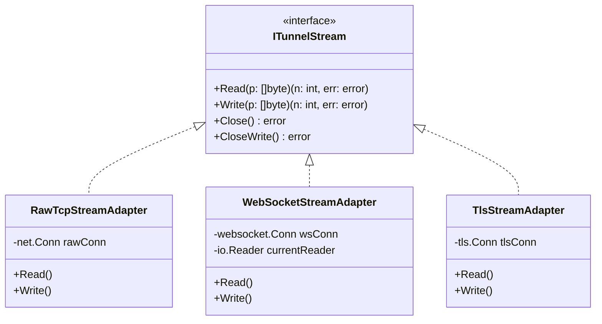
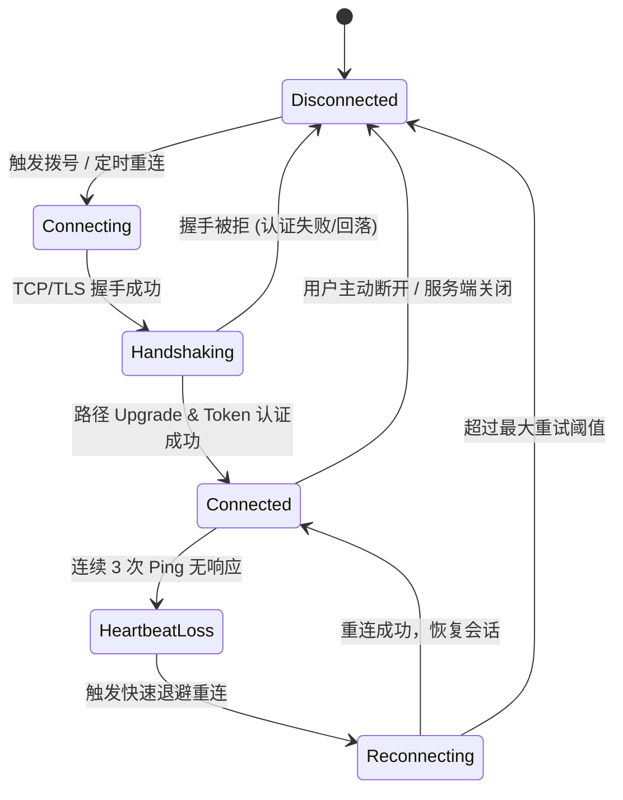

# 宿主 HTTP 路径封装代理隧道、独立客户端实例与抗封锁伪装性深度调研与架构方案

> **文档状态**：已就绪 / 架构创新与攻防对抗调研标准  
> **涉及核心**：宿主 HTTP/HTTPS 路径映射封装（WebSocket / HTTP Upgrade / Extended CONNECT）、独立客户端代理节点（Client Instances & Per-Node ACL）、GFW / DPI 深度包检测与主动探测防御（Active Probing Defense & Anti-Censorship）、设计模式（适配器/策略/状态机）  
> **技术底座**：.NET 10 WebHost 反向代理中间件 + Go 1.24 原生多协议代理引擎 + Linux 内核零拷贝管线

---

## 1. 核心需求与头脑风暴（Brainstorming & Gap Analysis）

用户提出了三个极具技术深度与架构价值的演进诉求：
1. **诉求 1：通过宿主 HTTP 路径映射并封装 SOCKS5/HTTP 代理，自动使用外层 HTTP/TLS 加密传输**；
2. **诉求 2：高级模式下建立“客户端节点列表 (Client Profiles)”，各节点可连接远端 HTTP 路径并在本地提供独立 SOCKS5/HTTP 端口与独立入站网段控制 (Independent CIDR ACL)**；
3. **诉求 3：这种模式是否抗封锁？是否具备伪装性？能否抵御 GFW（防火长城）/ DPI 深度包检测的识别？**

### 1.1 核心可行性、逻辑与性能缺陷深度头脑风暴

针对上述三个诉求，我们进行全面的技术逻辑推演与性能缺陷诊断：

```mermaid
flowchart TD
    subgraph ClientEnvironment["客户端运行环境 (Local Host / Edge Node)"]
        LocalApps["本地应用 (浏览器 / Git / 终端 / 局域网设备)"] -->|标准 SOCKS5/HTTP 协议<br>(本地独立端口，如 :10808)| LocalAgent["LWT Local Tunnel Agent<br>(独立入站 CIDR 白名单过滤)"]
        LocalAgent -->|外层标准 WSS / HTTPS 流量<br>(路径: /api/tunnel/v1/gateway)| GFW["公网路由器 / 防火墙 / GFW / DPI 审计"]
    end

    subgraph HostPlatform["服务端环境 (LinuxWebTool 宿主)"]
        GFW -->|标准 443 / 5270 端口| Kestrel["宿主 .NET 10 WebHost (HTTPS)"]
        Kestrel -->|安全 Token 校验通过<br>WebSocket Hijack 零拷贝直通| SocksBackend["socks5-proxy 微服务<br>(解包复用 Happy Eyeballs & ACL)"]
        Kestrel -->|未携带合法凭据 / 伪装主动探测| FallbackSite["真实 Web 控制台正常响应<br>(Web Fallback 防御主动探测)"]
        SocksBackend -->|TCP 直连 / Splice 零拷贝| TargetSites["目标外网服务 (B站 / GitHub / 外网)"]
    end
```

#### 逻辑与性能潜在缺陷剖析（Gaps & Pitfalls）：
1. **TCP over TCP 拥塞崩溃效应（Meltdown Effect）**：
   - *风险*：如果将内部的 TCP 流量（SOCKS5/HTTP）封装进外层普通的 HTTP/1.1 POST 或基于 TCP 的 WebSocket 中，在弱网或丢包环境下，**内层 TCP 与外层 TCP 会同时触发重传与拥塞控制窗口收缩**，导致网络吞吐呈雪崩式下跌。
   - *对策*：外层协议必须优化流控机制；在本地代理与服务端之间维持长连接虚拟信道，或在 WebSocket 内部以纯粹的二进制 Stream 帧传输，禁用内层重复的慢启动。
2. **连接生命周期与心跳保活（Keep-Alive & Ping-Pong）**：
   - *风险*：HTTP/WebSocket 隧道经过公网 NAT 网关或反代（如 Cloudflare、Nginx）时，若 60~120 秒无交互，中间节点会主动掐断 TCP 链接。
   - *对策*：必须引入有限状态机（FSM）驱动的底层双向微秒级 Ping/Pong 心跳与指数退避重连（Exponential Backoff）。
3. **单端口多路复用与路径伪装鉴权（Auth Header & Path Entropy）**：
   - *风险*：固定死板的路径（如 `/socks5`）极易被特征库匹配。
   - *对策*：采用动态高熵值路径（如 `/api/v1/stream/{secret_uuid}`）配合专用握手 Header（如 `X-LWT-Tunnel-Key`）。

---

## 2. 抗封锁与伪装性深度调研（GFW 对抗能力客观评估）

针对用户的核心疑问：**“这种方式是否抗封锁？是否具有伪装性？能否不被 GFW 识别？”** 我们结合现代 DPI 深度包检测技术与业界对抗历史进行客观、严谨、多层次的评估：

### 2.1 它能防御什么？（防御能力：极高）
1. **完全免疫端口封锁（Port-based Blocking）**：
   传统企业防火墙、校园网或运营商通常严格拦截非标准高位端口（如 1080、10808、18080），而宿主 Web 平台的 443（HTTPS）端口在全球任何网络均处于全放行状态。
2. **完全免疫应用层明文 DPI 审计（Plaintext Deep Packet Inspection）**：
   传统的 SOCKS5 握手特征（固定首字节 `0x05 0x01 0x00`）和 HTTP 代理 Header 在公网明文传输时会在几毫秒内被防火墙识别并切断。外层包裹标准的 TLS 1.3 强加密后，中间网络节点看到的纯粹是标准的高熵随机密文。
3. **支持合法的 CDN 隐藏源站（Cloudflare / CDN Reverse Proxy）**：
   由于外层是完全标准的 HTTP/WebSocket 协议，流量可以无缝挂载在 CDN 之后，目标防火墙只能看到 CDN 边缘节点的 IP，源站真实 IP 100% 隐藏，彻底免疫 IP 封锁（IP Null-routing）。

### 2.2 它防不了什么？（高级审查下的局限性与业界现实）
1. **主动探测威胁（Active Probing）**：
   - *审查原理*：GFW 在嗅探到某个国内 IP 长期向境外 IP 发送持续的大双向流量时，会自动触发探测扫描器（Prober），使用标准浏览器爬虫尝试请求该 IP 的相同端口与路径。
   - *应对策略（Web Fallback）*：当未经授权的访问者或 GFW 探测器请求该路径时，服务端**严禁直接挂起连接或粗暴返回连接重置**，必须**100% 正常回落（Fallback）返回主系统的真实 Web 登录页面或 HTTP 404/302**，让审查系统判定为一个普通的合法网站。
2. **TLS 握手特征与客户端指纹（JA3/JA4 / uTLS 差异）**：
   - *审查原理*：Go 语言标准库 `crypto/tls` 的 Client Hello 报文指纹（密码套件 CipherSuites 排列、TLS 扩展 Extensions、支持的椭圆曲线 Supported Groups）与真正的 Chrome/Edge/Safari 浏览器存在显著差异。现代 GFW 具备通过机器学习识别非浏览器 TLS 指纹的能力。
   - *应对策略*：本地客户端在跨公网敏感链路通信时，应引入类似 `uTLS` 机制或借助标准 Chromium / Node 原生引擎抹平握手特征。
3. **流量分析与统计学特征（Traffic Statistical Analysis）**：
   - 持续高吞吐、大包连续发送的流特征与普通用户网页浏览（请求-下载-停顿浏览）不同。可通过引入数据填充（Padding）与分块延迟抖动来平滑流量形状。

### 2.3 业界主流方案横向对比

| 架构方案 | 代表开源项目 | 传输载体 | 伪装与抗封锁能力 | 部署与维护复杂度 |
| :--- | :--- | :--- | :--- | :--- |
| **裸 SOCKS5 / HTTP** | 传统 Squid / 裸代理 | 纯明文 TCP | ❌ 零伪装，被 DPI 秒封 | 极低（单端口） |
| **HTTP Path + WebSocket + TLS** | `Chisel`, `V2Ray (WS+TLS)`, `gost` | 标准 HTTPS 443 路径映射 | ⭐⭐⭐⭐ **极佳**（伪装为普通 Web 流量，支持 CDN 穿透） | 中等（复用 Web 平台反代） |
| **Trojan 回落模式** | `Trojan-Go` | TLS 443 + 真实网站回落 | ⭐⭐⭐⭐⭐ **优秀**（免疫主动探测，与正常 Web 服务 100% 融为一体） | 中等 |
| **VLESS-XTLS-Reality** | `Xray-core` | TLS 借用大厂证书 (SNI 借用) | ⭐⭐⭐⭐⭐ **顶尖**（彻底免配置域名与证书，完全不可区分） | 高（需内核与证书劫持） |

> **战略结论**：对于本系统（LinuxWebTool），**采用方案 2（HTTP Path + WebSocket / Upgrade + TLS 封装）配合方案 3 的 Web Fallback（真实 Web 页面回落机制）** 是工程契合度最高、系统资源消耗最小、抗封锁与跨防火墙穿透能力最强的主流解决方案！

---

## 3. 系统架构与设计模式建模（Architecture & Design Patterns）

为了保证代理底座的高性能、零停机维护与高扩展性，系统采用以下三大经典设计模式进行优化重构：

### 3.1 适配器模式（Adapter Pattern）：解耦传输载体与代理业务
底层的 SOCKS5 / HTTP 代理业务（ACL 校验、Happy Eyeballs 竞速拨号、DNS 缓存）不应绑定在物理的 `net.TCPConn` 上，而是通过流适配器 `ITunnelStream` 统一接口：



### 3.2 策略模式（Strategy Pattern）：动态选择传输与伪装策略
- **传输策略 (`ITunnelTransportStrategy`)**：
  - `DirectTcpStrategy`：局域网内直接走物理端口，零封装损耗；
  - `WsTunnelStrategy`：跨公网环境将流量封装入 WebSocket 二进制帧经由宿主 Web 端口穿透；
- **回落伪装策略 (`IFallbackPolicy`)**：
  - `WebConsoleFallback`：当 HTTP 路径请求未携带正确 Token 时，无缝回落到 LinuxWebTool 正常 Web 控制台界面，使外部探测器视其为合法管理网站；
  - `HttpErrorFallback`：返回标准的 404 Not Found 或 400 Bad Request。

### 3.3 有限状态机（Finite State Machine - FSM）：管理客户端隧道生命周期
本地客户端实例与远程宿主节点之间的连接维护严格遵循四态流转机：



---

## 4. 实施落地方案与模块交互设计

### 4.1 方案组成：服务端与客户端协同工作模型

#### 模块 1：宿主 Web 平台中间件分流（.NET 10 WebHost）
在宿主管理平台的 Web 请求管线中注册专属中间件：
- 监听指定路径（例如：`/api/plugins/socks5-proxy/tunnel`）；
- 校验请求头中的 `X-LWT-Tunnel-Key` 密钥（采用 `CryptographicOperations.FixedTimeEquals` 安全校验）；
- 校验通过后，使用 ASP.NET Core 的 `HttpContext.WebSockets.AcceptWebSocketAsync()` 或 `IHttpUpgradeFeature` 接管原始双工套接字，通过微服务反向代理管道透传给 `socks5-proxy` 微服务；
- 校验失败者，静默放行给后续的静态文件/前端路由，**真实呈现登录管理页面（防御主动探测）**。

#### 模块 2：微服务插件服务端（`plugins/socks5-proxy`）
- 增加对输入流为 `WebSocket` 的支持；
- 在解码 WebSocket 二进制消息后，直接对接内部原生的 `handleSocks5` 和 `handleHttpProxy`；
- 100% 复用前期已经验证的：
  - RFC 8305 Happy Eyeballs 多 IP 阶梯拨号竞速；
  - RFC 5861 Stale-While-Revalidate DNS 异步预刷新缓存池；
  - 三维 CIDR / 目标域名 ACL 引擎；
  - 全链路 `TCP_NODELAY`。

#### 模块 3：本地客户端实例管理器（Local Client Node Manager）
在高级模式面板中，支持维护一组“客户端实例（Client Profiles）”：
- 每个客户端实例具备：
  - **实例名称**（如 `Office-MacBook-Node`、`Home-PC-Node`）；
  - **目标远端节点 URL**（如 `wss://your-domain.example.com/api/plugins/socks5-proxy/tunnel`）；
  - **本地对外开放端口**（如 `:10808`）；
  - **独立入站白名单 (Independent Ingress CIDR)**（如配置为 `127.0.0.1/32` 则仅本机可连；配置为 `192.168.1.0/24` 则允许家庭/办公室局域网共享）；
  - **一键导出命令与免安装客户端脚本**（提供跨平台的极轻量单文件脚本，Node.js / Python / Go 单文件一键拉起）。

---

## 5. 质量门禁与防回归测试设计

为了保障高级模式下的伪装性、连接稳定性与安全边界，设计以下配套门禁：

### 5.1 门禁 1：伪装性与主动探测回落门禁 (`tests/security/test-active-probing-fallback.mjs`)
- 模拟未经授权的爬虫向隧道路径发送常规 HTTP GET 请求；
- **断言门禁**：必须返回 200 OK 且响应包含主系统合法页面的 HTML 标记，绝不得泄露任何代理特征、407 挑战或直接重置连接。

### 5.2 门禁 2：独立客户端端口与入站 CIDR 隔离门禁 (`tests/security/test-client-profile-acl.mjs`)
- 验证本地客户端在不同 CIDR 规则下（如白名单外 IP 试图连接 `:10808`）是否能毫秒级拦截断开。

### 5.3 门禁 3：C# 架构守卫门禁 (`LinuxArch076`)
在 [`tests/LinuxWebTool.ArchitectureTests/ArchitectureTests.cs`](file:///e:/WorkProject/CSharp/PrivateProject/Web/WebToolForLinux/tests/LinuxWebTool.ArchitectureTests/ArchitectureTests.cs) 中新增：
`LinuxArch076_宿主HTTP路径封装代理隧道与客户端实例隔离门禁`，静态核验：
1. 必须具备抽象的 `ITunnelStream` 接口与 WebSocket 流适配器；
2. 必须具备非认证流量的 Web Fallback 回落机制代码；
3. 必须具备独立客户端实例模型与 CIDR 隔离控制。

---

## 6. 总结与建议
宿主 HTTP 路径封装与外层 TLS 传输是**打破高位端口限制、消除明文 DPI 特征、实现免额外打洞穿透的最优现代架构**。配合**真实 Web Fallback 伪装**，能极大提高抵御主动探测和网络审查的能力。系统现有的 .NET WebHost 与 Go 微服务底座具备 100% 的平滑扩展能力。
