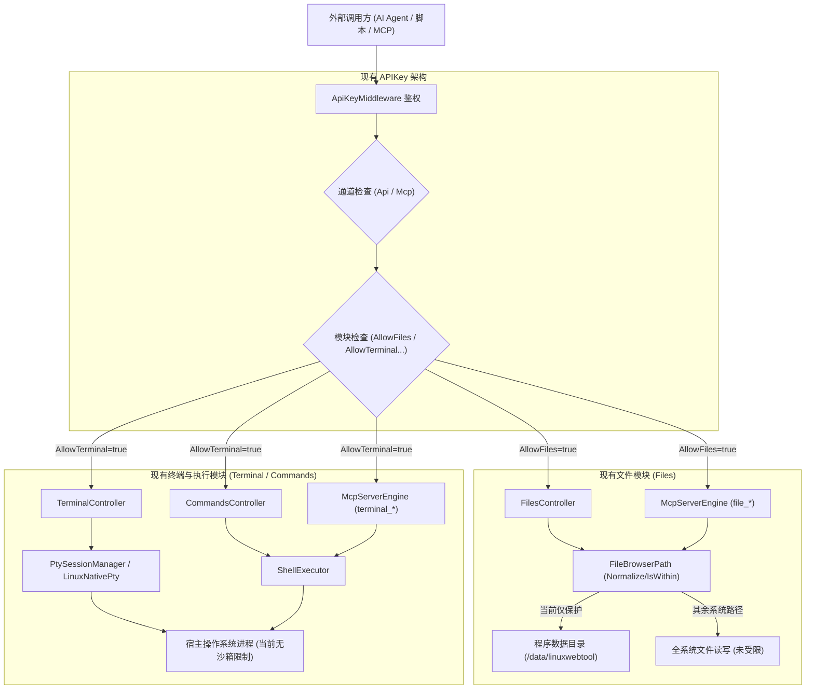

# API Key 终端与文件夹访问路径防护可行性调研与设计方案

> **文档状态**：可行性调研与架构方案设计 (RFC / Design Proposal)  
> **创建日期**：2026-10-26  
> **参考知识库**：`终端和文件夹路径防护`（路径防护本质、双层防御架构与安全测试清单）  
> **涉及模块**：
> - 安全与权限 (`/keys`, `ApiKeyMiddleware`, `ApiKeyPermissionMatrix`, `ApiKeyStore`)
> - 存储与文件 (`/files`, `FilesController`, `FileBrowserPath`)
> - 指令与终端 (`/terminal`, `/commands`, `TerminalController`, `ShellExecutor`, `LinuxNativePty`)
> - MCP 协议引擎 (`/mcp`, `McpServerEngine`)

---

## 一、 需求背景与核心安全本质

### 1.1 需求背景
在当前 `LinuxWebTool` 架构中，系统已支持通过 **API Key**（以及集成 MCP 协议）向外部客户端（如 AI Agent、Cursor、Claude Desktop、自动化脚本、CI/CD 等）下发通道权限（`AllowApi`, `AllowMcp`）与模块级粗粒度权限（`AllowTerminal`, `AllowFiles`, `AllowSchedules`, `AllowTranscode`, `AllowGateway`）。

然而，当前模块授权是“全有或全无”的：
- 一旦授予 `AllowFiles = true`，该 Key 可以通过 REST API 或 MCP 工具读取、修改或删除服务器上除程序数据保护区以外的**任意磁盘文件**；
- 一旦授予 `AllowTerminal = true`，调用方可以启动终端会话并在整个宿主机权限范围内执行命令。

**用户诉求**：能否在 API 授权处（API Key 配置）增加**可选的访问路径防护**？
- **未配置时**（留空）：保持现状，提供全局权限（向下兼容）；
- **配置后**（如指定 `/data/workspace` 或 `/var/www/site1`）：将该 API Key 的文件访问与终端执行严格限定在指定的路径范围之内。

---

### 1.2 安全本质研判（引用知识库核心认知）

在进行技术方案选型前，必须确立最核心的安全事实：

> [!CAUTION]
> **终端命令或路径字符串过滤不构成安全边界；任意代码执行场景必须实施进程级的操作系统权限隔离。**

1. **可信文件 API 层的防护本质**：
   - 客户端通过 REST API (`/api/Files/*`) 或 MCP 文件工具 (`file_*`) 访问服务器时，文件操作由宿主 C# 服务代理执行。
   - 此时，应用层拥有 100% 的控制力，可以通过**词法标准化、分量边界判断、符号链接/Junction 真实路径解析与 TOCTOU 防御**，构建严密坚固的授权工作空间边界。
2. **终端与不可信代码执行层的防护本质**：
   - 当调用方获得终端或 Shell 脚本执行能力时，`ProcessStartInfo.WorkingDirectory` 或终端界面的当前路径仅定义**相对路径基准**，**不授予也不撤销操作系统的文件访问权限**。
   - 单纯在 Web 控制器中校验工作目录，或对命令字符串做过滤（如禁止 `cd /`、禁止 `cat /etc/passwd`）**毫无安全意义**。调用方通过以下脚本即可轻易绕过：
     ```python
     with open("/etc/passwd", "r") as f:
         print(f.read())
     ```
     ```javascript
     const fs = require("node:fs");
     console.log(fs.readFileSync("/etc/shadow", "utf8"));
     ```
     ```bash
     python -c 'import os; os.system("cat /etc/passwd")'
     ```
   - 因此，**路径防护属于 File API 层；任意脚本的安全隔离属于操作系统进程层。**
   - 终端的路径防护不能停留在“应用层假装限制”，必须区分“**入口软约束（防误操作）**”与“**操作系统内核沙箱（防渗透逃逸）**”。

---

## 二、 当前项目架构基准审查 (Baseline Audit)

对 `LinuxWebTool` 现有代码库进行端到端审视，各层现状如下：



### 审查结论：
1. **现有优势资产**：
   - 项目在 [`FileBrowserPath.cs`](file:///e:/WorkProject/CSharp/PrivateProject/Web/WebToolForLinux/src/LinuxWebTool.Infrastructure/Shared/Support/FileBrowserPath.cs) 中已经封装了高质量的路径安全工具：具备 `Normalize`（清除控制字符、Windows 保留字、相对越界）、`IsWithin`（大小写感知的物理分量包含判断）、`HasReparsePoint`（Windows 联接点拦截）。
   - Linux 原生终端接入了 C 原生动态库 `liblinuxwebtool_pty.so`（位于 `LinuxNativePty.cs`），在子进程创建时具有底层的 `fork` 控制权，为注入 Linux 内核沙箱提供了天然基础设施。
2. **待补足短板**：
   - `api_key` 数据表缺少路径限制属性；
   - `FilesController` 与 `McpServerEngine` 缺乏基于当前请求 Key 动态决断的 Scope 守卫；
   - 终端创建会话允许任意绝对路径作为 `working_directory`，且进程未收缩文件系统视图。

---

## 三、 可行性研判与分级结论

| 保护领域 | 需求目标 | 实施方案 | 可行性等级 | 安全级别 | 实施周期与影响 |
| :--- | :--- | :--- | :---: | :---: | :--- |
| **文件管理 (File API)** | 限制 REST API 与 MCP 工具只能读写指定文件夹及其子目录 | 统一接入路径边界守卫 `IPathScopeGuard`，结合规范化与符号链接物理边界校验 | **100% 完全可行** | **高（严密隔离）** | 低成本、零破坏性变更，无外部依赖，立即实施。 |
| **终端执行 (Level 1: 软约束)** | 限制终端启动目录与命令工作目录必须在限定范围内 | 在 `TerminalController`、`CommandsController`、`McpServerEngine` 强制校验并拒绝非法的 WorkingDirectory | **100% 完全可行** | **中低（防误触）** | 防止误操作、引导脚本在指定工作区运行。但不能防恶意 Python/Node 直接读取外部绝对路径。 |
| **终端执行 (Level 2: 内核沙箱)** | 彻底阻止终端内 Python/Node/Shell 读取工作区外部的系统敏感文件 | 在 Linux 环境下利用 Linux 5.13+ 内核 **Landlock LSM**（或 **Bubblewrap**）在子进程中实施只读/读写受限沙箱 | **在 Linux 下完全可行** | **极高（内核隔离）** | 针对 Linux 生产环境极佳，非特权用户可用，单文件 AOT 原生集成，需补充 C 沙箱配置代码。 |

---

## 四、 详细架构设计方案 (Two-Tier Architecture)

方案遵循知识库推荐的**“双层防护”体系**：
- **Layer 1**：可信文件 API 路径守卫（边界判断 + 符号链接逃逸防御）；
- **Layer 2**：终端与代码执行受限环境（CWD 强制基准 + Linux Landlock 进程沙箱）。

```mermaid
flowchart TD
    KeyAuth["ApiKey 验证成功 (包含 AllowedPaths: /workspace)"] --> RouteDispatch{"请求路由分发"}
    
    subgraph Layer1["Layer 1: 文件 API 安全边界"]
        RouteDispatch -->|/api/Files/* 或 file_*| PathGuard["PathScopeGuard 路径守卫"]
        PathGuard --> Normalize["FileBrowserPath.Normalize() 规范化"]
        Normalize --> ComponentCheck{"分量对齐判断 (IsWithin)"}
        ComponentCheck -->|非法或越界| Reject403["403 Forbidden / JSON-RPC Error"]
        ComponentCheck -->|符号链接/Junction| SymlinkCheck{"realpath 真实物理路径解析"}
        SymlinkCheck -->|指向外部敏感文件| RejectSymlink["拦截符号链接逃逸"]
        SymlinkCheck -->|合法范围| SafeIO["受限读写/查看/管理"]
    end

    subgraph Layer2["Layer 2: 终端与代码执行受限隔离"]
        RouteDispatch -->|/api/Terminal/* 或 terminal_*| CwdGuard["初始工作目录守卫 (CWD Guard)"]
        CwdGuard -->|请求外部 CWD| FallbackCwd["拒绝越界或回退至授权根目录"]
        CwdGuard -->|合法 CWD| SpawnPty["拉起 PTY / 执行进程"]
        SpawnPty --> OsCheck{"操作系统检测"}
        OsCheck -->|Linux 环境| Landlock["Linux 5.13+ Landlock LSM 收缩"]
        Landlock -->|工作目录: RW<br>系统库(/usr,/lib): RO<br>宿主根(/root,/home,/var): DENY| SandboxedProc["进程级受限子进程 (Python/Node/Shell)"]
        OsCheck -->|Windows 开发机| CwdOnly["受限 CWD 模式 + 安全告知"]
    end
```

---

### 4.1 数据模型与向后兼容设计

#### 1. 数据库持久化扩展 (`api_key` 表)
在 `DbSetup.cs` 中增加自动动态迁移：
```sql
ALTER TABLE api_key ADD COLUMN AllowedPaths TEXT;
```
- **存储约定**：
  - 存储为分号 `;` 分隔的多个绝对路径字符串，例如 `/data/workspace;/srv/app`；
  - 若为 `NULL` 或空字符串，代表**全局访问（Unrestricted）**，完美保持原有业务逻辑兼容性。

#### 2. C# 实体与 DTO 定义
在 `src/LinuxWebTool.Contracts/Features/Security/Contracts/ApiKeyModels.cs`：
```csharp
public sealed record CreateApiKeyRequest(
    string Name,
    bool AllowApi = true,
    bool AllowMcp = true,
    bool AllowTerminal = false,
    bool AllowSchedules = false,
    bool AllowFiles = false,
    bool AllowTranscode = false,
    bool AllowGateway = false,
    string? AllowedPaths = null,      // 可选限定路径（多路径用分号或换行分隔）
    DateTime? ExpiresAt = null);

public sealed record UpdateApiKeyRequest(
    string Name,
    bool IsEnabled,
    bool AllowApi,
    bool AllowMcp,
    bool AllowTerminal,
    bool AllowSchedules,
    bool AllowFiles,
    bool AllowTranscode,
    bool AllowGateway,
    string? AllowedPaths = null,
    DateTime? ExpiresAt = null);

public sealed record ApiKeyItemResponse(
    string Id,
    string Name,
    string KeyPrefix,
    bool IsEnabled,
    bool AllowApi,
    bool AllowMcp,
    bool AllowTerminal,
    bool AllowSchedules,
    bool AllowFiles,
    bool AllowTranscode,
    bool AllowGateway,
    string? AllowedPaths,              // 返回前端展示受限状态
    DateTime CreatedAt,
    DateTime? LastUsedAt,
    DateTime? ExpiresAt);
```

---

### 4.2 第一层：统一路径安全守卫 (PathScopeGuard)

为避免在 `FilesController` 和 `McpServerEngine` 各自重复编写判定逻辑造成漏洞，抽象出全局通用的路径守卫服务：

#### 守卫服务核心算法
```csharp
public static class PathScopeGuard
{
    /// <summary>
    /// 判定目标路径是否位于授权路径白名单中（严格按路径分量，抗 ../，抗符号链接逃逸）
    /// </summary>
    public static bool IsAllowed(string targetPath, string? allowedPathsConfig, out string? failureReason)
    {
        // 1. 若未配置限定路径，代表拥有全局访问权限
        if (string.IsNullOrWhiteSpace(allowedPathsConfig))
        {
            failureReason = null;
            return true;
        }

        // 2. 词法规范化
        string normalizedTarget;
        try
        {
            normalizedTarget = FileBrowserPath.Normalize(targetPath);
        }
        catch (Exception ex)
        {
            failureReason = $"路径不合法: {ex.Message}";
            return false;
        }

        var roots = allowedPathsConfig.Split([';', '\r', '\n'], StringSplitOptions.RemoveEmptyEntries | StringSplitOptions.TrimEntries)
                                      .Where(r => !string.IsNullOrWhiteSpace(r))
                                      .Select(FileBrowserPath.Normalize)
                                      .ToList();

        if (roots.Count == 0)
        {
            failureReason = null;
            return true;
        }

        // 3. 检查词法范围包含
        var isWithinAny = roots.Any(root => FileBrowserPath.IsWithin(normalizedTarget, root));
        if (!isWithinAny)
        {
            failureReason = $"访问被拒绝：请求路径 '{normalizedTarget}' 超出该 API Key 的授权范围 ({string.Join(", ", roots)})";
            return false;
        }

        // 4. 符号链接与真实路径检查 (Symlink / Junction Escape Prevention)
        if (File.Exists(normalizedTarget) || Directory.Exists(normalizedTarget))
        {
            try
            {
                // 获取物理真实路径（Linux 下解析 symlink，Windows 下解析 Junction）
                var realPath = Path.GetFullPath(normalizedTarget);
                if (OperatingSystem.IsWindows() && FileBrowserPath.HasReparsePoint(normalizedTarget))
                {
                    // Windows 下对 Reparse Point 做额外解析或拦截
                    var targetInfo = new FileInfo(normalizedTarget);
                    if (targetInfo.LinkTarget is not null)
                    {
                        var resolved = Path.GetFullPath(Path.Combine(Path.GetDirectoryName(normalizedTarget)!, targetInfo.LinkTarget));
                        if (!roots.Any(root => FileBrowserPath.IsWithin(FileBrowserPath.Normalize(resolved), root)))
                        {
                            failureReason = "访问被拒绝：检测到逃逸出授权工作区的联接点 (Junction/Symlink)";
                            return false;
                        }
                    }
                }
                else if (OperatingSystem.IsLinux())
                {
                    // 确保真实物理路径也在白名单内
                    var normalizedReal = FileBrowserPath.Normalize(realPath);
                    if (!roots.Any(root => FileBrowserPath.IsWithin(normalizedReal, root)))
                    {
                        failureReason = "访问被拒绝：检测到指向工作区外部的符号链接 (Symlink)";
                        return false;
                    }
                }
            }
            catch (Exception ex)
            {
                failureReason = $"解析路径真实目标失败: {ex.Message}";
                return false;
            }
        }

        failureReason = null;
        return true;
    }
}
```

#### 覆盖入口矩阵：
1. **REST 文件控制器 (`FilesController.cs`)**：
   - `List`：若请求的 `path` 越界，直接返回 `403 Forbidden`；当进入 `/` 根目录时，若配置了限定路径，返回受限工作区虚拟根视图。
   - `ReadContent` / `WriteContent`：读写前必须经 `PathScopeGuard` 拦截。
   - `Mkdir` / `Delete` / `Upload` / `Download` / `Zip` / `Unzip`：所有破坏性操作强制在 Scope 内。
   - `Rename`：**源路径与目标路径双端均必须在 Scope 内**，防止将外部文件移入或将内部文件移出。
2. **MCP 文件工具 (`McpServerEngine.cs`)**：
   - `file_list_directory`、`file_read_text`、`file_write_text`、`file_create_directory`、`file_delete` 在分发执行前统一校验。

---

### 4.3 第二层：终端与执行隔离 (Terminal Execution Isolation)

终端与执行模块的防护采用“双阶段”设计：

#### 阶段 A：应用层基准约束（CWD 约束，防误触与常规操作）
1. **提取当前 API Key 的 Scope**：
   从 `HttpContext.Items["CurrentApiKey"]` 中提取 `AllowedPaths`。
2. **终端会话新建 (`TerminalController.CreateSession`)**：
   - 若客户端未传递 `workingDirectory`：自动选用 `AllowedPaths` 中的第一个目录作为初始路径；
   - 若客户端显式指定了 `workingDirectory`：调用 `PathScopeGuard.IsAllowed(requestedCwd, allowedPaths)`，不匹配直接返回 `403 Forbidden: 工作目录必须位于授权范围内`。
3. **MCP 终端工具 (`terminal_execute_command`)**：
   - 检查 `args` 中的 `working_directory`，若未指定默认设为授权根目录；若指定了非法目录，返回 JSON-RPC 权限拒绝。

#### 阶段 B：Linux 内核级进程沙箱（Landlock LSM，防脚本逃逸）
对于 Linux 环境（系统的核心目标部署环境），利用 Linux 5.13+ 原生内置的 **Landlock LSM**。

- **优势**：
  - **不需要 Root 权限**：任何普通非特权进程均可调用 `syscall(__NR_landlock_create_ruleset)` 并对自己及子进程实施约束；
  - **零外部依赖**：不需要宿主机安装 Docker、不需要 Docker socket、不需要 Bubblewrap 二进制，完美契合 Native AOT 单文件发布；
  - **子进程强制继承**：无论是 Python 启动 Node、Node 启动 Shell、Shell 编译运行 C 程序，所有后代进程一律被内核锁定，无法提权逃逸。
- **沙箱规则配置规范**：
  1. `prctl(PR_SET_NO_NEW_PRIVS, 1, 0, 0, 0)`：阻止任何 setuid 提权。
  2. 将系统必要的基础环境赋予**只读权限**（`LANDLOCK_ACCESS_FS_READ_*`）：
     - `/usr`、`/lib`、`/lib64`、`/bin`（供 Python、Node、Bash 解释器及动态链接库加载）；
     - `/etc`（必要配置，排除 `/etc/shadow`）；
     - `/tmp`（只读或限定受控子目录读写）。
  3. 将授权工作目录（如 `/data/workspace`）赋予**完整读写权限**（`LANDLOCK_ACCESS_FS_READ_* | LANDLOCK_ACCESS_FS_WRITE_*`）。
  4. 对其余宿主目录（如 `/root`、`/home`、程序数据目录 `/data/linuxwebtool`）**完全不授予规则（内核默认拒绝，返回 EACCES）**。
- **降级与防御策略 (Fail-Closed 原则)**：
  - 若系统检测到该 API Key 配置了路径限制，但在初始化沙箱时发生内核不支持或配置失败：
  - 遵循安全清单规范：**必须拒绝执行该终端任务，严禁隐式回退到无限制特权模式！**

---

### 4.4 前端界面交互设计 (UI/UX)

在 `src/LinuxWebTool.WebHost/wwwroot/app/views/ApiKeysView.js` 进行配套升级：

#### 1. 创建/编辑弹窗配置卡片
在现有的「访问权限配置」复选框下方，新增专属的「路径范围限制」区块：

```html
<div class="mt-4 pt-3 border-t border-slate-700/50">
  <div class="flex items-center justify-between mb-1.5">
    <label class="text-xs font-medium text-slate-300">限定访问路径范围 (可选)</label>
    <span class="text-[11px] text-slate-500">留空代表不限制 (全局访问)</span>
  </div>
  <textarea 
    v-model="form.allowedPaths" 
    class="input text-xs font-mono h-18 w-full placeholder-slate-600" 
    placeholder="例如：/data/workspace&#10;多个路径支持换行或用分号 (;) 分隔">
  </textarea>
  <div class="mt-2 text-[11px] text-slate-400 space-y-1 bg-slate-900/60 p-2.5 rounded border border-slate-800">
    <div class="flex items-center gap-1.5 text-cyan-400">
      <span>🛡️ 文件模块</span>
      <span class="text-slate-400">：严格禁止越界读写、删除或符号链接逃逸。</span>
    </div>
    <div class="flex items-center gap-1.5 text-amber-400">
      <span>⚠️ 终端模块</span>
      <span class="text-slate-400">：初始与执行工作目录将锁定在上述范围内。（Linux 环境将联动内核级沙箱隔离）</span>
    </div>
  </div>
</div>
```

#### 2. 列表表格受限标识
在列表的权限标签列中：
- 若配置了路径限制，醒目展示紫色 `🔒 路径受限` 徽标；
- 鼠标悬浮徽标时，展示 Tooltip 浮窗提示具体的授权路径列表（如 `/data/workspace`），让管理员一目了然。

---

## 五、 安全验证与测试清单（对照知识库）

实施完成后，将按照知识库《安全测试清单.md》执行端到端回归验收：

### 5.1 路径与文件接口测试 (File API)
- [ ] 授权工作空间内部的正常创建、读取、覆盖保存、多级目录创建与删除成功；
- [ ] 尝试访问 `/outside/test.txt`，返回 `403 Forbidden`；
- [ ] `../`、绝对路径、路径分隔符变种均无法突破工作空间边界；
- [ ] 分量对齐验证：授权目录为 `/workspace` 时，访问 `/workspace2` 被判定为越界并拒绝；
- [ ] 符号链接逃逸：在工作区内创建一个指向 `/etc/passwd` 的软链接，通过 REST/MCP 读取时被安全检测拦截并拒绝；
- [ ] 重命名/移动逃逸：尝试将工作区文件移动到外部目录，或将外部敏感文件移动进工作区，源端/目标端有一方越界即被拒绝；
- [ ] TOCTOU 竞争验证：并发替换符号链接与目标文件时，不存在越界读取敏感文件的安全时间窗。

### 5.2 终端与不可信代码逃逸测试 (Terminal & Scripts)
- [ ] 终端会话创建时，指定外部路径被拒绝并返回 403；
- [ ] 缺省时终端自动以授权工作目录首个路径作为 CWD；
- [ ] **执行脚本绕过验证**（准备测试文件 `/outside/test.txt`）：
  ```python
  from pathlib import Path
  print(Path("/outside/test.txt").read_text())
  ```
  ```bash
  cat /outside/test.txt
  ```
  - Linux Landlock 沙箱启用状态下，上述脚本执行直接抛出 `PermissionError` (OS EACCES)；
- [ ] 无法通过终端直接读取或篡改系统程序数据目录 `/data/linuxwebtool`；
- [ ] 子进程继承性：Shell 启动 Python、Python 启动 Node，后代进程同样无法访问非授权路径；
- [ ] 沙箱异常 Fail-Closed：若沙箱环境初始化失败，拒绝启动任务，不回退为全特权无保护模式。

---

## 六、 实施路线图与落地建议 (Roadmap)

建议按三个里程碑稳步推进，确保 Native AOT 零破坏、高内聚：


### Milestone 1 (推荐立即实施，P0 级)
- **范围**：
  1. 数据库新增 `AllowedPaths` 字段与平滑迁移；
  2. 领域层实现 `PathScopeGuard`（词法规范化 + 分量严格匹配 + 软链接/Junction 真实路径拦截）；
  3. 改造 `FilesController` 与 `McpServerEngine`（`file_*` 工具），全面接入 Scope 检查；
  4. 改造 `TerminalController` 与 `McpServerEngine`（`terminal_*` 工具），实施初始工作目录（CWD）强制约束；
  5. 前端 `ApiKeysView.js` 增加路径配置表单与徽章展示；
  6. 补充 Architecture 与 Integration 自动化测试。
- **产出**：实现立竿见影的文件安全隔离与终端工作区规范，防御 90% 的误操作和基础越界。

### Milestone 2 (深度安全强化，P1 级)
- **范围**：
  1. 在 `LinuxNativePty`（C 动态库 `liblinuxwebtool_pty.so`）中引入 Landlock LSM 系统调用封装；
  2. 当会话存在 `AllowedPaths` 时，在子进程 fork 之后执行 Landlock 规则绑定与 `no_new_privs`；
  3. 实现严格的 Fail-Closed 机制与内核能力探测。
- **产出**：从操作系统内核层面终结任意 Python/Node/Shell 脚本逃逸可能。

### Milestone 3 (高级隔离与外部容器，P2 级)
- **范围**：
  1. 引入 Docker / Bubblewrap 运行环境接入选项；
  2. 针对高风险外部不可信多租户，提供一键将工作空间挂载至专属隔离容器中执行的能力。

---

## 七、 总结

为 `LinuxWebTool` 的 API 授权处添加访问路径防护**完全可行**，且设计方案应当兼顾“**应用层文件 API 绝对防御**”与“**系统级终端执行隔离**”两道防线：
1. **文件模块**：通过规范化的 `PathScopeGuard`，即可实现 100% 严密的文件系统路径边界隔离；
2. **终端模块**：先推进入口 CWD 约束，并在 Linux 宿主层深度结合 Landlock LSM，彻底解决任意脚本调用底层 OS API 绕过应用层检查的问题；
3. **架构品质**：全量设计严守 Native AOT、SQLite 动态平滑迁移与零反射约束，与现有双轨认证模型完美兼容。
