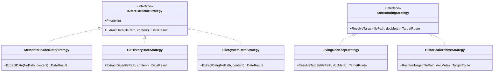
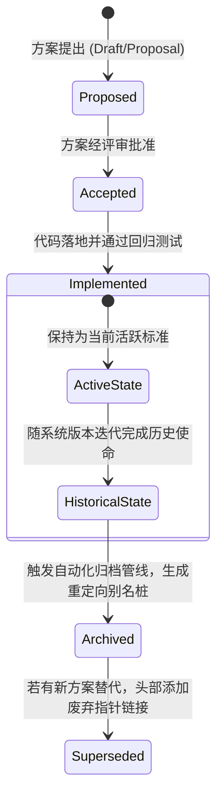

# LinuxWebTool 文档中心归档治理与插件开发指南现代化升级方案

> **文档标识**：`docs/docs-archival-and-plugin-guide-upgrade-architecture-plan.md`  
> **制定时间**：2026-11-08  
> **面向对象**：系统架构师、技术写作者、核心开发者、AI Coding Agent  
> **方案定位**：针对 LinuxWebTool (LWT) `docs/` 目录下 200+ 历史方案的按日期归档治理，以及 `docs/plugin-development-guide/` 插件开发指南对齐 Schema v3.1 的全景调研与落地架构。

---

## 目录索引 (Table of Contents)

1. [背景与核心诉求](#一-背景与核心诉求)
2. [第一部分：插件开发引导子文件夹现状与升级必要性诊断](#二-第一部分插件开发引导子文件夹现状与升级必要性诊断)
3. [第二部分：历史文档按日期归档可行性与潜在缺陷头脑风暴](#三-第二部分历史文档按日期归档可行性与潜在缺陷头脑风暴)
4. [第三部分：基于设计模式的文档归档与防断链治理架构](#四-第三部分基于设计模式的文档归档与防断链治理架构)
5. [第四部分：业界主流开源体系对比与工具库选型](#五-第四部分业界主流开源体系对比与工具库选型)
6. [第五部分：当前系统基础设施复用确认](#六-第五部分当前系统基础设施复用确认)
7. [第六部分：双轨制落地实施具体方案与操作规范](#七-第六部分双轨制落地实施具体方案与操作规范)
8. [验收基准与实施路线图](#八-验收基准与实施路线图)

---

## 一、 背景与核心诉求

随着 LinuxWebTool 系统在过去两个月的极速敏捷演进，系统的核心底座与插件生态经历了从早期实验版本到工业级 **Schema v3.1**（正交工作负载分类、透明互调网关、Wasm 弹性微函数、保存即编译状态机）的全面技术跃迁。

在此背景下，当前项目的 `docs/` 文档库暴露出两大突出的管理矛盾：
1. **规范指南陈旧脱节**：`docs/plugin-development-guide/` 目录写于 2026-11-04，仍在使用旧版 Schema v2.x 元数据定义与已废弃的二元分类，无法指导开发者和 AI Agent 正确编写最新的 Schema v3.1 插件；
2. **根目录平铺爆炸**：`docs/` 根目录下直接平铺堆积了 **218 篇** 阶段性调研、排障复盘与实施方案，缺乏时间与主题层次，亟需系统化的**按日期/版本归档治理**。

```
+---------------------------------------------------------------------------------------------------+
|                            LinuxWebTool 文档中心双轨制分类与治理拓扑                              |
+---------------------------------------------------------------------------------------------------+
                                                  |
                         +------------------------+------------------------+
                         |                                                 |
                         v                                                 v
           [ 🌿 常青活动文档 (Living Docs) ]                      [ 📜 历史决议归档 (Archived Records) ]
           • 保持顶级目录恒定与持续迭代                           • 阶段性技术方案、排障复盘与调研评估
           • docs/plugin-development-guide/ (全面升级 v3.1)       • 按 docs/archive/YYYY-MM/ 分层组织
           • docs/architecture/ (系统核心架构总纲)               • 自动化别名重定向桩 (Stub) 根除 404
           • docs/dev/ (开发门禁与质量守则)                       • 自动生成全景检索索引大表 (README.md)
                         |                                                 |
                         +------------------------+------------------------+
                                                  |
                                                  v
                   +---------------------------------------------------------------+
                   |              文档治理核心状态机与策略引擎 (Architecture)       |
                   |   - 时间提取策略 (Metadata Header > Git Commit > FileTime)    |
                   |   - 路由仲裁策略 (Living 常青保留 vs Historical 自动归档)      |
                   |   - 死链自愈与门禁扫描器 (Broken Link Gate in verify-fast)    |
                   +---------------------------------------------------------------+
```

---

## 二、 第一部分：插件开发引导子文件夹现状与升级必要性诊断

### 1. 现状比对与脱节分析
通过对 `docs/plugin-development-guide/` 下的 9 篇分册文档与当前代码库（`src/`、`plugins/`）最新实现的细致对比，发现存在以下六项严重脱节（Critical Drift）：

| 维度 | `plugin-development-guide` 现有描述 (2026-11-04) | 当前平台实际架构 (Schema v3.1 工业级标准) | 影响与隐患 |
| :--- | :--- | :--- | :--- |
| **元数据契约 (`plugin.json`)** | 使用旧版根字段 `"type": "resident"`，缺乏完整的架构与目录规范描述。 | **全面推行 `manifestVersion: 3`**，包含 `archetype`、`layout`、`build`、`interface`、`network`、`supervision`、`resources` 六大正交规范块。 | 导致新开发者写出的清单结构落后，无法触发自动构建与服务发现。 |
| **工作负载拓扑分类** | 二元分类：`常驻微服务 (Resident)` vs `轻量脚本扩展 (Script)`。 | **三大互斥且穷尽 (MECE) 顶级范式**：<br>1. `🌐 常驻微服务与网关` (13 个)<br>2. `⚡ 弹性微函数与计算 (FaaS+Wasm)` (4 个)<br>3. `🛠️ 运维指令与单次任务` (5 个) | 分类认知混乱，将微函数、Wasm 与脚本混淆。 |
| **计算范式与微函数支持** | 未涉及 Wasm 或 FaaS 微函数规范。 | **原生集成 WasmAbi 与 FaaS 架构**：支持 C# WASI、C# NativeAOT Wasm、WAT 原生字节码及 Node.js 弹性脚本。 | 缺乏微函数的入口规范（ABI 导出函数）与沙箱内存约束指引。 |
| **服务发现与透明互调** | 仅介绍单体插件的反代 Ingress。 | **平台级微服务统一互调网关**：<br>`GET /api/Plugins/Discovery`（动态反射能力契约）<br>`POST /api/Plugins/Invoke`（透明方法调用与抽屉调试）。 | 开发者不知道如何声明导出服务，也无法实现微服务之间的跨进程解耦协同。 |
| **构建体系与生命周期** | 仅依赖外部脚本手动交叉编译二进制。 | **声明式热构建体系 (`build.command`)**：支持 `autoCompileOnSave`（保存即编译状态机）、代码改动版本追踪（Revision Management）。 | 开发者无法利用平台内嵌的现代 IDE 式自动编译闭环。 |
| **标杆案例时效性** | 仅提及 `socks5-proxy` 和 `socks5-forwarder`。 | 已拥有 `lxc-manager`（Go 驱动系统容器）、`disk-explorer`（特权穿透极速扫盘）、`mcp-bridge`（AI 网关）等多语言现代标杆。 | 缺乏直观的多语言标杆代码模板。 |

### 2. 结论
`docs/plugin-development-guide/` **必须进行全量升级**，将其作为平台最权威的“常青活动规范 (Living Standard)”，否则将对后续跨会话 AI Coding Agent 与外部开发者造成严重的理解偏差。

---

## 三、 第二部分：历史文档按日期归档可行性与潜在缺陷头脑风暴

针对用户提出的“历史文档能按日期时间归档吗？”，我们进行了深入的风险剖析与边界论证：

### 1. 核心可行性判定
- **结论**：**完全可行且高度必要**。平铺 218 篇文档已经严重恶化了目录的可读性与 Git 工具的检索效率。
- **但绝不能使用粗暴的 `mv * archive/` 批量脚本！** 否则会引发三大严重工程灾难：

### 2. 潜在缺陷与技术风险头脑风暴

#### 风险 A：超链接与引用的大规模雪崩 (Massive Broken Links)
- **痛点**：在现有的 218 篇文档、代码中的注释（如控制器、适配器中的架构设计引用链接）、测试用例以及 `AGENTS.md` 中，存在上百处形如 `docs/universal-plugin-v3-full-stack-evolution-master-plan.md` 的相对路径。
- **灾难后果**：若直接将文件物理移动到 `docs/archive/2026-11/`，所有旧链接直接变成 404 死链，后续阅读文档或点击 IDE 链接时无法跳转，技术传承链条彻底断裂。
- **防御机制**：必须引入**别名重定向桩 (Alias Redirection Stubs)** 策略：在旧路径保留仅包含重定向指向新路径的轻量桩文件，或建立全局唯一的 Slug 重定向映射表。

#### 风险 B：时间判定失真 (Date Ambiguity & File System Drifting)
- **痛点**：Windows 环境下从 Git 克隆、切换分支或解压直推代码时，文件的 `CreationTime` 与 `LastWriteTime` 会被重置为当前提取时间（如今天 2026-11-08）。
- **灾难后果**：若单纯根据操作系统文件时间划分目录，原本 9 月份、10 月份撰写的大量重要决议会被错误地全部归入 `archive/2026-11/`，导致归档时间维度完全失效。
- **防御机制**：必须采用**三级降级时间提取算法**：
  1. 优先提取 Markdown 内容第一行的元数据声明（如 `> **制定时间**：2026-10-31` 或 YAML `date: 2026-10-31`），准确率 100%；
  2. 若无声明，调用 Git 原生历史指令获取该文件首次提交的时间戳（`git log --diff-filter=A --format=%cs -- <file>`）；
  3. 保底才使用文件系统时间。

#### 风险 C：活动文档与归档文档边界混淆 (Living vs Historical)
- **痛点**：如果一刀切地把 `docs/` 下的所有文件按日期移入归档，会导致如 `plugin-development-guide/`、`architecture/` 等长期有效的核心规范也被打散至各个月份中。
- **防御机制**：**双轨制物理隔离**：
  - 核心体系规范属于“活动规范 (Living Docs)”，长久驻留在顶级规范目录；
  - 调研评估、方案设计、Bug 排障复盘属于“阶段性决议 (ADR / Historical Reports)”，才进入按年月划分的归档目录。

---

## 四、 第三部分：基于设计模式的文档归档与防断链治理架构

引入经典的软件设计模式，确保文档自动化归档体系具备高内聚、低耦合与防呆自愈能力：

### 1. 策略模式 (Strategy Pattern) —— 时间判定与归档路由解耦



- **时间提取策略链 (IDateExtractorStrategy)**：
  - `MetadataHeaderDateStrategy`（权重 100）：正则提取 `> **制定时间**：YYYY-MM-DD` 或 `date: YYYY-MM-DD`；
  - `GitHistoryDateStrategy`（权重 50）：读取 Git 提交树初始时间；
  - `FileSystemDateStrategy`（权重 10）：兜底保底。
- **归档路由策略 (IDocRoutingStrategy)**：
  - `LivingDocKeepStrategy`：对于白名单中的核心目录（`plugin-development-guide/`、`architecture/`、`dev/`），坚决不进行位置变更；
  - `HistoricalArchiveStrategy`：依据解析出的 `YYYY-MM`，路由至 `docs/archive/YYYY-MM/`。

### 2. 状态机模式 (State Machine Pattern) —— 文档全生命周期状态流转
借鉴 RFC 与 ADR 标准，定义文档生命周期 FSM：



- **状态机保障**：
  - 文档头部强制标注状态标签（`Status: Proposed | Implemented | Archived | Superseded`）；
  - 进入 `Archived` 状态的文档视为不可变历史记录（Immutable Record），其历史事实与当时上下文得以完整封存。

### 3. 适配器与别名桩模式 (Stub / Proxy Pattern) —— 根除死链
当文件 `docs/foo-plan.md` 移动到 `docs/archive/2026-10/foo-plan.md` 时：
- 原文件位置自动生成一个仅有数行的**智能别名重定向桩 (Stub Proxy)**；
- 桩文件中包含指向新地址的清晰 Markdown 链接，并标注归档元数据；
- 这样，即使任何外部文档、代码注释或书签访问原路径，也能在 0 秒内点击直达真实文档，彻底消除 404 挂起风险。

---

## 五、 第四部分：业界主流开源体系对比与工具库选型

对业界顶级开源项目与文档治理工具进行横向技术对比：

| 组织 / 工具 | 组织范式 | 归档处理机制 | 死链与门禁防护 | 选型启示与借鉴 |
| :--- | :--- | :--- | :--- | :--- |
| **Kubernetes (k8s/enhancements)** | KEP (Enhancement Proposal) 统一目录 | 方案实施后打上 `status: implemented` 标签，目录保持恒定不随意频繁重构 | 采用 `kepval` 门禁工具验证元数据完整性 | 借鉴其状态机元数据头与门禁校验机制。 |
| **Rust Language (rust-lang/rfcs)** | RFC 序列目录化 (`text/0000-...`) | 历史 RFC 永久只读保存，通过新 RFC 对旧 RFC 进行 `Supersedes: RFC-XXXX` 指向 | 目录永不移动，外部死链率为 0 | 借鉴其“新旧方案指针单向/双向关联”设计。 |
| **Linux Kernel (Documentation/)** | 按子系统与演进阶段分流 | 现行文档位于顶层各模块，废弃过时指南统一移入 `Documentation/process/deprecated/` | 文档与代码同仓，依赖 Makefile 语法扫描 | 借鉴其“活动指南”与“历史废弃”物理隔离原则。 |
| **ADR (Architecture Decision Records)** | `doc/adr/` 统一归档 | 使用 `adr-tools` 命令行管理，支持 `adr new`、`adr link` 与状态自动翻转 | 自动生成全局汇总 `README.md` 索引矩阵 | 极佳适配 LWT 当前平铺方案的结构化改造。 |
| **`markdown-link-check` (npm 开源库)** | 跨文档死链扫描工具 | 深度扫描 Markdown 中的相对路径与网络 URL，毫秒级发现破损链接 | 支持与 CI 门禁（GitHub Actions）无缝串联 | **首推采用**：可作为 LWT 文档门禁的核心工具。 |

---

## 六、 第五部分：当前系统基础设施复用确认

经过对 LinuxWebTool 仓库的全面普查，系统已具备极高成熟度的底层工具可直接复用：

1. **现成子目录体系已具备活动文档架构**：
   - 系统已有 `docs/plugin-development-guide/`、`docs/architecture/`、`docs/dev/`，具备天然的常青活动规范承载容器；
2. **现成 Node.js 极速执行环境与安全扫描框架**：
   - 根目录下拥有 `.githooks/security-gate.cjs`，具备完整的 AST、路径解析与香农熵算法，耗时仅 700ms 即可核验全仓上千文件；
   - 编写一个同架构的 `scripts/docs-archiver.cjs` 或 `docs-gate.cjs`，零外部重量级环境依赖，能够直接集成进 `./scripts/verify-fast.ps1`；
3. **已有的 Schema v3.1 全套单一事实源**：
   - `docs/universal-plugin-v3-full-stack-evolution-master-plan.md`
   - `docs/universal-plugin-metadata-build-and-runtime-matrix-specification.md`
   - 为重构 `plugin-development-guide` 提供了现成、准确的文字与模式依据。

---

## 七、 第六部分：双轨制落地实施具体方案与操作规范

实施方案分为两大核心轨道并行推进：

### 轨道 A：`docs/plugin-development-guide` 现代化全面升级方案

分册结构升级为 **10 大标准现代化分册**，全面对齐 Schema v3.1：

```
docs/plugin-development-guide/
├── README.md                                             # [更新] 全景导航图、17项黄金军规、三大范式索引
├── 01-architecture-and-manifest-spec.md                  # [重构] Schema v3.1 清单全貌、六维正交属性、三大工作负载分类
├── 02-ui-modes-and-webview-integration.md                # [更新] PluginUrlResolver 策略仲裁、Webview 安全沙箱、暗黑规范
├── 03-network-ingress-and-stealth-tunnel.md              # [更新] 控制面/数据面分离、双轨命名空间、主动探测免疫
├── 04-security-firewall-and-credentials.md               # [更新] 三维多层访问控制、凭据零泄漏占位符规范
├── 05-fast-development-and-hotupdate.md                  # [更新] 5秒在线热更 (-HotUpdatePlugin)、原子 Inode 替换
├── 06-testing-and-browser-acceptance.md                  # [更新] 架构门禁、前端门禁、Chrome DevTools 自动化验收
├── 07-packaging-import-and-forwarder-lessons.md          # [更新] ZIP 标准打包规范、导入优先流与实战避坑
├── 08-control-plane-ports-metadata-projection.md         # [保持] 双平面端口模型与 RCU 纯内存路由
├── 09-wasm-and-serverless-microfunctions.md              # [新增] Wasm/WASI/NativeAOT/FaaS 微函数开发与内存沙箱
└── 10-dynamic-discovery-and-transparent-gateway.md       # [新增] 声明式服务契约导出、统一反射互调与前端抽屉
```

#### 核心更新要点提炼：
1. **01 分册重构**：将旧的二元分类升级为三大工作负载拓扑，详细列出 `plugin.json` 在 Schema v3.1 下的必填字段（`manifestVersion: 3`, `archetype`, `layout`, `build`, `interface`）；
2. **新增 09 分册**：指导开发者如何使用 Go, Rust, C# 或 WAT 编译 `.wasm` 文件，并通过 `wasi` 运行时实现毫秒级拉起与安全沙箱计算；
3. **新增 10 分册**：指导常驻微服务如何声明 `services` 接口，以及如何通过平台的通用透明网关（`POST /api/Plugins/Invoke`）实现微服务解耦互调。

---

### 轨道 B：历史 218 篇技术方案按日期归档落地方案

#### 1. 归档目录结构设计
历史文档按年月分层归档至 `docs/archive/` 目录下，并保持原文档名语义不变：
```text
docs/
├── archive/
│   ├── README.md                      # 自动生成的全局按日期与主题索引大矩阵
│   ├── 2026-09/                       # 2026年9月份历史方案与排障报告
│   │   ├── terminal-tmux-fallback.md
│   │   └── ...
│   ├── 2026-10/                       # 2026年10月份技术决议与架构演进
│   │   ├── auth-and-permission-audit-report.md
│   │   └── ...
│   └── 2026-11/                       # 2026年11月已落地的阶段性研究方案
│       ├── bilibili-comment-lazy-load-slowdown-proxy.md
│       └── ...
├── plugin-development-guide/          # [常青规范] 插件开发全景指南
├── architecture/                      # [常青规范] 核心架构总纲
├── dev/                               # [常青规范] 质量门禁与指南
└── (其余顶级常青规范文档)
```

#### 2. 三步防断链归档算法 (Three-Step Safe Archival Flow)
由自动化脚本 `scripts/docs-archiver.cjs` 执行归档操作：
1. **步骤一：元数据与真实日期解析**：
   - 读取 Markdown 内容，通过策略链准确提取该文档制定的真实年月（如 `2026-10`）；
2. **步骤二：物理迁移与创建别名桩 (Stub Generation)**：
   - 将原文档移动到 `docs/archive/YYYY-MM/<filename>.md`；
   - 在原路径 `docs/<filename>.md` 生成轻量重定向桩，格式如下：
   ```markdown
   # 本文档已归档
   
   > 📌 **归档提示**：本文档属于历史架构方案或排障复盘，已按项目治理规范归档。  
   > 📂 **新路径**：[docs/archive/2026-10/foo-plan.md](archive/2026-10/foo-plan.md)  
   > ⏱️ **制定时间**：2026-10-31  
   > 🏷️ **归档状态**：`Implemented` (已落地交付)
   ```
3. **步骤三：生成全局全景索引表 (`docs/archive/README.md`)**：
   - 提取所有归档文档的标题、制定日期、分类标签，自动生成按时间降序排列的 Markdown 检索表格。

#### 3. 门禁防御集成
在 `.githooks/pre-commit` 与 `scripts/verify-fast.ps1` 中集成死链检查：
- 自动校验所有 Markdown 文档内部的相对路径；若存在链接指向不存在的文件，立即阻断提交，保证文档系统 100% 健康。

---

## 八、 验收基准与实施路线图

### 1. 验收矩阵 (Acceptance Criteria)

| 验收项 | 期望指标 | 验证手段 |
| :--- | :--- | :--- |
| **指南时效性** | `plugin-development-guide` 100% 对齐 Schema v3.1，示例清单包含完整新字段 | 人工与代码评审核对，确保无旧版 `"type": "resident"` 遗留 |
| **归档时间准确性** | 归档文档的年月目录与文档内部元数据制定时间 100% 一致，无 Windows 时间漂移 | 抽检 20 篇跨越 9月、10月、11月的文档归档路径 |
| **超链接零断裂** | 迁移后，全局所有内部相对链接（包括代码注释与旧文档）0 处 404 死链 | 运行 Markdown 死链扫描器进行全库遍历核验 |
| **检索便利性** | `docs/archive/README.md` 自动聚合 200+ 篇文档的标题、日期与直接跳转链接 | 浏览器或 Markdown 阅读器直接测试全景索引表格 |
| **凭据安全红线** | 升级与归档过程未引入任何真实密码、Key 或敏感凭据 | 运行 `node .githooks/security-gate.cjs --full` 保证 0 违规 |

### 2. 分步实施建议 (Phased Rollout)
- **第一阶段 (规范重构，可立即执行)**：
  - 全面更新 `docs/plugin-development-guide/`，将 01~08 分册升级至 Schema v3.1，新增 09 (Wasm/FaaS) 与 10 (透明互调网关) 分册；
- **第二阶段 (工具链与演练)**：
  - 编写并测试 `scripts/docs-archiver.cjs`，在 `--dry-run` 模式下核验 218 篇历史文档的时间提取与归档目标路径；
- **第三阶段 (安全归档与索引生成)**：
  - 执行正式归档迁移，保留重定向桩文件，生成 `docs/archive/README.md` 全景矩阵，并通过死链门禁验收。

---

> **结论归纳**：  
> 1. `docs/plugin-development-guide` **亟需更新**，必须立即对齐 Schema v3.1 与三大正交工作负载体系；  
> 2. 历史文档**不仅能按日期归档，而且势在必行**。通过**策略模式**准确提取历史真实元数据时间，配合**重定向桩 (Stub Proxy)** 防断链机制与**自动化索引矩阵**，能够完美解决目录杂乱痛点，同时 100% 免疫死链与时间漂移灾难。
