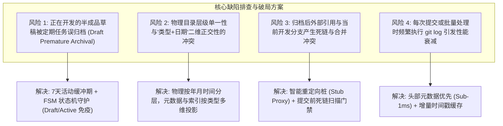
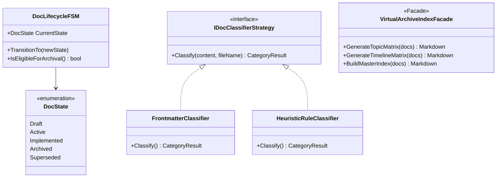
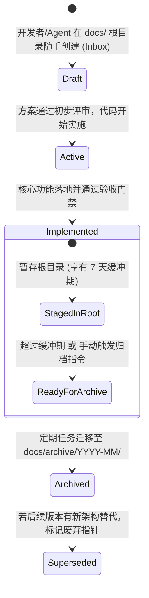

# LinuxWebTool 文档收件箱机制、生命周期状态机与按类型/日期定期归档规范

> **文档标识**：`docs/architecture/docs-inbox-lifecycle-and-periodic-archival-specification.md`  
> **制定时间**：2026-11-08  
> **面向对象**：系统架构师、核心开发者、AI 编程智能体、技术文档负责人  
> **方案定位**：针对开发者在日常开发中“习惯直接在 `docs/` 根目录创建方案/草稿（Inbox 模式）”的高频现实，制定一套兼顾极低编写心智负担、类型与日期双维正交映射、防误归档缓冲期与定期自动化整理的工业级知识库生命周期治理架构。

---

## 目录索引 (Table of Contents)

1. [背景与开发者习惯剖析 (Why docs/ Root Habit Exists)](#一-背景与开发者习惯剖析)
2. [头脑风暴：可行性、逻辑冲突与性能缺陷排查](#二-头脑风暴可行性逻辑冲突与性能缺陷排查)
3. [设计模式重构：状态机、策略与虚拟索引门面](#三-设计模式重构状态机策略与虚拟索引门面)
4. [业界主流开源方案深度对标 (Industry Benchmarking)](#四-业界主流开源方案深度对标)
5. [当前系统可复用基础设施确认](#五-当前系统可复用基础设施确认)
6. [权威元数据契约与按类型/日期归档规则](#六-权威元数据契约与按类型日期归档规则)
7. [定期整理流水线与触发机制设计](#七-定期整理流水线与触发机制设计)
8. [验收基准与落地实施路线图](#八-验收基准与落地实施路线图)

---

## 一、 背景与开发者习惯剖析

### 1. 现实习惯：“收件箱模式 (The docs/ Inbox Pattern)”
在快速迭代与敏捷开发中，开发者与 AI 协作智能体高频需要编写技术方案、头脑风暴记录、Bug 复盘报告或调研文档。此时：
- **零心智负担**：开发者最自然的动作是直接在 `docs/` 根目录下新建 `docs/<feature>-plan.md`，无需在撰写之初反复纠结“这属于 networking、plugins 还是 architecture”；
- **快速可见与检索**：编辑器文件树顶层直接可见，全局模糊搜索（`Ctrl + P`）优先命中，当前在途任务上下文极度聚焦；
- **AI 智能体交互契约**：提示词中“调研 可行性和具体方案 写入 docs 文件夹”已成为跨会话的标准指令。

### 2. 核心痛点：无约束积累引发的“收件箱过载 (Inbox Overload)”
- 当开发周期推进 1~3 个月，根目录下平铺累积数十乃至上百篇文档；
- “活动草稿（Active Drafts）”与“已结项历史方案（Finished ADRs）”混杂；
- 新加入的协作者无法区分哪些是现行标准、哪些已废弃，文档中心丧失可维护性。

**核心命题**：  
**能否既允许开发者保留“直接在 `docs/` 根目录随手建文档”的低摩擦习惯，又能通过一套自动化规则与设计模式，定期按“业务类型”与“制定日期”无缝归档？**

---

## 二、 头脑风暴：可行性、逻辑冲突与性能缺陷排查

在制定定期归档机制前，必须深入排查以下 4 项深层逻辑漏洞与工程风险：



### 1. 缺陷一：半成品与开发中文档误归档 (Draft Premature Archival)
- **危害**：若仅按“文件存在于根目录”或“文件创建时间”定期扫描，一篇正在编写、分支代码尚未合并的方案可能在周末被定期脚本移入 `docs/archive/2026-11/`，导致开发者本地编辑被动中断、分支合并冲突、会话上下文破损。
- **破解**：引入 **7 天活动宽限期（Grace Period）** 与 **显式状态标签保护**。凡标有 `status: Draft` 或 `status: Active` 的文档，无论存留多久，脚本坚决不予移动。

### 2. 缺陷二：物理树结构与二维正交属性（类型 vs 日期）的冲突
- **危害**：文件系统树是单一维度的父子层级。若物理目录设计为 `docs/archive/<type>/YYYY-MM/`，当一篇文档横跨“网络”与“插件”（如 `socks5-proxy-ingress.md`）时，分类仲裁困难，用户难以在时间轴上快速检索；若设计为 `docs/archive/YYYY-MM/<type>/`，目录层级过深（4~5 层），破坏浏览便利性。
- **破解**：**物理时间线分层 + 逻辑分类索引投影**。
  - **物理落盘**：统一采用扁平两级的 `docs/archive/YYYY-MM/<filename>.md`（不可变版本时间轴）；
  - **分类检索**：由构建器自动将全量文档解析投影到 `docs/archive/README.md` 的 **8 大业务主题分类矩阵** 中，实现“物理单副本、逻辑多维度快速检索”。

### 3. 缺陷三：Git 分支合并冲突与跨分支死链
- **危害**：开发者在分支 `feature/disk-scan` 中引用了 `docs/disk-scan-plan.md`，此时 `main` 主干执行了定期归档将其移动，分支合并时将引发文件重命名冲突（Merge Conflict）。
- **破解**：
  - 定期整理只在代码发布合并后（如发版流水线或固定维护周期）触发；
  - 采用预先演练模式（`--dry-run`）输出影响清单。

### 4. 缺陷四：Git Log 深度遍历的性能衰减
- **危害**：若定期归档脚本在拥有数千文件的仓库中对每个文件调用 `execSync('git log ...')`，在 Windows 环境下单次整理耗时可长达 30~60 秒，严重拖慢 CI/CD 速度。
- **破解**：**责任链多级短路提取**（头部元数据正则耗时 < 0.1ms，90% 以上直接命中短路，仅未标注元数据者降级至 Git）。

---

## 三、 设计模式重构：状态机、策略与虚拟索引门面

为实现上述机制的高内聚与低耦合，采用三大经典设计模式：



### 1. 状态机模式 (Finite State Machine Pattern)
为进入 `docs/` 根目录的每一篇文档定义明确的生命周期状态：



- **`Draft` / `Active` 守卫规则**：状态机判定为未结项状态的文档，具备**绝对归档豁免权**，确保开发中文档长期稳居根目录；
- **`Implemented` 状态**：标志方案已完结，赋予归档就绪标签（Ready for Archive）。

### 2. 策略与责任链模式 (Strategy & Chain of Responsibility Pattern)
文档类型（Category）的识别采用解耦策略链：
1. **显式 Frontmatter 策略 (Priority 1, 权重 100)**：解析头部 YAML `category: plugins`；
2. **元数据标签策略 (Priority 2, 权重 80)**：解析头部正文 `> **分类**：🧩 插件与微服务`；
3. **词法与启发式命中策略 (Priority 3, 权重 50)**：基于标题与高频系统关键词分类；
4. **兜底策略 (Fallback, 权重 10)**：默认收纳进 `📝 架构方案与决议`。

### 3. 门面模式 (Facade Pattern) —— 双重视图虚拟索引
通过 `VirtualArchiveIndexFacade` 将复杂的底层物理文件映射屏蔽在后台，对外统一提供高可读性门面：
- **主题矩阵大纲**：直达 8 大核心领域；
- **时间线流大纲**：按年月快速回溯系统演进历史。

---

## 四、 业界主流开源方案深度对标

横向对比业界顶级开源软件基金会与主流知识库的实践：

| 维度 / 体系 | Kubernetes (KEP) | ADR (Architecture Decisions) | Rust RFC 体系 | Obsidian / Zettelkasten | **LinuxWebTool (本方案)** |
| :--- | :--- | :--- | :--- | :--- | :--- |
| **创建入口** | `keps/sig-xxx/` 固定目录 | `doc/adr/NNNN-title.md` | `rfcs/0000-template.md` | `inbox/` 快速笔记收集箱 | **`docs/` 根目录直接创建（Inbox 零心智负担）** |
| **生命周期** | Provisional -> Implementable -> Implemented | Proposed -> Accepted -> Superseded | Draft -> Merged -> Active | Unprocessed -> Processed | **Draft -> Active -> Implemented -> Archived** |
| **分类处理** | 按 SIG 物理硬性目录划分 | 纯平铺序号，不分类 | 纯平铺序号，靠标头关联 | 标签聚合，物理不移动 | **物理按年月存储，逻辑生成 8 大分类索引大矩阵** |
| **归档机制** | 人工打标，不移动物理位置 | 永不移动物理位置 | 永不移动物理位置 | 人工/插件周期移动 | **自动化脚本定期扫描、状态感知平滑归档** |
| **防死链机制** | 依赖 CI 门禁检查 | 依赖编号不变更 | 依赖编号不变更 | 依赖双向链（Wikilink） | **全仓死链扫描器 + 归档索引 README 统一聚合** |

**选型结论**：LWT 方案融合了 **Obsidian Inbox 的极速收集便利** 与 **Kubernetes/ADR 的严格状态生命周期**，同时利用自动化脚本消除了人工整理的沉重负担。

---

## 五、 当前系统可复用基础设施确认

在 LWT 代码库中，已具备极高成熟度的工具与钩子，无需引入任何重量级外部 npm 依赖即可完全自闭环：

1. **归档与分类核心引擎**：
   - 现存 [`scripts/docs-archiver.cjs`](file:///e:/WorkProject/CSharp/PrivateProject/Web/WebToolForLinux/scripts/docs-archiver.cjs) 已实现时间提取策略链、`detectCategory` 8 大主题分类词法分析、`--dry-run` 预览与 `--clean-root` 纯净分类架构；
2. **极速门禁与扫描体系**：
   - [`.githooks/security-gate.cjs`](file:///e:/WorkProject/CSharp/PrivateProject/Web/WebToolForLinux/.githooks/security-gate.cjs) 具备 800ms 扫描 1400+ 文件的 AST 正则引擎，可直接扩展状态标签扫描；
3. **本地开发快速验证脚本**：
   - [`scripts/verify-fast.ps1`](file:///e:/WorkProject/CSharp/PrivateProject/Web/WebToolForLinux/scripts/verify-fast.ps1) 为门禁提供标准运行管道。

---

## 六、 权威元数据契约与按类型/日期归档规则

为保证“随手创建”与“规则整理”的顺畅衔接，确立以下规则标准：

### 1. 文档头部标准元数据头（推荐模版）
在 `docs/` 根目录新建文档时，建议在文件前 10 行包含如下元数据（支持 YAML Frontmatter 或 Markdown 引用格式）：

```markdown
# 功能模块名称与架构设计方案

> **制定时间**：2026-11-08  
> **状态**：Draft | Active | Implemented  
> **分类**：🧩 插件与微服务 (或 security, network, storage, deploy, terminal, architecture, audit)  
> **面向对象**：系统架构师、研发人员  

---
```

### 2. 8 大核心分类标准定义表

| 分类标识 (Category) | 识别图标与名称 | 包含技术主题与关键字 | 归档索引归属 |
| :--- | :--- | :--- | :--- |
| **`plugins`** | 🧩 **插件与微服务** | `plugin`, `mcp`, `socks5`, `caddy`, `disk-explorer`, `lxc-manager`, 微服务生命周期 | 视图 A - 插件与微服务 |
| **`network`** | 🌐 **组网与网络穿透** | `easytier`, `frp`, `tunnel`, `ingress`, `proxy`, `nat`, 双轨命名空间, 防探测 | 视图 A - 组网与网络穿透 |
| **`security`** | 🛡️ **安全鉴权与凭据** | `auth`, `apikey`, `jwt`, `permission`, `credential`, `firewall`, 防火墙 | 视图 A - 安全鉴权与凭据 |
| **`storage`** | 📦 **备份与存储同步** | `backup`, `sync`, `cifs`, `samba`, `smb`, `mount`, 目录排他, 增量同步 | 视图 A - 备份与存储同步 |
| **`terminal`** | 💻 **终端与 PTY 引擎** | `terminal`, `pty`, `tmux`, `bashrc`, `locale`, `webtty`, 伪终端 | 视图 A - 终端与 PTY 引擎 |
| **`deploy`** | 🚀 **容器与部署架构** | `docker`, `deploy`, `dockerfile`, `fast-dev`, `aot`, `ci-cd`, `actions`, 镜像构建 | 视图 A - 容器与部署架构 |
| **`audit`** | 📊 **审计与复盘报告** | `audit`, `report`, `lessons-learned`, `investigation`, `root-cause`, 排障复盘 | 视图 A - 审计与复盘报告 |
| **`architecture`** | 📝 **架构方案与决议** | `architecture`, `design`, `evolution`, `matrix`, `feasibility`, 平台总纲 | 视图 A - 架构方案与决议 |

---

### 3. 自动化归档决策四步算法 (Archival Decision Matrix)

当整理任务执行时，按以下确定性规则评估 `docs/` 根目录下的每个 `.md` 文件：

```mermaid
flowchart TD
    Start["扫描 docs/ 根目录下的 md 文件"] --> ChkWhitelist{"是否在保留白名单?<br/>(README.md 或 目录)"}
    ChkWhitelist -->|是| SkipKeep["坚决保留在原位 (Skip)"]
    
    ChkWhitelist -->|否| ChkStatus{"检查文档头部 Status 标签"}
    ChkStatus -->|状态为 Draft 或 Active| KeepActive["【免归档】活跃草稿/进行中方案，保留在根目录"]
    ChkStatus -->|状态为 Implemented/已落地| ArchiveNow["【立即归档】进入物理迁移流"]
    
    ChkStatus -->|未标注任何状态| ChkAge{"计算文件自创建以来的天数"}
    ChkAge -->|<= 7 天 (活动缓冲期)| KeepGrace["【免归档】在活动缓冲期内，支持自由开发编辑"]
    ChkAge -->|> 7 天 (无更新且无状态)| ArchiveNow
    
    ArchiveNow --> ExtractDate["提取制定日期 YYYY-MM"]
    ExtractDate --> ExtractCat["提取主题分类 Category"]
    ExtractCat --> MoveFile["物理移动至 docs/archive/YYYY-MM/"]
    MoveFile --> UpdateIndex["重新生成 docs/archive/README.md 双重视图索引"]
```

---

## 七、 定期整理流水线与触发机制设计

支持三种不同力度的整理触发方式，兼顾灵活性与自动化：

### 1. 手动按需一键整理 (Developer On-Demand)
开发者在完成一个阶段的开发或发布准备时，直接在终端执行：
```bash
# 模式 1: 试运行预览（检查哪些完成的方案符合归档条件）
node scripts/docs-archiver.cjs --dry-run

# 模式 2: 正式执行归档并保持根目录极简清爽
node scripts/docs-archiver.cjs --clean-root
```

### 2. 本地回归与验证门禁联动 (`verify-fast.ps1`)
在 [`scripts/verify-fast.ps1`](file:///e:/WorkProject/CSharp/PrivateProject/Web/WebToolForLinux/scripts/verify-fast.ps1) 中增加可选轻量检查开关：
- 扫描 `docs/` 根目录：若发现超过 10 篇文档且有已超过 14 天的文档未归档，输出黄色轻量提示：
  `💡 提示：docs 根目录有 12 篇历史方案可归档，建议运行 node scripts/docs-archiver.cjs --clean-root 进行整理。`

### 3. 发版流水线自动化归档 (Release Pipeline Hook)
在准备发布正式 Release Tag 时（如 `vX.Y.Z`），CI 脚本自动执行一次：
```bash
node scripts/docs-archiver.cjs --clean-root
```
确保随版本交付时，`docs/` 根目录永远保持整洁清爽，历史方案全部沉淀进对应年月的归档大纲中。

---

## 八、 验收基准与落地实施路线图

### 1. 验收矩阵 (Acceptance Criteria)

| 验收项 | 期望指标 | 验证方法 |
| :--- | :--- | :--- |
| **Inbox 零阻碍** | 开发者或 AI 在 `docs/` 根目录直接新建 `docs/xxx.md`，构建与门禁 100% 正常通过 | 新建测试文档并运行 `verify-fast.ps1` |
| **草稿与缓冲期保护** | 标有 `status: Draft` 或创建小于 7 天的文档，执行整理时 0 误移动 | 运行 `node scripts/docs-archiver.cjs --clean-root` 核验保留项 |
| **已结项文档精准归档** | 标有 `status: Implemented` 的文档准确归入 `docs/archive/YYYY-MM/`，无路径与标题破损 | 抽样检查目标年月子目录 |
| **双重视图索引同步** | 归档后 `docs/archive/README.md` 中的 8 大主题分类与年月流 100% 包含新文档 | 查看 `docs/archive/README.md` |
| **凭据安全红线** | 整理与归档过程绝不泄漏任何密钥或真实凭据 | 运行 `node .githooks/security-gate.cjs --full` 确保 0 违规 |

### 2. 实施路线图
- [x] **规范与架构制定**：明确收件箱模式、FSM 状态机规则与 8 大分类标准（本文档）；
- [ ] **工具链增强**：在 `scripts/docs-archiver.cjs` 中加入 `status: Draft / Active` 过滤守卫与 7 天缓冲期规则计算；
- [ ] **门禁与文档总入口更新**：在 `docs/README.md` 与 `docs/architecture/README.md` 中收录本治理规约。
