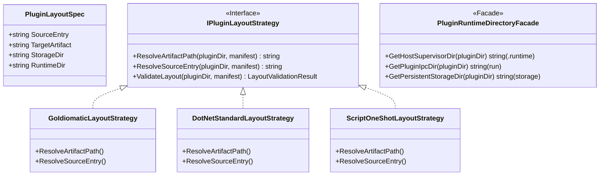

# LinuxWebTool 插件标准物理目录规范 (Layout Spec) 评估与微调架构方案

> **文档标识**：`docs/plugin-layout-specification-and-directory-structure-adjustment-plan.md`  
> **制定时间**：2026-11-08  
> **面向对象**：系统架构师、微服务开发者、插件作者、DevOps 维护人员  
> **方案定位**：针对 LinuxWebTool (LWT) 插件生态中标准物理目录规范（Layout Spec）的合理性评估、现存冲突深度排查、设计模式优化与微调落地方案。

---

## 目录索引 (Table of Contents)

1. [背景与核心诉求](#一-背景与核心诉求)
2. [现有五域物理目录规范合理性评估](#二-现有五域物理目录规范合理性评估)
3. [现存 4 处关键偏差与深层根因排查](#三-现存-4-处关键偏差与深层根因排查)
4. [设计模式重构与架构治理](#四-设计模式重构与架构治理)
5. [业界主流规范对比与借镜 (Industry Standards Benchmarking)](#五-业界主流规范对比与借镜)
6. [微调后的权威物理目录标准与示例矩阵](#六-微调后的权威物理目录标准与示例矩阵)
7. [配套自动化工具链与部署脚本调优](#七-配套自动化工具链与部署脚本调优)
8. [验收基准与落地实施路线图](#八-验收基准与落地实施路线图)

---

## 一、 背景与核心诉求

在 LinuxWebTool (LWT) 插件体系向 **Schema v3.1** 演进的过程中，系统从早期的“单文件平铺脚本”全面升级为支持 **常驻微服务 (Resident)**、**弹性微函数 (Serverless/Wasm)** 与 **运维指令 (OneShot)** 的现代化插件生态系统。

为解决早期插件源码、编译产物、运行时临时文件与持久数据杂乱混杂的问题，系统提出了“五域物理目录分离”的 Layout 规范。然而，在实际工程推进中（如 `disk-explorer` 磁盘透视镜、`mcp-bridge` 智能网关等实战开发），开发者发现物理文件组织与底层 C# 运行时调度、自动化部署脚本存在若干细节脱节与歧义。

核心问题可概括为：
1. **现行物理目录规范（Layout Spec）在架构大方向上是否正确？**
2. **是否存在阻碍工程落地、破坏开发体验或违背语言生态惯例的欠缺？**
3. **如何利用设计模式对其进行无缝平滑的微调升级？**

---

## 二、 现有五域物理目录规范合理性评估

### 1. 架构定位：大方向 100% 正确

现有规范所确立的 **“五域物理分离”** 架构在本质上是完全正确且前瞻的，严格对齐了现代云原生微服务与 OCI 容器分层原则：

```text
plugins/<plugin-id>/
├── plugin.json                 # 【元数据层】：声明式配置单一事实源
├── README.md                   # 【文档层】：开发者与用户指引
│
├── [源码域 (Read-Only)]         # 源代码（禁止在生产运行时被直接修改）
├── [产物域 (Read-Only)]         # 预编译静态可执行文件 / 字节码
├── storage/                    # 【持久存储域 (Persistent State)】：用户独占数据（SQLite、动态配置）
├── run/                        # 【瞬态运行时域 (Ephemeral tmpfs)】：IPC 套接字、临时缓冲区
└── ui/                         # 【专属视图域 (Optional Webview)】：原生 ESM 静态前端面板
```

### 2. 核心架构收益
- **持久化生命周期解耦 (State & Code Decoupling)**：Docker 容器重建或插件版本更新时，可放心地全量覆盖代码与二进制，而 `storage/` 卷内的数据库与密钥完全不受影响。
- **只读挂载与防篡改 (Read-Only Protection)**：源码与二进制在容器内支持以只读模式（`ro`）挂载，大幅降低提权攻击或勒索病毒篡改二进制的风险。
- **C# 后端已有强类型元数据支持**：Contracts 层已内置完整的 `PluginLayoutSpec`：
  ```csharp
  public sealed record PluginLayoutSpec
  {
      public string? SourceEntry { get; init; }
      public string? TargetArtifact { get; init; }
      public string StorageDir { get; init; } = "storage";
      public string RuntimeDir { get; init; } = "run";
  }
  ```

---

## 三、 现存 4 处关键偏差与深层根因排查

通过对全仓 22 个真实插件清单、C# 调度中间件与远程自动化部署脚本的深度审计，发现当前规范存在以下 4 处关键偏差：

### 1. 偏差一：编译产物落盘位置不一致 (`bin/<id>` vs 插件根目录)
- **文档规范**：编译产物必须放置于 `bin/` 目录下（如 `bin/disk-explorer`）。
- **实际现状**：
  - 目前所有高频活跃的 Go 插件（`mcp-bridge`、`socks5-proxy`、`disk-explorer`），编译指令均直接输出到**插件根目录**（`plugins/<id>/<id>`）；
  - 极速开发脚本 [`scripts/deploy-remote.ps1`](file:///e:/WorkProject/CSharp/PrivateProject/Web/WebToolForLinux/scripts/deploy-remote.ps1) 中的 `-HotUpdatePlugin` 逻辑硬编码了 `$binFile = "$pluginRelDir/$HotUpdatePlugin"`。
- **根因分析**：
  - 根目录放置虽然便于快速脚本寻址，但会导致编译产物污染 Git 工作区（Git Status 频繁出现未跟踪可执行文件）；
  - 若直接强推 `bin/`，则会破坏现有的热更脚本寻址逻辑。

### 2. 偏差二：Go 语言官方工程惯例与通用 `src/` 强制要求的冲突
- **通用规范生硬要求**：所有语言源码一律收纳进 `src/`。
- **Go 社区标准规范**：
  - Go 官方标准项目布局（`golang-standards/project-layout`）要求在模块根目录直接放置 `cmd/<id>/main.go`、`internal/...` 与 `go.mod`；
  - 若强行将 Go 源码嵌套放入 `src/cmd/...`，会导致 `go.mod` 寻址层级深浅不一，IDE 语言服务器（`gopls`）语法推断异常，`go test ./...` 路径错位。

### 3. 偏差三：运行时临时目录的命名分歧 (`run/` vs `.runtime/`)
- **规范声明**：`layout.runtimeDir` 默认为 `"run"`，用于存放运行时临时文件与进程 PID。
- **后端 C# 实际实现**：
  - 在 [`ResidentExecutionStrategy.cs`](file:///e:/WorkProject/CSharp/PrivateProject/Web/WebToolForLinux/src/LinuxWebTool.Infrastructure/Features/Plugins/Strategies/ResidentExecutionStrategy.cs#L92) 中，宿主硬编码使用了 `.runtime/` 目录：
    ```csharp
    var runtimeDir = Path.Combine(pluginDir, ".runtime");
    var pidFile = Path.Combine(runtimeDir, "process.pid");
    ```
  - 导致环境变量 `LWT_RUNTIME_DIR` 注入为 `run/`，而宿主看护进程却在 `.runtime/` 读写 PID，产生二元分裂。

### 4. 偏差四：`layout` 与 `ui` 属性的语义混淆
- **历史混淆**：早期部分文档在阐述 Webview 弹窗时，曾将前端展示形态（`displayMode`, `dimensions`）也冠以 "layout" 之名。
- **事实源澄清**：
  - `layout` 块纯粹且严格地对应 **文件系统物理目录布局 (Physical Filesystem Layout)**；
  - 界面与弹窗行为一律归属于 `ui` 块（`entry`, `title`, `icon`）与前端策略仲裁器。

---

## 四、 设计模式重构与架构治理

为解决上述偏差，引入三大经典设计模式对 Layout 体系进行治理：



### 1. 策略模式 (Strategy Pattern) —— 语言惯例自适应布局
针对不同技术栈引入 `IPluginLayoutStrategy`：
- **`GoIdiomaticLayoutStrategy`**：自适应解析 `cmd/<id>/main.go` 与 `internal/`，支持优先寻找 `bin/<id>` 并向后兼容根目录 `<id>`。
- **`DotNetStandardLayoutStrategy`**：规范 `src/` 与 `bin/publish/` 产物。
- **`ScriptOneShotLayoutStrategy`**：规范 `hooks/` 运维脚本集。

### 2. 外观门面模式 (Facade Pattern) —— 运行时目录隔离
引入门面模式清晰界定两套运行时目录的职责：
- **宿主监护私有域 (`.runtime/`)**：由 LWT 宿主 `ResidentExecutionStrategy` 独占读写，写入内部看护 PID、自愈排他锁 `process.lock` 与瞬态健康缓存，不暴露给插件业务；
- **插件业务 IPC 域 (`run/`)**：由插件业务自决使用（如监听 UDS 套接字 `run/service.sock`），通过环境变量 `LWT_RUNTIME_DIR` 注入给子进程。

---

## 五、 业界主流规范对比与借镜

| 业界规范 | 源码组织方式 | 产物输出方式 | 持久化与运行时处理 | 对 LWT 的借镜价值 |
| :--- | :--- | :--- | :--- | :--- |
| **OCI (Docker) 容器规范** | 多阶段构建分离 | 单一静态二进制打包至只读层 | 卷挂载 `/var/lib/...` | 确立 `storage/` 独立挂载原则。 |
| **Go 官方项目规范 (project-layout)** | `cmd/` + `internal/` | 默认 `bin/` 或根目录 | 依赖外部传入 `-data-dir` | 确立 Go 插件源码域豁免 `src/` 强制包裹。 |
| **systemd 临时目录规范** | 系统包源码分离 | `/usr/bin/` | `/run/<app>/` (tmpfs 内存挂载) | 确立 `run/` 作为跨进程 Unix Socket 交换区。 |
| **VSCode 扩展插件体系** | `src/` 源码 | `dist/` 打包单文件 | `globalStorageUri` 宿主隔离目录 | 确立 `plugin.json` 显式声明 `layout` 映射。 |

---

## 六、 微调后的权威物理目录标准与示例矩阵

### 1. 核心目录五域定义表

| 目录域 | 默认相对路径 | 读写属性 | 环境变量映射 | 用途与约束 |
| :--- | :--- | :---: | :--- | :--- |
| **核心元数据** | `plugin.json` | 只读 | - | Schema v3.1 清单文件，声明唯一事实源 |
| **语言惯例源码域** | `cmd/` 或 `src/` | 只读 | `LWT_SOURCE_ENTRY` | 业务源代码，生产环境禁止运行时写操作 |
| **可执行产物域** | `bin/` | 只读执行 | `LWT_TARGET_ARTIFACT` | Linux ELF 二进制、Wasm 字节码或 DLL |
| **持久存储域** | `storage/` | **读写持久** | `LWT_STORAGE_DIR` | SQLite 数据库、业务持久配置，更新时永不清除 |
| **临时运行时域** | `run/` | **读写瞬态** | `LWT_RUNTIME_DIR` | UDS 套接字、临时缓存，宿主重启自动清空 |
| **宿主私有监护域** | `.runtime/` | 宿主私有 | - | 宿主守护进程写入 `process.pid` 与 `process.lock` |
| **专属视图域** | `ui/` | 只读 | - | 前端原生 ESM 仪表盘单页 (HTML/JS/CSS) |

---

### 2. 三大典型技术栈物理结构范式

#### 范式 A：Go 高性能微服务（如 `disk-explorer`）
```text
plugins/disk-explorer/
├── plugin.json                 # layout.sourceEntry: "cmd/disk-explorer/main.go"
│                               # layout.targetArtifact: "bin/disk-explorer"
├── go.mod / go.sum             # Go 官方依赖声明
├── cmd/
│   └── disk-explorer/
│       └── main.go             # 进程启动主入口
├── internal/                   # 内部业务逻辑 (不对外导出)
│   ├── capabilities/           # 特权与宿主穿透探针
│   ├── scanner/                # 高并发文件树遍历引擎
│   ├── fsm/                    # 扫描任务生命周期状态机
│   └── server/                 # REST + SSE 通信网关
├── bin/                        # 编译输出产物
│   └── disk-explorer           # 静态无解释器 Linux ELF 可执行文件
├── storage/                    # 持久存储 (历史记录、自定义排他规则)
├── run/                        # 业务 IPC (如 disk-explorer.sock)
├── .runtime/                   # [系统管理] 宿主 process.pid
└── ui/                         # 专属暗黑赛博 Webview 仪表盘
    ├── index.html
    ├── app.js
    └── style.css
```

#### 范式 B：C# / .NET 现代微服务（如 `demo-dotnet-service`）
```text
plugins/demo-dotnet-service/
├── plugin.json                 # layout.sourceEntry: "src/Program.cs"
│                               # layout.targetArtifact: "bin/publish/demo-dotnet-service.dll"
├── demo-dotnet-service.csproj  # .NET 10 工程文件
├── src/
│   └── Program.cs              # ASP.NET Core 最小 API 入口
├── bin/
│   └── publish/                # dotnet publish 最终产物
├── storage/                    # 存储域
└── run/                        # 运行时域
```

#### 范式 C：Shell / Python 运维单次任务（如 `ssh-access-guard`）
```text
plugins/ssh-access-guard/
├── plugin.json                 # layout.sourceEntry: "hooks/records.sh"
│                               # layout.targetArtifact: "hooks/records.sh"
├── hooks/                      # 运维动作脚本集
│   ├── records.sh              # 审计提取
│   ├── failed.sh               # 爆破检测
│   └── ban.sh                  # 防火墙阻断
├── storage/                    # 封禁 IP 黑白名单库
└── ui/                         # 审计交互面板
```

---

## 七、 配套自动化工具链与部署脚本调优

为使实际开发与部署工具链无缝适应微调后的规范，落实以下两项具体改进：

### 1. `deploy-remote.ps1` 产物解析自适应增强
在 `scripts/deploy-remote.ps1` 的 `-HotUpdatePlugin` 流程中，升级二进制寻址算法：

```powershell
# 优先级 1: 优先读取 plugin.json 中声明的 layout.targetArtifact
$manifestFile = "$pluginRelDir/plugin.json"
$targetArtifact = ""
if (Test-Path $manifestFile) {
    try {
        $mf = Get-Content $manifestFile -Raw | ConvertFrom-Json
        $targetArtifact = $mf.layout.targetArtifact
    } catch { }
}

# 优先级 2: 若未显式配置，按降序自适应探测 bin/$HotUpdatePlugin -> $HotUpdatePlugin
$binCandidates = @(
    if ($targetArtifact) { "$pluginRelDir/$targetArtifact" },
    "$pluginRelDir/bin/$HotUpdatePlugin",
    "$pluginRelDir/$HotUpdatePlugin"
)
$binFile = $binCandidates | Where-Object { Test-Path $_ } | Select-Object -First 1
if (-not $binFile) {
    $binFile = if ($targetArtifact) { "$pluginRelDir/$targetArtifact" } else { "$pluginRelDir/bin/$HotUpdatePlugin" }
}
```

### 2. `.gitignore` 全局产物收敛
在根目录 `.gitignore` 中完善规则，严禁本地编译生成的二进制污染代码仓库：
```gitignore
# 插件标准产物与运行时目录
plugins/**/bin/
plugins/**/run/
plugins/**/.runtime/
plugins/**/storage/*.db
plugins/**/storage/*.sock
```

---

## 八、 验收基准与落地实施路线图

### 1. 验收矩阵 (Acceptance Criteria)

| 验收项 | 期望指标 | 验证方法 |
| :--- | :--- | :--- |
| **Go 惯例支持** | Go 插件在根目录保留 `cmd/` + `internal/` + `go.mod`，`go test ./...` 正常通过 | 运行 `cd plugins/disk-explorer && go test ./...` |
| **产物路径解耦** | `deploy-remote.ps1` 能够同时识别 `bin/<id>` 与根目录产物，并完成原子热更 | 执行 `deploy-remote.ps1 -HotUpdatePlugin disk-explorer` |
| **运行时分离** | 宿主将监护 PID 写入 `.runtime/process.pid`，插件将 `LWT_RUNTIME_DIR` 识别为 `run/` | 检查开发容器内 `/app/data/plugins/<id>/` 目录结构 |
| **持久存储完整性** | 热更覆盖代码时，`storage/` 目录中的数据文件保持不变 | 模拟写数据并在热更前后比对 `storage/data.db` 的 MD5 |
| **凭据安全门禁** | 文档与示例中 100% 使用 RFC 5737 脱敏占位符 | 执行 `node .githooks/security-gate.cjs --full` 保证 0 违规 |

### 2. 实施路线图
- [x] **架构评估与方案制定**：完成现状剖析、根因诊断与微调方案编制（本文档）；
- [ ] **指南同步更新**：同步更新 `docs/plugin-development-guide/01-architecture-and-manifest-spec.md` 中的 Layout 说明；
- [ ] **部署脚本平滑升级**：升级 `scripts/deploy-remote.ps1` 中的 `$binCandidates` 探测算法；
- [ ] **门禁校验**：运行全仓安全门禁 `security-gate.cjs` 与前端门禁。
