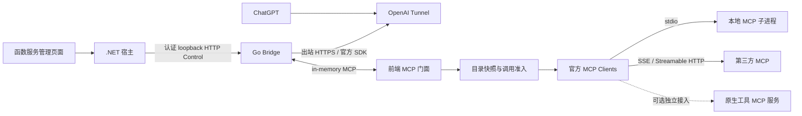

# ChatGPT 渠道常驻服务方案复核

日期：2026-11-01。范围：单机/NAS、自用、低占用；内联研究与文档，不实施代码、不安装依赖、不连接真实账号。本文是当前架构决策；执行任务见[实施计划](mcp-bridge-implementation-plan.md)，文件与行为门槛见[验收标准](mcp-bridge-file-scope-and-acceptance.md)。

## 1. 结论及需要调整的部分

Go 单 Bridge 进程、官方 Tunnel Client SDK、官方 MCP Go SDK 的方向可行，保持。应调整宿主集成、进程所有权、长任务语义和可恢复性，不能继续把 Bridge 当成一套独立的插件平台。

| 原有设想中的缺口 | 修订决策 | 收益与代价 |
|---|---|---|
| 为 Bridge 新建 Native adapter、生命周期 hook、HTTP client | 消费通用 Native 托管与 Resident Control；专用模块只提供类型化管理编排 | 减少重复状态源；通用底座必须先通过验收 |
| 常驻服务等同于工具可以无限运行 | 区分进程长期存活、同步 MCP 调用、显式异步任务 | 长任务有可查询契约；不能对所有远端 MCP 透明改造成异步 |
| 单进程等于整个方案只有一个进程 | 一个 Bridge 根进程；stdio 后端仍有子进程及解释器 | 资源报告包含进程树，避免低占用承诺失真 |
| 把 C# 任务协调器直接拿给 Go 使用 | 通过明确的 HTTP/MCP 服务边界复用；不跨语言直接调用对象 | 避免复制执行引擎；增加一个受限服务调用边界 |
| 内存操作记录等同于重启可恢复任务 | 持久化记录和幂等占位；重启将未结算任务置为未知，默认不重放 | 可追踪结果；持久化也不保证外部副作用 exactly-once |
| 工具勾选只影响列表 | 调用入口和真正 dispatch 前再次校验当前授权 | 缓存名称、排队调用不能绕过撤销 |
| 一个 Tunnel/共享 SDK session 等于一个聊天身份 | 固定个人接入授权范围；后端状态隔离另行处理 | 不串用聊天状态；首版不承诺任意 stateful MCP 连续会话 |
| 未发布仍保留旧插件 fallback | 单一新 manifest/argv/结果协议，同步升级内置示例 | 少分支；保留语言运行时能力，不保留旧插件格式 |

## 2. 官方能力与硬边界

官方 Tunnel SDK 已提供 Go 内存 MCP transport 示例，可以把 Tunnel 与前端 MCP Server 放在同一个 Go 程序中，业务不必自行实现 poll/response 协议。[官方示例](https://github.com/openai/tunnel-client/blob/master/examples/go-sdk-inmemory/main.go)

Tunnel 当前单请求绝对预算为 120 秒，包含托管队列等待与最终回传，进度通知不续期。配置 Tunnel ID/运行 Key 后仍须核对目标 ChatGPT workspace 与 Tunnels Read/Use 权限，并实际完成工具调用才算接通。Key 是控制面凭据，不是聊天登录凭证。[官方接入与限制](https://developers.openai.com/api/docs/guides/secure-mcp-tunnels)

MCP Go SDK 当前文档覆盖 stdio、Streamable HTTP、旧 HTTP+SSE，并区分旧 initialize 生命周期与 2026-07-28 请求元数据模型。SDK 的逻辑 session 对象不能直接证明 ChatGPT 对话身份。实现时锁定共同可编译的 SDK tag/commit 和工具链，不把 main/master 文档当成已发布版本保证。[SDK 协议说明](https://github.com/modelcontextprotocol/go-sdk/blob/main/docs/protocol.md)

上述能力是源码/官方文档证据，本次没有编译 Go spike 或使用真实 Tunnel；SDK 组合、取消传播、动态目录通知和身份元数据仍是 T0 必须实测的门槛。

## 3. 推荐的三层架构与通信

- **宿主层**：Worker 根进程、安装包、运行代次、启动环境、端口、日志和停止；扩展 Hooks 与一次性命令仍走各自通用执行能力。
- **Bridge 层**：第三方配置、独立凭据、连接和 stdio 子进程、工具目录/勾选/准入、Tunnel 状态。前端 MCP 内存通道不额外监听公网端口。
- **SDK 层**：MCP 编解码/transport/协商以及 Tunnel 控制面通信；不复制官方线协议或恢复队列。

宿主与 Bridge 使用现有 Resident Control 的 HTTP JSON 管理契约，不引入另一套宿主 JSON-RPC。MCP 数据面本身使用 JSON-RPC，由 SDK 承担。Control 默认路径 `/control/handshake`、`/control/health`、`/control/invoke/{action}`、`/control/shutdown`；握手核验 protocolVersion、workerId、runId，专用 token 只用于管理。现有客户端只验证部分字段，需补齐，不能以类已存在判定完成。

管理动作使用固定 allowlist，例如 `status.get`、`tunnel.save/start/stop`、`servers.save/delete/probe/discover`、`tools.list/select`、`config.apply`、`audit.list`。BFF 的公开 HTTP 路由保留类型化 DTO，由 action 映射器调用通用 Control client；禁止任意 URL、任意 action、任意 Header 透传。发现任务可能超过短 Control 超时，应返回管理任务句柄并轮询，不能仅调大全局 HTTP 超时。此类短期管理任务不冒充可重启恢复的原生命令 operation。

### 3.1 进程与秘密的唯一所有者

宿主只直接托管 Bridge 根进程。Bridge 通过 Go SDK 独占本地 MCP 的 stdin/stdout，stderr 做限额日志；宿主不能再读同一 stdout 或另起一个 stdio supervisor。Bridge 退出前关闭客户端、回收其子进程；宿主超时后负责整棵受管树的兜底清理，Windows Job/Linux 进程组的能力需测试，不能只调用 root Kill 后宣称无孤儿。

宿主生成每次运行的 Control token/runId，Bridge 不另建永久 admin.token 生命周期。Go 私有目录保存第三方配置、审批指纹与加密凭据，宿主不再复制一份业务状态到 SQLite；宿主全局主密钥不交给 Go。数据根独立于可编辑/导出的代码包；配置与密钥配套备份。Token 通过受限文件/既有安全启动交接，绝不放 argv；stdio 子进程仅得到自身所需的环境，不继承整份 Bridge 环境。

固定个人授权范围并非多用户隔离。如果将来增加团队、多 profile，需要可信调用主体、会话映射和独立选择集；不能依赖工具参数传来的 caller，也不能把 Tunnel Key 当用户授权。

## 4. 当前仓库可以复用什么

以下是当前工作区源码核验，包含未提交的新代码；“存在”不代表已构建、已集成或通过测试。本次没有运行产品测试。

| 基础设施 | 本地证据（仓库相对路径） | 复用范围与仍需验证的缺口 |
|---|---|---|
| Native runtime | `src/LinuxWebTool.Infrastructure/Features/Workers/Adapters/WorkerRuntimeAdapters.cs` 的 NativeRuntimeAdapter；`WorkersManager.cs` 已注册 Native 并使用 ArgumentList | 不新增同名 adapter；仍有字符串参数构造，应按单一新契约收敛；逐包平台/权限及异常停止需测 |
| 运行代次 | `src/LinuxWebTool.Infrastructure/Features/Workers/WorkersManager.cs` 的 WorkerProcessContext/RunId | 可防旧退出事件污染；当前 long 类型与 Control string 类型需统一规范和可信交接，不能各自生成 |
| 通用管理客户端 | `src/LinuxWebTool.Infrastructure/Features/Plugins/Adapters/ResidentControlClient.cs` | 有 handshake/health/invoke/shutdown、runId/token；BaseUrl 可覆盖、Token 可空、health 默认 Ready、响应未限量、异常信息未结构化，需收紧后复用 |
| 通用任务接口 | `src/LinuxWebTool.Contracts/Features/Plugins/Contracts/IPluginToolServices.cs` | INativeProcessRunner/INativeCommandExecutor/IPluginOperationCoordinator/IPluginArtifactStore 均可作为宿主底座；不直接成为 Go 内存对象 |
| 操作协调器与仓储 | `src/LinuxWebTool.Application/Features/Plugins/PluginOperationCoordinator.cs`；`src/LinuxWebTool.Infrastructure/Features/Plugins/Storage/PluginOperationStore.cs` | 当前 store 是 ConcurrentDictionary，不能承诺进程重启后的记录恢复；幂等查询/占位必须原子，不能靠先查询再保存 |
| Web 操作入口 | `src/LinuxWebTool.WebHost/Features/Plugins/Routes/PluginOperationsController.cs` | 已有 Submit/Get/Cancel/产物下载与服务端 caller 注入；仍须审查机器主体授权、动作授权、owner/产物校验，不能给 Bridge 管理员总权限 |
| DI | `src/LinuxWebTool.WebHost/Composition/ServiceCollectionExtensions.cs` | 上述接口已有注册；Workers 与 Control 的实际生命周期串接尚需集成证据，不能仅凭 DI 推断 |
| 已有第三方库 | `src/LinuxWebTool.Infrastructure/LinuxWebTool.Infrastructure.csproj` 中 Microsoft.Data.Sqlite、Dapper、Polly.Core 等 | C# 持久操作记录优先复用 SQLite/Dapper；Polly 仅用于安全的连接/探测策略，不重放有副作用调用 |
| Go 原生测试程序 | `tests/fixtures/native-tool-fixture/go.mod`、`main.go` | 已有 command/resident/managed 模式可扩展复用；不是 MCP fixture。其 invoke 注册路径为 `/control/invoke`，当前客户端使用 `/control/invoke/{action}`，需统一契约并以真实 HTTP 测试验收 |
| 现有扩展/页面/门禁 | `extensions/`；WebHost Workers 路由及前端现有结构；`tests/` 的 Unit/Integration/Architecture 测试项目 | 升级项目示例与管理入口，复用鉴权/前端请求封装/门禁，不另做独立管理站 |

当前工作区已出现 Go 原生工具测试模块，但尚未发现产品 Bridge 模块或官方 Go Tunnel/MCP 依赖。现有 C# 包引用不能替代 Go SDK；Bridge 是新增独立模块，用户 NAS 只安装预编译包，不要求 Go 编译器。测试 fixture 的 Go 1.22 声明也不能代替未来官方 SDK 组合的工具链要求。

## 5. 长任务与原生工具服务化

| 形态 | 推荐执行路径 | 对 ChatGPT 的契约 |
|---|---|---|
| 普通第三方 MCP 工具 | Bridge 原 schema/result 转发；剩余 deadline 内调用 | 保持原语义；超时结果可能未知，不默认重试 |
| 需要分钟/小时的本地命令 | 宿主 Native Command → OperationCoordinator → 持久记录/产物 | 显式 submit/get/cancel 工具；submit 很快返回 operationId，各查询也是短请求 |
| 常驻原生程序 | 宿主 Native Worker；可选 Control | 无 MCP 的程序不能直接作为 stdio MCP 添加；需专用协议/CLI/MCP 包装 |
| 任意不支持协议的 CLI | 固定程序与 typed argv 绑定、明确输出 parser | 命令能力经 MCP 包装公开；不拼接模型提供的 shell 字符串 |
| 远端 MCP 长任务扩展 | 按后端和 Tunnel/客户端实际协商验证后另增适配 | 首版不假定 MCP Tasks 或持续订阅可端到端通过 |

若首版希望 ChatGPT 操作本地长任务，需另建宿主 Native Tools MCP 门面或受限机器调用接口适配器，再作为普通后端注册 Bridge。现有浏览器 JWT 操作 API 不能直接承诺给 Go 使用，也不能将宿主管理员 JWT 保存给 Bridge。首版 Bridge 的三 transport/勾选验收可以独立交付；长任务门面在授权与持久化通过后增加，不阻塞普通 MCP 转发。

机器调用身份固定为受限 Bridge principal；owner 来自认证通道，绑定插件/动作 allowlist。操作记录应持久化 caller、operationId、插件及动作版本、状态、创建/结束时间、结果/产物引用、幂等键和 effectUncertain。提交须在启动副作用前持久化原子占位；重启时 running/starting 转为未知并等待核对，不自动重新启动命令。取消为尽力而为，进程结束不等于已撤回外部副作用。产物下载单独检查 owner、大小和有效期，避免把大文件塞进 MCP 响应。

## 6. 目录、会话、状态机与策略

采用少量有明确职责的模式，不引入通用工作流引擎：

| 模式 | 应用位置 | 解决的问题 |
|---|---|---|
| 适配器 | Native runtime；Go 的 stdio/SSE/HTTP 后端；Control action 映射 | 隔离进程、管理协议与 MCP transport，不要求所有程序会说 JSON-RPC |
| 策略 | 凭据注入、会话隔离/无状态复用、输出解析、只读探测退避 | 避免按语言/transport 堆条件；禁止统一“错误就重试”策略 |
| 状态机 | Worker、Tunnel、每个 backend、目录发布、长任务分别建模 | 不把连接失败、进程退出、认证失败都压成一个 Running |
| 不可变快照 + 准入检查 | 工具目录与当前执行策略 | SDK Add/RemoveTool 并非自动原子业务发布；读列表与 dispatch 服从同一批准版本 |
| Bulkhead / 有界队列 | 全局与每后端配额 | 慢后端不占满所有并发；流式连接也计算占用 |
| Facade | 宿主类型化 BFF + 前端 MCP tools-only 门面 | 管理 API 与模型可调用数据面分离 |

建议状态及约束：

- Worker：沿用宿主状态机；只有当前 runId 能更新当前实例。
- Tunnel：Unconfigured → Connecting → Ready；认证错误进入 AuthFailed，暂时网络错误进入 Backoff；异常执行恢复进入 RecoveryRequired；Stop 经 Draining 到 Stopped。
- Backend：Disabled / Connecting / Ready / AuthRequired / Degraded / Draining；描述/Schema 变更是目录 ReviewRequired，不必强行当进程崩溃。
- 配置：draftRevision → desiredRevision → activeRevision；持久化失败不发布，运行应用失败保留旧完整 active 并报告差异，重启根据持久意图重建。
- Operation：Queued → Starting → Running → Succeeded/Failed/Cancelled；无法确认副作用则 Unknown，不能写成普通失败后自动重试。

后端绑定固定 `(serverId, backendRevision, upstreamToolName, schemaDigest)`。endpoint/凭据/命令变化创建新代次，不能把排队中的旧调用改投。Apply 返回前完成撤销策略发布；尚未 dispatch 的调用重新检查，已 dispatch 的只能尽力取消。新服务默认禁用，新工具默认未选，空集拒绝全部；schema/description/输出结构等实质变化需复核。列表刷新通知尽力发送，ChatGPT 目录缓存不作为执行授权。

无可信聊天身份时默认按调用隔离后端会话；只有管理员明确声明安全的无状态后端才池化复用，stdio 的共享进程尤其不能凭个人 Key 就认定安全。状态连续性是能力缺口，应明确显示，而不是偷偷共享全局 session。每调用新建解释器可能昂贵，按实际后端测试选择保守隔离或显式无状态池。

首版 tools-only：不宣称 resources/prompts/sampling/elicitation/UI 完全代理；文本/结构化内容/图片等结果按锁定 SDK 支持矩阵转发或明确拒绝，不静默丢字段。对 resource link 内容必须明确不可自动读取或另行授权。选中通用 `execute`/`call_any` 工具等于授予其内部广泛能力，界面应说明；工具级过滤无法替代工具内部权限。

## 7. 库与代表性方案对比

以下方案用于比较设计，不是“市场份额排名”。低占用优劣为基于部署结构的判断，本次没有同机基准。

| 方案/库 | 已有能力与可借鉴点 | 当前项目取舍 |
|---|---|---|
| [官方 tunnel-client Go SDK](https://github.com/openai/tunnel-client) | 官方控制面、生命周期与内存 MCP 示例 | 直接使用；锁定版本验证恢复，不手写协议 |
| [官方 MCP Go SDK](https://github.com/modelcontextprotocol/go-sdk) | MCP client/server、多 transport、协商与取消 | 直接使用；聚合选择策略与配置生命周期自建 |
| [MCPProxy Go](https://github.com/smart-mcp-proxy/mcpproxy-go) | 单二进制、工具审批、direct 与检索/调用路由模式 | 借鉴隔离目录与审批；首版采用直接导出选中工具，不将管理工具交给模型；整套采用会与既有宿主管理重复 |
| [FastMCP Proxy](https://gofastmcp.com/servers/providers/proxy) | transport bridge、namespace、每请求隔离和显式共享会话 | 借鉴会话生命周期；Python 增加额外运行时。其默认转发部分入站认证头不适合本项目固定后端凭据策略，应明确禁用 |
| [Docker MCP Gateway](https://github.com/docker/mcp-gateway) | 容器进程隔离、统一目录、凭据与连接管理 | 适合已有 Docker 且需要隔离的部署；不为首版 NAS 强加容器底座。可日后作为一个远端 MCP 接入 |
| [IBM ContextForge](https://github.com/IBM/mcp-context-forge) | 统一注册/代理/管理、多类 API 接入 | 借鉴管理/数据面分工；完整平台超出当前单用户轻量范围 |

Go 层先用标准库 net/http、context、sync、encoding/json、crypto、os/exec，加两项官方 SDK 及其传递依赖；独占文件锁或跨平台进程树确实缺失时，再引入一个经过平台验证的小库。不预先叠加 Gin/GORM/通用插件 RPC 框架/独立 Redis。SDK 依赖树、许可证和最低 Go 版本须以锁定版本生成清单，不能从语言名称推断体积。

## 8. 性能与失效控制

起始限额沿用实施计划：并发 4/每后端 2、等待 16/2 秒、发现 10 秒、普通调用 30 秒；目录发现分页、单 Schema、累计字节都有上限。调用 deadline 取配置预算与剩余平台预算的较小值，预留回传时间；不为“长运行”把所有 timeout 关掉。

管理响应、stdio 单行、SSE 单事件、日志、工具结果均限量，不能只给 HTTP Content-Length 设上限。结果软限 1 MiB，错误中不复制原始远端正文或 secret；目录缓存按 revision 失效，发现频率有退避，不在每次 tools/list 全量扫描后端。不要把业务工具当健康探针。

Bridge 自身 idle ≤96 MiB、空闲 CPU <单逻辑核 1%、相对直连的本地额外 p95 ≤10ms 是试验目标，不是已测承诺；需同时报告后端子进程与现有宿主的增量和全量。对 1/4/8 并发、100 工具、断网、频繁 Apply、24h 稳定运行测 RSS/PSS/cgroup、FD、goroutine、子进程数。NAS 低占用主要取决于后端数量、解释器冷启动和会话保留，不仅取决于 Go 或 C#。

远端地址/重定向/SSE message endpoint 均执行已批准目标策略；私网 NAS 地址可显式批准，不能一刀禁止全部私网，也不能默认放行云 metadata。远端停用只断开本插件接入，本地停用按所有权回收子进程。原生工具拥有当前 OS 账户权限，进程托管不是沙箱；不以“官方 SDK”推导第三方命令安全。

## 9. 交付顺序与完成口径

先验证官方 SDK 组合及通用底座缺口，再实现 Bridge 配置/三 transport/过滤/Tunnel/Control，随后管理页面和打包；Native 长任务门面单列可选阶段。详细顺序及测试见配套计划和验收文档。

首版不含 OAuth、自动安装升级第三方、任意 REST 自动转 MCP、多用户、全协议代理、MCP Tasks 的未验证透传。现有语言运行时继续提供能力，但项目示例全部按新插件契约升级，不增旧格式兼容层，不删除既有开发数据。

本次完成的是可行性与源码现状复核、文档一致性更新；没有把源码存在写成测试通过，也没有将待实施的持久化、Control 加固、进程树回收和 ChatGPT 端到端验收标记完成。
