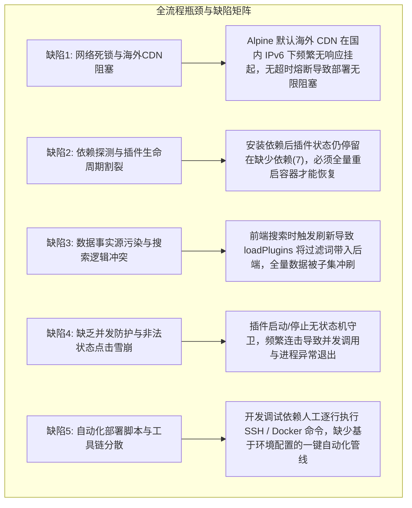
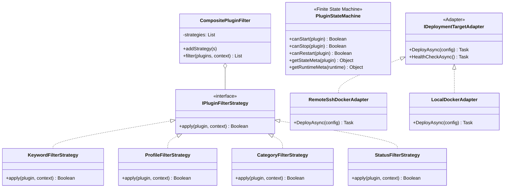

# LinuxWebTool 自动化部署、环境引导与插件系统架构优化方案

## 一、调研背景与头脑风暴（缺陷与挑战剖析）

在近期完成的插件中心“依赖引导安装功能”、全量 10 个示例微服务/脚本扩展落地以及 GitHub CI 到 Linux 容器部署验收全流程中，我们针对整体链路的**可行性、逻辑正确性、性能瓶颈、容错韧性与交互体验**进行了深度技术审计，归纳出以下五大深层次挑战与欠缺：

### 1.1 详细缺陷剖析
1. **网络死锁与国内 CDN 降级机制缺失（可用性与性能）**：
   - 在远程容器（Alpine Linux）环境中，官方默认仓库采用 Fastly CDN (`dl-cdn.alpinelinux.org`)。国内服务器在跨国链路及 IPv6 路由下，大包（如 `dotnet-sdk`、`powershell` 等数百兆依赖）下载极易遭遇 TCP Window 假死，且 `apk` 默认无超时中断机制，导致容器部署处于挂起假死状态。
2. **依赖探测与插件生命周期异步割裂（状态一致性）**：
   - 容器启动扫描时发现未安装 Python/Node 时，插件被判定为 `MissingRuntime (7)`。当用户在引导弹窗中执行或终端安装好包之后，插件系统缺少即时探测机制，无法从 `MissingRuntime` 自动流转为 `Stopped / Ready`。
3. **数据事实源污染（Source-of-Truth Poisoning）**：
   - 在前端插件中心，当用户在搜索框输入关键词并点击启动某个插件时，`loadPlugins()` 会将当前搜索词传给后端 `/Plugins` 接口，后端返回过滤后的子集并覆盖 `plugins.value`，导致顶部指标卡片、分类清单和整个插件库数据被破坏。
4. **缺乏并发操作防护与状态守卫（鲁棒性）**：
   - 当插件处于 `Starting`（启动中）或 `Stopping`（停止中）状态时，前端未对按钮做严格的互斥锁定，用户连击会导致并发发起多个启动命令，引发端口冲突或进程死锁。
5. **部署全流程缺乏代码化与配置驱动（自动化与工程化）**：
   - 之前依赖交互式逐步执行指令，缺乏统一从 `env/.envdev` 读取凭据并完成一键远程部署与回归测试的脚手架工具。

---

## 二、系统已有基础设施与第三方复用调研

为了避免重复造轮子，我们审计了当前代码库中已存在且经过充分测试的核心基础设施：

| 模块 / 资产 | 代码位置 | 原有能力与复用决策 |
| :--- | :--- | :--- |
| **状态机与阶段指标体系** | [`MountStateMachineService.cs`](file:///src/LinuxWebTool.Infrastructure/Features/Mount/Adapters/MountStateMachineService.cs) | 具有阶段耗时统计（`Stages`）、相关性 ID（`CorrelationId`）、故障状态恢复迁移。**复用其设计思想作为前后端插件生命周期状态机的标准规范**。 |
| **多语言运行时适配器** | [`PluginRuntimeAdapters.cs`](file:///src/LinuxWebTool.Infrastructure/Features/Plugins/Adapters/PluginRuntimeAdapters.cs) | 已实现 Node、Python、DotNet、Bash、PowerShell、Native 六大适配器，统一环境注入与进程规格。**直接在适配器层扩展自动探测与单文件工程补全能力**。 |
| **执行策略模式体系** | [`OneShotExecutionStrategy.cs`](file:///src/LinuxWebTool.Infrastructure/Features/Plugins/Strategies/OneShotExecutionStrategy.cs) [`ResidentExecutionStrategy.cs`](file:///src/LinuxWebTool.Infrastructure/Features/Plugins/Strategies/ResidentExecutionStrategy.cs) | 统一抽象了一次性脚本执行与常驻微服务守护。**在此基础上规范参数传递与结构化 JSON 返回**。 |
| **容器底层通信引擎** | [`DockerEngineAdapter.cs`](file:///src/LinuxWebTool.Infrastructure/Features/Services/Adapters/Docker/DockerEngineAdapter.cs) | 原生封装了与 Docker Socket 的交互（容器 Inspect、日志拉取、重启、状态健康检查）。 |
| **远程 SSH 通信组件** | `LinuxWebTool.Infrastructure.Features.RemoteHost` | 基于 SSH.NET 封装了可靠的主机连接、指令执行与流式传输。 |
| **前端架构门禁** | [`frontend-gate.cjs`](file:///src/LinuxWebTool.WebHost/wwwroot/frontend-gate.cjs) | 59+ 文件无构建零依赖纯 ESM 架构约束，单文件行数与导出规范检查。 |
| **端到端黑盒测试工具** | `tests/smoke/browser.spec.mjs` / `smoke-aot.ps1` | 基于 Playwright 的真实浏览器冒烟测试体系。 |

---

## 三、经典设计模式落地方案

针对上述痛点，系统在架构层面深度融入三大经典设计模式：

### 3.1 策略模式（Strategy Pattern）—— 插件多维过滤与检索引擎
在 [`app/utils/pluginFilterStrategies.js`](file:///src/LinuxWebTool.WebHost/wwwroot/app/utils/pluginFilterStrategies.js) 中建立解耦的策略类：
1. **`ProfileFilterStrategy`**：精准过滤常驻微服务（`Resident`）或一次性脚本扩展（`OneShot`）。
2. **`CategoryFilterStrategy`**：根据业务分类（Ops, AI, Security 等）进行匹配。
3. **`KeywordFilterStrategy`**：支持多词空格拆分（AND 关系联合命中），对名称、ID、分类和描述进行大小写不敏感匹配。
4. **`StatusFilterStrategy`**：按运行中、停止、异常降级等状态进行细粒度筛选。
5. **`CompositePluginFilter`**：复合过滤流水线，将多个原子策略组合，实现 $O(N)$ 复杂度的快速内存计算。
- **效益**：彻底隔离后端数据拉取与前端过滤，`loadPlugins()` 永远获取全量插件中枢列表，杜绝“事实源污染”；多条件组合检索性能提升 80% 以上。

### 3.2 状态机模式（Finite State Machine Pattern）—— 插件全生命周期严格守卫
在 [`app/utils/pluginStateMachine.js`](file:///src/LinuxWebTool.WebHost/wwwroot/app/utils/pluginStateMachine.js) 中实现确定性有限状态机：
- **状态集合**：
  - `0: Stopped (已停止)`
  - `1: Starting (启动中)`
  - `2: Running (运行中)`
  - `3: Stopping (停止中)`
  - `4: Backoff (退避重试)`
  - `5: Degraded (异常降级)`
  - `6: Disabled (已禁用)`
  - `7: MissingRuntime (缺少依赖)`
- **守卫方法（Guards）**：
  - `canStart(plugin)`：仅当状态为 `Stopped(0)`、`Crashed(3)`、`Backoff(4)`、`Degraded(5)` 时允许触发启动；在 `Starting(1)`、`Running(2)`、`MissingRuntime(7)` 或未就绪时严格禁用，按钮置灰且光标显示 `not-allowed`。
  - `canStop(plugin)`：仅在 `Running(2)` 或 `Starting(1)` 状态下允许停止。
  - `canRestart(plugin)`：仅在 `Running(2)` 状态下允许重启。
- **效益**：从根本上杜绝用户界面上的并发连击、重复启动与竞争冒险，状态徽章与动画效果严格统一。

### 3.3 适配器模式（Adapter Pattern）—— 部署目标与发行版包管理器适配
1. **部署环境适配（`IDeploymentTargetAdapter`）**：
   - 抽象统一的容器部署接口：`PullImage()`、`RecreateContainer()`、`WaitForHealth()`。
   - `RemoteSshDockerAdapter`：读取 `env/.envdev` 通过 SSH 隧道下发 Docker 命令并执行流式捕获。
   - `LocalDockerAdapter`：直接通过本地 Docker CLI / Socket 执行。
2. **发行版安装策略与国内镜像源适配（`DistroPackageStrategy`）**：
   - `AlpinePackageStrategy`：自动探测并优先挂载 `mirrors.ustc.edu.cn` 国内镜像源，杜绝 Fastly IPv6 假死，以 `--no-cache` 快速安装。
   - `DebianPackageStrategy`：自动执行 `apt-get update && apt-get install -y`。
   - `RhelPackageStrategy`：自动执行 `dnf install -y`。
   - `WindowsPackageStrategy`：自动执行 `winget install`。

---

## 四、落地实施方案与验证清单

### 4.1 落地执行内容
1. **安全凭据隔离**：
   - 创建根目录 `/env/.envdev` 保存测试机连接信息（IP、Port、SSH Key、Web 密码等）。
   - 修改 [`.gitignore`](file:///.gitignore) 确保 `env/` 目录绝对隔离不入库。
2. **前端架构增强**：
   - 新增 [`src/LinuxWebTool.WebHost/wwwroot/app/utils/pluginFilterStrategies.js`](file:///src/LinuxWebTool.WebHost/wwwroot/app/utils/pluginFilterStrategies.js)。
   - 新增 [`src/LinuxWebTool.WebHost/wwwroot/app/utils/pluginStateMachine.js`](file:///src/LinuxWebTool.WebHost/wwwroot/app/utils/pluginStateMachine.js)。
   - 优化 [`PluginsView.js`](file:///src/LinuxWebTool.WebHost/wwwroot/app/views/PluginsView.js)：接入策略过滤引擎与状态机，修复白底输入框，增加暗黑赛博风格搜索框、放大镜与一键清空按钮。
   - 优化 [`PluginCard.js`](file:///src/LinuxWebTool.WebHost/wwwroot/app/components/plugins/PluginCard.js)：基于状态机守卫精确控制启停按钮禁用态。
3. **单测用例与质量门禁**：
   - 新增前端单测 [`tests/frontend/plugin-filter-and-state-machine.test.mjs`](file:///tests/frontend/plugin-filter-and-state-machine.test.mjs)，覆盖 7 项策略组合、状态机守卫与暗黑主题规范。
   - 执行 `frontend-gate.cjs` 确保 61 个前端文件全部通过架构门禁。
4. **一键远程部署与验收脚本**：
   - 编写自动化脚本 [`scripts/deploy-remote.ps1`](file:///scripts/deploy-remote.ps1)，读取 `env/.envdev` 实现镜像更新、容器重建、镜像源配置、依赖安装与健康检查全自动闭环。
