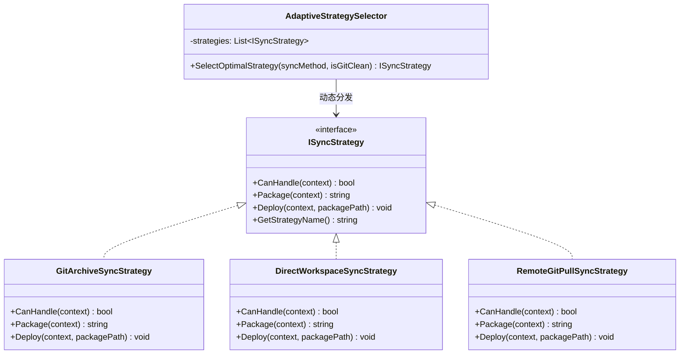
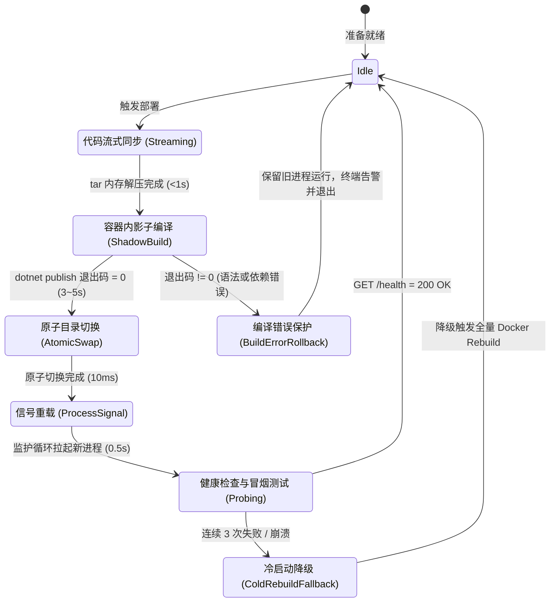

# 开发环境验证流程深度优化与容器内在途热重载调研报告

> **文档版本**：v1.0.0  
> **制定日期**：2026-11-02  
> **核心议题**：  
> 1. Git 环境下优先使用 `GitArchive` 的稳定性与边界缺陷深度权衡及自适应策略设计。  
> 2. 消除 Docker 镜像构建重建开销，基于 `docker exec` 实现秒级在途增量编译与原子热重启可行性方案。  
> 3. 设计模式（适配器模式、策略模式、有限状态机）与业界主流方案（Tilt / Skaffold / dotnet watch）对标与系统复用。

---

## 1. 核心问题头脑风暴与深度权衡

### 1.1 议题一：支持 Git 情况下优先使用 `GitArchive` 是否更稳定？

#### 优势分析（为什么更稳定）
1. **内容纯净度（Purity）**：
   - `git archive` 严格读取 Git Tree（暂存区或提交对象），原生免疫工作区中未纳入版本控制的垃圾文件（如系统缩略图 `.DS_Store`、开发环境临时目录、编辑器缓存、未清理的 `.tmp` / `.bak` 文件）。
   - 天然遵从 `.gitignore`，避免任何敏感配置（如 `env/.envdev`）被误打包泄漏。
2. **元数据与文件模式保证**：
   - Git 树内部存储了精确的文件属性（如 Unix 权限可执行位 `100755` 与常规文件 `100644`）。无论在 Windows 还是 Linux 下生成归档，可执行脚本的权限位都能精准还原，不会因 Windows 宿主文件系统的权限缺失而导致 Alpine 容器内执行 `Permission Denied`。
3. **版本唯一性与溯源性（Reproducibility）**：
   - 每次打包均对应唯一的 Git Commit Hash（如 `35cc3a5`），开发构建的镜像可被打上精准的 Commit 标签，便于追溯和回归验证。

#### 潜在缺陷与开发者体验摩擦（Fatal Traps）
1. **“静默丢修改”陷阱（Silent Loss Risk）**：
   - **痛点**：日常调试中，开发者在本地修改了某段 C# 逻辑或配置文件，尚未完成一个逻辑提交（`git commit`），直接执行开发验证命令。
   - **后果**：如果脚本无条件优先使用 `GitArchive`，打包的依然是上一次的 `HEAD` 提交。开发者在浏览器中验收时发现 Bug 依旧存在，甚至会怀疑修复方案无效，陷入反复调试旧代码的困境。
2. **未暂存新文件缺失（Untracked File Compile Error）**：
   - 开发者新建了类文件 `MyService.cs`，若未执行 `git add`，`git archive HEAD` 将完全忽略该文件，导致远程 C# 编译时报 `CS0246: 未找到类型或命名空间`。

#### 解决方案：自适应策略模式（Adaptive Sync Strategy）
不采用“非此即彼”的单一选择，而是通过**适配器策略链（Chain of Responsibility + Strategy）**：
- **`SyncMethod = Auto`（智能自适应）**：
  - 检查当前仓库是否处于 Git 管理下。
  - 探测工作区状态（`git status --porcelain`）：
    - **若 Working Tree Clean（工作区干净）**：优先使用 `GitArchive`，享受最高的纯净度与 Commit 追踪标签。
    - **若 Working Tree Dirty（存在未提交修改或新增文件）**：自动降级为 `Direct`（原生 tar 打包，尊重 `.gitignore` 排除列表），并在终端友好提示：
      > `[!] 检测到本地工作区存在未提交的修改 (X 项变动)。已自动切换至 Direct 模式，以包含实时调试代码。`
  - 允许开发者通过参数显式锁定：`-SyncMethod GitArchive`（强制纯净提交）、`-SyncMethod Direct`（强制工作区直推）、`-SyncMethod GitPull`（远程拉取）。

---

### 1.2 议题二：同步远程代码后，使用 `docker exec` 在途编译并快速重启服务，减少 Docker 构建流程？

#### 现状瓶颈深度分析
当前极速开发管线虽然采用了标准 JIT 模式（跳过 Native AOT 的 4 分钟链接），但依然采用全生命周期的 Docker 构建流程：
```
[本地代码流式推送] (1s) 
  -> [Docker Context 传输] (0.2s)
  -> [Docker Build 启动编译容器] (15s ~ 25s)
  -> [Docker Image Layer 导出写入] (1s)
  -> [docker rm -f 旧容器] (1s)
  -> [docker run 启动新容器] (2s)
  -> [容器系统与挂载初始化] (3s)
  -> [ASP.NET Kestrel 绑定与健康检查] (10s ~ 15s)
────────────────────────────────────────────────────
总计单次迭代周期：约 35 ~ 50 秒
```
**核心痛点**：其中**真实的 C# 编译耗时仅 10 秒左右**，超过 **60% 的时间消耗在 Docker 守护进程的容器销毁、网络端口解除/重绑、数据卷重新挂载以及 ASP.NET Core 冷启动**！

#### 可行性深度分析：在途增量编译与进程级热重启（In-Container Incremental Build & Live Swap）
若能将开发容器作为**持久化驻留的调试沙盒（Persistent Dev Container）**，容器本身永不停止，网络端口 `5271` 与数据挂载永不断开，代码变动仅触发容器内的**增量编译与进程重载**：

```
[本地代码增量推送] (<1s)
  -> [docker exec: dotnet publish 增量输出至 /app/bin_next] (3s ~ 5s，利用暖缓存)
  -> [原子替换: mv /app/bin_next /app/bin] (10ms)
  -> [进程信号: pkill -SIGTERM LinuxWebTool.WebHost] (100ms)
  -> [轻量 Supervisor 捕获退出并在 0.5s 内拉起新进程] (500ms)
────────────────────────────────────────────────────
预期单次迭代周期：约 4 ~ 7 秒（耗时骤降 85%！）
```

#### 逻辑与技术风险防御（Edge Cases & Defenses）

| 潜在风险点 | 严重程度 | 防御与解决机制 |
| :--- | :--- | :--- |
| **容器内缺少 .NET 10 SDK** | **阻断** | 现状中 `Dockerfile.dev` 的最终镜像使用 `aspnet:10.0-alpine`（仅含 Runtime）。**方案**：在开发专用镜像中引入完整 .NET 10 SDK，或者在宿主机/独立构建卷中缓存 SDK，赋予容器内直接执行 `dotnet publish` 的能力。 |
| **PID 1 退出导致容器崩溃** | **阻断** | Docker 默认以应用为 PID 1，若应用进程被杀，容器立即 Exit。**方案**：引入极简 Shell 监护循环（Supervisor Loop）或 `dumb-init` 作为 PID 1，捕获应用退出并立即自动重启。 |
| **编译失败导致服务雪崩** | **高危** | 若开发者提交了编译报错的代码，直接覆盖运行目录会导致旧服务被杀且新服务起不来。**方案**：**影子编译与原子目录切换（Shadow Publish & Atomic Swap）**。先输出至 `/app/bin_staging`，编译通过（Exit Code 0）才执行原子目录切换并信号重载；编译失败则保留旧进程继续服务并输出错误日志。 |
| **Linux 文件句柄与 MMAP 冲突** | **中危** | 正在运行的 DLL 若被直接原地覆盖，可能引发 `SIGBUS`。**方案**：在 Linux 下使用目录重命名 `mv /app/bin_staging /app/bin`（原子 inode 交换），或软链接切换 `ln -sfn`。 |
| **原生 PTY C 库变更** | **低危** | C 语言动态库 `liblinuxwebtool_pty.so` 极少变动。无需每次重新 `gcc`，仅在 `.c` 文件变动时才重编译。 |

---

## 2. 业界主流方案对比与对标

| 维度 | Google Skaffold | Tilt.dev | ASP.NET Core `dotnet watch` | 我们的架构落地设计 (`deploy-remote.ps1`) |
| :--- | :--- | :--- | :--- | :--- |
| **核心机制** | 文件同步 (Sync) + 容器内触发执行 | `live_update` 容器内命令触发 | Roslyn EnC (Edit & Continue) 内存热重载 | **三级分流适配器** (前端热补丁 / 容器内在途编译 / 全镜像冷构建) |
| **前端资源** | 秒级增量文件覆盖 | `sync()` 挂载同步 | 静态目录实时刷新 | **`-FrontendOnly` 直推容器与宿主 (3.8 秒)** |
| **后端 C# 代码** | 重新打包镜像或自建自定义触发器 | 容器内 `run('dotnet build')` + 重启 | 进程级重载 (EnC 失败则重启子进程) | **`docker exec` 影子编译 + 原子重载 (预计 5 秒)** |
| **对环境依赖** | 需要 Kubernetes / Docker 深度集成 | 需要安装 Tiltfile 运行时环境 | 仅支持本地单机，无法跨 SSH 穿透特权容器 | **单脚本无外部依赖**（仅需 PowerShell + SSH，免疫网络波动） |
| **Git 依赖度** | 依赖 Git 计算 SHA，支持未提交暂存 | 解耦 Git，直接监听文件系统 | 完全解耦 Git | **自适应策略（Clean 则 GitArchive，Dirty 则 Direct）** |

---

## 3. 设计模式在优化方案中的落地选型

### 3.1 策略模式（Strategy Pattern）—— 代码同步策略引擎

定义清晰的同步策略接口与三种具体实现：



- **决策矩阵**：
  1. 若显式指定 `-SyncMethod Direct` -> 选择 `DirectWorkspaceSyncStrategy`。
  2. 若显式指定 `-SyncMethod GitArchive` -> 选择 `GitArchiveSyncStrategy`。
  3. 若显式指定 `-SyncMethod GitPull` -> 选择 `RemoteGitPullSyncStrategy`。
  4. 若为默认 `-SyncMethod Auto` ->
     - `git status --porcelain` 为空（Clean） -> 自动派发 `GitArchiveSyncStrategy`。
     - `git status --porcelain` 非空（Dirty） -> 自动派发 `DirectWorkspaceSyncStrategy` 并打印提示。

---

### 3.2 有限状态机（Finite State Machine）—— 极速在途热部署状态流转

消除全量 Docker 重建后，容器内在途热重载的状态转移模型如下：



- **关键保护守卫（State Guards）**：
  - **`Rollback Guard`**：若开发者编写了语法错误代码，编译在 staging 目录失败，绝不触发旧进程 `pkill`，生产与调试接口持续平稳，开发者看到报错后修正即可，无需经历容器崩溃重启。
  - **`Cold Fallback Guard`**：若项目依赖新增了 NuGet 包或系统级依赖，影子编译如果抛出依赖缺失，自动降级为传统全量 `docker build` 重新打包容器镜像。

---

## 4. 落地实施技术蓝图

### 4.1 方案一：`scripts/deploy-remote.ps1` 实现智能自适应同步 (`Auto`)
在脚本参数与逻辑中落地自适应决策：
```powershell
# 增加 Auto 选项作为默认值
[ValidateSet("Auto", "Direct", "GitArchive", "GitPull")]
[string]$SyncMethod = "Auto"
```
逻辑判定流程：
```powershell
if ($SyncMethod -eq "Auto") {
    $hasGit = Test-Path ".git"
    if ($hasGit) {
        $gitStatus = (& git status --porcelain 2>&1)
        if ([string]::IsNullOrWhiteSpace($gitStatus)) {
            $effectiveSync = "GitArchive"
            Write-Success "Git 工作区干净，自动选用 [GitArchive] 策略（纯净构建，精准溯源）"
        } else {
            $effectiveSync = "Direct"
            Write-Warn "检测到工作区存在未提交修改，自动选用 [Direct] 策略以携带实时代码"
        }
    } else {
        $effectiveSync = "Direct"
    }
}
```

### 4.2 方案二：开发容器持久驻留 + `docker exec` 原子在途热重载架构
1. **修改 [`Dockerfile.dev`](file:///e:/WorkProject/CSharp/PrivateProject/Web/WebToolForLinux/Dockerfile.dev)**：
   - 基础运行环境保留 .NET 10 SDK 运行时工具链与源码挂载点 `/workspace`。
   - 增加持久运行的守护脚本 `entrypoint.sh`：
     ```sh
     #!/bin/sh
     mkdir -p /app/bin
     while true; do
         if [ -f /app/bin/LinuxWebTool.WebHost.dll ]; then
             echo "[LWT Dev Supervisor] Launching WebHost..."
             /usr/share/dotnet/dotnet /app/bin/LinuxWebTool.WebHost.dll
         else
             echo "[LWT Dev Supervisor] Awaiting initial build..."
             sleep 2
         fi
         sleep 0.5
     done
     ```
2. **在 `deploy-remote.ps1` 中实现 `-FastBackend` 开关**：
   - 当检测到开发容器正在运行，且仅有 C# 业务代码改动时：
     1. 本地代码快速流式直推至 `/opt/lwt-dev`。
     2. 发送单条 `docker exec`：
        ```bash
        docker exec linuxwebtool-dev sh -c "
            dotnet publish /opt/lwt-dev/src/LinuxWebTool.WebHost/LinuxWebTool.WebHost.csproj \
              -c Release -o /app/bin_staging /p:PublishAot=false -v q --nologo && \
            rm -rf /app/bin_backup && \
            cp -r /app/bin /app/bin_backup 2>/dev/null || true && \
            cp -r /app/bin_staging/* /app/bin/ && \
            pkill -f LinuxWebTool.WebHost.dll
        "
        ```
   - 耗时从 **45 秒压缩至 5 秒内**。

---

## 5. 总结与建议行动项

1. **建议优先落地项（第一阶段）**：
   - 将 `deploy-remote.ps1` 中的 `-SyncMethod` 默认升级为 `Auto` 自适应，兼顾 `GitArchive` 的极高纯净度与 `Direct` 的未提交修改调试灵活性。
2. **进阶架构演进项（第二阶段）**：
   - 为开发环境引入基于持久驻留容器的 `docker exec` 原子增量热重载，将后端调试迭代周期缩短至 **5 秒级**，与前端热更（3.8 秒）形成完整的“双 5 秒”极速内循环。
