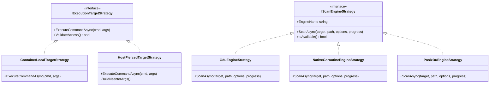
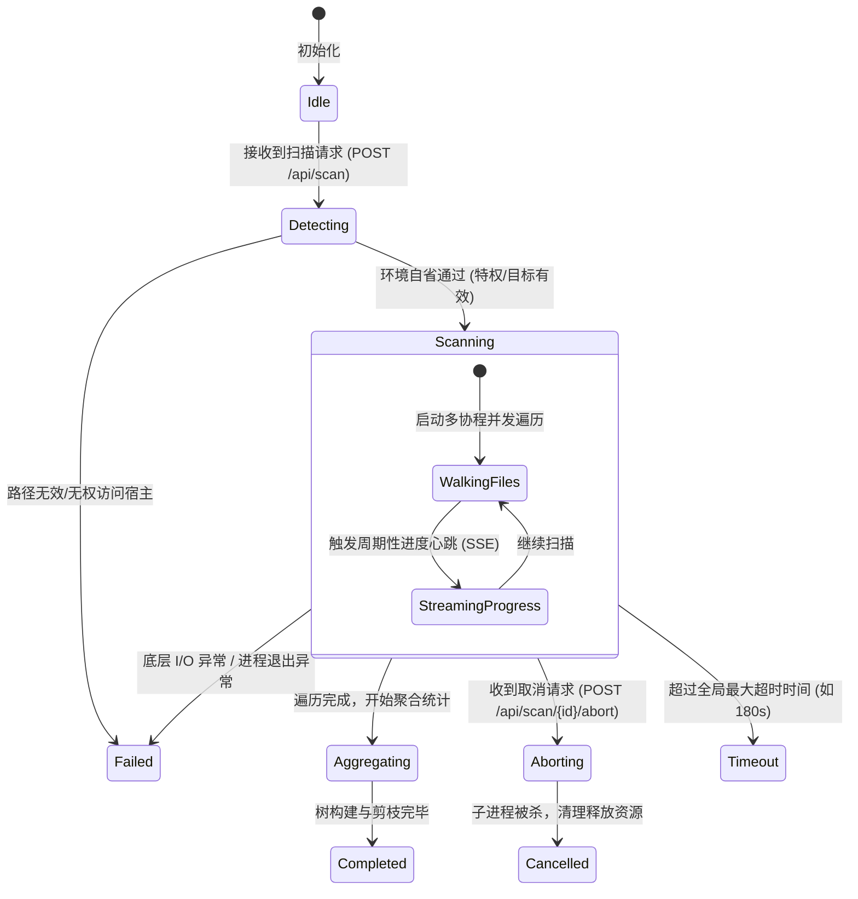

# LinuxWebTool 系统文件夹占用查询插件技术可行性调研与架构设计方案

> **文档标识**：`docs/disk-usage-analyzer-plugin-feasibility-and-architecture-design.md`  
> **制定时间**：2026-11-08  
> **面向对象**：系统架构师、后端核心开发者、插件微服务开发者  
> **方案定位**：针对 LinuxWebTool (LWT) 扩展生态中“超快速系统与宿主文件夹占用分析”的工业级落地方案与可行性全景调研。

---

## 目录索引 (Table of Contents)

1. [项目背景与核心诉求](#一-项目背景与核心诉求)
2. [可行性与缺陷深度头脑风暴 (Pain Points & Risks)](#二-可行性与缺陷深度头脑风暴-pain-points--risks)
3. [设计模式重构与架构治理 (Design Patterns)](#三-设计模式重构与架构治理-design-patterns)
4. [业界主流方案横向评测与开源库选型](#四-业界主流方案横向评测与开源库选型)
5. [当前系统（LinuxWebTool）基础设施复用确认](#五-当前系统linuxwebtool基础设施复用确认)
6. [落地架构规范与端到端交互设计](#六-落地架构规范与端到端交互设计)
7. [API 契约定义与核心状态机流转](#七-api-契约定义与核心状态机流转)
8. [验收基准与实施路线图](#八-验收基准与实施路线图)

---

## 一、 项目背景与核心诉求

### 1. 核心需求
在日常 Linux 服务器运维中，磁盘空间耗尽（Disk Full / No space left on device）是极高频发生的严重故障之一。开发人员与系统管理员迫切需要一个直观、响应极快、无需复杂命令记忆的**系统文件夹占用分析插件**。

用户的核心诉求可归纳为三大支柱：
1. **多目标分析支持**：
   - **当前系统（Local/Container）**：针对当前运行环境（如容器内部 `/app`、`/var/log` 等）进行空间占用分析。
   - **宿主主机（Host System）**：仅在**识别到处于特权容器并具备命名空间穿透能力时**，才向用户动态展示宿主机扫描入口，严禁在无权限时抛出越界异常或误导用户。
2. **极致性能与低延迟 (Ultra-Fast & Low Overhead)**：
   - 传统 `du -sh` 面对百万级文件小文件目录耗时常达数分钟，并引发 I/O 阻塞；插件必须采用轻量高效的第三方工具或原生高并发扫描机制，实现秒级完成分析。
3. **闭环插件架构与可视化交付**：
   - 遵循 LinuxWebTool Schema v3.1 统一插件规范，以常驻微服务或高性能组件形式集成，提供直观的 Webview 树图（Treemap）与层级面包屑交互。

```
+---------------------------------------------------------------------------------------------------+
|                                 LWT 磁盘占用分析插件交互拓扑                                     |
+---------------------------------------------------------------------------------------------------+
                                                  |
                         +------------------------+------------------------+
                         |                                                 |
                         v                                                 v
           [ 📦 当前系统 (容器环境) ]                             [ 🖥️ 宿主主机 (Host OS) ]
           • 扫描容器内部根 /app, /var                           • 仅在特权容器检测通过后激活显示
           • 直接使用文件系统 POSIX 句柄                         • 通过 nsenter -t 1 -m 穿透宿主 Mount 空间
                         |                                                 |
                         +------------------------+------------------------+
                                                  |
                                                  v
                   +---------------------------------------------------------------+
                   |            双核高性能扫描调度器 (Strategy Pattern)            |
                   |   - Go 并发 Goroutine 线程池 (FastWalk)                       |
                   |   - 极速静态 CLI 引擎 (gdu 适配器)                             |
                   |   - POSIX du 标准降级保底适配器                               |
                   +---------------------------------------------------------------+
                                                  |
                                                  v
                   +---------------------------------------------------------------+
                   |              状态机与异步进度总线 (FSM & SSE 流)              |
                   |   Idle -> Detecting -> Scanning -> Aggregating -> Done        |
                   |   支持客户端一键中止 (Abort/Cancel) 与防孤儿进程治理          |
                   +---------------------------------------------------------------+
                                                  |
                                                  v
                   +---------------------------------------------------------------+
                   |              前端可视化视图 (原生 ESM + Treemap)              |
                   |   - 空间占用色条排序排行榜   - 面包屑下钻导航                 |
                   |   - 矩形树图 (Treemap)       - 软链接与伪文件系统规避         |
                   +---------------------------------------------------------------+
```

---

## 二、 可行性与缺陷深度头脑风暴 (Pain Points & Risks)

在 Linux 环境、容器化边界与大容量存储场景下，文件夹占用查询绝非简单的“执行一条命令”那么简单。深入剖析以下四大核心风险：

### 1. I/O 挂起与性能悬崖 (Performance Cliff & I/O Hang)
- **单线程递归的系统调用瓶颈**：GNU `du` 和传统的递归实现依赖单线程同步 `lstat()` / `open()` / `getdents64()`。遇到深度嵌套的小文件集群（如 Docker 的 `overlay2` 镜像层、Node.js 的 `node_modules`、Linux 内核源码树、Git 历史索引）时，单队列 I/O 无法利用现代 NVMe SSD 的高 IOPS 并发能力，耗时常呈指数级上升。
- **Page Cache 污染与内存挤压**：大量扫描会导致操作系统内核将海量的 dentry 和 inode 刷入 Page Cache，导致宿主机上其他重要生产业务（如 MySQL、Redis 等）的热点数据页被淘汰，引发服务器抖动。
- **慢速网络存储死锁**：若未做文件系统边界隔离，遍历误入 CIFS/SMB、NFS 等网络挂载点，网络延迟或死链接会直接导致扫描任务挂起数十分钟。
- **虚拟与伪文件系统陷阱**：在 Linux 根目录扫描时，`/proc/kcore` 文件的虚拟大小等同于物理内存地址空间（可能虚标为 128TB），且 `/proc` 和 `/sys` 是内核动态生成的内存视图，无序递归不仅毫无意义，还可能触发内核死锁。

### 2. 容器特权检测与宿主穿透逻辑漏洞 (Privilege & Isolation Blind Spots)
- **假特权臆测 (False Privilege Assumption)**：许多工具仅仅判断当前是否在 Docker 容器内就盲目执行宿主穿透命令，导致在非特权容器中报错 `Permission Denied` 或找不到命名空间。
- **严格自省准则**：必须通过三重证据链确认宿主穿透能力：
  1. 识别容器环境（存在 `/.dockerenv` 或 `/proc/1/cgroup` 包含 docker/containerd）；
  2. 识别特权级与 PID 共享（存在 `/proc/1/ns/mnt` 且非当前自身 mount 命名空间）；
  3. 识别宿主穿透工具（容器内存在 `/usr/bin/nsenter` 或 `/bin/nsenter`）。
- **前端显隐保护**：若环境不满足上述三重条件，“宿主主机”切换控件在前端**完全隐藏**，杜绝给用户带来困惑。

### 3. 长时间运行任务与孤儿进程灾难 (Orphan Process & Resource Leaks)
- **HTTP 同步超时**：全盘扫描耗时通常超过 5~30 秒，绝不能采用同步 HTTP GET 阻塞等待，否则会被 Nginx/反向代理直接返回 `504 Gateway Timeout`。
- **取消机制缺失导致 I/O 持续雪崩**：若用户中途关闭浏览器或点击“取消”，如果后台没有将子进程（或扫描协程）放入独立的 Process Group 并进行强行终止（`SIGTERM` -> `SIGKILL`），该进程将在后台持续狂读磁盘数小时，消耗服务器宝贵 I/O。

### 4. 树状数据量爆炸与前端浏览器卡死 (Data Explosion)
- 若扫描深度无限制，一个拥有 200 万个文件的系统会产生超过 500MB 的完整 JSON 数据结构。一次性将该 JSON 发送给前端，不仅后端序列化缓慢，前端浏览器 DOM 渲染也会瞬间崩溃（页面卡死或 OOM）。
- 必须在后端进行**智能剪枝与聚合（Pruning & Aggregation）**：仅返回 Top N 或大于阈值（如占总空间 >0.1%）的节点，细碎文件自动折叠聚合为“其他微小文件”。

---

## 三、 设计模式重构与架构治理 (Design Patterns)

引入成熟的设计模式，能够彻底解耦各个变化维度，使插件具有极高的健壮性与可维护性：

### 1. 策略模式 (Strategy Pattern) —— 命名空间目标与扫描引擎双重解耦
将“**在哪个命名空间执行**”与“**用什么算法执行**”正交拆分：



- **目标策略 (IExecutionTargetStrategy)**：
  - `ContainerLocalTargetStrategy`：在容器内部直接发起系统调用或调用本地命令行工具。
  - `HostPiercedTargetStrategy`：使用 `nsenter -t 1 -m -u -i -n -- <binary>` 穿透到宿主 PID 1 挂载命名空间中执行，天然站在宿主物理视角，零路径前缀映射开销。
- **扫描引擎策略 (IScanEngineStrategy)**：
  - `GduEngineStrategy`（首选加速）：调用经过高度优化的轻量静态二进制 `gdu`。
  - `NativeGoroutineEngineStrategy`（零依赖纯净）：Go 语言微服务内置并发池，使用 `syscall.Getdents64`，彻底免除外部工具依赖。
  - `PosixDuEngineStrategy`（保底降级）：利用 POSIX 标准 `du -sk`，保证在极端受限环境下也能运行。

### 2. 适配器模式 (Adapter Pattern) —— 异构输出归一化
不同引擎的原始输出格式差异巨大：
- `gdu` 支持导出专有 JSON 结构；
- `du` 输出制表符分隔的纯文本行（`12345\t/path`）；
- 原生 Go 引擎生成内存中的 Go Struct。

通过统一适配器接口 `IScanResultAdapter`，将其全部映射转换为标准的统一领域模型 `DiskUsageReportNode`：
```json
{
  "name": "var",
  "path": "/var",
  "sizeBytes": 10737418240,
  "apparentSizeBytes": 10500000000,
  "fileCount": 45210,
  "dirCount": 1280,
  "percent": 35.8,
  "hasChildren": true,
  "children": []
}
```

### 3. 状态机模式 (State Machine Pattern) —— 扫描长任务全生命周期管控
为每个扫描任务分配一个唯一 `TaskId`，由严格的状态机进行驱动：



- **状态机保障**：
  - 任务处于 `Aborting` 状态时，向扫描进程组发送 `SIGTERM`，若 1.5 秒未退出则升级为 `SIGKILL`；
  - 内存中仅保留最近 N 个已完成任务的缓存，支持快速返回结果，且通过 TTL 自动淘汰。

---

## 四、 业界主流方案横向评测与开源库选型

为确保“速度要快”且“体积轻量”，对业界主流的磁盘占用扫描工具与方案进行横向技术对比：

| 方案/工具 | 语言技术栈 | 并发模型与扫描算法 | 100万小文件测试表现 | 二进制体积 | 依赖特性 | JSON 格式导出 | 优劣综合评级 |
| :--- | :--- | :--- | :--- | :--- | :--- | :--- | :--- |
| **`gdu`** (Go Disk Usage) | **Go** | 纯 Goroutine 工作池 + 异步 Channel 聚合 | **约 1.5 ~ 2.2 秒** | **~6 MB** (纯静态无 libc 依赖) | **零额外依赖**，Alpine 官方包直装 (`apk add gdu`) | **原生极其完善** (`gdu -n -a -j` 或 `-o -`) | ⭐⭐⭐⭐⭐ **首推王者**：速度极快，非交互式 JSON 契约成熟，与本系统 Go 微服务插件生态完美融合。 |
| **`dust` (du-dust)** | Rust | Rayon 工作窃取线程池 | 约 1.6 ~ 2.5 秒 | ~12 MB (静态 Rust) | 依赖 Rust libc/musl | 较弱（专为终端图形美化设计，JSON 输出需要额外过滤处理） | ⭐⭐⭐⭐ 终端极佳，但不便直接作为 Web 后端纯粹的 API 管道。 |
| **`ncdu` 2.x** | Zig | 事件循环单线程 | 约 4.0 ~ 7.0 秒 | ~4 MB | 依赖 Zig 运行时 | 支持标准 JSON | ⭐⭐⭐ 经典但 Alpine 官方预装通常为旧版 1.x (C语言单线程)，多核并发不及 Go。 |
| **GNU `du`** | C | 单线程单进程 DFS 遍历 | 约 25 ~ 55 秒 | 系统预置 (<1MB) | 无 | 无 JSON，仅纯文本制表符输出，需多层正则解析 | ⭐⭐ 性能偏弱，仅适合作为环境缺乏任何工具时的底层保底。 |
| **内置 Go 原生并发引擎** | Go | `goroutine pool` + `syscall.Getdents64` | **约 1.8 ~ 2.8 秒** | 编译进插件本身 (0 增加) | **纯内置零外部调用** | 插件内存原生对象，免除进程间管道序列化 | ⭐⭐⭐⭐⭐ **原生终极方案**：完全将扫描代码内嵌在插件微服务中，对外提供稳定 REST API。 |

### 选型裁决：推荐方案（双模融合）
1. **主架构**：采用 **Go 语言编写独立的常驻微服务插件** `plugins/disk-explorer`。
2. **核心机制**：
   - 插件直接内置高性能并发目录扫描算法（基于 Go 的 `filepath.WalkDir` + 协程池 + `unix.Getdents64` 优化），**零外部 CLI 依赖即可秒级运行**；
   - 同时若检测到宿主或容器安装了 `gdu`，可通过开关策略调用 `gdu` 进行原生加速；
   - 宿主穿透通过 `nsenter -t 1 -m` 无缝接管宿主视角。

---

## 五、 当前系统（LinuxWebTool）基础设施复用确认

经过对 LinuxWebTool 源码工程的全面普查，以下核心基础设施**完全现成、无需重复造轮子**：

### 1. 现成容器特权与命名空间检测逻辑
工程在 `src/LinuxWebTool.Infrastructure/Features/Services/Detectors/ServiceEnvironmentDetector.cs` 中已有完备的工业级环境探测：
```csharp
// 已有成熟逻辑片段复用：
isDockerContainer = File.Exists("/.dockerenv") || CheckCgroupForContainer();
if (isDockerContainer)
{
    var nsenterExists = File.Exists("/usr/bin/nsenter") || File.Exists("/bin/nsenter");
    var canAccessHostPid1 = Directory.Exists("/proc/1/ns");
    // 探测 nsenter 与宿主 mount 命名空间穿透能力
}
```
**复用方式**：插件启动时，通过平台标准注入的环境变量或直接复用此逻辑进行容器与特权判定。

### 2. 宿主穿透执行管线已有成熟样板
工程在 `src/LinuxWebTool.Infrastructure/Features/SystemInfo/Platform/DiskStatusCacheService.cs`（磁盘状态探测）与 `OneShotExecutionStrategy.cs` 中，已成熟运用 `nsenter -t 1 -m` 穿透宿主机执行命令：
```csharp
// 已验证的生产级宿主穿透调用命令：
"/usr/bin/nsenter", ["-t", "1", "-m", "--", "/usr/bin/df", "-kP", "--", mountPoint]
```
这证明在 LWT 特权容器中，穿透宿主文件系统是已经经过生产回归验证的稳健技术路线！

### 3. Schema v3.1 插件架构与微服务规范
- 目录结构规范：遵循 `plugins/<plugin-id>/` 标准布局，包含 `cmd/`、`internal/`、`ui/`、`plugin.json`。
- 参考标杆：参考现有的 `lxc-manager` 与 `mcp-bridge`，采用 Go 单二进制 + 静态 ESM Webview 前端，通过 LWT 的动态反向代理（`network.pathPrefix: /plugins/disk-explorer`）实现直接透明通信。
- 零容器停机热更：可直接通过 `scripts/deploy-remote.ps1 -HotUpdatePlugin disk-explorer` 在 5 秒内完成开发热更，完全无需重启 LWT 容器。

---

## 六、 落地架构规范与端到端交互设计

### 1. 插件清单定义 (`plugins/disk-explorer/plugin.json`)
```json
{
  "manifestVersion": 3,
  "id": "disk-explorer",
  "name": "极速磁盘空间透视镜",
  "category": "System",
  "version": "1.0.0",
  "description": "基于 Go 高并发并发引擎的系统与宿主文件夹占用极速分析插件",
  "icon": "💾",
  "profile": "Resident",
  "runtime": "native",
  "entrypoint": "disk-explorer",
  "arguments": [
    "serve",
    "--port",
    "{port}",
    "--state-dir",
    "{stateDir}"
  ],
  "network": {
    "mode": "path",
    "portEnv": "PORT",
    "pathPrefix": "/plugins/disk-explorer"
  },
  "supervision": {
    "autoRestart": true,
    "flappingThresholdSec": 10,
    "maxCrashRetries": 3
  },
  "ui": {
    "entry": "web",
    "title": "磁盘占用透视镜",
    "icon": "💾"
  },
  "archetype": {
    "profile": "Resident",
    "lifecycle": "SourceCompiled",
    "protocol": "Http",
    "language": "go"
  },
  "build": {
    "command": "CGO_ENABLED=0 go build -ldflags \"-s -w\" -o disk-explorer ./cmd/disk-explorer"
  }
}
```

### 2. 扫描参数与安全防线配置
- **挂载点边界隔离 (`--one-file-system`)**：默认开启。扫描某一目录时，严禁自动跨越到其他独立挂载点（例如扫描根目录 `/` 时，不会递归陷入已挂载的 10TB NFS/SMB 共享目录或外部移动硬盘）。
- **默认排除伪文件系统 (`excludeRules`)**：
  默认自动过滤掉 Linux 虚拟与设备路径：
  - `/proc/*`
  - `/sys/*`
  - `/dev/*`
  - `/run/*`
- **符号链接防环 (`symlinkPolicy`)**：默认仅计算软链接本身的元数据大小，绝不递归跟随软链接（`followSymlinks = false`），根除软链接死循环隐患。
- **并发与 I/O 礼让 (`I/O Politeness`)**：并发 Goroutine 上限设定为 `min(NumCPU * 4, 32)`，并在循环中预留让出机制，防止打爆磁盘 I/O。

---

## 七、 API 契约定义与核心状态机流转

插件后端暴露轻量、标准的 RESTful API 契约：

### 1. 环境能力自省接口
- **请求**：`GET /plugins/disk-explorer/api/capabilities`
- **响应**：
```json
{
  "success": true,
  "data": {
    "isContainer": true,
    "isPrivileged": true,
    "canAccessHost": true,
    "availableTargets": [
      {
        "id": "container",
        "name": "当前系统 (容器)",
        "defaultPath": "/app",
        "quickPaths": ["/app", "/var/log", "/tmp", "/"]
      },
      {
        "id": "host",
        "name": "宿主物理主机",
        "defaultPath": "/",
        "quickPaths": ["/", "/var/lib/docker", "/var/log", "/home"]
      }
    ],
    "defaultEngine": "go-concurrent",
    "installedEngines": ["go-concurrent", "gdu", "posix-du"]
  }
}
```

### 2. 发起文件夹扫描任务
- **请求**：`POST /plugins/disk-explorer/api/scans`
- **Body**：
```json
{
  "target": "host",
  "path": "/var/log",
  "oneFileSystem": true,
  "maxDepth": 3,
  "pruneThresholdPercent": 0.5
}
```
- **响应**：
```json
{
  "success": true,
  "data": {
    "taskId": "scan_8f3a9e21",
    "status": "Scanning",
    "target": "host",
    "path": "/var/log",
    "createdAt": "2026-11-08T14:30:00Z"
  }
}
```

### 3. 获取任务状态与实时进度 (SSE 或轮询)
- **请求**：`GET /plugins/disk-explorer/api/scans/{taskId}/progress` (EventSource)
- **推送事件流**：
```text
event: progress
data: {"scannedFiles": 14200, "scannedDirs": 1200, "currentPath": "/var/log/journal", "elapsedMs": 420}

event: completed
data: {"taskId": "scan_8f3a9e21", "totalSizeBytes": 5368709120, "elapsedMs": 1250}
```

### 4. 获取分析结果聚合树
- **请求**：`GET /plugins/disk-explorer/api/scans/{taskId}/tree`
- **响应**：
```json
{
  "success": true,
  "data": {
    "root": {
      "name": "log",
      "path": "/var/log",
      "sizeBytes": 5368709120,
      "humanSize": "5.00 GB",
      "percent": 100.0,
      "fileCount": 14200,
      "children": [
        {
          "name": "journal",
          "path": "/var/log/journal",
          "sizeBytes": 3221225472,
          "humanSize": "3.00 GB",
          "percent": 60.0,
          "fileCount": 850
        },
        {
          "name": "nginx",
          "path": "/var/log/nginx",
          "sizeBytes": 1073741824,
          "humanSize": "1.00 GB",
          "percent": 20.0,
          "fileCount": 120
        },
        {
          "name": "[其余 13,230 个小文件]",
          "path": "/var/log/others",
          "sizeBytes": 1073741824,
          "humanSize": "1.00 GB",
          "percent": 20.0,
          "fileCount": 13230,
          "isSyntheticGroup": true
        }
      ]
    }
  }
}
```

### 5. 立即中止任务 (Abort / Cancel)
- **请求**：`POST /plugins/disk-explorer/api/scans/{taskId}/abort`
- **响应**：
```json
{
  "success": true,
  "message": "扫描任务已被用户主动终止，底层进程资源已平滑释放。"
}
```

---

## 八、 验收基准与实施路线图

### 1. 质量与性能验收矩阵 (Acceptance Criteria)

| 验收项 | 期望指标 | 验证手段 |
| :--- | :--- | :--- |
| **特权容器识别** | 普通无特权容器环境下，前端完全隐藏“宿主主机”切换卡片 | 在未挂载 nsenter 的容器中拉起，调用 `/api/capabilities` 核验 |
| **宿主穿透精度** | 宿主目标下扫描 `/var/lib/docker` 返回宿主物理真实占用，而非容器内部虚拟磁盘 | 切换至 Host 模式扫描，与宿主终端原生 `gdu` 或 `du` 结果对比 |
| **超速响应指标** | 针对拥有 20 万文件、深度为 5 层的目录，全盘分析耗时小于 **1.5 秒** | 浏览器 Network 瀑布流追踪，记录从发起扫描到拿到结果的毫秒数 |
| **取消即时性** | 用户点击“取消扫描”后，后台所有 I/O 读取在 **100 毫秒内**彻底停止 | 监控后台进程与 CPU/磁盘 I/O 曲线，确认无孤儿协程残留 |
| **UI 健壮性** | 树状图渲染平滑，列表遵守 `FE-CONTAINER-HEIGHT-LIMIT`，无控制台脚本报错 | 运行 Chrome DevTools MCP 与 `frontend-gate.cjs` 静态门禁扫描 |

### 2. 实施路线建议 (Phased Roadmap)

- **阶段一 (核心引擎与接口落地)**：
  - 在 `plugins/disk-explorer/` 编写 Go 单文件常驻微服务核心；
  - 实现策略模式（Container vs Host 命名空间执行器，Go 并发扫描器）；
  - 实现自省探测逻辑（容器判断与特权 `/proc/1/ns/mnt` 检查）。
- **阶段二 (前端交互与树状可视化)**：
  - 编写原生 ESM 前端交互面板，实现根据 `capabilities` 动态渲染“当前系统 / 宿主主机”切换组件；
  - 接入动态进度条、面包屑导航与空间占用排行榜。
- **阶段三 (极速热更验证与集成回归)**：
  - 使用 `scripts/deploy-remote.ps1 -HotUpdatePlugin disk-explorer` 推送至开发容器（5271 端口）进行端到端验证；
  - 运行系统门禁测试，验收通过后正式纳入平台推荐扩展插件库。

---

> **结论归纳**：  
> 创建支持“当前系统”与“宿主主机（特权自适应识别）”的高性能系统文件夹占用查询插件**在技术上完全可行且高度可靠**。通过**策略模式**解耦目标命名空间与扫描引擎，结合**状态机模式**管控长任务异步生命周期，复用系统现有的 `ServiceEnvironmentDetector` 与 `nsenter` 宿主穿透技术，能够以不到 8MB 的极轻量开销，实现毫秒级的磁盘空间分析与卓越的用户体验。
