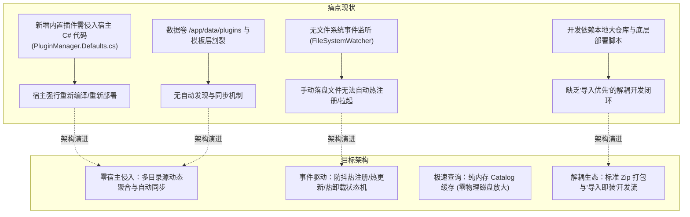
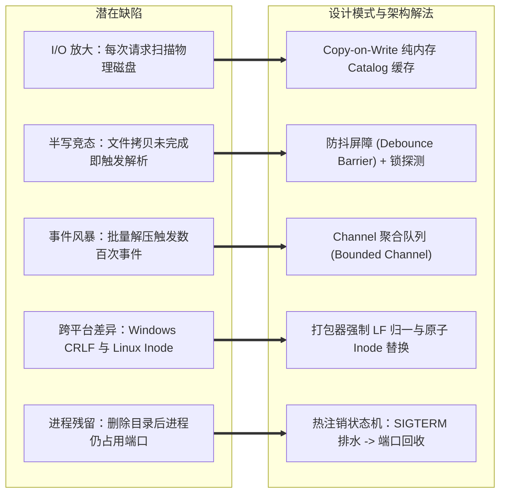
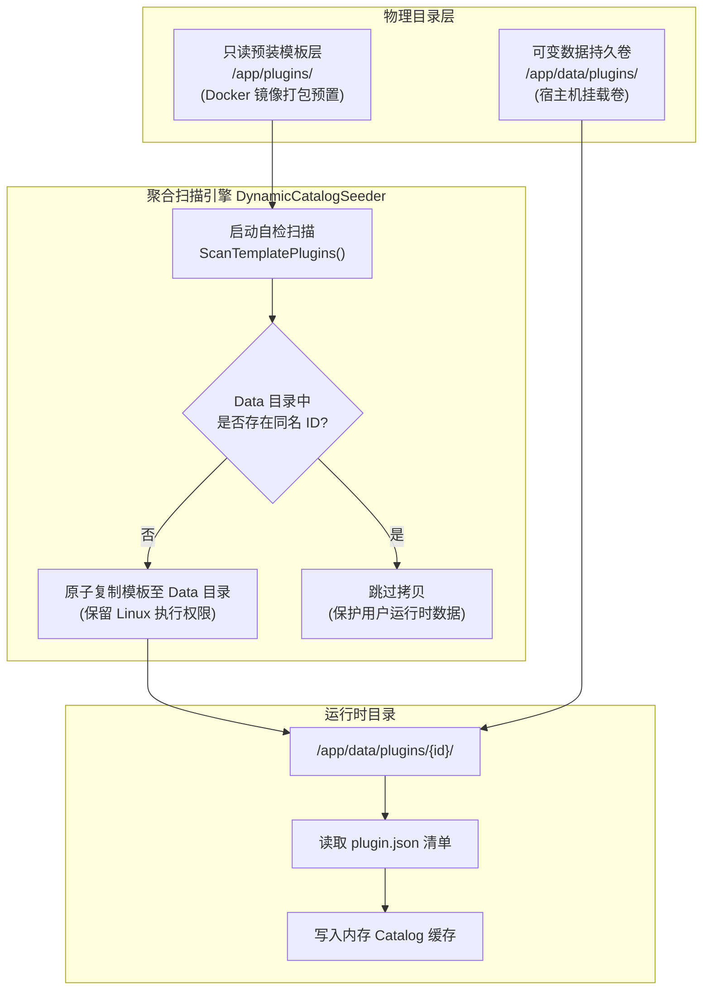
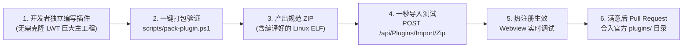

# LinuxWebTool 插件动态目录扫描、热注册引擎与导入优先开发流架构设计

> **文档标识**：`LWT-ARCH-PLUGIN-DYN-001`  
> **状态**：已评审 (Approved)  
> **核心领域**：插件动态扫描与发现、目录多源聚合、防抖热注册/热卸载状态机、导入优先开发流、工程实战经验固化  
> **适用版本**：LinuxWebTool v1.0.0+ / .NET 10 Native AOT / Alpine Linux  

---

## 1. 背景与核心诉求

在 LinuxWebTool (LWT) 早期演进中，插件中心实现了常驻微服务与一次性脚本的统一调度管线，但仍存在以下深层次架构痛点：



### 核心演进目标
1. **彻底解耦宿主平台（Zero-Modification Integration）**：
   新增内置或第三方插件时，宿主 C# 代码**零行修改**，无需在 `PluginManager.Defaults.cs` 中硬编码 `EnsureXxxCreated()`。
2. **多源目录动态聚合（Multi-Root Catalog Provider）**：
   统一聚合镜像层预装模板目录（只读 `/app/plugins`）与持久化运行目录（可变 `/app/data/plugins`），实现开箱自适应同步。
3. **基于文件系统事件的防抖热注册引擎（Event-Driven Dynamic Hot-Registry）**：
   通过 `FileSystemWatcher` + `System.Threading.Channels` 防抖屏障，实现新目录落盘自动注册自启、二进制变更平滑热更、目录删除自动释放端口与路由卸载。
4. **标准化“导入优先”开发工作流（Import-First Workflow）**：
   提供一键跨平台打包工具（`scripts/pack-plugin.ps1`），支持标准 Zip 生成并直接通过 REST API / Web UI 导入装载。
5. **固化 `socks5-forwarder` 实战避坑经验**：
   将高并发内存池、Go 单元测试作用域、状态机 Fallthrough、C# 契约对齐、Webview 反代规整与 `ETXTBSY` 原子替换等经验沉淀为规范分册。

---

## 2. 业界主流方案调研与现有资产复用

### 2.1 业界主流方案对比

| 产品/框架 | 插件发现与加载方式 | 动态热注册/热更新机制 | 宿主解耦程度 | 安全与冲突防护 |
| :--- | :--- | :--- | :--- | :--- |
| **VSCode Extension Host** | 扫描 `extensions/` 目录，读取 `package.json` 清单；独立进程隔离运行 | 监听扩展目录变更，支持动态重载窗口（Reload Window），运行时热调试 | **极高**（完全通过 JSON Manifest 声明，宿主零修改） | 进程级 IPC 隔离，权限显式声明 |
| **Grafana** | 扫描 `/var/lib/grafana/plugins`；后端插件为独立 gRPC Go 进程 | 启动时扫描或通过 CLI 安装，支持 `grafana-cli plugins install` | **高**（独立目录，标准 Zip 解压即用） | 数字签名校验（Plugin Signature），网络隔离 |
| **Traefik Proxy (File Provider)** | 监控动态配置文件目录（`providers.file.directory`） | 原生 `fsnotify` 监听，具备内建 Debounce 防抖，基于 RCU 状态切换平滑排水 | **极高**（路由配置与网关内核完全解耦） | 语法校验未通过则阻断应用，维持旧配置 |
| **Kubernetes Operator / CRD** | 监听 etcd 资源事件（Watch API） | Controller 循环（Reconciliation Loop）驱动状态机达到期望状态 | **极高**（声明式 API 驱动） | RBAC、准入控制器（Admission Webhook） |

### 2.2 当前系统已有基础设施复用评估

LWT 平台内部已沉淀了强大的模块化底层设施，无需引入臃肿外部框架即可实现高内聚复用：

1. **`PluginSecurityGuard` ([Contracts/Shared/Support](file:///e:/WorkProject/CSharp/PrivateProject/Web/WebToolForLinux/src/LinuxWebTool.Contracts/Shared/Support/PluginSecurityGuard.cs))**：
   - 现成提供单段合法 ID 校验（`IsValidPluginId`）、防路径穿越隔离（`EnsureSafePluginDirectory`）、Zip Slip / 展开炸弹校验（`ValidateZipArchive`）。
2. **`PluginStateMachine` ([Infrastructure/Supervisor](file:///e:/WorkProject/CSharp/PrivateProject/Web/WebToolForLinux/src/LinuxWebTool.Infrastructure/Features/Plugins/Supervisor/PluginStateMachine.cs))**：
   - 现成提供 `Installed -> Starting -> Running -> Stopping -> Stopped -> Degraded/Error` 标准状态机，具备 Flapping 振荡防护与崩溃重试计数。
3. **`PluginPortManager` ([Infrastructure/Supervisor](file:///e:/WorkProject/CSharp/PrivateProject/Web/WebToolForLinux/src/LinuxWebTool.Infrastructure/Features/Plugins/Supervisor/PluginPortManager.cs))**：
   - 现成提供端口冲突自动规避（`avoid` 策略分配空闲高位端口）与端口释放回收机制。
4. **`PluginIngressMiddleware` ([WebHost/Ingress](file:///e:/WorkProject/CSharp/PrivateProject/Web/WebToolForLinux/src/LinuxWebTool.WebHost/Features/Plugins/Ingress/PluginIngressMiddleware.cs))**：
   - 现成提供核心系统保留路由守卫（`HostReservedRoutes`）与双轨制动态反向代理。
5. **`PluginManager.Imports.cs` ([Infrastructure/Plugins](file:///e:/WorkProject/CSharp/PrivateProject/Web/WebToolForLinux/src/LinuxWebTool.Infrastructure/Features/Plugins/PluginManager.Imports.cs))**：
   - 现成提供 Zip 解压、运行时环境校验、`data.db` / `kv.db` 保护逻辑。

---

## 3. 架构痛点头脑风暴与深度推演

### 3.1 核心问题推演矩阵



### 3.2 逻辑与性能深度缺陷分析

1. **磁盘 I/O 放大与 GC 压力**：
   - *缺陷*：现有 `GetAllAsync()` 每次调用均执行 `Directory.GetDirectories(_pluginsRoot)` 与多次 `File.ReadAllTextAsync`。高频访问 Ingress 反代时会引发磁盘瓶颈。
   - *优化*：引入 **Read-Copy-Update (RCU) / 内存快照模式**。维护常驻 `ConcurrentDictionary<string, PluginInstanceDto>`，读操作零磁盘 I/O（< 0.05ms），仅当文件事件触发防抖后执行局部刷新。
2. **大文件写入过程中的半包竞态 (Partial Write Race Condition)**：
   - *缺陷*：当外部将一个 7MB 的 Go ELF 二进制或大量前端静态文件拷贝至目录时，`FileSystemWatcher` 在首字节写入时就会触发 `Created` 事件。若此时立即解析 `plugin.json` 或拉起二进制，将引发 `EndOfStreamException` 或 Linux 内核 `Exec format error`。
   - *优化*：引入 **Readiness Probing (就绪探针模式)** 与 **Debounce Window (防抖窗口)**。文件事件进入缓冲通道，延迟 800ms 聚合；处理前先尝试非排他只读打开并探测文件大小稳定度。
3. **僵尸微服务与孤儿端口泄露 (Orphan Process & Port Leak)**：
   - *缺陷*：若直接 `rm -rf /app/data/plugins/some-plugin`，如果系统没有事件捕捉，该微服务仍常驻后台运行，端口仍被占用，但管理后台已经看不到它。
   - *优化*：**Directory Removal Interceptor (目录移除拦截状态机)**。监听到目录删除事件时，先从内存 Catalog 检索该微服务实例，触发 `StopAsync(isManual: true)` 发送平滑退出信号，等待 PID 退出后释放 `PluginPortManager` 中的端口，最后注销 Ingress 路由。

---

## 4. 动态目录扫描与热注册系统架构设计

### 4.1 双源目录发现提供者模式 (Multi-Root Catalog Provider)



#### 零硬编码自动装载契约：
- 系统启动时，`DynamicCatalogSeeder` 自动遍历 `AppContext.BaseDirectory/plugins/` 下的所有子目录。
- 凡包含合法 `plugin.json` 的插件，自动比对目标目录 `/app/data/plugins/{id}`。
- 若目标目录不存在，执行递归安全深拷贝。
- **收益**：彻底废除 `PluginManager.Defaults.cs` 中 hardcoded 的 `EnsureDotnetServiceCreated()`、`EnsureSocks5ProxyCreated()` 代码；新增内置微服务只需将源码/产物放到仓库的 `plugins/<id>`，即可开箱全自动识别！

---

### 4.2 基于 Channels 的防抖热注册引擎 (Debounce Barrier Pattern)

```mermaid
sequenceDiagram
    autonumber
    participant FS as FileSystemWatcher (OS 内核)
    participant CH as Channel&lt;PluginFileEvent&gt;
    participant DB as DebounceProcessor (后台定时聚合)
    participant VAL as PluginSecurityGuard & Validator
    participant SM as PluginStateMachine
    participant CAT as In-Memory Catalog Cache

    FS->>CH: 发送 Changed / Created 事件 (/data/plugins/xxx)
    Note over CH: Bounded Channel (容量 256, DropOldest 防穿透)
    CH->>DB: 消费事件流
    Note over DB: 聚合窗口 (800ms 滑动防抖)
    DB->>VAL: 就绪校验 (Readiness Probe & JSON 解析)
    alt 校验通过 (Valid Manifest & Stable File)
        VAL->>SM: 触发状态转换 (Discovered / Reloading)
        SM->>CAT: 更新内存 DTO 缓存 (原子替换)
        alt manifest.supervision.autoStart == true
            SM->>SM: 执行平滑启动 (拉起微服务进程)
        end
    else 文件正在写入或清单不合法
        VAL-->>DB: 压入重试队列 (最多 3 次，间隔 500ms)
    end
```

#### 核心 C# 实现架构原型：

```csharp
public sealed class PluginDirectoryWatcher : IHostedService, IAsyncDisposable
{
    private readonly string _pluginsRoot;
    private readonly Channel<string> _eventChannel = Channel.CreateBounded<string>(new BoundedChannelOptions(256)
    {
        FullMode = BoundedChannelFullMode.DropOldest
    });
    private readonly FileSystemWatcher _watcher;
    private CancellationTokenSource? _cts;
    private Task? _consumerTask;

    public PluginDirectoryWatcher(string pluginsRoot)
    {
        _pluginsRoot = pluginsRoot;
        _watcher = new FileSystemWatcher(_pluginsRoot)
        {
            IncludeSubdirectories = true,
            NotifyFilter = NotifyFilters.DirectoryName | NotifyFilters.FileName | NotifyFilters.LastWrite,
            EnableRaisingEvents = false
        };
        _watcher.Created += (s, e) => QueuePath(e.FullPath);
        _watcher.Changed += (s, e) => QueuePath(e.FullPath);
        _watcher.Deleted += (s, e) => QueuePath(e.FullPath);
    }

    private void QueuePath(string fullPath)
    {
        // 提取插件顶级 ID 目录，丢弃深层无关文件的琐碎变动
        var rel = Path.GetRelativePath(_pluginsRoot, fullPath);
        var pluginId = rel.Split(Path.DirectorySeparatorChar, Path.AltDirectorySeparatorChar)[0];
        if (PluginSecurityGuard.IsValidPluginId(pluginId))
        {
            _eventChannel.Writer.TryWrite(pluginId);
        }
    }

    private async Task ProcessEventsAsync(CancellationToken ct)
    {
        var debounceMap = new Dictionary<string, DateTimeOffset>(StringComparer.OrdinalIgnoreCase);

        while (!ct.IsCancellationRequested)
        {
            // 批量消费并在 800ms 内聚合单一 Plugin ID 的多次抖动事件
            while (_eventChannel.Reader.TryRead(out var id))
            {
                debounceMap[id] = DateTimeOffset.UtcNow.AddMilliseconds(800);
            }

            var now = DateTimeOffset.UtcNow;
            var expired = debounceMap.Where(kv => kv.Value <= now).Select(kv => kv.Key).ToList();

            foreach (var pluginId in expired)
            {
                debounceMap.Remove(pluginId);
                await ReconcilePluginStateAsync(pluginId, ct);
            }

            await Task.Delay(200, ct);
        }
    }
}
```

---

## 5. 标准化“导入优先”开发工作流 (Import-First Workflow)

为彻底降低开发者心智负担，系统建立标准化的 **“脚手架 ➔ 本地打包 ➔ API/Web 导入 ➔ 在线自检 ➔ 提交发布”** 闭环：



### 5.1 标准插件 ZIP 包文件结构规范

```
my-plugin-v1.0.0.zip
├── plugin.json               # [必须] 插件核心清单元数据 (manifestVersion: 1)
├── my-service                # [编译型] Linux x64 静态 ELF 二进制 (已赋予 +x 权限)
├── run.sh                    # [脚本型] 入口 Shell 脚本 (强制 LF 换行符)
├── ui/                       # [可选] Webview 前端静态资产
│   ├── index.html            # 必须包含 index.html 作为默认 Webview 入口
│   ├── app.js
│   └── style.css
└── README.md                 # 插件说明文档
```

### 5.2 规范打包器脚本设计 (`scripts/pack-plugin.ps1`)

打包器负责实现本地环境到 Linux 容器环境的无缝转译：
1. **静态语法与清单校验**：核验 `plugin.json` 是否包含必需的 `id`、`name`、`profile`、`runtime`、`entrypoint`。
2. **源码换行符防御**：自动清洗源码与脚本中的 Windows CRLF (`\r\n`)，归一为 Unix LF (`\n`)。
3. **Go 源码自动交叉编译**：若检测到 `go.mod` 或 Go 源码，自动调用 `CGO_ENABLED=0 GOOS=linux GOARCH=amd64 go build -ldflags "-s -w"` 输出纯静态 Linux ELF。
4. **Linux 权限位保留压缩**：使用原生 tar / zip 打包，确保可执行文件在 Linux 下解压即具备 `755` 权限。
5. **直接联动一键导入**：支持命令行参数 `-ImportTo http://10.126.1.70:5271`，编译完成后直接通过 REST API 导入远端开发容器并自启！

---

## 6. `socks5-forwarder` 实战踩坑复盘与避坑金规

在 `socks5-forwarder` 落地开发过程中，经历了数次典型的跨语言、跨进程与跨网络端到端排障。将这些经验提炼固化为插件开发的避坑金规：

### 避坑点 1：Go 标准库 `sync.Pool` 的方法契约陷阱
- **现象**：编译报错 `bufferPool.Return undefined (type *sync.Pool has no field or method Return)`。
- **原因**：开发者易将其他语言的池化接口（如 C# 或 Java 的 `Return`）混淆。Go 官方 `sync.Pool` 的归还方法为 `Put(x any)`，获取方法为 `Get() any`。
- **规范**：内存池必须统一使用 `Put(bufPtr)`，且取出后需使用 `buf[:0]` 重置切片长度以确保重用安全。

### 避坑点 2：Go 同模块内 `package main` 单元测试不能跨包引用
- **现象**：在根目录下建 `tests/forwarder_test.go` 并 `import ".../cmd/socks5-forwarder"` 抛出 `is a program, not an importable package`。
- **原因**：Go 编译器严禁将声明为 `package main` 的入口包作为外部库被其他包 `import`。
- **规范**：插件主程序的单元测试文件必须直接放置在 `cmd/<id>/` 同级目录下，并同属 `package main`；若需拆分为多包，应将核心调度逻辑抽离至独立的 `internal/...` 包。

### 避坑点 3：Go 语言 `switch` 默认无隐式 Fallthrough
- **现象**：在调度策略测试中，`single` 模式遇到上游节点宕机时没有执行故障转移（Failover），而是直接跳出了 switch。
- **原因**：C/C++ 和 C# 默认需要 `break` 阻断穿透，而 Go 语言刚好相反——每个 `case` 默认自带 `break`！
- **规范**：多分支共享逻辑时，必须显式书写 `case "single", "failover":` 或者在分支末尾显式添加 `fallthrough` 关键字。

### 避坑点 4：C# `PluginManifest` 严格契约对齐
- **现象**：
  1. 反序列化报错：`Path: $.customActions[0].command` 要求复合对象却写了裸字符串；
  2. `ResidentExecutionStrategy` 抛出 `Value cannot be null. (Parameter 'path2')`。
- **原因**：
  1. C# 端 `customActions[].command` 映射为 `NativeCommandDefinition` 复杂类；
  2. C# 实体类中定义的可执行入口字段为 `Entrypoint`，而不是短名称 `entry`。
- **规范**：编写 `plugin.json` 时，必须严格遵从 `01-architecture-and-manifest-spec.md` 定义的 Schema 字段：
  - 入口统一使用 `entrypoint: "cmd/xxx/main.go"` 或 `entrypoint: "./xxx"`；
  - 常驻微服务统一标注 `profile: "resident"`, `runtime: "go"`。

### 避坑点 5：远程客户端下的 Webview URL 反代与 Localhost 穿透陷阱
- **现象**：后端 DTO 返回的 `gatewayUrl` 为 `http://localhost:18090`，在远程 PC 浏览器打开 Webview 弹窗时，iframe 尝试连接用户本机 `localhost:18090`，导致连接拒绝打不开。
- **原因**：服务端处于容器内部，计算出的访问地址基准是以容器本地环回（`localhost`）为视角的。
- **规范**：
  - 前端组件**绝对禁止直接读取未经转换的 `plugin.gatewayUrl`**；
  - 必须统一通过 [`PluginUrlResolver.getGatewayUrl(plugin)`](file:///e:/WorkProject/CSharp/PrivateProject/Web/WebToolForLinux/src/LinuxWebTool.WebHost/wwwroot/app/utils/pluginUrlResolver.js) 策略仲裁，检测到 `localhost` / `127.0.0.1` 时自动将其重写规整为宿主 Ingress 统一反向代理路径 `/plugins/{id}/`；
  - Webview 单页中的 JavaScript 必须自适应识别父级路径，动态推断 API 前缀（如 `apiBase = '/plugins/socks5-forwarder/api'`）。

### 避坑点 6：Linux 内核 `ETXTBSY` 报错与原子 Inode 替换
- **现象**：在线热更新运行中的 Go ELF 时，直接执行 `cp` 或写入目标文件报错 `Text file busy` (Linux errno 26)。
- **原因**：Linux 内核出于虚拟内存页映射保护，严禁对正在执行（内存映射中）的二进制文件进行原位写操作（In-place Write）。
- **规范**：更新运行时二进制必须采用 **原子 Inode 交换三部曲**：
  ```bash
  # 1. 拷贝到临时文件
  cp /tmp/new_binary /app/data/plugins/my-plugin/my-binary.tmp
  # 2. 赋予可执行权限
  chmod +x /app/data/plugins/my-plugin/my-binary.tmp
  # 3. 原子更名覆盖（mv 是系统调用 rename，仅改变 Inode 指针，完全避免 ETXTBSY）
  mv -f /app/data/plugins/my-plugin/my-binary.tmp /app/data/plugins/my-plugin/my-binary
  ```

---

## 7. 实施落地步骤与排期

| 阶段 | 任务目标 | 核心输出 |
| :--- | :--- | :--- |
| **Phase 1: 规范沉淀** (当前) | 完善插件开发全景文档体系，将“动态扫描”、“导入流”与“避坑复盘”归档入 `docs/` | `docs/dynamic-folder-scan...md`、`docs/plugin-development-guide/07-*.md`、更新 `README.md` |
| **Phase 2: 打包工具研发** | 编写开箱即用的跨平台一键打包与导入脚本 `scripts/pack-plugin.ps1` | 支持 Go 交叉编译、LF 清洗、Zip 打包与直接 POST 导入 |
| **Phase 3: 宿主目录解耦** | 实现 `DynamicCatalogSeeder`，支持 `/app/plugins` 到 `/app/data/plugins` 的自动自检同步 | 移除 `PluginManager.Defaults.cs` 中的硬编码样例，实现零 C# 侵入 |
| **Phase 4: 热注册状态机** | 实现基于 `FileSystemWatcher` + `Channel` 的防抖热注册引擎 | 支持新目录落盘自动注册、删除目录自动释放端口与注销 Ingress |
