# Linux 极速开发与快速测试工作流架构设计与落地方案

## 一、调研背景与痛点分析

### 1.1 现有正式发布流水线瓶颈剖析
在 LinuxWebTool 的标准交付规范中，正式发布与验证依赖于 GitHub Actions 的全量 CI/CD 流水线：
1. 本地代码提交并推送至 `main` 分支；
2. 打 Git 语义化版本标签（如 `git tag v0.2.48 && git push origin v0.2.48`）；
3. GitHub Actions 触发并串行/并行执行：
   - 后端架构门禁测试、覆盖率统计、API 集成测试；
   - AMD64 原生 Ubuntu 虚拟机 Native AOT 编译；
   - ARM64 物理机原生 Native AOT 编译；
   - Playwright 浏览器黑盒冒烟测试与 PTY 交互测试；
   - 跨架构 Docker 镜像分包推送并合并多架构 Manifest 至 GHCR；
4. 远程宿主机通过 SSH 拉取 `ghcr.io/csvkse/lwt:latest` 并重启容器。

**核心痛点**：
- **等待时间长**：全流程耗时 **8 ~ 15 分钟**。
- **改动开销严重不成比例**：在快速排查 UI 交互、调整 CSS 暗黑样式、微调插件 CustomAction 或修改单一接口逻辑时，每次即使只修改一行代码，开发者也必须等待长达 10 分钟的多架构 AOT 构建。
- **跨国镜像传输不确定性**：国外 GHCR 上传与国内宿主机拉取大镜像受跨国带宽与 CDN 抖动影响，易出现拉取超时。

---

## 二、双轨制架构设计（正式生产验证 vs 极速开发热测）

为了彻底解决日常迭代慢的问题，同时保证最终生产镜像质量不受丝毫妥协，系统采用 **“双轨制部署与验证架构”**：

```mermaid
flowchart TD
    subgraph DevBranch["轨道 A：Linux 极速开发热载管线 (Fast Dev Pipeline)"]
        D1["本地编码 / 快速排查"] --> D2["Git Push / Git Pull 或目录同步至 Linux 宿主机"]
        D2 --> D3{"运行形态选择"}
        D3 -- "静态文件与热载" --> D4["形态1: 源码卷直接挂载 (Bind-Mount)"]
        D3 -- "独立快速镜像" --> D5["形态2: Linux 本地 JIT 快速构建 (Dockerfile.dev)"]
        D4 --> D6["开发端口 5271 启动 linuxwebtool-dev"]
        D5 --> D6
        D6 --> D7["耗时: 0秒(前端) ~ 20秒(后端)"]
        D7 --> D8["高频迭代、快速验收与功能对齐"]
    end

    subgraph ProdBranch["轨道 B：正式生产全量验证管线 (Formal AOT Pipeline)"]
        P1["功能完全对齐与质量自测通过"] --> P2["推送标签: git tag v* && git push"]
        P2 --> P3["GitHub Actions 多架构 Native AOT 严密编译"]
        P3 --> P4["跨架构黑盒冒烟测试与 Manifest 合并"]
        P4 --> P5["GHCR 发布与正式端口 5270 特权生产滚动更新"]
        P5 --> P6["耗时: 8 ~ 15 分钟，作为正式发版把关"]
    end
```



---

## 三、极速开发模式三大落地形态可行性评估

| 评估维度 | 形态 1：源码卷直接透传挂载（Live-Mount） | 形态 2：宿主机本地 JIT 快速构建（Local Fast Docker） | 形态 3：正式 GitHub AOT 构建（现状） |
| :--- | :--- | :--- | :--- |
| **前端变更生效耗时** | **0 秒**（宿主机 pull 后浏览器 F5 刷新即生效） | **~15 秒**（快速镜像打包） | **8 ~ 12 分钟**（CI 全量 AOT 构建） |
| **后端变更生效耗时** | **~3 秒**（`dotnet watch` 增量热重载） | **~20 秒**（标准 JIT 发布） | **8 ~ 12 分钟**（Native AOT 优化链接） |
| **是否依赖 GHCR 镜像**| 否（完全本地运行） | 否（本地镜像 `lwt:dev`） | 是（拉取 GHCR 镜像） |
| **多语言依赖就绪** | 依赖开发容器预置或本地环境 | 预制在开发镜像层，零二次下载 | 每次新起容器需动态安装 |
| **端口隔离性** | 开发专享端口 `5271`，生产 `5270` 保持稳定运行 | 开发专享端口 `5271`，生产 `5270` 保持稳定运行 | 直接替换生产容器 `5270` |
| **对正式流程的侵入** | **完全零侵入** | **完全零侵入** | 核心发布标准 |

---

## 四、经典设计模式优化方案

针对双轨制管线，运用适配器、策略与状态机三大设计模式实现模块化解耦：

### 4.1 适配器模式（Adapter Pattern）—— 统一发布与部署目标适配
定义抽象部署契约 `IDeploymentPipelineAdapter`：
- `OfficialGithubAotAdapter`：
  - 职责：驱动 GitHub Actions，监控流水线状态，拉取官方多架构 AOT 镜像，部署至生产容器 `linuxwebtool`（端口 5270）。
- `LinuxFastDevAdapter`：
  - 职责：读取 `/env/.envdev`，在宿主机 `/opt/lwt-dev` 同步源码，以开发模式驱动 `linuxwebtool-dev`（端口 5271），支持热挂载与快速 JIT 镜像启动。
- **效益**：统一了外部调用指令（如 `deploy-remote.ps1 -Mode Official` vs `deploy-remote.ps1 -Mode Dev`），上层工具链零重复代码。

### 4.2 策略模式（Strategy Pattern）—— 编译与运行时策略解耦
- **`NativeAotCompilationStrategy`**：
  - 开启全程序静态分析、Dead-code 消除、符号表剥离、单二进制封装，追求极致的生产冷启动性能（<20ms）与极致轻量化。
- **`JitFastCompilationStrategy`**：
  - 关闭耗时的 AOT 编译分析，使用 Roslyn JIT 极速发射 IL，保留调试符号，启用代码热重载，追求毫秒级的开发编译周转。

### 4.3 状态机模式（Finite State Machine）—— 极速开发状态自愈机
在极速开发自动化脚本与守护进程中，定义如下有限状态机：
```
[IDLE] 
  │
  ▼
[SYNCING] ──── (git pull / rsync) ───► [SYNC_FAILED] ──► (告警并回滚)
  │
  ▼
[PROBING] ──── (检测环境与依赖)
  │
  ▼
[BUILDING_FAST] (JIT 编译或静态资源映射)
  │
  ▼
[DEV_CONTAINER_STARTING] (启动 5271 容器)
  │
  ▼
[DEV_HEALTHY] ──► [READY_FOR_DEV_TESTING]
```

---

## 五、系统已有基础设施复用

1. **环境配置复用**：
   - 直接复用根目录 [`/env/.envdev`](file:///env/.envdev) 中的凭据与连接参数（IP、Port、SSH Key 等），无需配置重复信息。
2. **Docker 网络与特权机制复用**：
   - 极速开发容器直接继承特权模式（`--privileged`）、FUSE 支持（`/dev/fuse`）、TUN 设备（`/dev/net/tun`）与宿主机 Docker Socket 挂载，确保所有依赖系统调用的底层功能（如 SMB 挂载、磁盘采集、网络穿透等）在开发容器中表现与生产容器 100% 一致。
3. **冒烟测试框架复用**：
   - `tests/smoke/browser.spec.mjs` 支持直接通过环境变量 `BASE_URL=http://10.126.1.70:5271` 对极速开发容器发起自动化验收，完全复用现有的 Playwright 资产。

---

## 六、具体落地方案与操作规范

### 6.1 开发专用 Dockerfile：`Dockerfile.dev`
在项目根目录提供 `Dockerfile.dev`，其核心特点：
1. 使用 `mcr.microsoft.com/dotnet/sdk:10.0-alpine` 作为构建基底；
2. 基础层直接预装 `nodejs`, `python3`, `py3-pip`, `dotnet8-sdk`, `powershell`, `caddy`，杜绝运行期二次下载；
3. 构建阶段采用普通 `dotnet publish -c Release -o /app/publish`（非 AOT 模式，耗时约 12 秒）。

### 6.2 自动化脚本支持：`deploy-remote.ps1 -Dev`
在 `scripts/deploy-remote.ps1` 中新增 `-Dev` 与 `-MountSource` 参数支持：
- `-Dev`：自动在宿主机工作区拉取最新代码，使用本地开发镜像启动容器 `linuxwebtool-dev` 并映射到端口 `5271`。
- `-MountSource`：将宿主机源码目录直通挂载至容器，前端改动零构建秒级生效。
