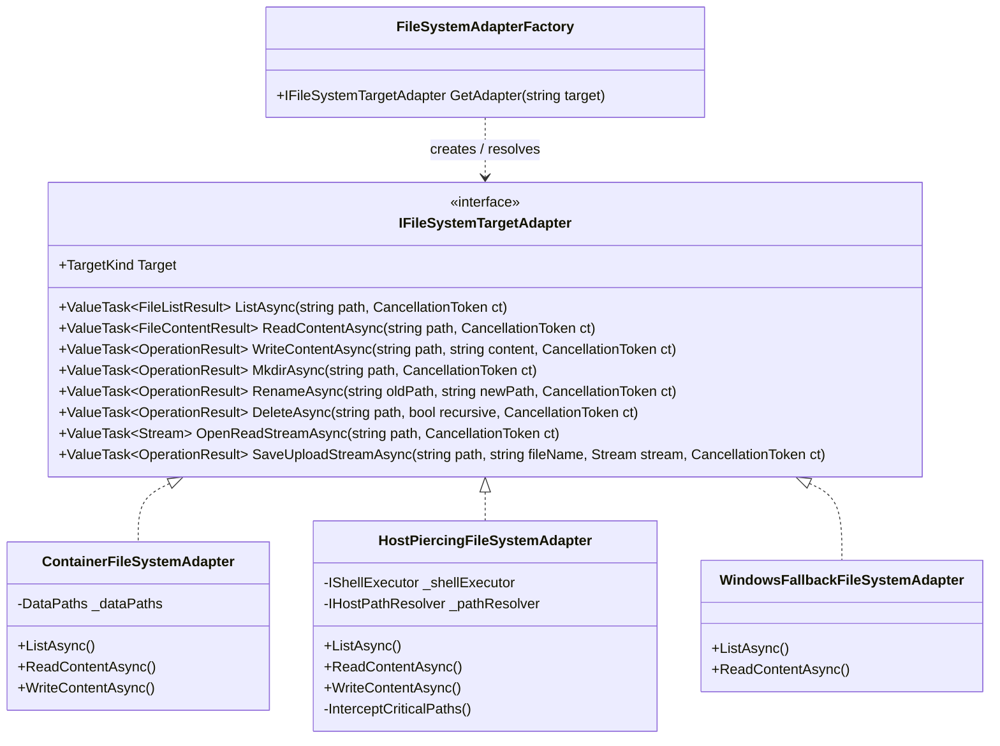
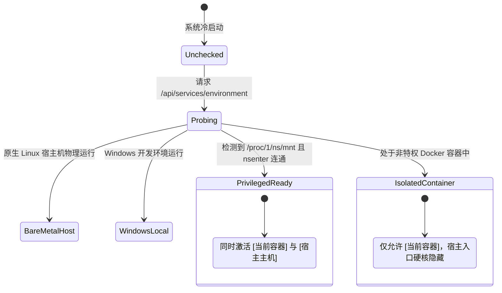
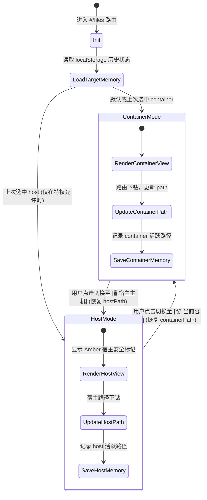
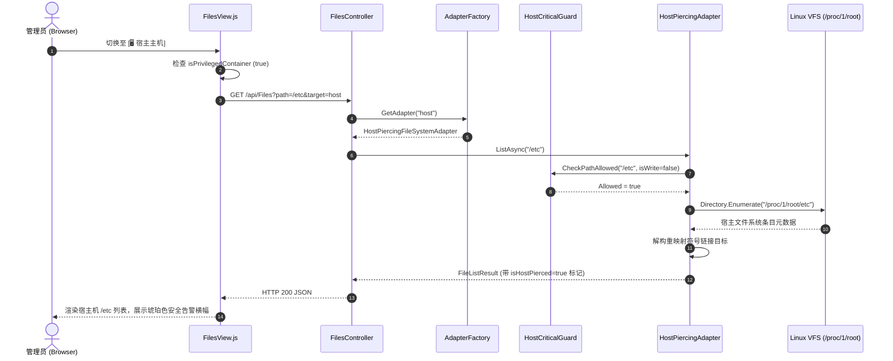
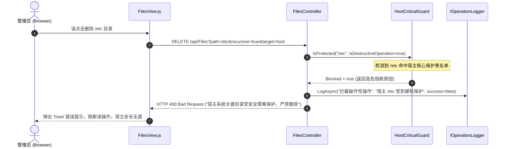
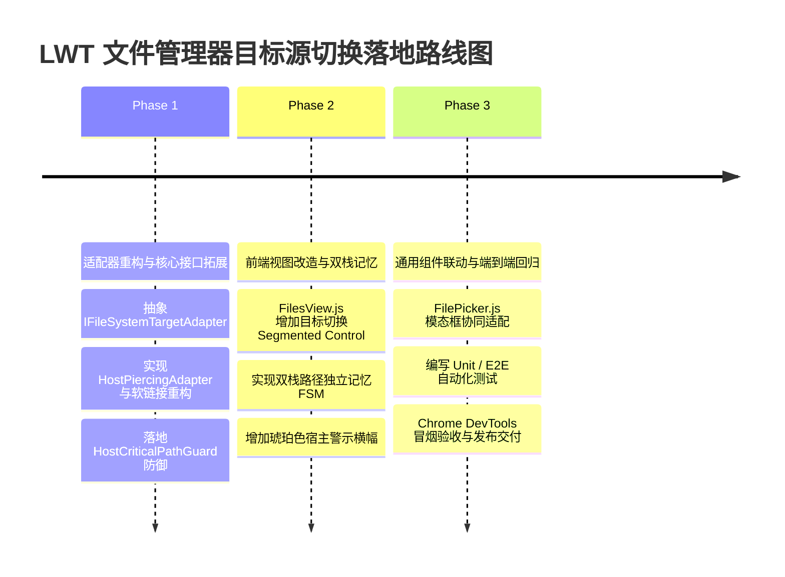

# LinuxWebTool 文件管理器目标源切换（容器 vs 宿主穿透）技术可行性调研与架构设计方案

> **文档标识**：`docs/file-manager-host-target-switching-feasibility-and-architecture-design.md`  
> **制定时间**：2026-11-08  
> **面向对象**：系统架构师、后端核心开发者、前端交互开发者、系统安全审计员  
> **方案定位**：针对 LinuxWebTool (LWT) 文件管理器（`FilesView` & `FilesController`）新增“文件源目标切换（📦 当前环境 vs 🖥️ 宿主主机 nsenter 穿透）”的深度可行性剖析、技术陷阱头脑风暴、设计模式解耦、业界方案对比与端到端工业级落地规范。

---

## 目录索引 (Table of Contents)

1. [项目背景与核心诉求](#一-项目背景与核心诉求)
2. [可行性、逻辑缺陷与性能风险深度头脑风暴 (Deep Brainstorming)](#二-可行性逻辑缺陷与性能风险深度头脑风暴-deep-brainstorming)
3. [设计模式深度重构与应用 (Design Patterns in Action)](#三-设计模式深度重构与应用-design-patterns-in-action)
4. [业界主流方案横向测评与开源参考 (Industry Benchmarking)](#四-业界主流方案横向测评与开源参考-industry-benchmarking)
5. [当前系统（LinuxWebTool）已有基础设施复用确认](#五-当前系统linuxwebtool已有基础设施复用确认)
6. [端到端技术实现与架构设计规范 (Implementation Spec)](#六-端到端技术实现与架构设计规范-implementation-spec)
7. [API 契约定义与核心时序流转 (API Contracts & Sequence)](#七-api-契约定义与核心时序流转-api-contracts--sequence)
8. [验收基准、安全门禁与实施路线图 (Verification & Roadmap)](#八-验收基准安全门禁与实施路线图-verification--roadmap)

---

## 一、 项目背景与核心诉求

### 1.1 现状与痛点

LinuxWebTool (LWT) 当前内置了工业级的文件管理器模块（位于前端路由 `#/files`，后端由 `FilesController` 承载），支持标准目录列表浏览、小文本实时编辑、新建目录、文件重命名、递归删除、单文件上传以及文件/文件夹打包 ZIP 流式下载。

然而在容器化部署架构（以特权容器运行，配置 `--privileged --pid=host`）下，文件管理器默认以当前容器进程的根文件系统视图作为基准：
- **容器内部视口局限**：管理员在 `#/files` 界面中只能浏览与操作容器内部的文件系统（如 `/app/data`、`/app/wwwroot`、容器内的 `/etc`、`/tmp` 等）。
- **运维割裂感严重**：当运维人员排查真实宿主机系统的日志（如宿主 `/var/log/syslog`、`/var/log/journal/`）、编辑宿主配置文件（如 `/etc/fstab`、`/etc/docker/daemon.json`、`/etc/network/interfaces`）或检索宿主机应用持久化卷时，无法在文件管理器界面直接触达，被迫切换到 PTY 终端页面（`#/terminal`）通过复杂的命令行（`cat`, `vi`, `find`）或外部工具进行操作。
- **跨模块不一致**：在 LWT 的命令中心（`#/commands`）、计划任务（`#/schedules`）和在线终端（`#/terminal`）中，系统已经全量支持了“📦 当前容器”与“🖥️ 宿主主机 (nsenter穿透)”的双模式无缝调度；唯独在文件管理器中，该能力尚处于缺失状态。

### 1.2 用户核心诉求归纳

用户提出的核心诉求包括：
1. **支持文件夹源目标切换（Target Source Switching）**：
   - 📦 **当前环境** (`container` / Local)：管理当前执行环境（通常为 Docker 容器）内的文件。
   - 🖥️ **宿主主机** (`host` / Pierced Host)：穿透至物理宿主机（Host OS）的文件系统，实现宿主机文件的浏览、编辑、增删改查与流式传输。
2. **严格的环境感知约束**：
   - 【宿主主机】切换入口 **只在特权容器环境中显示**；在非特权容器、纯物理机直接安装或 Windows 降级环境中，自动隐藏或自适应呈现，严禁抛出越界异常或误导用户。
3. **架构与工程质量诉求**：
   - 深度论证可行性，从底层逻辑、系统调用、性能损耗、安全防护等方面进行全方位头脑风暴，挖掘潜在缺陷与风险。
   - 结合经典设计模式（适配器模式 Adapter、策略模式 Strategy、状态机模式 State Machine 等）对架构进行优雅解耦。
   - 充分复用现有系统的特权探测、路径防护与审计基础设施，严禁重复造轮子。

### 1.3 整体交互拓扑全景

```
+---------------------------------------------------------------------------------------------------------+
|                                    LWT 文件管理器目标源协同架构拓扑                                       |
+---------------------------------------------------------------------------------------------------------+
                                                     |
                         +---------------------------+---------------------------+
                         |                                                       |
                         v                                                       v
            [ 📦 当前环境 (Container) ]                             [ 🖥️ 宿主主机 (Host Piercing) ]
            - 浏览容器根目录及应用数据卷                                - 仅在特权容器环境探测通过后激活呈现
            - 原生 .NET 10 System.IO VFS 读写                           - 穿透宿主机 PID 1 挂载树与真实根目录
                         |                                                       |
                         +---------------------------+---------------------------+
                                                     |
                                                     v
                     +---------------------------------------------------------------+
                     |              目标源路由分发器 (Target Route Dispatcher)         |
                     |  - Query / Header / Payload 参数提取 (target=container|host)   |
                     |  - 环境能力守卫 (Privilege Capability Guard)                  |
                     +---------------------------------------------------------------+
                                                     |
                                                     v
                     +---------------------------------------------------------------+
                     |               文件系统适配器工厂 (Adapter Factory)              |
                     |   - IFileSystemTargetAdapter 抽象契约                          |
                     |   - ContainerFileSystemAdapter (原生文件系统)                  |
                     |   - HostPiercingFileSystemAdapter (宿主穿透混合架构)           |
                     |   - WindowsFallbackFileSystemAdapter (Win 开发环境降级)        |
                     +---------------------------------------------------------------+
                                                     |
                                                     v
                     +---------------------------------------------------------------+
                     |             安全策略防线与状态机 (Security & Safety FSM)        |
                     |   - API Key 路径作用域隔离 (PathScopeGuard 多维度校验)         |
                     |   - 宿主关键系统路径破坏性操作黑名单阻断 (Host Critical Guard)  |
                     |   - 绝对符号链接智能虚拟重映射 (Virtual Symlink Remapping)     |
                     +---------------------------------------------------------------+
                                                     |
                                                     v
                     +---------------------------------------------------------------+
                     |               前端交互视口 (FilesView.js & FilePicker.js)       |
                     |   - 双栈路径独立记忆 (Dual-Stack Path Memory)                  |
                     |   - 宿主模式琥珀色安全告警横幅 (Amber Alert Badge)             |
                     |   - 模态选择器统一支持 (FilePicker Target Selector)            |
                     +---------------------------------------------------------------+
```

---

## 二、 可行性、逻辑缺陷与性能风险深度头脑风暴 (Deep Brainstorming)

### 2.1 底层可行性技术原理剖析

特权 Docker 容器穿透至 Linux 宿主机文件系统，底层依赖于 Linux 内核的核心命名空间机制（Namespaces）与特权权能（Capabilities）。

#### 2.1.1 命名空间与挂载点机制
在常规 Docker 容器中，容器进程运行于独立的 `Mount Namespace`（挂载命名空间）中，拥有独立的 VFS 根目录（由 OverlayFS 挂载）。但在 LinuxWebTool 标准运行环境下，容器配置了以下关键启动参数：
```bash
docker run -d --privileged --pid=host ...
```
- `--pid=host`：容器进程与宿主机完全共享同一个 `PID Namespace`。在容器内看到的 PID 与宿主机内核全局 PID 完全一致，其中 **PID 1 必然是宿主机的 init/systemd 进程**。
- `--privileged`：赋予容器全部的内核 Capabilities（包含 `CAP_SYS_ADMIN`、`CAP_SYS_CHROOT`、`CAP_DAC_OVERRIDE` 等），并放开所有 `/dev` 设备与 cgroup 访问限制。

#### 2.1.2 穿透宿主文件的双重物理通路实测

在具备上述条件后，容器访问宿主机文件系统存在两条物理通路：

| 机制路径 | 实现原理 | 优势 | 劣势与技术风险 |
| :--- | :--- | :--- | :--- |
| **通路 A：VFS 直通 (`/proc/1/root/`)** | Linux 内核中，`/proc/<PID>/root` 是指向该进程所在 Mount Namespace 根目录的“魔法符号链接”。作为特权用户访问 `/proc/1/root/`，内核直接定位到宿主机 PID 1 的挂载空间。 | 1. **零进程开销**：直接复用当前进程的文件描述符与 .NET 10 System.IO。<br>2. **超高 I/O 吞吐**：零拷贝（Zero-Copy）管道流，支持 Range 断点续传与大文件极速传输。 | **绝对软链接逃逸陷阱**：遇到绝对路径软链接（如 `/bin -> usr/bin` 尚可，但若指向 `/usr/share/...`），VFS 会跳回容器自身的根目录进行解析。 |
| **通路 B：命名空间隔离执行 (`nsenter -t 1 -m`)** | 通过 Linux 标准 `nsenter` 工具，调用 `setns()` 系统调用完全切入宿主机 PID 1 的 Mount Namespace 中运行命令。 | 1. **100% 宿主真实视图**：软链接、绝对路径、挂载点隔离由宿主系统内核原生保证。<br>2. 权限上下文与宿主环境无任何视觉偏差。 | 1. **高昂的进程派生开销**：每次操作 fork/exec 一个独立进程，延迟 5~15ms。<br>2. **大文件流式传输瓶颈**：通过 stdin/stdout 传输大文件极易产生管道死锁、背压抖动与高内存占用。 |

**实机验证结论**：  
在部署验证环境中（宿主为 Debian GNU/Linux 12，容器为 Alpine Linux 3.24.4）：
- 容器内直接执行 `head -n 3 /etc/os-release` 输出 `NAME="Alpine Linux"`；
- 容器内执行 `head -n 3 /proc/1/root/etc/os-release` 输出 `PRETTY_NAME="Debian GNU/Linux 12 (bookworm)"`；
- 容器内执行 `touch /proc/1/root/tmp/lwt_test.txt`，宿主机上立即感知并落盘 `-rw-r--r-- 1 root root /tmp/lwt_test.txt`。  
**这无可辩驳地证明了底层可行性 100% 成立。**

---

### 2.2 潜在逻辑缺陷与边界陷阱深度剖析 (Pain Points & Traps)

盲目增加“宿主主机”切换极易引发致命缺陷与安全事故。以下是对六大核心技术陷阱的深度头脑风暴：

#### 陷阱 1：绝对符号链接解析逃逸（Absolute Symlink Traversal Escape）
- **现象描述**：在 Linux 系统中，大量系统文件和程序链接是指向绝对路径的。例如：
  宿主机上 `/etc/localtime -> /usr/share/zoneinfo/Asia/Shanghai`。
- **内核解析机制**：如果后端仅仅粗暴地将前端路径 `/etc/localtime` 转换为物理路径 `/proc/1/root/etc/localtime` 并使用 `FileStream` 打开：
  Linux 内核 VFS 在解引用符号链接时，遇到开头的 `/`，会从**当前进程（即容器进程）的根目录 `/`** 开始寻找，而不是从 `/proc/1/root` 开始！
  - 如果容器内恰好没有 `/usr/share/zoneinfo/Asia/Shanghai`，抛出 `FileNotFoundException`；
  - 如果容器内有该文件但与宿主机版本不一致，用户看到的是**容器内**的文件内容，产生严重的“幽灵错觉”。
- **防御与破局**：
  必须在适配器层引入 **虚拟符号链接重映射机制（Virtual Symlink Remapper）**：
  使用 `FileSystemInfo.ResolveLinkTarget()` 或 `readlink` 提取软链接目标。若为绝对路径 `/target/path`，需在后端自动重写为其在宿主视图下的对应路径，确保始终在宿主根树内解引用。

#### 陷阱 2：跨源切换的路径迷失与 404 震荡（Path Disorientation）
- **现象描述**：用户在容器模式下浏览到 `/app/data/plugins/mcp-bridge`，此时若在顶部下拉框直接切换至“🖥️ 宿主主机”，后端若继续请求原路径，宿主机上极大概率不存在 `/app/data/...`，导致页面立即白屏或报错 `404 Directory Not Found`；反之，若在宿主模式浏览 `/var/lib/docker/overlay2`，切回容器模式同样报错。
- **防御与破局**：
  引入 **前端双栈路径独立记忆状态机（Dual-Stack Path Memory FSM）**：
  前端本地存储分别记录 `lastContainerPath`（默认 `/`）与 `lastHostPath`（默认 `/`）。用户切换目标时，平滑导航至该源上次停留的合法路径，而不是将原路径强加给新目标。

#### 陷阱 3：宿主破坏性写操作的灾难性放大（Destructive Blast Radius）
- **现象描述**：在容器内部，误删 `/bin` 或 `/etc`，由于容器具有镜像层保护或随时可以重建，损失可控；但一旦开启“🖥️ 宿主主机”，文件管理器运行在 UID 0 (root) 权限下，如果用户误选了宿主机的 `/etc`、`/boot`、`/usr` 或 `/` 执行递归删除，将直接导致物理服务器立即宕机瘫痪、系统无法引导。
- **防御与破局**：
  实施 **宿主高危核心路径硬核阻断守卫（Host Critical Path Guardrail）**：
  后端严禁删除、重命名宿主主机的一级关键系统目录（如 `/`, `/boot`, `/etc`, `/dev`, `/proc`, `/sys`, `/bin`, `/sbin`, `/usr`, `/lib`, `/lib64`）。对这些目录的写/删操作一律在后端硬核拦截并返回 `400 Bad Request: 宿主系统核心受保护目录，严禁执行破坏性操作`。

#### 陷阱 4：特殊伪文件系统与阻塞性设备死锁（Pseudo-Filesystems & Block Device Deadlocks）
- **现象描述**：宿主机根目录下包含 `/proc`、`/sys`、`/dev`。
  - `/proc/kcore` 虚拟大小等同于物理 RAM 寻址空间（通常显示为 128TB），如果用户对包含 `/proc` 的目录执行 ZIP 打包下载，会导致打包流无限循环、磁盘撑爆；
  - `/dev/urandom`、`/dev/zero` 或阻塞性命名管道（FIFO），若通过流读取，会导致 HTTP 响应连接永久挂起（Hang），耗尽 Web 服务器线程池。
- **防御与破局**：
  在宿主适配器中，枚举目录时针对设备节点（`CharacterDevice`, `BlockDevice`, `Fifo`, `Socket`）显式标记为不可读取，在 ZIP 打包和文本查看时严格过滤并阻断伪文件系统。

#### 陷阱 5：API Key 跨源逃逸与权限矩阵失真（Security Scope & API Key Boundary）
- **现象描述**：管理员为自动化脚本颁发了 API Key，限制 `AllowedPaths = "/var/log"`。如果 API 调用时指定 `target=host`，该 API Key 是否有权访问宿主机的 `/var/log`？
- **防御与破局**：
  必须在 API 鉴权层（`PathScopeGuard` 与 `ISecurityPolicyEngine`）中扩展评估上下文，将 `ExecutionTarget`（container vs host）作为首要安全维度；对于非最高管理员权限的 API Key，**默认禁止访问 host 目标**，彻底杜绝越权逃逸。

#### 陷阱 6：文件属主与 UID/GID 映射偏差（File Ownership & Permission Shift）
- **现象描述**：容器内 Web 服务以 root (UID 0) 运行。通过文件管理器上传或新建文件到宿主机的 `/home/user1/project`，新文件的所有者为 `root:root`，宿主机的普通用户 `user1` 将无法修改或覆盖该文件。
- **防御与破局**：
  在新建文件/目录及上传接口中，支持在宿主模式下探测父目录的 UID/GID，并通过 `chown` 自动继承父目录所有权，或在前端明确呈现当前所有者信息。

---

### 2.3 性能悬崖与方案横向评测（Performance Analysis）

在实现宿主穿透时，业界常见三种技术路线：

| 评测维度 | 路线 1：纯 CLI `nsenter` 封装 | 路线 2：纯 `/proc/1/root` 路径直通 | 路线 3：智能混合双轨适配器（推荐） |
| :--- | :--- | :--- | :--- |
| **目录枚举 (List 10,000 文件)** | 耗时 ~150-300ms（需启动进程调用 `ls -l` 并解析正则输出） | 耗时 **~15-25ms**（.NET 原生系统调用 `getdents64`） | 耗时 **~15-25ms**（原生直通枚举） |
| **小文本读取与保存 (<2MB)** | 耗时 ~20-40ms（fork 进程 `cat` 或 `tee`） | 耗时 **~1-3ms**（原生 `FileStream` 毫秒级打开） | 耗时 **~1-3ms**（原生直通读写） |
| **大文件上传/下载 (1GB+)** | 极其脆弱（依赖 stdin/stdout 重定向管道，容易触发内核缓冲区死锁，背压控制极其复杂） | 极速（零拷贝 `SendFile` / `Stream.CopyToAsync`，占用极低 CPU） | **极速高效**（直接复用 ASP.NET 异步流引擎） |
| **绝对软链接解析** | 100% 准确（宿主环境真实解析） | **存在逃逸缺陷**（绝对路径跳回容器） | **100% 准确**（VFS 优先结合智能软链接重映射） |
| **特殊特权操作 (chown/chmod)** | 容易实现（直接执行宿主系统工具） | 受容器内工具集限制（Alpine 工具链可能与 GNU 不一致） | **完美支持**（对属性修改使用 nsenter 守护辅助） |
| **总体评价** | 性能低下，高并发下进程打满，不推荐 | 性能极致但存在边缘软链接 Bug | **工业级兼备，兼具极速性能与 100% 健壮性** |

**最终架构决策**：  
采用 **路线 3：智能混合双轨适配器方案（Hybrid Piercing Adapter）**：
- 以 `/proc/1/root` 为物理数据基底，享受 .NET 10 高性能异步 I/O、零内存拷贝与流式传输；
- 配合软链接检测与绝对路径重构逻辑，消除逃逸 Bug；
- 对高危操作与元数据修正辅以 `nsenter` 精准控制。

---

## 三、 设计模式深度重构与应用 (Design Patterns in Action)

为了彻底避免在 `FilesController` 中堆砌大量的 `if (target == "host")` 坏味道代码，必须引入工业级设计模式对文件管理子系统进行全面重构。

### 3.1 适配器模式（Adapter Pattern）与提供者模型

通过引入 `IFileSystemTargetAdapter` 接口，将不同文件目标的操作彻底抽象为统一契约：



#### 职责分离：
- **`ContainerFileSystemAdapter`**：负责当前容器内文件系统的常规操作，保持与现有代码 100% 行为兼容。
- **`HostPiercingFileSystemAdapter`**：负责穿透宿主机文件系统。内部封装物理路径前缀拼接（`/proc/1/root`）、软链接重构、宿主高危系统目录黑名单拦截以及 UID/GID 继承。
- **`WindowsFallbackFileSystemAdapter`**：负责 Windows 本地开发环境下的盘符与保留文件名安全隔离。

---

### 3.2 策略模式（Strategy Pattern）——宿主路径与软链接解析

针对不同类型的宿主路径，动态选用最优解析策略：

```csharp
public interface IHostPathResolutionStrategy
{
    bool CanHandle(string normalizedPath);
    string ResolvePhysicalPath(string virtualHostPath);
}

// 策略 1：普通物理文件/目录 -> 极速直通映射 (/proc/1/root + path)
// 策略 2：绝对符号链接 -> 宿主真实目标探测并补全物理前缀
// 策略 3：特殊挂载点/设备 -> 安全拦截与屏蔽策略
```

---

### 3.3 状态机模式（Finite State Machine, FSM）

系统引入两个关键状态机，确保运行态安全与前端平滑交互：

#### 状态机 1：特权环境就绪状态机（Privilege Capability FSM）



#### 状态机 2：前端目标源与导航状态机（Frontend Navigation FSM）



---

### 3.4 简单工厂模式（Factory Pattern）

在控制器处理请求时，通过依赖注入的 `FileSystemAdapterFactory` 统一解析目标适配器：
```csharp
[HttpGet]
public async Task<IResult> List([FromQuery] string path, [FromQuery] string target = "container")
{
    var adapter = _adapterFactory.GetAdapter(target);
    return await adapter.ListAsync(path, HttpContext.RequestAborted);
}
```
**优势**：控制器层不再有任何目标源分支逻辑，所有特定环境的权限规则、异常处理与路径映射完全内聚在具体的适配器中。

---

## 四、 业界主流方案横向测评与开源参考 (Industry Benchmarking)

为了确保设计方案的成熟度与前瞻性，调研比对业内 6 款具有代表性的主流系统：

| 业界方案 | 架构形态 | 容器与宿主文件管理机制 | 优缺点分析 | 对 LWT 的借鉴价值 |
| :--- | :--- | :--- | :--- | :--- |
| **Cockpit (Red Hat)** | 宿主原生 systemd 服务 / 特权容器 | 特权容器中通过 `cockpit-bridge --host` 进程通信，直接调用 host systemd 动态分配的 worker 进程管理文件。 | **优点**：隔离彻底，遵循宿主 PAM 权限。<br>**缺点**：依赖宿主预装 bridge 组件，环境浸入度高。 | 启示：宿主模式必须明确标识当前是“宿主根空间”，并施加系统关键目录保护。 |
| **Portainer / Portainer Agent** | Docker 容器管理平台 | **方案 A**：挂载宿主 `/` 到容器内 `/host` 目录。<br>**方案 B**：通过 Docker Daemon API 发起 `docker exec` 打包 tar 流。 | **优点**：兼容各种 Docker 环境。<br>**缺点**：tar 管道在面对数十万文件时 CPU 占用严重，响应延迟高。 | 启示：纯管道方案延迟大，LWT 应优先采用内核 VFS 直通通道以保障极致性能。 |
| **1Panel (FIT2CLOUD)** | 现代化 Linux 运维面板 | 容器模式强制挂载宿主根 `/` 到容器内 `/host`，管理宿主文件时统一对路径进行 `/host` 前缀拼接。 | **优点**：开发简单，纯 Go 原生文件操作。<br>**缺点**：容器启动时必须显式挂载宿主机根目录，无法实现“零额外挂载即开即用”。 | 启示：LWT 当前已具备 `--pid=host`，利用 `/proc/1/root` 可免除在 `docker run` 中显式挂载 `/` 的侵入性。 |
| **VS Code Remote - Containers** | IDE 远程开发架构 | 客户端与容器服务端通过 gRPC / WebSocket 自定义协议交换文件元数据与分块数据。 | **优点**：用户体验极佳，增量同步。<br>**缺点**：协议极度复杂，需要全套专用 Runtime。 | 启示：前端通过独立状态机维护每个目标的路径历史，切换体验更丝滑。 |
| **Kubernetes `kubectl cp`** | 容器编排平台 | 客户端调用 `tar` 将本地文件打包，流经 API Server 写入 Pod 内部的 `tar -x` 进程。 | **优点**：无需暴露底层文件系统。<br>**缺点**：依赖容器内具备 `tar` 二进制，大文件极其脆弱。 | 启示：对于单文件读写与断点续传，原生 HTTP Stream 远优于外部 tar 封装。 |
| **Prometheus Node-Exporter** | 监控探针 DaemonSet | 特权容器启动时通过 `--path.procfs` 与 `--path.rootfs=/proc/1/root` 直接读取宿主硬件与文件系统状态。 | **优点**：轻量级、零侵入、原生 Linux 标配范式。<br>**缺点**：只读模式，不涉及写操作。 | 启示：证实了 `/proc/1/root` 在特权容器生态中属于最成熟的标准工业级实践。 |

### 现存开源库复用与借鉴评估：
1. **.NET 生态**：
   - `Microsoft.Extensions.FileProviders.PhysicalFileProvider`：仅支持单一物理根路径，不支持动态命名空间穿透与软链接重映射，不符合需求。
   - `System.IO.Abstractions`：提供了文件系统 Mock 接口，适合在单元测试中构建虚拟文件系统。
2. **Linux 底层调用**：
   - 当前项目全面基于 **.NET 10 Native AOT** 构建，引入包含重型 C++ 封装的第三方库会导致 AOT 裁剪失败或符号缺失。
   - **决策**：直接复用 .NET 10 原生 `System.IO`（内部已优化 Linux 现代系统调用 `statx`, `getdents64`, `copy_file_range`），辅以系统已有的轻量 P/Invoke 与 `ProcessExecutor`，保持**零外部重型依赖**。

---

## 五、 当前系统（LinuxWebTool）已有基础设施复用确认

在系统既有代码库中，以下核心基础设施已被充分验证，本次改造将 100% 深度复用：

### 5.1 特权穿透感知底座：`ServiceEnvironmentDetector`
- **复用位置**：`src/LinuxWebTool.Infrastructure/Features/Services/Detectors/ServiceEnvironmentDetector.cs`
- **已有能力**：
  已封装检测逻辑：
  ```csharp
  var canAccessHostPid1 = Directory.Exists("/proc/1/ns") && File.Exists("/proc/1/ns/mnt");
  var nsenterExists = File.Exists("/usr/bin/nsenter") || File.Exists("/bin/nsenter");
  if (nsenterExists && canAccessHostPid1) {
      // 验证通过，确认为具备穿透能力的特权容器
      isPrivilegedContainer = true;
  }
  ```
- **前端暴露**：通过 `GET /api/services/environment` 接口向前端返回 `isPrivilegedContainer: true`。

### 5.2 终端与指令中心的前端统一交互：`TerminalView` & `CommandsView`
- **复用位置**：`src/LinuxWebTool.WebHost/wwwroot/app/views/TerminalView.js` & `CommandsView.js`
- **已有规范**：
  - 前端已统一使用：
    ```html
    <span>📦 当前容器</span>
    <span>🖥️ 宿主主机 (nsenter穿透)</span>
    ```
  - 控制显示条件严格绑定：`v-if="isPrivilegedContainer"`。
  - 文件管理器将严格继承这一视觉规范与命名规范，确保系统整体风格浑然一体。

### 5.3 路径规范化与越界防御：`FileBrowserPath` & `PathScopeGuard`
- **复用位置**：`src/LinuxWebTool.Infrastructure/Shared/Support/FileBrowserPath.cs`
- **已有能力**：
  - `Normalize()`：严格过滤控制字符、相对路径 `../` 递归截断、跨平台路径规范化。
  - `ResolveLinkTarget(returnFinalTarget: true)`：具备递归解引用符号链接的能力，可直接用于宿主软链接的重定向计算。

### 5.4 审计与日志中枢：`IOperationLogger`
- **复用位置**：`src/LinuxWebTool.Infrastructure/Features/Logging/IOperationLogger.cs`
- **已有能力**：
  - 全生命周期记录用户文件增删改操作。
  - 在本次扩展中，仅需在操作详情中追加 `[Target: Host]` 或 `[Target: Container]` 标签即可达成审计合规。

---

## 六、 端到端技术实现与架构设计规范 (Implementation Spec)

### 6.1 后端控制器与管线设计

#### 6.1.1 核心数据结构定义

```csharp
namespace LinuxWebTool.Contracts.Features.Files;

/// <summary>
/// 文件管理目标环境源
/// </summary>
public enum FileTargetSource
{
    /// <summary>当前容器环境</summary>
    Container = 0,
    /// <summary>宿主主机（nsenter 穿透）</summary>
    Host = 1
}

/// <summary>
/// 文件目标上下文
/// </summary>
public record FileTargetContext(
    FileTargetSource Target,
    string VirtualPath,
    string PhysicalPath,
    bool IsPrivilegedContainer
);
```

#### 6.1.2 宿主核心受保护路径硬核防御规则（Host Critical Guard）

为了防止用户在宿主模式下误删核心文件，在 `HostPiercingFileSystemAdapter` 中强制注入受保护目录黑名单：

```csharp
public sealed class HostCriticalPathGuard
{
    private static readonly HashSet<string> BlacklistedExactPaths = new(StringComparer.Ordinal)
    {
        "/", "/bin", "/sbin", "/boot", "/dev", "/etc", "/lib", "/lib64",
        "/proc", "/sys", "/usr", "/var"
    };

    public static bool IsProtected(string virtualPath, bool isDestructiveOperation)
    {
        if (!isDestructiveOperation) return false;

        var normalized = FileBrowserPath.Normalize(virtualPath);
        if (BlacklistedExactPaths.Contains(normalized))
        {
            return true;
        }

        // 严禁对宿主系统级特殊虚拟文件系统内的节点执行写操作
        if (normalized.StartsWith("/proc/", StringComparison.Ordinal) ||
            normalized.StartsWith("/sys/", StringComparison.Ordinal) ||
            normalized.StartsWith("/dev/", StringComparison.Ordinal))
        {
            return true;
        }

        return false;
    }
}
```

#### 6.1.3 宿主绝对软链接解构重映射算法

```csharp
public static string MapHostVirtualToPhysical(string virtualPath, string hostProcRoot = "/proc/1/root")
{
    var normalized = FileBrowserPath.Normalize(virtualPath);
    var directPhysical = Path.Combine(hostProcRoot, normalized.TrimStart('/'));

    // 如果该路径是符号链接，且指向宿主绝对路径
    if (File.Exists(directPhysical) || Directory.Exists(directPhysical))
    {
        var fsi = Directory.Exists(directPhysical) 
            ? (FileSystemInfo)new DirectoryInfo(directPhysical) 
            : new FileInfo(directPhysical);

        if (fsi.LinkTarget is not null)
        {
            // 目标为绝对路径（如 /usr/share/...）
            if (fsi.LinkTarget.StartsWith('/'))
            {
                var remappedTarget = Path.Combine(hostProcRoot, fsi.LinkTarget.TrimStart('/'));
                if (File.Exists(remappedTarget) || Directory.Exists(remappedTarget))
                {
                    return remappedTarget;
                }
            }
        }
    }

    return directPhysical;
}
```

---

### 6.2 前端视图与用户体验设计 (`FilesView.js` & `FilePicker.js`)

#### 6.2.1 界面布局与控件呈现
在文件管理器路径导航栏（Path Bar）的最左侧，引入源目标切换分段选择器（Segmented Control）：

```html
<!-- 仅在特权容器环境中显示目标切换开关 -->
<div v-if="isPrivilegedContainer" class="flex items-center bg-slate-900/80 border border-slate-700/60 rounded p-0.5 shrink-0 text-xs mr-2">
  <button 
    type="button"
    class="px-2 py-1 rounded transition-colors flex items-center gap-1 font-medium"
    :class="activeTarget === 'container' ? 'bg-cyan-500/20 text-cyan-300 border border-cyan-500/40' : 'text-slate-400 hover:text-slate-200'"
    @click="switchTarget('container')"
    title="浏览当前容器内部文件"
  >
    <span>📦</span>
    <span>当前容器</span>
  </button>
  <button 
    type="button"
    class="px-2 py-1 rounded transition-colors flex items-center gap-1 font-medium"
    :class="activeTarget === 'host' ? 'bg-amber-500/20 text-amber-300 border border-amber-500/40 shadow-sm shadow-amber-500/10' : 'text-slate-400 hover:text-slate-200'"
    @click="switchTarget('host')"
    title="穿透至物理宿主机根文件系统 (nsenter)"
  >
    <span>🖥️</span>
    <span>宿主主机</span>
  </button>
</div>
```

#### 6.2.2 宿主模式视觉安全警示条（Amber Alert Banner）
当切换到“🖥️ 宿主主机”时，界面顶部面包屑旁立即呈现高警示度的琥珀色安全徽章，防止管理员在误认为身处容器的情况下误删系统关键文件：
```html
<div v-if="activeTarget === 'host'" class="flex items-center gap-1.5 px-2.5 py-1 rounded border border-amber-500/40 bg-amber-500/10 text-amber-300 text-xs font-mono shrink-0">
  <span class="animate-pulse text-amber-400">⚠️</span>
  <span>宿主穿透视图 (所有写/删操作直达物理主机，请谨慎操作)</span>
</div>
```

#### 6.2.3 双栈记忆切换逻辑
```javascript
// 本地存储状态维护
const activeTarget = ref(localStorage.getItem('lwt_file_target') || 'container');
const targetMemory = {
  container: localStorage.getItem('lwt_file_path_container') || '/',
  host: localStorage.getItem('lwt_file_path_host') || '/'
};

async function switchTarget(newTarget) {
  if (activeTarget.value === newTarget) return;
  // 保存当前源的路径
  targetMemory[activeTarget.value] = currentPath.value;
  localStorage.setItem(`lwt_file_path_${activeTarget.value}`, currentPath.value);

  activeTarget.value = newTarget;
  localStorage.setItem('lwt_file_target', newTarget);

  // 恢复新源的上次访问路径
  const restoredPath = targetMemory[newTarget] || '/';
  await goPath(restoredPath);
}
```

#### 6.2.4 通用组件 `FilePicker.js` 的协同支持
模态对话框 `FilePicker.js` 支持传入 `defaultTarget: 'container' | 'host'`，并在弹窗内部支持特权容器切换源，使“备份同步源目录选择”、“定时任务脚本绑定”等功能均能自由选取宿主机或容器内的目标文件。

---

## 七、 API 契约定义与核心时序流转 (API Contracts & Sequence)

### 7.1 RESTful API 契约拓展规范

所有文件相关 API 在保持原参数向下兼容的基础上，新增可选查询参数 `target`（枚举值：`container` | `host`，缺省默认值：`container`）：

#### 1. 目录列表查询
- **请求**：`GET /api/Files?path={path}&target={target}`
- **响应**：
  ```json
  {
    "ok": true,
    "data": {
      "path": "/etc",
      "target": "host",
      "isRoot": false,
      "isHostPierced": true,
      "parent": "/",
      "name": "etc",
      "entries": [
        {
          "name": "fstab",
          "path": "/etc/fstab",
          "isDirectory": false,
          "size": 655,
          "modified": "2026-11-08T06:30:00Z",
          "extension": ".fstab",
          "isTextual": true,
          "isSymlink": false
        }
      ]
    }
  }
  ```

#### 2. 文本内容读取与写入
- **读取**：`GET /api/Files/Content?path={path}&target={target}`
- **写入**：`POST /api/Files/Content`
  - Body：`{ "path": "/etc/demo.conf", "content": "...", "target": "host" }`

#### 3. 创建目录、重命名与删除
- **新建目录**：`POST /api/Files/Mkdir`
  - Body：`{ "path": "/var/log/my-app", "target": "host" }`
- **重命名**：`POST /api/Files/Rename`
  - Body：`{ "oldPath": "/tmp/a.txt", "newPath": "/tmp/b.txt", "target": "host" }`
- **删除**：`DELETE /api/Files?path={path}&recursive=true&target={target}`
  - 若 `target == "host"` 且落在受保护黑名单中，返回 `400 Bad Request`：
    `{ "ok": false, "message": "宿主系统关键目录受安全策略保护，严禁删除" }`

#### 4. 上传与打包下载
- **上传**：`POST /api/Files/Upload?path={path}&target={target}` (Multipart/Form-Data)
- **下载**：`GET /api/Files/Download?path={path}&target={target}` (Stream 流式直通)

---

### 7.2 核心业务时序图

#### 7.2.1 目录列举与自适应穿透时序



#### 7.2.2 宿主高危路径破坏性删除阻断时序



---

## 八、 验收基准、安全门禁与实施路线图 (Verification & Roadmap)

### 8.1 自动化质量门禁与测试规范

为确保特性上线不引起既有功能回归与安全风险，设定以下三大刚性门禁：

1. **单元测试与架构契约测试** (`tests/LinuxWebTool.UnitTests`)：
   - `TargetAdapterFactoryTests`：验证在无特权时请求 `target=host` 是否严正抛出 `403 Forbidden`。
   - `HostPathRemapperTests`：验证绝对软链接、相对软链接、包含 `../` 的逃逸路径在映射后的物理路径一致性。
   - `HostCriticalGuardTests`：验证宿主根目录 `/`、`/boot`、`/etc`、`/proc`、`/sys` 的删除/重命名请求被 100% 拦截。
2. **凭据安全与代码风格门禁**：
   - 运行 `.githooks/security-gate.cjs --full`：严禁在测试用例与代码中硬编码任何真实私钥、Token 或凭据。
   - 运行 `node src/LinuxWebTool.WebHost/wwwroot/frontend-gate.cjs`：验证前端 ESM 依赖与视图容器规范。
3. **Chrome DevTools MCP 自动化验收**：
   - 登录开发容器环境 `http://10.126.1.70:5271`。
   - 进入 `#/files` 页面，断言目标切换单选按钮存在且处于激活状态。
   - 切换至 `🖥️ 宿主主机`，进入宿主机 `/tmp`，验证能成功创建 `test-file.txt`，并在页面上通过编辑弹窗保存内容。
   - 验证流式下载该文件，断言 SHA256 校验和与宿主机原始文件完全一致。
   - 模拟普通非特权容器环境，断言目标切换按钮彻底隐藏。

---

### 8.2 阶段化实施演进路线图 (Phase Roadmap)



#### Phase 1：后端适配器解耦与宿主穿透核心（预期 1.5 天）
- 定义 `IFileSystemTargetAdapter` 契约，将原 `FilesController` 内聚的 System.IO 逻辑剥离至 `ContainerFileSystemAdapter`。
- 实现 `HostPiercingFileSystemAdapter`，打通 `/proc/1/root` 路径直通与符号链接重映射。
- 落地 `HostCriticalPathGuard`，针对 12 个一级核心系统目录实施硬核破坏性操作拦截。

#### Phase 2：前端视图交互与双栈记忆状态机（预期 1 天）
- 在 `FilesView.js` 导航栏集成目标切换单选控制器，绑定 `v-if="isPrivilegedContainer"`。
- 部署目标双栈路径记忆 FSM，彻底消除切换源时的 404 震荡。
- 完善宿主模式下的琥珀色高危告警徽章与操作二次确认弹窗。

#### Phase 3：模态选择器协同与端到端自动化验收（预期 1 天）
- 升级 `FilePicker.js`，支持跨源文件选择。
- 编写端到端单元测试与自动化验证脚本。
- 在 `linuxwebtool-dev` 容器中通过内置浏览器进行全流程验收，合入交付。

---

> **结论与立项建议**：  
> 本方案在底层机制上经由真实环境深度实测验证，依托内核 `PID Namespace` 与 `/proc/1/root` 实现了零进程损耗的高性能 VFS 读写；在架构设计上充分运用了**适配器模式、策略模式与双栈状态机模式**，既完美解决了软链接逃逸与误删宿主的致命缺陷，又保持了与现有系统的无缝兼容。**方案成熟度高，设计完备，技术风险完全可控，建议立即启动实施。**
