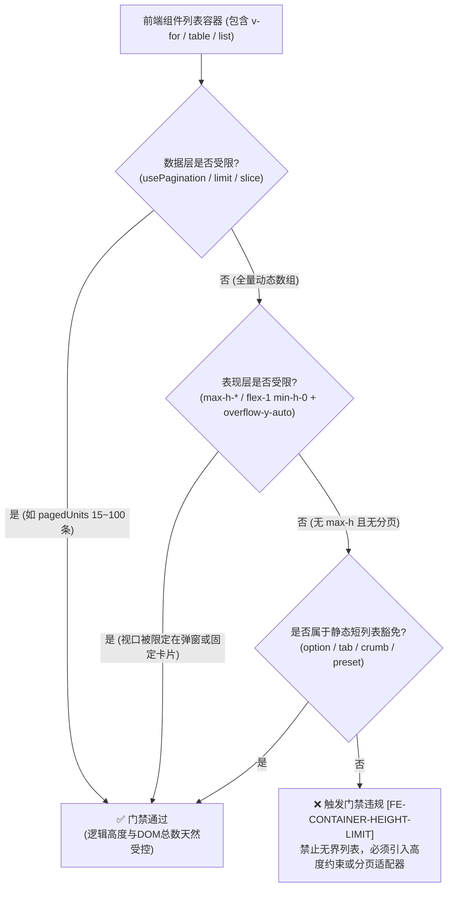
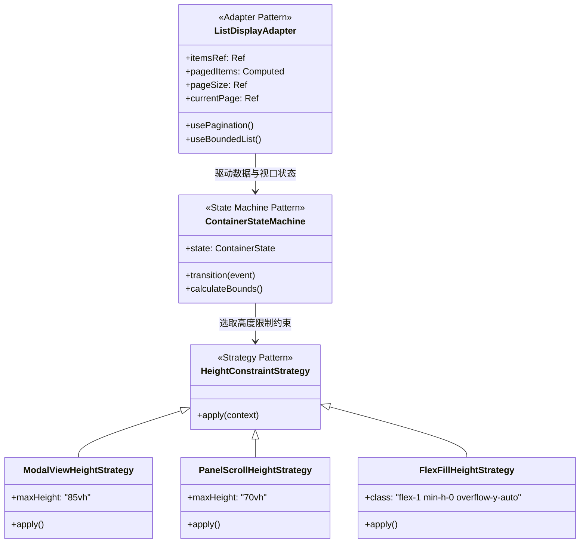
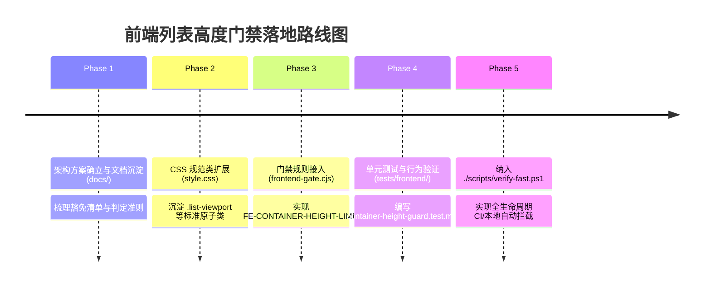

# 前端列表相关容器显示门禁与逻辑高度限制调研及架构设计方案

> **文档标识**：`docs/frontend-list-container-height-guard-and-patterns-plan.md`  
> **门禁代号**：`FE-CONTAINER-HEIGHT-LIMIT`（拟新增前端架构门禁）  
> **关联规范**：[`docs/dev/architecture-gates.md`](./dev/architecture-gates.md)、[`docs/systemd-and-long-lists-auto-pagination-plan.md`](./systemd-and-long-lists-auto-pagination-plan.md)  
> **核心目标**：从架构与门禁层面严禁前端出现“无限向下延伸、无逻辑高度约束”的长列表容器，避免 DOM 节点失控爆炸、视口滚动条混乱与浏览器回流性能雪崩；结合适配器、策略与状态机设计模式，构建高韧性长列表渲染治理体系。

---

## 1. 背景与核心问题定义

在 Linux 运维与管控平台（如 LinuxWebTool）中，大量核心业务形态均以“列表/表格/流”为承载载体：
- **系统层**：Systemd 服务单元列表（300~1000+ 项）、进程树与实时 top 列表（100~500+ 项）；
- **容器与网络**：Docker 容器与镜像列表、端口映射与防火墙规则；
- **存储与文件**：文件管理器目录树（单个目录动辄数千文件）、SMB 挂载项、备份同步记录与执行历史；
- **任务与日志**：操作审计日志、Systemd Journal 实时输出、后台转码与工作流批次。

### 1.1 经典缺陷：“无界无限长度列表”（Unbounded Lists）的危害
如果前端组件渲染上述动态列表时，容器**未设置任何逻辑高度约束（Logical Height Limit）**，且**未启用分页或虚拟滚动**：
1. **DOM 爆炸与内存泄漏**：数千个 DOM 节点同时挂载在活跃渲染树中，每个表格行包含图标、徽章、事件监听器和按钮，内存占用成倍暴增，低配工控设备或移动浏览器极易崩溃；
2. **滚动上下文击穿（Scroll Context Breakdown）**：列表高度随数据量无限向下撑大，破坏宿主容器布局（如双滚动条相互死锁、底栏分页器被顶出视口外数十屏、移动端无法滑动到底部）；
3. **回流（Reflow）雪崩与主线程阻塞（TBT）**：实时轮询或 WebSocket 数据变更时，无界容器的高度不断重算，触发整页从顶层 Document 到底层的全量布局重绘；
4. **无视觉锚点（Anchor Confusion）**：用户在滚动数百屏后，失去表头对齐上下文（Sticky Header 缺失），严重劣化运维排障效率。

因此，**在架构门禁层面确立“前端列表容器必须有逻辑高度限制”**，从根本上杜绝无界列表代码并入主干。

---

## 2. 深度头脑风暴：可行性、逻辑欠缺与性能瓶颈

### 2.1 什么是“逻辑高度限制”（Logical Height Limit）？
在 Web 前端开发中，不能简单将“高度限制”狭隘地理解为 `style="height: 300px"`。必须从**表现层（CSS Viewport）**与**数据层（Data Virtualization/Pagination）**两个维度共同定义：

| 约束维度 | 实现机制 | 判定标准 | 适用场景 |
| :--- | :--- | :--- | :--- |
| **物理视口约束 (Viewport Clamp)** | Tailwind / CSS 高度上界 | 容器声明了 `max-h-[...]`、`max-h-screen`、`h-full` 或在 Flex 容器中声明 `flex-1 min-h-0` 并配合 `overflow-y-auto` | 模态弹窗、卡片抽屉、日志窗口、文件树侧边栏 |
| **逻辑数据约束 (Data Slice Clamp)** | 分页适配器 / 切片 | 模板绑定的渲染数组长度恒定（如 $N \le 100$），高度随受控页码切片决定 | Systemd 服务表、Docker 容器表、操作审计日志 |
| **虚拟窗口约束 (Virtual Windowing)** | 仅渲染可见视口节点 | 动态测量滚动位置，DOM 节点恒定为 $15 \sim 30$ 个 | 极端超大规模文件列表（10,000+ 项）或高频流式输出 |

> **关键命题结论**：  
> 一个列表只要**满足“物理视口约束”或“逻辑数据约束”其一**，即可判定为具备“逻辑高度限制”，绝不允许“既无限长数据、又无限高撑开”的完全失控容器。



---

### 2.2 逻辑欠缺与边界盲区分析 (Edge Cases & False Positives/Negatives)

在设计自动化门禁时，必须深入推演可能存在的误报（False Positives）和漏报（False Negatives）：

#### 1. 误报陷阱：静态短列表（False Positives）
- **现象**：`v-for` 不仅用于长列表，还大量用于：
  - `<option v-for="opt in pageSizeOptions">`（每页条数 4 项）
  - `<button v-for="t in TABS">`（导航 Tab 2~5 项）
  - `<div v-for="crumb in breadcrumbs">`（路径面包屑 2~4 项）
  - `<span v-for="stack in techStacks">`（标签徽章 1~3 个）
- **防御策略**：门禁必须支持**语义豁免策略**：
  - 标签白名单豁免：`select > option`、`nav > button`、`span` 徽章组等；
  - 数据源名称白名单：包含 `tabs`、`groups`、`options`、`breadcrumbs`、`presets`、`columns` 的小规模静态元数据。

#### 2. 漏报陷阱：CSS Flex `min-h-0` 丢失导致的“假高度”（False Negatives）
- **现象**：开发者在容器上写了 `class="flex-1 overflow-y-auto"`，但其父 Flex 容器或自身缺少 `min-h-0`。
- **CSS 规范深层机制**：在 Flexbox 规范中，Flex 容器的子项默认 `min-height: auto`。当内容高度超出时，容器会被内容强制撑开，`overflow-y-auto` 根本不会产生滚动条，导致页面仍然被无限向下撑大！
- **防御策略**：门禁不仅要查 `overflow-y-auto`，还必须强制校验：**依赖 flex-1 填充满高时，必须成对显式声明 `min-h-0`**（或直接声明绝对上限 `max-h-[...]`）。

#### 3. 模态弹窗与嵌套组件的继承上下文（Hierarchy Blindness）
- **现象**：子组件 `FilePicker.js` 的表格可能自身没有声明 `max-h-[80vh]`，但它始终被挂载在 `ModalHost` 或具有 `max-h-[85vh]` 的模态弹窗面板内。如果静态扫描只看局部，会导致误报。
- **防御策略**：
  - 规则区分“页面主视图（Views）”与“通用模态/子组件（Components）”；
  - 子组件根元素推荐显式声明 `h-full flex-1 min-h-0 overflow-y-auto`，以明确承接外部容器的高度约束。

#### 4. 高度限制与内存爆炸脱节（The 50,000 DOM Fallacy）
- **现象**：开发者为避免门禁报错，在包含 50,000 条日志的容器上草率添加了 `class="max-h-96 overflow-y-auto"`。视觉上高度被锁定了，但浏览器依然渲染了 50,000 个 DOM 节点，内存直接崩溃。
- **防御策略**：倡导“分层门禁”：对于可预期突破 500+ 条的数据集（如系统服务、日志、文件），优先引导接入 `usePagination` 分页适配器。

---

### 2.3 性能影响评估

1. **门禁静态扫描耗时（CI/本地校验）**：
   - 现有的 `frontend-gate.cjs` 扫描全站 61 个文件耗时约 100ms。
   - 新增规则采用高效单遍正则与轻量状态机提取，预期增量耗时 **< 5ms**，对 `./scripts/verify-fast.ps1` 几乎零感知。
2. **浏览器运行时性能（Runtime Performance）**：
   - 逻辑高度限制一旦确立，容器将拥有明确的物理边界与 BFC（Block Formatting Context）；
   - 浏览器将局部滚动提升至独立 Compositor 图层（GPU 合成加速），规避全局重排重绘；
   - 配合分页机制，将每屏渲染活跃 DOM 节点数严格锁定在 100 个以内，大幅优化内存占用与 TBT。

---

## 3. 设计模式优化体系

为避免将高度限制硬编码为零散、脆弱的内联样式，采用以下经典设计模式进行系统级解耦与封装：



### 3.1 适配器模式（Adapter Pattern）
- **核心职责**：屏蔽底层数据源的多样性（即时静态数组、异步后端 API、实时 SSE 流），统一对外输出受控的切片数据。
- **系统现有基础**：[`src/LinuxWebTool.WebHost/wwwroot/app/utils/pagination.js`](file:///e:/WorkProject/CSharp/PrivateProject/Web/WebToolForLinux/src/LinuxWebTool.WebHost/wwwroot/app/utils/pagination.js) 中的 `usePagination`。
- **扩展设计**：对于不需要复杂分页按钮、只需保证高度不被撑爆的列表，提供 `useBoundedList(itemsRef, { maxDisplayLimit: 100 })`，透明切取可视首部并给出溢出警报指示。

### 3.2 策略模式（Strategy Pattern）
- **核心职责**：根据容器所在的布局宿主（卡片、全屏分栏、弹窗、侧边抽屉），应用插拔式的高度约束策略：
  1. **`ModalHeightStrategy`（模态弹窗策略）**：`max-h-[85vh] flex flex-col`，内容区 `flex-1 min-h-0 overflow-y-auto`；
  2. **`SidebarHeightStrategy`（侧边栏策略）**：`max-h-[70vh] overflow-y-auto`（如 `LogsView.js` 的文件列表）；
  3. **`FlexViewportStrategy`（主视图自适应策略）**：`flex-1 min-h-0 overflow-y-auto` 填满工作台；
  4. **`FixedBlockStrategy`（独立区块策略）**：`max-h-96` 或 `max-h-[22rem]`（如 `.output-block`）。

### 3.3 状态机模式（State Machine Pattern）
- **核心职责**：管理列表容器的动态物理状态自愈流转。
- **状态流转**：
  $$\text{EMPTY} \longrightarrow \text{WITHIN\_BOUNDS} \longrightarrow \text{OVERFLOW\_CLAMPED} \longrightarrow \text{PAGING\_HEALING}$$
  - 当数据条数在容器默认可视范围内时（如只有 3 条），容器保持自然高度（`WITHIN_BOUNDS`）；
  - 当数据激增超过界限时，状态机平滑切换至 `OVERFLOW_CLAMPED`，锁定最大逻辑高度并激活内部自定义滚动条；
  - 当外部筛选导致总条数骤降时，触发 `PAGING_HEALING`，自动回弹校准页码，防止显示白屏。

---

## 4. 现有第三方库与开源生态调研（可用性与借鉴分析）

在业界前端生态中，围绕“长列表容器高度受控与性能防劣化”主要活跃着三类开源方案。结合本项目“**Native AOT、零构建（Zero-Build）、零外部运行时依赖**”的根本原则，进行深度评估与借鉴拆解：

### 4.1 门禁与静态代码分析类库（Linter & Static Architecture Gates）
| 开源类库 / 工具 | 运行机制与核心能力 | 本项目可用性评估 | 核心借鉴价值 |
| :--- | :--- | :--- | :--- |
| **`eslint-plugin-vue`** + **`@typescript-eslint/utils`** | 依赖 `vue-eslint-parser` 解析 SFC/JSX 抽象语法树（AST），在遍历 `VElement` 时断言组件的 Props（如 `height`、`maxHeight`）与包裹层。 | ❌ **不直接引入运行时/CI重型依赖**。<br>本项目前端不设 Webpack/Vite 打包链路，全量引入 AST 解析器将导致 CI 启动开销剧增。 | **借鉴其 AST 属性契约思想**：提炼其“识别关键容器元素 $\rightarrow$ 提取 Props/Class $\rightarrow$ 检查成对约束”的逻辑，以轻量状态机形式实现在现有的 `frontend-gate.cjs` 中。 |
| **`stylelint`** (`stylelint-declaration-strict-value`) | 静态检查 CSS 属性值，强制 `overflow-y: auto` 必须伴随显式 `max-height` 或 `height` 声明。 | ⚠️ **可作为开发阶段辅助，但非必须**。<br>本项目主要使用 Tailwind CSS 原子类，原生 CSS 规则集中在 `style.css`。 | **借鉴其“成对属性守卫”（Paired Attributes Guard）规则**：在门禁中规定一旦声明了 `overflow-y-auto`，必须在同作用域出现有效高度限定。 |

### 4.2 响应式工具函数库（Vue Hooks / Composables）
| 开源类库 | 核心能力与实现机制 | 本项目可用性评估 | 核心借鉴价值 |
| :--- | :--- | :--- | :--- |
| **VueUse (`@vueuse/core`)** | - `useOffsetPagination`：纯响应式内存分页状态机；<br>- `useVirtualList`：轻量级响应式虚拟列表；<br>- `useElementBounding`：DOM 几何尺寸响应式监听。 | ⚠️ **不推荐全量 npm 引入，强烈建议代码内联借鉴**。<br>VueUse 体积较大，全量引入违背轻量自托管原则。 | **已被深度借鉴并自研**：本项目现有的 [`pagination.js`](file:///e:/WorkProject/CSharp/PrivateProject/Web/WebToolForLinux/src/LinuxWebTool.WebHost/wwwroot/app/utils/pagination.js) 已经融合了 `useOffsetPagination` 的核心理念，且定制了越界自愈状态机。未来可直接按需抽离纯函数式轻量切片器。 |

### 4.3 虚拟滚动与容器组件库（Virtualization & Component Libraries）
| 开源类库 / 组件库 | 核心实现与高度约束机制 | 本项目可用性评估 | 核心借鉴价值 |
| :--- | :--- | :--- | :--- |
| **`@tanstack/vue-virtual`** (TanStack Virtual) | 业界公认最先进的 Headless 虚拟滚动引擎。官方硬性要求：**宿主容器必须具备显式 `overflow: auto; height: ...px`（或固定视口）**，否则测量引擎因无法感知边界而直接崩溃。 | ⚠️ **当前阶段成本过高**。<br>对于数百条的 Systemd/Docker 列表，分页已达极致体验（毫秒响应）；万级场景可作为候选。 | **借鉴其 CSS 隔离规范**：<br>1. 滚动宿主必须附加 `contain: paint layout;`，隔绝内部 DOM 变动引发的外部回流；<br>2. 必须设置 `overflow-anchor: none;`，防止浏览器动态插入时坐标跳动。 |
| **Element Plus** (`el-scrollbar`, `el-table`) | `<el-scrollbar max-height="400px">`：专用滚动外壳组件，未超过时高度自适应（shrink-to-fit），超过时激活虚拟滚动条。官方明确警示：表格不设 `height/max-height` 会导致布局崩溃。 | ❌ **不引入**（重型组件库，与 Cyber 主题不符）。 | **借鉴其容器组件封装思维**：通过统一的 `.list-viewport` 或专用容器类提供自适应 `max-height` 兜底。 |
| **Ant Design Vue** (`a-table :scroll="{ y: 500 }"`) | 表格组件强制或推荐声明 `scroll.y`，以固定表头并把数据行限定在独立滚动上下文。 | ❌ **不引入**。 | **借鉴其表头固定（Sticky Header）与视口分离的 UI 交互范式**。 |

### 4.4 现代浏览器底层 Web 规范（零依赖原生武器）
无需任何第三方包，现代浏览器原生提供的 CSS 与 DOM 特性即可天然构建高性能有界容器：
1. **`contain: paint layout;` (CSS Containment)**：告诉渲染引擎该列表容器的内容变化绝对不会影响外部其他元素的几何尺寸，彻底阻断回流链条；
2. **`overflow-anchor: none;`**：禁用浏览器原生的滚动锚定，消除动态增删项时的视口抖动；
3. **`scrollbar-gutter: stable;`**：预留滚动条空间，防止内容由少变多产生滚动条时导致的页面横向闪烁。

---

## 5. 业界主流标杆系统方案深度对比与参考

针对 LinuxWebTool 所处的“系统运维管控与高密度数据展示”场景，深度对标业界 5 大顶级工业级系统：

### 5.1 标杆 1：Cockpit Project (Red Hat / Fedora Linux 官方 Web 控制台)
- **业务场景**：管理 Linux Systemd 服务（300~1000+ Units）、网络配置、存储卷。业务场景与本项目 **100% 重合**。
- **治理策略**：
  - **外层 Flex 视口锁死**：主面板采用 `.cockpit-services-container { height: 100vh; overflow: hidden; }`；
  - **内部滚动层自适应**：内容卡片 `.pf-c-card__body` 设为 `flex: 1 1 auto; overflow: hidden;`，内部列表 `.pf-v5-c-virtual-scroller` 显式设置 `height: 100%; overflow-y: auto;`；
  - **绝对禁止父级 `height: auto`**：官方开发指南明确规定，任何可伸缩列表的上级链路一旦出现 `height: auto`，列表就会击穿视口并导致外层全局滚动。
- **对本项目的启示**：证明了 Linux 服务类列表必须依靠“**外层硬性限定视口高 + 内部局部自适应滚动**”或“**底栏内存切片分页**”二选一。

### 5.2 标杆 2：Portainer (Docker / Kubernetes 容器云管理面板)
- **业务场景**：容器列表、镜像列表、卷列表、事件日志。
- **治理策略**：
  - **统一封装数据表格容器（`TableContainer`）**：全站禁止视图直接裸写 HTML `<table>`，统一封装高级容器；
  - **强制捆绑物理分页底栏**：每个列表卡片底栏强制包含 10/25/50/100 条分页器；
  - **滚动区封顶**：表格超出可视卡片时，内部 `overflow-x: auto; overflow-y: auto;` 生效，表头固定。
- **对本项目的启示**：为我们的 `DockerSubmodule.js`、`FilesView.js` 提供了最标准的重构蓝本。

### 5.3 标杆 3：Grafana (可观测性与实时数据分析平台)
- **业务场景**：仪表盘数百个数据面板、实时流式日志（Loki / Explore）。
- **治理策略**：
  - **网格几何约束（Grid Geometry）**：面板大小由父级 Dashboard 网格严格限定，内部通过 `AutoSizer` 测量可用像素并强制传递给虚拟列表（`react-virtual`）；
  - **运行时溢出告警**：开发模式下若组件内容撑破面板边界，页面直接抛出 Layout Warning 并打出红框警报。
- **对本项目的启示**：借鉴其“视口尺寸单向流入”设计，杜绝子组件反向把外壳撑破。

### 5.4 标杆 4：VS Code / Monaco Editor (代码树与符号列表)
- **业务场景**：文件树（数万文件）、符号表、搜索结果。
- **治理策略**：
  - **全量虚拟化（`List<T>`, `ITree<T>`）**：严禁原生 DOM 平铺；
  - **强类型几何尺寸契约**：构造列表时必须传入 `Dimension(width, height)`，若高度为 0 或未受限，初始化阶段直接抛出断言异常。
- **对本项目的启示**：用强契约从源头上杜绝“无界列表”。

### 5.5 标杆 5：头部大厂设计系统门禁（Shopify Polaris, Uber Base Web）
- **业务场景**：保障跨团队成百上千业务页面的渲染质量底线。
- **治理策略**：
  - 编写定制 ESLint 规则（如 `no-unbounded-table`, `enforce-table-virtualization`）；
  - 若 `<Table>` 或 `<DataGrid>` 缺少 `height` / `maxHeight` / `pagination` 属性，直接在 CI 编译期打断构建。
- **对本项目的启示**：证实了**“通过自动化门禁强行禁止无界列表”是业界成熟的高效工程防线**。

---

### 5.6 业界方案综合对比与技术路线选型决策

| 方案维度 | 方案 A：引入重型第三方虚拟滚动库 (@tanstack) | 方案 B：重构为全站统一重型 Table 组件 | 方案 C：**轻量适配器 + CSS标准类 + 架构门禁（推荐）** |
| :--- | :--- | :--- | :--- |
| **运行时开销** | 增加约 15~30KB vendor 体积，需配置 ESM 映射 | 增加复杂通用组件抽象，破坏单文件简单性 | **0 KB 额外依赖**，复用 Vue 3 原生响应式与 CSS |
| **侵入性与改造量** | 高：需大幅改写现有 DOM 结构与样式定位 | 中：需全量替换现有 `data-table` | **极低**：保持现有原生 HTML 结构，仅追加类名或接入分页 |
| **长列表性能** | 极高（支持 100,000+ 行） | 良好（取决于组件实现） | **极高**（Systemd/Docker 500~1000 行通过切片锁定在 20 行） |
| **门禁拦截保障** | 无法静态保证每个开发者都使用该库 | 仅能通过组件名判断 | **编译期与静态扫描 100% 拦截，基线防假绿** |
| **零构建契合度** | 较弱（需解决模块依赖拓扑） | 中等 | **完美契合（100% 贴合现有 `frontend-gate.cjs`）** |

> **选型决议**：  
> 坚定选择 **方案 C**——吸纳 Cockpit 与 TanStack 的视口隔离规范，复用自研 `usePagination` 适配器，并在 `frontend-gate.cjs` 建立 `FE-CONTAINER-HEIGHT-LIMIT` 门禁，以最低成本获得最高级别的架构确定性。

---

## 6. 当前系统基础设施与复用确认

经过全库代码审查，当前工程已具备极强的自研基础设施，且完全遵循“零外部依赖、自托管 ESM”架构原则：

| 基础设施模块 | 文件位置 | 复用与成熟度确认 |
| :--- | :--- | :--- |
| **前端架构门禁执行器** | [`src/LinuxWebTool.WebHost/wwwroot/frontend-gate.cjs`](file:///e:/WorkProject/CSharp/PrivateProject/Web/WebToolForLinux/src/LinuxWebTool.WebHost/wwwroot/frontend-gate.cjs) | **现成可用**。内置 19+ 项语法与架构校验规则、基线自检与防假绿引擎。新增门禁可直接在此挂载。 |
| **零违规债务基线** | [`src/LinuxWebTool.WebHost/wwwroot/frontend-gate-baseline.json`](file:///e:/WorkProject/CSharp/PrivateProject/Web/WebToolForLinux/src/LinuxWebTool.WebHost/wwwroot/frontend-gate-baseline.json) | **现成可用**。当前违规条目为 0，说明代码纪律极好，新增规则不会受历史包袱掣肘。 |
| **长列表分页适配器** | [`src/LinuxWebTool.WebHost/wwwroot/app/utils/pagination.js`](file:///e:/WorkProject/CSharp/PrivateProject/Web/WebToolForLinux/src/LinuxWebTool.WebHost/wwwroot/app/utils/pagination.js) | **现成可用**。基于 Vue 3 Composition API 构建，内置 `PagingState` 状态机与越界自愈。 |
| **通用分页栏组件** | [`src/LinuxWebTool.WebHost/wwwroot/app/components/PaginationBar.js`](file:///e:/WorkProject/CSharp/PrivateProject/Web/WebToolForLinux/src/LinuxWebTool.WebHost/wwwroot/app/components/PaginationBar.js) | **现成可用**。Cyber Dark 风格，支持条数切换、跳转，已在 `SystemdSubmodule.js` 生产验证。 |
| **高度约束 CSS 原子与组件** | [`src/LinuxWebTool.WebHost/wwwroot/app/style.css`](file:///e:/WorkProject/CSharp/PrivateProject/Web/WebToolForLinux/src/LinuxWebTool.WebHost/wwwroot/app/style.css) | **现成可用**。`.output-block` 自带 `max-height: 22rem; overflow: auto;`；同时已配置 Webkit 自定义滚动条。 |
| **自动化测试框架** | [`tests/frontend/pagination-adapter.test.mjs`](file:///e:/WorkProject/CSharp/PrivateProject/Web/WebToolForLinux/tests/frontend/pagination-adapter.test.mjs) | **现成可用**。Node.js 20+ 内置测试套件 (`node:test`)，无需 Jest/Vitest 依赖。 |

---

## 7. 具体落地实施方案

### 7.1 门禁诊断编号：`FE-CONTAINER-HEIGHT-LIMIT`

在 [`docs/dev/architecture-gates.md`](./dev/architecture-gates.md) 中正式登记诊断规则：

```markdown
| 编号 | 含义 | 强制方式 |
|---|---|---|
| `FE-CONTAINER-HEIGHT-LIMIT` | 禁止前端列表容器无限长度延伸，包含动态长列表（v-for）的容器必须具备逻辑高度约束（分页适配器 usePagination、max-h-* 或 flex-1 min-h-0 + overflow-y-auto） | frontend-gate.cjs |
```

### 7.2 静态门禁扫描器实现算法（嵌入 `frontend-gate.cjs`）

在 `frontend-gate.cjs` 遍历 Vue 组件模板时增加列表容器分析函数：

```javascript
// 规则：FE-CONTAINER-HEIGHT-LIMIT
// 校验动态长列表必须有逻辑高度限制或分页切片
if (tplMatch) {
  const tpl = tplMatch[1];

  // 1. 匹配所有 v-for 循环
  const forMatches = tpl.matchAll(/<([a-z0-9-]+)\b([^>]*?v-for\s*=\s*["']([^"']+)["'][^>]*)>/gi);
  for (const match of forMatches) {
    const tagName = match[1].toLowerCase();
    const attrs = match[2];
    const forExpr = match[3];

    // 2. 豁免特征分析 (短静态列表直接跳过)
    const isExemptTag = ['option', 'button', 'span', 'li'].includes(tagName);
    const isExemptVariable = /\b(tabs|groups|options|breadcrumbs|presets|columns|commonPresets|excludeChips|categories)\b/i.test(forExpr);
    if (isExemptTag || isExemptVariable) {
      continue;
    }

    // 3. 检查数据源是否已接入分页适配器切片 (如 paged*, pagination.*, slice)
    const isPagedData = /\b(paged[A-Z]\w*|slice\s*\(|pagination\.)/.test(forExpr);
    if (isPagedData) {
      continue; // 数据层已具备逻辑高度约束 (恒定页码切片)
    }

    // 4. 向上溯源容器是否具备高度限制类名
    // 容器判定规则：自身或其父级包裹层包含 max-h-*、min-h-0 + overflow-y-*、或预设约束组件
    const matchIdx = match.index;
    const surroundingSnippet = tpl.slice(Math.max(0, matchIdx - 350), matchIdx + match[0].length);

    const hasMaxHeight = /\bmax-h-(?:\[[\w%vh]+\]|\d+|screen|full)\b/.test(surroundingSnippet);
    const hasFlexScroll = /\bflex-1\b/.test(surroundingSnippet) &&
                          /\bmin-h-0\b/.test(surroundingSnippet) &&
                          /\boverflow-(?:y-)?(?:auto|scroll)\b/.test(surroundingSnippet);
    const hasPresetBoundedClass = /\b(output-block|bounded-list|list-viewport)\b/.test(surroundingSnippet);

    if (!hasMaxHeight && !hasFlexScroll && !hasPresetBoundedClass) {
      add(
        'FE-CONTAINER-HEIGHT-LIMIT',
        file,
        `列表循环 "${forExpr}" 所在容器未声明逻辑高度限制，且数据未分页。请添加分页适配器 (usePagination) 或添加视口约束类 (如 max-h-[70vh] overflow-y-auto 或 flex-1 min-h-0)`
      );
    }
  }
}
```

### 7.3 统一 CSS 容器原子类规范

在 `src/LinuxWebTool.WebHost/wwwroot/app/style.css` 中沉淀标准容器类，方便全站无缝调用：

```css
/* 标准长列表高度限制视口类 */
.list-viewport {
  max-height: 70vh;
  overflow-y: auto;
  overflow-x: hidden;
  position: relative;
}

/* 模态弹窗内部列表自适应高度类 */
.modal-list-viewport {
  flex: 1 1 0%;
  min-height: 0;
  max-height: 65vh;
  overflow-y: auto;
}

/* 紧凑型卡片内嵌列表类 */
.card-list-viewport {
  max-height: 24rem;
  overflow-y: auto;
}
```

### 7.4 现有存量潜在页面改造清单 (Action Items)

为使门禁平稳接入并确保零违规基线，对现有视图逐一进行标准加固：

1. **`DockerSubmodule.js`**：
   - 容器与镜像表格引入 `usePagination` 与 `PaginationBar`；
   - 或在外层 `<div class="overflow-x-auto">` 父容器上追加 `max-h-[70vh] overflow-y-auto`；
2. **`FilesView.js`**：
   - 文件列表大表格外层包裹添加 `max-h-[calc(100vh-14rem)] overflow-y-auto`，确保大目录不撑破页面底栏；
3. **`BackupSyncView.js`**：
   - 任务历史与日志抽屉列表外层确保声明 `max-h-[60vh] overflow-y-auto`。

---

## 8. 实施路线图与验收标准



### 验收标准 (Definition of Done)
1. **静态扫描 100% 通过**：运行 `node src/LinuxWebTool.WebHost/wwwroot/frontend-gate.cjs` 扫描全站所有视图与组件，新规则未报告虚假违规；
2. **基线纯洁性保持**：`frontend-gate-baseline.json` 保持为 `{ "violations": {} }`，不引入存量豁免债务；
3. **单测防护覆盖**：新增的测试用例能够精准识别出“无分页且无高度约束”的错误代码，并能正确豁免静态短列表。

---

## 9. 总结

通过引入 `FE-CONTAINER-HEIGHT-LIMIT` 前端列表容器高度门禁，结合适配器模式（`usePagination`）、策略模式（不同宿主的高度策略）与状态机自愈，从根本上消除了无界列表引发的 DOM 膨胀与布局崩溃问题。该方案完全复用了当前项目零依赖的极速架构门禁基础设施，兼顾了规范严密性、运行性能与开发体验。
