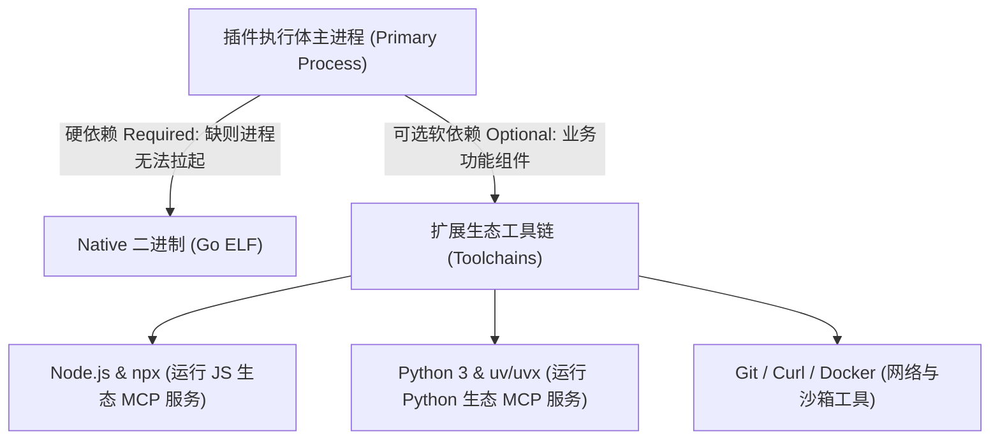
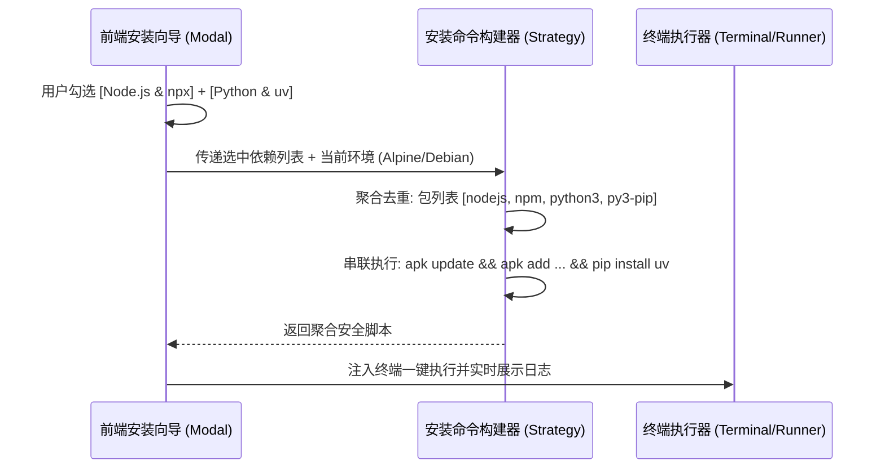
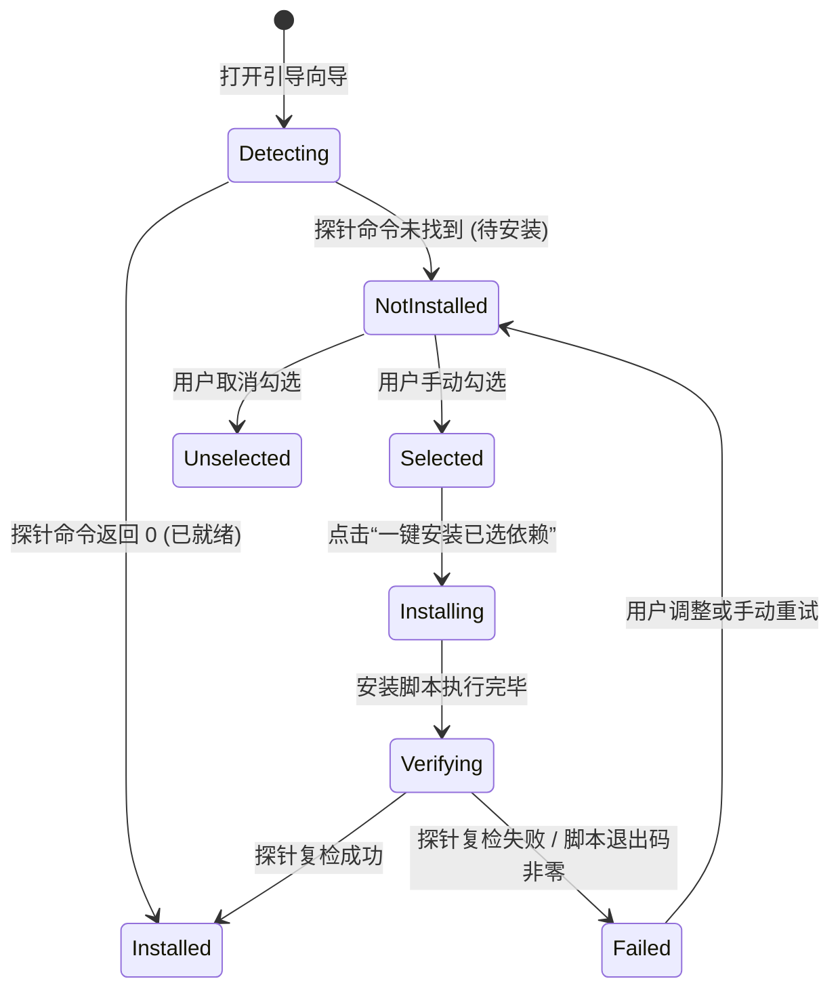

# 宿主侵入代码退役与插件可选依赖环境（Optional Dependencies）架构调研与设计方案

## 1. 调研背景与核心诉求

随着 LinuxWebTool 插件体系由“早期单体宿主硬编码模式”全面演进为“长时常驻微服务 + 透明网关反向代理 + 自包含 Webview 控制台”的现代化纯插件架构，用户提出了两个具备深远架构治理价值的核心议题：

1. **宿主历史代码退役计划**：
   - 宿主中现存的 `McpBridgeController` 及关联的编排器、模型、契约最初仅作为向前兼容的过渡别名（BFF）；
   - 在项目尚未正式上线、无历史存量用户兼容包袱的前提下，是否可以**彻底清除 `McpBridgeController` 及其相关宿主侵入代码**，实现宿主与插件的绝对解耦与插件自包含？
2. **扩展服务安装引导中添加“可选依赖环境（Optional Dependencies）”选项**：
   - 类似 `mcp-bridge` 这类原生桥接网关服务，服务执行体自身基于 Go 静态编译、零环境依赖（Native），但其**下游纳管的 MCP 工具生态**高度依赖宿主系统的开发工具链（如 Node.js 生态的 `npx`、Python 生态的 `uv/uvx`、本地轻量 SSE 服务等）；
   - 能否在插件安装引导中，引入类似现代包管理器的“可选扩展环境套件”勾选机制，支持用户在安装或引导时按需勾选、动态拼装并一键安装环境？

本文对上述两个议题展开可行性论证、逻辑与性能缺陷分析、设计模式优化建模（适配器策略模式与状态机模式）、业界主流方案对比，并给出清晰详尽的工程落地实施路径。

---

## 2. 议题一：宿主 `McpBridgeController` 历史代码退役调研

### 2.1 现状探查与侵入度诊断

经过对全工程源码与静态资产的深度检索（`git grep -i "/api/mcpbridge"` 与 `src/LinuxWebTool.WebHost/wwwroot` 扫描），得到如下关键事实：

1. **宿主前端零依赖**：宿主前端代码（`wwwroot/`）中**没有任何一处业务逻辑调用 `/api/McpBridge/*`**。所有插件在宿主维度的管理完全由统一插件接口 `/api/Plugins`（列表、启停、换端、日志、卸载）以及通用反向代理网关 `/plugins/mcp-bridge/*` 提供；
2. **Webview 已经实现自包含闭环**：`mcp-bridge` 插件拥有内置独立的 Web 控制台（Webview），其通信完全通过内核本地回环或通用反代网关直接向自身的 `/control/invoke/*` 派发指令并挂载安全令牌（`X-LWT-Run-Id` / `X-LWT-Plugin-Id`）；
3. **严重违反微内核（Microkernel）架构设计原则**：
   - 宿主为了单独一个插件 `mcp-bridge`，在工程中堆砌了 7 个核心源码文件：
     - `src/LinuxWebTool.WebHost/Features/McpBridge/Routes/McpBridgeController.cs`（控制器）
     - `src/LinuxWebTool.Application/Features/McpBridge/McpBridgeOrchestrator.cs`（编排层）
     - `src/LinuxWebTool.Contracts/Features/McpBridge/Contracts/IMcpBridgeOrchestrator.cs`（契约接口）
     - `src/LinuxWebTool.Contracts/Features/McpBridge/Contracts/McpBridgeModels.cs`（领域模型）
     - `src/LinuxWebTool.Contracts/Features/McpBridge/Contracts/McpBridgeRequests.cs`（请求契约）
     - `src/LinuxWebTool.Infrastructure/Features/McpBridge/Adapters/McpBridgeControlActions.cs`（基础设施适配器）
     - `src/LinuxWebTool.Infrastructure/Features/McpBridge/Adapters/McpBridgeJsonContext.cs`（Native AOT 上下文）
   - 如果未来系统引入 10 个新的微服务插件（如 `caddy-manager`、`socks5-proxy`、`wireguard-vpn`、`database-manager` 等），若每个插件都在宿主内核中硬编码一套 Controller 和 DTO，插件系统将彻底沦为**伪插件架构**，宿主将变得极其庞大且脆弱，破坏了插件独立升级、热插拔的核心价值。

### 2.2 彻底清除的可行性与收益评估

| 评估维度 | 评估结论 | 说明 |
| :--- | :--- | :--- |
| **可行性** | **100% 可行** | 项目未上线，无线上存量第三方客户端调用 `/api/McpBridge`；前端页面无需任何改动即可保持现有全部能力。 |
| **构建与包体积收益** | **大幅精简** | 减少 7 个源文件、1 个源生成上下文、2 个依赖注入注册，剔除冗余反射与 AOT 序列化桩代码，减少可执行文件二进制体积。 |
| **职责边界清晰度** | **根本性改善** | 宿主（Host）纯化为通用插件执行引擎与网关，不再感知任何特定插件的业务私有 DTO，彻底实现 Host-Agnostic。 |
| **潜在影响与防范** | **测试与门禁调整** | 部分现有架构测试（如 `LinuxArch051~054`）断言了 C# 端的类名与接口名。退役时需将此类门禁重构为**基于微服务黑盒契约与通用网关规范的架构门禁**。 |

### 2.3 结论
**建议坚决退役并彻底移除 `McpBridgeController` 及其相关宿主代码**。这是架构走向纯粹、自包含与模块化的高价值演进。

---

## 3. 议题二：插件可选依赖环境（Optional Dependencies）架构设计与头脑风暴

### 3.1 痛点场景剖析：为什么单靠 `Runtime` 不够？

在现有设计中，每个插件仅声明一个标量运行时：
`"runtime": "native"`（或 `"node"`, `"python"`, `"go"`）。
然而在现实世界中，插件的依赖往往是**两层甚至多层**的：



- **矛盾点**：`mcp-bridge` 作为一个 Native 原生程序，其主进程能以 0 依赖在 Alpine 容器中瞬间启动；但当用户在配置中引入需要 `npx` 的 GitHub MCP 或需要 `uvx` 的 Fetch MCP 时，由于系统缺少依赖，服务立刻发生降级。
- **用户困惑**：用户在安装插件时，完全不知道该插件在实际使用中还需要哪些辅助环境，只能在运行时报错后被动排查。

---

### 3.2 业界主流方案对比与借鉴

| 体系 | 依赖分类机制 | 表现形式与交互 | 优缺点与借鉴点 |
| :--- | :--- | :--- | :--- |
| **Debian / Ubuntu APT** | `Depends`（硬依赖）<br>`Recommends`（默认推荐）<br>`Suggests`（可选建议） | `apt install --install-suggests` 或命令行提示可选包 | 分级严谨；借鉴其**必选 vs 可选**两级解耦思想。 |
| **VS Code 插件生态** | `extensionDependencies`（核心）<br>`extensionPack`（合集）<br>`optionalDependencies` | 安装插件后右下角 Toast 提示：“检测到需要 Python 扩展，是否一键安装？” | 用户无感、渐进式引导；借鉴其**环境探针驱动的主动提示**。 |
| **DevContainer Features** | 模块化可组合 Feature<br>每个 Feature 具备探针与独立脚本 | 用户在勾选框中选择：☑️ Node.js ☑️ Python ☑️ Docker CLI | 借鉴其**参数化勾选与一键聚合组装命令**的向导模式。 |
| **Homebrew Bundle** | Brewfile 声明式列表与可选选项 | `brew "node", args: ["--with-npm"]` | 声明简单，对跨平台包管理器命令适配要求高。 |

---

### 3.3 设计模式建模与技术架构

#### 1. 契约模型设计（Composite Specification Pattern）
在 `plugin.json` 中扩展 `dependencies` 契约，与现有的单一 `runtime` 平滑向前兼容：

```json
{
  "id": "mcp-bridge",
  "name": "MCP 智能安全网关桥接服务",
  "runtime": "native",
  "dependencies": [
    {
      "id": "node-ecosystem",
      "name": "Node.js & npx 工具链",
      "required": false,
      "recommended": true,
      "description": "用于执行 GitHub、Filesystem、PostgreSQL 等基于 JavaScript/TypeScript 开发的标准 MCP 服务",
      "probe": {
        "command": "npx",
        "args": ["--version"]
      },
      "installGuide": {
        "alpine": "apk add --no-cache nodejs npm",
        "debian": "apt update && apt install -y nodejs npm",
        "rhel": "dnf install -y nodejs npm",
        "windows": "winget install OpenJS.NodeJS.LTS"
      }
    },
    {
      "id": "python-uv",
      "name": "Python 3 & uv/uvx 工具链",
      "required": false,
      "recommended": true,
      "description": "用于极速冷启动 Fetch、Git、Puppeteer 等基于 Python 生态开发的高性能 MCP 服务",
      "probe": {
        "command": "uvx",
        "args": ["--version"]
      },
      "installGuide": {
        "alpine": "apk add --no-cache python3 py3-pip && pip install --no-cache-dir uv --break-system-packages",
        "debian": "apt update && apt install -y python3 python3-pip && pip3 install uv",
        "rhel": "dnf install -y python3 python3-pip && pip3 install uv",
        "windows": "winget install astral-sh.uv"
      }
    }
  ]
}
```

#### 2. 发行版命令组装策略模式（Strategy & Builder Pattern）
用户勾选多个可选依赖后，系统**绝对不能并发发起多个独立的包管理命令**（在 Linux 中会触发 `/var/lib/dpkg/lock` 或 `/lib/apk/db/lock` 冲突锁死）。必须通过策略构建器，将勾选项安全聚合为一条原子命令：



#### 3. 依赖就绪状态机（Finite State Machine / FSM）
每个声明的依赖项在前端具备清晰的状态流转：



---

### 3.4 逻辑与性能缺陷分析（避免反模式）

1. **缺陷 1：全局执行器命令污染与权限边界**
   - **风险**：在 Alpine 镜像下使用 `pip install uv` 会遇到 PEP 668 `externally-managed-environment` 保护报错。
   - **对策**：在构建 Alpine 指引时，必须明确加上 `--break-system-packages`，或利用预打包好的 APK 包（如 `apk add py3-pip` 后安装）。
2. **缺陷 2：阻塞式安装导致前端界面卡死**
   - **风险**：安装 Node.js/Python 通常耗时 10~30 秒，若前端使用同步阻塞接口，用户可能误以为界面卡死或超时关闭窗口。
   - **对策**：充分复用宿主现有的 `PTY Terminal` 基础设施，向导点击“执行安装”时，直接以带参形式路由至控制台终端（`/terminal?exec=...`），或弹出嵌入式终端抽屉实时流式回显编译日志，给用户完全可预期的掌控感。
3. **缺陷 3：硬编码检测导致脱离实际**
   - **风险**：部分企业宿主机禁止连接外网公网源，直接跑 `apk add` 会超时失败。
   - **对策**：提供“命令自定义编辑”多行输入框，允许运维人员根据内网环境调整为自建私有源（Nexus / 清华镜像源）再执行。

---

## 4. 实施规划路线图

### 阶段一：宿主代码退役与微内核纯化（高优先级，零兼容包袱）
1. **删除冗余文件**：
   - 移除 `src/LinuxWebTool.WebHost/Features/McpBridge/Routes/McpBridgeController.cs`；
   - 移除 `src/LinuxWebTool.Application/Features/McpBridge/` 下所有编排类；
   - 移除 `src/LinuxWebTool.Contracts/Features/McpBridge/` 下所有契约与模型；
   - 移除 `src/LinuxWebTool.Infrastructure/Features/McpBridge/` 下所有适配器与 JsonContext。
2. **净化依赖注入与端点映射**：
   - 清理 `ServiceCollectionExtensions.cs` 中的服务注入；
   - 清理 `EndpointsMapper.g.cs` 与 `ApiKeyMiddleware.cs`；
   - 清理 `AppJsonSerializerContext.cs` 中未使用的特异化模型。
3. **架构门禁与测试重构**：
   - 将原先依赖 C# 控制器的测试转化为**纯插件微服务通用接口黑盒测试**；
   - 确保全套架构门禁（`LinuxArch001~LinuxArch054`）保持 100% 通过。

### 阶段二：插件清单契约升级与向导组件增强
1. **清单模型扩展**：
   - 在 `PluginManifest.cs` 中增加 `IReadOnlyList<PluginDependencyConfig>? Dependencies` 契约定义；
   - 更新 `mcp-bridge/plugin.json`，补充 `node-ecosystem` 与 `python-uv` 可选依赖规范。
2. **前端组件升级 (`PluginInstallGuideModal.js`)**：
   - 升级安装引导弹窗：从单一文本切换为“必选核心运行时”与“可选增强依赖套件”两层卡片；
   - 增加动态复选框与实时命令组装器；
   - 动态更新当前系统检测状态（已安装/未安装），并支持一键下发到终端执行。
3. **环境探针与验证闭环**：
   - 在后端增加轻量级依赖项探针检测接口（`/api/Plugins/{id}/Dependencies/Check`）；
   - 前端打开向导时自动探测并给未就绪的依赖标黄，辅助用户一键补齐。
