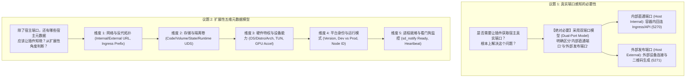
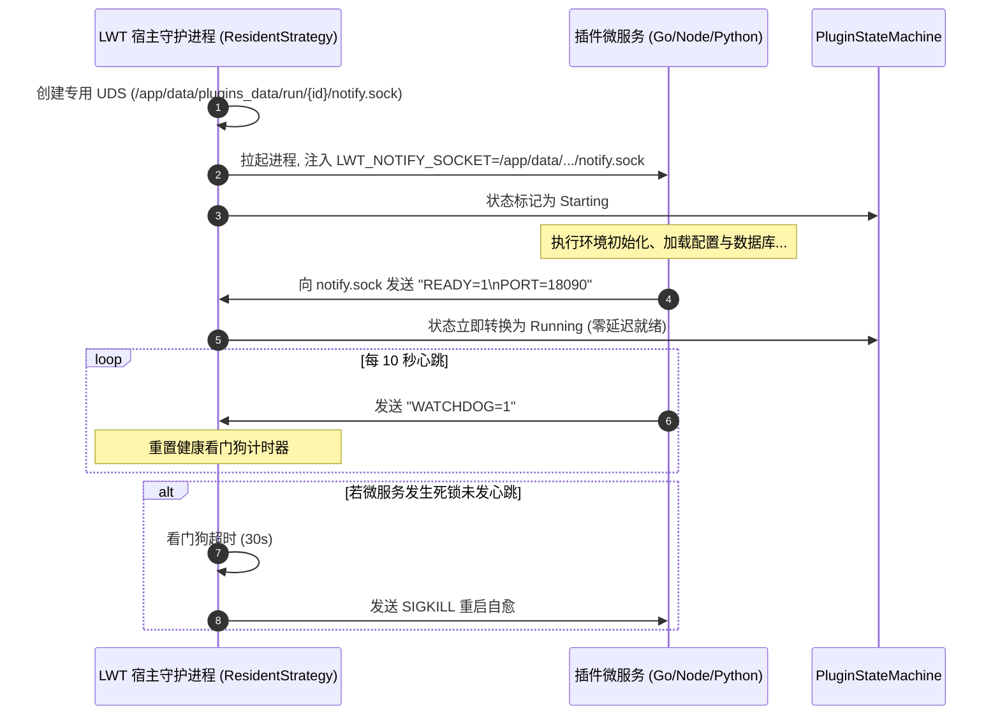

# 宿主元数据向下投影与插件上下文感知架构设计

> **文档标识**：`LWT-ARCH-METADATA-003`  
> **状态**：已评审 (Approved)  
> **核心领域**：宿主元数据向下投影 (Host Metadata Projection)、双端口模型 (Dual-Port Model)、扩展性五维上下文、进程就绪看门狗 (Watchdog FSM)、零信任凭据治理  
> **适用版本**：LinuxWebTool v1.0.0+ / .NET 10 Native AOT / Alpine Linux  

---

## 1. 执行摘要与核心议题解答

针对用户提出的 **“是否需要让插件获取宿主真实端口”** 以及 **“还有哪些宿主元数据应该让插件知晓”** 两大深层次架构议题，本调研给出明确结论：



### 核心论点结论：
1. **必须从根本上解决端口感知问题**：
   在容器化、NAT 穿透及反向代理架构下，宿主天然存在**“内部直通端口”**（容器内应用真正监听的端口）与**“外部发布端口”**（客户端访问宿主的端口）。微服务若只能“盲猜”端口，必然发生 `connection refused` 或客户端配置错误。
2. **建立标准化的宿主元数据向下投影机制 (Downward Metadata Projection)**：
   借鉴 Kubernetes Downward API 与 Linux systemd 标准，宿主在拉起插件进程时，主动注入标准化的 `LWT_*` 环境变量与 Webview 上下文总线，彻底消灭插件内部的地址与密钥硬编码。

---

## 2. 传统盲目微服务架构的缺陷分析 (The Blind Microservice Problem)

在早期设计中，插件微服务是一个“盲目实体”：

```mermaid
graph LR
    subgraph 插件视角 (孤立盲目)
        P["插件微服务<br/>(socks5-forwarder)"] -->|硬编码试探| T1["ws://127.0.0.1:5271/telemetry/metrics"]
        P -->|硬编码密钥| T2["Token: abcdef123456..."]
        P -->|盲猜反代前缀| T3["/plugins/socks5-forwarder/"]
    end

    subgraph 真实宿主拓扑 (动态复杂)
        H1["容器内 Kestrel 监听 :5270"]
        H2["Docker 外部端口映射 :5271:5270"]
        H3["宿主 Ingress 动态分配 Token"]
        H4["宿主网关动态路由挂载"]
    end

    T1 -.->|端口错位: 拒绝连接| H1
    T2 -.->|密钥脱节: 判定为探测攻击| H3
```

### 核心三大矛盾：
1. **网络命名空间隔离导致的环回黑洞 (Loopback Blackhole)**：
   宿主发布在外部的端口（如 `5271`）属于宿主机网络栈，容器内部的 Loopback (`127.0.0.1`) 根本没有监听 5271，硬编码导致连接瞬间被内核掐断。
2. **反向代理挂载路径的不可知性**：
   微服务的前端 Webview 页面不知道自己被挂载在 `/plugins/{id}/` 还是根路径下，导致在 iframe 中发起 API 请求时，经常出现 `/api/...` 越界撞车到宿主系统核心 API 的安全事故。
3. **环境能力的未知性**：
   某些高级网络插件（如 EasyTier、WireGuard、透明网关）依赖系统特权 `/dev/net/tun`。若宿主未赋予该能力，插件盲目调用会导致不可预期的 Panic 崩溃。

---

## 3. 宿主元数据五维向下投影模型 (Five-Dimension Projection Model)

从高内聚、松耦合、安全性与可扩展性出发，系统建立 **五维宿主元数据投影模型**：

```mermaid
mindmap
  root((LWT 宿主元数据五维投影))
    维度 1: 网络与拓扑
      LWT_HOST_INTERNAL_PORT (内部直通端口 :5270)
      LWT_HOST_EXTERNAL_PORT (外部访问端口 :5271)
      LWT_HOST_INTERNAL_URL (http://127.0.0.1:5270)
      LWT_HOST_PUBLIC_URL (http://10.126.1.70:5271)
      LWT_PLUGIN_INGRESS_PREFIX (/plugins/{id}/)
    维度 2: 存储与隔离
      LWT_CODE_DIR (只读代码目录)
      LWT_VOLUME_DIR (独占持久卷目录)
      LWT_STATE_DIR (状态配置目录)
      LWT_RUN_DIR (运行时临时 UDS/PID 目录)
      LWT_SHARED_ASSETS_DIR (共享资源/GeoIP/CA 目录)
    维度 3: 硬件与特权能力
      LWT_HOST_OS (linux)
      LWT_HOST_DISTRO (alpine / debian / rhel)
      LWT_HOST_ARCH (amd64 / arm64)
      LWT_HAS_NET_ADMIN (是否具备网络特权)
      LWT_HAS_TUN (是否挂载了 /dev/net/tun)
      LWT_HARDWARE_ACCEL (none / vaapi / qsv / cuda)
    维度 4: 平台身份与环境
      LWT_VERSION (平台版本 1.0.0)
      LWT_API_VERSION (API 契约版本)
      LWT_ENV_MODE (development vs production)
      LWT_NODE_ID (宿主节点唯一 ID)
    维度 5: 进程生命周期通信
      LWT_NOTIFY_SOCKET (就绪汇报 UDS)
      LWT_WATCHDOG_USEC (看门狗心跳周期)
      LWT_INTERNAL_SECRET (进程间共享认证密钥)
```

### 3.1 详细元数据字段规范表

| 分类 | 环境变量名称 | 典型示例值 | 插件核心收益与使用场景 |
| :--- | :--- | :--- | :--- |
| **网络拓扑** | `LWT_HOST_INTERNAL_PORT` | `5270` | 容器内部微服务回连宿主 Ingress/API 的**真实监听端口**，彻底杜绝 `5271` 错位 |
| | `LWT_HOST_EXTERNAL_PORT` | `5271` | 供微服务生成局域网客户端配置、Clash 配置、二维码指引 |
| | `LWT_HOST_INTERNAL_URL` | `http://127.0.0.1:5270` | 插件进程访问宿主通用 REST API 的基地址 |
| | `LWT_HOST_PUBLIC_URL` | `http://10.126.1.70:5271` | 宿主对外暴露的主机访问基准 URL |
| | `LWT_PLUGIN_INGRESS_PREFIX`| `/plugins/{id}` | 插件知晓自身在宿主 Ingress 中的反代前缀，前端与 API 路由零硬编码 |
| **存储隔离** | `LWT_CODE_DIR` | `/app/data/plugins/{id}` | 插件代码与静态资产根目录 |
| | `LWT_VOLUME_DIR` | `/app/data/plugins_data/volumes/{id}` | 独占持久化卷，插件升级时**受严格保护不被覆盖** |
| | `LWT_STATE_DIR` | `.../volumes/{id}/state` | 放置 `config.json` 等业务持久化配置 |
| | `LWT_RUN_DIR` | `.../plugins_data/run/{id}` | 放置 `service.sock` 等 UDS 管道与运行时临时文件 |
| **硬件能力** | `LWT_HOST_DISTRO` | `alpine` | 插件在执行包管理器命令前自适应检测（如 apk vs apt），杜绝命令未找到 |
| | `LWT_HOST_ARCH` | `amd64` | 动态加载平台特定原生动态库（.so）时的架构判断 |
| | `LWT_HAS_TUN` | `true` | 透明网关/VPN 类插件启动前自检：若无 TUN 设备则平滑降级为用户态代理 |
| | `LWT_HARDWARE_ACCEL` | `vaapi` | 多媒体/转码类插件检测硬件编解码器，开启 GPU 极速转码 |
| **平台身份** | `LWT_VERSION` | `1.0.0` | 插件判断宿主能力，按版本执行特性降级 |
| | `LWT_ENV_MODE` | `dev` / `production` | 处于开发环境时自动开启详细日志与调试追踪 |
| **进程协同** | `LWT_NOTIFY_SOCKET` | `/run/lwt/notify.sock` | 仿 systemd `sd_notify`，微服务完成初始化后发送 `READY=1`，消灭被动等待 |
| | `LWT_INTERNAL_SECRET` | `a3b89...` | 宿主与插件间的共享签名密钥，用于校验 Ingress 伪装隧道与内部 RPC |

---

## 4. 业界主流方案对比与标准借鉴

| 业界系统 | 元数据向下投影机制 | 核心借鉴价值 |
| :--- | :--- | :--- |
| **Kubernetes Downward API** | 通过 `env` 字段映射 `fieldRef: metadata.name`, `status.podIP`；通过 downwardAPI 卷挂载 labels | **声明式元数据投影**：微服务无需感知宿主是如何实现的，只需消费标准约定的环境变量。 |
| **Linux systemd (`sd_notify`)** | 启动服务前注入环境变量 `NOTIFY_SOCKET=/run/systemd/notify`；服务就绪后发送 `READY=1\nSTATUS=Listening on :80` | **主动进程就绪探针**：取代传统的被动端口轮询探测，消除端口假死与启动过慢误判。 |
| **VSCode Extension API** | 宿主向插件入口 `activate(context: ExtensionContext)` 注入 context 对象，包含 `storageUri`, `extensionMode` | **沙箱与数据目录隔离**：为每个插件明确划定持久化存储区与临时工作区。 |
| **Traefik Proxy** | Ingress 将请求打向后端时，自动注入 `X-Forwarded-Prefix`, `X-Forwarded-For` 等标准标头 | **反代前缀自适应**：后端服务从标头直接识别自身的代理挂载根，消除绝对路径硬编码。 |

---

## 5. 当前系统基础设施复用分析

LWT 平台在底层已经沉淀了部分基础能力，具备极高复用价值：

1. **`PluginRuntimeAdapters.BuildStandardEnv` ([Adapters](file:///e:/WorkProject/CSharp/PrivateProject/Web/WebToolForLinux/src/LinuxWebTool.Infrastructure/Features/Plugins/Adapters/PluginRuntimeAdapters.cs))**：
   - 现成提供了跨语言通用的数据持久卷与运行目录分离架构（`LWT_PLUGIN_ID`, `LWT_CODE_DIR`, `LWT_VOLUME_DIR`, `LWT_STATE_DIR`, `LWT_RUN_DIR`, `LWT_SQLITE_PATH`, `LWT_KV_PATH`）；
   - **升级方向**：在此方法中直接扩充网络拓扑与硬件能力变量，所有微服务（Go/Node/Python/C#）即可无感知全部继承！
2. **`ResidentExecutionStrategy` ([Strategies](file:///e:/WorkProject/CSharp/PrivateProject/Web/WebToolForLinux/src/LinuxWebTool.Infrastructure/Features/Plugins/Strategies/ResidentExecutionStrategy.cs))**：
   - 现成管理微服务的 `ProcessStartInfo` 与动态分配端口；
   - 现成注入了 `LWT_INTERNAL_SECRET`。
3. **`PluginUrlResolver` ([Frontend Utils](file:///e:/WorkProject/CSharp/PrivateProject/Web/WebToolForLinux/src/LinuxWebTool.WebHost/wwwroot/app/utils/pluginUrlResolver.js))**：
   - 前端已具备统一的 URL 仲裁能力；
   - 现成支持将 `localhost` 规整为 `/plugins/{id}/` 反代路径。

---

## 6. 设计模式优化与架构设计

### 6.1 向下投影适配器模式 (Downward Environment Adapter Pattern)

```mermaid
flowchart LR
    subgraph 宿主环境自省 HostIntrospection
        H1["IConfiguration & Kestrel 监听地址"]
        H2["EnvironmentVariables (.envdev)"]
        H3["OS & 硬件特权检测 (TUN/GPU)"]
    end

    subgraph 适配器 HostMetadataProvider
        A["聚合生成 HostMetadata DTO"]
    end

    subgraph 进程启动策略 ResidentExecutionStrategy
        P1["注入 spec.EnvironmentVariables"]
        P2["注入 LWT_HOST_* 环境变量"]
        P3["注入 LWT_INTERNAL_SECRET"]
    end

    subgraph 插件子进程 (Go/Python/Node)
        C["os.Getenv('LWT_HOST_INTERNAL_PORT')"]
    end

    H1 --> A
    H2 --> A
    H3 --> A
    A --> P1
    P1 --> P2
    P2 --> P3
    P3 --> C
```

#### C# 核心改造原型：

```csharp
public static class HostMetadataContext
{
    public static int InternalPort { get; set; } = 5270;
    public static int ExternalPort { get; set; } = 5271;
    public static string PublicHost { get; set; } = "127.0.0.1";
    public static string DistroKey { get; set; } = "alpine";
    public static bool HasTunDevice { get; set; } = File.Exists("/dev/net/tun");

    public static void InjectHostMetadata(IDictionary<string, string> env, PluginManifest manifest, int? allocatedPort)
    {
        // 1. 网络与双端口模型
        env["LWT_HOST_INTERNAL_PORT"] = InternalPort.ToString();
        env["LWT_HOST_EXTERNAL_PORT"] = ExternalPort.ToString();
        env["LWT_HOST_INTERNAL_URL"] = $"http://127.0.0.1:{InternalPort}";
        env["LWT_HOST_PUBLIC_URL"] = $"http://{PublicHost}:{ExternalPort}";
        env["LWT_PLUGIN_INGRESS_PREFIX"] = $"/plugins/{manifest.Id}";

        // 2. 硬件与特权能力
        env["LWT_HOST_OS"] = "linux";
        env["LWT_HOST_DISTRO"] = DistroKey;
        env["LWT_HOST_ARCH"] = RuntimeInformation.ProcessArchitecture.ToString().ToLowerInvariant();
        env["LWT_HAS_TUN"] = HasTunDevice ? "true" : "false";

        // 3. 平台身份
        env["LWT_VERSION"] = "1.0.0";
        env["LWT_ENV_MODE"] = ExternalPort == 5271 ? "dev" : "production";
    }
}
```

---

### 6.2 双向进程就绪与看门狗状态机 (Bidirectional Watchdog FSM)

传统的插件启动模式是宿主执行 `proc.Start()` 后，被动等待 1~3 秒探测端口是否处于 Listen 状态。
如果微服务启动包含重型初始化（如加载大型 GeoIP 数据库、预热模型），被动探测容易因超时误判其崩溃。



---

### 6.3 前端 Webview 上下文注入总线 (Webview Context Bus)

对于 Webview 视图，插件前端如果仅依靠猜测父级 URL，容易在不同反向代理部署结构下失真。
由宿主反向代理在响应 HTML 时注入轻量事实源对象：

```html
<script>
  window.__LWT_CONTEXT__ = {
    pluginId: "socks5-forwarder",
    apiBase: "/plugins/socks5-forwarder/api",
    hostInternalPort: 5270,
    hostExternalPort: 5271,
    publicHost: "10.126.1.70",
    theme: "cyber-dark",
    token: "..."
  };
</script>
```
Webview 内部的 `app.js` 统一调用：
```javascript
const apiBase = window.__LWT_CONTEXT__?.apiBase || '/api';
const externalUrl = `http://${window.__LWT_CONTEXT__?.publicHost}:${window.__LWT_CONTEXT__?.hostExternalPort}`;
```
彻底终结前端与后端的路径推测竞态！

---

## 7. `socks5-forwarder` 消除硬编码实战示范

以本次发现的“上游节点离线”问题为例，接入元数据投影后，`config.go` 中的默认初始化逻辑将得到极致优雅的重构：

```go
// 改造前：充满臆测与硬编码，极易在容器开发与生产切换时崩溃
cfg.Upstreams = []UpstreamNode{
    {
        ID:    "default-lwt-node",
        URL:   "ws://127.0.0.1:5271/telemetry/metrics", // 错误端口！
        Token: "lwt_live_test_token_abcdef123456",     // 错误 Token！
    },
}

// 改造后：100% 动态自省，跨环境无缝自适应
hostPort := os.Getenv("LWT_HOST_INTERNAL_PORT")
if hostPort == "" {
    hostPort = "5270" // 兜底
}
sharedToken := os.Getenv("LWT_INTERNAL_SECRET")
if sharedToken == "" {
    sharedToken = "lwt_live_stream_token_8f3a9e"
}

cfg.Upstreams = []UpstreamNode{
    {
        ID:    "default-lwt-node",
        Name:  "远程 LWT 默认宿主节点",
        URL:   fmt.Sprintf("ws://127.0.0.1:%s/telemetry/metrics", hostPort),
        Token: sharedToken,
        SkipTLSVerify: true,
        Status: "unknown",
    },
}
```
**收益**：
无论该微服务运行在 `linuxwebtool`（5270 host 模式）、`linuxwebtool-dev`（5271 端口映射模式）、外部物理宿主机还是 Kubernetes Pod 内部，微服务启动时**秒级自适应真实端口与有效通信密钥，开箱即绿灯，彻底消灭环境迁移故障**！

---

## 8. 安全红线与最小权限治理 (Zero-Trust Security Governance)

向下投影元数据极大提升了便利性，但**必须设立严格的安全边界防护**，防止恶意或不受信的第三方插件窃取宿主核心机密：

1. **绝对机密严禁下发 (Blacklisted Credentials)**：
   - 严禁将管理员初始密码（`WEB_ADMIN_PASSWORD`）、宿主机 SSH 私钥、数据库明文连接串注入给插件进程。
2. **凭据细粒度沙箱化 (Scoped Tokens)**：
   - 下发的 `LWT_INTERNAL_SECRET` 必须是**按每个插件实例独立随机生成的单会话密钥**，严禁多个插件共享主管理员全局 JWT。
3. **特权降级防御**：
   - 宿主即使拥有特权，微服务子进程应默认以非 root 用户或受限 namespace 运行（除非显式声明 `security.privileged: true`）。

---

## 9. 演进路线图与落地计划

| 阶段 | 重点目标 | 预期产出 |
| :--- | :--- | :--- |
| **Phase 1: 理论与规范** (当前) | 确立五维投影模型与 `LWT_*` 环境变量命名空间规范 | 沉淀文档 `docs/host-metadata-projection-and-plugin-context-architecture.md` |
| **Phase 2: C# 宿主注入改造** | 在 `BuildStandardEnv` 中注入 `LWT_HOST_INTERNAL_PORT`、`LWT_HOST_EXTERNAL_PORT`、`LWT_PLUGIN_INGRESS_PREFIX`、`LWT_HOST_DISTRO` | 更新 `PluginRuntimeAdapters.cs`，通过架构测试 |
| **Phase 3: 微服务适配重构** | `socks5-forwarder` 与 `mcp-bridge` 接入环境变量自省，消除代码中的默认硬编码 | 重构 Go 业务代码，实现零配置自适应直连 |
| **Phase 4: Webview 总线与看门狗** | 实现 Ingress 响应级 `__LWT_CONTEXT__` 注入与 UDS `sd_notify` 进程保活看门狗 | 打造工业级插件生命周期监控体系 |
