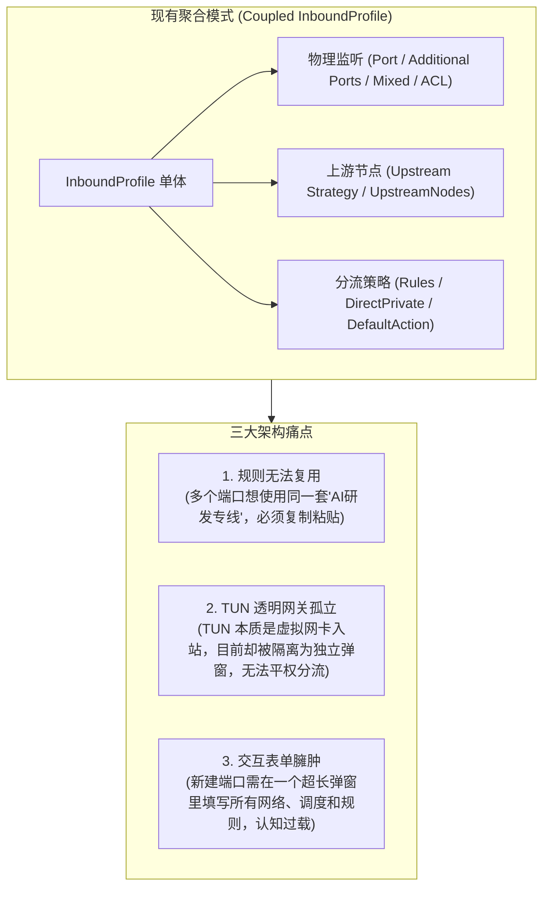
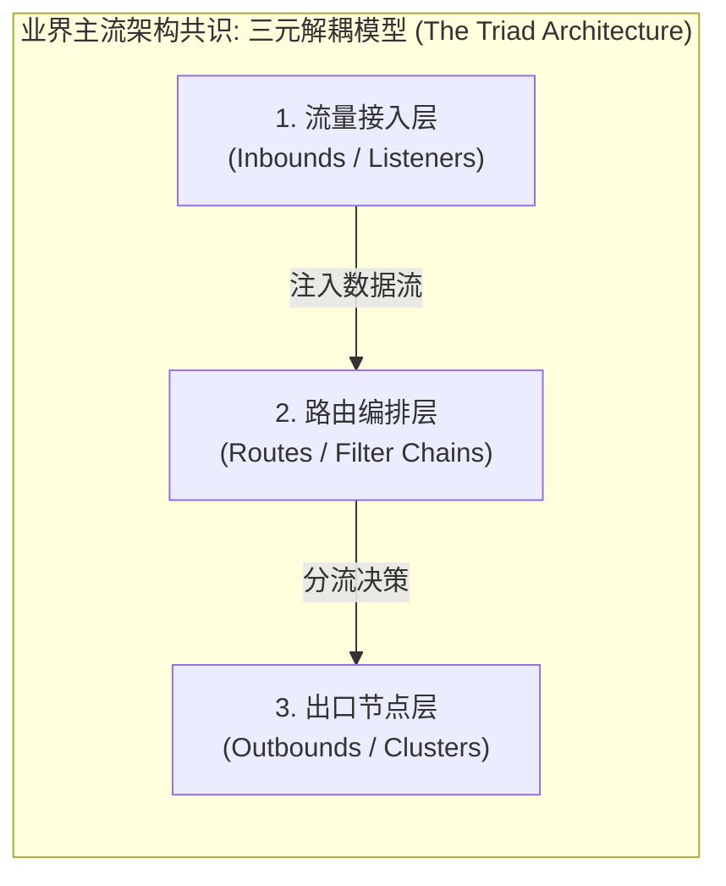

# SOCKS5 边缘中继网关：三阶分层解耦架构与交互重塑方案 (Tripartite Architecture)

> **文档标识**：`LWT-ARCH-FORWARDER-009`  
> **状态**：已评审 (Approved)  
> **核心领域**：流量接入层 (Inbounds)、线路编排与分流决策层 (Routing Pipelines)、节点与出口层 (Outbounds & Groups)、TUN 用户态透明网关统一抽象、DAG 拓扑环路检测、零分配路由匹配引擎  
> **适用版本**：LinuxWebTool v2.2.0+ / `plugins/socks5-forwarder`  
> **设计模式**：桥接模式 (Bridge Pattern)、责任链/流水线模式 (Pipeline Pattern)、外观门面模式 (Facade Pattern)、观察者模式 (Observer Pattern)、基数树匹配算法 (Radix Tree Matcher)

---

## 1. 架构演进动因与痛点诊断

在 SOCKS5 边缘中继网关（`socks5-forwarder`）前序演进中，我们实现了全协议支持（SOCKS5, HTTP, Trojan, VLESS, Shadowsocks, LWT-WSS）、自适应链式代理、分流规则模板以及 TUN 特权检测。

然而，随着系统能力的扩展，现存的**单体聚合配置模式**遭遇了结构性瓶颈：



---

## 2. 业界主流架构调研与共识 (Industry Benchmarks)

调研并对比了全球主流代理内核与云原生网关的技术实现：



| 系统 / 方案 | 接入层 (Inbound) | 出口层 (Outbound) | 决策层 (Routing / Pipeline) | 评价与借鉴点 |
| :--- | :--- | :--- | :--- | :--- |
| **Sing-box** (业界公认最现代) | `inbounds: []`<br/>将 `tun`, `mixed`, `socks`, `tproxy` 统一为标准 Inbound | `outbounds: []`<br/>包含协议节点、`selector`, `urltest`, `direct`, `block` | `route: { rules: [] }`<br/>基于 `inbound`, `domain`, `ip` 动态导向 `outbound` | **最值得 LWT 借鉴**：TUN 作为标准 Inbound 统一接入，规则与入站彻底解耦。 |
| **Clash / Mihomo** | `port`, `socks-port`, `mixed-port`, `tun` | `proxies` (单节点) + `proxy-groups` (链式、故障转移、自动优选) | `rules: []`<br/>全局规则列表 | 出口节点池与分组策略直观，策略组（Group）概念成熟。 |
| **Xray-core / V2Ray** | `inbounds` (各带独立的 `tag`) | `outbounds` (各带独立的 `tag`) | `routing.rules`<br/>通过 `inboundTag -> outboundTag` 桥接 | 极其灵活，但纯 JSON 配置对普通用户过于复杂繁琐。 |
| **Envoy Proxy** (云原生工业标准) | `Listeners` (TCP/HTTP/TLS 接入) | `Clusters` & `Endpoints` (上游服务实例) | `RouteConfiguration` (匹配与重定向) | 经受亿级高并发检验的标准分层架构。 |

---

## 3. 三阶分层解耦架构设计 (Three-Tier Pipeline)

基于业界最佳实践并契合 LinuxWebTool 敏捷定位，确立**三阶分层管道模型**：

```mermaid
flowchart TD
    subgraph Layer1 ["1. 接入层 (Inbounds)"]
        I1["TCP 混合端口 10801<br/>(支持多端口 10802/10803)"]
        I2["纯 SOCKS5 端口 10808<br/>(专用设备)"]
        I3["用户态 TUN 网卡 lwt-tun0<br/>(全局透明代理接管)"]
    end

    subgraph Layer2 ["2. 线路编排与分流管道 (Pipelines / Routing)"]
        P1["🌟 全局标准线路 (默认流水线)<br/>• 私网直连短路 (RFC 1918)<br/>• 广告与隐私追踪拦截<br/>• 大陆域名直连<br/>• 其余出海"]
        P2["🚀 AI 研发专线流水线<br/>• OpenAI/Claude 专属加速<br/>• 其余常规直连"]
        P3["🌐 全局出海流水线<br/>• 全量走代理"]
    end

    subgraph Layer3 ["3. 出口节点与组合 (Outbounds & Groups)"]
        O1["单节点池 (SOCKS5, Trojan, VLESS, WSS)"]
        O2["自适应动态链式 (亚太中继 + 固定落地出口)"]
        O3["延迟优选组 (Best-Latency Pool)"]
        O4["动作节点 (Direct 直连 / Reject 阻断)"]
    end

    I1 -.->|绑定线路| P1
    I2 -.->|绑定线路| P2
    I3 -.->|绑定线路| P1

    P1 -->|匹配代理| O1
    P1 -->|匹配代理| O2
    P2 -->|模型加速| O2
    P1 -->|国内/私网| O4
```



### 3.1 核心数据契约规范 (Configuration Schema)

```json
{
  "inbounds": [
    {
      "id": "in-lan-mixed",
      "name": "局域网默认混合接入",
      "type": "port",
      "enabled": true,
      "listenPort": 10801,
      "additionalPorts": [10802, 10803],
      "protocol": "mixed",
      "allowedCidr": ["10.0.0.0/8", "172.16.0.0/12", "192.168.0.0/16", "127.0.0.1/32"],
      "pipelineId": "pipe-default"
    },
    {
      "id": "in-tun-gateway",
      "name": "全局 TUN 透明代理网关",
      "type": "tun",
      "enabled": false,
      "tunInterface": "lwt-tun0",
      "tunCidr": "198.18.0.1/16",
      "dnsHijack": true,
      "bypassCidr": ["10.0.0.0/8", "172.16.0.0/12", "192.168.0.0/16", "127.0.0.0/8"],
      "pipelineId": "pipe-default"
    }
  ],
  "pipelines": [
    {
      "id": "pipe-default",
      "name": "全局标准线路 (默认流水线)",
      "directPrivateNetwork": true,
      "defaultAction": "proxy",
      "defaultOutbound": "default-lwt-node",
      "rules": [
        { "type": "domain_keyword", "value": "adservice", "action": "reject" },
        { "type": "domain_keyword", "value": "telemetry", "action": "reject" },
        { "type": "domain_suffix", "value": ".cn", "action": "direct" },
        { "type": "domain_suffix", "value": "bilibili.com", "action": "direct" },
        { "type": "ip_cidr", "value": "223.5.5.0/24", "action": "direct" }
      ]
    },
    {
      "id": "pipe-ai-dedicated",
      "name": "AI 研发专线流水线",
      "directPrivateNetwork": true,
      "defaultAction": "proxy",
      "defaultOutbound": "chain-auto-pinned",
      "rules": [
        { "type": "domain_suffix", "value": "openai.com", "action": "proxy", "target": "chain-auto-pinned" },
        { "type": "domain_suffix", "value": "anthropic.com", "action": "proxy", "target": "chain-auto-pinned" },
        { "type": "domain_suffix", "value": ".cn", "action": "direct" }
      ]
    }
  ],
  "upstreams": [
    { "id": "default-lwt-node", "name": "远程 LWT 默认宿主节点", "type": "lwt_wss" },
    { "id": "node-vless-1", "name": "东京VLESS-01", "type": "vless" }
  ],
  "chains": [
    {
      "id": "chain-auto-pinned",
      "name": "亚太中继 + 美西固定落地",
      "strategy": "auto",
      "fixedExitNodeId": "node-vless-1",
      "candidateHopNodeIds": ["default-lwt-node"]
    }
  ]
}
```

---

## 4. 关键设计模式与工程实现

### 4.1 桥接模式 (Bridge Pattern)
- **解耦维数**：接入层抽象（`IInboundListener`：TCP端口 / TUN虚拟网卡）与出站处理实现（`IOutboundDialer`：直连、单节点代理、多跳自适应链）彻底解耦；
- **桥接纽带**：`PipelineRouter` 作为桥接器，在连接建立时基于分流规则动态决定将客户端流量挂载到哪一个出站通道。

### 4.2 责任链与流水线模式 (Pipeline Pattern)
- 请求在进入时按顺序穿透检查器：
  1. `ACL Inspector`：白名单 IP 校验（不合规立即 0 字节丢弃）；
  2. `Private Network Short-Circuit`：私网 IP 直连短路；
  3. `Rule Evaluator`：域名/IP 前缀树规则匹配；
  4. `Fallback Dispatcher`：默认兜底通道。

### 4.3 智能缺省与外观门面模式 (Facade & Smart Presets)
- **解决普通用户认知过载**：
  - 系统启动默认自动初始化 `pipe-default`（全局标准线路）；
  - 新建端口接入或开启 TUN 网卡时，界面默认选定“全局标准线路”，普通用户无需理解流水线即可直接使用；
  - 高级用户可在【🔀 线路编排】选项卡中自由增删与微调多套线路。

### 4.4 有向无环图 (DAG) 环路防死锁算法
- 链式代理与线路引用中，必须防止循环依赖（如 Pipeline A 目标为 Chain 1，Chain 1 内部又指向 Pipeline A）：
  - 后端提供 DAG 检测器：在保存 `pipeline` 与 `chain` 时执行 DFS 环路检测，若出现环路直接阻断并抛出友好错误。

---

## 5. UI/UX 交互重构规范 (三栏联动视图)

```text
┌────────────────────────────────────────────────────────────────────────┐
│  🌐 SOCKS5 边缘中继网关控制台                                          │
│  [📥 流量接入 (Inbounds)]   [🔀 线路编排 (Pipelines)]   [📡 出口节点 (Outbounds)]│
├────────────────────────────────────────────────────────────────────────┤
│ 【📥 流量接入卡片】                                                    │
│  ┌───────────────────────┐  ┌────────────────────────────────────────┐ │
│  │ 🛡️ TUN 全局透明网关   │  │ 🔀 端口中继: :10801, :10802            │ │
│  │ 状态: 🟢 已就绪 (gVisor)│  │ 协议: MIXED | 白名单: 局域网私网       │ │
│  │ 绑定线路: [全局标准线路 ▾]│ │ 绑定线路: [AI研发专线 ▾]              │ │
│  │ [ 开 关 ]   [ ⚙ 设置 ]│  │ [ 运行中 ] [ ⚙ 编辑 ] [ 🗑 删除 ]       │ │
│  └───────────────────────┘  └────────────────────────────────────────┘ │
└────────────────────────────────────────────────────────────────────────┘
```

- **三大独立功能区**：
  1. **📥 流量接入 (Inbounds)**：端口中继卡片 + TUN 全局透明网关卡片，每张卡片具备独立开闭与 `绑定线路: [下拉框]`；
  2. **🔀 线路编排 (Pipelines)**：分流策略流水线管理，快速套用 5 套常用预设模板；
  3. **📡 出口节点 (Outbounds)**：上游单节点（一键导入）与链式代理（自适应固定出口）。

---

## 6. 平滑迁移与向后兼容保障 (Self-Healing Migration)

为确保现有用户的持久化数据不丢失：
- **历史数据自愈迁移**：在 `LoadConfig` 时，若检测到旧版 `InboundProfile.RoutePolicy`，系统自动将其提取为命名 Pipeline（如 `pipe-legacy-inbound-lan-default`），并将该 Inbound 的 `PipelineId` 指向它；
- **旧字段平滑映射**：API 端点保持向后兼容，老版本配置读取自动适配。
