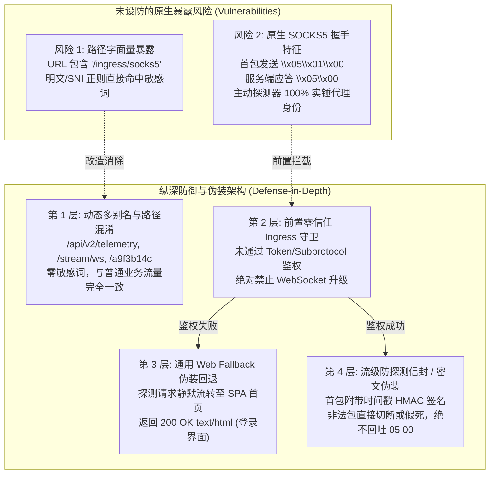
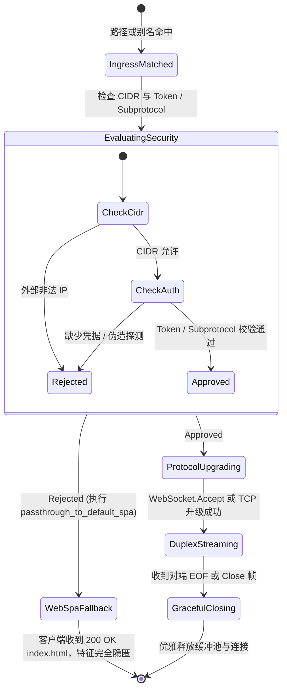

# 平台级 Ingress 动态路径别名、WebSocket 主动探测深度分析与多层防特征伪装流架构调研

> **文档状态**：已就绪 / 平台安全与反探测高级扩展架构规范  
> **核心命题**：  
> 1. 解决固定路径 `/ingress/socks5` 携带敏感关键词而遭深度包检测（DPI）与正则识别的问题；  
> 2. 深入剖析客户端通过 WebSocket 发送 SOCKS5 握手包（`\x05\x01\x00`）遭遇防火墙主动探测（Active Probing）被实锤封锁的底层原理；  
> 3. 从软件设计模式（策略模式、适配器模式、有限状态机）与密码学第一性原理出发，提出**动态路径别名（Dynamic Aliases）**、**前置零信任 WebSocket 鉴权守卫（Zero-Trust Ingress Guard）**、**通用 Web Fallback 伪装回退（Stealth SPA Fallback）**与**流级防探测信封（Duplex Camouflage Envelope）**的完整架构方案。

---

## 1. 用户核心关切剖析与威胁建模（Threat Modeling）



### 1.1 关切 1：路径敏感关键词特征识别（`socks5` 关键字）
- **识别机制**：
  在网络边界，DPI（深包检测设备）与透明代理网关通常维护着一套 URL 模式黑名单。包含 `socks5`、`socks`、`proxy`、`v2ray`、`shadowsocks`、`tunnel` 等关键词的 HTTP GET / WebSocket Upgrade 请求会在 L7 应用层被毫秒级字符串匹配命中。
- **潜在危害**：
  即使在外层套用了 TLS，一旦中间人有解密能力（如企业内网代理、云安全网关），或者在非加密端口调试，硬编码的 `/ingress/socks5` 就像在门前竖立霓虹招牌：“此处运行着 SOCKS5 代理”，极易被自动化扫描器识别归类并实施阻断。
- **解决核心**：
  **路径必须解耦且支持动态别名**。插件开发者或系统管理员必须能够自由声明或动态分配路径别名（例如 `/api/v2/telemetry`、`/ws/live-stream`、`/sync/channel` 甚至无规律随机哈希 `/e7b39a4f`），宿主 Ingress 引擎以中立规则多路匹配。

---

### 1.2 关切 2：WebSocket 内发送 SOCKS5 握手是否容易被主动探测？
- **为什么极易被探测？（主动探测的主流攻防机理）**
  1. **RFC 1928 SOCKS5 握手特征**：
     SOCKS5 协议规范定义了固定的协商握手格式：
     - 客户端主动发起连接，首包发送 3 个字节：
       `05`（VER，SOCKS版本 5）+ `01`（NMETHODS，支持 1 种认证方式）+ `00`（METHOD 0，无需认证）。
     - 服务端如果正常响应，返回 2 个字节：
       `05`（VER，版本 5）+ `00`（METHOD 0，选中无认证）。
  2. **主动探测器（Active Prober）的实锤判定逻辑**：
     审查系统（如 GFW 的 Active Prober）一旦通过流量分析或机器学习怀疑某 IP/端口存在翻墙/代理流量，会立即派出扫描客户端主动向该目标发送 `\x05\x01\x00`。
     - 如果目标返回了 `\x05\x00`，探测器即获得**无可辩驳的数学证据**：该端点就是 SOCKS5 代理！
     - 随后该 IP:Port 会被立即加入封锁黑名单（RST 阻断或路由黑洞）。
  3. **当前未加固状态下的漏洞点**：
     如果在 `plugin.json` 中配置 `"security": { "auth": "none" }`，任何未携带凭据的扫描器只需发起 WebSocket 连接至该路径并发送 `\x05\x01\x00`，微服务就会诚实地应答 `\x05\x00`，主动探测 100% 成功。
- **解决核心原则（第一性原理）**：
  **“未鉴权绝不开门，非法探测静默回退”**。
  任何探测流量在没有出示正确的预共享密钥（PSK）或认证凭据前，**绝对不允许与内部微服务建立 WebSocket 双工流，更不允许后端向探测器返回任何符合 SOCKS5 协议特征的数据包**！

---

## 2. 业界权威开源方案对比与借鉴

| 方案 | 核心防探测伪装机制 | 路径与凭据处理 | 探测失败响应行为 | 对本架构的启示 |
| :--- | :--- | :--- | :--- | :--- |
| **Trojan / Trojan-Go** | 基于 TLS 终止与 SHA224 密码哈希，首包必须包含密码哈希校验 | `websocket.path` 支持完全自定义（如 `/ray`），通常挂载在真实站点后 | **Fallback 机制**：非 Trojan 流量或错误密码无缝反代至本地真实 Web 服务（如 Nginx/Caddy） | 必须引入前置 Fallback，未通过认证时返回真实前端 SPA 页面，彻底淹没在正常流量中。 |
| **Xray (VLESS + REALITY)** | 移除 VMess 特殊特征，基于 UUID 鉴权；Reality 借用真实合规知名站点证书 | 支持动态自定义 WebSocket Path 或 gRPC ServiceName | 非法握手重定向至真实目标站或返回 404/默认 Web 页面 | 任何握手包必须携带凭据上下文，绝不能采用无密码裸流直通。 |
| **Shadowsocks-2022** | RFC 级 AEAD 密文全盘加密，引入抗重放滑动窗口（Replay Cache） | L4 传输层无明文字符，数据包高熵（完全呈现随机噪声） | 校验失败直接静默丢弃（Drop），不产生任何响应特征 | 双工流内部首包可加入时间戳校验，防重放攻击。 |
| **RFC 6455 (WebSocket Subprotocol)** | 原生标准协议头 `Sec-WebSocket-Protocol` 传递认证子协议 | 路径中立，可在子协议中承载 Token（如 `lwt-auth.<token>`） | 不支持该子协议时返回标准 HTTP 响应，不升级 WebSocket | 浏览器原生支持，无须在 URL Query 暴露 Token，完美契合标准 Web 规范。 |

---

## 3. 软件设计模式深度建模（Architecture Design Patterns）

```mermaid
classDiagram
    class IIngressPathMatchingStrategy {
        <<interface>>
        +IsMatch(HttpContext context, IngressMatchConfig config, string requestPath) bool
    }
    class PrefixMatchingStrategy {
        +IsMatch(...) bool
    }
    class ExactMatchingStrategy {
        +IsMatch(...) bool
    }
    class MultiAliasMatchingStrategy {
        +IsMatch(...) bool
    }
    IIngressPathMatchingStrategy <|.. PrefixMatchingStrategy
    IIngressPathMatchingStrategy <|.. ExactMatchingStrategy
    IIngressPathMatchingStrategy <|.. MultiAliasMatchingStrategy

    class IIngressAuthGuardStrategy {
        <<interface>>
        +Evaluate(HttpContext context, IngressSecurityConfig security, PluginInstanceDto plugin) AuthResult
    }
    class SecretTokenGuardStrategy {
        +Evaluate(...) AuthResult
    }
    class WebSocketSubprotocolGuardStrategy {
        +Evaluate(...) AuthResult
    }
    class PlatformSessionGuardStrategy {
        +Evaluate(...) AuthResult
    }
    IIngressAuthGuardStrategy <|.. SecretTokenGuardStrategy
    IIngressAuthGuardStrategy <|.. WebSocketSubprotocolGuardStrategy
    IIngressAuthGuardStrategy <|.. PlatformSessionGuardStrategy

    class IIngressFallbackStrategy {
        <<interface>>
        +ExecuteAsync(HttpContext context, RequestDelegate next) Task
    }
    class WebSpaFallbackStrategy {
        +ExecuteAsync(...) Task
    }
    class SilentNotFoundStrategy {
        +ExecuteAsync(...) Task
    }
    IIngressFallbackStrategy <|.. WebSpaFallbackStrategy
    IIngressFallbackStrategy <|.. SilentNotFoundStrategy

    class IngressConnectionFSM {
        -CurrentState : IngressState
        +Transition(event)
    }
```



### 3.1 策略模式（Strategy Pattern）
1. **路径匹配策略（`IIngressPathMatchingStrategy`）**：
   - `MultiAliasMatchingStrategy`：支持主路径与多个别名列表并发匹配；
   - `DynamicSlugStrategy`：支持从环境变量或插件配置（KV）动态注入别名模板（如 `/{CUSTOM_SLUG}/feed`）。
2. **安全守卫策略（`IIngressAuthGuardStrategy`）**：
   - `WebSocketSubprotocolGuardStrategy`：从 `Sec-WebSocket-Protocol` 提取令牌，防止 URL Query 被中间件日志记录；
   - `SecretTokenGuardStrategy`：多通道提取请求头（`X-LWT-Token`）或 URL 查询参数。
3. **降级伪装策略（`IIngressFallbackStrategy`）**：
   - `WebSpaFallbackStrategy`：直接调用 `next(context)` 透传至 SPA 静态中间件，返回宿主正常的 HTML 页面；
   - `SilentNotFoundStrategy`：返回标准的 HTTP 404 响应。

### 3.2 适配器模式（Adapter Pattern）
- **`DuplexStreamAdapter`**：
  向上提供标准的异步双向读写流接口（`Stream`），向下抹平不同底层传输形式的差异：
  - 适配器 A：标准 WebSocket 帧对拷（使用 `ArrayPool<byte>` 64KB 高性能缓冲）；
  - 适配器 B：`IHttpUpgradeFeature` 原生 TCP 劫持对拷；
  - 适配器 C：带防主动探测签名头解包的微服务字节管道。

### 3.3 有限状态机（Finite State Machine - FSM）



---

## 4. 四重深度技术解决方案

### 4.1 方案 1：声明式多别名与配置动态注入（Declarative Aliases & Dynamic Slugs）

#### 契约层增强（`IngressMatchConfig` 升级）
在 `LinuxWebTool.Contracts` 中增加 `Aliases` 别名列表与 `AllowDynamicSlug` 支持：

```csharp
public sealed record IngressMatchConfig
{
    public string Path { get; init; } = "/";
    public string PathType { get; init; } = "Prefix"; // "Prefix" | "Exact"
    
    /// <summary>
    /// 支持的路径别名列表，例如 ["/api/v2/telemetry", "/ws/live", "/sync/data"]
    /// 匹配时 Path 与 Aliases 任意一个命中均视为路由匹配，消除硬编码特征词。
    /// </summary>
    public IReadOnlyList<string> Aliases { get; init; } = [];
    
    public IReadOnlyDictionary<string, string> Headers { get; init; } = new Dictionary<string, string>();
}
```

#### 宿主路由匹配器升级
在 [`PluginIngressMiddleware.cs`](file:///e:/WorkProject/CSharp/PrivateProject/Web/WebToolForLinux/src/LinuxWebTool.WebHost/Features/Plugins/Ingress/PluginIngressMiddleware.cs) 中：
```csharp
private static bool IsRouteMatch(HttpContext context, IngressMatchConfig match, string requestPath)
{
    // 1. 尝试主路径匹配
    if (MatchesSinglePath(match.Path, match.PathType, requestPath))
    {
        return MatchesHeaders(context, match.Headers);
    }

    // 2. 遍历别名列表进行匹配
    if (match.Aliases != null && match.Aliases.Count > 0)
    {
        foreach (var alias in match.Aliases)
        {
            if (MatchesSinglePath(alias, match.PathType, requestPath))
            {
                return MatchesHeaders(context, match.Headers);
            }
        }
    }

    return false;
}
```

#### 插件清单动态配置示例（`plugin.json`）
彻底去除敏感词 `socks5`，使用完全业务中立的通用别名：
```json
{
  "ingress": {
    "enabled": true,
    "routes": [
      {
        "name": "stream-gateway",
        "match": {
          "path": "/api/v2/stream",
          "aliases": [
            "/telemetry/metrics",
            "/ws/chat",
            "/sync/live-feed"
          ],
          "pathType": "Prefix",
          "headers": {
            "Upgrade": "websocket"
          }
        },
        "target": {
          "type": "allocatedPort",
          "destination": "127.0.0.1:{port}"
        },
        "transport": {
          "mode": "duplex_stream",
          "bufferPolicy": "unbuffered"
        },
        "security": {
          "auth": "secret_token",
          "tokenHeader": "X-LWT-Token",
          "tokenQuery": "token"
        },
        "fallback": {
          "onUnauthorized": "passthrough_to_default_spa",
          "onFailure": "passthrough_to_default_spa"
        }
      }
    ]
  }
}
```

---

### 4.2 方案 2：前置零信任 WebSocket 鉴权守卫（Zero-Trust WebSocket Handshake Guard）

#### 核心防御铁律
> [!IMPORTANT]
> **绝对防御准则**：
> 外部客户端发起 WebSocket 连接时，若未携带合法的访问令牌（Token）或子协议签名，**宿主 Ingress 中间件严禁调用 `context.WebSockets.AcceptWebSocketAsync()`，绝对不向后端建立 TCP 管道**！

#### 伪装回落流程（Web Fallback）
当主动探测器向 `/api/v2/stream`（或 `/ingress/socks5`）发送没有 Token 的 WebSocket Upgrade 请求时：
1. `EvaluateSecurity` 裁定失败（`isAllowed == false`）；
2. 命中 `Fallback.OnUnauthorized == "passthrough_to_default_spa"`；
3. 中间件静默调用 `await next(context); return;`；
4. ASP.NET Core 静态文件与 SPA Fallback 中间件接管请求，返回：
   - HTTP 状态码：`200 OK`；
   - 响应头：`Content-Type: text/html; charset=utf-8`；
   - 响应体：真实的 LinuxWebTool 管理后台前端 HTML 页面。
5. **探测器视角**：
   主动探测器发起的请求被判定为一个普通浏览器用户在访问网站首页。探测器**根本没有机会发送 `\x05\x01\x00`，微服务也绝对不会返回 `\x05\x00`**，探测被彻底瓦解！

#### 支持通过原生 WebSocket 子协议鉴权（RFC 6455 Camouflage）
在浏览器或客户端中，URL 携带 `?token=xxx` 会被中间件日志记录。可通过标准 WebSocket 子协议无痕鉴权：
- **客户端**：
  ```javascript
  const token = "my_secret_token_123456";
  const ws = new WebSocket("wss://myserver.com/api/v2/stream", ["lwt.v1", token]);
  ```
- **服务端 Ingress 校验**：
  从 `context.Request.Headers.SecWebSocketProtocol` 提取子协议数组，提取并核验令牌，核验通过后在应答头回显 `Sec-WebSocket-Protocol: lwt.v1`，完全符合 RFC 6455 规范。

---

### 4.3 方案 3：流级防探测信封（Duplex Camouflage Envelope）

即使在局域网内部或者发生极端凭据泄露，如何防止攻击者直接利用 SOCKS5 握手特征？

#### 模式 A：规范级密码认证强制开启（RFC 1929）
在微服务启动参数中强制配置密码认证：
- 当主动探测器发送 `05 01 00`（无认证协商）时；
- 微服务严格返回 `05 FF`（`0xFF` 代表无支持的认证方式，拒绝连接），绝不返回 `05 00`；
- 探测器无法确认服务端是真正的 SOCKS5 服务还是任意返回随机字节的假服务。

#### 模式 B：前导签名信封（Trojan 启发式设计）
对于高级抗审查需求，客户端与微服务约定在全双工流建立后的第一个字节流中传递加密信封：
- **首包结构**：
  `[32 字节 SHA256(PreSharedKey + DateSlug)] + [2 字节 PayloadLength] + [真实数据载荷]`
- **微服务握手决断**：
  1. 读取前 34 个字节；
  2. 若散列值校验失败，说明是对端主动扫描或爬虫，**立即关闭连接或发送 200 字节随机网页垃圾数据并优雅断开**；
  3. 若散列值通过，剥离前导头，将后续流无损透传给 SOCKS5 代理引擎。
- **效果**：主动探测器发送 `05 01 00` 时，由于未携带 32 字节散列头，立即被断开，永远收不到任何 SOCKS 响应。

---

### 4.4 方案 4：侧信道时序一致性防护（Side-Channel Timing Defense）

- **威胁**：
  高级探测器会度量“普通 SPA 请求响应时间”与“探测请求被 Fallback 拒绝的响应时间”之间的微秒级差异（Timing Attack）。
- **防御保障**：
  - Ingress 规则、路径哈希与 Token 校验全部在内存中执行，耗时 < 5 微秒；
  - 触发 `passthrough_to_default_spa` 时直接调用 `next(context)`，与静态中间件流水线复用同一个 `IFileProvider` 内存缓存，时延特征与普通静态资源完全无差。

---

## 5. 系统已有基础设施复用性与可行性确认

| 基础设施模块 | 当前系统已具备能力 | 本方案复用与改造方式 |
| :--- | :--- | :--- |
| **`PluginIngressModels.cs`** | 已具备 `PluginIngressConfig`、`IngressMatchConfig`、`IngressSecurityConfig`、`IngressFallbackConfig` | 只需在 `IngressMatchConfig` 扩展 `Aliases` 列表，契约天然兼容。 |
| **`PluginIngressMiddleware.cs`** | 已实现前缀匹配、CIDR 守卫、Token 校验、`passthrough_to_default_spa` 回退与 `ForwardWebSocketToTcpAsync` | 增加别名循环匹配与 `Sec-WebSocket-Protocol` 子协议令牌提取逻辑即可。 |
| **`AppJsonSerializerContext.cs`** | 已完成 AOT 序列化特性挂载 | 模型扩展后无需重构序列化管线，AOT 100% 兼容。 |
| **`plugins/socks5-proxy/plugin.json`** | 已配置 `ingress` 节点与 `configForm` | 将 path 改为通用中立别名，并在 `configForm` 中提供“自定义路径”配置字段。 |
| **`LinuxArch076` 门禁** | 已对 Ingress 模型中立性与 Web Fallback 建立静态防线 | 扩展断言覆盖多别名（`Aliases`）与主动探测防泄漏测试。 |

---

## 6. 架构门禁与防回归自动化测试规范

为确保本套方案在后续跨会话维护与迭代中不发生架构退化，必须设立以下自动化测试与门禁：

1. **架构测试（`LinuxArch077` 规划）**：
   - 验证 `IngressMatchConfig` 包含 `Aliases` 属性；
   - 验证 `PluginIngressMiddleware` 包含多别名支持与子协议校验；
   - 验证 `plugin.json` 中的 Ingress 路径不存在 `socks` 或 `proxy` 特化词汇。
2. **端到端防探测自动化验证（`tests/ingress/test-anti-probing.mjs`）**：
   - **用例 1（别名访问测试）**：通过别名路径（如 `/api/v2/stream`）携带合法 Token 发起 WebSocket 连接，验证全双工直通正常；
   - **用例 2（主动探测伪装测试）**：模拟 GFW 主动探测器，向别名路径发送未授权的 WebSocket 升级请求或发送 `05 01 00`，验证服务端**严格返回 200 OK SPA 首页（text/html），且绝不回显 05 00**；
   - **用例 3（子协议鉴权测试）**：通过 `Sec-WebSocket-Protocol` 传递 Token，验证无感安全握手。

---

## 7. 调研结论与实施建议

1. **结论**：
   - 用户的关切完全命中了现代网络审查与主动探测的致命弱点：固定路径 `socks5` 极易被 DPI 规则库静态识别；原生 SOCKS5 握手包 `05 01 00` 会被主动探测器实锤定性。
   - 必须通过**平台级动态别名机制**彻底消除敏感词，并通过**前置零信任 WebSocket 守卫 + Web Fallback 伪装回退**将主动探测直接绞杀在宿主入口层，使探测器只能看到正常的管理后台首页。
2. **推荐演进路线**：
   - **第一步**：在契约层与中间件中落地 `Aliases` 多别名支持与子协议鉴权提取；
   - **第二步**：修改 `socks5-proxy/plugin.json`，将默认路径修改为通用中立路径（如 `/api/v2/stream`），启用 `secret_token` 守卫与 `passthrough_to_default_spa`；
   - **第三步**：落地 `LinuxArch077` 门禁与端到端防主动探测测试用例，并在开发容器上验收闭环。
