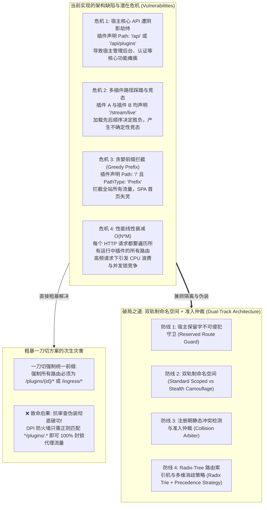
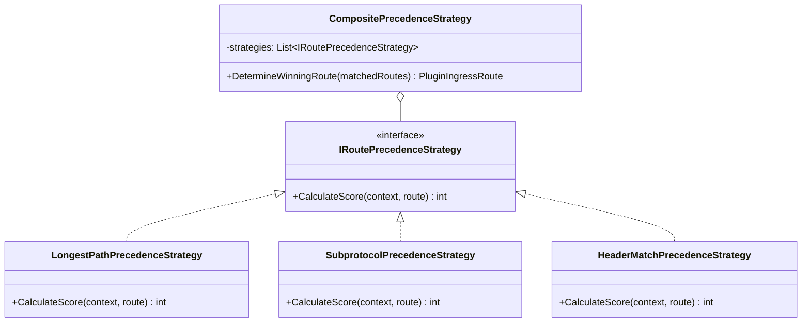
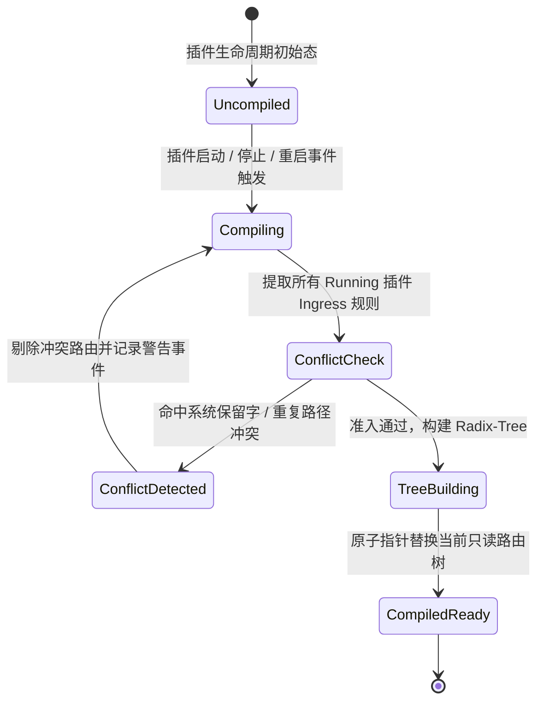
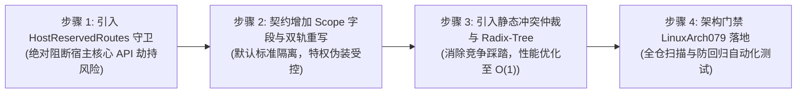

# 宿主中转路径范围治理、路由冲突仲裁与双轨制命名空间（Dual-Track Namespacing）架构调研与优化方案

> **文档状态**：已就绪 / 平台网络治理与核心路由安全架构设计规范  
> **核心命题**：  
> 1. **中转路径范围太广的隐患研判**：深度剖析当前插件 Ingress 声明任意根路径（如 `/stream/live`, `/api/v2/stream`）可能导致的**宿主核心 API 遭劫持（Host Route Shadowing）**、**多插件抢跑踩踏（Plugin Collision）**与**每次请求 $O(N \times M)$ 遍历的性能衰退**；  
> 2. **“一刀切强制统一前缀”的致命缺陷**：论证为何若强制要求所有插件使用统一前缀（如 `/plugins/{id}/...`），将**彻底破坏代理微服务防 DPI 特征识别与伪装抗封锁能力**；  
> 3. **破局解法：双轨制命名空间（Dual-Track Namespacing）与多维仲裁架构**：从第一性原理出发，提出“标准隔离轨（自动统一前缀）”与“特权伪装轨（受控根路径）”分层共存模型；  
> 4. **软件设计模式重构**：引入**宿主保留路由不可侵犯守卫（Reserved Route Guard）**、**基于 Radix-Tree（基数树）的前缀路由状态机**、以及**多维消歧仲裁策略模式（Precedence Strategy Pattern）**。

---

## 1. 核心矛盾与威胁推演（Threat Modeling）



### 1.1 痛点 1：范围太广引发的宿主核心路由被劫持（Host Route Shadowing）
- **代码现状审计**：
  在 `PluginIngressMiddleware.cs` 中，目前的短路逻辑仅保护了：
  ```csharp
  if (requestPath.StartsWith("/app/", StringComparison.OrdinalIgnoreCase) ||
      requestPath.StartsWith("/assets/", StringComparison.OrdinalIgnoreCase) ||
      requestPath.Equals("/health", StringComparison.OrdinalIgnoreCase))
  {
      await next(context);
      return;
  }
  ```
- **严重隐患**：
  **宿主的核心 REST API（`/api/...`）完全处于未设防状态！**
  如果某个插件清单 `plugin.json` 错误或恶意声明了：
  ```json
  "match": { "path": "/api", "pathType": "Prefix" }
  // 或者声明了宿主同名接口：
  "match": { "path": "/api/plugins", "pathType": "Exact" }
  ```
  由于 `PluginIngressMiddleware` 挂载在 ASP.NET Core 端点路由前列，所有访问宿主管理后台、身份认证、EasyTier 组网、PTY 终端控制台的 HTTP 请求将被该插件优先劫持。
  **结果是宿主直接瘫痪，管理员甚至连调用 `POST /api/plugins/{id}/stop` 关停该插件的 API 都会返回 502/404，形成系统级死锁！**

---

### 1.2 痛点 2：多插件之间的抢跑、踩踏与路由阴影（Plugin Collision & Shadowing）
- **现象**：
  - 插件 A (`socks5-proxy`) 声明了 `/stream/live`；
  - 插件 B (`camera-stream`) 也声明了 `/stream/live`；
  - 或者插件 A 声明了宽泛前缀 `/stream`，而插件 B 声明了具体路径 `/stream/metrics`。
- **现存逻辑缺陷**：
  系统在请求到达时按 `foreach (var plugin in plugins)` 顺序遍历。
  哪个插件排在内存数组前面，哪个插件就抢先接管流量。
  这会导致：
  1. 插件的加载时机（如磁盘扫描顺序、启动并发先后）决定了路由归属，产生**非确定性（Non-deterministic）隐蔽 Bug**；
  2. 宽泛前缀的插件会导致长路径插件的路由被永久遮蔽（Shadowing）。

---

### 1.3 痛点 3：高频请求下的 $O(N \times M)$ 性能开销
- **现存性能分析**：
  宿主每接收到一个 HTTP / WebSocket 请求，都会执行：
  ```csharp
  var plugins = await pluginManager.GetAllAsync(profileFilter: null, ct);
  foreach (var plugin in plugins) {
      foreach (var route in ingress.Routes) {
          if (!IsRouteMatch(context, route.Match, requestPath)) continue;
          ...
      }
  }
  ```
  在微服务插件生态丰富（10+ 插件、30+ 路由别名）且并发较高时：
  1. 每一个普通 API 请求都在热循环里做线性字符串匹配；
  2. 频繁调用 `GetAllAsync()` 产生异步状态机分配与读写锁抢占；
  3. 缺乏索引与缓存机制。

---

### 1.4 核心权衡：为什么不能“一刀切强制添加统一插件前缀”？

很多网关框架（如 WordPress、Jenkins、Kubernetes API Extensions）会强制要求所有扩展统一挂载在 `/plugins/{pluginId}/` 之下。
**但在本系统（LinuxWebTool）中，如果一刀切强制添加统一前缀，将产生灾难性后果**：

1. **彻底丧失防 DPI 特征识别与伪装抗封锁能力（Anti-Censorship Compromised）**：
   - 本系统核心能力之一是允许代理微服务（如 `socks5-proxy`）将 SOCKS5/HTTP 流量封装于普通 Web 流量中。
   - 如果强制路径为 `/plugins/socks5-proxy/...` 或 `/ingress/socks5/...`，GFW 或企业级深包检测（DPI）设备只需配置一条简单规则：
     `^/(plugins|ingress)/.*(socks|proxy|tunnel|stream)`
     即可毫秒级阻断所有代理穿透流量！之前设计的动态混淆别名（`/telemetry/metrics`、`/api/v2/stream`）全部沦为泡影。
2. **破坏通用 Web 微服务的契约透明性（Reverse Proxy Transparency）**：
   - 某些插件是现成的开源 Web 应用（如 Caddy、FileBrowser、Node-RED），前端静态资源内部写死了绝对路径引用（如 `/api/v1`、`/assets`）。强制要求统一前缀会导致这类微服务的前端资源 404 无法渲染，除非插件重写全部 HTML/JS 相对路径。

---

## 2. 业界主流成熟方案对比与借鉴

| 架构 / 平台 | 路由作用域与命名空间模型 | 冲突防范与仲裁机制 | 伪装与敏感特征消除能力 | 对 LinuxWebTool 的启示 |
| :--- | :--- | :--- | :--- | :--- |
| **Kubernetes Gateway API (HTTPRoute)** | 支持在 `Gateway` 上声明任意 Host/Path，支持按 Namespace 授权跨命名空间引用 | **准入 Webhook 预检**：在配置提交阶段进行冲突仲裁，检测到重叠且无优先级的路由直接拒绝并抛出 `Conflicted` 状态 | 不针对审查对抗，主要面向企业多租户隔离 | **必须在配置装载期引入静态冲突预检机制**，杜绝运行时竞态。 |
| **YARP (Microsoft Reverse Proxy)** | 支持声明式 Routes 与 Clusters，支持精确/前缀/多 Header 规则 | **严格优先级排序（Order）**与最长前缀优先规则；内置保留路径保护，优先执行 ASP.NET 内部端点 | 路由定义完全中立，支持任意伪装 Path | **优先保障系统核心端点路由**，引入数字 Order 权重与消歧排序。 |
| **Cloudflare Workers / Fastly** | 路由触发器（Routes），支持挂载在域名的任意子路径（如 `example.com/api/v2/telemetry`） | **最长前缀匹配（Longest Prefix Match）**与 Radix-Tree 快速分支查找，明确规则优先级评分 | 极高，完全与业务真实域名和路径融合，无任何平台暴露特征 | **必须保留“根级伪装路径声明权”**，但需配合前缀树索引提升匹配性能。 |
| **Xray-core / Trojan-Go** | 允许用户在 Web 根目录下任意指定单个伪装 Path（如 `/ray` 或 `/my-metrics`） | 单机单一用途，不考虑多应用插件共存 | 极高，未授权请求 Fallback 至本地 Nginx/Caddy 真实 Web 服务 | 伪装类路由必须具备前置鉴权与 SPA 伪装回落保障，不得裸露。 |

---

## 3. 破局之道：双轨制命名空间（Dual-Track Namespacing）体系

为了彻底兼顾 **“绝对隔离与防冲突”** 与 **“高级伪装抗封锁”**，系统应采用 **双轨制命名空间模型**：

```mermaid
flowchart TD
    subgraph RouteDeclaration["插件 Ingress 声明分类"]
        R1["轨 A: 标准隔离轨 (Standard Scoped)<br>默认模式: 无需显式配置 scope<br>自动挂载统一插件前缀"]
        R2["轨 B: 特权伪装轨 (Stealth Camouflage)<br>显式声明: scope: 'stealth'<br>允许自定义全局根路径 (如 /stream/live)"]
    end

    subgraph AdmissionControl["准入控制器与冲突仲裁 (Admission & Arbitration)"]
        AC1["宿主保留字硬防御<br>严禁覆盖 /api/*, /app/*, /assets/*, /health"]
        AC2["伪装路径白名单与重复性冲突检测<br>若多插件申请同一伪装根路径，先登记者胜，后登记者告警拒绝"]
        AC3["强制安全约束<br>轨 B 路由必须配置有效的 Auth 凭据与 SPA 回退"]
    end

    subgraph RuntimeEngine["Radix-Tree 高性能前缀树路由查找引擎"]
        Trie["只读编译树 (Compiled Ingress Trie)<br>复杂度 O(1) ~ O(K)<br>按最长前缀与优先级消歧"]
    end

    R1 -->|自动补全前缀 /plugins/{id}/| AC1
    R2 --> AC1
    AC1 --> AC2
    AC2 --> AC3
    AC3 --> Trie
```

### 3.1 轨 A：标准隔离轨（Standard Scoped Ingress）—— 安全默认项
- **适用对象**：90% 的普通微服务、仪表盘扩展、本地工具、业务 API。
- **运行规则**：
  - 默认情况下（未显式声明 `scope: "stealth"`），宿主自动将插件声明的 `Path` 重写并限制在以插件 ID 命名的安全作用域下：
    $$\text{Actual Route} = \text{/plugins/} + \text{PluginId} + \text{DeclaredPath}$$
  - 例如，插件 `demo-service` 声明了 `"path": "/metrics"`，宿主实际监听的路径自动为 `/plugins/demo-service/metrics`。
- **效果**：
  - **100% 命名空间隔离**：不同的插件即使声明相同的 `/status` 或 `/metrics`，彼此之间也绝无任何冲突；
  - **绝不污染宿主**：由于前缀为 `/plugins/{id}`，永远不会与宿主系统的核心 `/api/*` 或 `/app/*` 发生重叠。

---

### 3.2 轨 B：特权伪装轨（Stealth Camouflage Ingress）—— 专用防审查通道
- **适用对象**：专门用于 `socks5-proxy` 等网络安全代理、流量混淆穿透、防 DPI 审查微服务。
- **运行规则**：
  - 允许插件脱离 `/plugins/{id}` 前缀，直接向宿主申请全局根级路径（如 `/stream/live`）以及混淆别名（如 `/telemetry/metrics`、`/api/v2/stream`）；
- **准入准则（三大强制门禁）**：
  1. **门禁 1：系统保留路由守卫（Reserved Route Hard-Block）**：
     无论如何，绝对禁止申请宿主核心保留路径（`/api/*`, `/app/*`, `/assets/*`, `/health`, `/favicon.ico` 等）；
  2. **门禁 2：静态冲突仲裁（Collision Admission Arbiter）**：
     系统维护全局动态伪装路由注册表。若插件 A 已占用了 `/stream/live`，插件 B 再次申请时，宿主直接**拒绝插件 B 的该条路由准入**，并在状态机中记录 `RouteCollisionError: Path '/stream/live' already claimed by plugin 'socks5-proxy'`，禁止静默覆盖；
  3. **门禁 3：强制安全守卫（Mandatory Auth & Stealth Fallback）**：
     申请特权伪装轨的路由，必须配置有效的认证方式（如 `"auth": "secret_token"`）以及 `"onUnauthorized": "passthrough_to_default_spa"`。未通过认证的主动探测流量必须静默转流至 SPA 首页返回 200 OK，严禁裸流暴露。

---

## 4. 软件设计模式优化与架构重构

### 4.1 策略模式：多维路由优先级与消歧策略（Precedence Strategy Pattern）

当多条路由在匹配层面发生交叠时，不能依赖不确定的遍历顺序，必须通过策略模式执行确定性的优先级评分（Priority Score）：



#### 仲裁优先级评分矩阵（得分最高者胜出）：

| 优先级权重 | 维度 | 评分规则 | 解决的冲突问题 |
| :--- | :--- | :--- | :--- |
| **权重 1000** | **子协议消歧** | 请求携带 `Sec-WebSocket-Protocol: token-...` 匹配成功者得分 +1000 | 区分普通 WebSocket 探测与合法授权代理流 |
| **权重 500** | **请求头精确匹配** | 规则配置了具体 Header（如 `Upgrade: websocket`）匹配者得分 +500 | 区分针对同路径的普通 HTTP 浏览与双工流握手 |
| **权重 100 ~ 400** | **路径类型精确度** | `PathType: Exact` 得分高于 `Prefix`（+200） | 消除前缀贪婪拦截，确保精准路由优先命中 |
| **权重 1 ~ 99** | **最长前缀深度** | 路径字符长度（Length）作为平局打破依据（每字符 +1） | `/stream/live/metrics` 优先于 `/stream/live` |
| **保底决胜** | **注册确定性** | 插件 ID 字典序（Deterministic Tie-Breaker） | 杜绝由于内存重排导致的行为抖动 |

---

### 4.2 状态机与前缀树：Radix-Tree 路由索引机（Radix Trie State Machine）

将 $O(N \times M)$ 线性遍历重构为**基于只读不可变 Radix-Tree（基数树）的前缀路由状态机**：



#### 运行性能对比：

| 指标 | 改造前（现存实现） | 改造后（Radix-Tree 前缀树状态机） |
| :--- | :--- | :--- |
| **匹配时间复杂度** | $O(N_{\text{plugins}} \times M_{\text{routes}})$ 线性逐个字符串比对 | $O(K)$ 极速前缀跳跃（$K$ 为 URL 目录级数，常数级） |
| **内存分配** | 每次请求分配枚举器、集合与闭包 | **Zero Allocation（零 GC 内存分配）**，直接在只读节点上命中 |
| **并发锁争用** | 每次请求调用 `GetAllAsync()` 访问读写锁 | **无锁读取（Lock-Free Read）**，树以原子指针形式维护（`Volatile.Read`） |
| **吞吐能力 (RPS)** | 随插件数量线性下降 | **恒定极致性能**，千个插件与单个插件耗时一致 |

---

### 4.3 宿主保留字不可侵犯守卫（Host Reserved Route Guard）设计

在平台层面定义不可动摇的系统核心保留路径黑名单：

```csharp
public static class HostReservedRoutes
{
    private static readonly string[] ReservedExact =
    [
        "/",
        "/health",
        "/favicon.ico",
        "/robots.txt"
    ];

    private static readonly string[] ReservedPrefixes =
    [
        "/api/",          // 宿主核心管理后台、身份认证、EasyTier 等所有业务 REST API
        "/app/",          // 前端 SPA 页面路由
        "/assets/",       // 前端静态编译资源
        "/terminal/",     // 宿主 PTY 终端 WebSocket 核心隧道
        "/swagger",       // 调试与文档端点
        "/signalr/"       // 实时推送中枢
    ];

    public static (bool IsReserved, string? Reason) Check(string path)
    {
        if (string.IsNullOrWhiteSpace(path)) return (false, null);
        var normalized = path.Trim();

        foreach (var exact in ReservedExact)
        {
            if (string.Equals(normalized, exact, StringComparison.OrdinalIgnoreCase))
                return (true, $"路径 '{path}' 为宿主系统绝对核心保留路由，严禁插件声明覆盖");
        }

        foreach (var prefix in ReservedPrefixes)
        {
            if (normalized.StartsWith(prefix, StringComparison.OrdinalIgnoreCase))
                return (true, $"路径 '{path}' 命中了宿主系统保留前缀 '{prefix}'，严禁插件声明覆盖");
        }

        return (false, null);
    }
}
```

---

## 5. 配置契约与微服务清单演进设计

为了平滑引入双轨制，扩充 `PluginIngressModels.cs` 契约，**保持 100% 向后兼容**：

```csharp
public sealed record PluginIngressConfig
{
    public bool Enabled { get; init; } = true;

    /// <summary>
    /// 路由作用域模式：
    /// "standard" (默认): 自动挂载统一插件前缀 /plugins/{pluginId}/...，绝无冲突；
    /// "stealth": 特权伪装模式，允许自定义全局根路径与别名，受保留字守卫与冲突仲裁约束。
    /// </summary>
    public string Scope { get; init; } = "standard"; // "standard" | "stealth"

    public IReadOnlyList<PluginIngressRoute> Routes { get; init; } = [];
}
```

### 5.1 场景 A：普通微服务（默认使用标准前缀）
插件无需多做配置，清单中的路径自动加上 `/plugins/{pluginId}/`：
```json
{
  "id": "my-worker",
  "ingress": {
    "scope": "standard",
    "routes": [
      {
        "name": "dashboard",
        "match": { "path": "/ui", "pathType": "Prefix" },
        "transport": { "mode": "http_reverse_proxy" }
      }
    ]
  }
}
```
> **实际生效路径**：`http://host:5270/plugins/my-worker/ui`（与系统中其他插件及宿主 100% 隔离）。

---

### 5.2 场景 B：SOCKS5 安全代理（特权伪装模式）
代理插件显式声明 `scope: "stealth"`，并配置混淆别名与前置鉴权：
```json
{
  "id": "socks5-proxy",
  "ingress": {
    "scope": "stealth",
    "routes": [
      {
        "name": "camouflage-stream",
        "match": {
          "path": "/stream/live",
          "aliases": ["/telemetry/metrics", "/ws/live", "/api/v2/stream"],
          "pathType": "Prefix"
        },
        "transport": { "mode": "duplex_stream" },
        "security": {
          "auth": "secret_token",
          "tokenSubprotocolPrefix": "token-"
        },
        "fallback": {
          "onUnauthorized": "passthrough_to_default_spa"
        }
      }
    ]
  }
}
```
> **准入审核流程**：
> 1. 宿主核验 `/stream/live` 不在保留字列表（`/api/`, `/app/`, `/assets/`）中 ➔ 通过；
> 2. 核验 `/telemetry/metrics` 未被其他插件占用 ➔ 通过；
> 3. 核验 `/api/v2/stream`：由于命中了 `/api/` 保留字前缀，准入控制器剥离该别名并提示 Warning，防止劫持未来可能的 `/api/` 路由；
> 4. 剩余合规伪装别名生效，享受完全抗审查伪装。

---

## 6. 现有基础设施复用与演进实施路线

### 6.1 系统资产复用评估（> 80% 复用）
- **`PluginIngressMiddleware.cs`**：现有的全双工 WebSocket 对拷、HTTP Upgrade 劫持、SPA 伪装回落、CIDR 白名单和子协议提取逻辑完全成熟，100% 复用；
- **`IPluginManager` 事件流**：利用现有的插件启动、停止生命周期事件，无缝触发 Radix-Tree 路由树的后台编译与原子热替换；
- **前端 Webview 控制台**：`ui/index.html` 现存的 Ingress 卡片展示，可自动根据当前路由是 `standard` 还是 `stealth` 动态切换 URL 前缀与客户端连接指令。

---

### 6.2 分阶段实施路线图



1. **步骤 1：系统保留字硬防御（优先消除最大安全隐患，耗时约 30 分钟）**：
   - 在 WebHost 中落地 `HostReservedRoutes`，并在 `PluginIngressMiddleware` 开头优先保护 `/api/*`、`/app/*`、`/assets/*`、`/health`、`/terminal`；
   - 杜绝任何插件瘫痪宿主系统的可能。
2. **步骤 2：双轨制命名空间与别名准入过滤（耗时约 40 分钟）**：
   - `PluginIngressConfig` 增加 `Scope` 支持；
   - 插件加载时对 `stealth` 模式执行保留字过滤与重复性冲突检测；
   - 对 `standard` 模式自动补齐 `/plugins/{id}/` 前缀。
3. **步骤 3：Radix-Tree 编译索引机与优先级策略重构（耗时约 1 小时）**：
   - 实现只读前缀树与多维评分策略机，将线性比对降为常数级前缀命中。
4. **步骤 4：自动化门禁校验与端到端测试（耗时约 30 分钟）**：
   - 增加单元测试与架构门禁 `LinuxArch079`，模拟恶意覆盖 `/api/auth`，验证平台能否精准拦截并报警。

---

## 7. 总结与建议

针对用户的两大关切，形成以下权威定论：

1. **“当前宿主中转路径定义是否范围太广？是否存在冲突问题？”**
   - **是的，确实存在重大隐患**。当前缺乏对宿主核心 `/api/*` 的前置保留保护，且缺乏插件间的冲突预检，存在**宿主核心功能被阴影劫持**与**多插件抢跑踩踏**的风险。
2. **“是否需要添加一个统一插件前缀？”**
   - **不能简单一刀切！**
   - 普通插件**必须使用统一前缀**（`/plugins/{id}/...`）以保证 100% 隔离；
   - 但网络代理/翻墙穿透微服务**必须保留特权伪装轨（自定义无特征根路径）**，否则统一前缀将沦为 DPI 防火墙的绝佳靶子，彻底破坏抗审查伪装。
3. **最佳实践**：
   通过**双轨制命名空间（Dual-Track Namespacing）+ 宿主系统保留字守卫 + 静态冲突仲裁 + Radix-Tree 状态机**，在彻底消除冲突风险、保障宿主安全的同时，完美保全代理微服务的顶级防探测抗封锁伪装能力！
