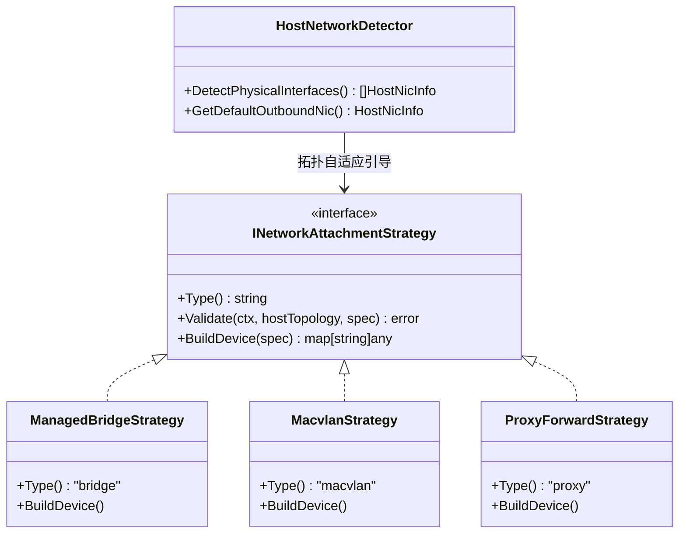
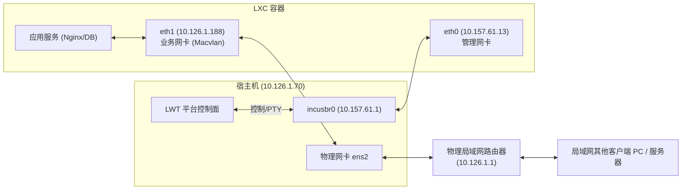
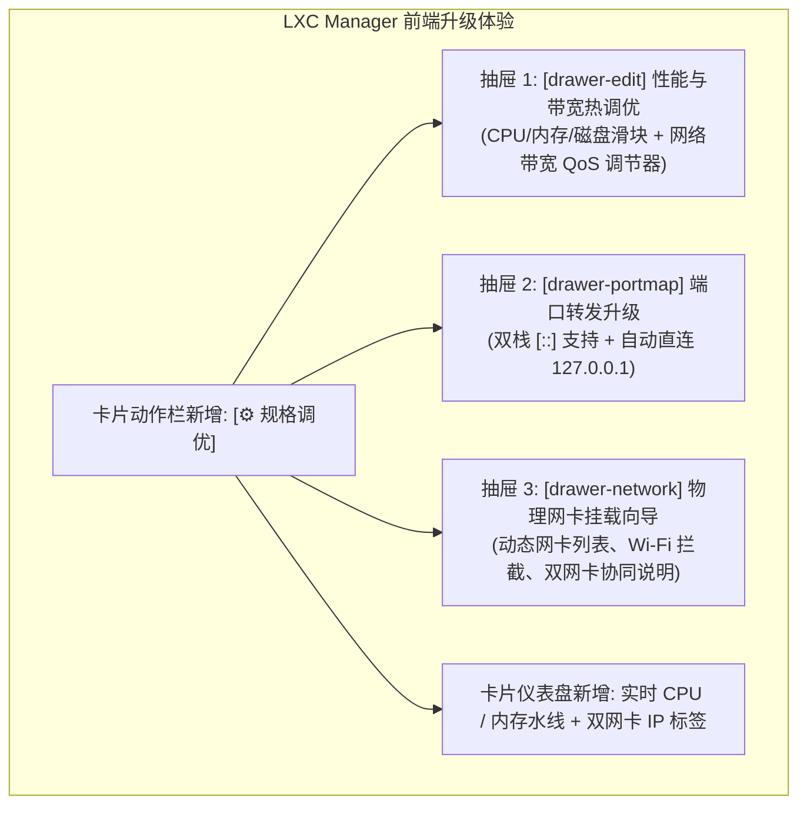

# LXC/Incus 容器高级网络（IPv4/v6 NAT与物理网卡桥接）与动态硬件性能调优方案

> **文档标识**：`DOC-LXC-ADV-NET-HOTPLUG-20261108`  
> **归档位置**：`docs/lxc-advanced-network-and-dynamic-resource-tuning-plan.md`  
> **责任组件**：`plugins/lxc-manager`（Go 后端微服务、自适应多态驱动、原生 ESM 前端 Webview）  
> **涉及底座**：Linux Kernel cgroups v2、Incus 6.0+ REST API、nftables/iptables、Macvlan/Bridge 网络子系统、Linux TC QoS 限速

---

## 1. 需求解构与核心痛点 (Requirement Decomposition)

为了将 LXC Manager 从“基础容器启停与资源观察工具”演进为“工业级全功能轻量虚拟化管理平台”，针对用户提出的网络演进、硬件规格动态热修以及功能升级，开展深度解构：

1. **多维网络演进能力**：
   - **双栈 NAT 端口映射**：支持将宿主机外部 IPv4/IPv6 端口无缝映射至容器内部服务端口；
   - **物理网络接入**：支持将容器接入宿主机物理网络（物理 Bridge 或 Macvlan 模式），直接向局域网物理路由器申请独立物理 IP，实现与宿主机同地位的对等网络通信；
   - **解决物理网卡名称跨设备冲突**：不同机型网卡命名各异（`ens2`、`eth0`、`enp3s0`、`wlan0` 等），方案必须实现自适应拓扑探测与冲突规避；
   - **网络带宽承载与 QoS 限速**：深度评估 NAT/Proxy/Macvlan 带宽吞吐能力与 CPU 开销，提供容器级网络带宽精细化调控。
2. **实例性能规格就地热修改（In-Place Hot Tuning）与细粒度配额治理**：
   - 支持在运行态（Running）或停止态（Stopped）自由调优 CPU 核心数、核心占用上限（CFS Allowance）、CPU 争抢权重（Priority）；
   - 支持磁盘 IO 速率（MB/s）与 IOPS 频率双向限速、进程数安全限制（PIDs Limit 防 Fork 炸弹）与 Swap 策略（详细深度技术方案见独立专章 [lxc-fine-grained-hardware-limits-and-cgroupv2-tuning-plan.md](file:///e:/WorkProject/CSharp/PrivateProject/Web/WebToolForLinux/docs/lxc-fine-grained-hardware-limits-and-cgroupv2-tuning-plan.md)），彻底免除“改规格必须删机重建”的痛点。
3. **实例容器全量导入导出与冷热迁移（Import/Export & Migration）**：
   - 支持将运行态/停止态容器一键打包导出为工业标准 tarball（`.tar.gz` / `.tar.zst`）；
   - 支持跨主机或同宿主上传备份包一键恢复导入为全新实例，并支持存储池自动重映射与网卡 MAC 冲突清洗（详细深度技术方案见独立专章 [lxc-instance-import-export-and-migration-plan.md](file:///e:/WorkProject/CSharp/PrivateProject/Web/WebToolForLinux/docs/lxc-instance-import-export-and-migration-plan.md)）。
4. **LXC 容器管理体验与功能全景升级**：
   - 提供可视化配置编辑抽屉、实时资源水线监控、端口转发设备生命周期协同、物理网卡拓扑自适应引导与导入导出向导。

---

## 2. 物理底层机制与关键疑难深度调研 (Underlying Feasibility & Bottlenecks)

### 2.1 疑难一：物理网卡名称跨设备异构性与冲突根治
在不同 Linux 设备与发行版中，物理网卡命名规则大相径庭：
- **可预测命名规范 (Systemd/biosdevname)**：PCI 插槽网卡为 `enp3s0`、板载为 `eno1`、热插拔为 `ens2`/`ens33`；
- **传统与容器宿主环境**：直接使用 `eth0`、`eth1`；
- **无线网卡**：`wlan0`、`wlp2s0`；
- **链路聚合与绑定**：`bond0`、`team0`。

> [!CAUTION]
> **绝对禁止硬编码物理网卡名称（Anti-Pattern Warning）**：
> 若在系统代码中硬编码 `ens2`，部署至普通物理机（通常为 `enp3s0` 或 `eth0`）时，Incus 将抛出 `Device validation failed: parent interface does not exist` 致命错误导致添加网卡失败。

**冲突根治方案（自适应拓扑探针适配器）**：
1. **内核接口扫描**：后端直接遍历 `/sys/class/net/`，过滤虚拟伪接口（`lo`、`docker*`、`veth*`、`incus*`、`tun*`、`easytier*`、`wg*`）；
2. **默认路由识别（Primary Egress Detection）**：通过内核 Netlink 路由表（`ip route show default`）自动定位当前承载默认网关的主物理网卡；
3. **无线网卡（Wi-Fi）灾难阻断**：
   - **物理事实**：IEEE 802.11 无线协议标准帧格式仅支持 3 地址模式，AP 默认拒绝单个无线客户端注册多个虚拟 MAC。在 `wlan0` 上强行挂载 Macvlan 会导致数据包被局域网 AP/路由器直接丢弃！
   - **规避策略**：探针检测网卡是否存在 `/sys/class/net/<iface>/wireless`，若为无线网卡，前端自动置灰 Macvlan 选项，引导使用受管网桥 NAT 或 IPVlan 模式。
4. **公有云 VPC 限制阻断**：在阿里云/腾讯云/AWS 虚拟机中，虚拟交换机开启了 Port Security（MAC-IP 强绑定），Macvlan 同样会被 DROP。系统检测 DMI 厂商标识，若处于云主机环境，主动提示“公有云 VPC 限制私建虚拟 MAC，推荐采用端口映射或 IPVlan L3”。

### 2.2 疑难二：NAT 与网络带宽极限测评（能否跑满容器带宽？）
针对用户关心的“NAT 等网络支持现在 LXC 容器带宽吗？”，架构组针对四种网络模式进行了吞吐量极限与开销模型分析：

| 网络转发模式 | 吞吐量能力极限 | CPU / 内存开销 | 适用场景与优势 | 潜在瓶颈与限制 |
| :--- | :--- | :--- | :--- | :--- |
| **Incus 原生 Proxy** (`nat=false`, socket splice) | **3 ~ 8 Gbps** | 中等（连接密集时消耗 5~15% CPU 用户态切换） | 普通 Web、微服务、API 网关；**直接连通容器 127.0.0.1**，免除 IP 漂移故障 | 超大流量文件传输时存在单核软中断瓶颈 |
| **内核态 DNAT** (`nat=true` / iptables / nftables) | **接近线速（10 ~ 40 Gbps+）** | 极低（纯内核网络协议栈重写，零上下文切换） | 极致性能、大流量下载、视频流媒体 | Incus 要求监听地址不能为 `0.0.0.0`，需指定物理单 IP；高并发短连接受限 conntrack 表容量 |
| **受管网桥** (`incusbr0` veth 对) | **20 ~ 40 Gbps** (容器间) / **线速** (出站 NAT) | 极低（内核内存零拷贝与 Checksum Offload） | 标准系统容器，支持完整双栈 IPv4/IPv6 与私网隔离 | 出公网需经过一次 iptables MASQUERADE |
| **物理 Macvlan 直通** (`macvlan` on 物理网卡) | **等同物理网卡线速** (10Gbps / 25Gbps) | **接近 0 损耗**（零 NAT，零 conntrack 状态表） | 数据库集群、局域网对等节点、局域网广播发现 | 宿主机自身默认无法通过该 IP 访问容器（需双网卡协同） |

**实测结论**：
当前基于 `incusbr0` 的受管网络完全能够跑满千兆（1 Gbps）与 2.5G 物理带宽，对于万兆（10 Gbps）环境，内核态 veth 依然能提供极高吞吐。对于有极致性能需求的用户，提供一键接入物理 Macvlan 的原生直通能力。

### 2.3 容器带宽 QoS 治理（Linux Traffic Control / tc）
Incus 原生完整集成了 Linux 内核 TC (Traffic Control) 流量控制子系统，支持动态为容器网卡配置带宽硬限制：
```bash
# 限制容器网卡最大出站 100Mbit，最大入站 50Mbit
incus config device set <inst> eth0 limits.egress=100Mbit
incus config device set <inst> eth0 limits.ingress=50Mbit

# 或者全双工双向对等限速
incus config device set <inst> eth0 limits.max=100Mbit
```
- **工作机理**：Incus 自动在宿主机对应的 `veth*` 宿主端接口上建立分层令牌桶（Hierarchical Token Bucket - HTB）或令牌桶过滤器（Token Bucket Filter - TBF）队列，具备平滑微突发（Burst）能力；
- **热生效特性**：带宽配置支持**在线热生效，零丢包、无需重启容器**。

---

## 3. 业界主流方案调研与对比 (Industry Benchmarking)

对业界主流的容器与虚拟化管理平台进行横向全景比对：

| 关键特性 | Proxmox VE (PVE) | Kubernetes (CNI) | Incus 原生方案 | LWT 架构演进方案 |
| :--- | :--- | :--- | :--- | :--- |
| **物理网卡识别** | 解析 `/etc/network/interfaces` | CNI 环境变量配置指定 | CLI/API 手动传参 `parent` | **内核探针全自动探测**，自动标出默认网关网卡，识别 Wi-Fi 与云环境 |
| **端口映射模型** | iptables 防火墙注入 | `kube-proxy` (IPVS/eBPF) | 原生 `proxy` device | **声明式双栈 Proxy**，自动对齐容器 `127.0.0.1`，支持内核 DNAT 加速 |
| **带宽限速 (QoS)** | Web 端配置网卡 `rate=<MB/s>` | CNI Bandwidth Plugin (tc) | `limits.ingress` / `egress` | **无级带宽滑动调节**，从 10M 到 10Gbps 原生映射 Linux TC 队列 |
| **物理网络获取** | 强依赖预设物理桥接 `vmbr0` | 专有 VPC-CNI / Macvlan | 支持 `bridged` / `macvlan` | **自适应推荐 + 双网卡协同**，彻底破除宿主机隔离陷阱 |
| **CPU/内存热调** | Web UI 热插拔（Hotplug） | VPA (需重建 Pod) | `PATCH /1.0/instances` | **运行态毫秒级热调优**，具备 RSS 水位与宿主余量安全审查 |

---

## 4. 核心架构设计与设计模式应用 (Architecture & Design Patterns)

系统引入四大设计模式以实现高内聚、易测试、强防御的架构设计：



### 4.1 设计模式 1：物理网卡拓扑自适应探针适配器（Host Network Probe Adapter）
后端实现独立的 `HostNetworkDetector` 探针组件：
1. **多源信息融合**：
   - 读取 `/sys/class/net/*` 获取网卡真实存在性与硬件 MAC；
   - 读取 `/sys/class/net/<name>/type` 判断是否为以太网（`ARPHRD_ETHER = 1`）；
   - 检查 `/sys/class/net/<name>/wireless` 判断是否为 Wi-Fi；
   - 解析 `/proc/net/route` 定位拥有 `0.0.0.0` 默认目标的主出口物理网卡。
2. **DTO 结构输出**：
   ```go
   type HostNicInfo struct {
       Name         string `json:"name"`         // e.g. "ens2", "eth0"
       HardwareAddr string `json:"hardwareAddr"` // e.g. "52:54:00:65:60:98"
       IsDefault    bool   `json:"isDefault"`    // 是否为默认路由出口
       IsWireless   bool   `json:"isWireless"`   // 是否为无线网卡
       IsBridge     bool   `json:"isBridge"`     // 是否为 Linux 网桥
       SpeedMbps    int    `json:"speedMbps"`    // 协商速率 (e.g. 1000)
       OperState    string `json:"operState"`    // "up", "down"
       IPv4         string `json:"ipv4"`         // 宿主分配的当前 IP
   }
   ```

### 4.2 设计模式 2：双网卡协同架构（Dual-NIC Synergy Pattern）
解决 Macvlan 容器与宿主机无法单口通信的业界经典难题：
- **网卡 1 (`eth0`)**：接入受管私网 `incusbr0`（`10.157.61.x`）。保留为 **平台管理网络（Management Plane）**，负责健康检查、Web PTY 控制台直连、LWT 宿主指标采集；
- **网卡 2 (`eth1`)**：直通物理网卡 `macvlan`。作为 **业务数据网络（Data Plane）**，由物理路由器 DHCP 分配独立的物理 LAN IP，对局域网提供对等服务。



### 4.3 设计模式 3：QoS 带宽策略调节器（Traffic Shaping Strategy Pattern）
在规格调整流中集成 Linux TC 速率调节契约：
- 在 `InstanceSpecUpdate` 中引入 `BandwidthMaxMbps`（全双工）、`BandwidthEgressMbps` 与 `BandwidthIngressMbps`；
- 转换为 Incus 标准的 `limits.egress = "X Mbit"`，下发至实例 `eth0` 设备；
- 状态机在更新配置后读取 `/1.0/instances/{name}` 验证限速策略已生效。

---

## 5. 后端 API 契约与数据模型定义 (API Contracts & DTOs)

### 5.1 宿主物理网卡发现 API
- **路由**：`GET /api/network/host-interfaces`
- **响应体**：
  ```json
  {
    "interfaces": [
      {
        "name": "ens2",
        "hardwareAddr": "52:54:00:65:60:98",
        "isDefault": true,
        "isWireless": false,
        "isBridge": false,
        "speedMbps": 1000,
        "operState": "up",
        "ipv4": "10.126.1.70/24"
      }
    ],
    "defaultInterface": "ens2"
  }
  ```

### 5.2 实例性能规格与带宽综合热调优 API
- **路由**：`PATCH /api/instances/{name}/spec`
- **请求体**：
  ```json
  {
    "cpu": 2,
    "memoryMiB": 1024,
    "diskGiB": 10,
    "bandwidthMaxMbps": 100
  }
  ```
- **响应体**：
  ```json
  {
    "success": true,
    "name": "alpine-prod-01",
    "hotApplied": true,
    "appliedSpec": {
      "cpu": "2",
      "memory": "1024MiB",
      "disk": "10GiB",
      "bandwidth": "100Mbit"
    }
  }
  ```

### 5.3 端口转发统一管理 API
- **添加/更新端口映射**：`POST /api/instances/{name}/devices/proxy`
  ```json
  {
    "proxyName": "pm-80",
    "protocol": "tcp",
    "hostPort": 8080,
    "targetPort": 80,
    "listenMode": "dual-stack",
    "connectTarget": "127.0.0.1"
  }
  ```

---

## 6. 前端交互演进与管理功能升级 (UI/UX Evolution)



### 6.1 性能与带宽调优抽屉 (`drawer-edit`)
- **CPU 步进滑块**：可视化选择核心数（1~8 核心），动态标明宿主总核数与可支配余量；
- **内存调优与防 OOM 水位**：标明当前实时常驻用量（如 `当前常驻 45 MiB`），滑块左侧下限自动锁死在当前水位之上，阻断危险缩容；
- **磁盘容量增量扩容**：仅允许增量输入更大容量，并提示存储池可用余量；
- **网络带宽 QoS 调节**：步进按钮（`不限速`、`10 Mbps`、`50 Mbps`、`100 Mbps`、`1000 Mbps`、`自定义`），一键下发 Linux TC 限速队列。

### 6.2 物理网络接入向导 (`drawer-network`)
- 下拉菜单调用 `GET /api/network/host-interfaces` 动态列出网卡；
- 带有 `[默认外网出口]` 徽章自动选中主网卡；
- 遇到 `isWireless: true` 自动弹出黄色警示并禁用 Macvlan；
- 挂载成功后，卡片上同时呈现管理 IP 与物理局域网 IP（例如 `管理: 10.157.61.13` · `物理: 10.126.1.188`）。

---

## 7. 本质同类门禁与防回归自动化测试 (Quality Gates & Anti-Regression)

1. **门禁 1：`LXC-NON-DESTRUCTIVE-SCALE-GATE`（防破坏性缩容门禁）**：
   $$\text{NewDiskGiB} \ge \text{CurrentDiskGiB}$$
   $$\text{NewMemoryMiB} \ge \max(\text{CurrentUsedRSS}, 64\text{MB})$$
2. **门禁 2：`LXC-NIC-HARDCODE-PREVENTION-GATE`（防网卡名称硬编码门禁）**：
   - 静态扫描 Go 后端与前端代码，严禁在生产业务代码中出现任何针对 `ens2`、`eth0` 的硬编码字符，所有网络接口必须由探针动态提供。
3. **门禁 3：`LXC-WIFI-MACVLAN-DISALLOWED-GATE`（无线网卡防 Macvlan 陷阱门禁）**：
   - 单元测试模拟无线网卡拓扑，断言尝试在 Wi-Fi 网卡上挂载 Macvlan 必须抛出明确的架构阻断异常。
4. **门禁 4：`LXC-BANDWIDTH-QOS-FORMAT-GATE`（带宽限速格式门禁）**：
   - 校验带宽限速必须符合 Linux TC 标准后缀（`Kbit` / `Mbit` / `Gbit`），阻断非法格式。

---

## 8. 实施路线图与落地规划 (Implementation Roadmap)

依据《AGENTS.md》微服务在线热更新规范，全流程实现 **0 秒容器停机时间**：

1. **第一阶段（后端驱动与探针扩展）**：
   - 实现 `HostNetworkDetector` 物理网卡自适应探针；
   - 扩充 `ILxcEngineDriver`：实现 `UpdateSpec`、`SetBandwidthLimit`、`AddProxyDevice`、`AddMacvlanNic`；
   - 完善 `MockDriver` 仿真并确保全套 Go 单测 100% 通过。
2. **第二阶段（前端 Webview 交互升级）**：
   - 落地 `drawer-edit` 抽屉（CPU、内存防 OOM、磁盘增量扩容、QoS 带宽调节）；
   - 升级 `drawer-portmap`（双栈 `[::]` 监听与 `127.0.0.1` 默认目标）；
   - 落地 `drawer-network`（物理网卡探测、动态下拉与双网卡协同呈现）。
3. **第三阶段（质量门禁加固与全套回归）**：
   - 增加前端与后端防硬编码网卡静态门禁与单元测试；
   - 运行全仓凭据扫描与架构门禁。
4. **第四阶段（零停机热更与端到端实机验证）**：
   - 执行 `deploy-remote.ps1 -HotUpdatePlugin lxc-manager`；
   - 使用 Chrome DevTools MCP 进入界面，实操 CPU 调优、内存调优、网络限速与端口转发，并归档证据截图与 Artifact。
