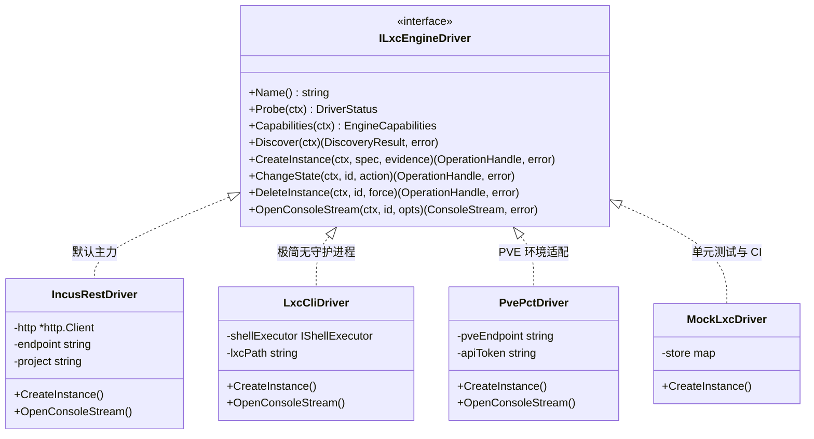
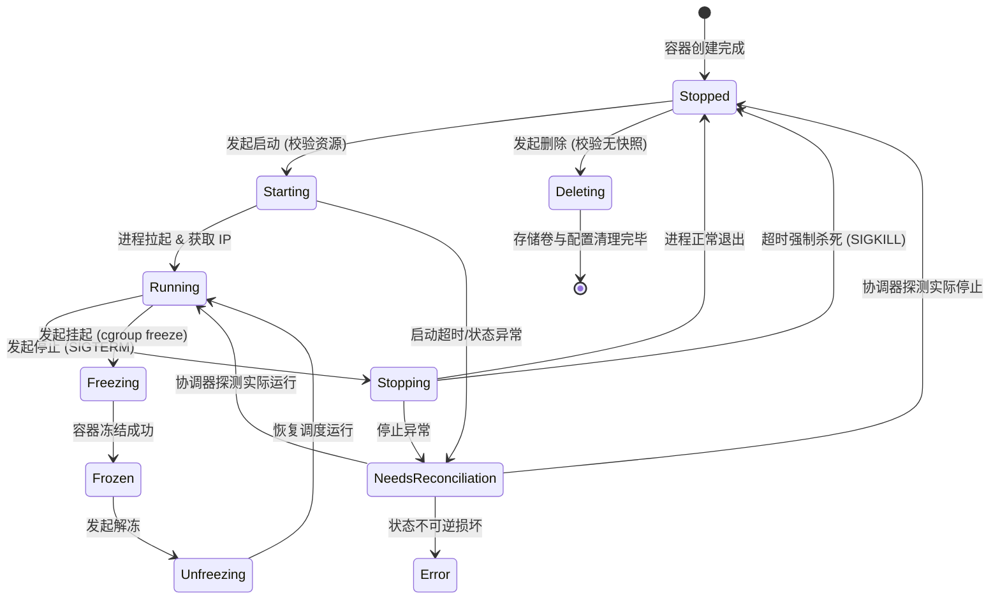
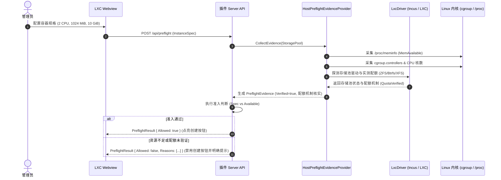
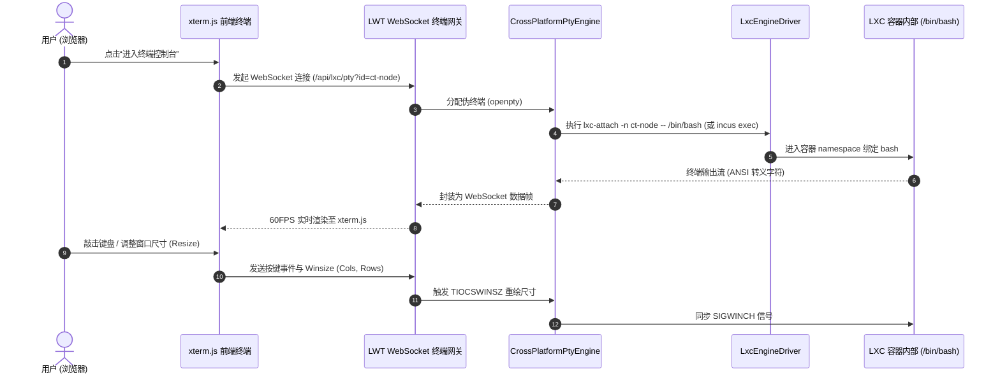
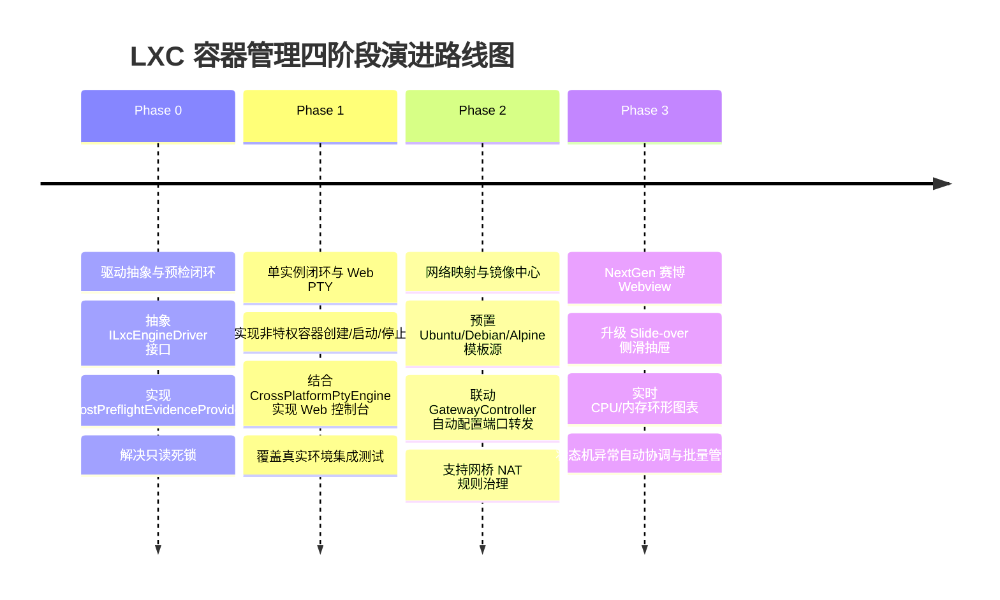

# LXC 系统容器管理架构调研与演进方案

> 调研与设计日期：2026-11-07  
> 适用范围：LinuxWebTool (LWT) 插件生态 (`plugins/lxc-manager/`)、宿主机系统容器管理、宿主与 Docker 共存环境及 Web 控制台集成。

---

## 1. 执行摘要与背景脉络 (Executive Summary)

LXC (Linux Containers) 作为 Linux 原生“系统容器”（System Container），与 Docker 类的单一进程应用容器有着根本区别：它具备完整的 `init` 进程（如 systemd / OpenRC）、独立的内核网络栈、私有挂载命名空间以及用户命名空间（User Namespaces），能够像轻量级虚拟机一样运行完整的 Linux 发行版，而内存开销仅为虚拟机的数十分之一。

在 LWT 前期调研中，团队先后输出了 5 篇核心技术文档（覆盖可行性设计、宿主机依赖安装、Docker 共存防火墙策略、真实环境验证及预检激活方案），并在 `plugins/lxc-manager/` 搭建了基于 Go 语言的微服务插件原型。

然而，当前该插件在工程化落地与用户体验层面面临三大结构性瓶颈：
1. **宿主依赖阻塞与运行环境脱节**：目标宿主尚未安装常驻守护进程，且面临 Docker 转发策略（`FORWARD: DROP`）与 Incus 受管网桥的冲突；
2. **预检门禁永久闭锁**：由于缺乏服务端可信容量证据源与硬配额校验器，当前预检逻辑注入空证据（Fail-Closed），导致所有创建操作被直接拒绝；
3. **架构强绑定与能力缺位**：插件名为 `lxc-manager`，但底层 100% 绑定 Incus REST API，无法复用宿主原生轻量 `lxc-tools` 或 Proxmox VE (`pct`)；同时缺失容器 Web PTY 终端直连、模板镜像库与端口暴露联动。

本方案基于**适配器模式 (Adapter)**、**全生命周期有限状态机 (FSM)**、**多策略引擎 (Strategy)** 及 **响应式观察者模式 (Reactive Observer)**，结合 LWT 平台现有的原生 PTY 终端引擎（`liblinuxwebtool_pty.so`）、四层网关转发系统与 NextGen 赛博 UI 交互体系，提出一套高可用、强安全、多驱动适配的演进方案。

---

## 2. 现状透视与核心阻塞点诊断 (Current State & Bottlenecks)

### 2.1 现有代码资产与已完成能力

通过对 `plugins/lxc-manager/` 源码进行全量走查，目前已具备以下基础资产：

| 模块 | 关键文件 | 已实现能力 | 遗留缺陷与瓶颈 |
| :--- | :--- | :--- | :--- |
| **插件平台集成** | `plugin.json` | 声明为 `resident` 原生常驻微服务，具备环境密钥鉴权与宿主依赖声明（`scope: host`） | 宿主依赖显示为 `Unknown`，缺少自动化就绪探测；缺少动态端口转发配置。 |
| **Incus 客户端** | `internal/incus/` | 支持标准库实现的 Unix Socket 与 mTLS HTTPS 双模式通信；支持容器、镜像、存储池与网桥发现 | 强耦合 Incus 的 `/1.0/` REST 协议，无法兼容纯轻量原生 LXC 命令行或 PVE 环境。 |
| **任务与准入锁** | `internal/jobs/` | 基于文件锁的跨进程 Admission 单槽控制、幂等键去重与异常恢复核对机制 | 全局单槽锁导致所有创建任务串行化，无分片并发能力；依赖本地文件系统持久化。 |
| **创建预检** | `internal/incus/preflight.go` | 严格的只读发现核对与容量防超卖检查规则 | `main.go:58` 显式传入空 `PreflightEvidence{}`，永久拒绝所有创建请求（Fail-Closed）。 |
| **操作工作流** | `internal/workflow/` | 实例创建与生命周期（Start/Stop/Restart）异步编排，注入所有权标签 `user.lwt.job` | 启停操作尚未在真实物理宿主验收；未实现容器控制台（Exec / Attach）。 |
| **前端交互** | `ui/index.html`, `ui/app.js` | 基础的原生 DOM 渲染，支持任务核对与错误提示 | 基础 HTML 表单，需手动输入 64 位镜像哈希；缺少现代赛博深色主题与侧滑抽屉。 |

### 2.2 核心阻塞点深层诊断

```mermaid
flowchart TD
    subgraph 阻塞点一：宿主与网络
        B1[目标宿主未安装 Incus daemon] --> B11[Debian 12 完整包因 QEMU 依赖冲突]
        B1 --> B12[Docker iptables FORWARD DROP 阻断容器桥接流量]
    end

    subgraph 阻塞点二：准入预检
        B2[main.go 注入空 PreflightEvidence] --> B21[Preflight.Verified = false]
        B21 --> B22[拒绝创建: capacity evidence unavailable]
        B21 --> B23[拒绝创建: hard storage quota unverified]
    end

    subgraph 阻塞点三：用户体验断层
        B3[缺少 Web PTY 控制台] --> B31[创建容器后无法交互式登录配置]
        B32[无模板镜像中心] --> B33[需手动填写 64 位 SHA256 镜像指纹]
        B34[网络隔离与外部断连] --> B35[容器私网 IP 无法通过宿主端口对外服务]
    end
```

1. **依赖安装冲突**：Debian 12 默认 Backports 中的完整 `incus` 包依赖 QEMU 8.0+，与宿主现有包冲突；虽然容器专用包 `incus-base` 依赖可解，但安装涉及底层包更新（如 `login`, `passwd`），且需建立 Docker 与 Incus 网桥共存规则；
2. **预检证据缺失**：`preflight.go` 严格要求服务端验证的 `Verified` 标志和存储池硬配额实测状态（`QuotaVerifiedForPool`）。目前尚未实现宿主机真实容量与存储配额的证据提供者，使插件处于“只读死锁”；
3. **用户体验三无（无终端、无模板、无映射）**：即使容器创建成功，缺少类似 Portainer / Cockpit 的 Web Terminal 直连控制台，用户无法进入 Shell；缺少公共镜像源加速索引；容器私网 IP 无法与 LWT 端口转发网关联动。

---

## 3. 业界主流系统容器管理方案横向多维对比 (Industry Benchmark)

针对 Linux 系统容器管理，调研业界五大主流代表方案：

| 维度 | Incus (社区主推) | 原生 LXC (`lxc-tools`) | Proxmox VE (`pct`) | Cockpit-machines | Portainer / 1Panel |
| :--- | :--- | :--- | :--- | :--- | :--- |
| **核心定位** | 现代系统容器与轻量 VM 统一中枢 | 极简原生系统容器底层工具链 | 企业级虚拟化超融合平台 | 模块化 Linux 宿主运维控制台 | 微服务应用容器可视化面板 |
| **通信机制** | REST API (Unix Socket / mTLS) | 纯本地 CLI / C 动态库绑定 | Perl Engine + REST API / CLI | D-Bus / systemd / WebPty | Docker Engine API |
| **存储后端** | ZFS, Btrfs, LVM-Thin, Dir, Ceph | 依赖宿主文件系统 (Dir, Btrfs, ZFS) | ZFS, Ceph, LVM-Thin, NFS | Libvirt 存储池 | Docker Volume / 宿主挂载 |
| **网络能力** | 受管网桥、OVS、网络转发、ACL | 基础网桥 (`lxcbr0`)，依赖宿主配置 | Linux Bridge, VLAN, SDN, NAT | Libvirt 虚拟网络 | Docker Bridge, Macvlan |
| **控制台终端** | 原生 WebSocket 终端协议 | `lxc-attach` / `lxc-console` (PTY) | xterm.js / noVNC 网页控制台 | 原生 WebShell (System PTY) | WebSocket Docker Exec |
| **宿主入侵性** | 中等（常驻 daemon ~30MB 内存） | 极低（零常驻后台进程，仅工具包） | 极高（需接管整机虚拟化架构） | 极低（按需激活 D-Bus 插件） | 中等（依赖 Docker daemon） |
| **LWT 适配评估** | **主力推荐驱动**：架构规范，API 健全 | **轻量兜底驱动**：宿主免装常驻服务 | **PVE 专属适配**：面向已有 PVE 用户 | **交互参考**：无打包纯原生 JS 架构 | 不适用：仅限应用容器，非系统容器 |

---

## 4. 设计模式驱动的系统架构重构推演 (Design Patterns & Architectural Evolution)

为了打破单一绑定、增强系统的灵活性与鲁棒性，系统架构引入四种设计模式进行重构演进：

### 4.1 驱动适配器模式 (Driver Adapter Pattern)

将底层容器引擎抽象为统一的 `ILxcEngineDriver` 接口，解耦业务编排与具体引擎实现：



- **IncusRestDriver**：首选驱动，通过 mTLS 或 Unix Socket 访问 Incus API，适用于安装了 Incus 的标准节点；
- **LxcCliDriver**：免守护进程驱动，通过宿主特权执行 `lxc-create -t download`、`lxc-start` 与 `lxc-attach`，适合不想安装重型 daemon 的精简环境；
- **PvePctDriver**：针对运行在 Proxmox VE 虚拟化宿主上的场景，直接调用 `pct` 命令或 PVE API，无缝纳管 PVE 现存容器；
- **能力矩阵协商 (Capability Negotiation)**：各驱动向上声明特性集（如 `SupportsHotSnapshot`、`SupportsWebSocketTerminal`、`SupportsProjectIsolation`），UI 根据能力动态渲染控件。

### 4.2 容器全生命周期状态机 (Finite State Machine, FSM)

容器的生命周期管理必须具备形式化状态机定义与严格的守卫条件（Guard Conditions）：



- **状态保护守卫**：
  - 只有在 `Stopped` 状态下才允许执行 `Delete` 或修改 CPU/内存硬件规格；
  - 只有在 `Running` 状态下才允许挂载 Web PTY 控制台终端；
  - 处于过渡态（`*ing`）时，互斥锁锁定容器，拒绝一切并发状态变更；
  - 若在过渡态遭遇服务重启或宿主崩溃，自动转为 `NeedsReconciliation`，由自愈引擎重新同步状态。

### 4.3 存储配额与网络拓扑多策略引擎 (Strategy Pattern)

#### 1) 存储配额策略 (Storage Quota Strategy)
- `ZfsDatasetStrategy`：利用 ZFS 数据集属性 `refquota` 实现字节级硬配额，可靠性最高；
- `BtrfsQgroupStrategy`：基于 Btrfs qgroup 进行容量限制，辅以写满预警；
- `DirProjectQuotaStrategy`：探测底层 ext4/xfs 挂载点是否包含 `pquota` / `prjquota` 挂载选项；
- `LvmThinStrategy`：通过 LVM 精简池为容器分配专用逻辑卷进行物理块截断。

#### 2) 网络拓扑与端口映射策略 (Network Topology Strategy)
- `ManagedBridgeNatStrategy`：默认策略，容器接入 `incusbr0` / `lxcbr0` 获取私网 IPv4，配合 LWT 四层网关映射对外端口；
- `HostBridgeMacvlanStrategy`：容器直连宿主机物理网卡，从外部路由器直接通过 DHCP 获取同局域网独立 IP；
- `IsolatedSandBoxStrategy`：零网络接口的离线计算沙箱。

### 4.4 响应式观察者模式 (Reactive Observer Pattern)

废弃高频长轮询（Polling），采用 SSE (Server-Sent Events) 与 WebSocket 事件流机制：
- 后端驱动订阅 Incus `/1.0/events` 或通过 Linux inotify 监听 `/var/lib/lxc`；
- 容器状态跃迁、IP 分配就绪、CPU/内存突发超限时，毫秒级推送至前端总线；
- 前端 Badge 与监控图表以 60FPS 平滑过渡，控制面请求量降低 90% 以上。

---

## 5. 当前系统基础设施深度复用矩阵 (Infrastructure Reuse Matrix)

LWT 系统内部已沉淀多项底层核心能力，无缝复用可极大地降低重构复杂度：

| 基础设施资产 | 源码位置 | 在 LXC 管理中的具体复用方式 |
| :--- | :--- | :--- |
| **原生 C 伪终端动态库 (`liblinuxwebtool_pty.so`) & `CrossPlatformPtyEngine`** | `src/LinuxWebTool.Infrastructure/Features/Terminal/Platform/CrossPlatformPtyEngine.cs` | **直连 Web PTY 容器终端**：直接拉起 `lxc-attach -n <ct> -- /bin/bash` 或 `incus exec <ct> -- /bin/bash`，与系统现有的 WebSocket / PTY 会话流对接，实现低延迟、支持窗口重绘（`TIOCSWINSZ`）的 60FPS 极速网页控制台！ |
| **`DockerEngineAdapter` 异步通信与降级范式** | `src/LinuxWebTool.Infrastructure/Features/Services/Adapters/Docker/DockerEngineAdapter.cs` | **Unix Domain Socket 原生通信**：直接复用 `SocketsHttpHandler` + Unix Domain Socket 范式直连 Incus socket，失败时平滑降级到 CLI 执行，彻底摆脱第三方重量级 SDK。 |
| **宿主环境感知系统 (`ServiceEnvironmentDetector`)** | `src/LinuxWebTool.Infrastructure/Features/Services/Detectors/ServiceEnvironmentDetector.cs` | **环境精准感知**：复用宿主机发行版、内核版本、cgroup v2 挂载点以及特权穿透探测能力，杜绝将容器内环境误判为宿主机环境。 |
| **硬件监控与系统指标 (`SystemStatusProvider`)** | `src/LinuxWebTool.Infrastructure/Features/Monitoring/SystemStatusProvider.cs` | **宿主 vs 容器水位对比**：直接调用宿主机 CPU、内存 PSI（Pressure Stall Information）与磁盘 I/O 指标，构建双重资源监控视口。 |
| **四层端口转发网关 (`GatewayController`)** | `src/LinuxWebTool.WebHost/Controllers/Api/GatewayController.cs` | **LXC 容器端口一键发布**：在创建容器时，用户勾选“开放 SSH (22)”或“开放 Web (80)”，直接联动四层网关规则表，将容器私网端口映射到宿主机外部端口！ |
| **NextGen 赛博深色 Webview 视觉规范** | `plugins/socks5-proxy/ui/` | **交互全面跃迁**：直接复用 Slide-over 侧滑抽屉、Glassmorphism 玻璃拟态卡片、Status Badge 与 Toast 消息总线，重塑现代化面板体验。 |

---

## 6. 核心技术阻塞点解决方案 (Deep-Dive Technical Solutions)

### 6.1 宿主依赖最小化与 Docker 防火墙共存规则治理

#### 1) 依赖包最小化方案 (Minimal Packaging)
针对 Debian 12 宿主环境，仅安装系统容器专用包，坚决不引入 QEMU 依赖：
```bash
# 1. 优先使用 Backports 仓库安装轻量容器专用包
apt-get install -y --no-install-recommends incus-base incus-client
```

#### 2) Docker 防火墙共存防御规则 (Firewall Coexistence)
Docker 守护进程启动时会将 iptables 的全局 `FORWARD` 策略重置为 `DROP`，导致 Incus/LXC 容器受管网桥无法向外通信或无法接收外部回包。系统应精准注入网桥专用放通规则，严禁盲目放通全局流量：
```bash
# 精准放通受管网桥内部转发
iptables -I FORWARD -i incusbr0 -o incusbr0 -j ACCEPT
# 精准放通受管网桥出站流量
iptables -I FORWARD -i incusbr0 ! -o incusbr0 -j ACCEPT
# 放通回包状态连接
iptables -I FORWARD -o incusbr0 -m conntrack --ctstate RELATED,ESTABLISHED -j ACCEPT
```

### 6.2 预检证据提供者 (Preflight Evidence Provider) 与准入闭环

为了打破 `PreflightEvidence{}` 的只读闭锁，服务端应建立真实的证据采集引擎：



- **容量余量安全计算公式**：
  $$\text{MemoryAvailable} = \text{MemAvailable} - \text{SystemSafetyMargin} \, (512\,\text{MiB})$$
  $$\text{DiskAvailable} = \text{PoolFreeSpace} - \text{DiskSafetyReserve} \, (5\,\text{GiB})$$
- 只有当 `Verified == true` 且存储池配额机制经过实测时，才允许放行创建请求。

### 6.3 容器 Web PTY 终端直连架构

复用系统现有的 `CrossPlatformPtyEngine`，实现无缝的容器 Web Terminal：



### 6.4 模板镜像中心与国内加速策略

彻底淘汰手动输入 64 位 SHA256 哈希的落后方式，建立开箱即用的模板中心：
- **预置精选镜像清单**：Alpine 3.20 (精简版仅 5MB)、Debian 12 Bookworm、Ubuntu 24.04 LTS、Arch Linux；
- **多镜像源分流加速**：
  - 官方源：`images.linuxcontainers.org`
  - 国内高校加速源：清华大学 TUNA 镜像站、中国科学技术大学 USTC 镜像站；
- **本地 Rootfs 缓存池**：镜像拉取一次后自动缓存至本地存储池，后续新建容器实现“秒级克隆实例化”。

---

## 7. 分阶段交付路线图与回归验收门禁 (Milestones & Verification Gates)

遵循渐进交付、小步快跑的原则，将 LXC 管理插件的演进划分为四个阶段：



| 阶段 | 核心目标 | 交付物与关键实现 | 验收与门禁指标 |
| :--- | :--- | :--- | :--- |
| **阶段 0** | **驱动抽象与预检闭环** | 1. 抽象 `ILxcEngineDriver` 并重构 `IncusRestDriver`；<br>2. 补充 `HostPreflightEvidenceProvider` 真实采集宿主可用内存与存储池配额证据；<br>3. 修复 `main.go` 空证据导致的永久拒绝问题。 | 单元测试 100% 通过；在隔离机上预检放行合规请求，准确拦截越界请求。 |
| **阶段 1** | **生命周期与 Web PTY** | 1. 实现非特权系统容器的生命周期管理（创建、启动、平滑停止、删除）；<br>2. 引入 `CrossPlatformPtyEngine`，实现基于 WebSocket 的 Web PTY 终端直连。 | 真实隔离环境 `TestRealIncusLifecycle` 验收通过；Web 终端键盘输入与窗口 resize 响应时延 < 30ms。 |
| **阶段 2** | **网络映射与模板中心** | 1. 建立常用 Linux 发行版模板库（支持清华/中科大加速源）；<br>2. 联动 LWT `GatewayController`，支持容器创建时一键暴露 SSH/Web 端口；<br>3. 实现 Docker 与 Incus 网桥共存防火墙规则。 | 一键拉取 Alpine 镜像并在 3 秒内完成容器启动；容器私网 22 端口映射至外部指定端口连通。 |
| **阶段 3** | **NextGen 赛博 Webview** | 1. 基于原生 Vanilla JS 重构 Webview，采用 Slide-over 侧滑抽屉与深色主题；<br>2. 实现实时 CPU/内存/磁盘 I/O 动态仪表盘与环形图；<br>3. 实现状态机异常自愈协调器。 | 遵循全系统 CSS 变量设计；前端门禁 `frontend-gate.cjs` 检查无死锁与高度越界。 |

---

## 8. 安全红线与凭据治理规范 (Security Governance & Zero Compromise)

在实现与演进全流程中，必须严格恪守以下系统安全底线：

1. **坚持非特权容器（Unprivileged Containers）红线**：
   - 容器创建请求强制注入 `"security.privileged": "false"` 与 `"security.nesting": "false"`；
   - 严禁为了简化网络或存储配置而自动降级为特权容器（Privileged Container），防止逃逸风险；
2. **凭据与文档零敏感信息**：
   - 本文及后续所有设计文档、测试用例、curl 示例中，严禁出现真实公网 IP、密钥或密码；
   - 统一使用 RFC 5737 规范占位符（如 `203.0.113.10`、`tunnel_0123456789abcdef`）；
3. **管理权限与最小化隔离**：
   - Docker 容器内严禁直接暴露或挂载未受限的宿主 `incus-admin` Socket；
   - 推荐使用专属的受限项目（Restricted Project）与受限客户端证书通信；
4. **自动化安全门禁核验**：
   - 任何代码与文档变更在提交前，必须通过本地与 CI 安全门禁：
     ```powershell
     node .githooks/security-gate.cjs --full
     ```
