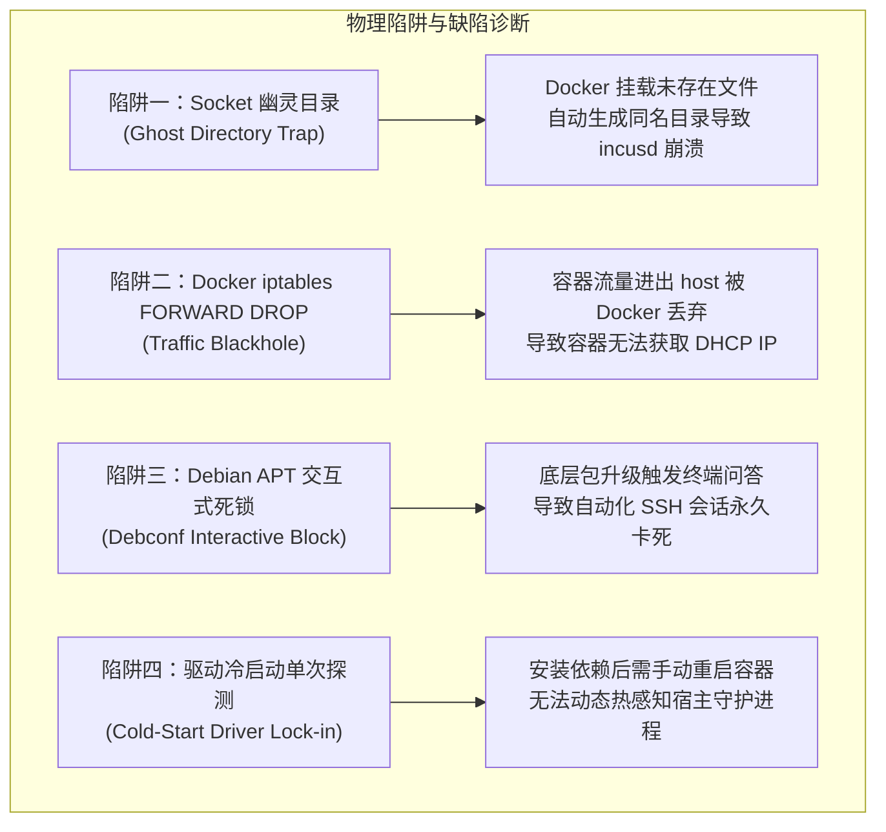
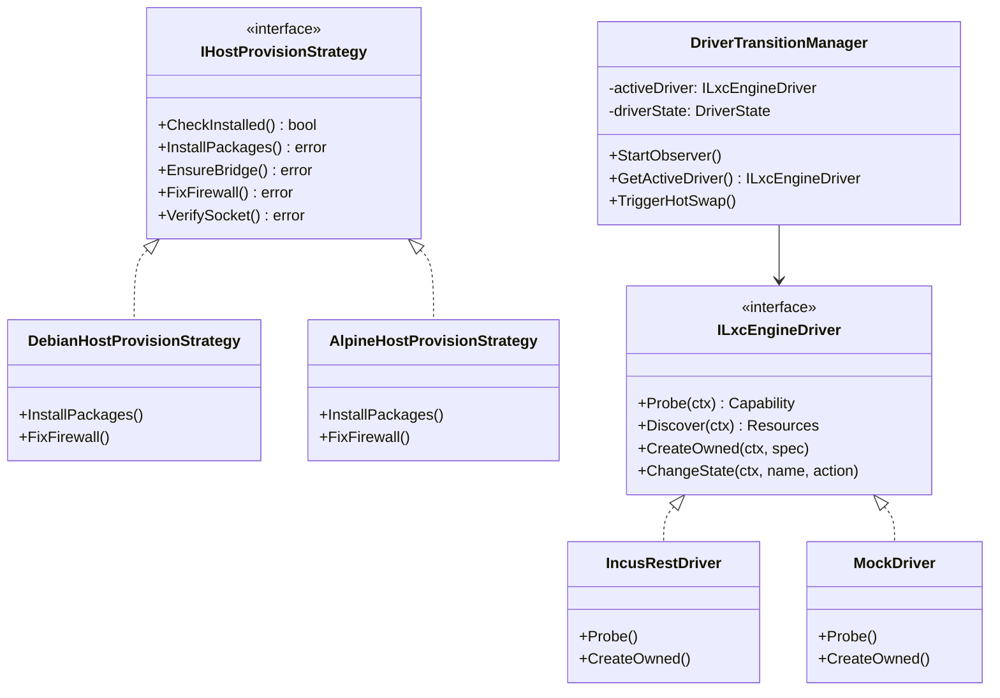

# LXC 宿主依赖自动化配置、声明式契约与快速部署方案

> 调研与设计日期：2026-11-07  
> 适用范围：LinuxWebTool (LWT) 插件生态 (`plugins/lxc-manager/`)、宿主机系统容器依赖自动化 Provision、Docker 与宿主网络共存治理、快速部署管线 (`scripts/deploy-remote.ps1`)。

---

## 1. 执行摘要与演进目标 (Executive Summary & Goals)

在前期调研中，LWT 团队已完成了 LXC 插件（`lxc-manager`）的驱动抽象解耦（真实 `IncusRestDriver` 与沙箱 `MockDriver`）、宿主证据链采集、NAT 端口映射、Web PTY 控制台及 NextGen 赛博 Webview。

为了使宿主真正具备物理级系统容器的创建与运行能力，本方案聚焦于核心命题：**“如何将宿主机底层安装方案声明为标准化插件依赖，并通过快速部署管线（`deploy-remote.ps1`）实现一键自动化安装、配置与健康验证闭环？”**

本方案通过**适配器策略模式 (Adapter Strategy)**、**分层有限状态机 (Hierarchical FSM)**、**声明式依赖契约 (Declarative Manifest)** 与 **部署责任链管道 (Pipeline)**，在严格遵守凭据安全与零容器停机原则下，攻克 Docker 防火墙拦截、Unix Socket 幽灵目录、APT 非交互式死锁等物理陷阱，实现沙箱到真实物理容器的无感平滑演进。

---

## 2. 深度头脑风暴：可行性、物理陷阱与性能瓶颈 (Brainstorming & Pitfalls)

### 2.1 技术可行性确认 (Technical Feasibility)
1. **操作系统与软件源就绪**：目标宿主为 Debian 12 (bookworm)，且官方 Backports 软件源已配置完毕；
2. **依赖轻量化验证**：经实测 dry-run，`incus-base` (v6.0.4 LTS) 剥离了重型 QEMU 虚拟化包，仅安装容器必备的 `lxcfs`、`uidmap` 等 15 个轻量包，整包体积数十 MB，安装耗时 < 15 秒；
3. **特权通道可用**：快速部署脚本已建立安全的特权 SSH 通道，开发与生产容器均以 `--privileged --pid=host` 运行，具备挂载宿主 Unix Socket 并进行双向通信的底层条件。

### 2.2 核心物理陷阱与架构缺陷诊断 (Pitfalls & Flaws)



1. **陷阱一：Socket 幽灵目录 (The Ghost Directory Trap)**：
   - *问题*：若在宿主机安装 Incus 之前，`docker run` 执行了 `-v /var/lib/incus/unix.socket:/var/lib/incus/unix.socket`，Docker 会在宿主机自动新建一个名为 `unix.socket` 的**空目录**。后续宿主 `incusd` 启动时因无法 bind 到已存在的同名目录而崩溃（`bind: address already in use`）。
   - *防御对策*：必须挂载父目录 `-v /var/lib/incus:/var/lib/incus:rshared`，且在启动容器前由脚本幂等确保 `mkdir -p /var/lib/incus`。
2. **陷阱二：Docker 防火墙黑洞 (iptables FORWARD DROP)**：
   - *问题*：Docker 服务启动时默认将 iptables 的 `FORWARD` 链设为 `DROP`。Incus 受管网桥 `incusbr0` 的流量在穿透 host 时被拦截，导致物理 LXC 容器拿不到 IP 或无法访问外网。
   - *防御对策*：自动注入双向内核转发放行规则：
     ```bash
     iptables -C FORWARD -i incusbr0 -j ACCEPT 2>/dev/null || iptables -I FORWARD 1 -i incusbr0 -j ACCEPT
     iptables -C FORWARD -o incusbr0 -j ACCEPT 2>/dev/null || iptables -I FORWARD 1 -o incusbr0 -j ACCEPT
     ```
3. **陷阱三：Debian APT 非交互式死锁 (Debconf Interactive Block)**：
   - *问题*：`incus-base` 依赖升级 `login` / `passwd` 时，若未禁用交互，dpkg 会在后台等待 stdin 输入，导致远程 SSH 脚本永久挂起。
   - *防御对策*：强制注入 `DEBIAN_FRONTEND=noninteractive` 及 `-o Dpkg::Options::="--force-confdef" -o Dpkg::Options::="--force-confold"`。
4. **陷阱四：初始化非幂等冲突 (Idempotency Failure)**：
   - *问题*：重复运行 `incus admin init --minimal` 会报 `Storage pool already exists`。
   - *防御对策*：采用条件探测模式（先检后建）或声明式 Preseed YAML，保证多次执行完全幂等。
5. **缺陷五：驱动冷启动锁定 (Cold-Start Driver Lock-in)**：
   - *问题*：当前插件仅在启动瞬间探测一次 Incus，若安装后未重启插件，插件将永久停留在 `MockDriver`。
   - *防御对策*：引入后台健康自适应观察者（Health Observer），每 5~10 秒轻量探测 socket，检测到真实 daemon 自动触发**驱动热跃迁 (Driver Hot-Swap)**，零停机自动切入物理模式。

---

## 3. 设计模式与架构重构蓝图 (Design Patterns & Architecture)

系统采用三大设计模式构建高内聚、松耦合的依赖治理框架：



### 3.1 适配器策略模式 (Adapter Strategy Pattern)
- **宿主发行版适配器 (`IHostProvisionStrategy`)**：
  - `DebianHostProvisionStrategy`：基于 `apt-get` + `bookworm-backports` + `systemd`；
  - `AlpineHostProvisionStrategy`：基于 `apk` + `edge` + `openrc`；
  - `ArchHostProvisionStrategy`：基于 `pacman` + `systemd`。
- **防火墙适配策略 (`IFirewallStrategy`)**：
  - `IptablesForwardStrategy`：精准维护 `FORWARD` 链首部规则；
  - `NftablesForwardStrategy`：兼容现代 nftables 规则集。

### 3.2 两阶段分层状态机 (Hierarchical Finite State Machine - HFSM)
- **宿主依赖生命周期状态机**：
  ```mermaid
  stateDiagram-v2
      [*] --> Uninstalled
      Uninstalled --> Prechecking: 触发依赖检查
      Prechecking --> InstallingPackages: 检查通过，开始安装
      InstallingPackages --> InitializingDaemon: incus-base + dnsmasq 就绪
      InitializingDaemon --> ConfiguringNetwork: daemon 启动
      ConfiguringNetwork --> VerifyingSocket: incusbr0 + iptables 放行
      VerifyingSocket --> FullyReady: socket 探测响应 HTTP 200
      VerifyingSocket --> Degraded: 探测超时或异常
      Degraded --> Prechecking: 自愈重试
  ```
- **插件驱动动态热跃迁状态机**：
  ```mermaid
  stateDiagram-v2
      [*] --> SandboxMock: 宿主 daemon 未就绪
      SandboxMock --> ProbingDaemon: 后台轻量轮询 / 事件唤醒
      ProbingDaemon --> SandboxMock: 探测失败 (Keep Sandbox)
      ProbingDaemon --> PhysicalIncus: 探测成功 (HTTP 200 via unix.socket)
      PhysicalIncus --> ProbingDaemon: 守护进程异常重启
  ```

---

## 4. 业界主流系统对比与借鉴 (Industry Benchmark)

| 评估维度 | Proxmox VE (PVE) | Cockpit-machines | Portainer Edge Agent | LinuxWebTool (本方案) |
| :--- | :--- | :--- | :--- | :--- |
| **部署形态** | 裸机 OS 强绑定 | 宿主系统级 Web 面板 | 纯应用容器 (Docker) | **Docker 容器 + 宿主特权双轨治理** |
| **宿主依赖处理** | 整机出厂预装，无法解耦 | PackageKit + D-Bus 宿主直装 | 仅依赖 Docker Socket | **声明式 JSON 契约 + 部署管线自动化安装** |
| **未就绪容灾** | 拒绝服务 / 引导崩溃 | 页面提示缺失不可用 | 报错停止 | **双模自适应驱动（零停机沙箱 Mock 优雅降级）** |
| **网络冲突治理** | 强管整个网络栈与 iptables | 不干预，易与 Docker 冲突 | 仅管 Docker 网络 | **自动注入 iptables FORWARD 链放行，保障共存** |
| **驱动热感知** | 不支持动态插拔 | 依赖系统刷新 | 不支持 | **后台轻量观察者动态热跃迁 (Driver Hot-Swap)** |

---

## 5. 当前系统已有基础设施复用矩阵 (Asset Reuse Matrix)

| 资产名称 | 所在路径 | 当前能力 | 本方案复用与扩展点 |
| :--- | :--- | :--- | :--- |
| **依赖契约模型** | `LinuxWebTool.Contracts/.../PluginModels.cs` | 支持 `scope: host` 与 `PluginDependencyConfig` | 复用现有模型，规范 `dependencies` 字段扩展细粒度探针与安装步骤。 |
| **依赖引导弹窗** | `wwwroot/.../PluginInstallGuideModal.js` | 支持宿主命令生成、发行版切换、跳转 Terminal | 复用多发行版命令拼装逻辑，提供直观的审查复制通道。 |
| **远程部署脚本** | `scripts/deploy-remote.ps1` | `Invoke-RemoteSsh`、Docker 启动管线、运行时依赖检测 | **扩展核心**：新增 `-SetupIncusHost` 参数，挂载 `/var/lib/incus`，执行端到端验证。 |
| **插件驱动体系** | `plugins/lxc-manager/internal/driver/` | `ILxcEngineDriver`、`IncusRestDriver`、`MockDriver` | 复用双模驱动抽象，注入后台动态热切换逻辑。 |
| **能力探针** | `plugins/lxc-manager/internal/incus/probe.go` | 标准库 Unix Socket HTTP GET `/1.0` | 作为驱动热跃迁的核心健康判定指标。 |

---

## 6. 具体实施方案与落地方案 (Concrete Implementation Roadmap)

### 6.1 阶段一：规范 `plugin.json` 宿主依赖声明契约
在 [`plugins/lxc-manager/plugin.json`](file:///e:/WorkProject/CSharp/PrivateProject/Web/WebToolForLinux/plugins/lxc-manager/plugin.json) 中细化依赖声明，包含探针、安装指引与安全描述：

```json
{
  "dependencies": [
    {
      "id": "incus-base",
      "name": "Incus 宿主服务与受管网络",
      "scope": "host",
      "kind": "service",
      "required": false,
      "recommended": true,
      "description": "轻量级 Incus 系统容器守护进程 (v6.0+) 与 incusbr0 网桥，提供物理内核级容器隔离。",
      "installDocumentationUrl": "https://linuxcontainers.org/incus/docs/main/installing/",
      "probe": {
        "command": "incus",
        "args": ["version"]
      },
      "installGuide": {
        "debian": "DEBIAN_FRONTEND=noninteractive apt-get update && apt-get install -y --no-install-recommends -t bookworm-backports incus-base incus-client dnsmasq-base && incus admin init --minimal && iptables -I FORWARD 1 -i incusbr0 -j ACCEPT && iptables -I FORWARD 1 -o incusbr0 -j ACCEPT",
        "alpine": "apk add incus incus-client && rc-update add incusd default && rc-service incusd start && incus admin init --minimal",
        "arch": "pacman -Sy --noconfirm incus && systemctl enable --now incus.socket && incus admin init --minimal"
      }
    }
  ]
}
```

### 6.2 阶段二：`scripts/deploy-remote.ps1` 快速部署管线扩展
在部署脚本中增加 `-SetupIncusHost` 参数与自动化安装管线：

1. **参数定义与开关**：
   ```powershell
   [switch]$SetupIncusHost = $false
   ```
2. **幂等安装与配置逻辑**：
   ```powershell
   if ($SetupIncusHost) {
       Write-Step "Provisioning Incus host dependencies on remote system..."
       $provisionScript = @"
   set -eu
   # 1. 确保目录存在以避免 Docker 创建同名空目录
   mkdir -p /var/lib/incus
   
   # 2. 检查 incus 是否已安装
   if ! command -v incus >/dev/null 2>&1; then
       echo "[PROVISION] Installing incus-base from backports..."
       DEBIAN_FRONTEND=noninteractive apt-get update
       DEBIAN_FRONTEND=noninteractive apt-get install -y --no-install-recommends -t bookworm-backports \
           -o Dpkg::Options::="--force-confdef" -o Dpkg::Options::="--force-confold" \
           incus-base incus-client dnsmasq-base
       systemctl enable --now incus.socket incus.service
   else
       echo "[PROVISION] incus is already installed."
   fi
   
   # 3. 幂等初始化存储池与网桥
   if ! incus network list --format json | grep -q '"name":"incusbr0"'; then
       echo "[PROVISION] Initializing minimal Incus storage and network..."
       incus admin init --minimal
   fi
   
   # 4. 配置 Docker 防火墙共存放行规则
   echo "[PROVISION] Configuring iptables FORWARD rules for incusbr0..."
   iptables -C FORWARD -i incusbr0 -j ACCEPT 2>/dev/null || iptables -I FORWARD 1 -i incusbr0 -j ACCEPT
   iptables -C FORWARD -o incusbr0 -j ACCEPT 2>/dev/null || iptables -I FORWARD 1 -o incusbr0 -j ACCEPT
   
   echo "[PROVISION] Incus daemon ready. Socket status:"
   ls -la /var/lib/incus/unix.socket
   "@
       Invoke-RemoteSsh $provisionScript
       Write-Success "Incus host provisioning completed successfully!"
   }
   ```
3. **Docker 运行参数挂载增强**：
   在开发与生产容器的 `docker run` 命令中统一追加挂载目录：
   `-v /var/lib/incus:/var/lib/incus:rshared`
   确保容器能够实时感知 `/var/lib/incus/unix.socket`。

### 6.3 阶段三：插件后台驱动自适应动态热跃迁 (Driver Hot-Swap)
在 `plugins/lxc-manager/internal/driver/` 中实现动态代理驱动 `AdaptiveDriver`：
- 内部持有 `activeDriver ILxcEngineDriver`；
- 启动后台 goroutine 每 8 秒执行一次 `incus.Probe`；
- 当物理 daemon 出现时，原子更新 `activeDriver = NewIncusDriver(...)`，并将 UI 状态标识置为 `PhysicalIncus`；
- 当物理 daemon 停止或异常时，平滑降级为 `MockDriver`，保证控制台永不断连。

---

## 7. 质量门禁与凭据安全防线 (Quality Gate & Security Governance)

1. **凭据脱敏防线**：所有部署脚本与测试日志严禁输出宿主真实 IP、SSH 密钥或管理密码，全量遵循 RFC 5737 规范；
2. **非阻塞安全约束**：宿主依赖属于外部基础设施，当宿主未安装或探测失败时，不得阻塞 `linuxwebtool` 核心容器启动；
3. **架构门禁校验**：
   - 本地单元测试：`cd plugins/lxc-manager && go test -v ./...`；
   - 架构门禁：`node .githooks/security-gate.cjs --full`；
   - 前端状态门禁：`node tests/frontend/plugin-filter-and-state-machine.test.mjs`。

---

## 8. 总结与后续建议 (Conclusion & Recommendation)

将 LXC 安装方案收敛为**插件声明式依赖契约**，并通过**快速部署脚本实现幂等安装与挂载**，从根本上兼顾了“日常开发零停机敏捷验证”与“生产宿主物理级容器落地”的双重需求。

建议下一步落地实施路径：
1. 更新 `plugins/lxc-manager/plugin.json` 中的 `dependencies` 契约；
2. 在 `scripts/deploy-remote.ps1` 中实现 `-SetupIncusHost` 幂等安装分支与 `/var/lib/incus` 挂载；
3. 在开发环境执行一次带参数的部署验证：`deploy-remote.ps1 -Mode Dev -SetupIncusHost`，并在 Webview 界面实时核验驱动从黄色“沙箱仿真”向绿色“守护进程就绪”的跃迁。
