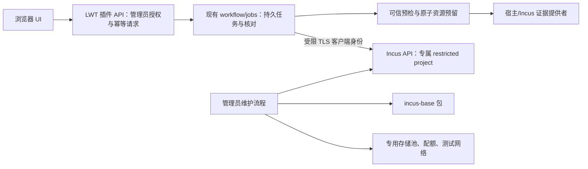
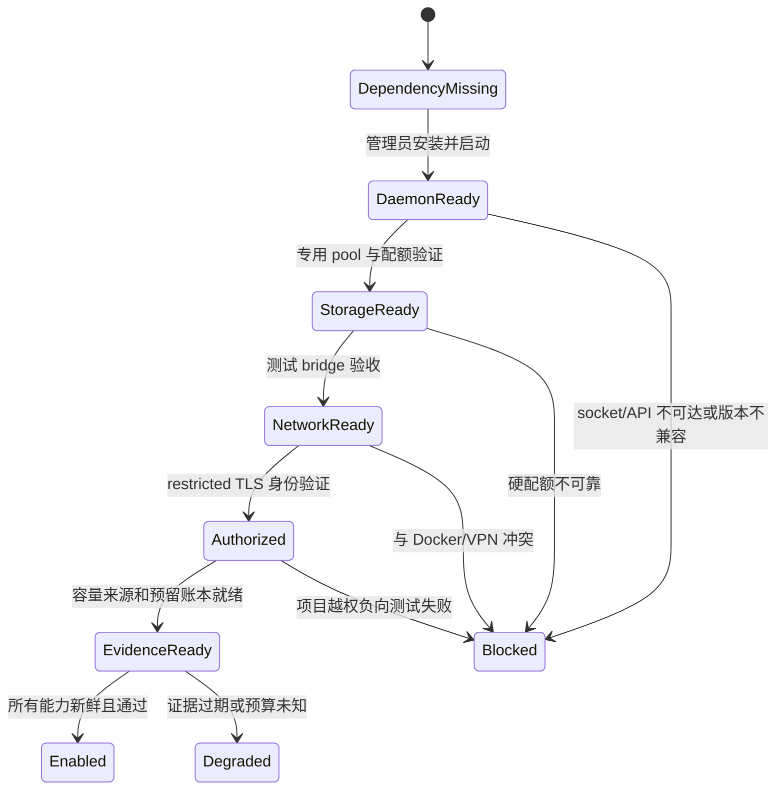

# LXC 管理插件启用与创建预检闭环方案

调研日期：2026-11-07。本文补充现有 LXC 可行性、宿主安装和实机验证文档，聚焦处理 Incus 未安装、插件无法安全连接宿主、创建预检缺少可信容量与配额证据三个阻塞点。未修改或安装目标宿主软件，未开放管理 API，未运行真实实例。

## 结论

**可以处理，且三个阻塞点都有可实施路径。当前拒绝创建是正确的安全行为，应补齐证据和授权链后再开放写操作，不能通过填入模拟容量、跳过预检或直接挂载管理员 socket 来绕过。**

现有插件只创建 Incus `container` 类型的 LXC 系统容器；目前不需要 QEMU。目标宿主的只读 APT 模拟显示，`incus-base` 依赖可解（升级 2 个包、新增 15 个、移除 0 个），适合先在隔离 Debian 12 VM 验证。完整 `incus` 包也可通过 Backports 满足 QEMU 依赖，但会新增 37 个包，超出当前容器功能所需。以上均为模拟，不是目标宿主安装结果。详情见[宿主与 Docker 共存方案](lxc-host-dependencies-docker-coexistence-plan.md)。

推荐方案是**管理员在隔离机安装和初始化 Incus；插件通过受限 TLS 身份访问专属 Incus 项目；服务端容量提供者完成配额验证和原子预留；只有全部能力证据有效时才开放创建**。这样复用 Incus 原生 API、项目隔离和现有任务编排，避免新增常驻宿主代理。若受限项目仍不能满足权限最小化，再评估窄接口宿主代理。不得把宿主 `incus-admin` Unix socket 直接挂载进插件容器。

## 当前事实与缺口

| 层面 | 当前实现或观测 | 影响 |
|---|---|---|
| 宿主依赖 | 目标宿主未安装 Incus，默认 socket 不存在。APT 当前 `incus-base` 候选为 `6.0.4-2+deb13u7~bpo12+1`；模拟事务是 2 个升级、15 个新增、0 个删除 | 容器能力的包依赖可解，但尚无服务启动、初始化和 Docker 共存证据；实际安装还会更新 `login`、`passwd` |
| 包选择 | 默认完整 `incus` 依赖解析失败，因为默认 QEMU 候选低于包要求；指定 `bookworm-backports` 的模拟会选择 QEMU `10.0.2`，新增 37 个包 | 当前功能只需要容器，不应仅为未来 VM 能力引入 QEMU |
| 插件连接 | 默认经 Go 标准库连本地 Unix socket `/var/lib/incus/unix.socket`；本次已增加 HTTPS/mTLS 配置入口和项目查询范围。Docker 部署仍不会自动挂载 socket、注入证书文件或开放管理 API | 可以在部署层提供受限 TLS 证书和 endpoint，但接入是否成功仍取决于 Incus 服务端授权、网络、防火墙与证书配置；项目参数本身不是权限边界 |
| 权限 | 插件 API 的内部密钥和管理员检查保护 LWT 到插件的入口，但它们不限制插件在 Incus 后端的权限 | 后端身份仍需独立收敛；Incus `incus-admin` 组可完全访问 API，包含挂载宿主路径等可导致宿主 root 权限的操作 |
| 创建预检 | `main.go:46-52` 明确传入空 `PreflightEvidence`；`preflight.go:65-72` 因无可信容量和指定池硬配额证据拒绝请求 | 当前拒绝是安全门禁；删除该条件会让 CPU、内存和磁盘设置失去可信准入依据 |
| 资源采样 | `resources.go:14-21,54-87` 读取 CPU/内存/池空间的瞬时总量和使用量，并明确不是容量预留、硬配额或集群快照 | 不能把采样值直接作为并发创建承诺；外部 Docker 和管理员创建的工作负载也会改变余量 |
| 任务与并发 | `internal/jobs` 已有持久幂等记录、跨进程 admission 文件锁和异常后核对；当前 admission 是全局单槽 | 正确性基础可复用，但创建流程被串行化；暂不应在资源预留缺失时放宽并发 |
| 插件平台 | manifest 的依赖标为 `scope: host`；平台将宿主依赖报告为 `Unknown`，不会用插件容器里的 `command --version` 冒充宿主探测，也不会因该依赖阻止插件进程启动 | 依赖范围模型和宿主发行版引导可复用；当前没有安全的宿主安装代理，这是有意的权限边界 |

目标宿主的安装模拟、Docker 基线和 WSL 隔离容器权限检查已记录在相关文档。当前 WSLC 临时容器缺少 `CAP_SYS_ADMIN`、`CAP_NET_ADMIN`、cgroup 写权限及 `/dev/fuse`，不能用于启动 Incus daemon 或证明 Docker 共存。

## 推荐目标结构

管理面安装、启动、存储初始化、网络初始化和插件授权分成独立步骤。LWT 只管理明确归属的项目与实例，不通过插件 manifest 执行任意宿主 shell。安装包或服务就绪不能自动等价为创建就绪。

## 处理方案

### 1. 宿主依赖和初始化

1. 首期将能力范围锁定为 LXC 系统容器，评估 Debian Backports 的 `incus-base`，不安装 QEMU。Incus 系统容器提供完整 Linux 用户空间但共享宿主内核；需要独立内核时另行评估 VM。
2. 在一次性 Debian 12 VM 重新执行 `apt-get -s install --no-install-recommends incus-base`，检查包来源、版本、服务脚本、依赖更新、磁盘增量和回滚，再安装并记录 systemd 服务、日志、socket、重启后的状态。共享宿主不得直接复用这次模拟作为安装授权。
3. 启动 daemon 后，分开创建隔离测试项目、受限存储池和不与 Docker/VPN 重叠的测试网络。避免直接运行默认交互式初始化而未审查它将写入的网桥、地址、NAT、sysctl 和防火墙规则。
4. 插件 `plugin.json` 的 Debian 引导已改为 `incus-base`，避免当前只支持容器时默认引入 QEMU；Debian 12 仍需预先配置经过审查的受支持软件源。依赖引导不得暗中添加源、升级包或初始化网络。

如果未来需要 Incus VM，另立能力项：完整 `incus` 包、兼容的 QEMU（官方当前要求 QEMU 8.2 或更高）、固件与虚拟化硬件能力、实例 API/UI 和独立测试矩阵。当前插件请求固定写入 `type: container`，仅升级 QEMU 不会自动增加 VM 管理能力。

### 2. 插件到宿主的授权通道

**首选：Incus 原生 HTTPS API + 专属受限客户端证书。** 为插件建立独立 Incus project，开启 `restricted=true`，预建其可用的镜像、profile、网络和存储资源；限制证书只允许访问该项目。HTTPS 监听仅绑定已审查的本机或专用管理网络，防火墙只允许插件服务来源；验证服务器证书，证书私钥放入插件专属受保护状态目录，提供轮换、吊销和审计。

Incus 官方提醒，受限 TLS 证书的 project 限制只有在 `authorization.client.tls-restricted=tls` 路由下才会生效；必须把该配置和负向授权测试纳入验收，不能被其他授权路由覆盖。测试证书不得列出或修改其他项目、全局配置、宿主存储池和网络。项目限制也不能代替 LWT 自身管理员授权。

可选方案是管理员维护的**窄接口宿主代理**：代理单独持有 Unix socket，只提供固定的发现、配额检查、创建和生命周期 API，校验项目/资源归属并记录审计。它能进一步限制操作，但新增一个 root 级服务和升级面，优先级低于 Incus 原生 restricted TLS。

禁止方案：把 `/var/lib/incus/unix.socket` 直接 bind mount 给插件并加入 `incus-admin`。官方定义该组有完整 API 权限；Unix socket root 访问也始终允许。容器 root、host network、`nsenter` 或 `privileged` 不能作为安全授权证明。[Incus 授权模型](https://linuxcontainers.org/incus/docs/main/authorization/)和[项目隔离](https://linuxcontainers.org/incus/docs/main/explanation/projects/)提供原生边界。

本次已将连接接线提取为 `incus.NewConnection`：保留 Unix socket 路径，并新增基于 Go 标准库的 mTLS HTTPS 路径。远程配置要求 endpoint、专用 project、服务端 CA、服务端叶证书 SHA-256 指纹和客户端证书/私钥文件；最低 TLS 1.3、CA/主机名校验、指纹匹配、关闭 HTTP 代理、不跟随重定向，所有项目 API 请求显式携带 `project` 查询参数。所有操作仍复用同一 Incus API Adapter，没有复制创建和任务逻辑。Incus 服务端仍必须将证书登记为仅允许指定项目的 restricted certificate，并把 `authorization.client.tls-restricted` 路由到 `tls`；客户端的 project 参数不是授权措施。证书发放、轮换、只读挂载和实际服务端权限负向测试尚未完成。

### 3. 可信预检、配额和并发

建立服务端 `PreflightEvidenceProvider`，UI 只能提交资源规格，不能提交 `Verified=true` 或可用容量。证据至少绑定：宿主标识、Incus 版本/能力、项目、存储池、驱动及 backing filesystem、限制配置指纹、采集时间、保留量、安全余量和配额实测状态；数据过期、来源不明或配置指纹改变时失效。

| 资源 | 证据来源和策略 | 必须通过的实测 |
|---|---|---|
| CPU | Incus 实例有效配置、宿主/cgroup 有效 CPU 上限、已预留实例和明确的超卖策略；`limits.cpu` 的 CPU 集合/数量与 CPU 时间比例不可混为一谈 | 在固定 CPU 负载下采集 cgroup 指标，确认 UI 声明对应的实际限制；不宣传未经实现的 CPU 时间保证 |
| 内存 | 宿主和容器 cgroup v2 有效限制、`MemAvailable`、Incus 已用量、插件账本预留及 Docker/宿主安全余量 | 在专用容器逐步触碰内存，核验 `memory.max`、`memory.events` 和宿主压力/OOM 行为 |
| 磁盘 | 选定 pool 的后端、文件系统与 quota 配置；实例 `expanded_devices.root.size` 与项目/池约束 | 写入超过实例上限必须被可靠拒绝，测试快照、稀疏文件、重启与回收；不能凭 Incus `space.used/total` 或根设备 `size` 单独认证硬配额 |
| 网络 | 已存在且归属清楚的受管网络、地址池和防火墙策略；保持 Incus 为唯一网络规则管理者 | DHCP、DNS、NAT、容器隔离、Docker/VPN 原有链路和重启规则一致性 |

**准入动作需要原子预留。** 对现有 `jobs.Store` 扩展 reservation ledger：在同一文件锁/事务中检查剩余预算、插入以 job key 唯一的 CPU/内存/磁盘预留，再提交 Incus 创建；成功核对有效配置后转为已分配，明确失败后释放，超时/断连/进程崩溃时保留为 `NeedsReconciliation` 并查询后端，禁止盲目重试。账本必须同时识别插件已创建实例和未知外部占用；如果无法约束同一项目外部写入，就保持安全余量或拒绝容量保证。

当前全局 `admission.lock` 一次只允许一个创建任务处于未核对阶段，适合首个安全版本但会限制吞吐。先完成持久预留、恢复和并发测试，再考虑按 project/pool 分片锁或数据库事务提升吞吐；不能先移除全局锁再补容量一致性。多节点/多管理者部署需共享事务存储或把所有写操作收口到单一授权服务，独立文件账本无法保证全局不超卖。

### 4. 状态机与模式落点

复用现有 `workflow.Creator`、`jobs.Store`、操作 ID 和 `NeedsReconciliation`，将就绪状态与实例状态分开，不新增无使用场景的通用框架。

- **Adapter**：后端协议/认证适配器分离 Incus Unix 与 restricted TLS；PVE 或 LXD 仅在有实际需求时新增独立 runtime adapter，不共享不兼容的权限和配额语义。
- **Strategy**：选择容器依赖包、受支持传输、存储 quota provider 和资源限制策略。按已验证 capabilities 选择；缺少能力时拒绝或呈现不可用，不静默降级。
- **状态机/协调器**：宿主就绪状态只观测和展示，不替管理员安装/初始化；实例任务持久化 `Pending → Reserved → Creating → Verifying → Starting → Completed`，不确定结果进入 `NeedsReconciliation`。
- **防重复与并发**：复用现有幂等键、跨进程锁及任务核对；在资源 reservation 建立前维持当前单槽。使用有界并发而不是无限 goroutine；逐步测量队列等待和阶段耗时。

### 5. 库和现有基础设施

| 资产/库 | 当前状态 | 建议 |
|---|---|---|
| Go 标准库 `net/http` / `net.Dialer` / `crypto/tls` | 已用于 Unix socket 和新增 mTLS HTTPS；`Client` 注入 `HTTP`、`Endpoint` 与 `Project`，测试使用 `httptest` | 覆盖当前有限 API 足够；TLS 配置已要求服务端信任根和客户端身份，不为少量请求引入大 SDK |
| Incus 官方 Go Client | 上游 client 同时有 `ConnectIncusUnix` 和 HTTPS 连接能力 | 若后续采用事件流、更多端点和强类型模型，可评估 `github.com/lxc/incus/v6/client` 与服务版本匹配；当前插件 `go.mod` 只有 Go 1.22 且无第三方依赖，先验证 toolchain、传递依赖、静态 Linux 构建和 AOT/包大小影响。上游 v7 要求变化尤其不能直接升级主版本 |
| `internal/jobs` | 持久 job 状态、请求哈希、跨进程锁、启停防重复、异常结果核对 | 复用作单节点准入基础，添加资源 reservation、时间/来源和恢复语义；当前它不是容量证据源，也不支撑多节点一致性 |
| 插件平台 `scope: host`、环境探测、安装向导 | 已区分宿主/容器依赖，宿主探测为 `Unknown`，可提供宿主发行版安装说明 | 复用状态展示和人工引导；不扩展为任意宿主命令执行器，不把发行版探测结果当 Incus 授权/服务就绪 |
| `SystemStatusProvider` | 可读取 `/proc/meminfo` 的 `MemAvailable` 等系统数据 | 可作为只读观测输入；不包含 Incus pool 配额、Docker 资源预算、reservation 或硬配额证据 |
| `vishvananda/netlink`、`google/nftables` | 可操作低层 Linux 网络 | 首期不引入。让 Incus 独立管理测试 bridge，避免 Incus、LWT 和插件多方改写 nftables/路由；只有自研网络成为正式需求时再评估 |
| SQLite 等额外数据库 | 当前 Go 插件没有数据库模块，job 状态为本地文件持久化 | 单进程/单宿主先复用文件锁；只有并发预留或多节点要求证明需要事务数据库后再选型，不先增加依赖 |

Incus Go 客户端确实提供 Unix 和 TLS 连接工厂；当前接口范围较小，继续标准库是更低风险的首步。[上游连接代码](https://github.com/lxc/incus/blob/main/client/connection.go)。Incus 自身 REST API 支持 Unix socket、本地或远端 HTTPS、扩展查询和异步操作；无需用 Docker socket 或 shell 代替管理 API。[REST API](https://linuxcontainers.org/incus/docs/main/rest-api/)。

## 方案比较

| 方案 | 权限与功能 | 对当前项目的适配 |
|---|---|---|
| Incus restricted TLS + project | 原生系统容器、REST、异步任务、项目和证书限制；必须严格校验 restricted TLS authorization 路由 | **首选**：复用现有 Incus API adapter，无宿主 socket bind mount；需要增加 TLS 配置和证书生命周期 |
| Incus Unix socket bind mount | 简单本地连接；若按 `incus-admin`/root 身份使用可能获得宿主级管理能力 | **不作为生产方案**；仅可在可丢弃测试环境作单实例适配器测试 |
| 窄接口 host agent | Agent 控制权限和 API 白名单最细，插件不持有 Incus 凭据 | 次选；需要额外特权服务、升级与故障恢复面，只有 project-scoped TLS 不足时采用 |
| PVE API | 适合已有 PVE 集群，具备完整 VM/CT 控制面 | 独立 RuntimeAdapter；不应为当前 Docker 宿主安装 PVE，也不应混管 PVE 实例 |
| 原生 LXC/liblxc | 底层灵活、可减少 Incus API 依赖 | 需自行维护镜像、任务、存储、网络、quota、授权和恢复，当前维护成本高于复用 Incus |
| Docker/OCI API | 适用于应用容器 | 不能替代共享宿主内核的完整 LXC 系统容器；挂载 Docker 管理 socket 同样是高权限通道 |

Incus 与 Docker 同宿主可能出现转发问题；官方指出 Docker 全局 `FORWARD=DROP` 会影响 Incus bridge 转发，Incus 使用独立 nftables namespace 也不能消除所有跨 namespace 的规则冲突。目标机当前确实观测到 `FORWARD=DROP`，所以**只装包、启动 daemon、创建 Incus bridge 是三个分开的影响阶段**；必须在测试 VM 对每个阶段分别比较 Docker 和 LWT 探针。[Incus Docker 共存与防火墙说明](https://linuxcontainers.org/incus/docs/main/howto/network_bridge_firewalld/)。

## 分阶段执行与验收门禁

| 阶段 | 工作 | 必过门禁 |
|---|---|---|
| 0. 冻结范围 | 只支持 `container`；确定隔离 Debian 12 VM、测试资源和回滚快照 | 确认不是要求独立内核 VM；目标宿主不写入 |
| 1. 依赖 | 测试 VM 记录 `apt-get -s`、安装 `incus-base`、检查包和服务启动/重启行为 | 版本、服务、socket、日志可解释；回滚恢复干净 |
| 2. 存储/网络 | 建专用 quota pool 和不重叠测试 bridge | Docker 原有容器 DNS、出站、映射端口、health 与路由无回归；记录 nftables/iptables 差异 |
| 3. 连接授权 | restricted TLS 证书只连测试 project，校验证书吊销、server pin 和 TLS 路由 | 可发现和创建自身测试项目实例；不能读取/修改其他 project、全局设置、宿主路径、storage pool 或网络 |
| 4. 容量证据 | 实现可信 provider、硬 quota verifier、原子 reservation 与过期恢复 | 无/过期/错 host/错 pool 证据均拒绝；两并发竞争最后容量时不超额；未核对任务不释放预算 |
| 5. 端到端 | 经真实 LWT API 创建非特权容器，核对配置、启动、停止、重启恢复 | 不是只通过 Incus adapter 测试；核对 project、所有权标记、CPU/内存/磁盘和网络实际生效 |
| 6. 性能与恢复 | 1/5/10 并发阶梯、失败注入、服务重启；采集 API/阶段 P50/P95、CPU、RSS、FD、goroutine、磁盘 I/O、cgroup 和队列等待 | 先留基线再设阈值；有界并发、无重复实例、无误删；所有异常可核对或明确阻塞 |
| 7. 生产放行 | 重新检查生产包计划、存储/网络、防火墙和权限，形成维护窗口与回滚步骤 | 仅在隔离环境所有门禁通过后讨论；生产宿主变更需独立、明确授权 |

### 必要自动化测试

- **就绪状态**：依赖缺失、daemon 未就绪、socket/TLS 不可达、存储未准备、网络未准备、证书撤销、证据过期分别显示具体状态；只读发现成功不得显示“可创建”。
- **权限负向门禁**：restricted TLS 只限指定 project；错误证书、跨 project、全局资源、特权容器、任意 raw config、宿主路径挂载全部拒绝。确认 socket 未配置时不尝试 shell/`nsenter` 回退。
- **预检与配额**：现有 `TestPreflightFailsClosedWithoutVerifiedCapacityAndQuota` 和 `TestCreateAPIRejectsUnverifiedCapacityBeforeBackend` 继续通过；新增证据有效期、host/pool/驱动指纹、配置变化、pool 配额实际写满、失败回收和外部占用测试。
- **并发与恢复**：延用 `TestConcurrentReservationHasExactlyOneWinner`、幂等创建和 `NeedsReconciliation` 测试；增加多个不同请求同时竞争 CPU/内存/磁盘预算、进程重启、外部实例创建和 reservation 过期测试。
- **Docker 共存**：在同一隔离 VM 采集安装前、安装后、daemon 启动后、bridge 初始化后的 Docker/LWT 健康、DNS/出站/端口映射、`FORWARD`、nftables/iptables、路由、conntrack。出现未解释差异立即停止，不在生产上直接追加 firewall 规则。
- **真实生命周期**：保留 `TestRealIncusLifecycle` 的隔离主机确认条件；新增服务端预检经 LWT API 的端到端路径。当前真实测试不验证硬配额，也不改变网络，不能替代上述用例。

## 代码索引

| 文件 | 作用 |
|---|---|
| `plugins/lxc-manager/cmd/lxc-manager/main.go` | Unix/mTLS 连接配置入口和空预检证据注入点 |
| `plugins/lxc-manager/internal/incus/resources.go` | Incus 主机和 pool 资源瞬时采样 |
| `plugins/lxc-manager/internal/incus/preflight.go` | 创建 fail-closed 规则与证据模型 |
| `plugins/lxc-manager/internal/incus/instances.go` | 固定创建 `type: container` 的 API adapter |
| `plugins/lxc-manager/internal/workflow/create.go` | 持久幂等创建、任务状态及后端结果核对 |
| `plugins/lxc-manager/internal/jobs/store.go` | 文件持久化、跨进程准入锁和 job 归属 |
| `src/LinuxWebTool.Contracts/Features/Plugins/Contracts/PluginModels.cs` | `container/host/external` 依赖范围规则 |
| `src/LinuxWebTool.Infrastructure/Features/Plugins/PluginManager.cs` | 宿主依赖 `Unknown`、状态投影与安装指南选择 |
| `src/LinuxWebTool.Infrastructure/Features/Services/Detectors/ServiceEnvironmentDetector.cs` | 宿主发行版和容器环境发现；不是宿主安装/授权代理 |

## 相关资料

- 本地：[LXC 管理插件可行性与设计](lxc-management-plugin-feasibility-and-design.md)、[Incus 宿主安装影响](incus-host-install-impact-assessment.md)、[LXC 依赖与 Docker 共存](lxc-host-dependencies-docker-coexistence-plan.md)、[实机验证计划](lxc-real-environment-validation-plan.md)。
- 官方：[Incus 授权](https://linuxcontainers.org/incus/docs/main/authorization/)、[项目限制](https://linuxcontainers.org/incus/docs/main/reference/projects/)、[TLS 远程认证](https://linuxcontainers.org/incus/docs/main/authentication/)、[Docker 网络共存](https://linuxcontainers.org/incus/docs/main/howto/network_bridge_firewalld/)、[存储配额驱动](https://linuxcontainers.org/incus/docs/main/explanation/storage/)、[Incus Go 客户端连接实现](https://github.com/lxc/incus/blob/main/client/connection.go)、[Go TLS `VerifyConnection`](https://pkg.go.dev/crypto/tls#Config.VerifyConnection)。

## 本轮按方案执行记录（2026-11-07）

### 已完成的本地实现

- 新增 `internal/incus.NewConnection`，统一构建 Unix socket 或 mTLS 客户端。远程模式只接受 HTTPS，要求 TLS 1.3、服务端 CA、匹配的服务端证书 SHA-256 指纹、客户端证书/私钥和专用项目；禁用 HTTP proxy 和重定向，不提供跳过证书校验选项。
- 插件入口读取 `INCUS_ENDPOINT`、`INCUS_PROJECT`、`INCUS_TLS_SERVER_CA_FILE`、`INCUS_TLS_SERVER_CERT_SHA256`、`INCUS_TLS_CLIENT_CERT_FILE`、`INCUS_TLS_CLIENT_KEY_FILE`；未配置远程 endpoint 时继续使用原 Unix socket 默认值，不能同时启用两种连接。
- 创建、发现、资源读取、状态管理、操作轮询及实例核对请求均通过同一 URL 适配器附加项目参数。项目查询只是路由；权限必须由 Incus 的受限 TLS 证书和授权路由在服务端执行。
- Debian 插件安装引导改为 `incus-base`，并增加 manifest 回归测试，防止现有容器范围无意升级为完整 QEMU 依赖。
- README 记录部署层证书文件要求及授权前提；不把私钥写进插件清单、仓库或环境变量值。

### 已运行验证

| 验证 | 结果 | 覆盖范围 |
|---|---|---|
| `go test ./internal/incus -run TestClientScopesProjectAwareRequests -count=1` | 通过 | mock Incus API 验证发现、资源读取、创建、状态变更、操作轮询和实例核对都携带指定 project |
| `go test ./internal/incus -run TestNewConnection -count=1` | 通过 | HTTPS/mTLS、TLS 1.2-only 服务端拒绝、CA/主机名校验、服务端 SHA-256 指纹匹配与错误 pin 拒绝、拒绝 HTTP/缺失证书/未指定项目、拒绝重定向 |
| `go test ./...`（`plugins/lxc-manager`） | 通过 | Incus adapter、任务存储、HTTP API 与工作流单元/集成测试 |
| `go vet ./...` 及 Linux amd64、CGO 关闭构建 | 通过 | Go 静态检查和目标 Linux 插件构建 |
| `node --test tests/frontend/plugin-install-scope.test.mjs` | 通过，5 项 | 宿主依赖范围和 Incus Debian 包选择 |

### 仍未通过真实环境验证的门禁

- 当前没有可用的隔离 Linux VM/Incus daemon；WSLC 临时环境权限不足且此前留下未完成注册状态。因此没有安装或初始化 daemon、改 Docker/宿主网络、开放 HTTPS listener、导入证书、创建真实容器或执行 Docker 共存测试；共享宿主未写入。
- mock mTLS 测试只证明客户端 TLS 行为，项目 mock 只证明查询参数路由；它们不能证明 Incus 对受限证书、项目内资源、`/1.0/resources` 或跨项目负向请求的真实授权语义。需在隔离 Incus 服务端确认 restricted certificate 与 `authorization.client.tls-restricted=tls` 配置。客户端证书吊销、证书轮换和跨项目拒绝也尚未对真实 daemon 实测。
- 真实容量提供者、原子 reservation、存储硬配额写满测试尚未实现。当前创建预检继续传入空 `PreflightEvidence`，因此所有创建请求仍应被拒绝。这一点未绕过。
- 证书向插件进程的安全注入和轮换仍由部署层解决；目前代码只读取部署管理员提供的文件路径，不会创建、复制或修改宿主证书。证书轮换需更新 CA/指纹和文件，并重启插件加载新证书。

后续必须按阶段 1–6 在独占 Debian 12 VM 完成：包及服务行为、Incus 项目/证书负向授权、Docker 共存、硬配额实测、LWT API 真实生命周期、并发与资源观测。未具备该环境前，不开放真实创建、不向共享宿主安装或初始化 Incus。
