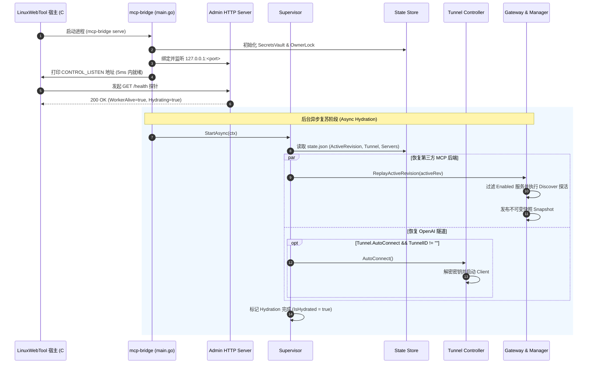
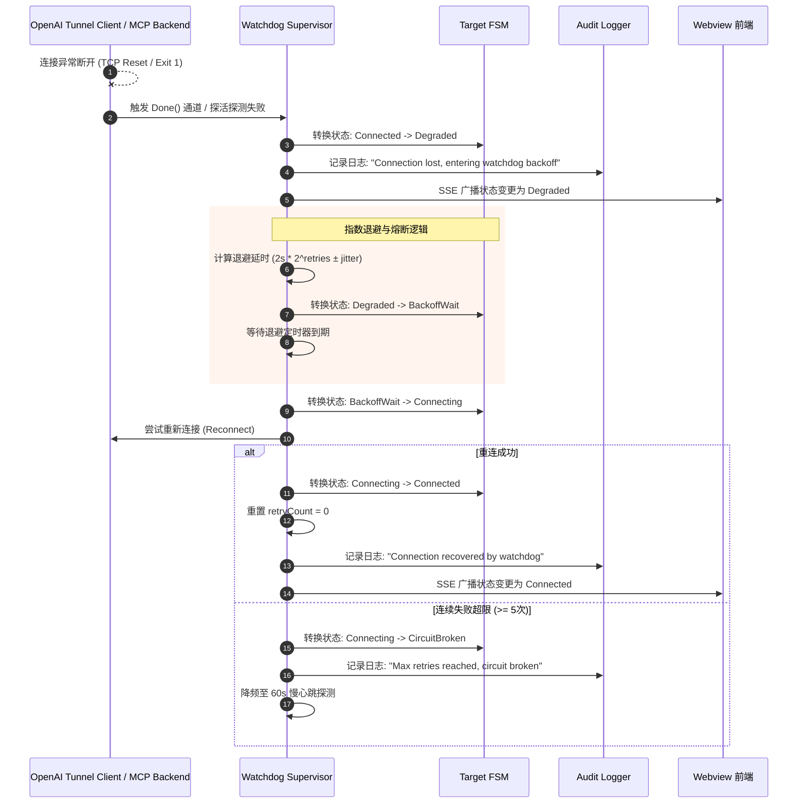

# MCP Bridge 自动连接与看门狗自动守护架构方案设计
*(OpenAI Secure Tunnel & Third-Party MCP Services Auto-Connect & Watchdog Supervisor)*

## 1. 调研背景与业务痛点

### 1.1 业务诉求
在当前微服务化架构下，`mcp-bridge` 作为独立的 Go 常驻原生插件（Resident Native Plugin），承载了两个核心连接通道：
1. **OpenAI Secure MCP Tunnel**：向外主动建立反向安全隧道，对外暴露统一的 Facade Server 工具集；
2. **第三方 MCP 纳管服务（Third-Party MCP Backends）**：纳管基于 Stdio、SSE 或 Streamable HTTP 协议的工具后端（如 `fetch`、`filesystem`、`system-tools`、`knowledge-arena` 等）。

用户提出了以下两个关键演进需求：
> 1. **OpenAI Tunnel 隧道**：能否支持插件启动后自动连接？并且添加看门狗自动守护？
> 2. **第三方 MCP 纳管服务**：能否支持插件启动后自动连接？并且添加看门狗自动守护？

### 1.2 现状痛点与断连根因分析
经深度审计 `plugins/mcp-bridge` 的源代码（`cmd/mcp-bridge/main.go`、`internal/runtime/runtime.go`、`internal/tunnel/controller.go`、`internal/gateway/gateway.go`），发现存在以下四个结构性断点：

```
[插件主进程启动 main.go] ──> NewRuntime() ──> 仅初始化内存空对象
                                          │
                                          ├─❌ 未读取 state.json 的 ActiveRevision 恢复第三方后端 (Gateway 工具数为 0)
                                          └─❌ 未检查 TunnelConfig 自动建立反向隧道 (Tunnel 处于 Unconfigured)

[运行期间外部异常] ────> c.client.Done() ──> 仅标记 StateDegraded
                                          │
                                          └─❌ 无重试循环、无退避策略、无主动心跳探活，连接永久失活，直至人工干预
```

1. **冷启动内存状态丢失（Cold-Start Memory Amnesia）**：
   - 持久化文件 `state.json` 中虽然固化了 `activeRevision`、已启用的服务列表及勾选的工具，但 `main.go` 启动时仅创建了空的 `Gateway` 与 `tunnel.Controller`；
   - 内存中的 `activeRevision` 默认置为 0，所有已启用的 STDIO 子进程（如 `uvx` / `npx`）均未预热拉起，SSE 长连接未建立，Facade Server 上的可用工具数为 0；必须管理员手工点击【🚀 应用生效配置 (Apply)】后才会加载。
2. **反向隧道被动等待（Tunnel Passive Idle）**：
   - 即使持久化存储中已配置了有效的 `TunnelID` 与 `EncryptedKey`，插件启动后 `tunnel.Controller` 始终停留在 `StateUnconfigured` 或空闲态，必须管理员手工打开 Webview 点击【▶ 启动隧道】。
3. **缺少断连自愈看门狗（No Self-Healing Watchdog）**：
   - `tunnel.Controller` 虽有 Goroutine 监听 `c.client.Done()`，但捕获意外断连后仅简单更新 `c.status.State = StateDegraded`，缺乏自动重连（Auto-Reconnect）机制；
   - 第三方后端（尤其是通过操作系统子进程运行的 `stdio` 架构，或远端 `sse` 网络会话）发生 OOM、段错误崩溃、网络超时闪断时，系统无法主动感知，只有在下次工具调用被派发时才会报错。
4. **管理意图与故障恢复无状态隔离（Intent vs Fault Ambiguity）**：
   - 系统未区分“**用户主动点击停止/禁用**”（User Explicit Stop）与“**异常网络/进程故障**”（Abnormal Crash/Disconnect），容易导致自动化机制与人工干预发生冲突。

---

## 2. 业界主流方案与可复用技术借鉴

### 2.1 业界主流架构对比

| 维度 | Kubernetes Kubelet Pod 守护 | Cloudflare Tunnel (`cloudflared`) | Envoy Proxy 离群探测与熔断 | 本系统推荐方案 (MCP Bridge Supervisor) |
| :--- | :--- | :--- | :--- | :--- |
| **启动恢复策略** | 声明式期望状态，控制器循环（Reconciliation Loop）自动拉齐 | 从本地凭据与配置文件无缝冷启动，后台常驻维护多路复用隧道 | 启动时加载动态配置（xDS / Static YAML）并立即建立上游连接池 | **极速启动 + 异步复苏（Fast Boot & Async Hydration）**：HTTP 监听先就绪，后台恢复 ActiveRevision |
| **断连感知机制** | 操作系统子进程退出信号（wait4） + `Liveness/Readiness` 探针 | QUIC/TCP KeepAlive 心跳探测 + 控制平面连接状态事件通知 | 主动心跳探针（Active Probing）+ 被动请求失败率统计（Passive Anomaly） | **双模探针（Dual-Mode Probe）**：Stdio 进程退出通道监听 + SSE/Tunnel 周期性 ping 心跳 |
| **重试与避震** | 指数退避重启（CrashLoopBackOff: 10s, 20s, 40s... 最大 300s） | Full Jitter 指数退避（1s 到 60s），防止大规模断网恢复时引发惊群 | 离群摘除（Ejection）与冷却窗口（Cooling-off Period），半开探测恢复 | **带抖动指数退避 + 熔断器模式（Jittered Backoff & Circuit Breaker）** |
| **人工意图隔离** | `replicas: 0` 或 `delete pod` 显式暂停控制器 | 命令行 `stop` 发送信号，持久化运行态与意图解耦 | 动态路由权重置 0（Drain / Maintenance Mode） | **意图驱动状态机（Intent-Driven FSM）**：显式用户停止状态禁止看门狗唤醒 |

### 2.2 现有基础设施与开源技术复用
1. **本系统现有能力复用**：
   - `internal/state/store.go`：已实现基于文件锁的高可靠原子读写，适合扩展意图字段（`AutoConnect`、`UserPaused`）；
   - `internal/state/secrets.go`：`SecretsVault` 已有成熟的本地 AES-GCM 敏感数据加解密能力，看门狗拉起连接时可直接调用；
   - `internal/catalog/snapshot.go`：不可变快照 `Snapshot` 与无锁发布机制（`registry.Publish`），天然支持看门狗在后台平滑更新服务就绪状态而不影响在线调用；
   - `internal/admin/audit.go`：环形内存审计日志，可直接记录看门狗的 `AutoConnected`、`Degraded`、`CircuitBroken`、`Recovered` 事件；
   - 宿主基础设施：宿主使用 `.NET` 进程守护者托管 Go 插件进程，Go 内部作为微内核运行，无需额外依赖外部守护工具（如 Supervisord / Systemd）。
2. **Go 经典设计模式与库选型**：
   - **退避算法**：借鉴 `cenkalti/backoff/v4` 的 Full Jitter 指数退避算法思想（避免外部依赖引入过重，内部实现轻量高效无反射版本）；
   - **并发原语**：使用 Go 标准库 `context.Context`、`sync.RWMutex`、`time.Ticker`，保持 Native 原生无第三方依赖。

---

## 3. 可行性与深度推演（边界缺陷与防坑设计）

针对自动连接与看门狗功能，我们进行了全方位的缺陷推演与头脑风暴，总结出以下五大关键隐患与应对方案：

### 隐患 1：惊群效应与启动延迟（Thundering Herd & Fast Boot vs Slow Downstream）
- **现象推演**：如果插件进程启动时在 `main.go` 中**同步阻塞**地去执行 6 个第三方 MCP 服务的发现（可能需 `npx`/`uvx` 下载或拉取远程 SSE）以及 OpenAI Tunnel 连接，会导致控制面 HTTP 端口迟迟无法绑定，触发宿主进程探测超时（Handshake Timeout），被宿主直接当作死锁杀掉！
- **应对方案（Fast Boot & Async Hydration 策略）**：
  1. `main.go` 启动后**优先绑定并开放 HTTP 控制面与健康自检接口**（5ms 内完成），立刻向宿主宣告健康；
  2. 随后通过独立的后台 Goroutine（`Supervisor.StartHydration()`）异步读取最后一次生效的 `ActiveRevision`，并发恢复第三方服务和隧道；
  3. 期间健康检查状态透出 `Hydrating: true`，页面展示“正在自动就绪服务”，避免请求阻塞。

### 隐患 2：进程风暴与死循环崩溃（Fork Bomb & CrashLoop）
- **现象推演**：若某个第三方 Stdio 服务由于缺少依赖（如 `npx` 缺失）或配置参数错误，启动 10ms 内立即崩溃；若看门狗死循环不断 `fork` 重启，将造成 CPU 100%、进程 PID 耗尽，引发系统级雪崩（Fork Bomb）。
- **应对方案（三态熔断器 + 抖动退避 Circuit Breaker with Jitter）**：
  - 为每个后端独立维护熔断状态：`Closed`（正常）-> `Open`（熔断隔离）-> `Half-Open`（半开探活）；
  - 采用指数退避：$T = \min(T_{max}, T_{base} \times 2^{\text{failures}}) \pm \text{Jitter}$（基数 2s，上限 60s，抖动 20%）；
  - 连续失败超过 5 次立即触发**熔断保护**，将该服务标红为 `Degraded`，拉长探测间隔至 60 秒，并记录告警审计，彻底阻断进程风暴。

### 隐患 3：显式人工意图 vs 自动看门狗的冲突（Intent vs Watchdog Conflict）
- **现象推演**：管理员在前端页面上主动点击【⏹ 停止隧道】或【⏸ 禁用服务】，但后台看门狗误以为是异常离线，几秒后又“贴心地”自动拉起重连，导致用户永远关不掉服务。
- **应对方案（意图声明模型 Intent-Driven Model）**：
  - 在配置模型与运行时中引入明确的人工意图字段：
    - `TunnelConfig.AutoConnect`（配置期望：是否开机自连，默认 `true`）；
    - `TunnelRuntime.UserPaused`（运行时意图：用户显式点击暂停时设为 `true`，用户点击启动时重置为 `false`）；
    - `BackendSpec.Enabled`（服务开关：若 `Enabled == false`，看门狗绝对不扫描、不连接、不重试）。
  - 看门狗仅在 `Enabled && !UserPaused && State != Connected` 时介入自愈。

### 隐患 4：并发写竞争与配置版本漂移（Concurrency Race Condition & Version Drift）
- **现象推演**：看门狗在后台自动探活并恢复服务的同时，管理员正在 Web 界面上编辑草稿或点击【🚀 应用生效配置】，双方若同时操作 `state.json`，极易发生写冲突或版本回滚覆盖。
- **应对方案（不可变快照隔离 + 只读状态投影）**：
  - 看门狗的探活操作为**只读（Read-Only）探活**，**绝不直接向 `state.json` 提交新的 Revision**；
  - 看门狗自愈后的服务工具只更新内存中的 `Snapshot` 动态就绪标记（`ReadyBackendMask`），保证在线请求能派发，而持久化版本号由且仅由管理员的显式 `Apply` 驱动。

### 隐患 5：僵尸进程与句柄泄漏（Zombie Processes & Leaked Descriptors）
- **现象推演**：Stdio 进程异常断开重连时，如果原有的子进程挂起在后台成为孤儿/僵尸进程，或者 SSE 的 HTTP 响应体没有执行 `Close()`，会导致操作系统的文件描述符（FD）和内存持续泄漏。
- **应对方案（Process Group Isolation & Context Cancel Guard）**：
  - Stdio 进程拉起时设置进程组 ID（Unix: `Setpgid: true`, Windows: `CREATE_NEW_PROCESS_GROUP`）；
  - 杀进程时发送 `SIGTERM`，若 3 秒内未退出，强制发送 `SIGKILL` 杀死整个进程组；
  - 每一个连接会话（Session）严格绑定生命周期 Context，异常退出时级联触发所有 Reader/Writer Goroutine 清理。

---

## 4. 架构设计与设计模式优化

针对上述推演，我们在架构中引入四种经典设计模式构建健壮的自愈系统：

```
                    ┌────────────────────────────────────────────────────────┐
                    │               Supervisor (单例监督者模式)               │
                    └───────┬────────────────────────────────────────┬───────┘
                            │                                        │
           ┌────────────────▼────────────────┐      ┌────────────────▼────────────────┐
           │     TunnelWatchdog (适配器策略)  │      │    BackendWatchdog (适配器策略)  │
           └────────────────┬────────────────┘      └────────────────┬────────────────┘
                            │                                        │
     ┌──────────────────────▼──────────────────────┐  ┌──────────────▼──────────────────────┐
     │           OpenAI Tunnel FSM (状态机)        │  │        Third-Party Backend FSM        │
     │ Unconfigured ⇄ Connecting ⇄ Connected     │  │ Disabled ⇄ Initializing ⇄ Ready     │
     │      ▲                │                     │  │               │              ▲      │
     │      │                ▼                     │  │               ▼              │      │
     │  UserPaused ⇦ BackoffWait ⇦ Degraded        │  │     CircuitBroken ⇦ CoolingOff      │
     └─────────────────────────────────────────────┘  └─────────────────────────────────────┘
```

### 4.1 设计模式落地说明

#### 1. 单例监督者模式（Supervisor Pattern / Erlang-style）
- 借鉴 Erlang/OTP 的 Supervisor 理念，由一个集中式守护者 `Supervisor` 统一调度两个子域看门狗（`TunnelWatchdog` 与 `BackendWatchdog`）；
- 具备隔离性（One-For-One Strategy）：某个第三方 MCP 工具（如 `weather-sse`）断连或故障，绝对不影响 OpenAI Tunnel 或其他 MCP 服务的持续运行。

#### 2. 状态机模式（Finite State Machine, FSM）
- **OpenAI Tunnel FSM**：
  - 状态集合：`Unconfigured`（未配置）、`Stopped`（已停止）、`UserPaused`（人工暂停）、`Connecting`（连接中）、`Connected`（已连接就绪）、`Degraded`（异常降级）、`BackoffWait`（退避等待）。
  - 流转逻辑严格基于事件驱动（`EventUserStart`、`EventUserStop`、`EventClientExited`、`EventBackoffTimer`）。
- **第三方 Backend FSM**：
  - 状态集合：`Disabled`（禁用）、`Initializing`（启动中）、`Ready`（正常就绪）、`Degraded`（连接降级）、`CoolingOff`（熔断冷却中）、`Probing`（半开探活中）。

#### 3. 适配器与策略模式（Adapter & Strategy Pattern）
- 提取统一的看门狗目标接口 `WatchdogTarget`：
  ```go
  type WatchdogTarget interface {
      TargetID() string
      CheckHealth(ctx context.Context) (bool, error)
      Reconnect(ctx context.Context) error
      CanSelfHeal() bool
  }
  ```
- 针对不同通信架构提供不同的自愈策略实现：
  - `TunnelStrategy`：监听 OpenAI SDK Client 的 `Done()` 通道与反向心跳；
  - `StdioBackendStrategy`：监听操作系统子进程的退出信号与输出管道 EOF，使用指数退避拉起子进程；
  - `SseBackendStrategy`：发起轻量级 HTTP OPTIONS/GET 探活请求，断线时执行重连。

#### 4. 观察者与反应式事件流（Observer Pattern & SSE Broadcast）
- 看门狗的所有状态流转通过事件总线实时广播：
  - 控制台 Web 界面无缝接收 `status.stream` 推送，当看门狗在后台自动恢复连接后，界面的徽章自动从黄色“降级”变为绿色“正常就绪”，无需用户手动刷新。

---

## 5. 核心契约与数据模型扩展

### 5.1 数据模型（`internal/config/model.go`）扩展
```go
// TunnelConfig 扩展自连属性
type TunnelConfig struct {
    TunnelID            string `json:"tunnelId"`
    EncryptedKey        string `json:"encryptedKey,omitempty"`
    ControlPlaneBaseURL string `json:"controlPlaneBaseUrl,omitempty"`
    OrganizationID      string `json:"organizationId,omitempty"`
    AutoConnect         bool   `json:"autoConnect"` // 新增：是否启动后自动连接（默认 true）
}

// BackendSpec 扩展守护属性
type BackendSpec struct {
    // 现有字段...
    ID             string            `json:"id"`
    Name           string            `json:"name"`
    Transport      TransportType     `json:"transport"`
    Enabled        bool              `json:"enabled"`
    Command        string            `json:"command,omitempty"`
    Args           []string          `json:"args,omitempty"`
    // 新增：看门狗相关配置（带默认值）
    AutoReconnect  bool              `json:"autoReconnect"`  // 是否开启自动守护（默认 true）
    MaxRetries     int               `json:"maxRetries"`     // 最大重试次数（默认 5）
}

// 运行时状态扩展
type TunnelRuntimeStatus struct {
    State        State     `json:"state"`
    TunnelID     string    `json:"tunnelId,omitempty"`
    ErrorMessage string    `json:"errorMessage,omitempty"`
    LastActiveAt time.Time `json:"lastActiveAt,omitempty"`
    UserPaused   bool      `json:"userPaused"`   // 新增：是否由用户显式暂停
    RetryCount   int       `json:"retryCount"`   // 新增：当前已重试次数
    NextRetryAt  time.Time `json:"nextRetryAt"`  // 新增：下次退避重试时间
}
```

### 5.2 启动与自愈时序设计

#### 场景 A：插件主进程冷启动与异步复苏（Fast Boot & Async Hydration）


#### 场景 B：运行中网络闪断与看门狗自愈（Watchdog Self-Healing with Jittered Backoff）


---

## 6. 实施路线图与测试质量门禁

### 6.1 阶段性实施规划

```
[阶段一: 契约与 FSM 核心] ──> [阶段二: Watchdog 引擎与退避器] ──> [阶段三: 启动链装配与自愈集成] ──> [阶段四: Web 控制台与端到端验收]
```

1. **阶段一：数据模型与状态机核心（Contract & FSM）**
   - 在 `internal/config/model.go` 中引入 `AutoConnect` 配置字段；
   - 在 `internal/tunnel/` 与 `internal/backend/` 中确立标准双态/多态状态机，支持 `UserPaused` 意图隔离。
2. **阶段二：Watchdog 引擎与退避策略（Watchdog Supervisor & Backoff）**
   - 实现 `internal/watchdog/` 包，封装 `Supervisor`、`BackoffController` 与 `CircuitBreaker`；
   - 编写高覆盖率的 Go 单元测试，模拟各种网络超时、进程秒退、并发争用的自愈与熔断场景。
3. **阶段三：启动链装配与无锁冷启动（Fast Boot & Replay Active Revision）**
   - 改造 `cmd/mcp-bridge/main.go` 与 `runtime.go`，实现极速绑定监听与后台异步 Hydration；
   - 在 `gateway.go` 中支持 `ReplayActiveRevision`，无感加载此前已生效的第三方工具。
4. **阶段四：Web 控制台实时投影与全链路验收（UI & Architecture Gates）**
   - Webview 界面上增加【开机自连】复选框，优化运行状态看板，直观展示看门狗状态（已连接 / 守护自愈中 / 熔断冷却）；
   - 执行远程 Linux 开发环境部署与内置浏览器真实验收。

### 6.2 质量保障与防回归架构测试门禁（Architecture Gates）

为防止未来代码变更导致退化，设计新增以下架构门禁：
- **`LinuxArch061_MCP网关自动连接与看门狗自愈门禁`**：
  1. **冷启动自愈断言**：断言 `runtime.go` / `main.go` 启动时必须挂载 `Supervisor`，且包含对已生效 `ActiveRevision` 的异步恢复逻辑；
  2. **意图隔离断言**：断言必须存在 `UserPaused` 或显式意图判断分支，严禁在用户主动停止后盲目重连；
  3. **防进程风暴断言**：断言看门狗重试逻辑必须显式引用带有上限与退避因子的退避算法（Backoff），严禁裸写 `for { go Reconnect() }` 无休止死循环；
  4. **非阻塞启动断言**：断言 HTTP 监听绑定逻辑必须位于长时间阻塞的第三方服务探测之前。

---

## 7. 调研结论

1. **可行性确认**：
   - OpenAI Tunnel 自动连接与第三方 MCP 纳管服务的开机自连及看门狗自动守护**完全可行**，在 Go 单进程微内核架构下能做到轻量（单协程开销 < 4KB 内存）、高效、无锁化。
2. **架构合理性**：
   - 采用 **Erlang-style Supervisor + FSM 状态机 + Adapter 策略模式**，能够完美解决“惊群效应”、“进程风暴”、“人工意图冲突”、“并发版本竞争”以及“僵尸进程泄漏”等潜在缺陷。
3. **用户体验跃迁**：
   - 实施后，用户在插件重启、容器重启或网络临时抖动后，**无需再手动打开页面点击【启动隧道】或【应用生效配置】**，系统将自动毫秒级拉起、无缝自愈并对外提供稳定的 MCP 工具调用能力。
