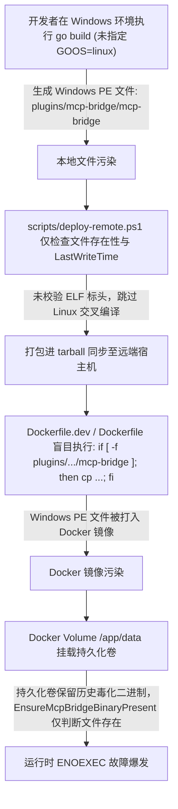
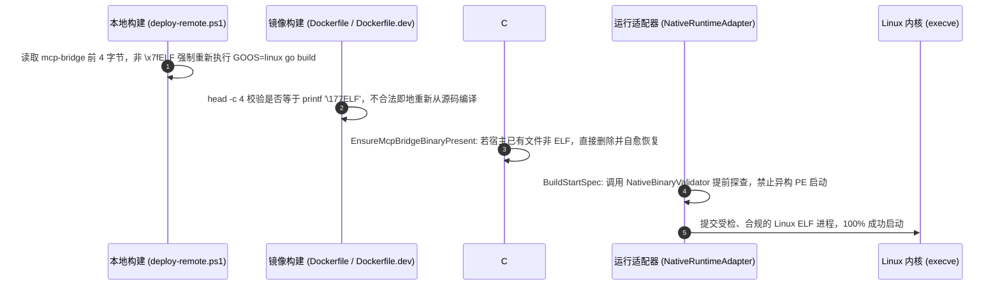

# MCP Bridge 原生二进制跨平台启动异常 (Exec format error) 调查分析与全链路二进制治理方案

## 1. 问题背景与现象描述

在 LinuxWebTool (LWT) 扩展中心微服务体系中，以原生 Go 独立进程形态常驻运行的 **MCP 智能安全网关桥接服务 (`mcp-bridge`)** 在启动时抛出如下系统异常：

```text
启动异常: An error occurred trying to start process '/app/data/plugins/mcp-bridge/mcp-bridge' with working directory '/app/data/plugins/mcp-bridge'. Exec format error
```

该异常导致扩展中心前端界面呈现服务启动故障红牌，MCP 协议反向代理与大模型工具网关无法联通。

---

## 2. 根因深度剖析 (Root Cause Analysis)

### 2.1 什么是 `Exec format error`？
在 Linux 操作系统内核中，当应用程序调用 `execve(2)` 系统调用执行一个程序文件时，内核子系统通过注册的二进制格式加载器（`binfmt`）按文件头部特征进行识别：
1. **ELF 格式 (`binfmt_elf`)**：文件前 4 字节必须为魔数 `0x7F, 0x45, 0x4C, 0x46`（即 ASCII `\x7fELF`），且 `e_machine` 字段需与当前 CPU 架构严格一致。
2. **脚本格式 (`binfmt_script`)**：文件前 2 字节为 `0x23, 0x21`（即 ASCII `#!`），后续跟随解释器路径。
3. **其它格式 (`binfmt_misc`)**：如未配置，内核将返回 POSIX 标准错误码 **`ENOEXEC` (Error 8: Exec format error)**。

在 Alpine Linux 最小化容器中，既没有 Wine 也没有 binfmt_misc 规则。

### 2.2 二进制头部实测取证
通过对远端开发容器 `/app/data/plugins/mcp-bridge/mcp-bridge` 以及本地工作区 `plugins/mcp-bridge/mcp-bridge` 执行十六进制头部分析：

```powershell
[System.BitConverter]::ToString([System.IO.File]::ReadAllBytes('plugins/mcp-bridge/mcp-bridge')[0..15])
# 输出: 4D-5A-90-00-03-00-00-00-04-00-00-00-FF-FF-00-00
```

- **`0x4D, 0x5A` ("MZ")**：明确表明该文件实质为 **Windows PE (Portable Executable) 64 位可执行文件**，而非 Linux ELF 文件。
- Linux 内核读取到 "MZ" 头部后，因无法识别其二进制结构，直接返回 `ENOEXEC`。

### 2.3 毒化二进制流入生产环境的 4 级污染链条



1. **源头污染**：本地 Windows 开发过程中，构建命令未指定 `$env:GOOS = "linux"`，且输出目标省略了 `.exe` 后缀，生成了一个被命名为 `mcp-bridge` 的 Windows PE 程序。
2. **部署脚本漏检**：`scripts/deploy-remote.ps1` 的预编译检查逻辑为：
   ```powershell
   $needCompile = (-not (Test-Path $mcpBin)) -or ((Get-Item $mcpBin).LastWriteTime -lt (Get-Item $mcpSrc).LastWriteTime)
   ```
   由于本地已被生成的 `mcp-bridge` 修改时间晚于 `main.go`，脚本判定为“最新”，因而跳过了 `GOOS=linux` 交叉编译！
3. **镜像构建漏检**：`Dockerfile` 与 `Dockerfile.dev` 仅判断文件是否存在：
   ```dockerfile
   RUN if [ -f plugins/mcp-bridge/mcp-bridge ]; then \
           cp plugins/mcp-bridge/mcp-bridge /app/publish/mcp-bridge; \
       else \
           cd plugins/mcp-bridge && CGO_ENABLED=0 go build ...
   ```
   导致 Docker 容器镜像直接继承了宿主传来的 Windows PE 文件。
4. **持久化卷毒化与缺乏运行时自愈**：宿主机 Docker 卷 `/app/data` 挂载在持久目录，C# 代码 `EnsureMcpBridgeBinaryPresent` 发现目的路径已存在该文件且大小不为 0，即认为已就绪，从而引发反复崩溃且重启无法恢复。

---

## 3. 业界主流方案与调研借鉴

### 3.1 业界方案对比

| 体系/方案 | 格式识别机制 | 架构校验 | 自愈机制 | 对本项目适配度 |
| :--- | :--- | :--- | :--- | :--- |
| **HashiCorp Nomad / Consul 插件体系** | 读取前 16 字节，验证 OS Magic 与 CPU Arch | 支持 `x86_64` / `arm64` 严格校验 | 启动前 Fail-Fast，详细输出目标平台与当前系统架构对比 | ⭐⭐⭐⭐⭐ 极佳，轻量且防御性极强 |
| **OCI runc / containerd** | 通过内核与静态 ELF 头部解析验证 ABI | 依赖容器镜像 Manifest 多架构定义 | 若架构不符抛出标准 OCI runtime 错误 | ⭐⭐⭐⭐ 适合镜像构建层规范 |
| **第三方库 (如 PeNet, ELFSharp)** | 全量解析 PE/ELF 节区表、符号表、动态链接库依赖 | 支持完整架构与指令集 | 依赖额外 NuGet 包，反射过多，增加 Native AOT 剪裁风险 | ⭐⭐ 过于沉重，违背 contracts/AOT 轻量原则 |
| **自定义纯 BCL 头部探针 (`NativeBinaryValidator`)** | 仅读取前 20 字节，识别 Shebang (`#!`), PE (`MZ`), ELF (`\x7fELF`) | 校验 `e_machine` (0x3E 为 AMD64, 0xB7 为 ARM64) | 0 堆内存分配，无三方依赖，完全兼容 Native AOT | ⭐⭐⭐⭐⭐ 最佳工程实践 |

### 3.2 ELF 与 PE 标头核心规范速查

- **ELF 标头 (Linux)**:
  - 偏移 `0..3`: `0x7F, 0x45, 0x4C, 0x46` (`\x7fELF`)
  - 偏移 `4`: `EI_CLASS` (`1` = 32 位, `2` = 64 位)
  - 偏移 `5`: `EI_DATA` (`1` = 小端序 Little Endian, `2` = 大端序)
  - 偏移 `18..19`: `e_machine` (可执行目标机器码，小端序):
    - `0x003E` (62): `AMD x86-64`
    - `0x00B7` (183): `ARM AArch64`
- **PE 标头 (Windows)**:
  - 偏移 `0..1`: `0x4D, 0x5A` (`MZ` DOS 兼容头)
- **脚本 Shebang**:
  - 偏移 `0..1`: `0x23, 0x21` (`#!`)

---

## 4. 全链路治理与防御设计方案

为了彻底根除此类问题并防止在任何环节回归，我们确立 **“构建检、部署检、注入检、运行检”** 四重防御治理闭环：



### 4.1 核心组件 1：零分配纯 BCL 原生二进制校验探针 (`NativeBinaryValidator`)
在 `src/LinuxWebTool.Infrastructure/Features/Plugins/Adapters/NativeBinaryValidator.cs` 中实现：
- 使用 `stackalloc byte[20]` 读取文件头，零堆分配；
- 在 Linux 下校验 `\x7fELF` 与当前 CPU 架构 (`Architecture.X64` vs `Architecture.Arm64`)；
- 在 Windows 下校验 `MZ`；
- 允许带有 Shebang (`#!`) 的脚本；
- 若检测到跨系统错误（如 Linux 上检测到 `MZ`），抛出可读性极高的错误原因，明确指导编译修正。

### 4.2 核心组件 2：宿主持久卷自愈与动态原地编译
在 `PluginManager.Defaults.cs` 中改造 `EnsureMcpBridgeBinaryPresent`：
1. **清理毒化产物**：检查 `/app/data/plugins/mcp-bridge/mcp-bridge`，若验证失败，立即执行 `File.Delete`。
2. **合法候选复制**：扫描内置模板 `/app/mcp-bridge`、`/usr/local/bin/mcp-bridge` 等候选文件，仅在通过 `NativeBinaryValidator` 验证后才复制并赋权 `0755`。
3. **源码自愈降级**：若候选全不可用且当前处于 Linux 容器，只要检测到本地安装有 `go` CLI 及 Go 源码，自动触发一次 `go build -ldflags="-s -w" -o ... ./cmd/mcp-bridge`。

### 4.3 核心组件 3：运行适配器防御性 Fail-Fast
在 `NativeRuntimeAdapter.cs` 的 `BuildStartSpec` 中，在进程启动前显式调用 `NativeBinaryValidator.ValidateExecutable(exe)`。若失败，立即中断并返回友好清晰的错误信息，避免让底层系统抛出模糊的 `Exec format error`。

### 4.4 核心组件 4：部署脚本与 Dockerfile 编译门禁
1. **`scripts/deploy-remote.ps1`**:
   读取本地产物前 4 字节，只要不是 `0x7F, 0x45, 0x4C, 0x46`，一律视作需要重新编译，并调用交叉编译命令：
   `set CGO_ENABLED=0& set GOOS=linux& set GOARCH=amd64& go build ...`
2. **`Dockerfile` & `Dockerfile.dev`**:
   将原有简单存在性判断替换为字节比对：
   `[ -f plugins/mcp-bridge/mcp-bridge ] && [ "$(head -c 4 plugins/mcp-bridge/mcp-bridge 2>/dev/null)" = "$(printf '\177ELF')" ]`

---

## 5. 架构门禁与回归预防 (`LinuxArch040`)

为确保任何后续提交都不会退回到“仅判断文件存在”的粗糙逻辑，新增架构测试门禁：
**`LinuxArch040_原生二进制跨平台与文件格式校验门禁`**：
1. 校验 `Dockerfile` 与 `Dockerfile.dev` 中对预置原生可执行文件的复用逻辑必须包含 ELF 标头校验；
2. 校验 `NativeBinaryValidator` 必须存在且具备跨架构与 PE/ELF 交叉隔离逻辑；
3. 校验 `NativeRuntimeAdapter` 与 `PluginManager.Defaults` 中必须引用 `NativeBinaryValidator`。
