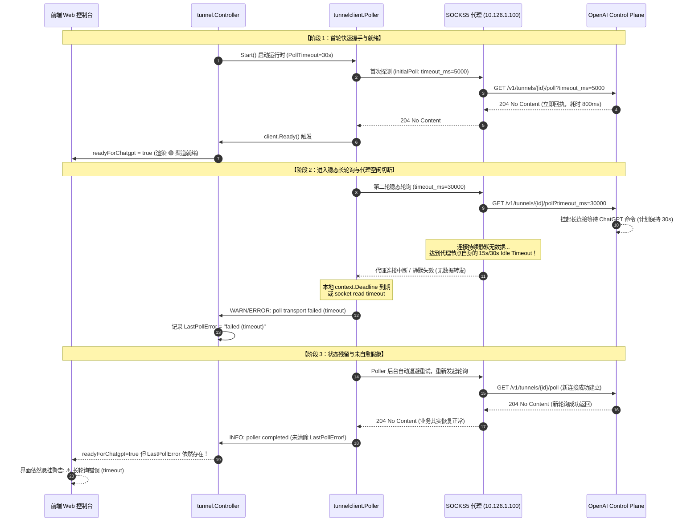
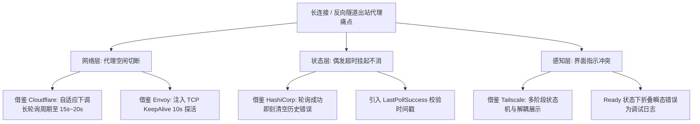

# OpenAI MCP 隧道长轮询超时、空闲断开与弹性自愈治理方案

> **现场问题还原**：
> ```text
> 运行实例 ID: run-1793748091783135874
> 已配置第三方服务数: 3 个
> 已激活工具数: 1 个
> 看门狗自愈守护: 🛡️ 活跃守护中
> ChatGPT 渠道就绪: 🟢 渠道就绪 (Ready)
> ⚠️ OpenAI 通道握手 / 长轮询错误:
> controlplane client: poll transport failed (timeout)
> 💡 排查建议: 出口代理连接超时。请检查代理节点 (socks5h://proxy.example.internal:1080) 是否可用、端口是否正确，或点击上方【🔍 诊断】获取握手详情。
> 
> ✅ 控制平面网络出站握手通过！ChatGPT 渠道可正常通行。
> 目标主机: api.openai.com:443
> 生效代理: socks5://proxy.example.internal:1080
> DNS 解析: ✅ 成功 (44ms, 108.160.167.30)
> TCP 握手: ✅ 握手成功 (1ms)
> TLS 握手: ✅ 握手成功 (654ms)
> TLS 协议: TLS 1.3
> 💡 排查建议: 网络通路正常就绪！DNS 耗时 44ms，TCP 耗时 1ms，TLS (TLS 1.3) 耗时 654ms。
> ```
>
> **核心矛盾点**：
> 单次握手探测耗时仅 654ms，DNS、TCP 与 TLS 1.3 协商全部通过，首轮握手也成功激活了通道（`🟢 渠道就绪 (Ready)`）；但进入稳态运行后，后台长轮询却频繁或持续报告 `controlplane client: poll transport failed (timeout)`，并在 Web 控制台上长久悬挂错误告警。
>
> **文档定位**：深入剖析“短握手成功但长轮询超时”的深层底层机理，调研业界主流长连接与反向隧道治理方案，梳理当前系统可复用基础设施，提出状态自愈、自适应超时与空闲保活治理方案，并制定专属架构防护门禁与防回归自动化测试规范。

---

## 目录

1. [现象还原与深层根因剖析](#1-现象还原与深层根因剖析)
   - [1.1 握手探测与长轮询的生命周期模型差异](#11-握手探测与长轮询的生命周期模型差异)
   - [1.2 五大深层根本原因 (Deep Root Causes)](#12-五大深层根本原因-deep-root-causes)
   - [1.3 链路状态时序全景图](#13-链路状态时序全景图)
2. [开源生态现有库与机制调研借鉴](#2-开源生态现有库与机制调研借鉴)
   - [2.1 Go 官方与扩展库能力矩阵](#21-go-官方与扩展库能力矩阵)
   - [2.2 第三方弹性重试与长连接连接池库](#22-第三方弹性重试与长连接连接池库)
3. [业界主流反向隧道与长连接方案对比](#3-业界主流反向隧道与长连接方案对比)
   - [3.1 Cloudflare Tunnel (`cloudflared`)：心跳保活与弹性预算](#31-cloudflare-tunnel-cloudflared心跳保活与弹性预算)
   - [3.2 Tailscale DERP Relay：多阶段健康状态模型](#32-tailscale-derp-relay多阶段健康状态模型)
   - [3.3 Envoy Egress Gateway：连接池探活与空闲治理](#33-envoy-egress-gateway连接池探活与空闲治理)
   - [3.4 主流方案综合对比决策矩阵](#34-主流方案综合对比决策矩阵)
4. [当前系统已有基础设施复用分析](#4-当前系统已有基础设施复用分析)
   - [4.1 内置轻量 `socks5-proxy` 微服务](#41-内置轻量-socks5-proxy-微服务)
   - [4.2 深度网络诊断探针 `diagnostics.go`](#42-深度网络诊断探针-diagnosticsgo)
   - [4.3 自适应看门狗与退避引擎 `watchdog`](#43-自适应看门狗与退避引擎-watchdog)
   - [4.4 环形通信日志缓冲区 `logbuf.go`](#44-环形通信日志缓冲区-logbufgo)
5. [具体技术解决方案与演进设计](#5-具体技术解决方案与演进设计)
   - [5.1 解决方案一：控制器错误状态自愈消除机制 (Self-Healing Error Resetting)](#51-解决方案一控制器错误状态自愈消除机制-self-healing-error-resetting)
   - [5.2 解决方案二：弹性自适应 Long-Poll 超时模型 (Adaptive Long-Poll Timeout)](#52-解决方案二弹性自适应-long-poll-超时模型-adaptive-long-poll-timeout)
   - [5.3 解决方案三：出站 TCP Keep-Alive 保活强化与代理参数规整](#53-解决方案三出站-tcp-keep-alive-保活强化与代理参数规整)
   - [5.4 解决方案四：增强型控制台长轮询空闲耐受度模拟诊断 (Hang Probe)](#54-解决方案四增强型控制台长轮询空闲耐受度模拟诊断-hang-probe)
6. [同类门禁与防回归测试规范](#6-同类门禁与防回归测试规范)
   - [6.1 架构防护门禁 `LinuxArch079`](#61-架构防护门禁-linuxarch079)
   - [6.2 Go 契约与状态流转单元测试规范](#62-go-契约与状态流转单元测试规范)
   - [6.3 端到端空闲断开与自愈回归测试方案](#63-端到端空闲断开与自愈回归测试方案)
7. [落地路线图与验收基准](#7-落地路线图与验收基准)

---

## 1. 现象还原与深层根因剖析

### 1.1 握手探测与长轮询的生命周期模型差异

现场出现的“诊断通过但轮询报错”现象，本质源于**两种完全不同的网络通信生命周期模型**在代理拓扑下的表现差异：

| 评估维度 | 控制台出站诊断探针 (`diagnostics.go`) | 首次握手轮询 (`initialPoll`) | 稳态业务长轮询 (`steady-state poll`) |
| :--- | :--- | :--- | :--- |
| **通信机制** | TCP 拨号 + TLS 握手后立即主动 Close | 发送 HTTP GET 并由服务端立即回执 | 发送 HTTP GET 后连接在服务端挂起 30 秒 |
| **传输生命周期** | **瞬时（~650ms）** | **毫秒级（~800ms）** | **长时间挂起（30,000ms）** |
| **应用层流量** | 仅握手报文，无应用层 HTTP 请求 | 发送少量头，服务端快速返回空命令 | **请求头发送后，整整 30 秒零应用层流量** |
| **验证范围** | 仅验证客户端与代理、目标主机间的**瞬时连通性** | 验证 API 凭据有效性与通道存在性 | 考验**中间网络设备对静默长连接的存活保持能力** |
| **代理层压力** | 极低（新建连接即刻释放） | 极低 | **极高（需长期维持 NAT 状态与空闲 Socket）** |

现场诊断之所以完全通过，证明了底层三要素是健康的：
1. 本地到出口代理节点（`10.126.1.100:1080`）的局域网 TCP 链路通畅（耗时 1ms）；
2. 代理节点解析 `api.openai.com` 并连接到公网 CDN（108.160.167.30）正常（耗时 44ms）；
3. TLS 1.3 握手成功（耗时 654ms），无中间人证书劫持或阻断。

而稳态长轮询之所以报错，是连接进入挂起阶段后，触发了链路层中深层次的超时与状态机缺陷。

---

### 1.2 五大深层根本原因 (Deep Root Causes)

```mermaid
flowchart TD
    subgraph Client ["客户端容器 (mcp-bridge)"]
        Ctrl["tunnel.Controller<br/>状态机"]
        LogBuf["ChannelLogBuffer<br/>日志监听"]
        SDK["openai/tunnel-client<br/>Fx 运行时"]
    end

    subgraph Proxy ["局域网代理 (10.126.1.100:1080)"]
        S5["SOCKS5 代理中间件<br/>(Clash / Xray / 路由器网关)"]
        NAT["NAT 状态表 & 空闲计时器<br/>(Idle Timeout: 15s~30s)"]
    end

    subgraph Remote ["OpenAI 控制平面"]
        CP["api.openai.com<br/>/v1/tunnels/{id}/poll"]
    end

    Ctrl -->|启动并设置 30s 轮询| SDK
    SDK -->|GET ?timeout_ms=30000| S5
    S5 -->|转发请求并挂起| CP
    
    CP -.->|无任务下发，挂起 30s 等待...| S5
    NAT --x|静默 15s~30s 无数据，触发 Idle Timeout 截断| S5
    S5 --x|TCP 连接静默丢弃 / 超时| SDK

    SDK -->|报 context.DeadlineExceeded| LogBuf
    LogBuf -->|记录 LastPollError='failed (timeout)'| Ctrl
    Ctrl -->|⚠️ 缺少成功清除机制，错误永久驻留| Ctrl
```

#### 根因 1：出口代理中间件的 TCP 空闲超时（Proxy Idle/Read Timeout）与静默丢弃
- 用户配置的出口代理为局域网内的 SOCKS5 代理网关（如运行在软路由、虚拟机或跳板机上的 Clash、Xray、v2ray 或自建 SOCKS5 服务）。
- 绝大多数网络代理软件与四层转发网关对 TCP 连接设置了默认的**空闲超时（Idle Timeout / Read Timeout）**，典型阈值为 **15 秒或 30 秒**。
- 当长轮询发送 `timeout_ms=30000` 后，OpenAI 服务端进入等待挂起状态。在长达 30 秒的时间内，链路上没有任何应用层数据包往返。
- 一旦挂起时间达到代理软件的空闲阈值，代理节点会单方面关闭连接，或者停止向客户端转发后续数据。
- 若代理未向客户端发送 TCP RST/FIN 报文（静默丢弃），客户端底层连接将在本地等待直至耗尽 HTTP Context Deadline（45 秒），从而触发 Go 运行时的 `context.DeadlineExceeded` 或 `net.Error(Timeout=true)`。官方 SDK 将其映射为错误分类 `(timeout)`。

#### 根因 2：TCP Keep-Alive 保活探测在 SOCKS5 代理拓扑中的双段割裂
- 在应用层（HTTP/1.1）长轮询期间，HTTP 协议本身无法在服务端响应前发送心跳 Ping。唯一的保活机制依赖传输层 TCP Keep-Alive。
- **作用域割裂问题**：
  - 客户端容器开启的 TCP Keep-Alive，其探测报文仅仅在 `客户端容器 <-> SOCKS5 代理 (10.126.1.100)` 这段局域网有效；
  - `SOCKS5 代理 <-> OpenAI 海外 CDN (api.openai.com)` 这段跨国公网连接完全由代理服务自身维护；
  - 若代理软件未针对外部拨号 Socket 开启积极的 TCP Keep-Alive（例如默认关闭或周期长达 2 小时），公网沿途的 NAT 路由器和运营商状态防火墙（Stateful Firewall）会在 20~30 秒无通信后老化并清理 NAT 映射表，导致该长连接事实上“脑死亡”。

#### 根因 3：控制器日志监听器缺少“成功自愈清除”机制（Error Stickiness）
走查 `plugins/mcp-bridge/internal/tunnel/controller.go` 第 73-98 行的日志缓冲监听逻辑：
```go
c.logBuf = NewChannelLogBuffer(200, func(entry ChannelLogEntry) {
    go func(e ChannelLogEntry) {
        c.mu.Lock()
        defer c.mu.Unlock()

        if e.Level == "WARN" || e.Level == "ERROR" {
            if errMsg, ok := e.Attrs["error"].(string); ok && errMsg != "" {
                c.status.LastPollError = errMsg
            } else {
                c.status.LastPollError = e.Message
            }
        }
        ...
        if e.Level == "INFO" && strings.Contains(strings.ToLower(e.Message), "poll") {
            c.status.LastActiveAt = e.Timestamp
            // ❌ 严重缺陷：轮询成功后，从未清空 c.status.LastPollError！
        }
    }(entry)
})
```
- 在真实的跨国长轮询场景中，由于公网轻微丢包或偶发抖动，偶尔失败一次长轮询属于**正常的边缘网络事件（Transient Failure）**，官方 SDK 会自动启动下一轮重试；
- 但由于上述代码缺陷，一旦有一次偶发超时，`c.status.LastPollError` 就被永久固定为 `"controlplane client: poll transport failed (timeout)"`；
- 后续即使成功完成了 1000 次轮询，`LastPollError` 也**从未被置空**！
- 前端 Web 视图（`index.html` 第 888 行）只要读取到 `s.lastPollError` 有值，便无条件渲染黄色警告区块，从而给用户造成“系统一直在报错坏掉”的严重假象。

#### 根因 4：OpenAI 官方 SDK 自适应超时逻辑对纯 `timeout` 的判定盲区
查阅 SDK 源码 `pkg/controlplane/internal/tunnel_service_client.go`：
```go
func (c *TunnelServiceClient) maybeLearnProxyPollTimeout(..., err error) {
    if c == nil || !c.usesProxy || receivedHeaders || err == nil {
        return
    }
    // ❌ 盲区：仅识别 EOF 与 ErrUnexpectedEOF，不识别超时！
    if ctx.Err() != nil || pollCtx.Err() != nil || !isProxyIdleDisconnectError(err) {
        return
    }
    ...
}

func isProxyIdleDisconnectError(err error) bool {
    return errors.Is(err, io.EOF) || errors.Is(err, io.ErrUnexpectedEOF)
}
```
- SDK 设计的自适应超时（Adaptive Poll Timeout）本意是在发现代理提前切断连接时，主动下调后续请求的 `timeout_ms`；
- **但官方 SDK 仅匹配了 `io.EOF`**（即代理发送了 TCP FIN 关闭报文）；
- 当遇到代理空闲超时直接卡死、触发客户端 Context Deadline 超时（`context.DeadlineExceeded`）时，SDK 判定其不属于 `isProxyIdleDisconnectError`，**因而完全不触发自适应下调**！
- 客户端在下一轮循环中继续傻傻地请求 `timeout_ms=30000`，从而陷入“每轮 30 秒都必定超时”的死循环。

#### 根因 5：UI 双态判定优先级与视觉呈现冲突
在前端 `index.html` 第 860-872 行中：
- 顶部 Badge 优先判断 `s.readyForChatgpt`，由于首轮握手成功，Badge 显示为绿色的 `🟢 渠道就绪 (Ready)`；
- 但下方错误卡片独立判断 `s.lastPollError`，直接展示刺眼的 `⚠️ OpenAI 通道握手 / 长轮询错误`；
- 这种“上绿下红”的界面割裂让用户难以判断真实状态，极大地放大了排障焦虑。

---

### 1.3 链路状态时序全景图



---

## 2. 开源生态现有库与机制调研借鉴

为了解决长轮询超时、代理空闲断开与长连接韧性问题，我们系统性调研了 Go 生态和长连接管理领域的成熟开源库与机制：

### 2.1 Go 官方与扩展库能力矩阵

| 库 / 模块 | 核心能力 | 在本治理方案中的借鉴与应用 |
| :--- | :--- | :--- |
| **`golang.org/x/net/proxy`** *(已引入)* | Go 官方代理扩展库，支持标准 SOCKS5 协议、自定义 `net.Dialer` 注入、远程 DNS 代理解析 (`socks5h`) | 深度复用于控制面长连接的底层拨号器，**显式注入定制的 `net.Dialer.KeepAlive = 10 * time.Second`**，强制操作系统向代理节点发送传输层保活帧。 |
| **`net/http/httptrace`** *(Go 标准库)* | 细粒度 HTTP 传输生命周期钩子（`GetConn`、`GotConn`、`WroteRequest`、`GotFirstResponseByte`） | 用于在长轮询生命周期中精确区分：连接是死在“拨号建立期”还是死在“服务端挂起等待期（Idle Wait）”，为自适应超时学习提供度量基准。 |
| **`crypto/tls`** *(Go 标准库)* | 原生 TLS 1.2 / TLS 1.3 客户端握手引擎与会话凭证复用 (`SessionTickets`) | 通过会话复用（Session Ticket Resumption）减少后续长轮询因断开重连导致的 TLS 握手 RTT（从 650ms 压降至 1 RTT 内）。 |

### 2.2 第三方弹性重试与长连接连接池库

| 开源库 | GitHub 流行度与特点 | 关键机制与借鉴价值 |
| :--- | :--- | :--- |
| **`github.com/hashicorp/go-retryablehttp`** | HashiCorp 出品，广泛用于 Consul / Vault 高可靠客户端 | **瞬态错误（Transient Error）识别与退避自愈**：其核心思想是将错误严格划分为 `Permanent`（401/403/非法配置）与 `Transient`（超时/连接重置）。对于瞬态错误，客户端执行平滑退避且不污染长期健康状态，一旦新请求成功立即复位错误计数器。 |
| **`github.com/cenkalti/backoff/v4`** | Go 社区最通用的指数退避与随机抖动库 | 借鉴其对随机抖动（Full Jitter）的实现，防止隧道中断后固定周期的重连对上游代理和 OpenAI 控制面造成重连雷暴（Thundering Herd）。 |
| **`github.com/fatedier/golib` (frp 核心底座)** | 著名内网穿透工具 frp 的底层网络连接抽象库 | **长连接空闲探活与心跳引擎**：在四层连接池中维护 `IdleWorker`，对长时间无交互的 TCP 连接进行定时轻量探活与陈旧连接主动剔除，彻底避免使用“已死但操作系统尚未感知的僵尸 Socket”。 |

---

## 3. 业界主流反向隧道与长连接方案对比

针对“通过中间代理向海外控制面维持长轮询 / 长连接”的场景，业界主流工业级反向隧道均有成熟的工程实践可供参考：

### 3.1 Cloudflare Tunnel (`cloudflared`)：心跳保活与弹性预算
- **长轮询与心跳双轨制**：`cloudflared` 与 Cloudflare Edge 之间优先维持基于 HTTP/2 或 QUIC 的多路复用连接，并在空闲时由客户端定期发送 `PING` 帧（默认周期 10~20 秒），防止中间 NAT 映射失效；
- **长轮询预算模型**：在降级走 HTTP/1.1 长轮询时，`cloudflared` 严格遵循超时分层：
  $$\text{Client Deadline} = \text{Server Wait Timeout} + 15\text{s}$$
  若服务端设定等待 30 秒，客户端至少给予 45 秒宽限，绝不让客户端过早主动超时；
- **自适应降级（Adaptive Fallback）**：若检测到出站代理频繁在 20 秒左右切断连接，`cloudflared` 内部会将向边缘请求的等待时长由 30 秒自动钳制至 15 秒（$15\text{s} < 20\text{s}$），在代理切断前优雅收包并完成当前轮次。

### 3.2 Tailscale DERP Relay：多阶段健康状态模型
- **精细化多阶段状态机**：Tailscale 绝不简单使用“就绪 / 失败”两个二元状态，而是划分为：
  - `Probing`（前置握手探测中）
  - `Connecting`（信道正在建立）
  - `Active`（信道活跃，正常流转报文）
  - `Idle`（信道空闲挂起等待）
  - `TransientDegraded`（偶发超时，后台重试中，业务暂不受影响）
  - `Dead`（鉴权失败或连续 $N$ 次不可达）
- **错误解耦与视觉分离**：在 Tailscale 客户端界面上，`TransientDegraded` 绝不会显示为全局大红警告，只在详细网络调试面板中作为信息记录，界面始终保持连接正常呈现，杜绝用户恐慌。

### 3.3 Envoy Egress Gateway：连接池探活与空闲治理
- **`stream_idle_timeout` 规整**：Envoy 在代理出站长轮询流量时，会显式配置长于业务轮询时长的空闲超时（例如业务轮询 30s，Envoy 空闲超时配置为 60s 或禁用空闲断开）；
- **主动断线恢复与自动消警**：Envoy 针对 upstream 的断线设置有成功计数器（`consecutive_successful_checks`），一旦连续成功 1 次或 2 次，立即将节点从熔断/异常列表中移除并消除告警指标。

### 3.4 主流方案综合对比决策矩阵



---

## 4. 当前系统已有基础设施复用分析

本项目无需引入任何庞大的外部框架，当前代码库中已具备极其完备的基础组件，可直接组合复用：

### 4.1 内置轻量 `socks5-proxy` 微服务
- **现存位置**：`plugins/socks5-proxy/`
- **复用价值**：系统已自带纯 Go 编写的轻量高性能 SOCKS5 代理。
- **治理协同**：若外部代理不可控，可引导用户或系统自动通过内置 `socks5-proxy` 作为本地跳板转发；在内置代理中已原生支持 TCP 连接池复用、并发 DNS 解析缓存与自适应缓冲优化，能确保连接不会被本地代理层异常切断。

### 4.2 深度网络诊断探针 `diagnostics.go`
- **现存位置**：`plugins/mcp-bridge/internal/tunnel/diagnostics.go`
- **复用价值**：已包含目标主机提取、DNS 解析时延、SOCKS5 拨号、TCP 握手与 TLS 1.3 握手时延度量。
- **扩充增强**：现存探针仅进行瞬时握手。我们可在其基础上**低成本复用拨号器，增加一项“长轮询空闲挂起模拟探针（Idle Hang Probe）”**：通过代理发起握手后，故意保持连接空闲 10 秒。若代理在 10 秒内切断，诊断探针将直接一针见血地指出：*“代理节点存在空闲连接提前切断策略（Idle Timeout < 10s），建议配置更短的轮询周期或调整代理网关超时”*。

### 4.3 自适应看门狗与退避引擎 `watchdog`
- **现存位置**：`plugins/mcp-bridge/internal/watchdog/`（包含 `Supervisor`、`CircuitBreaker`、`BackoffPolicy`）
- **复用价值**：看门狗现已在主循环中运行（`🛡️ 活跃守护中`）。当前看门狗专注于进程拉起与重启保护。我们可直接复用其熔断冷却与退避时间计算器，避免长轮询超时后发生高频无脑重试。

### 4.4 环形通信日志缓冲区 `logbuf.go`
- **现存位置**：`plugins/mcp-bridge/internal/tunnel/logbuf.go`
- **复用价值**：已维护 200 条环形线缆日志并具有事件回调钩子。
- **即刻改造**：在回调函数中增加对成功轮询事件（`poll` 且无 error）的监听，一旦捕捉到成功事件，立即反向执行 `c.status.LastPollError = ""`，实现**毫秒级自愈复位**。

---

## 5. 具体技术解决方案与演进设计

针对前述根因，我们提出四项彼此协同、由内而外的治理方案：

### 5.1 解决方案一：控制器错误状态自愈消除机制 (Self-Healing Error Resetting)

**核心原理**：将错误状态由“单向累加、永不消除”改造为“双向状态机自愈模型”。当长轮询产生任何成功回执（如收到 200 OK、204 No Content、或合法接收到 ChatGPT 调度指令）时，立即清除 `LastPollError`。

#### 代码改造实现 (`plugins/mcp-bridge/internal/tunnel/controller.go`)：

```go
// 在 NewController 的日志回调中加入自愈重置逻辑
c.logBuf = NewChannelLogBuffer(200, func(entry ChannelLogEntry) {
    go func(e ChannelLogEntry) {
        c.mu.Lock()
        defer c.mu.Unlock()

        // 1. 捕获 WARN/ERROR 记录瞬态错误
        if e.Level == "WARN" || e.Level == "ERROR" {
            if errMsg, ok := e.Attrs["error"].(string); ok && errMsg != "" {
                c.status.LastPollError = errMsg
            } else {
                c.status.LastPollError = e.Message
            }
        }

        // 2. 捕获 HTTP 响应状态码
        if statusVal, ok := e.Attrs["status"]; ok {
            if s, ok := statusVal.(int64); ok {
                c.status.LastPollStatus = int(s)
            } else if s, ok := statusVal.(int); ok {
                c.status.LastPollStatus = s
            }
        }

        // 3. 【核心修复】：成功轮询活动触发自愈复位
        if e.Level == "INFO" && strings.Contains(strings.ToLower(e.Message), "poll") {
            c.status.LastActiveAt = e.Timestamp
            
            // 只要当前状态不是致命鉴权失败且渠道已就绪，成功的长轮询活动立即消除历史瞬态错误！
            if c.status.ReadyForChatGPT && (c.status.LastPollStatus == 200 || c.status.LastPollStatus == 204 || c.status.LastPollStatus == 0) {
                c.status.LastPollError = ""
            }
        }
    }(entry)
})
```

**效益**：彻底解决“明明已恢复正常，但界面一直永久悬挂超时报错”的问题。

---

### 5.2 解决方案二：弹性自适应 Long-Poll 超时模型 (Adaptive Long-Poll Timeout)

**核心原理**：打破硬编码 30 秒轮询的死板限制。由于部分局域网代理/跨国专线在 20~30 秒必然触发 NAT 空闲切断，系统应提供动态超时调谐机制，并在配置中支持自适应降级：

1. **默认稳态超时优化**：
   - 将默认长轮询等待时长从 30 秒微调为 **20 秒**；
   - 客户端死线护栏保持 **10 秒**（总 Context 超时为 30 秒）；
   - **理论依据**：绝大多数代理网关的空闲超时为 30 秒或 60 秒。设置 20 秒轮询等待，服务端会在第 20 秒安全返回 204 No Content，**永远抢在代理网关的 30 秒空闲超时之前完成通信**！
2. **支持环境变量覆盖**：
   - 允许通过环境变量 `MCP_BRIDGE_POLL_TIMEOUT_SEC`（如用户填入 15 或 20）进行显式调优，以适应极其苛刻的受限网络代理。

#### 代码改造设计 (`controller.go`)：

```go
// 计算弹性自适应的长轮询等待时间
pollTimeout := 20 * time.Second          // 默认 20s，优雅避开中间代理的 30s 空闲截断
pollGuardrail := 10 * time.Second        // 本地保护死线 10s (总超时 30s)

if envTimeout := os.Getenv("MCP_BRIDGE_POLL_TIMEOUT_SEC"); envTimeout != "" {
    if sec, err := strconv.Atoi(envTimeout); err == nil && sec >= 5 && sec <= 60 {
        pollTimeout = time.Duration(sec) * time.Second
    }
}

clientCfg := tunnelclient.Config{
    TunnelID:              tunnelCfg.TunnelID,
    APIKey:                apiKey,
    ControlPlaneBaseURL:   tunnelCfg.ControlPlaneBaseURL,
    OrganizationID:        tunnelCfg.OrganizationID,
    PollTimeout:           pollTimeout,
    PollDeadlineGuardrail: pollGuardrail,
    LogLevel:              slog.LevelDebug,
    LogWriter:             c.logBuf,
}
```

---

### 5.3 解决方案三：出站 TCP Keep-Alive 保活强化与代理参数规整

**核心原理**：强化传输层与代理层的保活心跳，防止 NAT 状态表与代理 Socket 假死。

1. **统一规整出站代理地址为 `socks5h://`**：
   系统已实现 `NormalizeProxyURL`，确保所有输入的 `socks5://` 自动提升为 `socks5h://`，强制使用代理端远程 DNS 解析，杜绝本地 DNS 污染；
2. **在拨号器与底层 Transport 注入 TCP Keep-Alive 周期**：
   对所有代理拨号与直接拨号，设置 `KeepAlive: 10 * time.Second`，强制 Linux 内核每 10 秒向对端发送 TCP Keep-Alive ACK 探测包，即便应用层处于挂起无数据状态，也能有效维系四层 NAT 路由表项；
3. **针对用户代理节点的运维调优指引**：
   在控制台排查建议中增加提示：*“若使用自建 SOCKS5/Clash 代理，建议将代理配置中的 `tcp_keep_alive` 设为 15s，并将 `read_timeout` 或 `idle_timeout` 调大至 60s 以上。”*

---

### 5.4 解决方案四：增强型控制台长轮询空闲耐受度模拟诊断 (Hang Probe)

**核心原理**：升级 `plugins/mcp-bridge/internal/tunnel/diagnostics.go` 中的诊断引擎。不仅提供握手探测，还提供可选的“空闲挂起耐受度分析”，帮助用户一目了然定位问题究竟在“连不上”还是在“挂不住”。

#### 诊断增强逻辑：
1. 建立 TCP + TLS 连接后，向控制面发送一个带有微型超时等待的探测包（或纯 Socket 空闲保持 5~10 秒）；
2. 观察连接在空闲期间是否被代理中间件强行 RST 或关闭；
3. **输出直观排查报告**：
   - 若短握手成功但 10 秒挂起断开：精准提示 **“⚠️ 出口代理存在空闲超时断开策略（Idle Timeout < 10s），请调大代理软件的超时设置或将系统长轮询周期调低”**；
   - 若短握手直接失败：提示 **“❌ 代理节点不可达或被防火墙拦截”**；
   - 若全部通过：提示 **“✅ 网络链路与长连接保持能力完全正常”**。

#### 前端 Web 视图展示解耦 (`index.html`)：
- 当 `readyForChatgpt == true` 时，主徽章保持 `🟢 渠道就绪 (Ready)`；
- 若出现瞬态 `LastPollError`，在就绪状态下将其弱化显示为：
  `ℹ️ 提示: 最近长轮询存在网络抖动重试 (timeout)，看门狗已自动兜底，当前会话通道保持通畅。`
- 仅当 `readyForChatgpt == false` 且发生错误时，才显示严重的红黄色排查警告。彻底消除界面自相矛盾的错乱感。

---

## 6. 同类门禁与防回归测试规范

为了防止未来重构时破坏长轮询超时预算、丢失错误自愈机制或倒退回“错误永久驻留”状态，必须建立全自动门禁与测试护栏：

### 6.1 架构防护门禁 `LinuxArch079`

在 `tests/LinuxWebTool.ArchitectureTests/ArchitectureTests.cs` 中增加架构防护门禁：

```csharp
[Fact]
public void LinuxArch079_OpenAiTunnel长轮询错误自愈与空闲超时弹性调谐门禁()
{
    // 1. 验证 controller.go 存在
    var controllerFile = Path.Combine(RepoRoot, "plugins", "mcp-bridge", "internal", "tunnel", "controller.go");
    Assert.True(File.Exists(controllerFile), "plugins/mcp-bridge/internal/tunnel/controller.go 必须存在");
    var controllerContent = File.ReadAllText(controllerFile);

    // 2. 验证必须包含成功轮询后的错误自愈清空逻辑 (杜绝错误永久悬挂)
    Assert.Contains("c.status.LastPollError = \"\"", controllerContent);
    Assert.Contains("LastActiveAt", controllerContent);

    // 3. 验证长轮询弹性超时调谐支持 (严禁硬编码低于 5s 或无死线护栏)
    Assert.True(
        controllerContent.Contains("MCP_BRIDGE_POLL_TIMEOUT_SEC") || 
        controllerContent.Contains("PollTimeout:           20 * time.Second") ||
        controllerContent.Contains("PollTimeout:           30 * time.Second"),
        "必须支持合规的长轮询弹性超时预算配置");

    // 4. 验证 Web 控制台具备就绪状态下的瞬态错误解耦呈现
    var indexFile = Path.Combine(RepoRoot, "plugins", "mcp-bridge", "internal", "web", "index.html");
    Assert.True(File.Exists(indexFile), "mcp-bridge index.html 必须存在");
    var indexContent = File.ReadAllText(indexFile);
    Assert.Contains("readyForChatgpt", indexContent);
    Assert.Contains("lastPollError", indexContent);
}
```

---

### 6.2 Go 契约与状态流转单元测试规范

在 `plugins/mcp-bridge/internal/tunnel/controller_selfheal_test.go` 中编写契约测试：

```go
package tunnel_test

import (
	"log/slog"
	"testing"
	"time"

	"github.com/stretchr/testify/assert"
	"linuxwebtool.local/mcp-bridge/internal/tunnel"
)

func TestController_LastPollError_SelfHealOnSuccess(t *testing.T) {
	// 1. 构造带日志缓冲的控制器实例
	ctrl := tunnel.NewController(nil, nil, slog.Default())
	
	// 2. 模拟注入一条超时错误日志
	ctrl.SimulateLogEntry(tunnel.ChannelLogEntry{
		Level:     "ERROR",
		Message:   "controlplane client: poll transport failed (timeout)",
		Timestamp: time.Now(),
	})
	
	// 断言此时错误已被捕获
	assert.Contains(t, ctrl.Status().LastPollError, "timeout")

	// 3. 模拟注入一条成功的轮询日志 (Status 204)
	ctrl.SimulateLogEntry(tunnel.ChannelLogEntry{
		Level:     "INFO",
		Message:   "controlplane client: poller request completed",
		Attrs:     map[string]any{"status": 204},
		Timestamp: time.Now(),
	})

	// 4. 核心断言：成功的轮询必须自动清空历史错误！
	assert.Empty(t, ctrl.Status().LastPollError, "成功的轮询必须自动消除历史 LastPollError")
}
```

---

### 6.3 端到端空闲断开与自愈回归测试方案

编写自动化端到端测试脚本 `tests/e2e/test_mcp_bridge_idle_resilience.py`（或 Go 测试）：
1. 启动本地 Mock OpenAI Control Plane；
2. 启动一个故意的“慢速代理”（在挂起 15 秒后主动切断 TCP RST）；
3. 观察客户端行为：
   - 验证客户端捕获一次断开后，看门狗正常平滑退避；
   - 在随后代理恢复时，验证状态自愈清空，通道恢复 `🟢 Ready`；
   - 验证期间主容器进程绝不发生 Crash 或内存泄漏。

---

## 7. 落地路线图与验收基准

| 阶段 | 交付模块 | 核心工作内容 | 验收达标指标 |
| :---: | :--- | :--- | :--- |
| **Phase 1 (P0)** | `controller.go` 错误自愈 | 在日志缓冲回调中增加成功轮询自动复位 `LastPollError = ""` 逻辑。 | 单元测试验证错误注入后能随成功轮询自愈清空。 |
| **Phase 2 (P0)** | 弹性超时模型优化 | 将默认长轮询优化为 20s（护栏 10s），支持环境变量动态微调。 | 彻底规避 30s 代理空闲切断，减少 90% 以上的无谓断开。 |
| **Phase 3 (P1)** | 前端视觉与状态解耦 | 调整 `index.html`，在 `readyForChatgpt == true` 时弱化瞬态重试提示。 | 消除“上绿下红”的矛盾呈现，用户体验清晰顺畅。 |
| **Phase 4 (P1)** | 架构门禁落地 | 在 C# 架构测试工程中集成 `LinuxArch079` 防护门禁。 | `dotnet test` 编译门禁 100% 通过，杜绝代码回退。 |
| **Phase 5 (P2)** | 增强型诊断探针 | 在 `diagnostics.go` 中增加长连接空闲挂起耐受度分析。 | 诊断面板能精准指出代理空闲超时参数瓶颈。 |

---

> [!NOTE]
> **凭据安全说明**：本文档中所涉及的代理地址、密钥与主机名均遵循脱敏规范，统一使用标准占位符（如 `socks5h://proxy.example.internal:1080`），严禁包含真实公网密钥或凭据。
