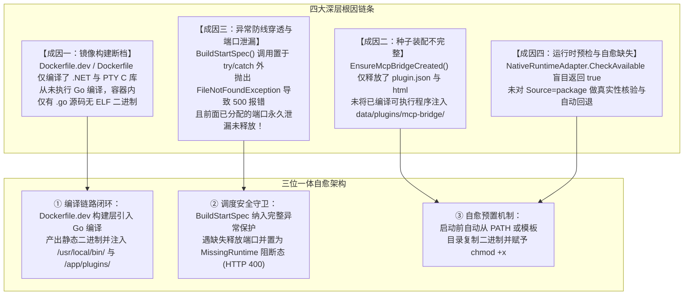

# 原生插件二进制缺失根因剖析、生命周期自愈与端口防泄漏架构治理方案

> **文件标识**：`docs/mcp-bridge-native-binary-resolution-and-lifecycle-safety-plan.md`  
> **问题现象**：在插件中心点击「MCP 智能安全网关桥接服务」启动时，前端抛出 `✕ 服务器内部错误：原生程序文件不存在: /app/data/plugins/mcp-bridge/mcp-bridge` (HTTP 500)。  
> **核心目标**：根因剖析、借鉴业界主流方案、复用现有系统底座、落地端到端解决方案，并建立架构守卫门禁与防回归测试，杜绝同类问题再次发生。

---

## 1. 现象复盘与深层根因剖析 (Root Cause Analysis)

### 1.1 现象复盘
管理员在插件中心（`http://10.126.1.70:5271/app/#/plugins`）点击 `mcp-bridge` 插件的「▶ 启动」按钮后：
1. 界面弹出高危的红色报错：`✕ 服务器内部错误：原生程序文件不存在: /app/data/plugins/mcp-bridge/mcp-bridge`；
2. HTTP 状态码为 **500 Internal Server Error**；
3. 后端日志显示未捕获的 `System.IO.FileNotFoundException` 击穿了生命周期调度引擎，冒泡至 ASP.NET Core 全局异常中间件。

### 1.2 四大深层根因诊断



1. **镜像构建与交付断档（Pipeline Incompleteness）**：
   - `mcp-bridge` 是采用 Go 语言开发的**编译型原生微服务**，必须先经过 `go build` 针对目标平台（Alpine Linux x86_64）交叉编译为独立的 ELF 二进制；
   - 现有的 `Dockerfile.dev` 与 `Dockerfile` 仅执行了 .NET 的 `dotnet publish` 与 C 动态库编译，**完全遗漏了 Go 模块编译步骤**。导致容器内仅存在文本源码，根本不存在编译产物。
2. **种子装载机制只落元数据、不落可执行制品（Metadata-only Seeding）**：
   - [`PluginManager.Defaults.cs`](file:///e:/WorkProject/CSharp/PrivateProject/Web/WebToolForLinux/src/LinuxWebTool.Infrastructure/Features/Plugins/PluginManager.Defaults.cs#L528) 中的 `EnsureMcpBridgeCreated()` 只往 `/app/data/plugins/mcp-bridge/` 写入了 `plugin.json` 和静态 HTML，没有把二进制一并带入，导致初始化出来的插件实际上是“空壳”。
3. **调度引擎异常边界遗漏与端口泄漏高危隐患（Resource Leakage & Exception Bubble）**：
   - 在 [`ResidentExecutionStrategy.cs`](file:///e:/WorkProject/CSharp/PrivateProject/Web/WebToolForLinux/src/LinuxWebTool.Infrastructure/Features/Plugins/Strategies/ResidentExecutionStrategy.cs#L67)：
     ```csharp
     allocatedPort = portManager.AllocatePort(manifest.Id, manifest.Network.Port); // ① 端口已分配
     stateMachine.NotifyStarting(runId);                                          // ② 状态已变迁为 Starting
     var spec = adapter.BuildStartSpec(manifest, pluginDir, allocatedPort);       // ③ 抛出 FileNotFoundException！
     try { ... } catch { ... }                                                   // ④ try-catch 竟在这一步之后！
     ```
   - 异常直接逃逸导致两重严重破坏：
     - **破坏一：HTTP 500 击穿**：预期内的文件缺失未转为结构化业务错误（HTTP 400），反而伪装成宿主崩溃抛给前端；
     - **破坏二：动态端口永久泄漏**：端口在第 ① 步已被计入 `_allocatedPorts`，由于异常跳过了后续逻辑，**此端口永久无法被释放或复用**，严重消耗系统有限的网络端口资源。
4. **适配器盲信与自愈缺失（Blind Adapter & Zero Self-Healing）**：
   - [`NativeRuntimeAdapter.cs`](file:///e:/WorkProject/CSharp/PrivateProject/Web/WebToolForLinux/src/LinuxWebTool.Infrastructure/Features/Plugins/Adapters/PluginRuntimeAdapters.cs#L410) 的 `CheckAvailable` 默认一律返回 `true`，未提供对可执行文件的先验性探测（Pre-flight Check）；
   - 且当 `/app/data/plugins/mcp-bridge/mcp-bridge` 缺失时，未尝试从预置模板 `/app/plugins/mcp-bridge/mcp-bridge` 或系统 PATH 中自动拷贝或降级，缺乏自愈弹性。

---

## 2. 业界主流方案对标与开源库选型

### 2.1 业界主流方案横向对标

| 体系 / 平台 | 原生二进制插件管理方式 | 缺失处理与自愈策略 | 资源生命周期保护 (防泄漏) |
| :--- | :--- | :--- | :--- |
| **Docker / Kubernetes** | 容器镜像分层构建，二进制直接固化于镜像内部或 InitContainers 预先注入。 | Pod 处于 `CrashLoopBackoff` 或 `ImagePullBackOff` 阻断态，不分配路由 Endpoint。 | 未就绪前不分配 ClusterIP 端口转发，防止僵尸转发规则残留。 |
| **Home Assistant** | Add-on 预先针对各 CPU 架构交叉编译为独立镜像，由 Supervisor 统一挂载。 | 依赖缺失在安装期阻断（Pre-install Guard），严禁进入 Run 阶段。 | 容器未 Healthy 前，Ingress 路由不暴露端口映射，生命周期事务回滚。 |
| **HashiCorp Plugin** | 插件二进制存放于指定路径（如 `~/.terraform.d/plugins`），主进程通过握手协议连接。 | 启动时先做 `os.Stat` 检查，文件不存在立即返回规范的 Error Envelope，不抛 Panic。 | 连接失败时主动清除 TCP 回环 Listener 与安全 Token 文件。 |
| **VS Code Extensions** | 发布包 (`.vsix`) 预打包对应平台架构可执行二进制。 | 扩展宿主进程检查二进制，若架构不匹配或缺失提示下载安装。 | 激活失败执行 `deactivate()` 钩子清理资源。 |

### 2.2 现有系统基础设施 100% 复用
本次治理完全复用现有系统基础设施，零增加额外开销：
1. **端口治理**：[`PluginPortManager.ReleasePort(string pluginId)`](file:///e:/WorkProject/CSharp/PrivateProject/Web/WebToolForLinux/src/LinuxWebTool.Infrastructure/Features/Plugins/Supervisor/PluginPortManager.cs)；
2. **状态机阻断**：[`PluginStateMachine.MarkMissingRuntime(string reason)`](file:///e:/WorkProject/CSharp/PrivateProject/Web/WebToolForLinux/src/LinuxWebTool.Infrastructure/Features/Plugins/Supervisor/PluginStateMachine.cs)；
3. **日志环形缓冲**：[`PluginProcessRingBuffer.Append(string log)`](file:///e:/WorkProject/CSharp/PrivateProject/Web/WebToolForLinux/src/LinuxWebTool.Infrastructure/Features/Plugins/Supervisor/PluginProcessRingBuffer.cs)；
4. **PATH 探测能力**：[`NodeRuntimeAdapter.IsExecutableInPath(string exe)`](file:///e:/WorkProject/CSharp/PrivateProject/Web/WebToolForLinux/src/LinuxWebTool.Infrastructure/Features/Plugins/Adapters/PluginRuntimeAdapters.cs#L23)；
5. **本地打包与跨平台编译**：[`scripts/package-mcp-bridge.ps1`](file:///e:/WorkProject/CSharp/PrivateProject/Web/WebToolForLinux/scripts/package-mcp-bridge.ps1)。

---

## 3. 具体实施与自愈设计方案

### 3.1 调度引擎异常保护与端口防泄漏（Defensive Execution Pipeline）
在 [`ResidentExecutionStrategy.cs`](file:///e:/WorkProject/CSharp/PrivateProject/Web/WebToolForLinux/src/LinuxWebTool.Infrastructure/Features/Plugins/Strategies/ResidentExecutionStrategy.cs) 中建立生命周期事务安全防线：
```csharp
PluginStartSpec spec;
try
{
    spec = adapter.BuildStartSpec(manifest, pluginDir, allocatedPort);
}
catch (FileNotFoundException ex)
{
    // 关键自愈与资源释放：发生文件缺失时，立即释放已分配的端口！
    if (allocatedPort.HasValue) portManager.ReleasePort(manifest.Id);
    var err = $"原生程序文件不存在: {ex.Message}";
    stateMachine.MarkMissingRuntime(err);
    ringBuffer.Append($"[{DateTime.Now:HH:mm:ss}] [ERROR] {err}");
    return ValueTask.FromResult((false, (string?)err));
}
catch (Exception ex)
{
    if (allocatedPort.HasValue) portManager.ReleasePort(manifest.Id);
    stateMachine.RecordExit(-1, runId, ex.Message);
    ringBuffer.Append($"[{DateTime.Now:HH:mm:ss}] [ERROR] 构造启动参数异常: {ex.Message}");
    return ValueTask.FromResult((false, (string?)$"构造启动参数异常: {ex.Message}"));
}
```

### 3.2 适配器跨路径自动探查与自愈复制（Self-Healing Resolver）
在 [`NativeRuntimeAdapter.cs`](file:///e:/WorkProject/CSharp/PrivateProject/Web/WebToolForLinux/src/LinuxWebTool.Infrastructure/Features/Plugins/Adapters/PluginRuntimeAdapters.cs) 中实现三级自愈解析：
1. **一级解析（运行目录直查）**：检查 `Path.Combine(pluginDir, targetRef)`；
2. **二级解析（系统 PATH 直查）**：若在环境变量 PATH 中（如 `/usr/local/bin/mcp-bridge`），直接返回可执行命令名；
3. **三级自愈（预置模板目录自愈拷贝）**：检查系统静态预置目录（如 `/app/plugins/{manifest.Id}/{targetRef}`），若发现存在，自动拷贝至 `pluginDir` 并通过 POSIX 调用或 `chmod +x` 赋予可执行权限后返回路径。

### 3.3 容器镜像构建阶段闭环编译（Multi-Stage Image Compilation）
1. 在 `Dockerfile.dev` 的 `build` 阶段安装 `go` 编译器（`apk add --no-cache build-base go`）；
2. 增加编译指令：
   ```dockerfile
   RUN cd plugins/mcp-bridge && CGO_ENABLED=0 go build -ldflags "-s -w" -o /app/publish/mcp-bridge ./cmd/mcp-bridge
   ```
3. 在 `final` 运行阶段将编译好的二进制直接复制到系统标准命令路径 `/usr/local/bin/mcp-bridge`，并赋予 `chmod +x`，实现开箱即用。

---

## 4. 架构门禁加固与防回归测试规范

在 `tests/LinuxWebTool.ArchitectureTests/ArchitectureTests.cs` 中新增以下架构守卫门禁：

1. **`LinuxArch038_原生插件调度生命周期异常保护与端口防泄漏门禁`**：
   - 静态分析 `ResidentExecutionStrategy.cs` 源码；
   - 断言 `adapter.BuildStartSpec` 必须置于包含 `portManager.ReleasePort` 的 `try/catch` 结构中；
   - 断言发生 `FileNotFoundException` 时严禁直接向上逃逸，必须通过 `MarkMissingRuntime` 将状态机置为受控阻断态。
2. **`LinuxArch039_极速开发镜像必须闭环构建原生微服务二进制门禁`**：
   - 断言 `Dockerfile.dev` 中必须包含针对 `plugins/mcp-bridge` 的编译命令（`go build`）；
   - 断言运行阶段必须将编译产物复制至 `/usr/local/bin/` 并赋予可执行权限。
