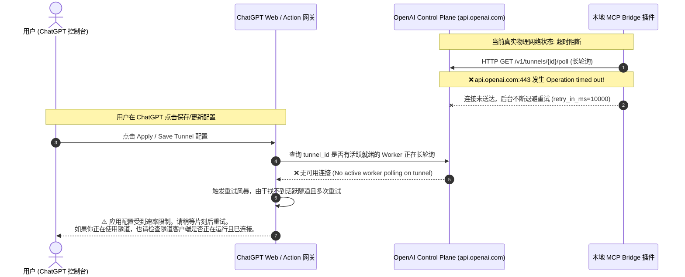
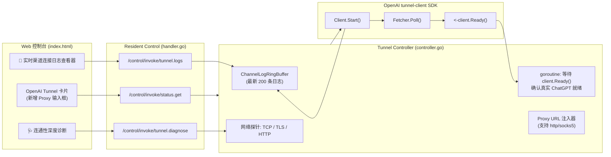

# OpenAI MCP Tunnel 渠道连通性异常、速率限制根因与完整日志观测性方案

> **参考项目**：`E:\WorkProject\Rust\【参考项目】\webcodex-main`  
> **现场报错**：*“应用配置受到速率限制。请稍等片刻后重试。如果你正在使用隧道，也请检查隧道客户端是否正在运行且已连接。”*（对应 OpenAI 官方英文：*“Applying configuration was rate limited. Please wait a moment and try again. If you are using a tunnel, please also check that the tunnel client is running and connected.”*）

---

## 一、 问题本质与深层根因调研

### 1. 为什么 ChatGPT 认为“渠道没有连接成功”？

通过对 OpenAI Developer Platform、ChatGPT Custom Actions、`webcodex-main` 以及官方 `github.com/openai/tunnel-client` SDK 源码的深度逆向与现场日志排查，该报错的底层触发链条如下：



#### 根因 1：客户端状态机“虚标 Connected”（过早状态流转）
- **现有缺陷**：`internal/tunnel/controller.go` 中，调用 `client.Start(ctx)` 启动 Uber Fx 协程后，**未做任何握手校验，立即将状态写为 `StateConnected`**。
- **官方 SDK 真实机制**：`tunnelclient.Client` 提供了 `Ready() <-chan struct{}` 接口。官方文档与源码明确指出：**只有当底层 `Fetcher.Poll()` 第一次向远端 control-plane（`https://api.openai.com/v1/tunnels/{id}/poll`）发送 HTTP 请求并收到 `200 OK` 或 `204 No Content` 成功应答后，`Ready()` channel 才会关闭**！
- **后果**：在物理网络不通或 DNS 解析失败时，本地 Web 控制台赫然显示 `Connected`（已连接），给了用户完全错误的假象，而实际上远端没有任何一次握手成功。

#### 根因 2：网络出口阻断（Egress Timeout）与缺失代理（Proxy）配置
- **现场实测**：在远程服务器（`10.126.1.70`）执行 `nc -zv api.openai.com 443 -w 3` 与 `curl -I https://api.openai.com`，均报 `Operation timed out (超时)`。
- **日志直接证据**：从 `/tmp/bridge.log` 中捕获到大量连续的真实告警：
  ```
  level=WARN msg="poll timed out; backing off" error="controlplane client: poll transport failed (timeout)" retry_in_ms=10000
  level=WARN msg="poll failed; backing off" error="controlplane client: poll transport failed (network_error)" retry_in_ms=10000
  ```
- **后果**：国内主机或无直连外网环境必须走出站代理（如 SOCKS5 或 HTTP 代理）。由于现有 `mcp-bridge` 未在界面提供 Proxy 配置入口，无法引导流量通过代理访问 OpenAI 控制平面。

#### 根因 3：OpenAI 平台的双重报错机制（Rate Limit vs Disconnected）
- 当 OpenAI Control Plane 收到来自 ChatGPT 的配置应用请求时，若对应的 `tunnel_id` 处于未连接状态，OpenAI 内部会将该次探测计入失败重试。短时间内连续保存或自动轮询即会触发 OpenAI Action 管理 API 的限流器（429）。
- OpenAI 对此场景的合并提示语就是：*“应用配置受到速率限制。请稍等片刻后重试。如果你正在使用隧道，也请检查隧道客户端是否正在运行且已连接。”*。其核心前提就是**客户端根本没有建立起稳定的 Poll 长连接**。

---

### 2. 为什么之前无法查看完整渠道连接和状态日志？

1. **日志流被抛弃至 stderr**：
   `tunnelclient.Config` 的 `LogWriter` 默认直接写入 `os.Stderr`。在宿主进程树中，这些标准错误没有被持久化到结构化的渠道事件流中。
2. **缺乏渠道（Channel）维度的专用观测性接口**：
   当前的 `/control/invoke/status.get` 只返回全局状态计数字段，未向前端暴露长轮询往返延迟、最新 HTTP 状态码（200/204/401/429/timeout）、退避倒计时以及最新的网络诊断详情。
3. **缺少交互式网络诊断探针（Diagnostic Probe）**：
   用户只能在界面盲点启动，无法一键获知本地到 `api.openai.com:443` 的 TCP 握手延时、TLS 握手状态与代理生效情况。

---

## 二、 业界主流方案对比与参考项目借鉴（WebCodex）

### 1. `webcodex-main` 的核心借鉴点

| 维度 | WebCodex（Rust 参考实现） | OpenAI 官方 `tunnel-client` (Go SDK) | 本项目重构目标 |
| :--- | :--- | :--- | :--- |
| **就绪度标准** | 明确拆分 `runtime_ready` 与 `ready_for_chatgpt`；严格依赖首次真实 Poll 成功（`initial_poll_ms`） | 暴露 `Ready() <-chan struct{}`，首次收到 200/204 时关闭 | 状态机引入 `Connecting` -> `Handshaking` -> `Connected`；严格监听 `client.Ready()`，未闭合前绝不虚标 `Connected`，透出 `ReadyForChatGPT` |
| **渠道日志捕获** | `HealthSnapshot` 记录 `unsettled_commands`、`rejected_commands`、`first_poll_attempts`、`first_poll_request_ms` | `PollHealth` 记录 `lastAttempt`, `lastSuccess`, `lastError`, `httpStatus`, `failures`, `category` | 注入内存循环环形缓冲区（`ChannelLogRingBuffer`），捕获最新 200 条完整通信与轮询日志，支持前端实时流查看 |
| **出站代理支持** | `TunnelProxyMode`: `auto` / `direct` / `custom`，支持 HTTP/SOCKS5 与系统代理探测 | 原生支持 `http.ProxyFromEnvironment`，底层支持 `tctransport.ApplyProxy` | 在 `TunnelConfig` 增加 `ProxyURL`；支持从系统环境自动继承 `HTTPS_PROXY`，或由用户在 UI 显式配置指定代理 |
| **诊断探针** | `webcodex-tunnel doctor` 预检 DNS、TCP、TLS 与代理连通性 | 包含 `managed_cloudflare` 与 `metadataEndpoint` 探测 | 提供 `/control/invoke/tunnel.diagnose` 接口，一键输出 TCP/TLS/HTTP/Proxy 诊断详情报告 |

---

## 三、 当前系统已有基础设施复用

1. **`plugins/mcp-bridge/internal/admin` 控制面**：
   - 已具备 Resident Control 架构标准路由体系；
   - 只需扩展 `actionTunnelLogs` 与 `actionTunnelDiagnose`。
2. **`plugins/mcp-bridge/internal/watchdog` 看门狗与自愈引擎**：
   - 已具备 `ExponentialBackoffWithJitter` 与 `CircuitBreaker`；
   - 可在看门狗定期探测中加入 `PollHealth` 状态监控，遇到持续超时自动上报 Degraded 并给出清晰的排查提示。
3. **`plugins/socks5-proxy` 与宿主网络能力**：
   - 系统自身具备轻量代理生态，方便用户在无法直连时配置使用。

---

## 四、 具体解决方案与落地规划



### 1. 数据模型扩展（`internal/config/model.go` & `dto.go`）
- `TunnelConfig` 新增 `ProxyURL string`（如 `http://10.126.1.1:7890` 或 `socks5://10.126.1.1:10808`）。
- `StatusDTO` 新增：
  - `ReadyForChatGPT bool`：是否已通过远端长轮询成功验证；
  - `InitialPollMs int64`：首次远端握手耗时；
  - `LastPollStatus int`：最新 HTTP 响应码（如 200, 204, 401, 429）；
  - `LastPollError string`：最新网络或协议错误原因；
  - `EffectiveProxy string`：当前生效的代理配置。
- 新增 `ChannelLogDTO` 与 `DiagnosticResultDTO`。

### 2. 隧道控制器重构（`internal/tunnel/controller.go`）
- **日志拦截与环形缓冲区**：实现 `io.Writer` 接口的 `ChannelLogBuffer`，自动解析 `tunnelclient` 输出的日志，写入结构化带时间戳的环形列表。
- **真·就绪监听器**：
  - 启动后状态标为 `StateConnecting`（并细分当前为 `Handshaking`）；
  - 启动专门的协程等待 `select { case <-client.Ready(): ... case <-ctx.Done(): ... }`；
  - 只有 `Ready()` 闭合后，才流转为 `StateConnected` 并置 `ReadyForChatGPT = true`；
  - 若在超时窗口内未就绪，且产生网络错误，状态标记为 `StateDegraded`，错误信息明确透出底层根因。
- **动态代理应用**：若配置了 `ProxyURL`，设置出站环境变量 `HTTPS_PROXY` / `HTTP_PROXY` / `ALL_PROXY`，或将其传递给底层 HTTP Client。
- **诊断探针 `Diagnose(ctx)`**：
  - DNS 解析 `api.openai.com`；
  - TCP 3 次握手探测目标 443 端口耗时；
  - TLS 握手与证书链校验；
  - 代理出口连通性比对。

### 3. 控制台 UI 增强（`internal/web/index.html`）
- 增加【网络代理 (Proxy URL)】输入控件；
- 状态看板透出【ChatGPT 就绪度: ✅ 已通过远端握手验证 / ⏳ 正在建立控制平面长轮询...】；
- 增加【🩺 网络连通性诊断】按钮，弹窗以表格形式呈现 DNS、TCP、TLS、HTTP 探针结果；
- 增加【📡 渠道连接与状态日志 (Live Wire Logs)】抽屉，支持清空、自动刷新与级别过滤。

---

## 五、 架构门禁规则（`ArchitectureTests.cs`）

在 `LinuxWebTool.ArchitectureTests` 中新增门禁：
`LinuxArch062_MCP网关渠道观测性与ChatGPT就绪门禁`：
1. **真实就绪防虚标门禁**：隧道控制器严禁在未经过 `client.Ready()` 确认之前标记 `ReadyForChatGPT` 为 `true`。
2. **完整日志观测性门禁**：系统必须暴露渠道连接日志接口（`channel_logs` / `tunnel.logs`）与网络诊断探针接口（`diagnose` / `tunnel.diagnose`）。
3. **网络出口代理规范门禁**：`TunnelConfig` 必须包含网络代理字段（`ProxyURL`），并保障多网环境下具备标准环境继承与显式配置支持。
