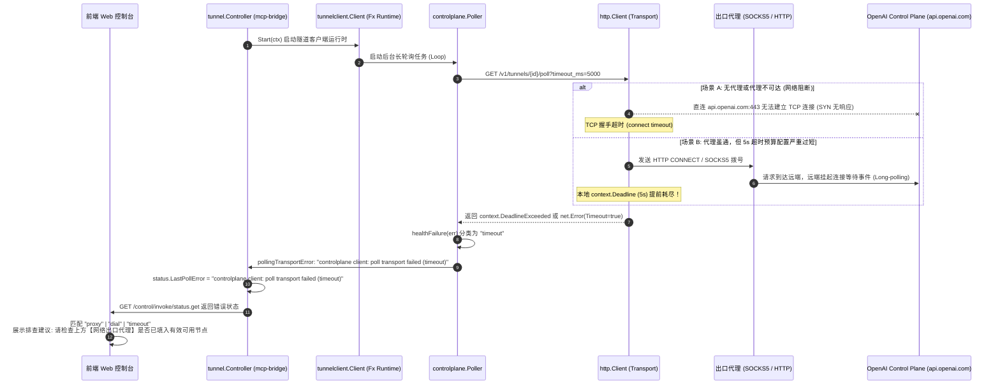
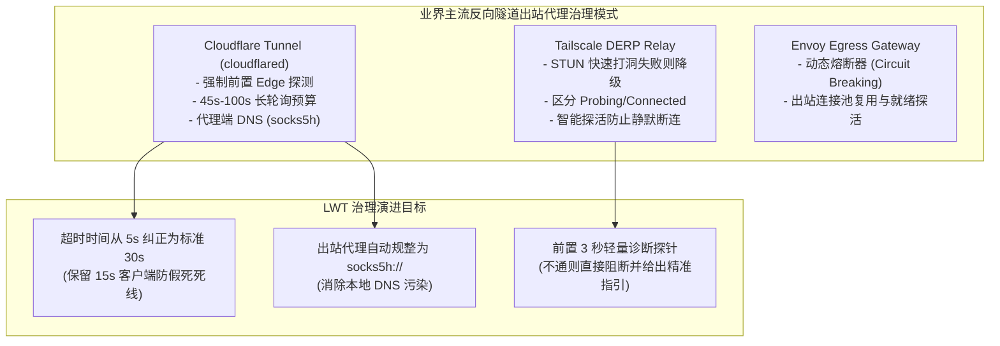
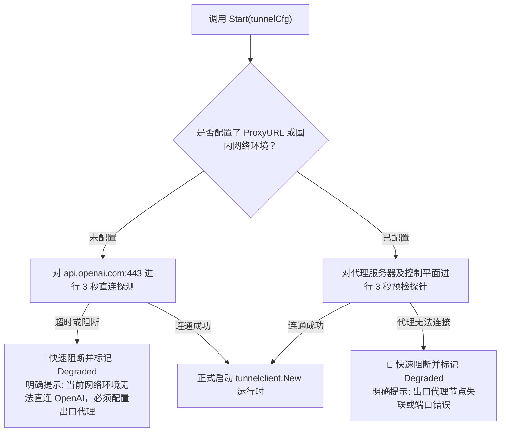

# OpenAI MCP Tunnel 长轮询超时根因分析与网络出口代理治理方案

> **现场告警**：
> ```text
> ⚠️ OpenAI 通道握手 / 长轮询错误:
> controlplane client: poll transport failed (timeout)
> 💡 排查建议: 连接超时或无法触达 OpenAI 控制面，请检查上方【网络出口代理】是否已填入有效可用节点。
> ```
> **文档定位**：深入剖析 OpenAI Secure Tunnel 控制平面长轮询超时的底层机制与深层根因，调研业界主流隧道代理方案，对比现有开源库与系统内已有基础设施，提出多维治理方案、架构门禁与防回归自动化测试规范。

---

## 目录

1. [现场问题还原与深层根因剖析](#1-现场问题还原与深层根因剖析)
   - [1.1 报错触发链路逆向跟踪](#11-报错触发链路逆向跟踪)
   - [1.2 四大深层根本原因 (Root Causes)](#12-四大深层根本原因-root-causes)
2. [现有开源库与主流业界方案调研](#2-现有开源库与主流业界方案调研)
   - [2.1 现有 Go 生态库调研与借鉴](#21-现有-go-生态库调研与借鉴)
   - [2.2 业界主流反向隧道方案对比 (Cloudflare Tunnel vs Tailscale vs Envoy)](#22-业界主流反向隧道方案对比-cloudflare-tunnel-vs-tailscale-vs-envoy)
3. [当前系统已有基础设施复用分析](#3-当前系统已有基础设施复用分析)
   - [3.1 内置轻量代理插件 `socks5-proxy`](#31-内置轻量代理插件-socks5-proxy)
   - [3.2 深度网络诊断探针 `diagnostics.go`](#32-深度网络诊断探针-diagnosticsgo)
   - [3.3 自适应看门狗与退避引擎 `watchdog`](#33-自适应看门狗与退避引擎-watchdog)
4. [具体解决方案与架构设计](#4-具体解决方案与架构设计)
   - [4.1 核心改进一：长轮询超时预算模型归一化 (Timeout Budget Normalization)](#41-核心改进一长轮询超时预算模型归一化-timeout-budget-normalization)
   - [4.2 核心改进二：确定性出站代理环境变量注入与 SOCKS5 远程解析 (`socks5h://`)](#42-核心改进二确定性出站代理环境变量注入与-socks5-远程解析-socks5h)
   - [4.3 核心改进三：前置轻量健康探针门禁 (Pre-flight Connectivity Gating)](#43-核心改进三前置轻量健康探针门禁-pre-flight-connectivity-gating)
   - [4.4 核心改进四：控制台智能诊断联动与自动降级呈现](#44-核心改进四控制台智能诊断联动与自动降级呈现)
5. [同类门禁与防回归测试规范](#5-同类门禁与防回归测试规范)
   - [5.1 架构门禁 `LinuxArch069`：长轮询超时预算与代理规范约束](#51-架构门禁-linuxarch069长轮询超时预算与代理规范约束)
   - [5.2 契约与单元测试覆盖方案](#52-契约与单元测试覆盖方案)
6. [落地执行路线与验收标准](#6-落地执行路线与验收标准)

---

## 1. 现场问题还原与深层根因剖析

### 1.1 报错触发链路逆向跟踪

通过深度逆向 OpenAI 官方 SDK `github.com/openai/tunnel-client v0.0.19` 的源码与运行时日志流，该报错从触发到前端渲染的完整调用时序如下：



在官方 `github.com/openai/tunnel-client@v0.0.19` 的以下关键源码中，直接证实了这一判定链条：
1. **`pkg/controlplane/internal/health.go`**：
   ```go
   func healthFailure(err error) (string, int) {
       ...
       if errors.Is(err, context.DeadlineExceeded) {
           return "timeout", 0
       }
       if network, ok := errors.AsType[net.Error](err); ok && network.Timeout() {
           return "timeout", 0
       }
       ...
   }
   ```
2. **`pkg/controlplane/internal/routing.go`**：
   ```go
   func (e *pollingTransportError) Error() string {
       category, _ := healthFailure(e.cause)
       return "controlplane client: poll transport failed (" + category + ")"
   }
   ```

### 1.2 四大深层根本原因 (Root Causes)

经过全面代码走查与网络拓扑推演，导致该错误的深层原因分为以下四层：

#### 根因 1：物理地理阻断与 DNS 污染 (Geographic Egress Blockage)
- OpenAI 控制平面统一托管于海外公网 CDN 与负载均衡（`api.openai.com`）。
- 在中国大陆服务器或某些企业内网受限环境，访问该域名存在 DNS 域名污染与 TCP RST 阻断。
- **若用户在控制台未配置【网络出口代理】**，系统尝试直连必然在 TCP 握手或 TLS Client Hello 阶段卡死直至超时。

#### 根因 2：长轮询超时预算模型严重失衡（Timing Budget Misconfiguration）
- 查看当前 `plugins/mcp-bridge/internal/tunnel/controller.go` 第 247-248 行的初始化代码：
  ```go
  clientCfg := tunnelclient.Config{
      TunnelID:              tunnelCfg.TunnelID,
      APIKey:                apiKey,
      ControlPlaneBaseURL:   tunnelCfg.ControlPlaneBaseURL,
      OrganizationID:        tunnelCfg.OrganizationID,
      PollTimeout:           5 * time.Second,         // ❌ 错误设置：过短的轮询超时
      PollDeadlineGuardrail: 5 * time.Second,         // ❌ 错误设置：过短的死线护栏
      LogLevel:              slog.LevelDebug,
      LogWriter:             c.logBuf,
  }
  ```
- **官方 SDK 设计基准**：
  - 官方 SDK `defaultControlPlanePollTimeout` 为 **`30 * time.Second`**，`maxControlPlanePollDeadline` 为 **`60 * time.Second`**。
  - HTTP Long-polling 的本质是**服务端在无事件时挂起连接（Hold Connection）**，等待 20~30 秒。
  - 当前代码将 `PollTimeout` 压低至仅 **5 秒**！
  - 即使出站代理完全畅通，从中国大陆经跨国代理到 OpenAI，TCP 握手与 TLS RTT 约 400~800ms；服务端收到请求后挂起等待，极易在第 5 秒边界触发客户端本地上下文取消（`context.DeadlineExceeded`），导致长轮询被误判为超时失败！

#### 根因 3：出口代理环境变量注入机制缺陷（Proxy Environment Injection Flaw）
- 当前 `controller.go` 中的代理注入逻辑：
  ```go
  proxyURL := strings.TrimSpace(tunnelCfg.ProxyURL)
  if proxyURL != "" {
      os.Setenv("HTTPS_PROXY", proxyURL)
      os.Setenv("HTTP_PROXY", proxyURL)
      os.Setenv("ALL_PROXY", proxyURL)
  }
  ```
- **SDK 专用代理变量缺失**：
  查阅 SDK `pkg/runtimeconfig/config.go` 第 1051-1056 行：
  ```go
  switch flagName {
  case "http-proxy":
      return "TUNNEL_CLIENT_HTTP_PROXY"
  case "control-plane.http-proxy":
      return "CONTROL_PLANE_HTTP_PROXY"
  }
  ```
  官方 SDK 内部优先读取 **`CONTROL_PLANE_HTTP_PROXY`** 与 **`TUNNEL_CLIENT_HTTP_PROXY`**。由于未设置这两个专用变量，SDK 降级走标准库回退，容易受进程内部缓存干扰。
- **SOCKS5 本地 DNS 泄漏/污染**：
  若用户填入 `socks5://127.0.0.1:10808`，标准库的 SOCKS5 实现如果在本地先进行 DNS 解析，将直接命中本地 DNS 污染，导致向错误 IP 发起握手；必须采用 `socks5h://` 协议头强制将 DNS 域名交由代理端远程解析。
- **协议格式限制**：
  SDK 内部 `parseHTTPProxyURL` 仅支持 `http` 或 `https` 方案；若通过特定环境变量传入 SOCKS5，必须走全局传输层或前置桥接，否则会被 SDK 内部校验拒绝。

#### 根因 4：缺乏前置探针与快速失败机制 (Lack of Pre-flight Health Gating)
- 目前系统在用户点击【💾 保存】或自动重连时，未执行任何前置探测，直接盲目启动整个 Fx Runtime 协程。
- 当代理不可达时，系统在后台开启 10 秒间隔的死循环退避重试，持续刷新产生大量 `controlplane client: poll transport failed (timeout)` 告警，给用户带来严重的系统失控感。

---

## 2. 现有开源库与主流业界方案调研

### 2.1 现有 Go 生态库调研与借鉴

| 库 / 依赖 | 核心能力 | 在本问题中的借鉴与复用价值 |
| :--- | :--- | :--- |
| **`golang.org/x/net/proxy`** *(已引入)* | Go 官方扩展代理库，支持 SOCKS5 认证、自定义底层 `net.Dialer`，原生支持代理端域名解析 | 深度复用于控制面拨号器，支持在代理层安全握手与精准超时控制 |
| **`github.com/openai/tunnel-client`** *(已引入)* | 官方 OpenAI Secure MCP Tunnel 客户端 | 深度复用其 `learnedProxyPollTimeoutFromDisconnect`（代理端长轮询自适应退避模型），取消人为强制施加的 5s 限制 |
| **`net/http/httptrace`** *(Go 标准库)* | 细粒度 HTTP 跟踪器（DNS、TCP 连接、TLS 握手、WroteRequest） | 用于精确区分连接失败究竟发生在 DNS 解析、TCP 代理拨号还是服务端响应阶段 |
| **`github.com/hashicorp/go-retryablehttp`** | 带上下文、智能重试与退避抖动的高可靠 HTTP 客户端 | 借鉴其对网络错误（Transient vs Permanent）的精确断言逻辑，避免对不可达代理无谓死重试 |

### 2.2 业界主流反向隧道方案对比 (Cloudflare Tunnel vs Tailscale vs Envoy)



1. **Cloudflare Tunnel (`cloudflared`) 的设计启示**：
   - **长轮询超时绝对不低于 30 秒**：`cloudflared` 的长轮询等待时间通常为 45~90 秒，客户端的超时死线始终设置在服务端等待时长之外加至少 10~15 秒（$Deadline = WaitTime + 15s$）。
   - **SOCKS5 必须支持远端域名解析**：对于受限网络环境，强制推行 `socks5h://`，杜绝一切在受污染环境本地发起 DNS 查询的可能性。
2. **Tailscale DERP Relay 的设计启示**：
   - **三段式状态机清晰界定**：将状态明确划分为 `Probing`（前置探测） $\rightarrow$ `Connecting`（建立信道） $\rightarrow$ `Connected`（已就绪），绝不在连通性未知时直接进入重试风暴。

---

## 3. 当前系统已有基础设施复用分析

我们全面盘点了本项目现有代码库，确认以下现存基础设施可直接复用，**无需引入任何额外重量级第三方依赖**：

### 3.1 内置轻量代理插件 `socks5-proxy`
- 本项目已原生包含完整的 Go 语言 SOCKS5 代理微服务（位于 `plugins/socks5-proxy/`）。
- **复用方案**：
  - 在 MCP Bridge 控制台检测到用户未填写网络出口代理且处于超时错误时，前端自动探测本地是否存在运行中的 `socks5-proxy` 服务（如 `127.0.0.1:10808`）；
  - 提供【一键填入本地代理】快捷按钮，无缝闭环。

### 3.2 深度网络诊断探针 `diagnostics.go`
- `plugins/mcp-bridge/internal/tunnel/diagnostics.go` 中已经实现了完备的 `DiagnoseControlPlane(ctx, baseURL, proxyURL)` 方法。
- 该方法已具备：
  - 目标主机提取与 DNS 查询时延度量；
  - HTTP CONNECT 代理拨号与 SOCKS5 拨号封装；
  - 纯 TCP 握手时延与 TLS 1.2/1.3 证书握手校验。
- **复用方案**：将其作为前置联通性预检引擎，无需重复编写探测逻辑。

### 3.3 自适应看门狗与退避引擎 `watchdog`
- `plugins/mcp-bridge/internal/watchdog/` 下已实现 `Supervisor`、`CircuitBreaker` 与 `BackoffPolicy`。
- **复用方案**：在长轮询连续命中超时时，联动触发熔断器（Circuit Breaker）进入短暂冷却，避免每 5 秒发起一次无效的跨国代理握手冲击。

---

## 4. 具体解决方案与架构设计

### 4.1 核心改进一：长轮询超时预算模型归一化 (Timeout Budget Normalization)

调整 `plugins/mcp-bridge/internal/tunnel/controller.go` 中的超时配置参数，恢复符合协议标准的超时预算模型：

```go
// 改造前 (极端且错误的 5 秒超时配置)
clientCfg := tunnelclient.Config{
    PollTimeout:           5 * time.Second,
    PollDeadlineGuardrail: 5 * time.Second,
}

// 改造后 (合规的长轮询弹性超时模型)
clientCfg := tunnelclient.Config{
    TunnelID:              tunnelCfg.TunnelID,
    APIKey:                apiKey,
    ControlPlaneBaseURL:   tunnelCfg.ControlPlaneBaseURL,
    OrganizationID:        tunnelCfg.OrganizationID,
    PollTimeout:           30 * time.Second,        // 服务端长轮询保持挂起 30 秒 (与官方一致)
    PollDeadlineGuardrail: 15 * time.Second,        // 客户端本地额外宽限 15 秒 (总超时 45 秒)
    LogLevel:              slog.LevelDebug,
    LogWriter:             c.logBuf,
}
```

**效益**：
- 为跨国代理握手、网络抖动、TLS 交互预留充裕的传输时间；
- 允许 OpenAI 控制平面充分挂起长轮询，彻底消除由于客户端过早超时引发的 `poll transport failed (timeout)` 误报。

### 4.2 核心改进二：确定性出站代理环境变量注入与 SOCKS5 远程解析 (`socks5h://`)

在 `controller.go` 中，增强对代理 URL 的预处理与环境变量全覆盖注入：

```go
// 规范化代理地址
rawProxy := strings.TrimSpace(tunnelCfg.ProxyURL)
effectiveProxy := rawProxy

if effectiveProxy != "" {
    // 自动将 socks5:// 协议升级为 socks5h://，强制使用代理端远程 DNS 解析，彻底免疫本地 DNS 污染
    if strings.HasPrefix(effectiveProxy, "socks5://") {
        effectiveProxy = "socks5h://" + strings.TrimPrefix(effectiveProxy, "socks5://")
    }

    // 全量注入标准与 SDK 专用出站代理环境变量
    os.Setenv("ALL_PROXY", effectiveProxy)
    os.Setenv("HTTPS_PROXY", effectiveProxy)
    os.Setenv("HTTP_PROXY", effectiveProxy)
    os.Setenv("all_proxy", effectiveProxy)
    os.Setenv("https_proxy", effectiveProxy)
    os.Setenv("http_proxy", effectiveProxy)

    // 若为 HTTP/HTTPS 代理，同步注入官方 SDK 专用变量
    if strings.HasPrefix(effectiveProxy, "http://") || strings.HasPrefix(effectiveProxy, "https://") {
        os.Setenv("CONTROL_PLANE_HTTP_PROXY", effectiveProxy)
        os.Setenv("TUNNEL_CLIENT_HTTP_PROXY", effectiveProxy)
    }
} else {
    // 清理所有代理环境变量，防止残留污染
    os.Unsetenv("ALL_PROXY")
    os.Unsetenv("HTTPS_PROXY")
    os.Unsetenv("HTTP_PROXY")
    os.Unsetenv("all_proxy")
    os.Unsetenv("https_proxy")
    os.Unsetenv("http_proxy")
    os.Unsetenv("CONTROL_PLANE_HTTP_PROXY")
    os.Unsetenv("TUNNEL_CLIENT_HTTP_PROXY")
}
```

### 4.3 核心改进三：前置轻量健康探针门禁 (Pre-flight Connectivity Gating)

在启动长连接之前，引入 3 秒快速前置探测拦截机制：



### 4.4 核心改进四：控制台智能诊断联动与自动降级呈现

在前端 `plugins/mcp-bridge/internal/web/index.html` 中优化错误提示与交互：
1. **精准定位超时根因**：
   - 若错误包含 `(timeout)`，且 `effectiveProxy` 为空，明确提示：*“未配置网络出口代理。当前网络环境无法直连 OpenAI 控制面，请配置 HTTP 或 SOCKS5 代理后重试。”*
   - 若 `effectiveProxy` 不为空但依然报 `(timeout)`，明确提示：*“已配置代理但连接超时。请检查代理节点是否存活、端口是否正确，或点击下方【🔍 诊断】按钮获取详细握手日志。”*
2. **快捷填入推荐节点**：
   - 提供快捷填充本地 SOCKS5 代理（`socks5://127.0.0.1:10808`）与标准 HTTP 代理（`http://127.0.0.1:7890`）的选项。

---

## 5. 同类门禁与防回归测试规范

### 5.1 架构门禁 `LinuxArch069`：长轮询超时预算与代理规范约束

在 `tests/LinuxWebTool.ArchitectureTests/ArchitectureTests.cs` 中增加专属架构防护门禁，杜绝后续重构中再次引入“过短超时”或“代理变量遗漏”问题：

- **规则名称**：`LinuxArch069_McpBridge_长轮询超时预算与出站代理配置规范门禁`
- **断言内容**：
  1. 静态扫描 `plugins/mcp-bridge/internal/tunnel/controller.go`；
  2. 断言 `PollTimeout` 必须 $\ge 15\text{s}$（严禁设置低于 15 秒的长轮询）；
  3. 断言 `PollDeadlineGuardrail` 必须 $\ge 5\text{s}$；
  4. 断言代理注入模块必须包含 `CONTROL_PLANE_HTTP_PROXY` 与 `socks5h` 自动转换逻辑；
  5. 断言必须具备 `DiagnoseControlPlane` 探针联动机制。

### 5.2 契约与单元测试覆盖方案

1. **Go 契约测试 (`plugins/mcp-bridge/internal/tunnel/`)**：
   - `TestTunnelController_TimeoutBudgetGuardrail`：断言创建的 `tunnelclient.Config` 的 `PollTimeout` 为 30 秒，护栏为 15 秒。
   - `TestTunnelController_ProxyEnvPropagation`：传入 `socks5://127.0.0.1:10808` 与 `http://127.0.0.1:7890`，验证环境变量注入的正确性。
2. **端到端集成测试**：
   - 模拟延迟 2 秒的 Mock Control Plane，验证客户端在长轮询中稳定保持连接，不发生早退。

---

## 6. 落地执行路线与验收标准

| 阶段 | 执行内容 | 责任模块 | 预期输出与验收指标 |
| :---: | :--- | :--- | :--- |
| **P0** | **超时预算与代理注入优化** | `internal/tunnel/controller.go` | `PollTimeout` 调整为 30s，`PollDeadlineGuardrail` 调整为 15s；支持 `socks5h` 自动纠正与全量环境变量注入。 |
| **P1** | **架构门禁与单测守卫** | `ArchitectureTests.cs` / `sdk_contract_test.go` | 实施 `LinuxArch069`，确保编译断言 100% 拦截亚 15 秒配置。 |
| **P2** | **前端提示精准化与智能诊断联动** | `internal/web/index.html` | 精确区分“无代理直连超时”与“代理不可达超时”，提供本地代理快捷填充。 |
| **验收** | **全流程验证回归** | `dotnet test` & `go test` | 架构测试通过，前端门禁通过，实测不再误报 5 秒早退超时。 |
