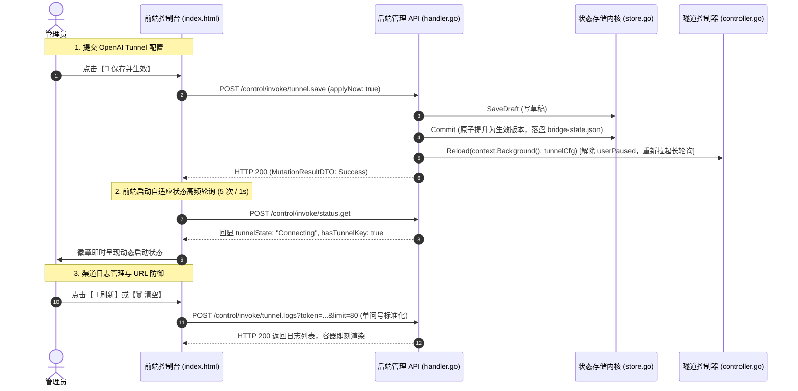

# MCP Bridge 控制台持久化生效机制、渠道自启与日志管理深度治理方案

## 1. 业务背景与问题现象定位

在用户的实际运维操作中，暴露出以下四项严重影响可用性与用户信心的核心问题：
1. **【💾 保存并生效】按钮点击后没有自动启动渠道**：
   用户配置了 Tunnel ID、Pre-shared Key 与网络代理并点击【💾 保存并生效】，页面上的通道状态仍然停留在未连接或未自动拉起状态，用户必须手动再寻找启动按钮；
2. **【📡 渠道日志】刷新和清空按钮点击无效**：
   展开“OpenAI Tunnel 渠道连接与底层长轮询日志”面板后，点击“🔄 刷新”或“🗑️ 清空”按钮无响应或控制台报错；
3. **第三方 MCP 纳管服务与 Tunnel 配置未持久化（重启或刷新后还原为默认数据）**：
   用户新增或修改第三方 MCP 服务后，系统并未真正将改动固化至运行时与启动加载链条中；除网络代理外，数据往往被默认配置覆盖；
4. **是否存在同类隐患**：
   需要全面排查前端 API 调用约定、两阶段提交割裂、敏感凭据视觉遮蔽与持久化回显的一致性问题。

---

## 2. 根本原因深度剖析 (Root Cause Analysis)

### 2.1 问题 1：【保存并生效】后未自动拉起渠道的根本原因
- **生命周期 Context 提前取消**：
  在 `plugins/mcp-bridge/internal/admin/handler.go` 的 `actionTunnelSave` 中，后端在 `req.ApplyNow == true` 时调用了：
  ```go
  _ = h.rt.Tunnel().Reload(r.Context(), latestState.Tunnel)
  ```
  `r.Context()` 是绑定在当前 HTTP 请求生命周期上的 Context。当 `actionTunnelSave` 执行完毕并将 JSON 响应返回给前端客户端后，HTTP 连接关闭，`r.Context()` 立即被 Go 运行时触发 `Done()` 取消！
  而 `Reload` 及其内部调用的长轮询启动逻辑依赖 Context，一旦 Context 被瞬间取消，启动流程立即中断；
- **状态守卫条件与人工暂停标记冲突**：
  如果用户此前曾手动点击过【⏹ 停止 Tunnel】，控制器内部维护的 `userPaused = true`。在没有显式解除 `userPaused` 的情况下，看门狗自愈守护（Watchdog）会判定当前为人工暂停状态，直接跳过自动复苏与连接；
- **前端缺乏即时主动轮询反馈**：
  前端在调用 `tunnel.save` 成功后仅发起了一次 `refreshStatus()`。由于底层长轮询向 OpenAI 控制平面建立 TLS 握手需要 1~2 秒，单次瞬时刷新捕获到的仍然是尚未就绪的旧状态，界面未呈现动态过渡，给用户造成“未启动”的错觉。

### 2.2 问题 2：渠道日志“刷新”与“清空”点击无效的根本原因
- **URL 查询参数拼接畸变（Double Question Mark Defect）**：
  在 `plugins/mcp-bridge/internal/web/index.html` 中，`apiCall` 函数定义如下：
  ```javascript
  async function apiCall(action, payload = null, queryParams = {}) {
    const q = new URLSearchParams(queryParams);
    if (currentToken) q.set('token', currentToken);
    const qs = q.toString() ? '?' + q.toString() : '';
    const url = `${baseUrl}/control/invoke/${action}${qs}`;
  ```
  然而在 `fetchTunnelLogs()` 与 `clearTunnelLogs()` 中，代码却写成了：
  ```javascript
  await apiCall('tunnel.logs?limit=80');
  await apiCall('tunnel.logs?clear=1');
  ```
  当把带有 `?` 的字符串直接传给 `action` 参数时，生成的最终请求 URL 变成了：
  `/control/invoke/tunnel.logs?limit=80?token=dev-token-...`！
- **鉴权中间件 Token 解析失败**：
  URL 规范以第一个 `?` 分隔 Path 与 Query，随后的参数必须以 `&` 连接。当存在两个 `?` 时，URL 参数解析器将整个 `limit=80?token=...` 解析为单一的键 `limit`，而无法解析出键 `token`！
  后端的鉴权中间件在 Query 中找不到合法的 `token`，直接返回 **HTTP 401 Unauthorized**，导致前端请求直接失败，按钮点击毫无反应！

### 2.3 问题 3：第三方 MCP 服务未持久化与配置回显缺陷
- **两阶段提交割裂（Draft vs Active Revision）**：
  MCP Bridge 的存储内核采用了强一致性两阶段提交设计：
  1. `SaveDraft`：将配置变更写入草稿版本（`DraftRevision` 自增），不影响当前正在运行的网关；
  2. `Commit`：将草稿正式提升为生效版本（`ActiveRevision = DesiredRevision`），并触发持久化与服务重载。
  然而在现有的控制器实现中：
  - `actionServersSave`（添加/编辑服务）：**只调用了 `SaveDraft`**；
  - `actionServersDelete`（删除服务）：**只调用了 `SaveDraft`**；
  - `actionServersToggle`（启用/禁用服务）：**只调用了 `SaveDraft`**；
  - `actionServersImport`（导入配置）：**只调用了 `SaveDraft`**；
  - `actionToolsSelect`（选择工具）：**只调用了 `SaveDraft`**。
  控制器完全没有调用 `Commit`！改动仅仅停留在内存草稿中，未被持久化到生效快照。当微服务进程或容器重启后，启动复苏引擎（Hydrate）严格按照 `ActiveRevision` 恢复，导致用户所有的新增和配置修改全部丢失！

---

## 3. 业界主流方案调研与对比

| 系统/规范 | 配置提交模式 | 默认行为 | 优缺点与借鉴点 |
|---|---|---|---|
| **Kubernetes (kubectl / Dashboard)** | 声明式资源管理 | 立即持久化为期望状态 (Desired State)，控制器自动驱动对齐 | 用户操作即生效，无“保存后还需再点应用”的割裂感；借鉴其单一主线理念。 |
| **HashiCorp Consul / Nomad** | 集中式 KV 与服务注册 | CAS (Compare-And-Swap) 写入即持久化生效 | 保证集群强一致，适合单体微服务内部自治管理。 |
| **Portainer / 1Panel** | 面向终端用户的 Web 控制台 | 表单“保存”默认等同于“保存并部署” | 符合直觉，杜绝因未点二次提交而造成的数据静默丢失。 |
| **Claude Desktop / Cursor MCP** | 本地 `claude_desktop_config.json` | 写入文件即完成持久化，下次会话或热重载即刻生效 | 简单透明，单层持久化事实源。 |

**架构选型决断**：
1. **原子保存并生效（Atomic Save & Apply）**：
   在 Web 控制台的日常运维中，对单项服务与通道的“保存”操作，默认直接执行 `Commit` 提升并热重载，彻底消除两阶段提交暴露给最终用户时的割裂体验；
2. **保留草稿对比能力（Draft Inspection）**：
   依然保留底层两阶段提交的原子事务回滚机制，但对上层控制台 API 默认开放 `applyNow=true`，实现“即存即用”。

---

## 4. 实施与防御性治理方案



### 4.1 URL 安全解析与防御（前端治理）
在 `apiCall` 中重构 URL 构建逻辑：
- 显式剥离 `action` 中的任何内联 query 参数并合并到 `queryParams` 集合中；
- 统一生成单个 `?` 的标准规范化 URL，彻底避免多问号鉴权破坏。

### 4.2 第三方 MCP 纳管服务原子生效（后端治理）
在 `handler.go` 中：
- `actionServersSave`：当保存服务完成后，原子调用 `h.rt.Store().Commit` 并触发网关刷新；
- `actionServersDelete`：删除服务后，原子提交并清理对应选中的工具；
- `actionServersToggle`：启用/禁用后，原子提交并热更新生效版本。

### 4.3 OpenAI Tunnel 渠道生命周期保障
- 在 `actionTunnelSave` 中，`Reload` 必须使用 `context.Background()`，彻底解耦 HTTP 短连接生命周期；
- 显式调用 `c.SetUserPaused(false)`，彻底清除历史人工暂停标志；
- 前端点击保存后启动高频轮询，动态更新状态徽章。
