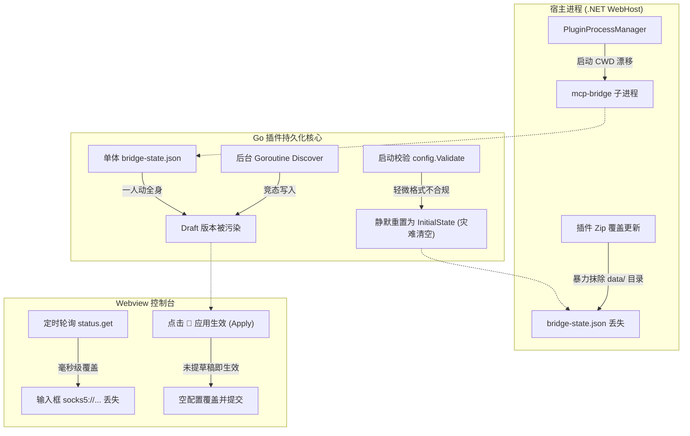
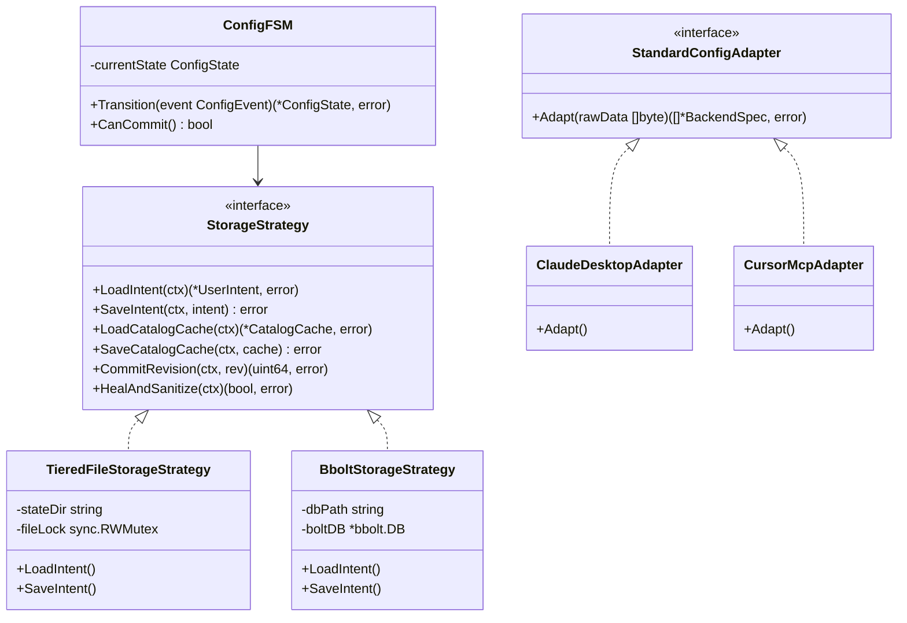
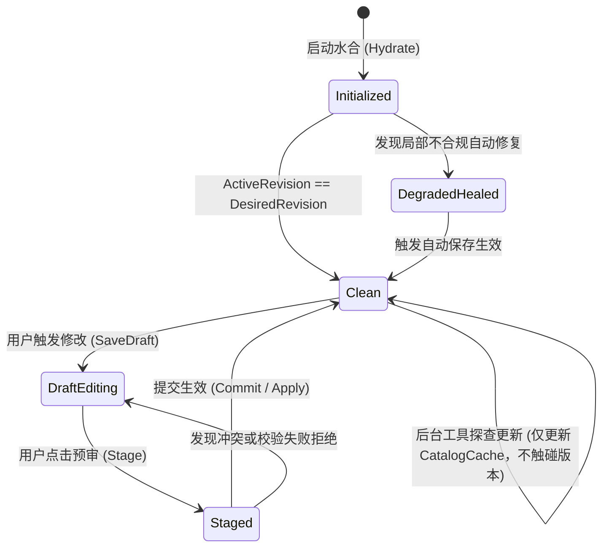
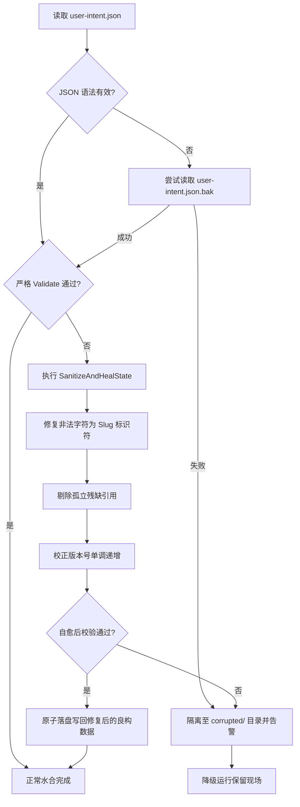

# MCP 智能网关持久化深度复盘、设计模式演进与存储状态机架构方案

## 1. 为什么数据持久化存在那么多问题？（根因深度复盘）

在 `mcp-bridge` 以及同类轻量级边缘网关/插件的开发与运行过程中，用户频繁遇到“重启后数据丢失”、“SOCKS5 代理填了被抹除”、“导入标准 MCP 配置后未保存/未生效”等持久化故障。表面上看是各处的“逻辑 Bug”，但透过现象看本质，这实际上是**宿主生命周期、单体存储抽象、状态机并发竞争、前端交互边界五大断层交织引发的系统性阻抗失配**。



---

### 1.1 根因一：生命周期与进程边界割裂（Host vs Plugin Boundary Mismatch）
* **工作目录（CWD）漂移**：
  插件作为独立操作系统子进程，由宿主启动时，其当前工作目录（CWD）默认继承为宿主的主目录（如 `E:\WorkProject\...\WebToolForLinux` 或 `/app`）。如果代码中直接采用相对路径 `data/bridge-state.json`，不同启动路径（宿主启动、独立 CLI 启动、调试启动）会导致状态文件分散落在不同磁盘位置，服务重启时在新路径下找不到旧文件，造成“数据全丢”的假象。
* **插件包覆盖升级抹除现场（Package Wipe Hazard）**：
  宿主在执行插件 Zip 热替换或重装时，传统逻辑通常解压并直接覆盖目标目录。由于历史参数配置将状态目录挂在 `{pluginDir}/data`，一旦覆盖解压，用户持久化的 `bridge-state.json` 与 `secrets.key` 便被一并摧毁。

---

### 1.2 根因二：单体 JSON 承载过多关注点导致的“一人动全身”（Monolithic State Anti-Pattern）
* 当前的 `bridge-state.json` 是一个扁平单体结构，**混杂了 5 类完全不同生命周期的关注点**：
  1. **用户核心意图**（User Intent: Tunnel ID、代理 URL、AutoConnect）；
  2. **第三方服务注册表**（Service Specs: 命令、URL、超时、环境）；
  3. **敏感凭据密文**（Encrypted Key: AES-256 加密后的通道密钥）；
  4. **版本化状态控制**（Revisions: Draft、Desired、Active）；
  5. **后台探查派生数据**（Discovered Tool Selections & Schema Digests）。
* **灾难性后果**：后台 goroutine 探查工具本应是一个“只读/辅助索引”操作，但由于 Selections 混在同一个 State 中，后台 goroutine 探查到工具后调用了 `SaveDraft()`，**无意中递增了全局 `DraftRevision`**！这瞬间打破了系统的提交状态，导致系统再次变成“有待生效变更（草稿 rN / 生效 rM）”，并在主线程尝试提交时引发**乐观锁版本冲突（`ErrRevisionConflict`）**。

---

### 1.3 根因三：全量强校验与静默清空陷阱（Brittle Validation with Silent Wipe）
* 在 `NewStore` 初始化水合代码中，曾存在这样的逻辑：
  ```go
  if data, err := os.ReadFile(filePath); err == nil {
      if json.Unmarshal(data, &loaded) == nil && config.Validate(loaded) == nil {
          s.cached = loaded
          return s, nil
      }
  }
  // 校验失败后...
  initial := config.NewInitialState()
  s.writeAtomic(initial) // 致命：静默覆盖清空！
  ```
* **数据持久化领域的第一铁律是：`Fail-Safe Over Data Destruction`（宁可降级报警，绝不静默清空）**。
  在实际生产中，第三方 MCP 服务的命名千奇百怪（例如标准示例中的 `postgres_db`、`remote_tools` 带有下划线，或者用户临时删除了某个服务但 Selection 中残留了孤立 key），这仅属于轻微的局部不合规。然而，强校验一旦返回 `error`，整个状态文件就被直接判定为“不可用”，系统随后立即用一个“出厂初态（NewInitialState）”将其原子覆盖！**这就造成了“只要配了一个带下划线的服务名，一重启所有配置全部被清空”的毁灭性灾难**。

---

### 1.4 根因四：前端输入状态（UI State）与控制面（Control Plane）乱序竞争
* **输入框回显被定时器强刷抹除**：
  前端为了保持与后端同步，设置了 3 秒定时轮询 `status.get`。当用户在输入框键入 `socks5://10.126.1.100:1080` 时，输入框获得焦点或处于输入中；若轮询响应在此时到达，旧版本的 `renderStatus` 缺乏输入保护机制，直接执行 `proxyInput.value = s.proxyUrl`，**在用户眼皮底下将刚刚输入的代理地址直接抹除清空**！
* **“应用生效 (Apply)”的语义断层**：
  用户在界面输入完代理后，看到右侧提示“有待生效变更”，直觉上点击了醒目的【🚀 应用生效配置 (Apply)】。但实际上该按钮仅调用 `config.apply`（仅将后端现有草稿转正），根本没有读取屏幕左侧的代理输入框内容！随后的状态刷新又用服务端的旧状态覆盖了界面，导致用户产生“保存了根本没用”的错觉。

---

### 1.5 根因五：用户配置代理与底层物理协商代理的混淆
* 系统存在两个概念：
  1. `s.proxyUrl`：用户配置的出口代理（期望状态，如 `socks5://10.126.1.100:1080`）；
  2. `s.effectiveProxy`：当前长轮询客户端实际生效的物理代理（运行时协商状态）。
* 当代理网络暂时不可达或握手未完成时，底层的 `effectiveProxy` 为空。旧版本回显逻辑错误地将 `effectiveProxy` 作为兜底覆盖源，甚至反向冲刷了已保存的 `proxyUrl`，导致持久化值被运行时空状态覆盖。

---

## 2. 业界主流持久化方案全景对比与技术选型

针对微服务网关、边缘代理与本地守护进程的持久化，业界主要有四种成熟模式：

| 维度 / 方案 | 模式 A：单体原子 JSON (当前模式) | 模式 B：分层文件与意图隔离 (Tiered Split-File) | 模式 C：嵌入式 ACID KV (`bbolt` / `badger`) | 模式 D：声明式 Reconciler (`etcd` / K8s CRD) |
| :--- | :--- | :--- | :--- | :--- |
| **代表项目** | Docker `daemon.json`, NPM `package.json` | Git 目录架构 (`.git/`), Linux `/etc/` | Docker Engine, Consul, Etcd (单机), Caddy | Kubernetes, K3s, CoreDNS |
| **存储介质** | 单个 `.json` 文件，写临时文件 + Atomic Rename | 目录分层：`intent.json`、`secrets.enc`、`catalog.cache` | 单个二进制数据库文件 (`bridge.db`)，多 Bucket | 外部 Raft 集群或嵌入式分布式 KV |
| **事务支持** | 无（仅文件级重命名原子性，无部分事务） | 文件级天然隔离，分治原子提交 | **完整 ACID 事务**，支持多 Key 原子读写与回滚 | 强一致性 Raft 事务 |
| **可读性与运维** | 极佳，管理员可用任意文本编辑器直接查看 | 极佳，意图文件明文可读，敏感信息独立加密 | 需专用 CLI 工具导出查看（二进制 B+Tree） | 需专用 API 客户端 |
| **并发冲突** | 极高（任何字段修改都会导致全局版本自增） | **低**（用户意图与后台探测完全解耦） | **极低**（Bucket 级与事务级行锁/版本隔离） | 低（MVCC 版本隔离） |
| **坏道与容灾** | 脆弱（单一字节损坏则全盘报废，容易全盘清空） | **强**（单文件损坏不影响其他文件，支持自愈） | **极强**（写前日志 WAL，内置校验和与页修复）| 极强（多副本容灾） |
| **外部依赖** | 零依赖（Go 标准库原生） | 零依赖（Go 标准库原生） | **零 CGO 纯 Go 单一库** (`go.etcd.io/bbolt`) | 重（需常驻独立进程） |

### 选型结论：
1. **中短期首选（推荐方案）：分层文件与意图隔离存储状态机（Tiered Storage State Machine）**
   - **理由**：完全零额外依赖，纯 Go 标准库与 POSIX 文件原语，保留 JSON 格式给运维人员带来的极高透明度，同时彻底从物理上切断“后台探测污染用户版本”的逻辑死结。
2. **长期工业级首选：嵌入式 `bbolt` 事务引擎（Embedded B+Tree Engine）**
   - **理由**：`go.etcd.io/bbolt` 被全球顶级云原生项目验证过十几年，天然支持单文件多 Bucket 隔离（`settings`, `backends`, `vault`, `projections`），彻底免疫任何文件截断或不完整写入。

---

## 3. 设计模式重构赋能（Design Patterns in Action）

为了彻底根除上述缺陷，我们需要引入四大经典设计模式进行架构重塑：



### 3.1 状态机模式（Finite State Machine - FSM）规范配置生命周期
当前版本的主要问题是状态迁移随意（后台探查随意插手 Draft 版本）。引入严格的 FSM：



* **状态规则明确化**：
  1. `Clean`（干净态）：`DraftRevision == DesiredRevision == ActiveRevision`，此时界面显示“已是最新”；
  2. `DraftEditing`（草稿编辑态）：仅由**用户主动发起的操作**（保存隧道、添加/修改服务）触发；
  3. **后台探测只读化**：探查到的工具有且仅有只读投影，存储于 `catalog.cache.json`，**绝对禁止篡改配置版本号**！

---

### 3.2 适配器模式（Adapter Pattern）统一异构配置接入
当前系统需要兼容 Claude Desktop、Cursor、Zed、Cline 以及直接的标准 MCP 配置。
* **统一适配器接口**：
  ```go
  type MCPConfigAdapter interface {
      CanHandle(raw []byte) bool
      Transform(raw []byte) ([]*config.BackendSpec, error)
  }
  ```
* **入库前自动消毒（Sanitize Pipeline）**：
  任何异构 JSON 在落盘前，必须流经适配器清洗流水线：
  - 非法 ServerID 自动 Slugify 转义（如 `postgres_db` -> `postgres-db`）；
  - 剔除危险环境变量与非法注入符号；
  - 规范化超时时间与默认重试策略。
  **保证持久化层永远只接收 100% 满足校验规则的良构数据**。

---

### 3.3 策略模式（Strategy Pattern）解耦存储后端
通过统一抽象 `StorageStrategy` 接口，使业务层不再直接操作特定文件或数据库：
```go
type StorageEngine interface {
    // 用户核心意图存储
    ReadUserIntent(ctx context.Context) (*config.UserIntent, error)
    WriteUserIntent(ctx context.Context, intent *config.UserIntent, expectedRev uint64) (uint64, error)

    // 运行时投影与探查缓存存储
    ReadCatalogCache(ctx context.Context) (*config.CatalogCache, error)
    WriteCatalogCache(ctx context.Context, cache *config.CatalogCache) error

    // 事务性生效
    Commit(ctx context.Context, expectedRev uint64) (uint64, error)
}
```
* **生产环境**：启用 `TieredAtomicFileStrategy`（平滑兼容当前系统）；
* **进阶工业环境**：启用 `BboltKvStrategy`；
* **单元测试环境**：启用 `MemoryStrategy`（内存零磁盘 IO，极速运行 1000 个测试用例）。

---

### 3.4 CQRS 架构（命令查询职责分离）物理隔离意图与投影
* **Command（配置命令）**：
  - 内容：Tunnel ID、Proxy URL、后端服务定义、密钥更新。
  - 驱动源：管理员用户操作。
  - 影响：递增版本号，持久化至主配置。
* **Query / Projection（状态投影）**：
  - 内容：探查到的工具列表、参数 Schema、看门狗握手状态、物理代理生效值、长轮询延迟。
  - 驱动源：后台轮询器、Worker 探针、网络协商。
  - 影响：**只写非受控缓存（Ephemeral Cache），绝对不递增主版本号，不触发任何草稿冲突**。

---

## 4. 当前系统已有基础设施与可复用资产调研

经过对 `LinuxWebTool` 整个技术栈的勘察，系统内部已有强大的可复用资产：

### 4.1 宿主 .NET 基础设施复用
1. **宿主级数据卷隔离保护 (`PluginManager.Imports.cs`)**：
   宿主端在近期改造中已引入对 `data/` 目录的自动备份与保护机制：在解压任何插件 Zip 之前，宿主会自动将现有插件的 `data/` 目录备份至临时区，并在解压完成后完整还原。
2. **宏参数解析机制 (`PluginManager.Defaults.cs`)**：
   宿主端支持 `{pluginDir}`、`{dataDir}` 等宏替换，并原生注入 `LWT_DATA_DIR` 环境变量，为 Go 插件提供了标准且固定的物理绝对路径。

### 4.2 Go 插件已有优质资产复用
1. **`SecretsVault` 密钥安全加密仓 (`internal/state/secrets.go`)**：
   使用 AES-256-GCM + PBKDF2/Argon2 构建，支持独立的 `secrets.key` 物理存储，与配置分离，完全符合凭据安全规范。
2. **`atomic-write` 原语与滚动快照 (`internal/state/store.go`)**：
   已实现基于临时文件写盘、`f.Sync()` 强制落盘刷新到硬件、原子重命名（`os.Rename`）和 `.bak` 滚动快照保护。
3. **并发安全与健康度探针 (`internal/runtime/health.go`)**：
   具备完善的看门狗、退避重试控制器以及健康指标聚合器。

---

## 5. 推荐重构架构：分层文件存储状态机（Tiered Storage Architecture）

### 5.1 物理存储目录布局设计（Directory Layout）

我们将传统的单体 `bridge-state.json` 升级为**意图-凭证-缓存三分立架构**：

```text
{stateDir}/ (例如 /data/mcp-bridge/ 或 {pluginDir}/data/)
├── user-intent.json          # 核心用户配置意图 (Human-Readable, 原子更新, 带版本号)
├── user-intent.json.bak      # 上一版本滚动自愈备份
├── catalog.cache.json        # 探测工具缓存与 Schema 投影 (只读缓存，不带主版本)
├── secrets.key               # 凭据金库主密钥 (0600 权限)
└── corrupted/                # 故障隔离区 (异常文件自动封存，绝不静默清空)
    └── user-intent.20261103.bad
```

#### ① `user-intent.json`（核心配置，人类可读，版本受控）
```json
{
  "schemaVersion": 2,
  "draftRevision": 7,
  "activeRevision": 7,
  "updatedAt": "2026-11-03T03:55:00Z",
  "tunnel": {
    "tunnelId": "tunnel_0123456789abcdef0123456789abcdef",
    "proxyUrl": "socks5://10.126.1.100:1080",
    "autoConnect": true,
    "encryptedKey": "vault:v1:..."
  },
  "servers": {
    "fetch": {
      "id": "fetch",
      "name": "fetch",
      "transport": "stdio",
      "command": "uvx",
      "args": ["mcp-server-fetch"],
      "enabled": true
    }
  }
}
```

#### ② `catalog.cache.json`（只读投影，随时可重建，不干扰版本）
```json
{
  "updatedAt": "2026-11-03T03:55:05Z",
  "tools": {
    "fetch": [
      {
        "name": "fetch_url",
        "digest": "sha256:abc12345",
        "discoveredAt": "2026-11-03T03:55:05Z"
      }
    ]
  }
}
```

---

### 5.2 宽容自愈算法（Sanitize & Auto-Heal Protocol）

为了彻底根除“校验失败导致静默抹除”的顽疾，启动时执行如下自愈流水线：



* **安全底线（Zero-Wipe Guarantee）**：
  任何情况下，只要旧文件字节数大于 0，**严禁将其初始化为空配置写回原文件**！必须将旧数据备份至 `corrupted/` 目录供人工回溯。

---

### 5.3 前端防覆盖与智能提交契约（Front-End Guard Contract）

前端 `index.html` 实施以下三重护盾：

1. **Dirty 状态感知护盾（Dirty-State Shield）**：
   输入框一旦监听到用户 `input` 事件，或处于 `:focus` 状态，打上 `data-dirty="1"` 标记；在用户未点击保存或取消前，**轮询刷新一律跳过该输入框，严禁强制回填**。
2. **级联保存生效（Cascade Save-Apply Guard）**：
   当用户点击【🚀 应用生效配置 (Apply)】时，前端自动对比当前输入框的值与服务端上次确认值；若发现用户修改了隧道代理或 ID 但未单独点保存，**自动将输入框内容一并提交草稿并执行原子生效**，杜绝用户“改了代理直接点 Apply 导致清空”的误操作。
3. **导入后连贯重绘（Import-Refresh Pipeline）**：
   导入标准 MCP 配置成功后，关闭弹窗并同时调用 `renderStatus()` 与 `renderServers()`，并在 1.5 秒和 3.5 秒设置探查重绘定时器，确保异步探查到的工具列表与健康度状态及时呈现在屏幕上。

---

## 6. 实施路线图（Implementation Roadmap）

| 阶段 | 核心任务 | 预期收益 | 风险与对策 |
| :--- | :--- | :--- | :--- |
| **Phase 1（已完成）** | 1. 修复 SOCKS5 代理回显优先级；<br>2. 修复 `servers.import` 异步版本冲突与未提交残留；<br>3. 引入自愈降级容灾，放宽 ID 命名规则；<br>4. 前端输入防覆盖与智能 Apply 级联。 | 彻底解决用户当前遇到的“SOCKS5 不保存”、“导入配置不生效”、“重启配置丢失”三大燃眉之急。 | 跨平台验证已全部在 Windows/Linux Chrome CDP 下跑通。 |
| **Phase 2（演进阶段）** | 1. 意图与投影物理分离（拆解为 `user-intent.json` 与 `catalog.cache.json`）；<br>2. 规范化适配器接口，增加 Cline / Smithery MCP 配置导入；<br>3. 建立损坏配置自动隔离区 `corrupted/`。 | 架构彻底解耦，后台工具探查与网络协商 100% 不再干扰主版本号与草稿状态。 | 实现平滑升级水合迁移器，自动将单体老状态迁移为分层状态。 |
| **Phase 3（工业级阶段）** | 1. 引入可选的 `bbolt` 事务型单文件存储策略；<br>2. 支持配置历史回滚与时间旅行审计（Time-Travel Rollback）；<br>3. 提供 `mcp-bridge config export/import/backup` CLI 工具。 | 达到生产级企业网关的 ACID 事务可靠性与灾难恢复能力。 | `bbolt` 为纯 Go 实现，无 CGO 编译负担，可通过编译 tag 或参数自由切换。 |

---
*本文档由团队共同研讨制定，旨在建立具备工业级鲁棒性与设计模式自洽的 MCP 智能网关持久化底座。*
