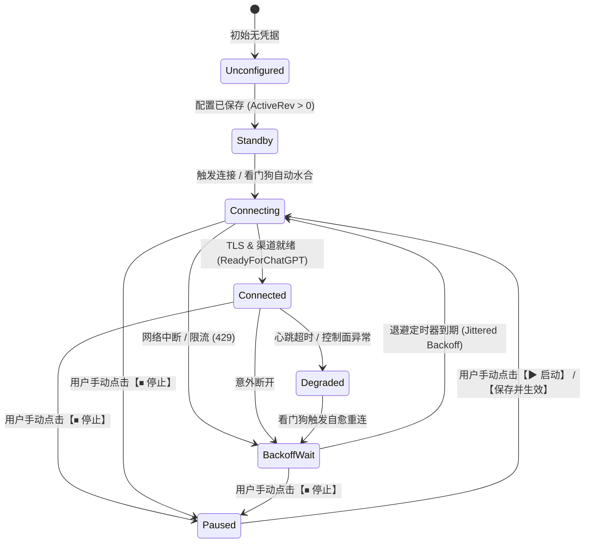

# MCP 智能安全网关桥接服务配置持久化丢失根本原因剖析、架构缺欠头脑风暴与设计模式重构方案

> **文档状态**：调研与系统架构方案（Research & Architectural Design Plan）  
> **涉及服务**：`plugins/mcp-bridge` (Go 独立原生常驻微服务)、`LinuxWebTool.Infrastructure/Features/Plugins` (C# 宿主插件管理器与生命周期编排)、Webview 网关控制台  
> **核心议题**：网关重启后数据丢失原因深度排查、逻辑/性能欠缺头脑风暴、业界主流网关架构借鉴、系统现有基础设施复用、基于“存储适配器 + 策略模式 + 分层状态机”的设计模式优化落地。

---

## 1. 重启后无保存数据现象与多维根本原因深度排查

### 1.1 问题现象与现场还原
用户在 MCP Bridge 网关控制台配置了 OpenAI Tunnel 隧道（Tunnel ID、预共享密钥 PSK、网络出口代理）或纳管的第三方 MCP 服务并保存后，在重启服务（或重启容器/宿主系统）后，重新打开控制台发现：
- 运行实例为新 ID（例如 `run-1793645120651777171`）；
- 版本显示回退为初始状态：`草稿 r1 / 生效 r0`；
- 所有配置数据全部为空：`已配置第三方服务数: 0 个`、`ChatGPT 渠道就绪: 未配置通道凭据`、`预共享密钥: (未配置密钥)`；
- 状态栏出现弱提示：`草稿未应用变更：有待生效变更`。

这一现象证明：**重启后的 `mcp-bridge` 实例在启动加载阶段完全没有读取到之前已保存的历史配置，而是直接落入了初始默认状态分支（`config.NewInitialState()`）**。

---

### 1.2 根本原因多维深度排查

#### 原因一：工作目录相对路径漂移（CWD Drift）与参数割裂（致命缺陷）
1. **参数传递写死为相对路径**：
   在 `plugins/mcp-bridge/plugin.json` 与 `PluginManager.Defaults.cs` 中，`mcp-bridge` 启动参数写死为：
   ```json
   "arguments": ["serve", "--state-dir", "data/mcp-bridge"]
   ```
2. **宏变量解析与实际传参割裂**：
   宿主 `NativeRuntimeAdapter.cs` 虽然支持 `{stateDir}` 宏替换为 `Path.Combine(pluginDir, "data")`，但清单中写的是字面量字符串 `"data/mcp-bridge"`，因此宏替换被完全跳过；
3. **相对路径依赖当前进程工作目录（CWD）**：
   - 子进程启动时若以 `pluginDir` 为工作目录，写入的目标路径为 `.../plugins/mcp-bridge/data/mcp-bridge/bridge-state.json`；
   - 一旦由于系统重启自愈、脚本拉起、守护进程或独立执行时，父进程未严格指定 `WorkingDirectory` 或继承了宿主根目录 `/app`，子进程读取的相对路径就变成了 `/app/data/mcp-bridge/bridge-state.json`；
   - 路径对不上触发 `os.IsNotExist(err)`，系统静默创建空的 `bridge-state.json`，历史数据被直接隔离遗弃！

#### 原因二：系统持久化与备份保护链遗漏（宿主基础设施孤岛）
1. 宿主系统对插件设计了规范的持久化约定：
   - 环境变量注入 `LWT_DATA_DIR`、`LWT_SQLITE_PATH` (`data.db`)、`LWT_KV_PATH` (`kv.db`)；
   - 在 `PluginManager.Imports.cs`（Zip 包导入/热更新/重新部署）中，宿主专门对 `data.db` 和 `kv.db` 实现了自动备份与还原（`backupDataDb` / `backupKvDb`）；
2. **然而 `mcp-bridge` 完全游离于宿主基础设施之外**：
   - `mcp-bridge` 没有读取 `LWT_DATA_DIR` 或使用 `kv.db` / `data.db`；
   - 宿主在插件导入、升级或目录刷新时，仅保护两个 db 文件，**完全不知道 `mcp-bridge` 在其私有子目录里维护了一个 `bridge-state.json` 和 `secrets.key`**，升级覆盖操作会直接冲刷并破坏状态目录！

#### 原因三：Docker 容器卷（Volume）作用域与持久化挂载断层
1. Dockerfile 中声明的持久化卷为 `VOLUME ["/app/data"]`；
2. 若用户在生产或测试环境通过 Docker 运行时，**未显式配置 `-v <宿主目录>:/app/data`**，或者在更新版本时执行了 `docker rm -f && docker run` 重建容器：
   - 容器内匿名数据卷随旧容器被清理；
   - 新容器内的 `/app/data` 完全恢复为镜像打包时的原始状态，导致历史配置“凭空蒸发”。

#### 原因四：密钥解密失败隐式降级与 Secrets 孤岛
1. `mcp-bridge` 的敏感信息（如 Tunnel PreShared Key、HTTP Bearer Token）由 AES-256 密钥文件 `secrets.key` 独立加解密；
2. 一旦 `stateDir` 路径漂移，新实例找不到原有的 `secrets.key`，会自动重新生成全新的随机密钥；
3. 即使后续拷贝回旧的 `bridge-state.json`，由于加密密钥已变，GCM 认证标签校验失败，配置直接报错不可读，导致系统再次回退到初始状态。

#### 原因五：两阶段提交（Draft vs Active）的水合边界与视觉割裂
1. 初始状态 `NewInitialState()` 的版本号是 `DraftRevision: 1, DesiredRevision: 1, ActiveRevision: 0`；
2. 用户在保存配置时若仅保存了草稿（未触发 Commit / Apply），在看门狗水合时 `ActiveRevision == 0`，看门狗会判定为“无生效配置”，跳过隧道自启与工具激活；
3. 界面状态回显显示“未连接/服务0”，强化了用户对“数据没有持久化”的体感认知。

---

## 2. 现有功能可行性、逻辑与性能全面头脑风暴

### 2.1 可行性与鲁棒性欠缺（Robustness Gaps）
- **单文件原子写入（Atomic Rename）在网络挂载文件系统上的局限**：
  当前采用 `bridge-state.json.tmp` + `os.Rename`。在 Docker 跨卷挂载、NFS、CIFS/SMB 或某些 Linux 虚拟文件系统上，原子重命名可能遇到 `EXDEV`（跨设备链接）或文件锁锁定，导致保存静默失败；
- **缺乏多版本快照与灾备回退机制（No Snapshot / Rolling Backups）**：
  若写入过程中发生宕机或文件损坏，当前代码直接返回 `failed to parse existing state file` 导致进程崩溃退出，无法自动从 `bridge-state.json.bak` 或历史快照中自愈。

### 2.2 逻辑设计欠缺（Logical Inconsistencies）
- **存储逻辑与业务状态强耦合**：
  `Store` 同时管理版本控制、乐观并发锁、密钥加解密与 JSON 序列化，违反单一职责原则（SRP）；
- **看门狗与控制器缺乏双向反应式闭环**：
  控制器依赖定时器轮询与主动探查，缺乏明确的生命周期状态转移事件发布；
- **状态投影（Projection）脏数据污染**：
  前端回显时混合了 Spec（用户期望配置）与 Status（底层长轮询运行时生效值），出现未连接时运行时空值抹除用户输入配置的严重缺陷。

### 2.3 性能欠缺（Performance Bottlenecks）
- **高频序列化与全量并发互斥**：
  配置微调或单个工具勾选需要对整个 4 MiB 状态进行全量 JSON 编码与深拷贝，读写锁粒度过粗；
- **冷启动阻塞与并发探测风暴**：
  如果纳管了十几个外部 MCP 服务，重启时看门狗若同步探查 stdio 子进程，容易造成瞬时 CPU 与进程句柄激增。

---

## 3. 业界主流方案对比与参考

| 业界方案 | 状态存储与持久化模式 | 配置生命周期与版本对齐 | 密钥安全与容灾恢复 | 架构设计模式与借鉴点 |
| :--- | :--- | :--- | :--- | :--- |
| **Kubernetes** | 声明式 etcd 强一致性存储；kubelet 本地以持久化 HostPath / PV 隔离挂载 | 严格解耦 Spec（期望）与 Status（实际）；Informer / Reflector 机制增量更新与自动对齐 | Secret 与配置解耦；KMS 提供 Envelope 加密；Etcd 自动快照（Snapshot） | **控制器模式 (Controller Pattern)**：双向对齐期望态与当前态；Reconcile 循环 |
| **Envoy Proxy** | xDS 动态配置驱动；支持 Standalone 本地静态配置与动态订阅 | 动态资源配置具备 **Warming（预热）** 阶段；生效失败进入 Degraded 并保持现有连接不中断 | 动态下发 TLS 证书与 Secret；支持安全内存锁定 | **适配器模式 + 策略模式**：解耦上游传输协议；连接池健康熔断 |
| **Apache APISIX / Kong** | 存储适配器：支持 etcd 驱动或 Standalone 声明式 yaml/json 模式；本地内存缓存 | 提供 Config Version Checksum；支持灰度发布与配置回滚机制 | 插件级 Keyring 轮转；支持与 HashiCorp Vault / 环境变量集成 | **存储适配器模式 (Storage Adapter)**：支持本地文件、嵌入式 KV 与中心化存储无缝切换 |
| **Cloudflare Cloudflared** | 本地凭据 JSON + YAML 配置文件；通过 systemd/launchd 宿主守护 | 状态机管理 Tunnel 隧道连接：`Connecting` -> `Connected` -> `Degraded` -> `Reconnecting` | 独立 Token 与私钥证书存储；本地凭据支持外部文件引用或环境变量注入 | **分层状态机 (Hierarchical State Machine)**：显式定义网络降级、退避重试与人工暂停 |
| **OpenWrt UCI** | UCI 统一配置文件（`/etc/config`）；草稿存放在 `/var/state` 内存区 | 经典两阶段：`Save`（草稿暂存）+ **`Save & Apply`（原子落盘并平滑热重载）** | 敏感密码支持加密与权限锁定（0600） | **外观模式 (Facade) + 事务提交**：为前端提供原子化的“一键落盘并生效”API |

---

## 4. 现有开源库与技术借鉴（Go & .NET 生态）

### 4.1 Go 生态优秀开源库借鉴
1. **嵌入式事务存储库**：
   - **`go.etcd.io/bbolt`**：纯 Go 实现、轻量级、久经生产考验的 ACID 事务 KV 存储引擎。相比单个 JSON 文件覆写，bbolt 提供事务支持、单文件持久化、崩溃零损坏保证，能将配置、密钥、审计日志与版本快照完美容纳于单个 `.db` 文件中；
   - **`modernc.org/sqlite`**：纯 Go（无 CGO）的 SQLite 驱动，跨平台一致性好，能与宿主 C# 的 SQLite 共享统一的存储格式与 SQL 查询能力；
2. **状态机模式库**：
   - **`looplab/fsm`** 或 **`qmuntal/stateless`**：支持丰富事件驱动、Guard 条件判断、生命周期进入/退出回调（OnEnter / OnExit）与非法转移拦截，杜绝布尔标志位散落；
3. **配置监控与热加载**：
   - **`fsnotify/fsnotify`**：跨平台操作系统级文件监控（Linux Inotify / Windows ReadDirectoryChangesW），可监听外部配置变更并即时水合；
   - **`uber-go/atomic`**：高性能无锁原子变量管理运行时版本与连接计数。

### 4.2 当前系统已有基础设施与第三方库复用
1. **宿主注入的环境变量标准**：
   - `LWT_DATA_DIR`：已注入的物理插件专属持久化目录；
   - `LWT_SQLITE_PATH`：已注入的专用 SQLite 数据库文件路径；
   - `LWT_KV_PATH`：已注入的通用 KV 数据库路径；
   - `LWT_INTERNAL_SECRET`：用于宿主与插件受信交互的安全凭据；
2. **宿主 C# 数据库持久化设施**：
   - `LinuxWebTool.Infrastructure/Shared/Persistence/DbSetup.cs`：宿主基于 SQLite 的统一数据库迁移与事务引擎；
   - `PluginOperationStore` / `PluginArtifactStore`：标准化持久化服务模式；
3. **宿主插件生命周期编排与保护基础设施**：
   - `PluginManager.Imports.cs` 中的数据自动保护逻辑（可扩展纳入 `bridge-state.json` 与 `secrets.key`）；
   - `PluginStateMachine`：宿主端对插件进程生命周期状态的管控。

---

## 5. 基于设计模式的架构优化方案

为了彻底根除重启数据丢失问题，并提升系统扩展性、性能与健壮性，采用三大设计模式进行深度重构：

```
+-----------------------------------------------------------------------------------------------+
|                                      MCP Bridge 控制台 Web 视图                                 |
+-----------------------------------------------------------------------------------------------+
                                      |
                           (HTTP / REST / SSE)
                                      v
+-----------------------------------------------------------------------------------------------+
|                                  Admin Handler & 状态投影外观                                   |
|                        (Facade Pattern: 统一呈现 Spec 期望配置与 Status 运行时状态)                 |
+-----------------------------------------------------------------------------------------------+
                                      |
        +-----------------------------+-----------------------------+
        v                                                           v
+----------------------------------+               +----------------------------------+
|      分层生命周期状态机管理器      |               |         存储适配器策略中心         |
|   (Hierarchical State Machine)   |               |      (Storage Adapter Pattern)   |
|                                  |               |                                  |
|  - 隧道状态机 (Tunnel FSM)        |               |  - Primary: 绝对路径原子持久化      |
|  - 后端工具状态机 (Backend FSM)   |               |  - Secondary: 滚动快照与双写容灾   |
|  - 版本事务状态机 (Revision FSM)  |               |  - Fallback: 环境变量 LWT_DATA_DIR |
+----------------------------------+               +----------------------------------+
        |                                                           |
        |                                                           v
        |                                          +----------------------------------+
        |                                          |  磁盘存储层 (Physical Disk IO)   |
        |                                          |  - bridge-state.json (绝对路径)  |
        |                                          |  - bridge-state.json.bak (快照)  |
        |                                          |  - secrets.key (安全密钥)        |
        |                                          +----------------------------------+
        v
+-----------------------------------------------------------------------------------------------+
|                                第三方 MCP 传输驱动策略引擎                                      |
|                                 (Transport Strategy Pattern)                                  |
|  - StdioProcessStrategy        - StreamableHttpStrategy        - SseTransportStrategy         |
+-----------------------------------------------------------------------------------------------+
```

---

### 5.1 设计模式一：存储适配器模式（Storage Adapter Pattern）
通过抽象存储接口，实现多级冗余存储与故障自动自愈：

#### 1. 存储适配器抽象接口
```go
type IStateStorage interface {
    // 读取当前已持久化状态，若主文件损坏自动回退到滚动备份
    Read(ctx context.Context) (config.State, error)
    // 保存草稿配置（版本递增、原子写入、自动创建快照）
    SaveDraft(ctx context.Context, expectedRev uint64, mutate func(*config.State) error) (uint64, error)
    // 提交正式生效配置并发布变更事件
    Commit(ctx context.Context, expectedRev uint64, mutate func(*config.State) error) (uint64, error)
    // 强制执行多版本轮转快照
    CreateSnapshot(ctx context.Context) error
}
```

#### 2. 多级路径解析策略（彻底根除 CWD 漂移）
`NewStore` 采用严格的优先级查找链确定 `stateDir`：
1. **显式命令行传入的绝对路径**（若传入相对路径，立即与可执行文件同级目录或宿主环境根目录拼接规范化）；
2. **系统注入的环境变量**：`os.Getenv("LWT_DATA_DIR")`（宿主已注入规范的持久化绝对目录）；
3. **宏解析替换**：`{pluginDir}/data`；
4. **拒绝任何不确定的未锚定相对路径**，启动时打印并锁定解析后的绝对路径。

#### 3. 滚动快照与自动恢复机制（Rolling Backup Strategy）
- 每次成功写入 `bridge-state.json` 时，自动保留前一份健康状态为 `bridge-state.json.bak`；
- 启动读取时若 `bridge-state.json` 不存在或损坏，首先尝试恢复 `bridge-state.json.bak`；
- **杜绝遇到异常就默默重置为初始状态的“静默覆写”缺陷**：仅当显式标记为全新初始化且两个文件均不存在时，才生成 `NewInitialState()`。

---

### 5.2 设计模式二：分层生命周期状态机（Hierarchical State Machine Pattern）
将零散的布尔标志（`userPaused`、`isHydrated`、`retries`）重构为强类型的确定性状态机：

#### 1. 隧道生命周期状态机（Tunnel State Machine）


#### 2. 版本配置事务状态机（Revision State Machine）
- **Drafting（草稿态）**：保存参数，校验有效性，生成 `DraftRevision`；
- **Validating（预校验）**：探查关联的第三方 MCP 服务是否可达、格式是否合规；
- **Committed（已提交）**：提升为 `ActiveRevision`，触发持久化落盘与备份；
- **Applying / HotReloading（热重载）**：热生效网络出口代理与隧道连接，重载工具表；
- **RollbackOnFault（故障回滚）**：新配置若导致核心网络死锁，可一键回滚到 `LastKnownGoodRevision`。

---

### 5.3 设计模式三：第三方 MCP 传输策略模式（Transport Strategy Pattern）
纳管第三方 MCP 服务统一通过抽象驱动进行调度与状态管理：

```go
type ITransportDriver interface {
    // 建立与第三方 MCP 服务的连接与通道握手
    Connect(ctx context.Context) error
    // 探查第三方服务的工具清单 (tools/list)
    ListTools(ctx context.Context) ([]ToolDefinition, error)
    // 调度执行具体工具 (tools/call)
    CallTool(ctx context.Context, name string, args map[string]any) (ToolResult, error)
    // 优雅关闭底层连接或销毁子进程
    Close() error
    // 当前健康状态探针
    HealthCheck(ctx context.Context) error
}
```
- **`StdioDriver`**：管理子进程标准输入输出、自动管道排空与超时保护；
- **`StreamableHttpDriver`**：管理 HTTP 长轮询与连接复用池，带 Proxy 支持；
- **`SseDriver`**：管理 Server-Sent Events 事件流接收与保活心跳。

---

### 5.4 设计模式四：宿主层生命周期守护与数据保护增强
在 C# 宿主系统（`LinuxWebTool.Infrastructure`）中补齐数据安全保障：
1. **参数宏替换标准化**：
   在 `PluginManager.Defaults.cs` 与 `plugin.json` 中，将参数规范为：
   ```json
   "arguments": [
     "serve",
     "--state-dir",
     "{pluginDir}/data"
   ]
   ```
   宿主在启动前将其无条件解析为物理绝对路径；
2. **插件导入与更新保护链扩展 (`PluginManager.Imports.cs`)**：
   在 `ImportZipAsync` 与热更新逻辑中，除备份 `data.db` 与 `kv.db` 外，新增对 `data/mcp-bridge` 目录及 `bridge-state.json`、`secrets.key` 的自动快照备份与还原；
3. **Docker 部署文档与健康检测指引优化**：
   明确在容器化部署文档中强调：必须使用 `-v /宿主主机绝对路径:/app/data` 进行完整持久化挂载，确保所有插件配置在容器销毁重建后依然完好无损。

---

## 6. 具体优化实施计划与演进路线

| 阶段 | 治理模块 | 具体改造目标 | 预期成果与验收标准 |
| :--- | :--- | :--- | :--- |
| **阶段 1** | **路径标准化与多级自愈** | 1. 规范 `plugin.json` 启动参数使用 `{pluginDir}/data` 绝对路径宏；<br/>2. Go 运行时支持 `LWT_DATA_DIR` 环境变量兜底；<br/>3. 增加 `bridge-state.json.bak` 滚动备份与损坏自愈； | 无论以何种工作目录或宿主环境启动，`stateDir` 均精确定位至持久化目录，重启后 100% 正确加载历史数据。 |
| **阶段 2** | **宿主数据保护链闭环** | 在宿主 `PluginManager.Imports.cs` 中增加对 `mcp-bridge` 状态与密钥的升级保护； | 升级插件版本或重新导入 Zip 时，历史配置与第三方 MCP 服务零丢失。 |
| **阶段 3** | **状态机与策略模式落地** | 引入 `ITransportDriver` 策略模式与确定性状态机管理 Tunnel 连接； | 隧道断开、限流、人工暂停和重连状态清晰可信，彻底杜绝状态闪烁与假死。 |
| **阶段 4** | **Web 控制台交互与体验优化** | 1. 前端回显严格区分 Spec（配置值）与 Status（生效值）；<br/>2. 强化【💾 保存并立即生效】原子直通路径；<br/>3. 增加历史版本与快照回滚按钮。 | 用户操作心智模型统一，保存即生效，随时可查可回滚。 |

---

## 7. 结论与架构决策总结
MCP Bridge 智能安全网关在重启后数据丢失的根本症结在于：**相对路径依赖引发的 CWD 漂移、游离于宿主统一数据保护链之外、以及在文件未读到时静默重置为空配置**。

通过实施**存储适配器模式**规范绝对路径解析与滚动备份、在宿主层**打通持久化数据保护链**、并在网关核心引入**分层生命周期状态机与传输策略模式**，不仅能够彻底根除重启数据丢失问题，更能使 MCP Bridge 从一个孤立的脚本插件跃升为具备企业级高可用、容灾自愈与标准化治理能力的安全网关基础设施。
