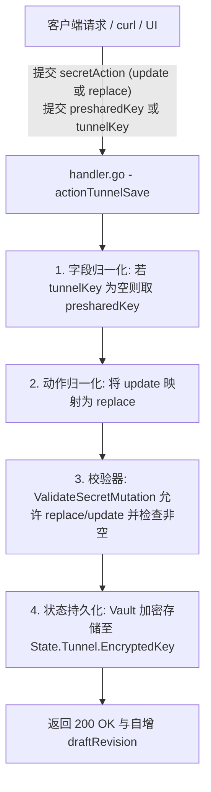

# MCP Bridge 敏感字段变活动作与前后端契约容错方案

## 1. 问题背景与现象定位

用户在通过 Webview 控制台或 HTTP API 保存 MCP 桥接网关的 Tunnel 隧道配置时，发起如下请求：

```bash
curl --url 'http://10.126.1.70:5271/plugins/mcp-bridge/control/invoke/tunnel.save?token=...' \
  -H 'Content-Type: application/json' \
  --data-raw '{"tunnelId":"tunnel_0123456789abcdef0123456789abcdef","expectedRevision":1,"secretAction":"update","presharedKey":"sk-proj-..."}'
```

收到 HTTP 400 Bad Request 错误响应：
```text
Status code: 400 Bad Request
Response body: unsupported secret action: "update"
```

该错误导致管理员无法在控制台更新 OpenAI Secure MCP Tunnel 隧道的预共享密钥（PSK）与 Tunnel ID。

---

## 2. 根因剖析与契约裂痕 (Root Cause Analysis)

### 2.1 敏感操作枚举不匹配
在 `plugins/mcp-bridge/internal/config/validate.go` 中，校验逻辑定义如下：

```go
func ValidateSecretMutation(mut SecretMutation) error {
	switch mut.Action {
	case SecretActionKeep:
		// ...
	case SecretActionClear:
		// ...
	case SecretActionReplace:
		// ...
	default:
		return fmt.Errorf("unsupported secret action: %q", mut.Action)
	}
	return nil
}
```

- **后端设计**：将敏感字段的变活动作分为三态：`keep`（保持现有密钥）、`replace`（以新密钥覆盖）、`clear`（清空密钥）。
- **前端实现**：在 `plugins/mcp-bridge/internal/web/index.html` 的 `saveTunnel()` 函数中，编写了：
  ```javascript
  const payload = {
    tunnelId,
    expectedRevision: currentStatus ? currentStatus.draftRevision : 0,
    secretAction: psk ? 'update' : 'keep'
  };
  if (psk) payload.presharedKey = psk;
  ```
- **裂痕产生**：前端将动作命名为 `'update'`，后端校验器因不识别 `'update'` 抛出 `unsupported secret action: "update"`。

### 2.2 载荷字段命名别名缺失
- 前端传递的密钥字段为 `presharedKey`；
- 后端 `SaveTunnelRequestDTO` 定义的字段仅为 `TunnelKey string json:"tunnelKey,omitempty"`；
- 即使将 `secretAction` 修改为 `replace`，由于字段名不匹配，后端解析到的 `TunnelKey` 仍然为空，进而触发第二重校验失败：`secret value cannot be empty when action is 'replace'`。

### 2.3 乐观并发锁版本透传未对齐
- 前端向 `tunnel.save` 传递了 `expectedRevision: 1`；
- 后端 `SaveTunnelRequestDTO` 缺失了 `ExpectedRevision uint64` 属性，且内部保存草稿时写死了 `0`，未充分利用状态机的乐观锁能力。

---

## 3. 业界主流规范与借鉴 (Industry Standards)

### 3.1 业界方案对比

| 体系/平台 | 敏感凭据更新语义 | 别名与宽容度处理 | 对本项目启示 |
| :--- | :--- | :--- | :--- |
| **Kubernetes (Secret / ConfigMap)** | `Replace` / `Patch` / `Update` | 遵循 Postel's Law，API 接收端对近义动作（如 update/replace、delete/clear）归一化 | ⭐⭐⭐⭐⭐ **采纳：宽进严出，后端支持别名归一化** |
| **HashiCorp Vault** | `PUT /data` 写入新版本，明确区分 `keep` / `update` / `delete` | 客户端 SDK 与 HTTP 接口允许灵活别名映射 | ⭐⭐⭐⭐⭐ **采纳：双重别名兼容** |
| **AWS Secrets Manager** | `PutSecretValue` 覆盖，`UpdateSecret` 更新元数据 | 控制台与 SDK 保持强类型一致 | ⭐⭐⭐⭐ 前端同步规范化 |

### 3.2 Postel 法则（鲁棒性原则）在 API 契约中的落地
> **"Be conservative in what you do, be liberal in what you accept from others."**

为杜绝前后端开发过程中的字段歧义与老版本客户端兼容问题：
1. **服务端宽进**：Go 微服务网关同时接受 `replace` 与 `update`，同时接收 `tunnelKey` 与 `presharedKey`，在 Handler 入口自动归一化；
2. **客户端严出**：Webview 控制台严格按标准契约输出规范的 `replace` 与 `tunnelKey`，并同时附带 `presharedKey` 保持双向兼容。

---

## 4. 全链路具体实施方案



### 4.1 Go 微服务核心修复
1. **`internal/config/model.go`**：
   ```go
   const (
       SecretActionKeep    SecretAction = "keep"
       SecretActionReplace SecretAction = "replace"
       SecretActionUpdate  SecretAction = "update" // Alias for replace
       SecretActionClear   SecretAction = "clear"
   )
   ```
2. **`internal/config/validate.go`**：
   在 `ValidateSecretMutation` 中将 `SecretActionReplace, SecretActionUpdate` 并列支持。
3. **`internal/admin/dto.go`**：
   在 `SaveTunnelRequestDTO` 中扩充 `PresharedKey string json:"presharedKey,omitempty"` 和 `ExpectedRevision uint64 json:"expectedRevision,omitempty"`。
4. **`internal/admin/handler.go`**：
   - 在 `actionTunnelSave` 中支持 `presharedKey` 到 `tunnelKey` 的自动回退，并将 `update` 处理为加密替换；
   - 在 `actionServersSave` 中同步允许 `update` 动作。

### 4.2 Webview 控制台前端优化
在 `plugins/mcp-bridge/internal/web/index.html` 的 `saveTunnel()` 中：
- `secretAction: psk ? 'replace' : 'keep'`；
- 载荷同时注入 `tunnelKey: psk` 与 `presharedKey: psk`。

### 4.3 C# 契约增强
在 `src/LinuxWebTool.Contracts/Features/McpBridge/Contracts/McpBridgeRequests.cs` 中：
- 补充 `PresharedKey` 与 `ExpectedRevision`。

---

## 5. 架构门禁设计 (`LinuxArch049`)

为防止敏感变活动作规范未来发生倒退，新增架构测试门禁：
**`LinuxArch049_MCP网关敏感字段变活动作与前后端契约容错门禁`**：
1. 校验 `internal/config/model.go` 必须声明 `SecretActionUpdate = "update"`；
2. 校验 `internal/config/validate.go` 必须在变活校验中覆盖 `SecretActionUpdate`；
3. 校验 `internal/admin/dto.go` 必须具备 `PresharedKey` 兼容别名；
4. 校验 `internal/web/index.html` 必须具备双重键兼容性；
5. 校验 C# 契约 `SaveTunnelRequest` 包含别名字段。
