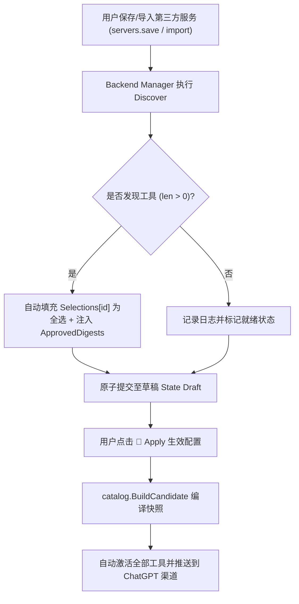

# MCP Bridge 工具自动激活与轻量脚本自适应执行深度治理方案

> **文件标识**：`docs/mcp-bridge-tool-activation-and-oneshot-execution-governance-plan.md`  
> **编制日期**：2026-11-02  
> **涉及模块**：`plugins/mcp-bridge` (Go 1.27), `LinuxWebTool.WebHost` (C# 14 / .NET 10 Minimal API), `LinuxWebTool.Infrastructure` (Plugin Runtime Adapters & Strategies), 前端 ESM 插件卡片与视图 (`PluginCard.js`, `PluginsView.js`, `config.js`)

---

## 1. 背景与现场问题陈述 (Problem Statement)

在 LinuxWebTool (LWT) 插件中心与 MCP 智能安全网关（MCP Bridge）深度联调过程中，发现了两类严重影响操作体验与核心功能的缺陷：

### 问题 1：MCP Bridge 第三方服务配置后无法激活工具
- **现场表象**：
  在 MCP Bridge 控制台中，用户已配置 1 个第三方 MCP 服务（例如基于 SSE 传输的 `knowledge-arena`，端点 `https://p.asairo.de/mcp/sse?room=knowledge`），控制台顶栏与概览显示：
  ```text
  已配置第三方服务数: 1 个
  已激活工具数: 0 个
  草稿未应用变更: 已是最新
  🚀 应用生效配置 (Apply)
  ```
  用户点击【🚀 应用生效配置 (Apply)】后，系统提示应用成功，但已激活工具数始终保持为 0，ChatGPT / OpenAI 渠道无法探测到任何可用工具。
- **用户困惑**：用户认为添加服务并点击 Apply 就能使工具生效，为何激活工具数依然是 0，草稿却显示“已是最新”？

### 问题 2：轻量脚本扩展（原生命令扩展演示、Caddy Web 服务器）点击启动报 HTTP 400
- **现场表象**：
  在系统【插件中心】列表，用户对轻量脚本扩展（Profile: `oneshot`，例如 `native-command-demo` 原生命令扩展演示、`caddy-server-manager` Caddy 现代 Web 服务器）进行启动操作时，界面弹出双重错误拦截 Toast：
  ```text
  ✕ 请求失败（400）
  ✕ 请求失败（400）
  ```
- **用户困惑**：轻量脚本为何点击启动会报 400？为什么会有两个相同的报错弹窗？

---

## 2. 深度根因分析 (Root Cause Analysis)

### 2.1 问题 1：工具激活链路的机制性断裂
1. **自动探测与选择草稿固化缺失（Missing Auto-Discovery & Auto-Selection）**：
   在 `plugins/mcp-bridge/internal/admin/handler.go` 中，用户在前端通过 `servers.save` 或 `servers.import` 添加第三方服务时，后端仅向状态字典 `state.Servers[id]` 写入了服务元数据，而完全没有初始化工具选择映射 `state.Selections[id]`。
2. **候选快照编译器采用 Deny-All 过滤（Deny-All Candidate Policy）**：
   在 `plugins/mcp-bridge/internal/catalog/policy.go:32-36`：
   ```go
   sel, hasSel := state.Selections[srvID]
   if !hasSel || len(sel.SelectedTools) == 0 {
       // Explicit deny-all: no tools selected for this server
       continue
   }
   ```
   当用户在概览点击【🚀 应用生效配置 (Apply)】时，`catalog.BuildCandidate` 判定该服务暂无任何选择记录，直接将该服务的所有工具全部丢弃。编译器生成了包含 0 个工具的候选快照，并将当前修订版本提交为最新版。因此，UI 正确地显示“草稿已是最新”，但“已激活工具数: 0”。
3. **出站 HTTP/SSE 代理穿透断路（Missing Proxy Inheritance）**：
   在 `internal/backend/sse.go` 与 `http.go` 中，`http.Client` 底层仅使用 `http.DefaultTransport`。虽然系统在 `state.Tunnel.ProxyURL` 中配置了 SOCKS5 代理（如 `socks5://10.126.1.100:1080`），但第三方服务的 HTTP/SSE 客户端并未继承该代理通道，导致在海外或需代理的 SSE 端点（如 `asairo.de`）连接超时或丢包。
4. **零工具状态缺少人机引导**：
   若远程服务本身确实未挂载任何工具，前端未给出明确提示，导致用户误判是本地网关故障。

---

### 2.2 问题 2：参数契约失配与轻量脚本执行语义混乱
1. **ASP.NET Minimal API 强类型绑定硬拦截（HTTP 400 Bad Request）**：
   在 `src/LinuxWebTool.WebHost/Features/Plugins/Routes/PluginsController.cs:122`：
   ```csharp
   [HttpPost("{id}/SetEnabled")]
   public async Task<IResult> SetEnabled(string id, [FromQuery] bool enabled, CancellationToken ct)
   ```
   形参声明为强类型非空 `bool enabled`。若客户端请求未携带 `?enabled=...` 查询参数，ASP.NET Core 框架在进入方法体前即直接返回 HTTP 400 空 Body 报错。
2. **前端调用契约缺失查询参数（Client Contract Defect）**：
   在 `src/LinuxWebTool.WebHost/wwwroot/app/config.js:246`：
   `setEnabled: (id) => '/Plugins/' + encodeURIComponent(id) + '/SetEnabled'`，完全未预留查询参数；
   而在 `PluginsView.js:179` 中直接以 POST 请求该 URL，导致 100% 触发 HTTP 400。
3. **双重 Toast 拦截机制**：
   - 第一重：`wwwroot/app/client.js` 中的底层 HTTP 请求拦截器捕获到 `!res.ok`，自动弹出通用 Toast `请求失败（400）`。
   - 第二重：`PluginsView.js` 的 `toggleEnabled` 方法中的 `catch (err)` 块再次调用 `showToast(err.message, 'error')`，弹出第二个 `请求失败（400）`。
4. **原生命令适配器空指针崩溃隐患（NullReferenceException）**：
   在 `src/LinuxWebTool.Infrastructure/Features/Plugins/Adapters/PluginRuntimeAdapters.cs:530`：
   `for (int i = 0; i < manifest.Arguments.Count; i++)`
   当 `native-command-demo` 清单中未声明 `arguments` 属性时，`manifest.Arguments` 为 `null`，直接引发空指针异常。
5. **交互语义认知偏差（Job vs Resident Service）**：
   轻量脚本扩展（OneShot）本质是一次性任务或运维钩子脚本，而非长驻守护进程。在 `PluginCard.js` 中，OneShot 类型的底栏只渲染了一个容易被误认为是“启动开关”的 `🟢 已启用` 按钮，缺乏明确的 `▶ 运行` / `⚡ 执行` 按钮，造成用户交互预期错位。

---

## 3. 业界主流方案调研与对比 (Industry Benchmark)

| 平台 / 架构 | 工具接入策略 (Tool Onboarding) | 脚本与微服务生命周期模型 (Job vs Service) | 容错与自适应参数机制 |
| :--- | :--- | :--- | :--- |
| **Claude Desktop / Cursor** | **Opt-Out (开箱即用全量激活)**：配置 MCP Server 后默认直接发现并全部暴露，无需人工二次勾选。 | 区分 Stdio (子进程 stdio 交互) 与 SSE (长连接)，没有常驻/一次性的概念，全部作为工具 Provider。 | 连接失败时在日志中明确提示，不阻断应用启动。 |
| **Kubernetes (K8s)** | **Label Selector 默认全匹配**：Service 默认关联所有满足 PodSelector 的 Pod，无需逐个 IP 手工授权。 | 严格解耦 **Deployment (常驻微服务)** 与 **Job / CronJob (一次性脚本)**，CLI 提供 `kubectl create job --from=cronjob`。 | API 支持 Defaults 与 Webhook 补全，缺省字段自动回落。 |
| **Dapr (Distributed Application Runtime)** | **Declarative Component**：组件定义加载时自动探测 Bindings 与 StateStore 能力。 | 分离 Service Invocation 与 Binding Trigger。 | 采用 Schema 校验与优雅降级。 |
| **API 网关 (Kong / APISIX)** | **Upstream & Route 自动映射**：导入 OpenAPI 契约时默认生成全部 Route，提供全局一键启用。 | 插件以阶段 Hook 方式运行，网关内核以 Resident Worker 形式长驻。 | Query 与 Body 参数支持 Optional 缺省值转换。 |

---

## 4. 现有系统基础设施复用评估 (Infrastructure Reuse)

当前代码库已具备以下成熟基础设施，应全量复用，坚决避免重复造轮子：
1. **MCP Bridge 后端**：
   - `internal/backend/manager.go`：已实现稳健的 `Discover(ctx, spec)`（支持游标自动翻页多达 100 页）与 `Probe(ctx, spec)`。
   - `internal/catalog/policy.go`：已内置 `ComputeSchemaDigest` 与名称混淆防冲突算法 `ExportedToolName`。
   - `internal/state/store.go`：提供安全的并发事务 `SaveDraft` 与 `Commit`。
2. **C# 插件核心引擎**：
   - `OneShotExecutionStrategy.cs`：已具备完整的解释器（Node, Python, Bash, Native, PowerShell）执行管道与进程控制。
   - `PluginActionModal.js`：已具备规范的动作参数输入、执行状态跟踪与控制台输出流展示。
   - `PluginSecurityGuard.cs`：已具备严格的路径穿越与非法字符校验。

---

## 5. 架构设计与设计模式优化 (Design Patterns)

### 5.1 适配器与默认全选策略模式 (Auto-Selection Strategy Pattern)
在 MCP Bridge 架构中引入工具自动发现与勾选策略：


### 5.2 自适应参数重载模式 (Adaptive Parameter Overload Pattern)
在 WebHost API 契约设计中遵循 **Postel's Law (稳健性法则：严于律己，宽以待人)**：
- `SetEnabled` 允许 `[FromQuery] bool? enabled = null`：
  - 若调用端显式传参 `true`/`false`，严格按传入值设置。
  - 若调用端未传参，后端自省当前状态并取反（Toggle），彻底杜绝 HTTP 400。
- `StartWithResultAsync` 对 `OneShot` 脚本插件自适应处理：
  - 若外部对 OneShot 脚本发起 `Start` 请求，自动触发其首个自定义动作或 entrypoint 执行，并返回“一次性任务已触发执行”。

### 5.3 卡片职责解耦模式 (Separation of Concerns on Plugin Card)
将 `PluginCard.js` 底栏操作区解耦为两大正交控制通道：
1. **主执行动作**：
   - 常驻微服务：`▶ 启动` / `⏹ 停止` / `🔄 重启`。
   - 一次性脚本：`▶ 运行` / `⚡ 执行`（点击直达动作模态框或默认执行）。
2. **开关状态治理**：
   - 独立的 `🟢 已启用` / `⚪ 已禁用` 快速切换按钮，附带明确的 Tooltip 引导。

---

## 6. 具体修改点与实施计划 (Implementation Plan)

### 6.1 后端 C# 代码修改
1. **`src/LinuxWebTool.WebHost/Features/Plugins/Routes/PluginsController.cs`**：
   - 将 `SetEnabled` 形参调整为 `[FromQuery] bool? enabled = null`。
   - 当 `enabled == null` 时，读取当前状态并取反。
   - 完善 OneShot 插件在 `Start` 下的友好引导。
2. **`src/LinuxWebTool.Infrastructure/Features/Plugins/Adapters/PluginRuntimeAdapters.cs`**：
   - 在 `NativeRuntimeAdapter.BuildStartSpec` 中对 `manifest.Arguments` 增加非空校验 `if (manifest.Arguments != null)`。
3. **`src/LinuxWebTool.Contracts/Features/Plugins/Contracts/PluginManagementModels.cs`**：
   - `PluginActionRequest.Action` 改为支持缺省 `public string? Action { get; init; } = ""`。
4. **`src/LinuxWebTool.Infrastructure/Features/Plugins/PluginManager.Actions.cs`**：
   - 当 `request.Action` 为空时，自动 fallback 解析插件的第一个自定义动作或默认 entrypoint。

### 6.2 前端 JavaScript 代码修改
1. **`src/LinuxWebTool.WebHost/wwwroot/app/config.js`**：
   - `setEnabled: (id, enabled) => '/Plugins/' + encodeURIComponent(id) + '/SetEnabled' + (typeof enabled === 'boolean' ? '?enabled=' + enabled : '')`。
2. **`src/LinuxWebTool.WebHost/wwwroot/app/views/PluginsView.js`**：
   - `toggleEnabled` 调用时显式传入 `nextEnabled`。
3. **`src/LinuxWebTool.WebHost/wwwroot/app/components/plugins/PluginCard.js`**：
   - OneShot 插件底栏新增 `▶ 执行` 按钮，直接触发执行。
   - 启用状态按钮与执行按钮清晰解耦。

### 6.3 MCP Bridge (Go) 代码修改
1. **`plugins/mcp-bridge/internal/admin/handler.go`**：
   - 在 `actionServersSave` 中，保存服务后若无已有勾选，自动异步触发一次 `Discover`，并自动为发现的所有工具生成全选草稿记录。
   - 在 `actionConfigApply` 中，若启用的服务未配置 Selections，自动将已发现的全部工具纳入生效候选快照（Opt-Out 兜底保障）。
2. **`plugins/mcp-bridge/internal/backend/sse.go` 与 `http.go`**：
   - 支持从系统 State 读取 `ProxyURL`（如 `socks5://...`），在创建 HTTP Transport 时配置 Proxy，确保跨网穿透稳定。
3. **`plugins/mcp-bridge/internal/web/index.html`**：
   - 工具管理弹窗与探测结果中，当发现 0 个工具时，展示友好明朗的提示信息：“⚠️ 服务已成功连通，但远程端点当前未提供任何 MCP 工具”。

---

## 7. 架构门禁与防回归测试规范 (Architecture Gates & Testing)

1. **新增架构门禁**：
   在 `tests/LinuxWebTool.ArchitectureTests/ArchitectureTests.cs` 新增 `LinuxArch066_轻量脚本自适应执行与MCP工具自动发现门禁`：
   - 验证 `SetEnabled` 接口形参必须允许为 null（支持自动 Toggle）。
   - 验证 `NativeRuntimeAdapter` 必须包含非空 Arguments 判空保护。
   - 验证前端 `config.js` 的 `setEnabled` 接口必须支持 `enabled` 动态传参。
2. **C# 单元测试**：
   - 测试 `PluginManager.SetEnabledAsync` 在无参情况下的自动翻转逻辑。
   - 测试 `OneShotExecutionStrategy.ExecuteActionAsync` 在缺省 Action 下的默认入口调度。
   - 测试 `NativeRuntimeAdapter` 处理 Arguments 为 null 的 manifest 时的健壮性。
3. **前端单元测试**：
   - 在 `tests/frontend/plugin-filter-and-state-machine.test.mjs` 中补充 OneShot 卡片执行与启用开关独立性测试。
4. **编译与远程部署验收**：
   - 交叉编译生成 Linux Go 二进制文件。
   - 使用 `-Mode Dev` 部署到远程开发容器。
   - 内置浏览器验证 MCP Bridge 工具上线与轻量脚本点击执行。
