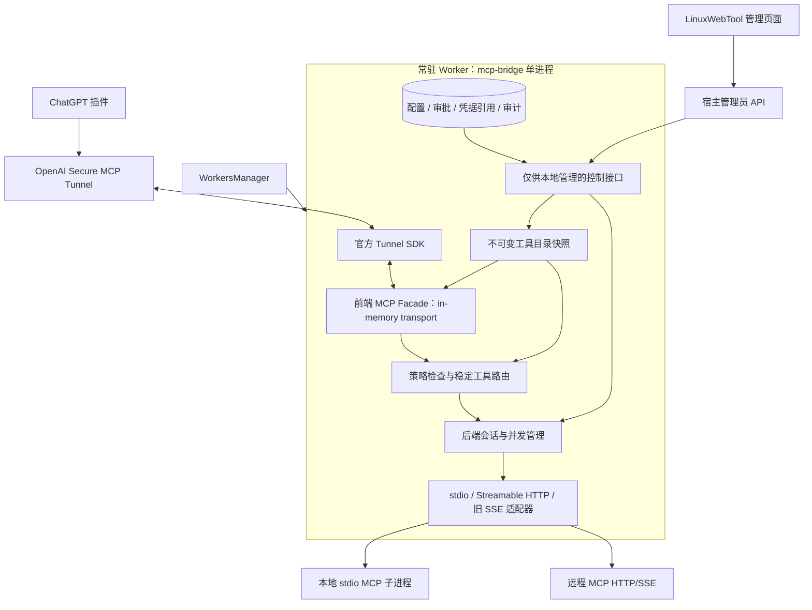
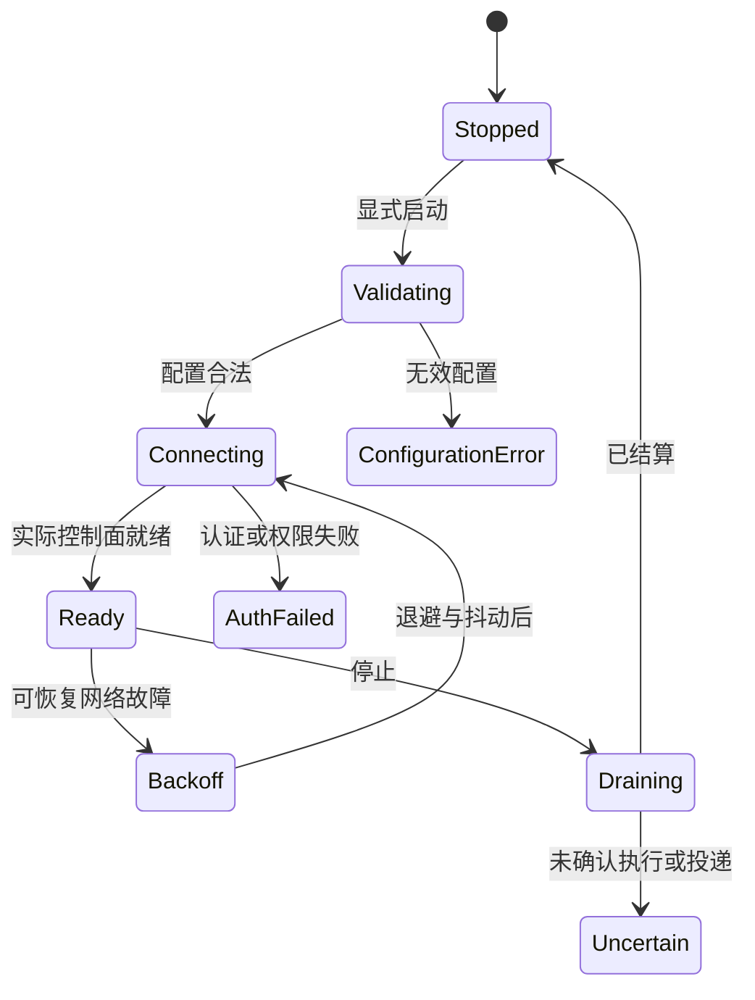

# 函数服务托管的 ChatGPT Tunnel / MCP 聚合插件：可行性与设计

日期：2026-11-01。状态：调研方案，未实施、未压测、未进行真实 ChatGPT 接入。

已确认目标：**单机 / NAS 自用，优先低占用**；支持 Tunnel ID + OpenAI Platform API Key、动态添加本地与远程 MCP、按服务及工具勾选暴露。本文由当前对话直接调研整理。既有源码、在线资料和设计建议在文中分别标明。

阅读配套：[本地基础设施核验](mcp-tunnel-plugin-infrastructure.md) · [语言、库与行业方案比较](mcp-tunnel-plugin-options.md) · [前期 WebCodex Tunnel 源码调研](webcodex-tunnel-research.md)。

## 1. 结论与建议路线

**可行，但应实现为“函数服务托管的常驻 MCP 聚合网关”，而不是每次调用才启动的短生命周期函数。** 界面里是一个插件，内部同时承担 Tunnel 客户端、前端 MCP Server、后端 MCP Client、工具目录和策略管理。HTTP/SSE 的普通反向代理不足以完成协议、会话和工具过滤。

建议首版使用 **Go 单个预编译可执行文件 + 官方 Tunnel Go SDK + 官方 MCP Go SDK**，由当前 Workers 管理启动和日志。官方提供同进程 in-memory MCP 接入示例，无须额外运行一个 Tunnel 进程和本地 MCP HTTP 监听器；这是减少进程与协议维护量的实现机会，不是已经测得的最低内存结论。[官方嵌入说明](https://github.com/openai/tunnel-client#embed-as-a-go-sdk)

保留两个替代方案：优先验证“现成 MCPProxy + 官方 tunnel-client”能否满足需求，减少自研；若维护语言统一比独立部署更重要，使用独立 C# Worker + 官方 MCP C# SDK，Tunnel 仍复用现成客户端。Rust 作为后续实测资源预算不达标时的备选，不能仅凭语言印象决定重写。

当前 Workers 没有 Native runtime，Linux 首轮验证可用 Bash 入口 `exec` 预编译程序；正式版本建议增加明确的 Native 适配器。不要在 NAS 启动时执行 `go run`、Cargo 编译或 `dotnet run`。具体宿主缺口见配套基础设施核验。

## 2. 边界：能支持什么，“透传”到哪里为止

| 需求 | 可行性 | 设计边界 |
|---|---|---|
| Tunnel ID + Key 接 ChatGPT | 可行，已有官方 SDK | Key 是 Platform Tunnel 控制面凭据，不是 ChatGPT 网页 Cookie；需平台资源、workspace 关联与权限 |
| 本地 MCP | 可行 | 明确指 stdio command + argv + cwd + 最小环境；不是任意 REST URL |
| 远程 Streamable HTTP MCP | 可行，优先 | 后端必须真的实现 MCP，不自动把 REST/OpenAPI 变成 MCP |
| 旧 HTTP+SSE MCP | 可行，作为兼容适配器 | 包括 GET SSE 和服务端告知的 POST message 地址；与 Streamable HTTP 响应内的 SSE 不同 |
| 动态添加 / 删除后端 | 可行 | 独立重建后端实例和目录，不为每次变更重启 Tunnel |
| 勾选服务 / 工具 | 可行且必须双重执行 | `tools/list` 隐藏 + `tools/call` 拒绝；空选中集表示全部拒绝 |
| 任意 MCP 特性完全透明 | 首版不承诺 | 工具、结构化结果和错误必须保留；resources/prompts/UI/双向请求另做能力矩阵 |
| 常驻插件执行数小时任务 | 进程可常驻，单次调用不可无限保持 | 长任务及时返回任务标识，由查询工具后续观察 |

官方当前默认 Tunnel 限制包括：同 tunnel/application 维度持续 600 请求/分钟、完整序列化 envelope 10 MiB、从入队到结果送达共 120 秒、等待队列 1,000 项。进度通知不重置期限，多启动客户端不增加额度。配置上线前应重新核验。[官方限制](https://developers.openai.com/api/docs/guides/secure-mcp-tunnels#limits)

本方案首版仅个人同一授权主体；Tunnel ID 不代表终端用户身份，也不是不同聊天的会话标识。多人共享需要独立身份与下游授权模型，不能把个人 No Auth 接入直接升级为团队隔离。

## 3. 建议架构与责任分工



逻辑拆分：

- **Workers 宿主**：安装、启动、停止、资源与进程树所有权、自动启动意图、日志入口。
- **Bridge**：Tunnel 连接、MCP 协议、后端 session、工具过滤、配置快照、结果回传。
- **LinuxWebTool 管理 API**：JWT 管理鉴权、只写凭据、服务与工具选择页面；不向 ChatGPT 暴露这些管理操作。

使用 Worker `Service` 形态，因为插件需要本地管理/健康 HTTP 接口；Tunnel 与 Facade 可直接走内存。监听仅限 loopback。`/healthz` 是存活，`/readyz` 是就绪，`/admin/*` 另用宿主专用凭据。远端只能进入 MCP Facade，不能通过 Tunnel 访问管理 API。

可以将 LinuxWebTool 自身 `http://127.0.0.1:5270/mcp` 注册成一个后端，只勾选需要的工具；使用独立低权限 `lwt_...` Key。插件不应反向递归注册自己的聚合入口。

默认由一个 Worker 独占一个 Tunnel/profile，使用进程所有权锁阻止重复启动；恢复时核对旧 owner 是否确实退出。不要把同一 Tunnel 的多个客户端当作无状态负载均衡，尤其不能据此共享 stateful MCP 会话。插件持续运行的前提是宿主应用/容器也持续运行；宿主停止、NAS 重启后的启动意图必须单独持久化并落实。

## 4. 动态添加、勾选和发布流程

1. 管理员添加后端草稿：传输类型、URL 或 executable/argv、凭据引用、超时和会话策略。该操作允许联系远端或执行本地程序，应在页面说明。
2. 做路径/目标校验并建立受限探测连接；按协议版本协商后端能力，遍历分页 `tools/list`，限制页数、工具数、Schema 大小和总耗时。
3. 将发现的工具放入“待选择”目录。**新增服务默认关闭，新工具默认未勾选**；连接成功不等于已公开。
4. 保存明确 allowlist，生成候选快照；持久化配置与审批 revision 后，用一次原子交换发布运行快照。
5. 按已协商的协议/传输发送目录变化通知。ChatGPT 是否刷新由实际客户端决定；必要时提示用户刷新插件工具或重新连接，不承诺自动立即识别。
6. 工具调用先解析已发布名称，再查当前授权与后端实例 revision，取有界执行租约后才分发；配置变更不得悄悄改投另一个服务器。

MCP 规范允许工具集合随授权和实际目录变化，并建议稳定排序；旧协议通知与现代订阅机制应由 SDK 按协商版本处理，不能硬编码一种推送方式。[工具规范](https://modelcontextprotocol.io/specification/2026-07-28/server/tools)

### 工具身份与过滤规则

建议身份为 `(serverId, upstreamToolName, backendRevision, schemaDigest)`，导出名是稳定命名空间 `nas__read_file`。采用大小写敏感的精确映射，不靠拆分字符串猜路由；名称过长或冲突时生成短哈希后缀并持久化。首版可主动采用不超过 64 字符的兼容策略，这是产品约束而非声称所有 MCP 版本的统一限制。

```text
可发现 = profile启用 ∧ server启用 ∧ tool被显式选择 ∧ Schema已审核
可执行 = 可发现 ∧ 当前调用授权 ∧ 绑定实例仍匹配 ∧ 后端可用 ∧ 获得执行配额
```

业务调用不能修改 selection；description/Schema 来自外部，不应自动视为可信指令。Schema、工具描述或权限语义有变化时标记“待复核”，默认暂停新调用；仅顺序变化不应反复触发审批。服务地址/凭据变化产生新绑定，不继承旧的执行目标信任。

若后端自身提供通用执行/再代理工具，勾选该工具仍可能允许它访问大量未逐项列出的能力；需要在 UI 显示这种授权范围，不能声称“只选一个工具”就自动实现最小权限。后端也可能依赖 Node/Python/其他解释器；Bridge 是单二进制不等于所有 MCP 服务都免依赖，首版只检测并报告缺项，不静默执行 npx/uvx 安装。

**撤销语义**：取消勾选后，新调用和未分发的排队调用必须拒绝；已经可能执行的操作不能宣称已撤销，记录 in-flight 状态并提供尽力取消。即使 ChatGPT 缓存了旧工具列表，执行入口仍拒绝被撤销工具。

## 5. 配置与接口草案

以下是设计数据形状，不是当前 Workers 已支持的字段，不可直接作为现有 `worker.json` 导入：

```json
{
  "schemaVersion": 1,
  "revision": 12,
  "tunnel": {
    "id": "<platform-issued-tunnel-id>",
    "credentialRef": "secret:tunnel-primary"
  },
  "servers": [{
    "id": "nas",
    "transport": "stdio",
    "command": "/opt/mcp/fs-server",
    "args": ["--root", "/volume1/shared"],
    "cwd": "/opt/mcp",
    "credentialRef": null,
    "enabled": true,
    "selectedTools": ["read_file"],
    "sessionPolicy": "isolated",
    "revision": 3
  }],
  "limits": {"globalConcurrency": 4, "perServerConcurrency": 2, "queueCapacity": 16}
}
```

另建 `tool_approvals` 保存当前描述/Schema 的指纹与审批状态；不在普通配置返回值中混入明文 Key。UI 保存时携带 `expectedRevision`，冲突返回明确错误并要求刷新，不后写覆盖先写。

最小管理接口：服务 CRUD、显式 probe/discover、工具勾选 apply、Tunnel start/stop/status、健康与审计查询。数据可以存入 Worker 私有 SQLite 或有 revision 的 JSON；首版不要同时维护两份可写配置。若 Go 数据库驱动影响交叉编译/体积，可先选原子 JSON 快照，审计采用有上限的追加日志；需要事务/检索再选 SQLite。

## 6. 设计模式：解决已有变化点，避免堆抽象

| 模式 | 本方案具体落点 | 不承担的责任 |
|---|---|---|
| Adapter | stdio / 旧 SSE / Streamable HTTP 转为统一 BackendSession | 不自行实现所有协议细节，优先 SDK |
| Strategy | 后端会话复用、超时、重试资格、健康检查策略 | 不把写工具统一设为可重试 |
| State Machine | Tunnel、Backend、整体就绪分别建状态机 | 不用“进程存活”代替连接成功 |
| Registry / Router | 不可变工具目录与稳定名称到后端映射 | 不通过扫描全部服务试调用来路由 |
| Decorator / Pipeline | 凭据隔离 → 过滤 → 配额 → 审计 → 调用 | 过滤必须同时覆盖发现和执行 |
| Bulkhead + Circuit Breaker | 每后端并发隔离，故障只影响该后端 | 熔断恢复探测不能重放未知结果的写操作 |

首版用少量接口和显式状态表即可，不需要插件框架套插件框架、CQRS、消息总线或 Kubernetes。



Backend 单独使用 `Disabled → Discovering → Ready / Degraded / AuthRequired / ReviewRequired → Draining → Stopped`。整体可为 `PartialReady`：可用后端继续提供已批准工具，坏后端明确报不可用，不静默切换目标。401/403 等持久错误进入可见终态，不让宿主无限重启绕过。

## 7. 必须补齐的逻辑缺口

| 缺口 | 推荐处理 |
|---|---|
| 会话串扰 | stateful 后端按可信前端 session / 显式租约隔离；不可用 tunnel ID 或共享 API Key 推断聊天身份 |
| 现代无状态调用连接旧 stateful stdio | 默认每次独立后端 session；允许声明无状态/可安全复用后再池化。真正需要跨调用状态的后端必须显式建租约，不能共享一个全局进程状态 |
| stdio 被当日志吞掉 | MCP Client 必须独占子进程 stdin/stdout；stderr 是日志。现有 Worker 不可直接作为 stdio Client |
| 全协议“透明”假设 | 首版限定 tools；保留 result content/structuredContent/isError/_meta。资源 URI 需命名空间和读策略，客户端双向请求需能力协商；未支持能力不宣告 |
| 鉴权混用 | Tunnel Key、管理 Key、每后端 Key/OAuth 分开；禁止把入口 Authorization 全量转发所有后端 |
| 任意 URL / command | 管理员批准 executable、cwd 和网络目标；NAS 私网可显式允许，拦截未批准地址、metadata 地址、重定向和递归入口；旧 SSE message 地址也校验 |
| 下游子进程继承控制面密钥 | 启动时清理继承环境，只传必要 PATH/HOME/证书及该后端批准的 secret；不能把宿主所有环境原样带下去 |
| 非幂等调用断连 | 自动重连与业务重试分离；可能已执行的调用标记 unknown，不自动重放写入 |
| 重复 poll / 重启 | 优先复用成熟 Tunnel 实现；核验所选版本去重与持久收据边界，不能假定恰好一次执行 |
| 大结果与多媒体 | 限制 envelope、单 SSE event 和内容大小；不要把二进制拼成无限日志或任意截断 JSON；资源/文件交付能力另验收 |
| 管理面暴露 | 管理 API 不进入 ChatGPT 工具目录；loopback 仍需管理认证，浏览器请求需宿主权限校验 |

MCP 安全指南明确涉及 token passthrough、SSRF 和代理场景中的 stdio 风险。个人 NAS 自用仍须控制执行身份和凭据流向；工具勾选不是操作系统沙箱。[MCP 安全实践](https://modelcontextprotocol.io/docs/2025-11-25/tutorials/security/security_best_practices)

## 8. 性能策略与验证方法

此场景首先受后端进程、网络与工具数量影响，语言只决定一部分开销。建议优化顺序：限制后端数量/会话 → 避免每次调用冷启动 → 复用 HTTP 连接 → 缓存稳定工具目录 → 限制队列和结果 → 最后比较语言。

```text
内存总量 ≈ Bridge + 各 stdio 后端进程 + 活跃会话状态
         + 并发结果/SSE缓冲 + Schema目录 + 日志/收据缓存
单调用延迟 ≈ 平台排队 + Tunnel传输 + 本地排队 + 适配/校验 + 后端执行 + 回传
```

单机建议起始值（待测后调整）：全局并发 4、每后端 1–2、等待队列 16、排队预算 2 秒、普通后端操作预算 30 秒、工具发现预算 10 秒、单结果软限 1 MiB。约束必须在 transport 的总 deadline 内扣减执行预算，并预留回传时间；不能每一层重新获得完整 120 秒。长工具按明确 opt-in 放宽，仍不能超过控制面剩余预算。

保留有状态 session 时设置空闲 TTL、总 session 上限和每后端进程上限；活跃调用期间不能被空闲清理。新增工具默认关闭，首版建议导出不超过 100 个工具作为配置提醒阈值，不伪称平台硬限制。目录更大时再考虑 discover/describe/call 模式；它会改变模型交互和工具审批粒度，不能静默替换直接工具表。

压测计划：相同 NAS/容器、相同后端和工具 Schema，对比现成代理、Go 单进程、C# 独立 Worker；分别测纯代理和包含子进程的总量。采样 idle 15 分钟、3 后端/100 工具、并发 1/4/8、后端断网、取消、配置频繁修改、运行 24 小时。记录 RSS/PSS 或 cgroup memory.current、总 CPU 时间、p50/p95、本地热路径额外延迟、进程/FD 数、GC 和错误率。

可设试验门槛：Bridge 单独 idle ≤96 MiB、空闲 CPU 均值 <1 个逻辑核的 1%、本地热路径额外 p95 ≤10 ms、24 小时稳定负载下无持续内存/FD 增长。**这些是候选验收目标，不是测量结果或产品保证**；后端进程和硬件不明时不能承诺总量。对比必须同时展示 PSS/进程树总量，不能只挑单进程 RSS。

## 9. 分阶段落地与停止条件

| 阶段 | 范围 | 通过标准 |
|---|---|---|
| P0 兼容性验证 | 对照现成 MCPProxy；验证官方 SDK 单进程样例、三个传输、两后端同名工具、ChatGPT 一次只读调用 | 选型与协议风险有实证；禁止直接扩到全协议 |
| P1 可用首版 | Worker 托管、单 Tunnel、CRUD/发现、显式勾选、稳定名称、只写凭据、管理界面、恢复/关闭 | 取消勾选后旧缓存调用也拒绝；全不选无工具；配置持久、停止可结算 |
| P2 稳定性 | Native runtime、开机启动意图、优雅停止、配额/熔断、Schema 变更审核、断连未知态、24h 测试 | 不孤儿、不无限重启、不重放未知写操作，资源满足预算 |
| 后续可选 | OAuth、resources/prompts、任务协议、多 Profile、团队身份 | 每项独立做权限与兼容性验收，不默认纳入首版 |

P0 如果现成方案满足交互、过滤、生命周期和资源预算，停止自研数据面，保留宿主集成即可。如果 Go 同进程 SDK 与所需会话模型不兼容，先退回官方 Tunnel 独立进程 + Bridge，评估增加的实际资源再决定是否自行扩展。

## 10. 已决与未决

已决：单机/NAS、低占用、先做可行性方案；不创建远程资源、不安装依赖、不修改产品代码。建议由调研者提出：Go 单进程优先、个人 profile、工具白名单、协议 SDK、独立管理面，尚非用户批准实施。

实现前需要补充：NAS CPU 架构/内存、常用 MCP 清单、是否依赖 OAuth/有状态跨调用工具、是否要求旧 SSE、运行账户与容器布局，以及可以接受的资源预算。当前未获真实平台账号资格、硬件、所选 SDK 固定版本和性能证据。
