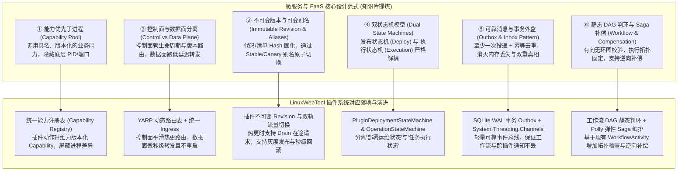
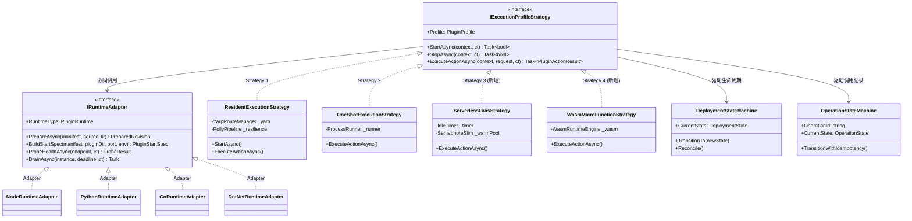
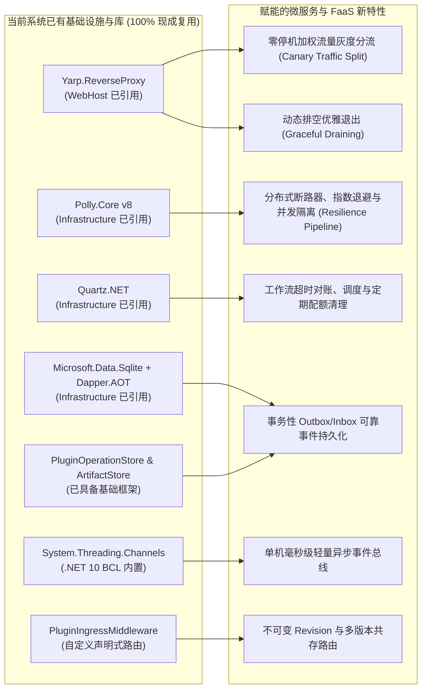
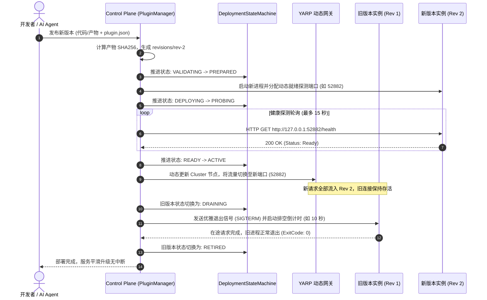
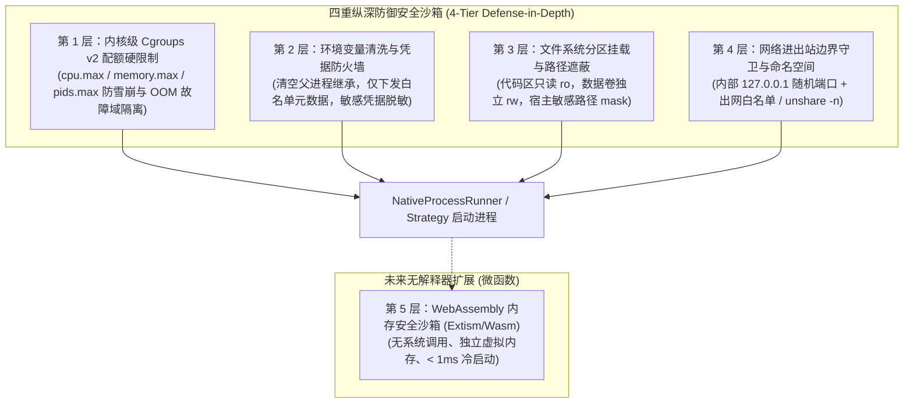
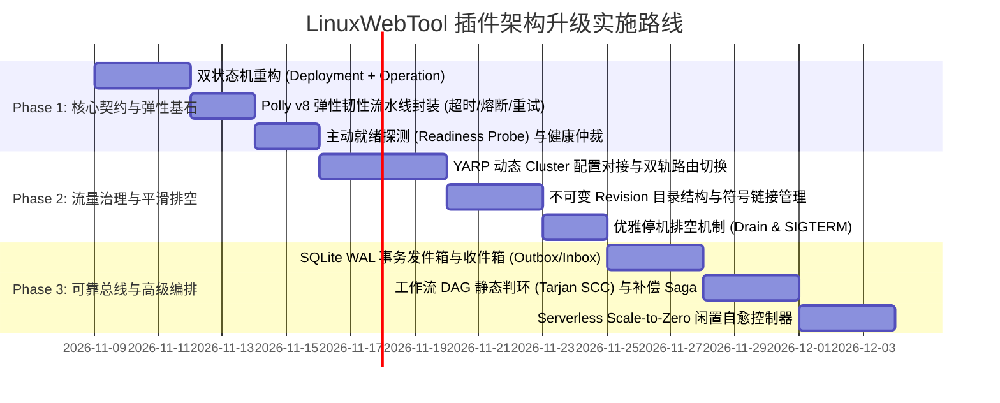

# 借鉴微服务与函数平台架构优化 LinuxWebTool 插件系统调研与落地方案

> **文档定位**：架构调研与系统重构方案  
> **编写日期**：2026-11-08  
> **参考来源**：`微服务及函数平台软件`（Moleculer、Windmill、K3s、Knative、Dapr、faasd、WasmCloud 等选型与运行时设计）  
> **当前系统底座**：.NET 10 WebHost (C# 14)，Alpine Linux Native AOT 独立无解释器二进制，特权 Docker 宿主集成环境。

---

## 1. 调研背景与参考选型核心解构

### 1.1 调研背景与核心问题

当前 LinuxWebTool (LWT) 经过前期重构，已经将“后台常驻 Worker”与“轻量脚本扩展 Extension”整合为统一的插件服务体系（`Plugin Platform`），基于 `plugin.json` 驱动生命周期，并提供了 `Resident`（常驻微服务）与 `OneShot`（瞬态脚本）两种执行规格，同时集成了 MCP (Model Context Protocol) 供 AI Agent 调用，以及工作流 (Workflow) 引擎。

然而，随着系统承载的微服务逐渐增多（如 MCP 安全网关 `mcp-bridge`、SOCKS5 代理网关、Caddy 服务管理器、LXC 容器管理器等），以及 AI Agent 动态调用与工作流编排的高频化，当前的插件架构逐渐暴露出**缺少不可变版本管理**、**热更易引发在途请求断流**、**状态机粒度粗放缺少主动就绪探测与对账**、**跨服务通信缺少持久化消息事件保证**、以及**高频脚本执行缺少轻量级沙箱隔离**等深层次架构瓶颈。

参考知识库《微服务及函数平台软件》对两大主流架构方向的深度剖析：
- **方案 A（极简轻量单机流）**：Moleculer + Windmill + NATS JetStream + PostgreSQL；
- **方案 B（云原生编排容器流）**：K3s + Knative Serving + Dapr + Event Broker；
- 以及 **轻量边缘流**：OpenFaaS/faasd、WasmCloud、Extism/WebAssembly、Supabase Edge Functions。

本调研的核心目标：**在不打破 LWT 极速轻量、单容器交付、.NET 10 Native AOT 零外部重型依赖（不强装 Kubernetes、不强装 PostgreSQL/Kafka）的前提下，充分借鉴业界成熟微服务与 FaaS 平台的核心架构思想与设计模式，对当前插件系统进行升维优化。**

---

### 1.2 核心设计范式提炼与映射

知识库中对微服务与函数平台的核心原则，可以直接映射并指导 LWT 的插件系统升级：



---

## 2. 头脑风暴：现状系统缺陷与技术债务诊断

结合当前 LWT 源码（`PluginManager.cs`、`PluginStateMachine.cs`、`PluginIngressMiddleware.cs`、`OneShotExecutionStrategy.cs`、`ResidentExecutionStrategy.cs`、`WorkflowActivities.cs` 等），我们在可行性、逻辑闭环、性能瓶颈与安全隔离四个维度进行深度排查：

### 2.1 可行性与版本治理：缺少“不可变 Revision”与“排空 (Draining)”机制
- **现状缺陷**：当前插件完全基于物理目录（`data/plugins/<id>/`）运行。当执行热更新或代码编辑时，新代码直接覆盖当前目录，或向运行中的进程发送重启信号。
- **痛点分析**：
  1. **执行语义漂移**：如果一个长时工作流正在调用插件的某个动作，中途插件被热更或重启，在途请求会直接遭遇 `Connection Refused` 或因参数契约改变而异常抛错；
  2. **缺少排空 (Drain) 阶段**：没有版本过渡机制，新版本尚未探测健康，旧版本就已经被强制 `kill`，违背了微服务“优雅下线与流量平滑移交”的原则；
  3. **无法灰度与回滚**：无法支持 Canary（金丝雀）测试，一旦新发布的代码出现运行时 Crash，系统会陷入 CrashLoopBackoff，无法自动回退到上一可用版本。

### 2.2 状态机逻辑：生命周期状态单一，缺少“就绪探测 (Readiness Probe)”与对账
- **现状缺陷**：当前 `PluginStateMachine` 仅管理底层进程的存活状态（`Stopped`, `Starting`, `Running`, `Crashed`, `Backoff` 等）。对于 `Resident` 微服务，进程一旦拉起并获得端口，状态机立刻从 `NotifyStarting` 跃迁为 `NotifyRunning`。
- **痛点分析**：
  1. **假就绪 (False Ready)**：很多微服务进程（如 Go/Node/Python 服务）在进程启动后，还需要加载模型、初始化数据库或建立网络监听。在完成监听前，反向代理如果把流量打过去，客户端将拿到 502 Bad Gateway；
  2. **缺少双状态机解耦**：将“插件部署生命周期”与“单次调用的执行生命周期”混杂在一起，导致外部调用者无法清晰判断是“插件没准备好”还是“任务在排队执行”。

### 2.3 性能与资源瓶颈：高频 OneShot 脚本的冷启动开销与进程抖动
- **现状缺陷**：对于轻量脚本扩展（`profile: oneshot`），每次调用动作（`ExecuteActionAsync`）都通过 `Process.Start` 启动外部解释器（`python`, `node`, `bash`）。
- **痛点分析**：
  1. **解释器冷启动延迟**：Node.js 或 Python 进程的拉起、加载内置模块需要 50~200ms。若 AI Agent 高频调用或工作流密集执行数十个步骤，系统会因频繁 `fork`/`exec` 导致 CPU 负载尖峰与内存抖动；
  2. **无 Scale-to-Zero（缩容至零）与预热池**：要么是常驻（一直吃内存与端口），要么是一次性（每次硬冷启）。介于两者之间的“按需拉起、空闲一段时间自动释放”的 Serverless 模式在当前系统缺失。

### 2.4 可靠性与通信：内存事件无持久化保证，存在“双重真相”
- **现状缺陷**：当前跨模块通知依赖 C# 进程内事件 `OnPluginStateOrManifestChanged`，操作记录虽然有内存级的 `PluginOperationStore`，但未形成统一的事件持久化规范。
- **痛点分析**：
  1. **单点故障丢消息**：如果容器或后台服务重启，正在排队的操作状态和未交付的通知全部蒸发；
  2. **非幂等重复执行**：若上游因网络抖动重发调用，缺少数据库级原子锁判定，容易产生重复副作用（如重复创建规则、重复写入文件）。

### 2.5 安全沙箱：缺少资源配额与强隔离机制
- **现状缺陷**：所有脚本和原生插件均在 LWT 宿主容器内部以当前权限运行，虽然有 `PluginSecurityGuard` 对路径和命令名称做了基本的黑白名单正则过滤，但缺乏内核级的强力约束。
- **痛点分析**：
  1. 插件无法对自身的最大 CPU、内存、文件句柄设定硬性限额，若第三方插件出现内存泄露或死循环，会直接拖垮 LWT 主系统；
  2. 环境变量注入较粗糙，插件容易通过标准系统 API 探测并读取到其他插件或容器的运行参数。

### 2.6 现状缺陷与方案应对闭环对照矩阵 (Defect-to-Solution Closed-Loop Matrix)

| 诊断项 | 核心缺陷与痛点 | 方案落地处理手段 | 对应设计模式与机制 | 对应章节 |
| :--- | :--- | :--- | :--- | :--- |
| **2.1 版本治理与排空** | 单目录覆盖热更、长任务契约漂移、旧进程强杀 502 断流、无法灰度与回滚 | ① 不可变目录 `revisions/rev-xxx/` + 符号链接；<br>② `aliases.json` 别名路由与流量加权分流；<br>③ `Draining` 排空期发送 SIGTERM 保护在途连接；<br>④ 工作流实例启动时锁定具体 revision。 | 不可变版本模式、金丝雀分流 (Canary)、优雅排空 (Drain) | §6.2, §6.3 |
| **2.2 状态机与就绪探测** | 进程起即标记 Running (假就绪 False Ready)、状态粗放揉杂、缺少自愈对账 | ① 解耦为 `DeploymentStateMachine` 与 `OperationStateMachine`；<br>② 引入 `Probing` 状态，HTTP GET `/health` 探针通过后才接收流量；<br>③ 基于已有的 `Quartz.NET` 运行 30s 控制器对账循环自愈。 | 正交双状态机模式、主动就绪探针 (Readiness Probe)、Reconciler 对账循环 | §3.3, §5.1, §6.3 |
| **2.3 性能冷启与进程抖动** | OneShot 脚本每次 `Process.Start` 耗时 50~200ms，高频调用引发 CPU 颠簸；无冷启缩容 | ① 新增 `ServerlessFaasStrategy`（按需预热拉起，闲置超时 Scale-to-Zero 自动释放）；<br>② 新增 `WasmMicroFunctionStrategy`（纯计算微函数内存内装载，冷启 < 1ms，零进程 fork）；<br>③ Polly v8 RateLimiter/Bulkhead 隔板流控。 | 策略模式 (Strategy)、Scale-to-Zero、WebAssembly 内存沙箱、并发隔板 | §3.2, §5.1, §6.5 |
| **2.4 事件通信与双重真相** | 内存事件单点丢消息，无持久化队列，重复调用缺少幂等去重 | ① SQLite WAL 事务性发件箱 (`plugin_event_outbox`) 同库原子写入；<br>② `System.Threading.Channels` 极速单机异步事件通道；<br>③ 消费者收件箱 (`event_inbox`) 唯一键幂等去重，保证 At-least-once 投递。 | 事务发件箱模式 (Transactional Outbox)、收件箱去重模式 (Consumer Inbox) | §3.4, §5.1 |
| **2.5 安全沙箱与资源配额** | 缺少 CPU/内存配额硬限制，父进程敏感凭据被完全继承泄漏，脚本可穿透访问敏感文件 | ① Linux Cgroups v2 硬限制 (`cpu.max`, `memory.max` 建立 OOM 故障域绝对隔离，`pids.max` 防 Fork 炸弹)；<br>② `psi.Environment.Clear()` 清空继承，凭据脱敏防火墙；<br>③ 代码只读 `ro`、数据独立 `rw`、`unshare -m` 路径遮蔽；<br>④ 内部 `127.0.0.1` 绑定，离线脚本 `unshare -n` 断网。 | 四重纵深防御沙箱、Linux Cgroups v2 内核硬限额、最小权限白名单 | §6.5 |

---

## 3. 设计模式深度重构实践

针对上述痛点，我们引入经典设计模式结合微服务平台实践，对插件系统进行体系化重构：



### 3.1 适配器模式 (Adapter Pattern) 的深化：全生命周期能力适配
将原本仅仅用于“命令行拼接”的 `IRuntimeAdapter` 升级为具备**全生命周期治理**的适配器：
1. **准备与校验阶段 (`PrepareAsync`)**：在部署前执行依赖检查、二进制格式验证（ELF vs PE）、执行权限修正（`chmod +x`）；
2. **启动规约生成 (`BuildStartSpec`)**：按隔离策略组装环境变量、工作目录、标准端口环境变量（`PORT`）；
3. **就绪探测适配 (`ProbeHealthAsync`)**：依据清单定义的探针（HTTP GET、TCP Connect、命令退出码）进行微服务就绪状态仲裁；
4. **平滑排空适配 (`DrainAsync`)**：向进程发送优雅退出信号（SIGTERM/SIGINT），并在设定的 Deadline 内监控连接排空情况。

### 3.2 策略模式 (Strategy Pattern) 的扩充：四维执行规格矩阵
在现有的 `Resident` 和 `OneShot` 基础上，扩充两种面向现代云原生/边缘场景的执行规格：

| 策略规格 | 适用场景 | 资源占用 | 冷启动延迟 | 生命周期特征 |
| :--- | :--- | :--- | :--- | :--- |
| **`Resident` (常驻微服务)** | 高吞吐 API、WebSocket 网关、MCP 穿透桥接、SOCKS5 转发 | 独占端口与内存 | 0ms（已就绪） | 长期存活，具备自愈与 CrashLoop 熔断 |
| **`OneShot` (瞬态脚本)** | 每日健康巡检、批量运维排障、一次性配置推送 | 运行期瞬时占用 | 50~200ms | 触发即起，执行完毕退出并回收全部资源 |
| **`Serverless` (动态按需池 - 新增)** | 低频管理后台、统计分析报表、按需转换工具 | 空闲时 0 内存占用 | 100~300ms | 命中请求时即刻拉起，闲置 N 分钟后自动 Scale-to-Zero |
| **`Wasm` (微函数沙箱 - 预留)** | 高频无状态校验、数据过滤、加密转换、纯计算任务 | 内存池复用 (< 5MB) | **< 1ms** | 进程内 Wasm 沙箱实例，极致安全且零进程 fork 开销 |

### 3.3 状态机模式 (State Machine Pattern)：发布状态机与执行状态机正交解耦
参考知识库中的设计，彻底拆分为两个相互独立的状态机：

#### 1. 部署与生命周期状态机 (`DeploymentStateMachine`)
负责插件版本从代码导入到就绪上线的全流程控制：

```text
[DRAFT] (导入清单/源码包)
   │
   ▼
[VALIDATING] (JSON Schema 校验 / 依赖探针检查) ──► [INVALID] (依赖缺失/清单非法)
   │
   ▼
[PREPARED] (环境就绪 / 端口预分配)
   │
   ▼
[DEPLOYING] (进程启动 / 容器实例化)
   │
   ▼
[PROBING] (就绪探针主动轮询 / HTTP GET /health) ──► [CRASHED/FAILED] (超时未就绪)
   │
   ▼
[READY] (探测通过，准备承接业务)
   │
   ▼
[ACTIVE] (路由切换，流量正式打入) ◄── (正常运行与心跳守护)
   │
   ▼ (收到更新或停止指令)
[DRAINING] (切断新连接，等待在途请求完成，限时优雅排空)
   │
   ▼
[RETIRED/STOPPED] (释放端口与临时资源)
```

#### 2. 操作/任务执行状态机 (`OperationStateMachine`)
管理单次调用的幂等性与执行进展（对应已初步实现的 `PluginOperationStore`）：

```text
[QUEUED] ──► [STARTING] ──► [RUNNING] ──┬──► [SUCCEEDED] (产生 Artifact/结果数据)
                                       ├──► [FAILED] (抛错或非零退出)
                                       ├──► [TIMED_OUT] (触发超时熔断)
                                       └──► [CANCELLED] (客户端主动中止并补偿)
```

### 3.4 事务性发件箱模式 (Transactional Outbox) 与幂等收件箱 (Consumer Inbox)
针对消息事件可靠性问题，利用当前系统内置的 **SQLite WAL 机制**，实现单机高可用事件总线：
1. **原子同库写入**：当插件状态变更或操作完成时，在同一个 SQLite 本地事务中，同时写入业务记录表和 `plugin_event_outbox` 表；
2. **异步平滑推送**：后台常驻 `OutboxDispatcher`（基于 `System.Threading.Channels`）从 Outbox 批量读取未投递事件，推送到订阅者（如工作流引擎、WebSocket 客户端、Audit 审计记录器）；
3. **收件箱去重**：订阅端维护 `event_inbox(consumer_id, event_id, state)` 联合唯一索引，一旦收到重复事件直接跳过，保证业务层 **At-least-once 投递 + Exactly-once 处理**。

---

## 4. 业界主流方案横向对比与参考

将知识库涉及的各大主流方案与 LWT 的架构特征进行全方位雷达对比：

| 方案 | 运行粒度 | 动态发布能力 | 编排与工作流 | 依赖复杂度 | 资源底噪 (RAM) | 对 LWT 的借鉴价值 |
| :--- | :--- | :--- | :--- | :--- | :--- | :--- |
| **Moleculer** | Node.js 进程级服务 | 良好 (loadService) | 基础 (无持久工作流) | 低 (Node.js/可选 NATS) | 约 60~120 MB | **极高**：其 Action 命名规范、RPC 统一上下文（Context）、超时与熔断机制完全可用于 LWT 内部 Action 规约。 |
| **Windmill** | 脚本/作业 Worker | 卓越 (API/版本/代码) | 卓越 (持久流/DAG/审批) | 中 (Postgres + Worker) | 约 300~800 MB | **极高**：其“不可变版本 Hash + 别名路由”、“参数 JSON Schema”、“有界作业队列”是 LWT 插件平台演进的直接参考范式。 |
| **faasd / OpenFaaS** | 容器/微服务 | 良好 (镜像/进程) | 基础 (外部触发) | 低~中 (Containerd) | 约 150~300 MB | **高**：其 Watchdog 双向 HTTP 代理与优雅退出排空机制，为 LWT 宿主级微服务监管提供了极佳原型。 |
| **Knative Serving** | OCI 容器服务 | 卓越 (Revision/Traffic) | 弱 (需 Eventing) | 极高 (K3s/K8s/Istio) | 约 1.5~3 GB 起 | **中**：仅借鉴其不可变 Revision 命名模型与 Traffic Split 百分比灰度路由思想；坚决不引入 K8s 重量级控制面。 |
| **Dapr** | 微服务 Sidecar | 无源码管理 | 卓越 (Dapr Workflow) | 中~高 (多组件依赖) | 约 200~500 MB | **中**：借鉴其声明式 Actor/Workflow 确定性重放设计；但 LWT 不应采用重型 Sidecar 伴生进程。 |
| **Extism / Wasm** | 内存级 Wasm 沙箱 | 极致 (动态装载字节码) | 弱 (纯计算执行器) | 极低 (单一 SDK) | **< 10 MB** | **未来价值极高**：作为无解释器依赖的多语言轻量函数插件执行底座，彻底消除容器内多解释器维护成本。 |

---

## 5. 当前系统已有基础设施与第三方库复用盘点

在实现上述架构优化时，**严格遵守 LWT 原生轻量原则，坚决不引入笨重外部中间件**。当前系统的依赖库和基础设施已具备实现 90% 高级特性的能力：



### 5.1 关键库的具体复用路径

1. **`Yarp.ReverseProxy`（动态路由与流量控制引擎）**：
   - *复用场景*：接管微服务插件的底层反向代理与连接转发；
   - *落地方案*：利用 YARP 的 `InMemoryConfigProvider` 动态提供 `RouteConfig` 与 `ClusterConfig`。当插件发生版本更新时，配置双集群（`mcp-bridge-v1` 与 `mcp-bridge-v2`），通过权重调整实现 Canary 灰度分流与零停机排空。

2. **`Polly.Core`（微服务弹性韧性管道）**：
   - *复用场景*：插件 HTTP 内部调用 (`plugin_invoke`)、动作触发 (`plugin_action`) 与工作流步骤执行；
   - *落地方案*：针对每个插件实例化一个基于 Polly v8 构建的 `ResiliencePipeline`，组合：
     - 超时策略（`TimeoutStrategy`）：防止插件由于内部死锁导致宿主管线挂起；
     - 重试策略（`RetryStrategy`）：基于指数退避处理瞬时故障；
     - 断路器（`CircuitBreakerStrategy`）：当插件连续崩溃达到阈值时自动切断流量，保护宿主 CPU；
     - 隔板并发控制（`RateLimiterStrategy`）：防止某单一插件吞噬整个系统的连接池。

3. **`Microsoft.Data.Sqlite` + `Dapper.AOT`（统一控制面元数据与发件箱）**：
   - *复用场景*：存储 `CapabilityRegistry`、`DeploymentRevision`、`EventOutbox`、`EventInbox` 与执行历史；
   - *落地方案*：利用 SQLite WAL 模式的单写多读并发优势，在单机上提供相当于轻量级 PostgreSQL 的 ACID 事务保证，完全免除外部数据库依赖。

4. **`System.Threading.Channels`（单机极速事件总线）**：
   - *复用场景*：将 SQLite Outbox 与内存监听器解耦；
   - *落地方案*：采用 `Channel<PluginSystemEvent>.CreateBounded(new BoundedChannelOptions(10000) { FullMode = BoundedChannelFullMode.Wait })`，单机吞吐可达每秒数百万消息，零 GC 分配，完美贴合 Native AOT 运行目标。

5. **`Quartz.Extensions.Hosting`（长任务对账与自愈定时器）**：
   - *复用场景*：孤儿进程清理、超时任务扫描、Scale-to-Zero 闲置侦测；
   - *落地方案*：配置每 30 秒执行一次 `PluginReconciliationJob`，主动对比系统的 `desired_state`（期望状态）与 `observed_state`（实际进程/端口），实现类似 Kubernetes Controller Loop 的闭环自愈。

---

## 6. 统一架构升级具体方案设计

### 6.1 统一能力目录模型 (Capability Catalog Specification)

将原本松散的“插件动作”升级为强类型的“平台能力模型”：

```json
{
  "$schema": "https://json-schema.org/draft/2020-12/schema",
  "capabilityId": "plugins.mcp-bridge.tunnel-status",
  "revision": "sha256:7f83b1657ff1fc53b92dc18148a1d65dfc2d4b1fa3d677284addd200126d9069",
  "alias": "stable",
  "kind": "resident-action",
  "runtime": {
    "provider": "native",
    "entrypoint": "mcp-bridge",
    "httpEndpoint": "/api/v1/tunnel/status"
  },
  "inputSchema": {
    "type": "object",
    "properties": {
      "tunnelId": { "type": "string", "pattern": "^tunnel_[a-z0-9]{32}$" }
    },
    "required": ["tunnelId"]
  },
  "outputSchema": {
    "type": "object",
    "properties": {
      "status": { "type": "string", "enum": ["connected", "disconnected", "reconnecting"] },
      "latencyMs": { "type": "integer" }
    }
  },
  "execution": {
    "mode": "sync",
    "timeoutMs": 5000,
    "idempotency": "optional",
    "maxConcurrency": 10
  },
  "security": {
    "requiredScopes": ["plugins:read", "tunnel:status"],
    "rateLimit": { "windowSec": 60, "maxRequests": 120 }
  }
}
```

### 6.2 目录结构与不可变版本存储设计

为了支持零停机热更与无损回滚，重构 `data/plugins/` 目录组织结构：

```text
data/plugins/
├── mcp-bridge/
│   ├── .state/                  # 运行时动态数据（持久化，版本间共享）
│   │   ├── config.json
│   │   └── sqlite.db
│   ├── revisions/               # 不可变版本代码区
│   │   ├── rev-1.0.0-a1b2c3d4/   # 历史版本 1（可安全作为回滚备胎）
│   │   │   ├── plugin.json
│   │   │   └── mcp-bridge (ELF)
│   │   └── rev-1.0.1-e5f6g7h8/   # 当前运行版本 2
│   │       ├── plugin.json
│   │       └── mcp-bridge (ELF)
│   ├── current -> revisions/rev-1.0.1-e5f6g7h8  # 符号链接（指向活动版本）
│   └── aliases.json             # 别名路由表 {"stable": "rev-1.0.1...", "canary": "..."}
```

### 6.3 零停机平滑更新流程 (Zero-Downtime Deployment Flow)



### 6.4 工作流 DAG 判环与 Saga 分布式补偿引擎

针对现有工作流引擎的升级方案：
1. **静态 DAG 拓扑判环**：
   在工作流保存时，使用 **Tarjan 强连通分量算法 (SCC)** 进行静态依赖扫描。若存在任何回路（例如 `Step A -> Step B -> Step C -> Step A`），立即拦截并拒绝保存，输出精确的环路依赖链。
2. **Saga 补偿动作机制**：
   允许在 `WorkflowStep` 中声明对应的 `compensation` 动作：
   ```json
   {
     "name": "创建远程隧道",
     "activityType": "plugin",
     "parameters": {
       "pluginId": "mcp-bridge",
       "action": "create_tunnel",
       "param": "{\"target\": \"10.0.0.1\"}"
     },
     "compensation": {
       "action": "destroy_tunnel",
       "param": "{\"tunnelId\": \"${steps.create_tunnel.output.id}\"}"
     }
   }
   ```
   若后续步骤遭遇不可恢复故障且策略为 `FailAndCompensate`，编排器将按照拓扑逆序自动执行已完成步骤的补偿操作，确保系统状态严格一致。

### 6.5 四重安全沙箱与硬核资源配额落地方案 (Multi-Tier Security Sandbox & Hard Quotas)

针对 2.5 节诊断的“缺少资源配额与强隔离机制”，方案彻底摒弃“仅靠代码路径黑白名单”的虚假安全假象，借鉴 Linux 容器底座（OpenFaaS/faasd 与 Windmill Worker 隔离实践），在无需引入 Kubernetes/Docker-in-Docker 的前提下，依托特权容器原生构建 **四重纵深防御沙箱体系**：



#### 1. 第 1 层：内核级 Cgroups v2 配额硬限制 (Kernel-level Cgroups v2 Enforcement)
- **原理与优势**：LWT 运行在特权 Docker 容器或 Linux 宿主机上，宿主系统的 Cgroups v2 挂载在 `/sys/fs/cgroup/`。主控通过原生文件 I/O 即可为每个插件动态创建 cgroup 子树：
  `/sys/fs/cgroup/lwt/plugins/<plugin-id>/`
- **具体治理指标**：
  1. **CPU 限额 (`cpu.max`)**：
     在 `plugin.json` 的 `resources.cpuQuota` 声明（如 `"0.5"` 即 50% 单核，或 `"2.0"` 即双核）。
     写入：`echo "50000 100000" > /sys/fs/cgroup/lwt/plugins/<id>/cpu.max`（每 100ms 周期最多占用 50ms CPU）。
  2. **内存上限与硬 OOM 隔离 (`memory.max` & `memory.high`)**：
     在 `plugin.json` 的 `resources.memoryLimit` 声明（如 `"256MB"`）。
     写入：`echo "268435456" > /sys/fs/cgroup/lwt/plugins/<id>/memory.max`。
     > [!IMPORTANT]
     > **OOM 故障域绝对隔离**：一旦插件发生内存泄漏或死循环吃满内存，Linux 内核的 OOM Killer **只会精准杀死该 cgroup 子树内的插件子进程**，LWT WebHost 主进程和其它插件完全不受影响！
  3. **进程数硬上限与防 Fork 炸弹 (`pids.max`)**：
     声明 `resources.maxPids`（默认 64）。
     写入：`echo "64" > /sys/fs/cgroup/lwt/plugins/<id>/pids.max`。即使插件执行恶意 Fork 炸弹（`:(){ :|:& };:`），也会在达到 64 进程时被内核直接拒绝 `fork`，从底层杜绝进程表耗尽。
  4. **进程动态移入 (`cgroup.procs`)**：
     在 `NativeProcessRunner` 启动进程获得 PID 后，立即执行 `File.WriteAllText($"/sys/fs/cgroup/lwt/plugins/{id}/cgroup.procs", pid.ToString())`。进程退出后，cgroup 控制器自动回收。

#### 2. 第 2 层：环境变量清洗与凭据防火墙 (Credential Cleansing & Minimal Whitelist)
- **痛点根源**：.NET `ProcessStartInfo` 默认会完整继承当前 WebHost 宿主的所有环境变量，导致 LWT 管理员密码（`WEB_ADMIN_PASSWORD`）、JWT 签名密钥、SSH 私钥路径、数据库连接串全部泄漏给不可信子进程。
- **治理机制**：
  1. **显式清空继承 (`psi.Environment.Clear()`)**：在启动任何插件或脚本前，强制清空环境字典；
  2. **最小白名单下发**：仅投影基础系统环境（`PATH`, `LANG`, `TMPDIR`）与标准插件元数据（`LWT_PLUGIN_ID`, `LWT_CODE_DIR`, `LWT_VOLUME_DIR`, `PORT`）；
  3. **敏感凭据正则脱敏守卫**：内置环境变量过滤器，严禁下发任何匹配 `*(KEY|SECRET|PASSWORD|TOKEN|SSH|ADMIN|JWT)*` 的系统变量；
  4. **受控临时访问令牌**：微服务若需回调 LWT 平台 API，由控制面动态派发具名、有时效（如 1 小时）、受限 Scope 的短期 Bearer Token，并在请求头中单向验签。

#### 3. 第 3 层：文件系统分区隔离与路径遮蔽 (Filesystem Jailing & Path Masking)
- **代码与数据严格分离 (Code `ro` vs Data `rw`)**：
  - 插件不可变代码版本目录（`data/plugins/<id>/revisions/rev-xxx/`）挂载为**只读 (Read-Only)**，插件进程无权修改自身代码或注入后门；
  - 插件持久化状态只能写入专属隔离卷 `data/plugins_data/volumes/<id>/`；
- **宿主敏感目录遮蔽 (Path Masking via Mount Namespace)**：
  - 对于不可信的 OneShot 脚本，使用 `unshare -m`（挂载命名空间）将宿主敏感目录（`/app/data` 主系统数据库、`/var/run/docker.sock` Docker 控制套接字、`/root/.ssh`、`/etc/shadow`）挂载为只读空 `tmpfs` 屏蔽层；
- **路径穿越强制拦截**：`PluginSecurityGuard.IsValidPluginId` 与路径安全断言在所有文件读写、日志采集与 Artifact 导出前执行完整绝对路径比对，彻底杜绝 `..` 相对遍历。

#### 4. 第 4 层：网络进出站边界守卫与命名空间 (Network Egress & Ingress Guard)
- **入站端口隐藏 (Loopback Only)**：
  - 微服务插件一律强制绑定 `127.0.0.1:<random-port>`，绝不监听 `0.0.0.0`。所有对外 HTTP/WebSocket 流量必须经过 LWT 的 `PluginIngressMiddleware` 或 YARP 代理，执行认证鉴权、CIDR 客户端白名单匹配与流控打分。
- **离线与纯计算脚本出站断网 (`unshare -n`)**：
  - 针对每日巡检、数据分析、文本处理等离线 OneShot 脚本，启动时添加 `unshare -n` 参数，将其置入隔离的网络命名空间（仅有本地 loopback，无任何物理网卡路由），物理上断绝数据外逃或矿机后门可能；
- **出口网关与白名单审计**：
  - 需外联公网的微服务（如 `mcp-bridge` 连接 OpenAI、代理工具连接对端），需在 `plugin.json` 中明确声明 `network.egressAllowed: true` 及目的域名白名单，由管理控制面统一审查与审计记录。

#### 5. 第 5 层（演进）：WebAssembly 内存级微函数沙箱 (Wasmtime / Extism SDK)
- 作为面向 Phase 3 的高级演进特性，针对高频瞬态计算逻辑（如自研过滤钩子、Payload 转换器、日志分析脚本）：
- **零冷启动 (< 1ms)**：直接在 LWT WebHost 进程内装载 Wasm 字节码；
- **硬件级内存隔离**：Wasm 模块运行在沙箱线性内存中，完全无法直接执行系统调用（Syscalls）、无法读写未授权磁盘文件、无法原生 fork 进程，具备天生的数学级安全性。

---

## 7. 分阶段实施路线图 (Phase 1 ~ Phase 3)

为了确保工程实施的可控性与稳定性，建议采取小步快跑、分阶段演进策略：



### Phase 1：核心契约与弹性基石 (预计 7 人日)
- **目标**：解决假就绪、单点调用阻塞、环境变量污染和粗粒度状态机问题；
- **具体交付**：
  1. 重构 `PluginStateMachine`，分离 `DeploymentStateMachine` 与 `OperationStateMachine`；
  2. 增强 `IRuntimeAdapter`，为 `Go`, `Node`, `Python`, `.NET` 补充主动探针实现（`ProbeHealthAsync`）；
  3. 基于已有 `Polly.Core` 组装插件专用的统一韧性流水线（`ResiliencePipeline`），杜绝死锁与雪崩；
  4. 实现 `NativeProcessRunner` 环境变量清洗与白名单投影机制（清空父进程继承，阻断 `WEB_ADMIN_PASSWORD`、JWT 等宿主凭据泄漏）。

### Phase 2：流量治理与平滑排空 (预计 9 人日)
- **目标**：解决代码更新断流、版本冲突、在途请求丢失与资源配额失控问题；
- **具体交付**：
  1. 引入不可变 Revision 目录模型与 `aliases.json` 映射逻辑；
  2. 对接已有 `Yarp.ReverseProxy` 的 `InMemoryConfigProvider`，实现毫秒级动态路由刷新；
  3. 完善 `DrainAsync` 逻辑，支持在新旧版本切换期间排空在途长连接；
  4. 实现 Linux 原生 Cgroups v2 配额绑定控制器，动态注入 `cpu.max`、`memory.max` 与 `pids.max`，建立硬核 OOM 故障域隔离。

### Phase 3：可靠总线与高级编排 (预计 9 人日)
- **目标**：解决跨插件异步事件丢失、复杂工作流死循环/不可逆与零信任函数沙箱问题；
- **具体交付**：
  1. 基于 SQLite WAL + `System.Threading.Channels` 实现持久化发件箱/收件箱总线；
  2. 升级工作流引擎，集成 Tarjan 判环算法与逆向 Saga 补偿机制；
  3. 实现轻量级 Serverless 策略，空闲微服务支持自动缩容至零；
  4. 探索基于 WebAssembly (Extism/Wasmtime) 的无解释器微函数沙箱执行器。

---

## 8. 总结与决策建议

通过深入调研《微服务及函数平台软件》知识库中的前沿理念并对照当前 LWT 代码库，我们得出以下明确结论：

1. **架构同构性与可行性**：
   LWT 现有的底层技术栈（C# 14, .NET 10 WebHost, Native AOT, YARP, Polly, Quartz, SQLite WAL）**与微服务平台理念高度契合**，无需引入笨重的 Kubernetes 或外部消息队列，即可在单进程/单容器内构建出高度工业级、弹性韧性的微服务与函数平台。
2. **模式驱动重构**：
   通过深入贯彻**适配器模式**（全周期运行时环境）、**策略模式**（四维执行规格）、**双状态机模式**（部署与执行正交分离）、以及**事务性发件箱模式**，可以彻底治愈系统当前在版本管理、平滑发布、假就绪与事件丢失方面的顽疾。
3. **投入产出比最大化**：
   遵循小步快跑的 3 个阶段演进路径，系统可以在保持 Native AOT 毫秒级极速构建与轻量化优势的同时，获得云原生级的优雅排空、灰度发布、工作流确定性与可靠事件通知能力。
