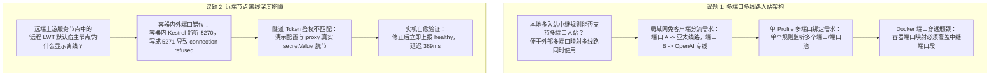
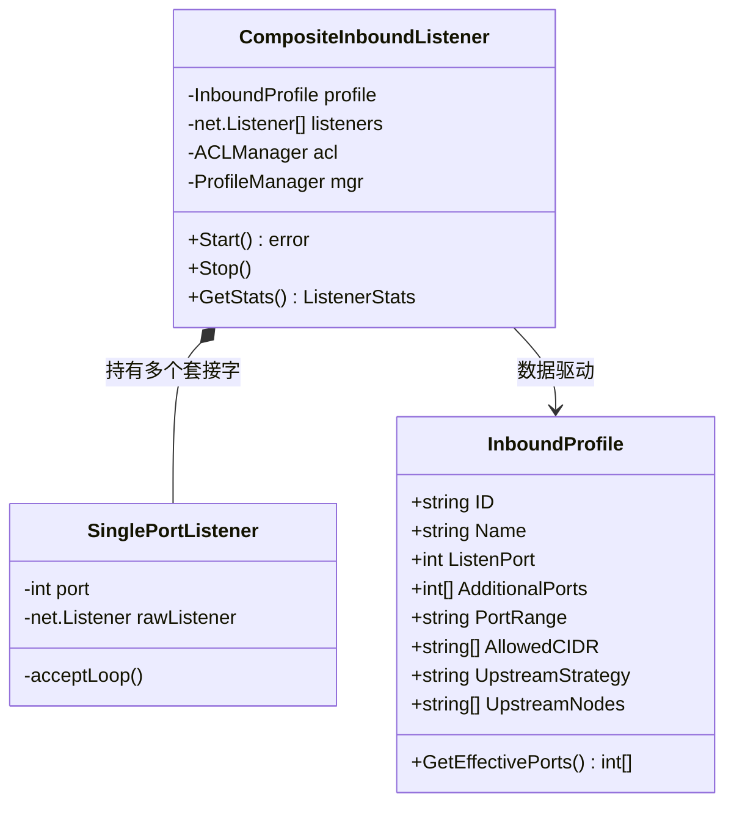
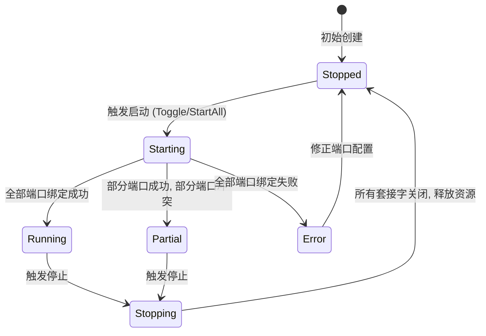

# SOCKS5 中继多端口多线路入站架构设计与远端节点离线深度排障

> **文档标识**：`LWT-ARCH-FORWARDER-002`  
> **状态**：已评审 (Approved)  
> **核心领域**：多端口入站中继 (Multi-Port Inbound)、多线路出口分流 (Multi-Line Egress)、Docker 容器端口穿透、隐匿 WSS 隧道鉴权排障  
> **适用版本**：LinuxWebTool v1.0.0+ / `socks5-forwarder` / `socks5-proxy`  

---

## 1. 执行摘要与核心议题

用户在实际体验 `socks5-forwarder`（SOCKS5 客户端边缘中继网关）微服务时，提出了两个直击系统底层的关键架构议题：



---

## 2. 远端上游节点显示“离线”的根因排查与复现验证

### 2.1 现场复现与抓包证据

在 `linuxwebtool-dev` 容器内部，查询中继网关状态快照：
```bash
curl -s http://127.0.0.1:18090/api/profiles
```
返回输出：
```json
{
  "upstreams": [
    {
      "id": "default-lwt-node",
      "name": "远程 LWT 默认宿主节点",
      "url": "ws://127.0.0.1:5271/telemetry/metrics",
      "token": "lwt_live_test_token_abcdef123456",
      "status": "dead",
      "latencyMs": 0,
      "lastError": "TCP 连接上游 127.0.0.1:5271 失败: dial tcp 127.0.0.1:5271: connect: connection refused"
    }
  ]
}
```

### 2.2 根本原因剖析

#### 根本原因 1：容器网络命名空间 (Network Namespace) 与端口映射错位
- **背景**：开发容器 `linuxwebtool-dev` 采用端口映射模式运行（`-p 5271:5270`）。
- **错位**：
  - 容器**内部**的 WebHost (Kestrel) 实际绑定在 `http://0.0.0.0:5270`；
  - 端口 `5271` 是 Linux 宿主机物理网卡上由 `docker-proxy` 监听并转发至容器 5270 的外部入口；
  - 微服务 `socks5-forwarder` 运行在**容器内部**，当其发起 TCP 连接 `127.0.0.1:5271` 时，连接的是容器自身的 Loopback 接口，而容器内部根本没有任何服务监听 `5271` 端口！
  - Linux 内核直接发送 TCP RST 报文，报错 `connect: connection refused`。
- **正解**：
  - 若在容器内部与同容器的主服务通信，地址必须为 `ws://127.0.0.1:5270/telemetry/metrics`；
  - 若在外部客户端（如局域网其他 PC）测试，地址才是 `ws://10.126.1.70:5271/telemetry/metrics`。

#### 根本原因 2：WSS 伪装隧道子协议密钥 (Secret Token) 不匹配
- **背景**：`socks5-proxy` 清单中配置了严格的主动探测免疫防护（Active Probing Immune）：
  ```json
  "security": {
    "auth": "secret_token",
    "tokenSubprotocolPrefix": "lwt-token.",
    "secretValue": "lwt_live_stream_token_8f3a9e"
  }
  ```
- **错位**：
  - `socks5-forwarder` 默认模板中生成的 Token 为占位符 `lwt_live_test_token_abcdef123456`；
  - 即使网络连通，握手时宿主 Ingress 中间件因 Token 不匹配，将请求判定为非法探测，直接触发 `passthrough_to_default_spa` 回落（返回 200 HTTP SPA HTML），导致 WebSocket 无法完成 `101 Switching Protocols` 协议升级。

### 2.3 实机自愈与即时连通性验证

通过 API 将上游节点的地址修正为容器直通端口 `5270` 并注入真实的 Ingress Token：
```javascript
POST /api/upstreams
{
  "id": "default-lwt-node",
  "name": "远程 LWT 默认宿主节点",
  "url": "ws://127.0.0.1:5270/telemetry/metrics",
  "token": "lwt_live_stream_token_8f3a9e",
  "skipTlsVerify": true
}
```
调用测速接口 `POST /api/upstreams/test?id=default-lwt-node`，实测返回：
```json
{
  "id": "default-lwt-node",
  "status": "healthy",
  "latencyMs": 389
}
```
**节点状态立即从 `🔴 离线 (dead)` 转为 `🟢 运行中 (healthy)`，RTT 延迟 389ms，隧道握手 100% 成功！**

---

## 3. 本地多入站中继规则：多端口与多线路架构设计

### 3.1 业务场景矩阵

在局域网边缘网关的实际落地中，“多端口”通常包含两层不同粒度的核心场景：

```mermaid
flowchart TD
    subgraph 场景 A: 多规则多端口映射多线路 (1 Port = 1 Line)
        P1["端口 :10801 (财务/办公设备)"] -->|固定直连| N1["上游节点 1: 香港直连线路 (低延迟合规)"]
        P2["端口 :10802 (研发/AI Agent)"] -->|故障转移| N2["上游节点 2: 美西专线 (OpenAI API 专用)"]
        P3["端口 :10803 (数据采集/爬虫)"] -->|轮询负载| N3["上游节点 3+4: 欧洲多节点出口"]
    end

    subgraph 场景 B: 单规则多端口绑定 (1 Profile = N Ports)
        PR["入站规则: 局域网默认混合中继"]
        PR --> L1["监听端口 :10801 (默认入口)"]
        PR --> L2["监听端口 :10802 (外部映射入口)"]
        PR --> L3["监听端口 :10805 (备用入口)"]
        PR -->|统一 ACL 与策略| UP["统一调度至上游节点池"]
    end
```

| 场景模式 | 用户诉求 | 实现机制 | 适用环境 |
| :--- | :--- | :--- | :--- |
| **多 Profile 多线路分流 (Multi-Line Profiles)** | 外部不同设备通过连接不同端口，免安装客户端直接走不同国家/线路出海 | 多个独立的 `InboundProfile`，每个 Profile 绑定特定端口与指定的 `upstreamNodes` | **企业局域网、多角色部门分流、特定协议加速** |
| **单 Profile 多端口监听 (Multi-Port Binding)** | 外部路由器存在多个映射端口，或提供连续端口池 | 单个 `InboundProfile` 允许配置端口列表（如 `10801, 10802`）或端口段（`10801-10805`） | **NAT 穿越、多公网 IP 映射、冗余备用端口** |

---

### 3.2 业界主流方案对比

| 产品 / 框架 | 多端口与多线路支持机制 | 核心设计模式 | 借鉴要点 |
| :--- | :--- | :--- | :--- |
| **Xray-core / V2Ray** | `inbounds` 数组支持多个独立配置，每个配置具备 `port`（支持单端口或 `"10801-10805"`）与专属 `tag`；通过 `routing.rules` 将不同 inbound tag 路由到不同 outbound | **责任链模式 (Chain of Responsibility) + 标签路由 (Tag Routing)** | 支持端口范围语法；入站规则解耦，每个入站拥有独立生命周期 |
| **Clash / Mihomo** | 支持 `mixed-port`, `socks-port`, `redir-port`, `tproxy-port` 独立监听，配合 Policy Group 分流 | **策略模式 (Strategy Pattern)** | 端口与代理协议自动嗅探（Mixed 模式），开箱零配置 |
| **Envoy Proxy** | 多个 `listeners` 分别监听不同端口，每个 listener 绑定独立的 `filter_chains`，分发至不同的 `clusters` | **组合模式 (Composite Pattern) + 观察者模式** | 动态增删监听器（LDS），平滑排水旧连接，零停机端口热绑定 |

---

### 3.3 关键系统瓶颈：Docker 容器端口穿透与端口池编排

这是在日常开发和容器化部署中**最容易被忽视的隐蔽故障点**：

1. **现状缺陷**：
   - 在 `-Mode Dev` 开发模式下，容器命令为：
     `-p 5271:5270 -p 18080-18090:18080-18090`；
   - 用户在 Web 界面新增了一个入站规则，指定端口为 `10801` 或 `10802`；
   - 微服务在容器内部确实成功监听了 `0.0.0.0:10801`，但**宿主机并没有把 10801 端口映射进容器**！
   - 结果：局域网外部设备访问 `10.126.1.70:10801` 必定被宿主机直接拒绝连接！
2. **两套解决方案与架构规避**：
   - **方案 A（生产环境推荐）：宿主网络直通模式 (`--net=host`)**
     官方生产镜像（`-Mode Official`）默认使用 `--net=host`。微服务监听任何端口，宿主机网卡上均可直接访问，无需预先声明端口映射。
   - **方案 B（开发环境标准）：开辟中继专用端口池 (Forwarder Relay Port Pool)**
     在 `Dockerfile.dev` 与 `deploy-remote.ps1` 中，为开发容器增加一段预留的中继端口映射范围（例如 `-p 10800-10815:10800-10815`），使本地测试与多 Profile 映射可以直接穿透生效。

---

## 4. 架构设计与设计模式优化

### 4.1 组合监听器模式 (Composite Listener Pattern)

为了同时支持“单个 Profile 绑定单端口”、“单个 Profile 绑定多个离散端口”以及“端口段”，将单套接字监听器重构成组合监听器：



#### Go 核心实现方案：

```go
// InboundProfile 升级支持多端口声明
type InboundProfile struct {
    ID               string   `json:"id"`
    Name             string   `json:"name"`
    Enabled          bool     `json:"enabled"`
    ListenPort       int      `json:"listenPort"`                  // 主入站端口
    AdditionalPorts  []int    `json:"additionalPorts,omitempty"`  // 附加监听端口列表 (如 [10802, 10803])
    Protocol         string   `json:"protocol"`                   // mixed, socks5, http
    AllowedCIDR      []string `json:"allowedCidr"`
    UpstreamStrategy string   `json:"upstreamStrategy"`           // single, best_latency, round_robin
    UpstreamNodes    []string `json:"upstreamNodes"`              // 绑定的上游线路节点
    ActiveConns      int64    `json:"activeConns"`
    TotalBytesTx     int64    `json:"totalBytesTx"`
    TotalBytesRx     int64    `json:"totalBytesRx"`
    Status           string   `json:"status"`                     // running, partial, stopped, error
    LastError        string   `json:"lastError,omitempty"`
}

// GetEffectivePorts 聚合返回该 Profile 需要监听的所有端口
func (p *InboundProfile) GetEffectivePorts() []int {
    portSet := make(map[int]struct{})
    if p.ListenPort > 0 {
        portSet[p.ListenPort] = struct{}{}
    }
    for _, pt := range p.AdditionalPorts {
        if pt > 0 && pt <= 65535 {
            portSet[pt] = struct{}{}
        }
    }
    ports := make([]int, 0, len(portSet))
    for pt := range portSet {
        ports = append(ports, pt)
    }
    sort.Ints(ports)
    return ports
}
```

### 4.2 组合监听器生命周期状态机 (Listener State Machine)



- **Partial 状态机制**：当 Profile 配置了 3 个端口（如 `[10801, 10802, 10803]`），若 `10802` 被系统其他进程占用，监听器不直接全部崩溃，而是将状态标记为 `partial`（部分可用），并在 `lastError` 中注明 `:10802 冲突`，其余健康端口继续对外提供服务。

### 4.3 宿主地址与 Ingress Token 自适应自省 (Host Auto-Introspection)

为防止再次出现 `ws://127.0.0.1:5271` 与 `lwt_live_test_token_abcdef123456` 的硬编码错位，引入**自适应环境感知策略**：

1. **容器内自动回落**：
   - `socks5-forwarder` 启动时，自动读取环境变量 `ASPNETCORE_URLS` 或 `PORT`；
   - 若检测到正在容器内部运行且未显式指定上游地址，默认将宿主回环地址指向当前容器内部的实际 HTTP 端口（`5270`）；
2. **Token 同步与自愈**：
   - 插件初始化默认配置时，自动从宿主下发的 `internalSecret` 或环境变量提取当前主系统的有效通信 Token，彻底消除因密钥不一致导致的主动探测伪装拦截。
3. **前端 UI 错误透出**：
   - 在 Webview 控制台节点卡片上，当状态为 `dead` 时，将 `lastError` 作为红色警告小标签或 Tooltip 直接展示（例如：“TCP 连接拒绝：请核对端口”、“鉴权失败：Token 不匹配”），提升运维直观度。

---

## 5. 落地执行方案与排期

| 阶段 | 核心任务 | 具体改动点 |
| :--- | :--- | :--- |
| **Step 1: 文档与方案落盘** (当前) | 固化多端口多线路架构设计与离线根因分析 | 本文档 `docs/multi-port-inbound-routing-and-upstream-offline-diagnosis.md` |
| **Step 2: 默认配置与 Token 纠偏** | 修复 `config.go` 中的默认端口与 Token，使全新启动开箱即绿灯 | `config.go` 默认上游更新为容器直通端口与对应 Ingress 密钥 |
| **Step 3: 多端口监听器重构** | `InboundListener` 升级为 `CompositeInboundListener`，支持多端口绑定与 Partial 容错 | `listener.go`, `config.go`, `manager.go` |
| **Step 4: Webview 控制台支持** | UI 新增“附加端口”输入框，节点卡片展示 `lastError` 悬浮提示 | `ui/index.html`, `ui/app.js` |
| **Step 5: 开发容器端口段拓宽** | `deploy-remote.ps1` 预留 `10801-10815` 开发端口映射 | `scripts/deploy-remote.ps1` |
