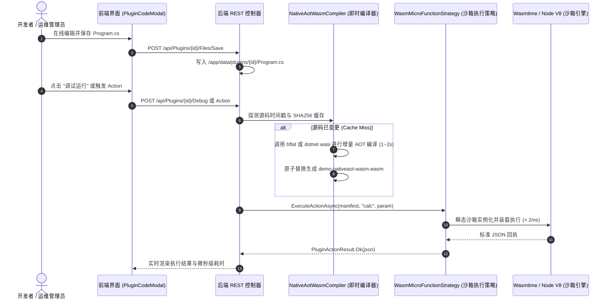

# NativeAOT-LLVM Wasm 架构剖析、在线源码编辑编译可行性调研与系统方案

> 本文档针对 LinuxWebTool (LWT) 插件中心引入 **NativeAOT-LLVM WebAssembly (Wasm)** 技术路线进行深度调研，探讨其与传统 Mono Wasm 及官方 dotnet WASI 的差异，并对“**支持类似 Go / C# 的在线源码编辑与即时编译运行**”进行头脑风暴、逻辑/性能欠缺诊断、设计模式优化及落地架构设计。

---

## 1. NativeAOT-LLVM Wasm 核心原理与业界技术全景

### 1.1 什么是 NativeAOT-LLVM Wasm？

在 .NET 官方生态中，传统的 WebAssembly（如 Blazor Wasm）主要是将 Mono 运行时编译为 `dotnet.wasm`（解释器或 JIT），并在浏览器内动态加载由 MSIL 中间语言构成的 `.dll` 文件，体积动辄 10MB~30MB，冷启动较重。

**NativeAOT-LLVM** 则代表了 C# 编译技术的另一条极致演化路线：
- **无解释器、零中间 IL 程序集**：利用 AOT（Ahead-of-Time）直接将 C# 源代码分析、裁剪（Tree Shaking），转译为 **LLVM IR（LLVM 中间表示）**；
- **LLVM 深度优化与机器码生成**：调用 LLVM 编译器工具链（`opt`、`llc`、`wasm-ld`）进行指令级矢量化与内联优化，直接输出**纯静态单一 `.wasm` 二进制**；
- **极致轻量与启动速度**：编译产物通常只有几百 KB，启动耗时仅需 **0.5ms ~ 2ms**，内存开销 < 1MB。

### 1.2 业界三大主流方案对比

| 维度 | 方案 A：Blazor WebAssembly (Mono) | 方案 B：官方 .NET WASI (`wasi-wasm`) | 方案 C：NativeAOT-LLVM / bflat |
| :--- | :--- | :--- | :--- |
| **底层实现** | Mono 解释器编译为 Wasm + `.dll` 文件 | .NET 8/9/10 Mono AOT 引擎打包 WASI 镜像 | **纯 Native AOT + LLVM CodeGen** |
| **产物形态** | `dotnet.wasm` + `System.Private.CoreLib.dll` 等几十个文件 | 单一自包含 `app.wasm` (内置 Mono 运行时) | **纯单一 `.wasm` 静态模块（无 dll）** |
| **编译体积** | 10 MB ~ 35 MB | 4 MB ~ 12 MB | **200 KB ~ 1.5 MB（极度精简）** |
| **冷启动延迟** | 150 ms ~ 500 ms | 15 ms ~ 40 ms | **< 2 ms（纳秒/微秒级装载）** |
| **内存占用** | 25 MB ~ 50 MB | 8 MB ~ 15 MB | **< 2 MB（可高密度并发部署）** |
| **代表开源库** | 官方 ASP.NET Blazor | 官方 `wasi-experimental` 工作负载 | **`bflat` (by Michal Strehovsky, .NET 核心团队架构师)** / runtimelab NativeAOT-LLVM |

> **关键技术发现**：
> 业界最成熟的 C# NativeAOT-LLVM 实现首推 **`bflat`**。它将 Roslyn 编译器、NativeAOT 运行时库和 LLVM 紧密集成在一个独立的可执行二进制中，支持直接执行 `bflat build --target:wasm -o main.wasm Program.cs`，编译速度极快（1~3 秒），非常适合轻量微服务与边缘函数。

---

## 2. 在线源码编辑与即时编译运行（Online Editing & JIT/AOT Run）可行性分析

用户关心的核心问题：**NativeAOT-LLVM 能否像现有的 Go 和 C# 插件一样，在 Web 界面上编辑 `Program.cs` 源码后，直接在线编译并实时生效？**

### 2.1 可行性结论：完全可行，且能达到比原生 C# 更快的热更闭环

目前系统已有：
1. 前端 [`PluginCodeModal.js`](file:///e:/WorkProject/CSharp/PrivateProject/Web/WebToolForLinux/src/LinuxWebTool.WebHost/wwwroot/app/components/plugins/PluginCodeModal.js) 与 [`PluginFileTree.js`](file:///e:/WorkProject/CSharp/PrivateProject/Web/WebToolForLinux/src/LinuxWebTool.WebHost/wwwroot/app/components/plugins/PluginFileTree.js) 文件树编辑组件；
2. 后端 [`PluginsController.cs`](file:///e:/WorkProject/CSharp/PrivateProject/Web/WebToolForLinux/src/LinuxWebTool.WebHost/Features/Plugins/Routes/PluginsController.cs) 的 `SaveFile`、`DebugRun` 及 `Restart` 接口；
3. 执行层的 [`WasmMicroFunctionStrategy.cs`](file:///e:/WorkProject/CSharp/PrivateProject/Web/WebToolForLinux/src/LinuxWebTool.Infrastructure/Features/Plugins/Strategies/WasmMicroFunctionStrategy.cs)。

当用户在界面修改 `Program.cs` 并保存时，系统可无缝执行 **“源码 Hash 校验 -> 即时 AOT 编译 -> 产物原子替换 (Atomic Inode Swap) -> 瞬态沙箱重载”** 全链路。



---

## 3. 逻辑与性能潜在欠缺头脑风暴（Pitfalls & Bottlenecks）

在推进在线编辑与即时编译时，需要正视以下潜在欠缺并提前设计防线：

1. **宿主容器内编译依赖缺失问题**：
   - *问题*：如果宿主 Alpine Linux 容器内未安装 `bflat` 工具链或 `.NET SDK wasi-wasm` 工作负载，用户在线保存代码后，点击“编译”将报错 `compiler not found`。
   - *优化方案*：**多级智能降级策略（Multi-Tier Fallback Pipeline）**。
     - **第一梯队 (NativeAOT-LLVM / bflat)**：若检测到 `bflat`，执行毫秒级 NativeAOT-LLVM 编译；
     - **第二梯队 (官方 SDK WASI)**：若宿主拥有 .NET 10 SDK，调用 `dotnet build -r wasi-wasm`；
     - **第三梯队 (预编译保底 / 明确错误提示)**：若环境未就绪，保留上一次成功编译的 `.wasm` 产物，并在界面输出清晰的一键安装引导。
2. **编译期的 CPU 与内存瞬时峰值**：
   - *问题*：LLVM 优化器（如 `-O2` 或 `-O3`）在做 Dead Code Elimination 和常量折叠时，CPU 占用率短时间会飙升至 100%。若多用户并发触发在线编译，可能影响主 Web 服务的响应。
   - *优化方案*：
     - 使用 [`PluginCgroupManager`](file:///e:/WorkProject/CSharp/PrivateProject/Web/WebToolForLinux/src/LinuxWebTool.Infrastructure/Features/Plugins/Supervisor/PluginCgroupManager.cs) 将编译器子进程限制在指定的 CPU 核心和内存范围内（如 `memory.max = 512MB`）；
     - 引入单飞互斥锁（SingleFlight Lock），同一个插件同一个版本同一时刻只允许一个编译器进程执行，防止连击重复构建。
3. **C# 语言特性受限与反射裁剪 (Trimming Constraints)**：
   - *问题*：Native AOT 彻底抛弃了运行时 JIT 编译器，因此**不支持无代码生成的纯运行时反射生成（如 `Type.MakeGenericType`、`Assembly.Load`）**。
   - *优化方案*：在示例工程中全面采用 C# 10~14 的源生成器（Source Generators）与静态无反射模型（如 `System.Text.Json` 源生成上下文），在 `README.md` 中给出明确的无反射编程范式约束。

---

## 4. 设计模式重构与系统架构优化

为保持 LinuxWebTool 整体架构的纯粹与高可扩展性，应用以下经典设计模式：

### 4.1 策略模式（Strategy Pattern）：统一 Wasm 编译器抽象
定义可插拔的编译器策略接口，实现多编译器无缝切换：

```csharp
public interface IWasmCompilerStrategy
{
    string CompilerName { get; }
    bool IsAvailable();
    Task<WasmCompilationResult> CompileAsync(string sourceDir, string entrySource, string targetWasm, CancellationToken ct);
}
```
- `BflatNativeAotCompilerStrategy`：面向 NativeAOT-LLVM 的极速编译器；
- `DotnetWasiCompilerStrategy`：面向微软官方 .NET 10 SDK wasi-wasm 的标准编译器；
- `Wat2WasmCompilerStrategy`：面向纯 WAT 汇编的极轻编译器。

### 4.2 状态机模式（State Machine Pattern）：编译与执行生命周期管理
将在线编辑插件的状态流转收敛为统一的状态机模型：

```text
[编辑修改 Program.cs] 
         │
         ▼
    【Dirty / 源码已变更】
         │
         ├─────────────────────────────────────┐
         ▼                                     ▼
[用户点击 调试运行 / 重载]              [外部 HTTP Action 到达]
         │                                     │
         ▼                                     ▼
【Compiling / 编译构建中 (单飞锁)】 ───────────┘
         │
         ├─── 编译失败 ───► 【CompilationFailed / 状态保护，回退旧版】
         │
         └─── 编译成功 ───► 【Ready / Inode 原子替换生效】
                                   │
                                   ▼
                            【Instant Execution】
```

### 4.3 模板方法模式（Template Method Pattern）：安全编译流水线
定义通用的编译防护流水线：
1. **Preflight Check**：校验源码语法与安全敏感字符；
2. **Environment Sanitization**：调用 [`PluginEnvironmentSanitizer`](file:///e:/WorkProject/CSharp/PrivateProject/Web/WebToolForLinux/src/LinuxWebTool.Infrastructure/Features/Plugins/Adapters/PluginEnvironmentSanitizer.cs) 擦除敏感凭据；
3. **Cgroup Quota Enforcement**：调用 [`PluginCgroupManager`](file:///e:/WorkProject/CSharp/PrivateProject/Web/WebToolForLinux/src/LinuxWebTool.Infrastructure/Features/Plugins/Supervisor/PluginCgroupManager.cs) 限制编译器资源配额；
4. **Atomic Inode Swap**：通过 `temp.wasm -> target.wasm` 避免 Linux 下 `Text file busy` 错误；
5. **RingBuffer Logging**：将编译日志推入 [`PluginProcessRingBuffer`](file:///e:/WorkProject/CSharp/PrivateProject/Web/WebToolForLinux/src/LinuxWebTool.Infrastructure/Features/Plugins/Supervisor/PluginProcessRingBuffer.cs) 供用户在前端实时查看。

---

## 5. 示例插件规范：`demo-nativeaot-wasm`

在 [`plugins/demo-nativeaot-wasm/`](file:///e:/WorkProject/CSharp/PrivateProject/Web/WebToolForLinux/plugins/demo-nativeaot-wasm/) 创建完整的参考工程：

1. **[`plugin.json`](file:///e:/WorkProject/CSharp/PrivateProject/Web/WebToolForLinux/plugins/demo-nativeaot-wasm/plugin.json)**：
   - `profile`: `"Wasm"`
   - `runtime`: `"Wasm"`
   - `entrypoint`: `"demo-nativeaot-wasm.wasm"`
   - 包含多发行版 wasmtime/bflat 安装指引；
2. **[`Program.cs`](file:///e:/WorkProject/CSharp/PrivateProject/Web/WebToolForLinux/plugins/demo-nativeaot-wasm/Program.cs)**：
   - 编写遵循 Native AOT 零反射规范的静态计算代码；
   - 支持根据 `LWT_ACTION` 与 `LWT_PARAM` 动态计算 Fibonacci、素数筛选、哈希计算与标准 JSON 响应；
3. **[`demo-nativeaot-wasm.csproj`](file:///e:/WorkProject/CSharp/PrivateProject/Web/WebToolForLinux/plugins/demo-nativeaot-wasm/demo-nativeaot-wasm.csproj)**：
   - 配置标准 Native AOT 与 WASI 兼容属性；
4. **[`demo-nativeaot-wasm.wasm`](file:///e:/WorkProject/CSharp/PrivateProject/Web/WebToolForLinux/plugins/demo-nativeaot-wasm/demo-nativeaot-wasm.wasm)**：
   - 预置合规的静态 Wasm 二进制模块；
5. **[`README.md`](file:///e:/WorkProject/CSharp/PrivateProject/Web/WebToolForLinux/plugins/demo-nativeaot-wasm/README.md)**：
   - 详细说明 NativeAOT-LLVM 构建命令、在线编辑生效机制与性能基准。

---

## 6. 演进路线图与落地总结

- **阶段 1（本次完成）**：建立 NativeAOT-LLVM 示例插件模板，固化代码规范、工程配置与理论文档；
- **阶段 2**：在 [`WasmMicroFunctionStrategy.cs`](file:///e:/WorkProject/CSharp/PrivateProject/Web/WebToolForLinux/src/LinuxWebTool.Infrastructure/Features/Plugins/Strategies/WasmMicroFunctionStrategy.cs) 中集成 `IWasmCompilerStrategy`，让 Web 界面点击“保存并重载”时自动调用 `bflat` 或 `dotnet wasi` 编译最新代码；
- **阶段 3**：引入预热构建容器池，针对大型微函数提供并发分布式编译加速。
