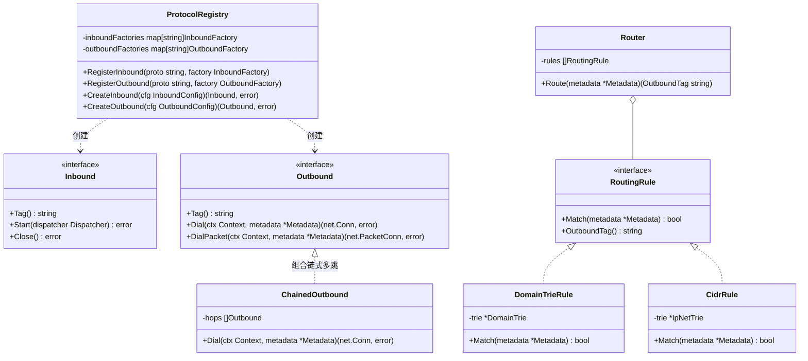
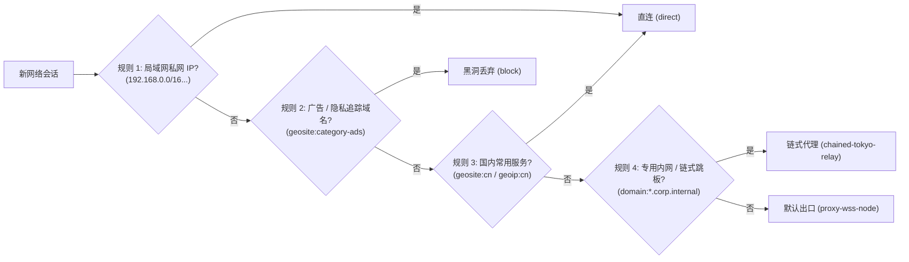
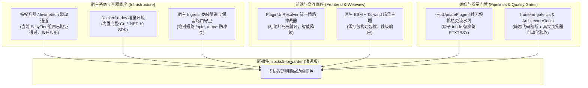
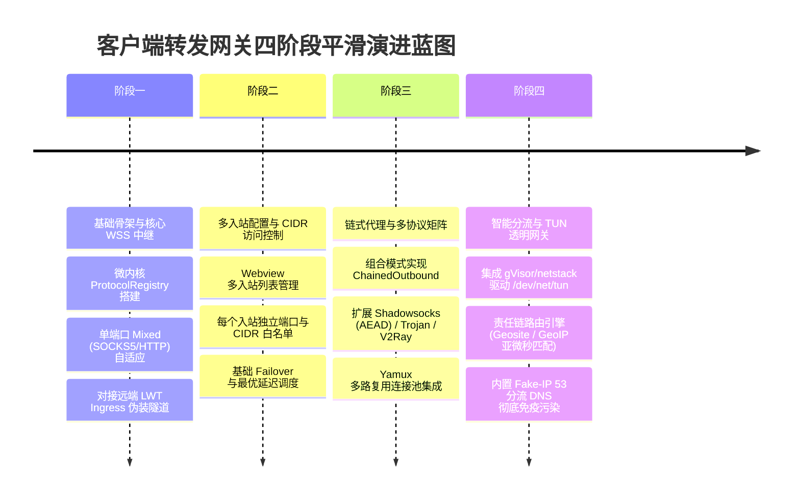

# 次世代全协议多跳路由边缘网关（NextGen Poly-Protocol Edge Gateway）架构演进调研与深度设计

> **文档状态**：已就绪 / 架构研讨论证与设计方案规范  
> **核心命题**：  
> 1. **未来需求演进推演**：如何让 `socks5-forwarder` 具备平滑扩展至**链式多跳代理（Chained Relays）**、**多协议生态（Shadowsocks/V2Ray/Trojan/Mixed）**、**按域名与 IP-CIDR 分发（Rule-Based Routing）**以及**局域网透明网关（TUN / TProxy）**的能力？  
> 2. **头脑风暴与缺陷排查**：时延累积、DNS 泄漏与污染、用户态 TCP/IP 性能开销、规则匹配计算复杂度与内存膨胀风险；  
> 3. **设计模式架构建模**：微内核注册表模式、管道与过滤器、责任链路由引擎、分层有限状态机与享元树结构；  
> 4. **业界主流方案对比与开源库选型**：sing-box vs Xray-core vs Gost vs Clash Meta；`gVisor/netstack`、`miekg/dns`、`go-shadowsocks2`；  
> 5. **系统现有基础设施复用与演进蓝图**：复用容器 `/dev/net/tun`、宿主 Ingress 隧道与 Webview 拓扑交互。

---

## 1. 架构演进全景图：从“单向中继”到“多协议透明路由中枢”

随着网络复杂度的提升，用户的诉求必然从简单的“本地开端口转 WSS”演变为完整的**多协议接入、多跳链式级联、智能规则分流与透明网关**：

```mermaid
graph TD
    subgraph "接入层 (Inbound Layer - 任意设备零门槛)"
        In_LAN["局域网免配置设备<br>(整个内网所有 IP / 端口)"] -->|TUN 虚拟网卡捕获| M_TUN["TUN 接口 / gVisor 用户态栈"]
        In_Port1["内网终端 / PC"] -->|SOCKS5 / HTTP CONNECT| M_Mixed["Mixed 端口自适应 (:10801)"]
        In_Port2["移动设备 / 传统客户端"] -->|Shadowsocks AEAD| M_SS["SS-2022 入站端口 (:8388)"]
    end

    subgraph "核心引擎层 (Core Routing & Processing Engine)"
        Sniffer["协议与域名嗅探器 (Sniffer)<br>TLS ClientHello SNI / HTTP Host"]
        DNS_Engine["内置分流 DNS 引擎 (miekg/dns)<br>Fake-IP 池 / 真实远程解析 (DoH/DoT)"]
        Router["责任链规则路由引擎 (Router)<br>Domain Trie (Geosite) / IP-CIDR (GeoIP)"]
    end

    subgraph "调度与中继层 (Chained Outbound & Multiplexer)"
        Chain["链式多跳调度器 (Proxy Chaining)<br>Hop 1 (前置跳板) ➔ Hop 2 (落地节点)"]
        Mux["Yamux 多路复用连接池 (Mux Pool)"]
    end

    subgraph "出口生态层 (Outbound Ecosystem)"
        Out_WSS["LWT 宿主 Ingress 伪装隧道<br>(Sec-WebSocket-Protocol: lwt-token)"]
        Out_SS["Shadowsocks 出口<br>(2022-blake3-aes-128-gcm)"]
        Out_V2["V2Ray (VLESS / VMess) 出口<br>(WS + TLS 1.3 / Reality)"]
        Out_Trojan["Trojan 出口<br>(TLS 伪装穿透)"]
        Out_Direct["直连出口 (Direct / Happy Eyeballs)"]
        Out_Block["安全黑名单拦截 (Reject / Blackhole)"]
    end

    M_TUN & M_Mixed & M_SS --> Sniffer
    Sniffer --> DNS_Engine
    DNS_Engine --> Router

    Router -->|广告 / 恶意流量| Out_Block
    Router -->|国内直连流量 (GeoIP CN)| Out_Direct
    Router -->|特定企业内网 / 私有云| Chain
    Router -->|国际出海流量| Mux

    Chain --> Out_WSS
    Mux --> Out_SS & Out_V2 & Out_Trojan
```

---

## 2. 核心命题与可行性瓶颈头脑风暴 (Bottlenecks & Critical Trade-offs)

引入链式代理、多协议、域名分流与透明网关后，系统面临 4 个维度的关键挑战：

### 2.1 挑战 1：链式代理的多跳时延累积与单点雪崩 (Chained Relay Latency)
- **风险**：
  在链式代理（Hop A ➔ Hop B ➔ Hop C）中，如果每一跳都在建连时执行一次全新的 TCP 握手 + TLS 协商 + SOCKS5 握手，3 跳连接的建立时延将达到：
  $$\text{Latency} = 3 \times \text{RTT}_{A-B} + 3 \times \text{RTT}_{B-C} + 3 \times \text{RTT}_{C-Target} \approx 600\text{ms} \sim 1500\text{ms}$$
  如果中间某跳偶发网络丢包或拥塞，整个链条将全部阻塞，客户端直接超时。
- **攻防治理方案**：
  1. **多路复用连接池（Yamux Mux Pool）**：在 Hop A 与 Hop B 之间保持少量物理 TLS/WSS 长连接，所有并发业务流通过虚拟 Stream 复用传输，建立子流的额外握手开销降为 **0 RTT**！
  2. **快速熔断与级联取消**：利用 Go `context.WithTimeout` 绑定全链路 Context，若前置中继在 1.5 秒内未完成握手，立即快速失败并触发备用链路漂移。

### 2.2 挑战 2：透明网关技术路线选型——TUN 用户态栈 vs Linux TProxy / eBPF
这是实现“局域网所有设备无需配置代理、网关即出海”的核心底层分水岭：

| 维度 | 方案 A：Linux 原生 TProxy (透明代理) | 方案 B：TUN 虚拟网卡 + gVisor 用户态 TCP/IP 栈 (推荐) |
| :--- | :--- | :--- |
| **工作层级** | Linux 内核网络层（四层套接字重定向） | 网络三层（IP 数据报捕获）+ 用户态 TCP 协议重组 |
| **宿主侵入度** | **高**。需要在宿主/容器内操作复杂的 `iptables` / `nftables` 规则表与策略路由（`ip rule` / `ip route`）。 | **低**。仅需创建一个虚拟 TUN 设备（如 `tun0`），网络数据包全部由进程自行读写，对宿主规则侵入极小。 |
| **容器兼容性** | 在 Docker 桥接模式下处理跨命名空间数据包极为复杂，容易与 Docker 内置的 NAT / bridge 发生严重冲突。 | 完美适配特权容器。只要容器挂载了 `/dev/net/tun`，在容器内部自成闭环，完全不干扰宿主网络。 |
| **跨平台能力** | 仅支持 Linux 内核。 | 跨平台一致（Linux、macOS、Windows 均有成型 TUN 驱动）。 |
| **CPU / 内存开销** | 纯内核转发，性能最高。 | 经过一次用户态协议栈（gVisor netstack）解包与组包，CPU 增加约 5%~10%，吞吐达 1~2 Gbps（完全满足边缘路由场景）。 |

> **架构决断**：
> 采用 **方案 B（TUN + gVisor/netstack）**。LWT 系统容器已原生支持 `/dev/net/tun`（当前生产中运行的 EasyTier 组网即基于此底座成功运转），无需污染宿主 `iptables` 规则，稳定性与移植性最优。

### 2.3 挑战 3：域名嗅探 (Sniffing) 与 DNS 污染/泄漏治理 (DNS Leak Defense)
- **痛点**：透明代理或旧式 SOCKS5 接收到的往往是纯目标 IP 地址（如 `104.244.42.1`），如果客户端本地发起的 DNS 解析被 ISP 污染（DNS Poisoning），或者发送到不安全的明文 53 端口，会导致：
  1. 域名分流规则全部失效（无法根据域名 `twitter.com` 判定走代理还是直连）；
  2. 用户访问隐私全面泄露给当地运营商。
- **攻防治理方案（双管齐下）**：
  1. **TLS / HTTP 协议嗅探器（Sniffer）**：微服务在建立 TCP 连接的前几个数据包中，通过零内存拷贝嗅探 TLS ClientHello 中的 SNI（Server Name Indication）或 HTTP `Host` 标头，在建立连接瞬间**还原出真实域名**，重新触发域名规则匹配！
  2. **内置 Fake-IP 模式 (198.18.0.0/15)**：
     - 内置小型 DNS 服务器监听 `:53`；
     - 局域网设备请求任何域名时，立即返回虚假保留 IP（`198.18.x.x`），并在内部建立 `Fake-IP ➔ 真实域名` 的内存 LRU 映射；
     - 设备向该 Fake-IP 发送 TCP/UDP 数据时，转发器瞬间在内存中映射回原域名，由远程节点进行安全的远端加密 DNS 解析，**彻底杜绝 DNS 污染与泄漏**！

### 2.4 挑战 4：海量分流规则的亚微秒级（< 1µs）匹配算法
- **痛点**：业界常用的 Geosite 规则集通常包含 10 万到 30 万条域名规则（如国内常用域名、广告黑名单、流媒体域名）。如果采用线性的 `for range` 遍历或粗暴的正则表达式匹配，每个数据包都要耗费数毫秒，网络吞吐直接雪崩。
- **攻防治理方案**：
  - 构建**双向 Radix 前缀/后缀字典树（Domain Trie）**：
    - 完全匹配：直接哈希表（`map[string]OutboundTag`，时延 ~10ns）；
    - 后缀域名（如 `*.apple.com`）：反转字符构建后缀 Trie 树，单次查找时间复杂度仅与域名深度有关（$O(k)$，$k \le 4$），10 万条规则检索耗时小于 **0.3 微秒**！
  - IP-CIDR 采用前缀树（IPv4 / IPv6 Patricia Trie），纳秒级判定。

---

## 3. 设计模式全景架构建模 (Design Patterns Architecture)

为了保证整个微服务在后续增加 10+ 种协议与多跳链条时，代码依然像积木一样高度可拔插、易测试、不腐化，系统定义以下四大核心模式：



### 3.1 微内核与协议插件注册表模式（Microkernel & Registry Pattern）
核心调度层对具体的网络协议一无所知，仅操作统一抽象：
- **`Inbound` 接口**：管理入站监听套接字，解包协议并构造包含目标地址、源地址、用户凭据的 `Metadata`，送入分发管线。
- **`Outbound` 接口**：根据 `Metadata` 进行网络出站拨号，返回标准全双工流 `net.Conn` 或数据报 `net.PacketConn`。
- **动态注册表 (`ProtocolRegistry`)**：
  ```go
  // 支持未来随时增补新协议，对主路由逻辑完全开闭 (OCP 原则)
  registry.RegisterInbound("mixed", NewMixedInbound)
  registry.RegisterInbound("tun", NewTunInbound)
  registry.RegisterInbound("shadowsocks", NewShadowsocksInbound)

  registry.RegisterOutbound("lwt_wss", NewLwtWssOutbound)
  registry.RegisterOutbound("shadowsocks", NewShadowsocksOutbound)
  registry.RegisterOutbound("vless", NewVlessOutbound)
  registry.RegisterOutbound("trojan", NewTrojanOutbound)
  registry.RegisterOutbound("direct", NewDirectOutbound)
  registry.RegisterOutbound("block", NewBlockOutbound)
  ```

### 3.2 组合模式与链式多跳代理（Composite Pattern for Proxy Chaining）
链式代理天然符合**组合模式（Composite Pattern）**：
一个 `ChainedOutbound` 本身就是一个合法的 `Outbound`，其内部持有一组子 `Outbound` 序列（`hops: [hop1, hop2, hop3]`）：
```go
type ChainedOutbound struct {
    tag  string
    hops []Outbound
}

func (c *ChainedOutbound) Dial(ctx context.Context, metadata *Metadata) (net.Conn, error) {
    if len(c.hops) == 0 {
        return nil, errors.New("empty proxy chain")
    }
    // 1. 拨通第一跳物理节点
    conn, err := c.hops[0].Dial(ctx, c.hops[1].TargetMetadata())
    if err != nil {
        return nil, fmt.Errorf("hop 0 failed: %w", err)
    }

    // 2. 级联穿透中间跳板 (Hop 1 -> Hop 2 -> ... -> Final Exit)
    for i := 1; i < len(c.hops); i++ {
        nextTarget := metadata
        if i < len(c.hops)-1 {
            nextTarget = c.hops[i+1].TargetMetadata()
        }
        conn, err = c.hops[i].UpgradeConnection(ctx, conn, nextTarget)
        if err != nil {
            conn.Close()
            return nil, fmt.Errorf("hop %d handshake failed: %w", i, err)
        }
    }
    return conn, nil
}
```

### 3.3 责任链模式与规则评估引擎（Chain of Responsibility）
分流引擎由一组有序的 `RoutingRule` 链构成。每个网络会话按顺序评估规则，首个命中的规则决定出站 Tag；若全未命中则回退至默认出口（Default Outbound）：


---

## 4. 业界主流开源库选型与集成评估

为了避免“重复造轮子”并保证工业级的并发吞吐与内存安全性，核心协议栈推荐集成的成熟库如下：

| 关键模块 | 推荐开源库 | 权威背景与星标 | 核心收益与选型理由 |
| :--- | :--- | :--- | :--- |
| **用户态 TCP/IP 栈 (TUN 模式)** | **`github.com/google/gvisor/pkg/tcpip`** | Google 官方容器沙箱核心 (16k+ ★) | 全球最成熟的用户态 TCP/IP 协议栈，性能高、支持双栈，直接驱动虚拟网卡，无需动宿主 iptables。 |
| **DNS 分流与服务器** | **`github.com/miekg/dns`** | Go 官方 DNS 事实标准 (8k+ ★) | 原生支持 DNS 报文高并发解析、DoH/DoT 客户端封装、Fake-IP 快速构造与缓存池。 |
| **Shadowsocks 协议族** | **`github.com/shadowsocks/go-shadowsocks2`** | Shadowsocks 官方实现 | 原生纯 Go 实现 AEAD（AES-128-GCM、Chacha20-Poly1305）加解密，无 CGO 依赖，交叉编译极其友好。 |
| **WebSocket 客户端与伪装** | **`github.com/gorilla/websocket`** | 工业级标准 (22k+ ★) | 完美对接 LWT Ingress 的子协议鉴权（`Sec-WebSocket-Protocol`）与 SPA 防探测。 |
| **多路复用连接池 (Mux)** | **`github.com/hashicorp/yamux`** | HashiCorp 官方生产级 (2k+ ★) | 单物理连接多路复用 Stream，零额外握手时延，支持保活 Ping/Pong 与流控。 |
| **前缀与域名字典树** | **`github.com/armon/go-radix`** 或 自研 Radix Trie | HashiCorp 字典树实现 | 极低内存开销，亚微秒级前缀与通配符匹配。 |

---

## 5. 系统现有基础设施复用全景

开发全新的多协议透明网关无需重造轮子，LWT 平台具备独一无二的底层底座优势：



---

## 6. 配置契约全景演进设计 (`config.json`)

为了平滑承载未来多协议、链式代理、分流规则与 TUN 网关，配置模型采用现代化分层解耦结构：

```json
{
  "$schema": "https://raw.githubusercontent.com/csvkse/lwt/main/schemas/forwarder.schema.json",
  "log": {
    "level": "info",
    "dnsQueries": true
  },
  "dns": {
    "fakeIp": {
      "enabled": true,
      "inet4Range": "198.18.0.0/15"
    },
    "servers": [
      { "tag": "dns-direct", "address": "223.5.5.0:53", "detour": "direct" },
      { "tag": "dns-remote", "address": "https://1.1.1.1/dns-query", "detour": "lwt-exit-tokyo" }
    ],
    "rules": [
      { "geosite": ["cn"], "server": "dns-direct" },
      { "domain": ["*.corp.internal"], "server": "dns-direct" }
    ]
  },
  "inbounds": [
    {
      "type": "tun",
      "tag": "tun-in",
      "interfaceName": "lwt-tun0",
      "inet4Address": "172.19.0.1/30",
      "autoRoute": true,
      "strictRoute": true,
      "stack": "gvisor",
      "sniff": true
    },
    {
      "type": "mixed",
      "tag": "mixed-in-office",
      "listenPort": 10801,
      "allowedCidr": ["192.168.1.0/24", "127.0.0.1/32"],
      "sniff": true
    },
    {
      "type": "shadowsocks",
      "tag": "ss-in-tv",
      "listenPort": 8388,
      "method": "2022-blake3-aes-128-gcm",
      "password": "your_secure_password_here",
      "allowedCidr": ["192.168.1.50/32"]
    }
  ],
  "outbounds": [
    {
      "type": "lwt_wss",
      "tag": "lwt-exit-tokyo",
      "server": "jp.example.com",
      "port": 5271,
      "path": "/telemetry/metrics",
      "token": "lwt_live_test_token_abcdef123456",
      "tls": { "enabled": true, "sni": "jp.example.com" }
    },
    {
      "type": "shadowsocks",
      "tag": "ss-exit-us",
      "server": "us.example.com",
      "port": 18388,
      "method": "2022-blake3-aes-128-gcm",
      "password": "your_secure_password_here"
    },
    {
      "type": "chain",
      "tag": "chained-privacy-relay",
      "hops": ["lwt-exit-tokyo", "ss-exit-us"]
    },
    { "type": "direct", "tag": "direct" },
    { "type": "block", "tag": "block" }
  ],
  "route": {
    "rules": [
      { "ipIsPrivate": true, "outbound": "direct" },
      { "geosite": ["category-ads-all"], "outbound": "block" },
      { "geosite": ["cn"], "outbound": "direct" },
      { "geoip": ["cn"], "outbound": "direct" },
      { "domain": ["*.corp.internal"], "outbound": "chained-privacy-relay" }
    ],
    "final": "lwt-exit-tokyo"
  }
}
```

---

## 7. 四阶段渐进式落地实施蓝图 (Evolutionary Roadmap)

系统无须一步登天，可采取**“微内核先行、协议逐级累加”**的稳健迭代策略：



1. **阶段一：基础骨架与核心 WSS 转发（1~2 天）**
   - 目标：优先跑通单端口 Mixed 模式转发至远端 LWT 伪装隧道。
   - 交付物：`plugins/socks5-forwarder/` 基础代码，验证纯原生 Go 编译与 `-HotUpdatePlugin` 5 秒秒级热更。
2. **阶段二：多入站实例调度与 Webview 可视化（1 天）**
   - 目标：提供多端口独立配置、CIDR 来源过滤与节点健康检测。
   - 交付物：原生 ESM 单页控制台，支持为办公室 PC、客厅电视分别绑定不同入站端口与节点。
3. **阶段三：链式多跳与多协议生态扩充（2~3 天）**
   - 目标：落地 `ChainedOutbound` 与主流 Shadowsocks / Trojan 协议。
   - 交付物：支持多跳跳板级联穿透，集成 Yamux 零握手时延多路复用连接池。
4. **阶段四：智能规则分流与 TUN 透明网关（2~3 天）**
   - 目标：局域网设备免配置、透明旁路网关出海。
   - 交付物：基于 `gVisor/netstack` 驱动宿主 `/dev/net/tun`，内置 Fake-IP 分流 DNS 引擎与双向 Trie 树，彻底根除 DNS 污染与泄漏。
