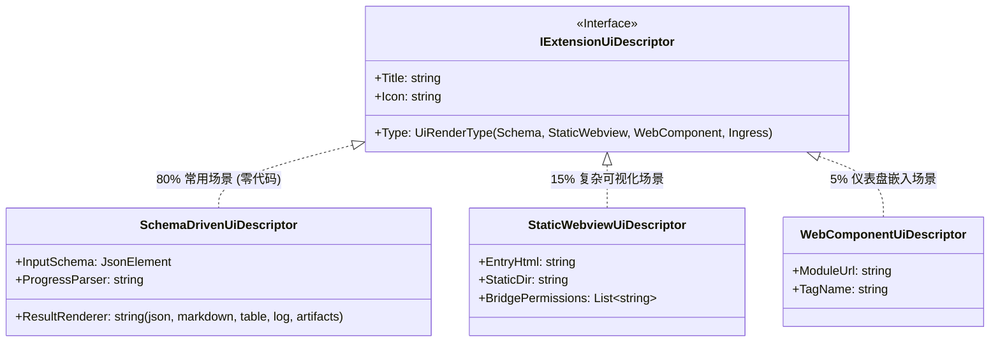
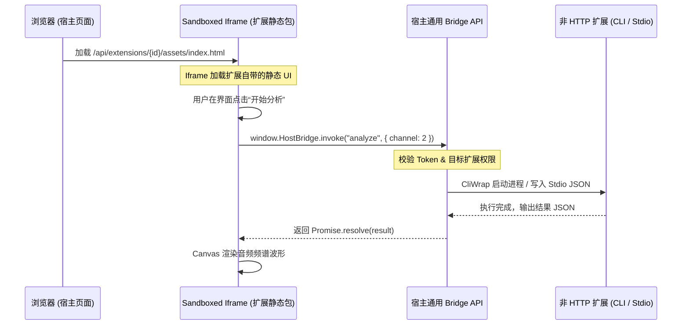
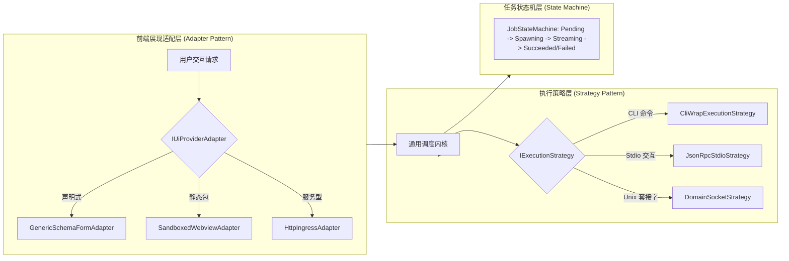
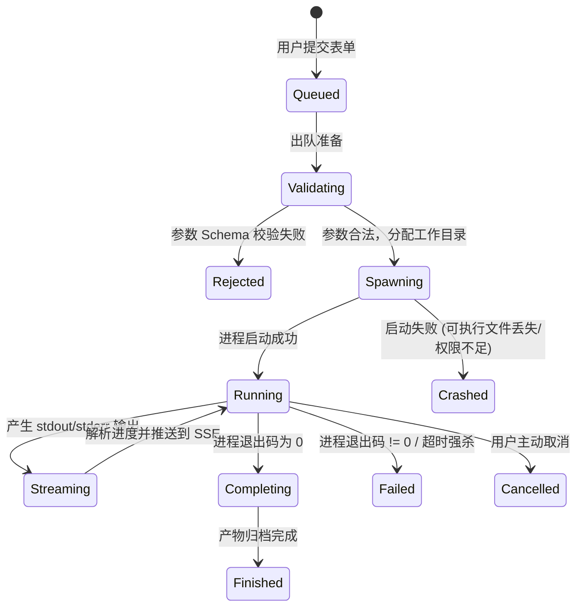

# 非 HTTP 扩展的前端注入与界面呈现架构调研与设计

> 日期：2026-11-01  
> 核心原则：**坚持扩展是独立、可插拔的扩展单元，宿主保持平台通用内核。** 针对无法提供 HTTP 服务的扩展类型，严禁在宿主源码中硬编码扩展专用业务组件或专用 DTO，通过**声明式元数据驱动**与**宿主代托管静态沙盒桥接**实现零侵入的前端注入。

---

## 1. 核心矛盾与场景剖析

在微服务型 Worker（如 `mcp-bridge`）中，扩展自身内置轻量 Web 服务并监听回环端口，宿主利用 Ingress（`/w/{id}/*`）做反向代理即可实现界面自治。

但系统中存在大量**无法或无需提供 HTTP 服务的扩展类型**：
1. **一次性原生 CLI 工具（Native Command Tools）**：如 FFmpeg 转码脚本、Rsync/Rclone 备份工具、数据库备份还原脚本、诊断工具。它们执行完毕即退出，不驻留进程，更无 HTTP 端口。
2. **生命周期 Hook 脚本**：如安装前检查、启动前初始化、告警回调。它们通过 `stdin/stdout` 交换 JSON 数据。
3. **Stdio MCP 工具服务**：遵循 Model Context Protocol 的标准输入输出进程，使用 JSON-RPC 2.0 通信，无 HTTP 栈。
4. **无 Web 栈的后台守护进程（Headless Daemons）**：纯 C/Rust/Go 编写的消息队列消费者、文件变动监听器（inotify），为节省内存与体积未打包任何 HTTP 库。
5. **本地原生库与自动化批处理脚本**：受限于系统安全策略或运行环境，无法开放 TCP 监听。

### 核心挑战
如果这些扩展需要用户界面（例如：提供参数配置表单、触发运行、查看实时进度日志、下载产物、展示结果），**在宿主前端源码不增加任何特定扩展组件的前提下，前端该如何注入并呈现？**

---

## 2. 业界五大标杆方案对比与启发

```mermaid
flowchart TD
    subgraph VSCode["VS Code (非 HTTP 插件标杆)"]
        VSCManifest[package.json 声明配置项/树视图/菜单] -->|VS Code 原生渲染| VSCDeclarative[声明式原生 UI]
        VSCExt[Extension Host 进程] <-->|postMessage 通信| VSCWebview[沙盒 Webview 静态包]
    end

    subgraph HomeAssistant["Home Assistant Lovelace"]
        HACard[静态 JS Web Component] -->|customElements.define| HAUICore[宿主通用容器]
        HACard <-->|Central WebSocket RPC| HABackend[HA Core Service]
    end

    subgraph DockerDesktop["Docker Extensions"]
        DDManifest[metadata.json 声明 UI entry] -->|Docker Desktop 宿主加载| DDIframe[静态 HTML/CSS/JS]
        DDIframe <-->|window.ddClient.cli.exec| DDCli[本地无 HTTP 的 CLI 工具]
    end

    subgraph GitHubActions["GitHub Actions & OpenAPI"]
        WorkflowSchema[workflow_dispatch inputs schema] -->|动态生成表单| GHAForm[通用参数输入界面]
        GHAForm -->|SSE / WebSocket| GHATerminal[通用流式日志终端]
    end
```



| 平台 | 非 HTTP 扩展形态 | 前端注入机制 | 通信通道 | 宿主侵入度 |
|---|---|---|---|---|
| **VS Code** | Node.js 插件，无 HTTP 端口 | **两级机制**：① `package.json` 声明式配置项；② `Webview API` 加载静态 HTML/JS | `acquireVsCodeApi().postMessage()` 消息总线 | **0**（核心不写插件专有代码） |
| **Docker Desktop** | 本地 CLI 可执行文件或容器 | 扩展打包静态 `ui/index.html`，宿主代为托管并嵌入面板 | `window.ddClient.extension.vm.cli.exec(...)` 桥接 | **0** |
| **Home Assistant** | 本地 Python 逻辑 + 静态卡片 | 静态 JS 导出 Web Component，宿主动态 `import()` 挂载 | 宿主统一的 `hass.callWS()` WebSocket 总线 | **0** |
| **Tauri / Electron** | Rust / C++ 后端函数，无 HTTP 端口 | 前端为纯静态页面，嵌入 WebView | `window.__TAURI__.invoke('cmd', args)` IPC | **0** |
| **GitHub Actions / Backstage** | 纯 YAML/Shell 脚本 | 声明式 JSON/YAML Schema 驱动通用表单与终端渲染 | 统一作业队列 API + 日志流式推送 | **0** |

---

## 3. 四种前端注入范式架构设计

针对 LinuxWebTool 平台，建立覆盖从简单脚本到复杂交互的**四级渐进增强注入架构**：



### 3.1 范式一：声明式元数据驱动（Schema-Driven / Zero-Code UI）—— 首选主力方案（覆盖 80% 场景）
#### 适用对象
一次性 CLI 命令、Hook 脚本、标准参数化运维工具、Stdio MCP 服务。

#### 核心机制
扩展开发者**不写一行前端代码**。只需在清单（`manifest.json` 或 `worker.json`）中以标准的 **JSON Schema** 声明其输入参数与预期展示风格：

```json
{
  "id": "mysql-dump-tool",
  "name": "MySQL 数据库备份工具",
  "type": "native-command",
  "ui": {
    "type": "schema",
    "display": "modal", // modal, drawer, view
    "formSchema": {
      "type": "object",
      "required": ["database"],
      "properties": {
        "database": { "type": "string", "title": "目标数据库名", "description": "要导出的数据库" },
        "compress": { "type": "boolean", "title": "Gzip 压缩", "default": true },
        "retentionDays": { "type": "integer", "title": "保留天数", "default": 7, "minimum": 1 }
      }
    },
    "resultView": {
      "type": "artifacts-and-log",
      "progressParser": "json-lines",
      "downloadableArtifacts": true
    }
  }
}
```

#### 宿主端通用基础设施
1. **通用动态表单渲染器（`GenericSchemaForm.js`）**：
   - 宿主前端维护一个通用的动态表单组件，递归解析 JSON Schema 生成输入框、下拉框、开关、文件选择器与校验器；
2. **通用作业执行与流式终端（`GenericTaskRunner.js`）**：
   - 用户在表单中点击“执行”，前端调用宿主通用接口 `POST /api/plugins/{id}/execute`；
   - 宿主调度后台进程执行，前端通过通用的 SSE/WebSocket 连接（`/api/plugins/{id}/tasks/{taskId}/stream`）实时接收日志输出与结构化进度条，执行完毕呈现产物下载列表。

---

### 3.2 范式二：宿主代托管静态沙盒 + 通用 IPC 桥（Host-Hosted Static Webview + Bridge RPC）—— 复杂交互方案（覆盖 15% 场景）
#### 适用对象
扩展自身没有内置 HTTP 服务器（如纯 C++、Rust 或 Python 脚本），但需要高度定制化的专属界面（如 Canvas 裁剪、音视频波形图、流程图设计器）。

#### 核心机制
扩展安装包自带一个静态 Web 目录（如 `web/dist/`，包含 `index.html`、`bundle.js`、`style.css`）：

```json
{
  "id": "audio-analyzer",
  "ui": {
    "type": "static-webview",
    "entry": "web/dist/index.html",
    "staticDir": "web/dist"
  }
}
```



#### 宿主端通用基础设施
1. **通用静态托管中间件**：
   - 宿主通过 ASP.NET Core `UseStaticFiles` 配合 `PhysicalFileProvider`，安全地将受信任扩展目录中的静态资源映射至通用路由：`/api/extensions/{id}/assets/*`；
2. **沙盒 Iframe 隔离**：
   - 宿主使用通用的 `<iframe sandbox="allow-scripts" src="...">` 隔离扩展静态页，彻底防止第三方静态 JS 窃取宿主 Cookie、LocalStorage 或劫持宿主 DOM；
3. **通用宿主通信桥（HostBridge SDK）**：
   - 宿主向 iframe 注入一个仅 2KB 的标准桥接脚本 `window.HostBridge`：
     ```javascript
     // 扩展静态前端代码直接调用：
     const result = await window.HostBridge.call("runTask", { inputFile: "demo.wav" });
     window.HostBridge.onProgress((p) => updateProgressBar(p.percentage));
     ```
   - 宿主后端提供通用 RPC 适配器 `POST /api/extensions/{id}/bridge/call`，将前端调用转换为本地命令行调用或标准输入通信。

---

### 3.3 范式三：微前端 / Web Component 动态组件注入（5% 场景）
#### 适用对象
需要在宿主主界面仪表盘（Dashboard）中嵌入微型指标卡片或快捷开关的无 HTTP 扩展。

#### 核心机制
扩展导出一个标准的 Web Component（Custom Element）ES 模块：
```javascript
// 扩展自带的 dist/card.mjs
export class StorageQuotaCard extends HTMLElement {
  connectedCallback() {
    this.attachShadow({ mode: 'open' });
    this.shadowRoot.innerHTML = `<div class="card">存储使用率: <span id="val">--</span></div>`;
  }
  updateData(data) {
    this.shadowRoot.getElementById('val').textContent = data.usedPercent + '%';
  }
}
customElements.define('ext-storage-quota-card', StorageQuotaCard);
```
- 宿主通过原生浏览器的 `import('/api/extensions/{id}/assets/card.mjs')` 动态加载，并在通用的卡片容器中挂载 `<ext-storage-quota-card>`；
- 利用浏览器原生的 **Shadow DOM** 实现 CSS 样式强隔离，零 CSS 污染；
- 扩展与宿主通信通过标准的 `CustomEvent` 事件冒泡或传入的通用上下文。

---

### 3.4 范式四：协议中继适配器（IPC-to-HTTP Ingress Adapter）
#### 适用对象
使用 Unix Domain Socket (UDS) 或 Windows 命名管道（Named Pipe）提供通信、但不监听 TCP 端口的本地服务。

#### 核心机制
- 宿主 YARP 反向代理的 `SocketsHttpHandler` 原生支持连接 Unix Domain Socket；
- 宿主将外部 HTTP 请求 `/w/{id}/*` 直接桥接至目标 Worker 的 `/run/worker.sock` 本地套接字；
- 前端将其视为普通 HTTP 服务无缝交互，而扩展本身无需申请 TCP 端口或暴露外部网络。

---

## 4. 全局可行性、逻辑缺陷与性能防御

### 4.1 逻辑严密性与故障模型

| 潜在缺陷 | 风险表现 | 防御方案 |
|---|---|---|
| **长时任务阻塞导致 HTTP 超时** | 非 HTTP 扩展执行耗时任务（如转码 10 分钟），若前端采用同步等待请求，浏览器或网关必在 60s/120s 产生 504 超时。 | **强制异步作业模型（Async Job Pattern）**：前端调用后宿主立即返回 `202 Accepted` 与 `jobId`，前端随后挂载通用的 SSE 事件流订阅实时日志，完成后拉取结果。 |
| **沙盒逃逸与安全越权** | 扩展静态包注入的 JavaScript 代码试图访问宿主管理凭证，或调用其他扩展的接口。 | **沙盒双向约束**：<br>1. Iframe 设置严格的 `sandbox="allow-scripts"`（禁用 `allow-same-origin`）；<br>2. 宿主下发的 Bridge 调用凭证是**受限短效的作用域令牌（Scoped JWT）**，仅允许访问自身 `extensionId` 命名空间下的资源。 |
| **进程风暴与资源耗尽** | 用户在前端连续快速点击“执行”，或者恶意脚本并发调用，导致系统并发启动数十个重量级进程，打爆 CPU 与内存。 | **并发信号量与队列控制**：单扩展并发实例上限设为 2（超出排队），排队超时 10s；结合 Linux cgroups / Windows JobObject 实行硬性内存与 CPU 限额。 |
| **孤儿进程泄漏** | 前端刷新页面或关闭弹窗，导致正在执行的底层进程无人关注但继续死跑。 | 客户端断开连接时，宿主检测连接丢失并通过 `CancellationToken` 级联终止底层进程树。 |

---

## 5. 设计模式的工程化落地



### 5.1 适配器模式（Adapter Pattern）
1. **前端展现适配（`IUiProviderAdapter`）**：
   - 抹平 HTTP 服务型、静态托管型、声明式元数据型的渲染差异，对宿主主框架呈现统一的 `renderComponent(extension)` 接口；
2. **执行协议适配（`IExecutionStrategyAdapter`）**：
   - 抹平 CLI 参数拼接、Stdio JSON-RPC 通信与本地 Socket 的调用差异，统一提供 `ExecuteAsync(JobContext context)` 抽象。

### 5.2 策略模式（Strategy Pattern）
1. **参数绑定策略（`ArgumentBindingStrategy`）**：
   - 字面量绑定（`literal`）、字段名映射（`inputScalar`）、文件路径映射（`inputPath`）、产物路径推导（`artifactPath`）；
2. **进度与结果解析策略（`OutputParserStrategy`）**：
   - `JsonLinesProgressParser`：按行解析 `{"percent": 50}`；
   - `RegexProgressParser`：解析控制台百分比正则；
   - `ArtifactCollectorStrategy`：从临时工作目录按规则抽取生成的文件并持久化归档。

### 5.3 状态机模式（State Machine Pattern）
引入统一的 **非 HTTP 作业生命周期状态机（Non-HTTP Job FSM）**：


---

## 6. 现有基础设施复用与改造实施路线

### 6.1 现有系统已有基础设施复用清单
1. **契约模型**：
   - `NativeToolModels.cs` 中已包含 `NativeCommandDefinition`、`CommandArgumentBinding`、`CommandStdinBinding`、`CommandArtifactRule`，完全可复用为 Schema 声明模型；
2. **进程执行器**：
   - 宿主已有进程调度与生命周期监管机制，可平滑引入 `CliWrap` 进一步加固进程树生命周期；
3. **安全与静态托管**：
   - `PipelineExtensions.cs` 已有成熟的中间件管道配置机制，可直接挂载 `/api/extensions/{id}/assets/` 静态安全托管；
4. **协调与排他锁**：
   - `IPluginOperationCoordinator` 已具备跨操作互斥锁，防止并发写冲突。

### 6.2 零侵入改造三步实施方案
1. **第一步：建立宿主通用的 `GenericSchemaForm.js` 与 `GenericTerminalModal.js`**：
   - 宿主前端不写任何特定工具代码，仅维护通用的 Schema 解析器与日志流终端组件；
2. **第二步：在 `worker.json` / `manifest.json` 中规范化 `ui` 节定义**：
   - 支持 `"ui": { "type": "schema", ... }` 与 `"ui": { "type": "static-webview", ... }`；
3. **第三步：提供宿主通用的任务执行通道与沙盒 SDK**：
   - 统一暴露 `/api/plugins/{id}/execute` 与 `/api/plugins/{id}/tasks/{taskId}/stream`，为静态页面注入轻量 `HostBridge.js`。

通过此方案，**无法提供 HTTP 服务的扩展获得了与专业原生应用无异的前端交互能力，而宿主核心代码保持绝对的通用性与纯粹性（零代码侵入）。**
