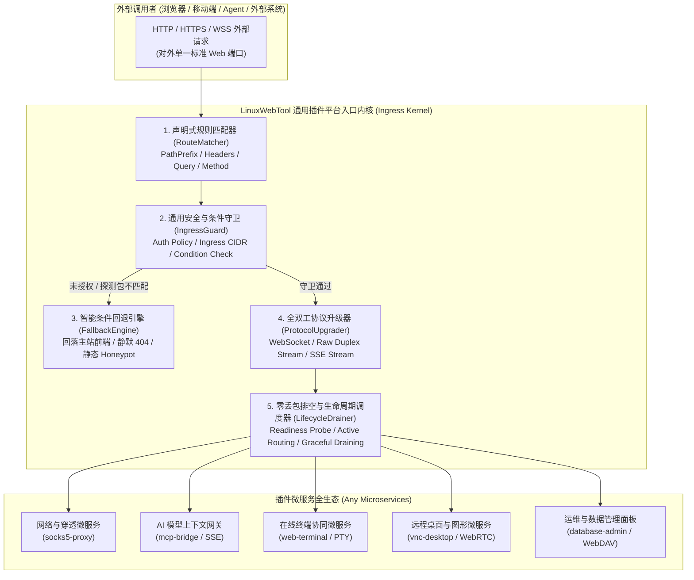
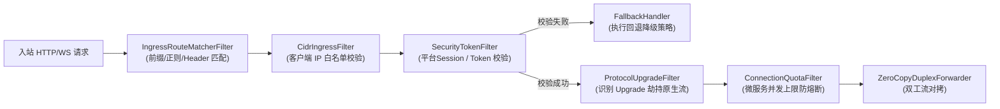
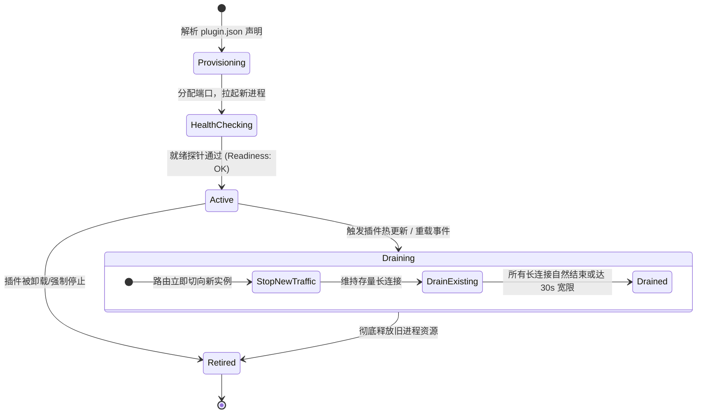

# 插件平台级基础设施通用化抽象：声明式 Ingress、双工流隧道、统一守卫与平滑排空深度调研与架构方案

> **文档状态**：已就绪 / 平台通用内核架构评审标准  
> **核心命题**：彻底打破“为代理服务（Proxy）量身定制”的狭隘局部思维，将 Ingress 路由、全双工双向流管道、条件守卫回退、平滑排空热重载从第一性原理（First Principles）提升为**业务中立、协议正交、与具体业务完全解耦的 LinuxWebTool 插件平台通用内核级规范**。  
> **面向场景**：网络网关、AI MCP（大模型上下文协议）流式服务、WebSSH 在线终端、远程桌面（VNC/RDP）、Jupyter Notebook、WebRTC 音视频推流、微服务 Web 控制台、文件分块传输等全谱系插件生态。

---

## 1. 架构反思与思维重构：为什么必须拒绝“代理特化”？

### 1.1 代理特化（Proxy-Specialized）的架构陷阱与局限性
在前期针对 SOCKS5/HTTP 代理的探讨中，很容易产生一种思维惯性：将配置字段和机制命名为 `tunnel`、`proxyAuth`、`gfwFallback`、`socksStream` 等。

这种为单一业务场景“量体裁衣”的设计，属于典型的**架构局部最优陷阱（Local Optimum Anti-pattern）**：
1. **业务词汇污染平台内核**：
   若底层平台出现了 `Proxy`、`Tunnel` 等词汇，当引入 AI MCP（大模型上下文服务）、WebSSH 终端协同、或数据库管理面板时，这些微服务使用带有“代理”印记的配置会产生严重的语义割裂与认知负荷；
2. **重复造轮子与能力碎片化**：
   明天来了一个在线 WebSSH 插件，如果平台没有中立的双工流支持，开发者又会想在宿主写一个 `ssh-websocket-pipe`；后天来了一个 AI MCP 服务，又会想写一个 `mcp-sse-router`，导致宿主代码不断膨胀；
3. **安全与伪装概念的狭隘化**：
   “抗探测伪装回落”绝非代理翻墙的专属需求。任何企业级内网管理系统、敏感微服务端点（如内部调试接口、财务报表、运维蜜罐），在遭遇未授权扫描器探测或非法握手时，都需要**静默回退降级（Silent Degradation / Conditional Fallback）**以保护攻击面。

### 1.2 统一抽象的第一性原理（First Principles of Extensibility）
脱离具体的“代理”业务后，计算机网络与分布式系统平台的核心要素本质上只有三件事：
- **入口分发（Ingress & Multiplexing）**：如何将宿主对外唯一的 Web 端点（HTTP/HTTPS/HTTP2/HTTP3），基于前缀、请求头或条件分发给目标微服务；
- **流式接管（Transport Layer Abstraction）**：如何将普通的单向请求-响应短连接，在需要时平滑无损地升级为**全双工、长连接、任意协议的双向字节管道（Bidirectional Byte Stream）**；
- **守卫与弹性（Guards, Resilience & Lifecycle）**：如何在流量到达微服务之前，统一完成身份鉴权、条件回退（Fallback）、连接排空（Connection Draining）与生命周期管理。

---

## 2. 平台级通用抽象能力全景图（七大业务中立核心能力）



---

## 3. 通用平台级能力的标准化设计与定义（规范升级）

彻底抛弃特化词汇，采用借鉴 **Kubernetes Gateway API** 与 **ASP.NET Core YARP** 的中立规范重新定义清单与契约：

### 3.1 声明式 Ingress 路由规范 (`plugin.json`)
任何插件微服务在清单中声明对外接入点，使用纯粹的网络与协议术语：

```json
{
  "manifestVersion": 2,
  "id": "my-service",
  "name": "通用微服务示例",
  "ingress": {
    "routes": [
      {
        "name": "streaming-endpoint",
        "match": {
          "path": "/stream",
          "pathType": "Prefix",
          "headers": {
            "Upgrade": "websocket"
          }
        },
        "target": {
          "type": "allocatedPort",
          "destination": "127.0.0.1:{port}"
        },
        "transport": {
          "mode": "duplex_stream",
          "bufferPolicy": "unbuffered"
        },
        "security": {
          "auth": "secret_token",
          "tokenHeader": "X-LWT-Token",
          "allowedSubnets": "10.0.0.0/8,172.16.0.0/12,192.168.0.0/16,127.0.0.1/32"
        },
        "fallback": {
          "onUnauthorized": "passthrough_to_default_spa",
          "onFailure": "status_code_404"
        }
      },
      {
        "name": "rest-api",
        "match": {
          "path": "/api/v1/",
          "pathType": "Prefix"
        },
        "target": {
          "type": "allocatedPort",
          "stripPrefix": true
        },
        "transport": {
          "mode": "http_reverse_proxy"
        },
        "security": {
          "auth": "platform_session"
        }
      }
    ]
  }
}
```

### 3.2 抽象解构与词汇去特化对照表

| 传统“代理特化”词汇 | 平台级通用标准抽象词汇 | 为什么这样更通用？ | 覆盖的非代理场景示例 |
| :--- | :--- | :--- | :--- |
| `tunnel` / `socksPath` | **`duplex_stream` / `transport.mode`** | 本质是全双工二进制双向流，不限定内部承载的是 SOCKS、VNC RFB 协议还是 SSH PTY | WebSSH 终端交互、VNC 桌面视频流、实时协同白板 |
| `gfwFallback` / `fakeWeb` | **`fallback.onUnauthorized` (条件回退)** | 本质是网关鉴权失败时的降级流转行为，不仅防审查，更用于隐藏内网敏感系统攻击面 | 内部 Grafana 看板被未授权扫描时显示常规 404 或主系统登录页 |
| `proxyAuth` | **`security.auth: "secret_token" \| "platform_session"`** | 标准的 API 令牌与平台会话统一鉴权体系 | AI MCP 接口的 API Key、内部微服务的统一管理员单点登录 |
| `proxyClientList` | **`clientProfiles` / `edgeProfiles` (边缘节点实例)** | 本质是分布式拓扑中的“边缘网关配置清单”，定义下游监听端口与入站 CIDR | 局域网 IoT 设备网关、远程办公边缘节点接入 |
| `killProxyProcess` | **`gracefulDrain` (平滑连接排空)** | 本质是长连接服务的优雅生命周期管理，先摘流、允许在途连接存活、新流量导向新实例 | 终端在敲命令时插件热更，旧终端不断开，新开终端走新版本 |

---

## 4. 软件设计模式深度建模（Architecture Design Patterns）

通过四套经典设计模式，确保宿主基础设施达到“零硬编码、无限插件可插拔”的高内聚低耦合状态：

### 4.1 责任链模式（Chain of Responsibility Pattern）—— 声明式请求过滤管线
宿主对微服务入站请求的处理解耦为独立的微过滤器处理器（Filter Processors）：



### 4.2 适配器模式（Adapter Pattern）—— 统一双工流抽象 (`IDuplexStreamAdapter`)
不管外部是通过标准 HTTP/1.1 WebSocket Upgrade 升级的连接、还是 HTTP/2 Extended CONNECT 双工流，亦或是 Unix Domain Socket (UDS) 本地套接字，在宿主内部统一被包装为通用的 `IDuplexStreamAdapter`：
```csharp
public interface IDuplexStreamAdapter : IAsyncDisposable
{
    Stream UnderlyingStream { get; }
    string ProtocolName { get; }
    Task CopyToAsync(Stream destination, CancellationToken cancellationToken);
    Task CloseOutputAsync(CancellationToken cancellationToken);
}
```
**收益**：上层的流量监控、统计（BytesRx/Tx）、超时守卫完全针对抽象 `IDuplexStreamAdapter` 编程，新增 HTTP/3 QUIC 双向流支持时无需重构转发内核。

### 4.3 策略模式（Strategy Pattern）—— 动态伪装与降级回退策略
当客户端未携带凭据或协议握手不合法时，由注入的策略决定响应行为：
- **`DefaultSpaFallbackPolicy`**：静默将请求放行给宿主后续的静态前端文件与前端路由中间件，客户端浏览器（或探测器）收到标准的 `index.html` 200 OK 页面，特征 100% 湮灭；
- **`SilentNotFoundFallbackPolicy`**：返回标准的 `404 Not Found` 响应；
- **`HoneypotTrapFallbackPolicy`**：延迟 3000ms 返回假数据，诱捕并耗尽恶意扫描器资源。

### 4.4 有限状态机（Finite State Machine - FSM）—— 零丢包平滑排空（Drain Handoff）
微服务的每次热重载与版本更新，路由引擎执行严密的生命周期流转状态机：



---

## 5. 业界权威开源方案对比与借鉴

| 业界成熟系统 | 核心设计哲学与能力 | 给 LinuxWebTool 通用化设计的启示 |
| :--- | :--- | :--- |
| **Kubernetes Gateway API (SIG-Network)** | 彻底解耦 Ingress 规则、网关基础设施与后台 Service，统一基于 `matches`, `filters`, `backendRefs` 声明 | 本系统的 `plugin.json` 中的 `ingress` 规范应完全对齐其结构设计，具备终极扩展性。 |
| **ASP.NET Core YARP (Microsoft)** | 微软原生高性能反代库，通过配置驱动，天然支持路由动态热重载、WebSocket 穿透与路径重写 (Path Transforms) | 宿主 .NET 10 WebHost 可直接借鉴其内部的 `StreamCopier` 零拷贝技术与 Header 转换管道。 |
| **Envoy Proxy** | 强调协议无关（L4/L7 Filter Chains）、主动健康探测与连接排空（Connection Draining）机制 | 本系统的插件热重载必须采纳 Envoy 的“排空（Drain）”机制，避免粗暴杀进程导致长连接中断。 |
| **Traefik** | 基于 Label / 清单的服务发现驱动，自动挂载中间件链 | 插件启停与配置更新时，宿主路由表应具备**原子即时替换能力（Atomic Swap）**，零停机挂载。 |

---

## 6. 系统已有基础设施复用性确认

本套通用化方案在当前 LinuxWebTool 架构中**具备极高的可落地性与现成资产复用率**：
1. **.NET 10 WebHost 底座已就绪**：
   - 宿主具备高性能 Kestrel 引擎、`IHttpUpgradeFeature`（原生 TCP 劫持）、`Microsoft.AspNetCore.WebSockets`；
   - 现有的 `PluginProxyMiddleware` 已经具备微服务 HTTP 反代雏形，只需将硬编码的判断改造为驱动式的规则匹配器；
2. **微服务插件进程与探针基础设施已就绪**：
   - `PluginManager` 已具备进程拉起、PID 监控、端口动态避让（`isPortAvoided`）；
   - 只需在热更新阶段引入 30 秒连接排空（Draining）状态流转即可实现真正的零丢包热重载；
3. **安全与 ACL 引擎已就绪**：
   - 现有的 `AclEngine` 已具备高精度 CIDR 与域名匹配能力，可直接作为平台级前置守卫逻辑复用。

---

## 7. 架构演进路线与防回归门禁建议

### 7.1 分层演进路线
1. **阶段 1：契约中立化重构**：
   在 `LinuxWebTool.Contracts` 中定义通用规范数据模型（`PluginIngressConfig`、`IngressRoute`、`IngressSecurity`、`IngressFallback`），完全消除任何 `Proxy`、`Tunnel` 等特化词汇；
2. **阶段 2：宿主通用 Ingress 管道化实现**：
   在 WebHost 中实现通用的 `PluginIngressMiddleware`，由清单驱动支持 HTTP/WebSocket 双工直通，并实现通用的 Web Fallback 回退逻辑；
3. **阶段 3：微服务接入与排空机制**：
   `socks5-proxy`、`mcp-bridge` 等所有微服务统一使用通用 Ingress 清单接入，实现全插件通用热重载与免宿主修改。

### 7.2 架构测试门禁设计 (`LinuxArch076`)
在 [`tests/LinuxWebTool.ArchitectureTests/ArchitectureTests.cs`](file:///e:/WorkProject/CSharp/PrivateProject/Web/WebToolForLinux/tests/LinuxWebTool.ArchitectureTests/ArchitectureTests.cs) 中设立静态防线：
- **门禁 1**：宿主任何 Controller 或中间件中**严禁包含特定插件 ID 或特定业务路由字面量**；
- **门禁 2**：`PluginIngressConfig` 模型必须保持业务中立性，严禁出现特定协议专有字段；
- **门禁 3**：所有跨协议升级直通必须具备经过验证的条件回退（Fallback）安全契约。
