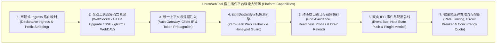
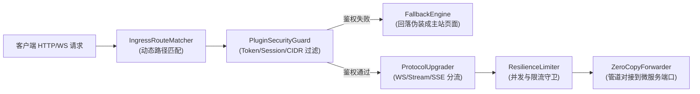
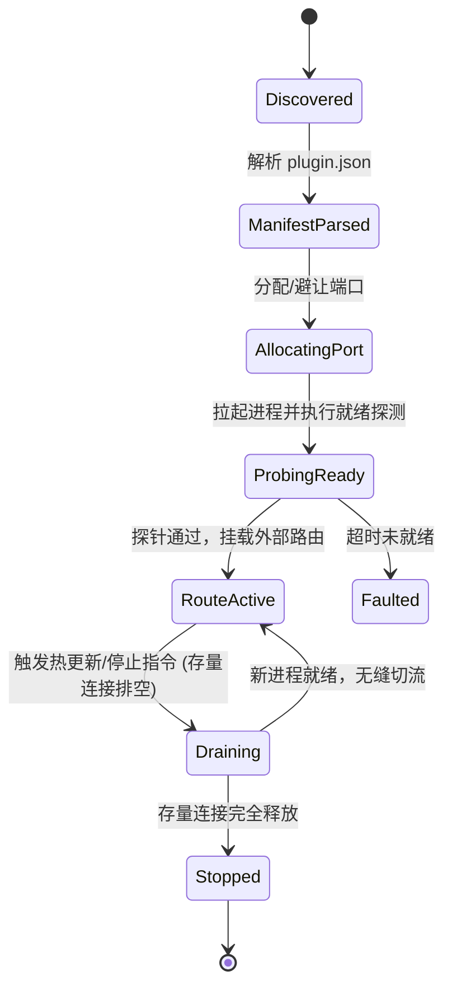

# 宿主转发能力向插件平台级下沉与全生命周期扩展性深度调研与架构方案

> **文档状态**：已就绪 / 架构演进与平台化标准  
> **核心命题**：
> 1. 宿主转发逻辑是否需要提升为“插件平台级能力”，彻底杜绝后续每增一个插件都要改动宿主代码的紧耦合弊端？  
> 2. 从插件平台级能力的扩展性角度，还需要哪些关键能力支持，才能实现一次性前瞻设计、避免后续遇到新场景时“又想起要改动宿主”？  
> **涉及技术栈**：.NET 10 ASP.NET Core Kestrel 管道 / YARP 架构思想、声明式插件清单 (Declarative Manifest Ingress)、WebSocket/SSE/gRPC 全双工字节流直通、主动探测防御伪装回落 (Web Fallback)、适配器/策略/状态机设计模式。

---

## 1. 核心问题定位：为什么必须提升为“插件平台级能力”？

### 1.1 现状痛点：硬编码宿主转发的架构坏味道（Anti-Pattern）
在传统的微服务或插件系统初期，开发者往往习惯在宿主 WebHost 中针对特定插件写硬编码逻辑（例如：针对 SOCKS5 代理单独写一段 `/api/socks5/tunnel` 的转发中间件，针对远程桌面写一段 `/api/vnc/ws`，针对 AI MCP 网关写一段 `/api/mcp/sse`）。

这种做法存在四大致命缺陷：
1. **违背软件工程“开闭原则”（Open-Closed Principle, OCP）**：
   宿主主干代码应对扩展开放，对修改关闭。每新增一个微服务功能就要动手术式地修改 C# WebHost 控制器或中间件，引入了不可控的系统级回归风险。
2. **严重破坏“双轨制部署与热更新”的敏捷红利**：
   根据 `AGENTS.md` 规范，插件微服务的热更新仅需 **5 ~ 8 秒（容器零停机）**。一旦需要改动宿主 C# 代码，就不得不走全量编译重启开发镜像（40 ~ 50 秒）甚至重建生产容器，彻底丧失了微服务解耦迭代的优势。
3. **微服务业务逻辑侵入宿主底座**：
   宿主底座变成了“大杂烩”，失去了作为纯粹应用运行时底座（Application Runtime Kernel）的整洁性与通用性。

### 1.2 平台级演进目标（Platform-Level Ingress Vision）
- **宿主角色转变**：宿主不再感知任何特定插件的业务含义，只提供通用的**声明式流量入口引擎（Declarative Ingress Engine）**；
- **插件声明驱动**：任何微服务只需要在 [`plugin.json`](file:///e:/WorkProject/CSharp/PrivateProject/Web/WebToolForLinux/plugins/socks5-proxy/plugin.json) 清单中声明自己的入口路径、协议类型（HTTP/WebSocket/SSE/Stream）与鉴权策略，宿主平台在插件加载时**自动动态挂载路由，宿主代码 0 修改！**

---

## 2. 插件平台级能力扩展性需求全景分析（七大核心能力图谱）

为了彻底避免“后续需要时又想起要改动宿主代码”，必须系统性梳理微服务插件生态在未来 3~5 年内可能需要的所有接入场景（网络代理、AI MCP 网关、Web 终端、VNC 桌面、大文件分块传输、时序监控、IoT 数据流等），建立**平台级能力扩展矩阵**：



### 2.1 能力 1：声明式 Ingress 路由映射（Declarative Ingress Routes）
插件通过 `plugin.json` 的 `ingress` 节点自主声明需要宿主对外暴露的端点，完全解耦宿主：
```json
{
  "ingress": {
    "routes": [
      {
        "path": "/tunnel",
        "protocol": "websocket",
        "target": "residentPort",
        "auth": "plugin_secret",
        "fallback": "web_console"
      },
      {
        "path": "/api/*",
        "protocol": "http",
        "target": "residentPort",
        "stripPrefix": true,
        "auth": "admin_session"
      },
      {
        "path": "/events",
        "protocol": "sse",
        "target": "residentPort",
        "buffering": "disabled"
      }
    ]
  }
}
```

### 2.2 能力 2：全协议双工流式直通（Full-Duplex Stream & Protocol Upgrades）
宿主的反向代理引擎必须原生支持全套现代 Web 协议的透明转发：
- **标准 HTTP/1.1 & HTTP/2 反向代理**：自动处理 Chunked 编码、大文件分块上传与断点续传；
- **WebSocket 原生双工直通 (`Upgrade: websocket`)**：利用 `HttpContext.WebSockets.AcceptWebSocketAsync()` 接管底层 TCP 双工通道；
- **HTTP 任意协议升级 (`IHttpUpgradeFeature`)**：支持原生 TCP Stream 劫持，将外层 HTTP 路径直接降解对接为底层原始流；
- **Server-Sent Events (SSE) 直通**：针对 AI MCP（Model Context Protocol）微服务，强制关闭代理缓冲（`X-Accel-Buffering: no`），实现按 Token 实时打字机流式推送。

### 2.3 能力 3：统一身份鉴权与安全上下文透传（Security & Identity Propagation）
微服务自身无需重复实现复杂的 JWT / Cookie 会话验证，由平台提供统一守护：
- **认证模式声明**：
  - `none`：公开路由（如状态探测或公开页面）；
  - `admin_session`：必须持有宿主管理员合法登录态；
  - `plugin_secret`：校验自定义密钥头（如 `X-LWT-Tunnel-Key`）；
- **上下文透明注入**：鉴权通过后，宿主自动向微服务请求头中注入：
  - `X-LWT-Client-IP`：经由反代修正的真实客户端 IP；
  - `X-LWT-User`：当前登录的操作员身份；
  - `X-LWT-Trace-ID`：全链路分布式追踪 ID。

### 2.4 能力 4：通用伪装回落与抗主动探测引擎（Universal Anti-Probing Web Fallback）
对于代理隧道或敏感微服务，主动探测是暴露服务特征的头号元凶。平台提供全局 Web Fallback 机制：
- 任何外部请求若未通过 `plugin_secret` 校验或未带合法 Upgrade 头：
  - **策略 A (`web_console`)**：静默将请求透传至主系统前端静态文件管线，**100% 呈现正常的前端控制台登录界面**；
  - **策略 B (`silent_404`)**：严格模拟标准 Web 服务器的 404 Not Found；
- 微服务本身零代码改动即可完全免疫 GFW 或扫描器的主动探测。

### 2.5 能力 5：动态端口避让与无缝排空热重载（Drain-Reload & Readiness Probes）
- **端口冲突自愈**：当声明的微服务端口被宿主其他进程占用时，平台自动分配高位可用端口并通过命令行参数 `{port}` 传入；
- **健康就绪探针 (Readiness Probe)**：微服务启动或热更时，平台先轮询其本地 `/health` 探针，确认就绪后才将宿主 Ingress 路由切流到新 PID；
- **连接平滑排空 (Connection Draining)**：热重载微服务时，存量长连接允许存活至自然关闭，新连接立即路由到新实例，消除业务感知抖动。

### 2.6 能力 6：微服务与宿主双向 IPC 控制总线（Bidirectional IPC Event Bus）
- 宿主向微服务广播系统事件（如宿主 IP 变动、管理员密码更新、系统进入低功耗模式）；
- 微服务向宿主注册动态扩展点（如在主系统左侧导航栏动态挂载菜单项、向系统仪表盘贡献硬件指标卡片）。

### 2.7 能力 7：微服务级弹性流量治理与防护（Resilience & Rate Limiting）
- **单插件最大并发连接数限制**：防止单个失控的插件微服务吃光宿主操作系统的文件描述符（FD）；
- **自适应缓冲区管理**：对于大流量长流（如视频流、备份同步），平台限制单个代理连接的内存占用峰值。

---

## 3. 设计模式深度建模（Architecture Design Patterns）

为了确保这套插件平台级能力的优雅扩展与高内聚低耦合，采用四大核心设计模式进行架构建模：

### 3.1 管道与过滤器模式（Pipes and Filters Pattern / Ingress Middleware Pipeline）
宿主处理任何经过插件 Ingress 路径的请求时，构建一条高内聚的微中间件管线：



### 3.2 适配器模式（Adapter Pattern）：抹平底层协议差异
定义通用的 `IPluginStreamAdapter` 抽象契约：
- `WebSocketStreamAdapter`：将 ASP.NET Core 的 `WebSocket` 封装为标准的 `System.IO.Stream`；
- `HttpUpgradeStreamAdapter`：将底层原始双工 TCP 套接字封装为 `Stream`；
- 转发引擎直接面向 `Stream` 操作，无论插件底层是 WebSocket、gRPC 还是标准 HTTP，转发逻辑完全统一复用。

### 3.3 策略模式（Strategy Pattern）：动态选择路由与伪装策略
- **伪装回落策略 (`IFallbackPolicy`)**：
  - `ConsolePageFallbackPolicy`（回落为主站登录界面，用于抗审查伪装）；
  - `NotFoundFallbackPolicy`（标准 404 响应）；
  - `CustomHoneypotFallbackPolicy`（蜜罐诱捕响应）；
- **上游路由策略 (`IRoutingStrategy`)**：
  - `DirectLoopbackStrategy`（直接转发给容器内监听端口）；
  - `UnixDomainSocketStrategy`（针对高性能场景走 IPC 本地套接字）。

### 3.4 有限状态机（Finite State Machine - FSM）：管理 Ingress 路由生命周期
微服务在宿主中的生命周期与路由挂载严格遵循六态流转：



---

## 4. 实施落地方案与架构门禁设计

### 4.1 实施路径：分阶段无感落地
1. **第一阶段：Manifest 规范与 Ingress 路由中间件落地**：
   - 在 `src/LinuxWebTool.WebHost/` 中重构现有的 `PluginProxyMiddleware`，使其支持 `plugin.json` 中的声明式 `ingress.routes`；
   - 引入 WebSocket / Stream 双工直通适配器，任何插件声明 `"protocol": "websocket"` 即可自动获得外部 HTTPS 路径穿透能力。
2. **第二阶段：通用主动探测防御与 Web Fallback 引擎**：
   - 在中间件中实现未授权请求静默流转至 `DefaultFileMiddleware` / SPA 前端，微服务免除编写伪装代码的负担。
3. **第三阶段：`socks5-proxy` 与其他微服务无缝迁移**：
   - 将 `socks5-proxy` 的 HTTP 路径隧道完全声明化配置，宿主 C# 代码保持零修改。

### 4.2 架构测试门禁与防回归约束 (`LinuxArch076`)
在 [`tests/LinuxWebTool.ArchitectureTests/ArchitectureTests.cs`](file:///e:/WorkProject/CSharp/PrivateProject/Web/WebToolForLinux/tests/LinuxWebTool.ArchitectureTests/ArchitectureTests.cs) 中新增：
`LinuxArch076_插件平台级声明式Ingress路由与通用流式直通门禁`：
1. **严禁在宿主 Controllers 或特定中间件中硬编码特定插件的业务子路径**；
2. **强制所有跨协议流式转发必须基于通用声明式 Manifest 解析机制**；
3. **强制提供基于 Web Fallback 的抗主动探测安全回落契约**。

---

## 5. 总结
将转发能力提升为**插件平台级通用能力**是 LinuxWebTool 迈向微内核插件生态的必然进化。通过一次性前瞻设计“声明式 Ingress、全双工流直通、统一鉴权上下文、通用抗探测伪装回落与排空热重载”七大能力体系，后续无论接入何种新型微服务，均可实现**宿主代码 0 修改、插件微服务 5 秒极速热更且零停机**的极致架构体验。
