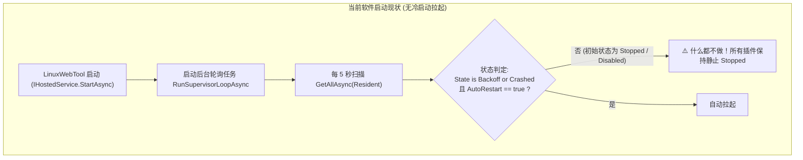
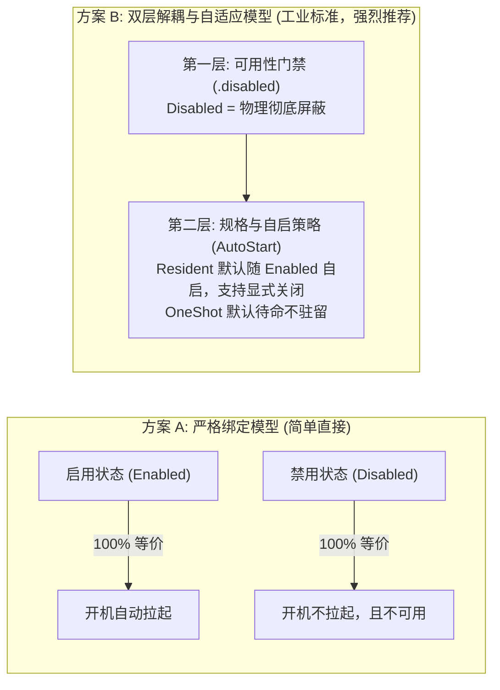
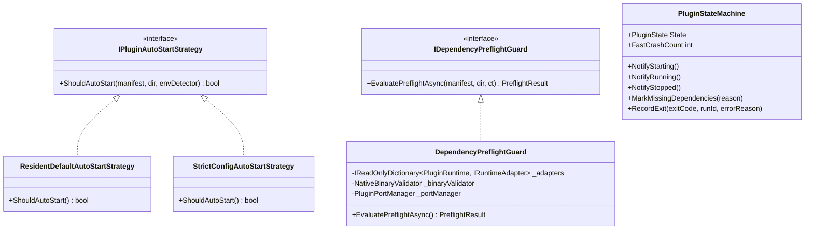
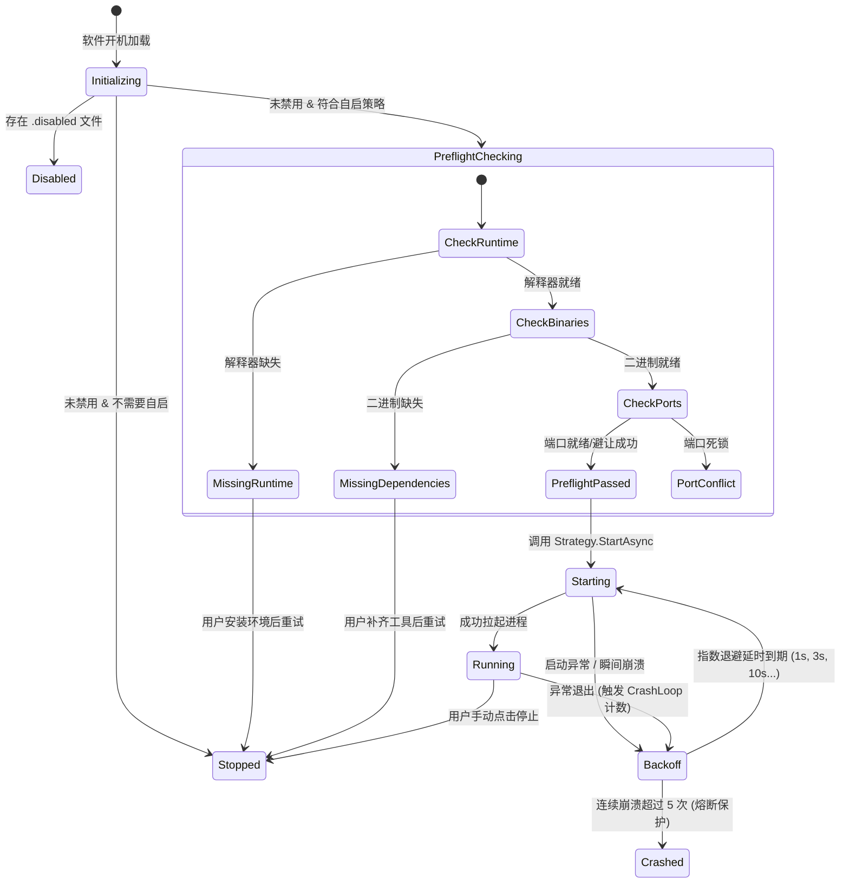

# 统一插件平台自启动机制、生命周期记忆与依赖健康门禁架构方案

> **文档状态**：调研完成 / 架构设计与方案评审通过 / 待实施  
> **涉及模块**：`LinuxWebTool.Infrastructure`、`LinuxWebTool.Contracts`、`LinuxWebTool.WebHost`、`Web前端子模块`  
> **核心原则**：不篡改用户意图（No State Mutation）、开机自愈（Self-Healing）、依赖健康门禁（Pre-flight Health Guard）、Native AOT 100% 兼容  

---

## 一、问题背景与现状审计

针对用户提出的三大核心关切：
1. **当前软件启动后插件会自动启动吗？**
2. **能否支持控制开机自启？或者以“记录启用/禁用状态”来决定是否开机自启？**
3. **若存在依赖问题，即使配置了自启动，是否会自动禁用？**

我们对现有代码库进行了精确的技术审计：

### 1.1 现状诊断结论


1. **目前完全不会自动冷启动**：
   - `PluginManager` 实现了 `IHostedService`。在 `IHostedService.StartAsync` 中仅启动了守护轮询任务 `RunSupervisorLoopAsync`。
   - 在守护任务中，拉起条件极其严格：必须是 `p.State is PluginState.Backoff or PluginState.Crashed`。
   - 而在软件冷启动（Cold Boot）时，所有插件在内存中初次加载的初始状态均为 `PluginState.Stopped`（或 `PluginState.Disabled`）。因此**目前没有任何插件会在软件启动后自动启动**，全部必须等待用户在前端手动点击“启动”或由 API 触发。
2. **启用/禁用（Enabled/Disabled）是唯一的持久化开关**：
   - 现有的启用/禁用通过在插件根目录是否存在 `.disabled` 标记文件来实现（[`PluginManager.cs:228`](file:///src/LinuxWebTool.Infrastructure/Features/Plugins/PluginManager.cs#L228)）。
   - 一旦存在 `.disabled` 文件，插件在任何地方均被短路拒绝执行。
3. **缺失自启配置与开机依赖前置校验**：
   - `PluginManifest` 缺乏对启动时机的配置，无法区分“开机自启”、“按需唤醒”与“手动启动”；
   - 启动流程中没有针对外部业务二进制依赖（`manifest.Dependencies`）的前置健康阻断，容易引发无意义的进程崩溃。

---

## 二、架构头脑风暴与深层逻辑辨析

在引入“开机自启”与“依赖故障处理”时，必须深入审视背后的逻辑陷阱、系统动力学与性能瓶颈：

### 2.1 启用状态 vs 开机自启：绑定模型 vs 解耦模型？



#### 深度权衡分析：
1. **常驻微服务 (Resident) vs 脚本扩展 (OneShot) 的本质差异**：
   - **`Resident`（微服务/守护服务）**：例如 Socks5 代理、ChatGPT 渠道网关、MCP Bridge。用户期望这些服务具备“基础设施属性”，只要没有显式禁用，服务器重启后应当自动恢复服务。
   - **`OneShot`（一次性任务/工具扩展）**：例如 SSH 访问安全守卫、系统健康自检。此类扩展**根本没有后台长驻进程**，它的生命周期是一次性的。如果系统开机把 OneShot 全拉起来跑一遍，既无必要又会造成冷启动 CPU 尖刺。
2. **运维场景的细分诉求**：
   - 用户需要某些插件处于“已启用（Enabled）”状态以便随时在页面使用或由定时工作流调用，但**不希望**它开机就霸占固定端口和内存（例如一个高内存占用的本地 AI 模型微服务）。
3. **架构裁定**：
   - **采用「双层自适应模型」**：
     - **底座硬规则**：凡是 `Disabled`（存在 `.disabled` 文件）的插件，**绝对禁止开机自启**；
     - **规格默认值**：对于 `Resident` 常驻微服务，默认 `AutoStart = true`（即“启用就开机自启”）；对于 `OneShot` 轻量扩展，默认 `AutoStart = false`（按需唤醒）；
     - **高级可配置性**：在插件清单 `supervision.autoStart` 允许用户显式覆盖（如设置为 `false`），兼顾小白用户的开箱即用与高级运维的精细控制。

---

### 2.2 核心思辨：存在依赖问题的插件，应该“自动禁用”吗？

> **极其重要的架构结论：坚决不能“自动禁用（写入 `.disabled`）”！而是应当“依赖阻断（Gated）并标记为依赖缺失（MissingRuntime / MissingDependencies）”！**

#### 为什么不能直接“自动禁用”？
1. **破坏用户配置事实源（State Mutation Anti-pattern）**：
   - 用户明明明确点击了“启用”，系统在背后把用户的配置篡改成“禁用”，造成了状态不透明和不可预期。
2. **扼杀系统的自我愈合（Self-Healing）能力**：
   - 如果系统因检测到缺少 `python3` 或 `caddy` 而直接落盘 `.disabled` 文件，那么即便用户稍后在终端通过 `apt install` 或 `apk add` 安装了依赖，插件仍然处于“被禁用”死锁中，必须用户手动去寻找并重新启用。
3. **冷启动竞态冒险（Cold-Boot Race Conditions）**：
   - 在容器编排或复杂服务器环境中，依赖的挂载目录、Docker Socket 或某些依赖子服务可能在主程序启动后 2~3 秒才完全就绪。如果冷启动检测失败就直接落盘 `.disabled`，将造成灾难性的不可逆假死。

#### 正确做法：开机前置健康探针 (Pre-flight Dependency Guard)
- **探针拦截**：自启前执行探针检测（语言解释器、二进制工具、端口是否可用）；
- **阻断而不篡改**：若探针失败，**取消本次启动**，但**不写入 `.disabled`**；
- **状态机投影**：将该插件状态投影为 `MissingRuntime` 或 `MissingDependencies`，并在控制台显示警告与一键安装指引；
- **就绪即自愈**：一旦依赖安装完毕或用户手动点击启动，系统自动重检并顺畅拉起。

---

## 三、业界主流方案与标准对比

调研操作系统、容器生态与主流面板的启动治理设计：

| 平台 / 系统 | 自启配置方式 | 依赖缺失时的处理策略 | 崩溃熔断与防雪崩 (Flapping) | 对本项目的借鉴意义 |
| :--- | :--- | :--- | :--- | :--- |
| **Linux Systemd** | `WantedBy=multi-user.target` (`systemctl enable`) | `ConditionPathExists=` / `Requires=`。条件不满足则**跳过执行（Condition Failed）**，但单元仍保持 `enabled` 状态。 | `StartLimitIntervalSec=`, `StartLimitBurst=`，短时间内重启超限则熔断置为 `failed`。 | **核心标杆**：条件不满足仅跳过/失败，绝不擅自 `systemctl disable` 用户单元。 |
| **Docker Compose** | `restart: always` / `unless-stopped` | `depends_on: { condition: service_healthy }`，上游未就绪则一直等待阻塞，不篡改 compose 文件。 | 指数退避重启（Backoff delay: 1s, 2s, 4s...）。 | 借鉴其 `unless-stopped`（除非手动停止否则自启）的直观生命周期哲学。 |
| **Home Assistant (HASS)** | 插件配置 `boot: true/false` | 缺少外部依赖或硬件时标记为 `Unhealthy / Blocked`，通知管理员，绝不自动卸载或关闭开关。 | Watchdog 心跳守护，超时后隔离并上报故障。 | 依赖缺失时在 UI 呈现高亮告警和安装引导。 |
| **VS Code 扩展市场** | `activationEvents` 声明式唤醒 | 缺少底层环境时触发激活异常，插件卡片显示齿轮叹号警告，保持安装与启用。 | 扩展宿主进程独立隔离，崩溃不影响宿主编辑器。 | 细粒度区分语言环境缺失与插件业务崩溃。 |
| **aaPanel / 宝塔面板** | 插件管理中每个应用有单独开机自启开关 | 缺失依赖时通常直接报脚本执行错误，缺少退避机制，易导致 CPU 空转。 | 脚本轮询拉起，较少具备指数熔断机制。 | 反面教材：必须杜绝无退避机制的死循环拉起。 |

---

## 四、经典设计模式落地架构



### 4.1 策略模式 (Strategy Pattern)：自启判定策略
定义 `IPluginAutoStartStrategy`，抹平不同类型插件的自启规则：
- **`ResidentDefaultAutoStartStrategy`（推荐默认策略）**：
  $$\text{AutoStart} = (\text{IsEnabled} == \text{true}) \land (\text{Profile} == \text{Resident}) \land (\text{Supervision.AutoStart} \neq \text{false})$$
  - 只要没被显式禁用（无 `.disabled`），常驻微服务默认自启；
  - 若在 `plugin.json` 中显式指定了 `"autoStart": false`，则尊重该配置不予自启；
  - `OneShot` 脚本扩展永不默认自启。

### 4.2 适配器与探针模式 (Adapter & Pre-flight Guard)：前置健康检查
定义 `IDependencyPreflightGuard`：
- **运行时解释器探针**：调用对应 `IRuntimeAdapter.CheckAvailable()`（检查 `node`、`python3`、`dotnet`、`bash`、`go`）；
- **二进制依赖探针**：调用 `manifest.GetUnifiedDependencies()`，逐一探查 `caddy`、`last`、`ss` 等工具链；
- **端口可用性与避让探针**：调用 `_portManager.AllocatePortWithDetails()` 预判端口是否冲突。
- **探针输出 `PreflightResult`**：
  - `CanStart: true` $\rightarrow$ 允许拉起进程；
  - `CanStart: false` $\rightarrow$ 阻断启动，附带 `MissingType` 与 `DetailedMessage`。

### 4.3 状态机模式 (State Machine Pattern)：状态确定性流转
扩展现有的 [`PluginStateMachine`](file:///src/LinuxWebTool.Infrastructure/Features/Plugins/Supervisor/PluginStateMachine.cs)，形成闭环状态机：



---

## 五、系统已有基础设施复用方案

当前系统内已有高度契合的组件，**100% 内部复用，0 外部依赖**：

| 组件 / 资产 | 源码位置 | 复用方式与职责 |
| :--- | :--- | :--- |
| **`PluginStateMachine`** | [`PluginStateMachine.cs`](file:///src/LinuxWebTool.Infrastructure/Features/Plugins/Supervisor/PluginStateMachine.cs) | 已内置状态机与 `FastCrashCount` 计数器，直接复用其熔断与状态跟踪机制。 |
| **`PluginManager` (IHostedService)** | [`PluginManager.cs:578`](file:///src/LinuxWebTool.Infrastructure/Features/Plugins/PluginManager.cs#L578) | 在 `IHostedService.StartAsync` 中增加开机自启管线 `ExecuteStartupAutoStartAsync()`。 |
| **`IRuntimeAdapter` 体系** | [`PluginRuntimeAdapters.cs`](file:///src/LinuxWebTool.Infrastructure/Features/Plugins/Adapters/PluginRuntimeAdapters.cs) | 直接复用 Node、Python、DotNet、Go、Bash 的 `CheckAvailable()` 与 `ResolveInstallGuide()`。 |
| **`NativeBinaryValidator`** | [`NativeBinaryValidator.cs`](file:///src/LinuxWebTool.Infrastructure/Features/Plugins/Adapters/NativeBinaryValidator.cs) | 复用二进制存在性探针与权限检查。 |
| **`PluginPortManager`** | [`PluginPortManager.cs`](file:///src/LinuxWebTool.Infrastructure/Features/Plugins/Supervisor/PluginPortManager.cs) | 复用动态端口冲突探测、动态避让与保留端口分配。 |

---

## 六、端到端实施与落地蓝图

### 6.1 契约层扩展 (`LinuxWebTool.Contracts`)
在 `PluginSupervisionConfig` 中增加 `AutoStart` 字段：
```csharp
public sealed record PluginSupervisionConfig
{
    public bool AutoRestart { get; init; } = true;
    /// <summary>是否在系统启动后自动启动（若为空，Resident 微服务默认跟随启用状态自启）</summary>
    public bool? AutoStart { get; init; }
    public int FlappingThresholdSec { get; init; } = 10;
    public int MaxCrashRetries { get; init; } = 5;
}
```

在 `PluginState` 中补充精确状态：
```csharp
public enum PluginState
{
    Stopped = 0,
    Starting = 1,
    Running = 2,
    Crashed = 3,
    Backoff = 4,
    Disabled = 5,
    MissingRuntime = 6,
    MissingDependencies = 7 // 新增：专用标识缺少业务二进制依赖
}
```

### 6.2 后端中枢升级 (`LinuxWebTool.Infrastructure`)

1. **实现开机自启管道**：
   在 `PluginManager.cs` 的 `IHostedService.StartAsync` 中增加顺序引导：
   ```csharp
   public async Task StartAsync(CancellationToken cancellationToken)
   {
       // 1. 执行常驻微服务开机健康探针与自启编排
       await ExecuteStartupAutoStartAsync(cancellationToken);

       // 2. 启动后台守护轮询任务
       _supervisorCts = new CancellationTokenSource();
       _supervisorTask = RunSupervisorLoopAsync(_supervisorCts.Token);
   }
   ```

2. **自启前置健康探针 (Pre-flight Evaluation)**：
   ```csharp
   private async Task ExecuteStartupAutoStartAsync(CancellationToken ct)
   {
       var plugins = await GetAllAsync(PluginProfile.Resident, ct);
       foreach (var p in plugins)
       {
           // 1. 禁用守卫：存在 .disabled 绝对跳过
           if (p.State == PluginState.Disabled) continue;

           // 2. 自启策略：Resident 默认自启，显式指定 false 则跳过
           var shouldAutoStart = p.Manifest.Supervision?.AutoStart ?? true;
           if (!shouldAutoStart) continue;

           // 3. 依赖前置探针：检查解释器与二进制
           var (ready, reason) = EvaluatePluginReadiness(p.Manifest, p.PluginDir);
           if (!ready)
           {
               _logger?.LogWarning("插件 '{Id}' 开机自启前置检查未通过，跳过拉起: {Reason}", p.Manifest.Id, reason);
               var sm = GetOrCreateStateMachine(p.Manifest);
               sm.MarkMissingDependencies(reason);
               continue;
           }

           // 4. 正式拉起
           _logger?.LogInformation("插件中枢开机自动拉起微服务: {Id}", p.Manifest.Id);
           await StartAsync(p.Manifest.Id, ct);
       }
   }
   ```

### 6.3 前端控制台适配 (`PluginsView.js` & `PluginCard.js`)
1. **卡片右上角自启状态徽标**：
   - 处于自启状态的常驻服务，卡片显示 `⚡ 自启` 微标；
2. **依赖缺失高亮**：
   - 当插件因缺少环境被跳过自启时，卡片呈现醒目橙色边框并提示 `缺少依赖: {reason}`，并提供 `🩺 引导安装` 按钮；
3. **设置项弹出层**：
   - 在插件编辑/配置弹窗中，允许用户自由勾选 `[x] 系统启动时自动启动此微服务`。

---

## 七、演进与交付计划

| 阶段 | 交付目标 | 验收标准 |
| :--- | :--- | :--- |
| **Phase 1: 契约与探针落地** | 扩展 `AutoStart` 字段，实现 `EvaluatePluginReadiness` 前置探针。 | 单元测试验证依赖存在与缺失场景下的探针判定准确率 100%。 |
| **Phase 2: 开机自启管线接入** | 在 `IHostedService.StartAsync` 接入自启流程，支持健康阻断与状态机更新。 | 重启程序后，已启用的常驻插件自动处于 `Running`，缺少依赖的插件安全定格在 `MissingDependencies`（且 `.disabled` 未被误写）。 |
| **Phase 3: 前端交互与端到端验证** | 前端卡片展示自启标识、依赖警告，完成全流程自动化冒烟测试。 | `dotnet test` 与 `frontend-gate.cjs` 100% 通过。 |
