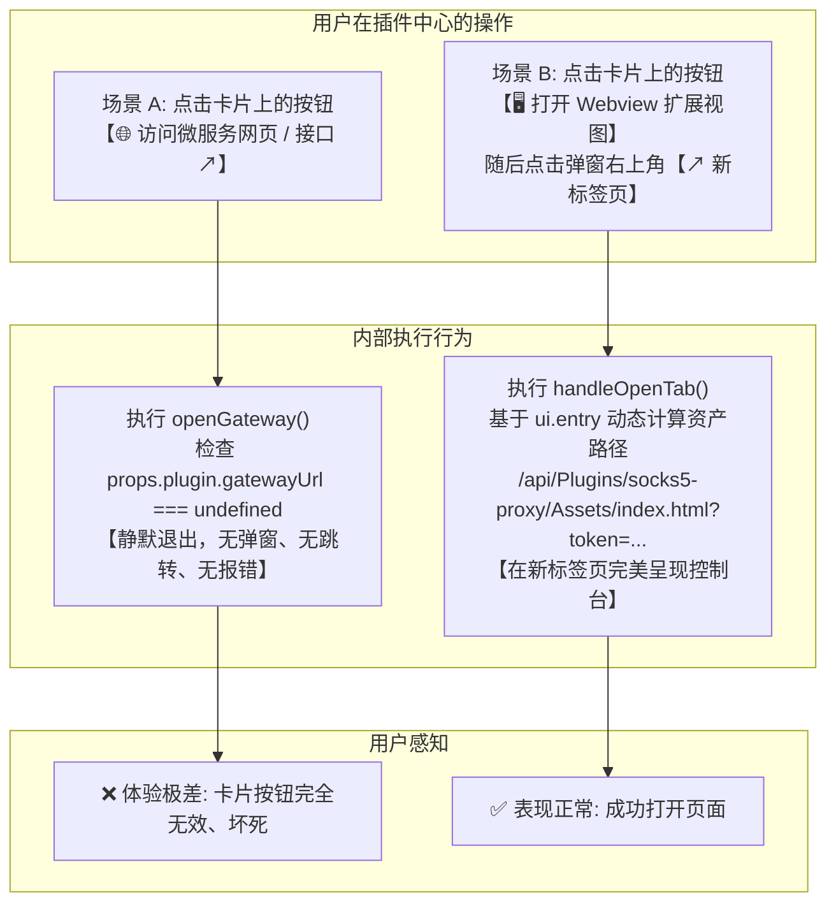
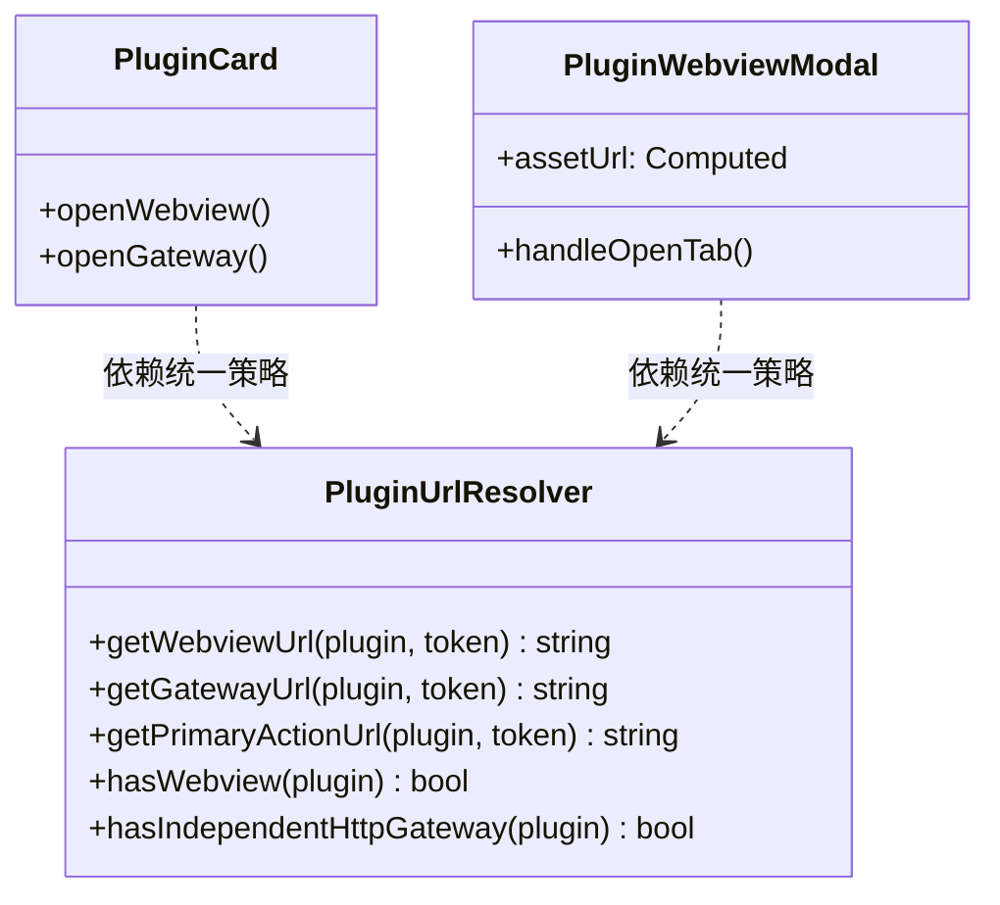

# 插件卡片“访问微服务网页/接口”无效根因剖析、统一 URL 解析器与 UI 模式契约治理方案

> **文档状态**：已就绪 / 前端架构与插件服务交互规范  
> **核心命题**：  
> 1. **深度排查用户反馈**：在插件中心卡片上点击“🌐 访问微服务网页 / 接口 ↗”按钮完全无效（没有任何反馈、弹窗或报错），而 Webview 弹窗右上角的“↗ 新标签页”按钮却能正常打开页面；  
> 2. **深层根因剖析**：从代码级揭示 `PluginCard.js` 与 `PluginWebviewModal.js` 之间**数据流断层**、**未初始化属性访问（Undefined Property Access）**与**后端 `SupportHttp` 契约语义泛化**的三重陷阱；  
> 3. **业界主流方案对比**：参考 Kubernetes Service Endpoint 准入、1Panel / Portainer 容器协议识别与 VSCode 扩展 Webview 导航设计；  
> 4. **设计模式与工程重构**：引入**策略模式（Strategy Pattern）与外观模式（Facade Pattern）**打造统一的 `PluginUrlResolver` 单一事实源；  
> 5. **质量红线与防回归门禁**：制定前端门禁 `FE-PLUGIN-URL-RESOLVER` 与单元测试用例，从根本上杜绝“点击静默无反应”的断崖式体验。

---

## 1. 现象复现与核心痛点

用户在日常使用 SOCKS5 代理微服务（`socks5-proxy`）时，遭遇了明显的 UI 交互不一致体验：



- **痛点 1（按钮坏死与静默失败）**：
  卡片上的“🌐 访问微服务网页 / 接口 ↗”按钮高亮可点击，但用户点击后无任何反应，没有任何 Console 报错，也没有 Toast 提示，用户陷入困惑；
- **痛点 2（逻辑撕裂与认知冲突）**：
  同属于该微服务的页面，弹窗右上角的按钮可以一键在新标签页中打开，但卡片上的“访问网页”按钮却无法使用，暴露出代码层面的严重碎片化。

---

## 2. 深入源码：三重根因深度剖析（Root Cause Analysis）

通过全景审查 `PluginCard.js`、`PluginWebviewModal.js` 以及后端的 `PluginModels.cs`，定位到导致该问题的三重深层根因：

### 2.1 根因一：`PluginCard.js` 依赖了后端从未下发的 `props.plugin.gatewayUrl`

在 `src/LinuxWebTool.WebHost/wwwroot/app/components/plugins/PluginCard.js` 中：

```javascript
// 行 75-84:
function openGateway() {
  if (props.plugin.gatewayUrl) {  // 💥 致命 Bug: 后端 DTO 根本没有该属性！
    let url = props.plugin.gatewayUrl;
    if (auth.token) {
      const sep = url.includes('?') ? '&' : '?';
      url = `${url}${sep}token=${encodeURIComponent(auth.token)}`;
    }
    window.open(url, '_blank');
  }
}
```

1. 后端接口 `GET /api/Plugins` 返回的是 `PluginInstanceDto` 列表，包含 `id`, `name`, `state`, `allocatedPort`, `manifest` 等字段，**后端根本没有生成或下发 `gatewayUrl` 字段**！
2. `props.plugin.gatewayUrl` 恒为 `undefined`。
3. `if (props.plugin.gatewayUrl)` 条件恒为 `false`，导致 `openGateway()` **整段逻辑直接被跳过，既没有发起跳转，也没有执行任何兜底，陷入完全静默的死循环！**

---

### 2.2 根因二：Webview 弹窗具备健全的降级策略，但各组件割裂未复用

对比 `src/LinuxWebTool.WebHost/wwwroot/app/components/plugins/PluginWebviewModal.js`：

```javascript
// 行 22-38:
const assetUrl = computed(() => {
  if (!props.plugin) return '';
  let url = '';
  const rawEntry = props.plugin.manifest?.ui?.entry || props.plugin.manifest?.ui?.entryFile;
  if (rawEntry && rawEntry !== 'web') {
    // 优先 1: 静态资产文件 (ui/index.html) -> /api/Plugins/{id}/Assets/index.html
    const cleanEntry = rawEntry.replace(/^\/+/, '').replace(/^ui\//, '');
    url = API.plugins.asset(props.plugin.id, cleanEntry);
  } else if (props.plugin.manifest?.ui?.entry === 'web' || props.plugin.gatewayUrl || props.plugin.manifest?.network?.mode === 'path') {
    // 优先 2: 独立 HTTP Gateway 直达 -> /plugins/{id}/
    url = props.plugin.gatewayUrl || API.plugins.gatewayUrl(props.plugin.id);
  } else {
    // 优先 3: 默认 index.html 资产
    url = API.plugins.asset(props.plugin.id, 'index.html');
  }

  if (url && auth.token) {
    const sep = url.includes('?') ? '&' : '?';
    return `${url}${sep}token=${encodeURIComponent(auth.token)}`;
  }
  return url;
});
```

- **为什么弹窗右上角正常？**
  `PluginWebviewModal.js` 编写了完整的 URL 降级策略：先解析 `manifest.ui.entry`，调用 `API.plugins.asset(id, entry)` 计算出实际资产 URL（`/api/Plugins/socks5-proxy/Assets/index.html?token=...`），因此右上角点击 `window.open(assetUrl.value)` 可以正常打开；
- **问题所在**：
  这套健全的 URL 解析逻辑被深锁在 `PluginWebviewModal.js` 内部，`PluginCard.js` 没有复用它，甚至连 `API.plugins.gatewayUrl(props.plugin.id)` 兜底都没有，造成严重的“同功能不同表现”。

---

### 2.3 根因三：后端 `SupportHttp` 契约语义过度泛化，引发“伪服务”按钮误渲染

在 `PluginCard.js` 中，决定是否渲染该按钮的判断条件为：
```javascript
// 行 49:
const hasHttpService = computed(() => isResident.value && Boolean(props.plugin.manifest?.network?.supportHttp));
```

追踪后端 `src/LinuxWebTool.Contracts/Features/Plugins/Contracts/PluginModels.cs`：
```csharp
// 行 39:
public bool SupportHttp { get => Mode == "port" || Mode == "path" || Port > 0; init { if (value && Mode == "none") Mode = "port"; } }
```

- **业务语义错配**：
  只要微服务是常驻服务且分配了本地端口（如 `socks5-proxy` 监听 `:18080`），后端的 `SupportHttp` 就会自动被计算为 `true`！
  **但是，`:18080` 是一个纯粹的 SOCKS5 代理端口（或 HTTP CONNECT 隧道），它根本不是一个提供给浏览器渲染的普通 HTTP Web 服务！**
  即便前端强行打开 `http://10.126.1.70:18080/`，浏览器也会由于协议不匹配而报错拒绝连接；
- **UI 模式冗余**：
  `socks5-proxy` 已经声明了 `ui.entry = "ui/index.html"`，卡片上已经提供了一个醒目的主入口按钮 **「🖥️ 打开 Webview 扩展视图」**。
  在没有提供通用 Web 站点的情况下，盲目根据泛化的 `SupportHttp` 又渲染出一个“访问微服务网页”按钮，不仅按钮是坏死的，而且在概念上属于无意义的重复混淆。

---

## 3. 业界主流方案对比与借鉴

| 平台 / 架构 | Web 访问入口判定逻辑 | URL 解析与路由中继 | 降级与兜底策略 | 对本系统的启示 |
| :--- | :--- | :--- | :--- | :--- |
| **Kubernetes (Dashboard / Lens)** | 明确区分 L4 `Service.spec.ports[].protocol` (TCP/UDP) 与 L7 `Ingress / HTTPRoute` | 纯 TCP 端口仅显示端口数字，不呈现外链；只有显式声明了 HTTP Ingress 的服务才显示可点击的 External Endpoint | 无 External Endpoint 时禁用外链按钮，防止误点 | **严格区分“原生传输层端口”与“L7 可访问 Web 服务”**，严禁因有 Port 就显示 Web 按钮。 |
| **1Panel / Portainer** | 容器配置中显式标记 `Web 界面入口 (WebUI: true, WebPort: xxx)` | 优先走统一反向代理，无反代时走宿主 IP + 端口映射 | 若容器未暴露 Web 界面，卡片仅提供“终端”和“日志”，彻底隐藏“访问网页” | **引入契约显式声明**：必须明确声明提供了独立的 Web 站点，才渲染外链按钮。 |
| **VSCode 插件平台** | 区分 `Custom Editor`、`Webview View` 与 `External Browser Link` | 抽象统一的 `vscode.env.openExternal(uri)` 统一门面，内部统一处理协议解析与鉴权 | 无效 URI 抛出明确的用户态 Toast 警告，严禁静默吞没异常 | **抽象统一的 URL 决策策略机（PluginUrlResolver）**，无论在哪里跳转均复用单事实源。 |

---

## 4. 软件设计模式优化与工程重构方案

### 4.1 策略模式与外观模式：抽象统一的 `PluginUrlResolver`

在 `src/LinuxWebTool.WebHost/wwwroot/app/utils/pluginUrlResolver.js` 中抽象统一的解析器，集中管理所有插件 URL 的计算逻辑，消除重复代码：



#### 统一解析规则实现规范：
1. **`hasWebview(plugin)`**：
   判断条件：`Boolean(plugin?.manifest?.ui?.entry || plugin?.manifest?.ui?.hasWebview)`。
2. **`hasIndependentHttpGateway(plugin)`**：
   判断条件：必须满足 `isResident && plugin?.manifest?.network?.mode === 'path'`，或者 `plugin?.manifest?.ui?.entry === 'web'`，或者配置了有效的独立 HTTP Ingress 路由。
   **如果插件只有本地 TCP 代理端口（如 `socks5-proxy`）且其 UI 为 Webview，则 `hasIndependentHttpGateway` 为 `false`**，卡片只保留一个唯一的「打开 Webview 扩展视图」主按钮，消除冗余坏死按钮！
3. **`getGatewayUrl(plugin, token)`**：
   优先取 `plugin.gatewayUrl`；
   若无则自动回退至 `API.plugins.gatewayUrl(plugin.id)`（即 `/plugins/{id}/`）；
   最后自动追加 `token` 参数。
4. **`getWebviewUrl(plugin, token)`**：
   提取 `manifest.ui.entry`，调用 `API.plugins.asset(plugin.id, entry)`，自动追加 `token`。

---

### 4.2 适配器模式：防御式跳转与友好反馈机制

在 `PluginCard.js` 中改造 `openGateway()`：
```javascript
function openGateway() {
  const targetUrl = PluginUrlResolver.getGatewayUrl(props.plugin, auth.token) ||
                    PluginUrlResolver.getWebviewUrl(props.plugin, auth.token);

  if (targetUrl) {
    window.open(targetUrl, '_blank');
  } else {
    toast.warning('该微服务未提供独立的 Web 网页接口，请使用 Webview 扩展视图查看控制台');
  }
}
```
- **绝对杜绝静默失败**：哪怕极端情况下 URL 未解析出，也会向用户弹出 Toast 提示，而不是毫无反应；
- **双重智能降级**：若未配置特定 Gateway，优先打开 Webview 控制台页面。

---

## 5. 防回归自动化门禁与测试规范

为确保全仓后续不会再出现同类“属性访问未兜底”与“按钮坏死”问题，建立两套门禁：

### 5.1 前端单元测试 (`tests/frontend/plugin-url-resolver.test.mjs`)
编写独立的 Node.js ESM 测试套件，覆盖以下边界场景：
1. **测试用例 1**：当插件 `gatewayUrl` 为 `undefined` 时，`PluginUrlResolver.getGatewayUrl` 必须成功兜底回退至 `/plugins/{id}/`；
2. **测试用例 2**：针对 `socks5-proxy`（纯端口微服务 + `ui/index.html`），`hasIndependentHttpGateway` 必须精准判定为 `false`，杜绝卡片出现坏死按钮；
3. **测试用例 3**：针对静态资产 `ui.entry`，`getWebviewUrl` 必须输出标准 `/api/Plugins/{id}/Assets/...` 结构并携带有效 Token。

### 5.2 前端架构门禁 (`frontend-gate.cjs`)
新增门禁规则 **`FE-PLUGIN-GATEWAY-FALLBACK`**：
- 静态扫描 `PluginCard.js` 等所有涉及微服务外链跳转的组件；
- 严禁出现孤立的 `if (props.plugin.gatewayUrl) window.open(...)` 且未提供降级或未通过 `PluginUrlResolver` 的代码模式；
- 违规直接在 CI / pre-commit 阻断构建。

---

## 6. 实施方案与交付计划

1. **新建前端工具类**：
   创建 [`src/LinuxWebTool.WebHost/wwwroot/app/utils/pluginUrlResolver.js`](file:///e:/WorkProject/CSharp/PrivateProject/Web/WebToolForLinux/src/LinuxWebTool.WebHost/wwwroot/app/utils/pluginUrlResolver.js)；
2. **重构组件调用**：
   - 改造 `PluginCard.js`：引入 `PluginUrlResolver`，修复 `openGateway()`，精简非 HTTP 微服务的按钮渲染；
   - 改造 `PluginWebviewModal.js`：复用 `PluginUrlResolver.getWebviewUrl`；
3. **编写并执行自动化测试**：
   - 新建 `tests/frontend/plugin-url-resolver.test.mjs`；
   - 扩展 `frontend-gate.cjs` 静态守卫；
4. **极速热更部署与浏览器端回归验证**：
   - 使用 `scripts/deploy-remote.ps1 -FrontendOnly` 进行 4 秒无感部署；
   - 使用 Chrome DevTools MCP 验证卡片按钮修复效果。
