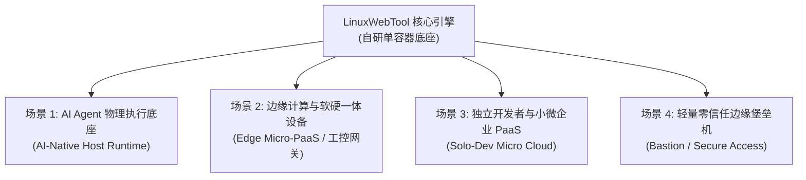

# LinuxWebTool (LWT) 插件中心架构深度剖析、业界对标与商业价值白皮书

> **文档标识**：`docs/plugin-center-architecture-industry-comparison-and-commercial-value.md`  
> **编写时间**：2026-11-08  
> **系统定位**：面向边缘特权宿主、轻量微服务与 AI Agent 协同的自研高密度多语言执行底座  
> **面向对象**：系统架构师、研发工程师、产品决策者与技术投资人  

---

## 目录索引 (Table of Contents)

1. [第一章：当前项目插件中心架构体系与核心特点](#第一章当前项目插件中心架构体系与核心特点)
   - 1.1 核心定位与设计哲学
   - 1.2 契约驱动规范 (Schema v3.1 全栈标准)
   - 1.3 正交多维分类学与工作负载拓扑 (MECE 原则)
   - 1.4 工业级微服务核心模式落地
   - 1.5 异构多语言混合统一运行时
   - 1.6 开发者体验与 AI Agent 优先架构
2. [第二章：与市面微服务平台及同类方案的全景对比](#第二章与市面微服务平台及同类方案的全景对比)
   - 2.1 四维全景横向对比矩阵
   - 2.2 相比市面平台的显著优势
   - 2.3 客观短板与技术边界
3. [第三章：市面类似项目与相关技术生态对标解析](#第三章市面类似项目与相关技术生态对标解析)
   - 3.1 代码与微函数平台：Windmill
   - 3.2 单机无 K8s 容器 FaaS：faasd / OpenFaaS
   - 3.3 传统服务器运维面板：1Panel 与 Red Hat Cockpit
   - 3.4 内存微函数沙箱：Extism 与 WasmCloud
   - 3.5 AI 工具中枢：Open WebUI Pipelines 与 Dify Tools
   - 3.6 对标总览与“四合一”生态位总结
4. [第四章：项目工程架构的“特殊性”深层剖析](#第四章项目工程架构的特殊性深层剖析)
   - 4.1 反主流的技术选型：.NET 10 Native AOT 征战 Linux 特权底座
   - 4.2 反“重型中间件绑架”的单机极简微服务闭环
   - 4.3 运维 + 微服务 + AI 智能体的跨界大一统
   - 4.4 极客与 Agent 结对编程的敏捷闭环
5. [第五章：商业价值评估与商业化落地路径](#第五章商业价值评估与商业化落地路径)
   - 5.1 四大高价值变现蓝海场景
   - 5.2 商业模式演进 (Open-Core / OEM / Marketplace)
   - 5.3 商业化落地的现实挑战与避坑指南
   - 5.4 商业化战略破局结论

---

## 第一章：当前项目插件中心架构体系与核心特点

### 1.1 核心定位与设计哲学
LinuxWebTool (LWT) 插件中心是在单机与边缘物理宿主环境下，演进出的**高密度混合计算与微服务执行底座**。其核心理念是：**在极其受限的单机硬件资源（如 1C1G、2C2G VPS 或边缘工控机）上，以几十兆的内存底噪，赋予宿主完整的微服务治理、函数计算、脚本运维与 AI 智能体协同能力。**

### 1.2 契约驱动规范 (Schema v3.1 全栈标准)
- **声明式元数据驱动**：系统由统一的 `plugin.json` 强类型契约驱动，规范了：
  - 生命周期模型 (`Lifecycle`)：解释型 (`Interpreted`)、预编译二进制 (`PrebuiltBinary`)、源码热构建 (`SourceCompiled`)；
  - 通信协议 (`Protocol`)：`Http` REST、`Uds` 本地套接字、`WasmAbi` 内存调用、`CliArgs` 命令行参数；
  - 工作负载形态 (`Archetype`)：常驻微服务、弹性微函数、运维指令；
  - 目录布局 (`LayoutSpec`)、构建规范 (`BuildSpec`) 以及显式服务接口清单 (`Services` / `Actions`)。
- **物理目录结构标准化**：所有插件严格采用结构化分层（`src/` 源码、`bin/` 构建产物、`storage/` 隔离数据目录），彻底杜绝临时产物污染。

### 1.3 正交多维分类学与工作负载拓扑 (MECE 原则)
遵循云原生（K8s / AWS / Cloudflare）计算机科学本质，将计算单元划分为三大顶级正交工作负载范式：
1. **🌐 常驻微服务与网关 (`Resident Microservices & Gateways`)**：长时运行、持有网络端口或套接字、由 Supervisor 守护、提供持续 API 服务（如 `mcp-bridge`、`lxc-manager`、`socks5-proxy`、`caddy-manager`）；
2. **⚡ 弹性微函数与计算 (`Elastic Micro-Functions / FaaS & Wasm`)**：无状态、毫秒级/纳秒级冷启动、按需拉起（Scale-to-Zero）、内存沙箱安全隔离（如 `demo-serverless-api`、`demo-nativeaot-wasm`、`demo-wasm-function`）；
3. **🛠️ 运维指令与单次任务 (`OneShot Tasks & CLI Ops`)**：有限生命周期、随调随走、执行系统运维指令或健康巡检的工具（如 `ssh-access-guard`、`sample-healthcheck`）。
- **多维组合切面索引**：前端与后端支持按生命周期、通信协议、业务领域与运行健康状态进行四维正交组合筛选。

### 1.4 工业级微服务核心模式落地
- **动态控制面与数据面分离 (YARP 反向代理)**：基于微软工业级反代引擎 `Yarp.ReverseProxy`，主系统作为 API 网关动态转发微服务流量，支持动态端口映射、平滑端口切换与零停机重载。
- **解耦的正交双状态机 (Dual State Machines)**：
  - **部署状态机 (`DeploymentStateMachine`)**：`DRAFT -> VALIDATING -> PREPARED -> DEPLOYING -> PROBING -> READY -> ACTIVE -> DRAINING -> STOPPED`。通过主动 HTTP GET 就绪探针彻底杜绝微服务的“假就绪 (False Ready)”；
  - **操作状态机 (`OperationStateMachine`)**：管理单次 Action 调用的执行阶段与幂等状态（`QUEUED -> RUNNING -> SUCCEEDED / FAILED / TIMED_OUT`）。
- **单机可靠事件通信**：利用系统内置的 **SQLite WAL 机制**实现事务性发件箱（Transactional Outbox）+ `System.Threading.Channels` 极速单机异步事件通道，消费者收件箱保证 At-least-once 投递与幂等去重。
- **对账自愈循环**：基于 Quartz.NET 定时轮询与 Polly v8 弹性流水线，对异常崩溃插件执行指数退避重试（CrashLoopBackoff 熔断守护）。

### 1.5 异构多语言混合统一运行时
系统容器内原生内置并调度 **Go (静态 ELF)、.NET 10 (AOT/DLL)、Node.js、Python、Shell/Bash、PowerShell 以及 WebAssembly (WASI/WAT)**。开发者无需关心语言壁垒，统一通过契约在控制台进行全生命周期管理。

### 1.6 开发者体验与 AI Agent 优先架构
- **零停机微服务秒级热更 (Hot Update)**：针对高频更新的 Go/C# 微服务，Windows 本地交叉编译 Linux ELF 静态二进制，通过 SSH 直推并在容器卷内执行原子 Inode 覆盖（`cp -> chmod +x -> mv -f` 消除 Linux `Text file busy` 崩溃），配合 REST API 重拉，**耗时仅 5~8 秒且宿主主容器全程不重启**。
- **原生 MCP (Model Context Protocol) 桥接**：内置 `mcp-bridge`，插件暴露的 Service 与 Action 自动转化为标准的 MCP Tool 规范，AI Agent 可自主发现、自省参数、按需执行并处理返回值。
- **全栈动态交互抽屉**：前端纯原生 ESM 架构（零构建、无打包），开箱即用提供通用互调抽屉 (Invoke Drawer)、保存即热编译控制台、实时日志流、文件树与 KV 键值持久化抽屉。

---

## 第二章：与市面微服务平台及同类方案的全景对比

### 2.1 四维全景横向对比矩阵

| 核心维度 | LinuxWebTool 插件中心 (当前项目) | K8s + Dapr / Knative (云原生微服务) | Spring Cloud / Dubbo (框架级微服务) | 1Panel / 宝塔面板 (单机应用中心) |
| :--- | :--- | :--- | :--- | :--- |
| **部署底座与依赖** | **极简单容器交付** (.NET 10 Native AOT + Alpine)，无外部 DB/消息队列依赖 | 极高（需 etcd、K8s 控制面、Sidecar、容器引擎） | 较高（需注册中心 Nacos/Eureka、网关、Redis、MQ） | 单机宿主 / Docker Compose |
| **系统冷启与底噪 (RAM)** | **极致轻量**：整套系统底噪 **~40-80 MB**，Wasm 纳秒级 | 庞大：单节点控制面与 Sidecar 通常占用 **1.5~3 GB+** | 中等：单 JVM 实例通常消耗 **300~800 MB** | 中等：基于 Go/Python，约 **150~400 MB** |
| **服务形态覆盖度** | **全覆盖**：常驻 API、按需 FaaS、Wasm 微函数、单次运维任务 | 偏重常驻微服务与事件驱动容器，运维指令需 Job | 仅限常驻 API 服务，无脚本/运维集成 | 仅限独立容器 App 或纯 Shell 任务，无统一微服务网关 |
| **跨语言能力** | **完全异构统一**（Go / C# / Python / Node / Bash / Wasm） | 良好（通过容器镜像隔离或 Dapr gRPC 边车） | 较弱（严重绑定 Java 生态） | 弱（各容器独立黑盒） |
| **宿主特权与硬件控制** | **深度穿透**（宿主 PTY、LXC 容器、TUN/FRP 网络、Cgroups v2） | 弱（严格沙箱隔离，穿透宿主复杂且受限） | 几乎无（纯应用层逻辑） | 良好（直接操作宿主系统） |
| **AI Agent 原生集成** | **原生 MCP 网关 + 自动 Schema 发现与互调** | 需额外开发 Agent Gateway 中间件 | 无原生契约 | 无原生适配 |
| **运维开发闭环** | **秒级热更（5~8s）+ 在线动态编译 + 统一互调抽屉** | 构建镜像 + 推送 Registry + RollingUpdate (数分钟) | 本地编译 + CI/CD 流程 | 重启容器 Compose |
| **分布式跨机扩缩容** | **不支持**（聚焦单机/单宿主） | **卓越**（HPA 自动扩缩、多节点拓扑调度） | **卓越**（配合网关与集群多实例负载均衡） | **不支持**（单机工具） |

### 2.2 相比市面平台的显著优势
1. **极致轻量、零依赖与极低硬件门槛**：  
   在 1 核 1G 的极低配 VPS 上，传统微服务全家桶（Spring Cloud / K8s）无法启动，而 LWT 插件中心仅占用数十兆内存，无需外挂 Kafka、PostgreSQL、Redis 即可享受到微服务级别的路由分发、就绪探测与可靠事务。
2. **微服务服务化 + 边缘宿主控制的一体化融合**：  
   传统微服务与底层硬件高度隔离；LWT 插件中心既能提供高吞吐的 API 转发，又能向下直接操作 PTY 伪终端、虚拟网卡、LXC 容器和 Linux Cgroups v2 硬配额。
3. **异构计算范式大一统**：  
   将常驻 Daemon、按需 Serverless、Wasm 内存微函数和运维脚本整合在同一套状态机和 API 网关下，无需引入不同技术栈的独立运行时。
4. **开箱即用的 AI Agent 原生交互**：  
   底座能力通过 `mcp-bridge` 直接向 AI 模型暴露标准化 MCP 工具接口，使 AI 成为具备宿主级工程能力的协同者。

### 2.3 客观短板与技术边界
1. **单机/边缘架构约束，无原生跨节点分布式编排**：  
   目前系统聚焦于单台服务器/边缘容器的管理，不支持跨多台物理主机的负载均衡与弹性容器漂移（非 Kubernetes 替代品）。
2. **沙箱属于容器/进程级隔离，非虚拟化级强多租户隔离**：  
   所有插件共用宿主特权容器命名空间，设计假定插件作者或运维 Agent 是可信主体，防御强度低于 AWS Firecracker (MicroVM) 或 Kata Containers。
3. **自研中间件生态成熟度差异**：  
   相比成熟的 Dapr 或 Spring 生态，全局分布式事务（2PC/Saga）与全链路 OpenTelemetry 追踪仍在演进中。
4. **主控单点依赖 (SPOF)**：  
   反向代理与微服务监管寄宿在主进程内，主容器崩溃会导致转发短暂中断，暂未设计 Raft 多副本主备切换机制。

---

## 第三章：市面类似项目与相关技术生态对标解析

市面上**没有 100% 结构相同**的产品，但各细分领域存在核心理念高度相通的标杆项目：

### 3.1 代码与微函数平台：Windmill (`windmill-labs/windmill`)
- **相似度**：★★★★☆
- **相通点**：同样推崇“代码即服务”，原生支持 Python、TypeScript、Go、Bash、Wasm；基于参数自动推导 JSON Schema 并动态生成前端调用界面；兼顾常驻 Worker 与瞬态 Job。
- **差异点**：Windmill 定位于企业内部低代码工作流（类似 Retool/Airflow 替代品），严重依赖外部 PostgreSQL，底噪 300MB~800MB，完全脱离底层物理宿主特权控制。

### 3.2 单机无 K8s 容器 FaaS：faasd / OpenFaaS
- **相似度**：★★★☆☆
- **相通点**：反抗 K8s 复杂臃肿底座，专为单机 Linux 设计轻量微服务与函数平台，内存底噪低（~150MB），提供 Watchdog 网关与就绪排空。
- **差异点**：faasd 以 containerd 容器镜像为最小调度单位；LWT 粒度更细，直接调度进程级 ELF 二进制、脚本热加载与 Wasm 内存沙箱，冷启动与热更速度（5~8s）显著领先。

### 3.3 传统服务器运维面板：1Panel 与 Red Hat Cockpit
- **相似度**：★★★☆☆
- **相通点**：均提供直观的 Web 界面管理 Linux 服务器的网络、反代、终端与扩展。
- **差异点**：
  - **1Panel**：本质是 Docker Compose 容器模板市场，无法进行内部微服务 API Action 的细粒度状态机探活与参数级互调；
  - **Cockpit**：重度绑定 systemd 与 D-Bus，是纯粹的系统监控面板，不包含多语言微服务网关、FaaS 与动态反向代理。

### 3.4 内存微函数沙箱：Extism 与 WasmCloud
- **相似度**：★★★☆☆
- **相通点**：基于 WebAssembly 内存沙箱，冷启 < 1ms，内存 < 5MB，跨语言无缝互调，与 LWT 的 `WasmAbi` 弹性微函数模块设计理念完全契合。
- **差异点**：Extism 是底层基础库，缺乏 LWT 完整的 Web 交互、YARP 网关与宿主特权运维闭环。

### 3.5 AI 工具中枢：Open WebUI Pipelines 与 Dify Tools
- **相似度**：★★☆☆☆
- **相通点**：将外部功能抽象为工具提供给大模型调用。
- **差异点**：主流 AI 工具平台停留在应用层 Python 脚本和 Prompt 粘合；LWT 是将真正的 Linux 宿主运维、网络穿透与底层微服务直接投影为 MCP 标准协议。

### 3.6 对标总览与“四合一”生态位总结

```
┌────────────────────────────────────────────────────────┐
│             传统分立且割裂的技术软件圈                 │
├─────────────────┬──────────────────┬───────────────────┤
│   传统运维圈    │   微服务架构圈   │      AI 工具圈    │
│ (1Panel / 宝塔) │ (Spring / Dapr)  │ (Dify / LangChain)│
│  管容器/看图表  │  业务 API 与治理 │ Prompt 粘合/脚本  │
│ 不碰微服务互调  │ 避开 Linux 特权  │ 碰不到底层操作系统│
└────────┬────────┴────────┬─────────┴─────────┬─────────┘
         │                 │                   │
         └─────────────────┼───────────────────┘
                           ▼
┌────────────────────────────────────────────────────────┐
│           LinuxWebTool 插件中心的独特生态位           │
│        「特权宿主运维 + 微服务底座 + AI MCP 桥接」     │
│        以极轻量单容器（.NET 10 Native AOT）闭环交付   │
└────────────────────────────────────────────────────────┘
```

---

## 第四章：项目工程架构的“特殊性”深层剖析

### 4.1 反主流的技术选型：.NET 10 Native AOT 征战 Linux 特权底座
- **非常规现象**：Linux 底层与运维工具业界 90% 采用 Go (1Panel, Docker) 或 C/Rust (Cockpit)，极少有人使用 C# 做特权底座。
- **架构收益**：生产环境编译为独立无解释器的 Alpine Linux Native AOT 静态 ELF 二进制，直接 P/Invoke 调用手写的 C 原生库（`liblinuxwebtool_pty.so`），利用 YARP 获得工业级高并发代理性能，同时保持数十兆极低内存底噪。

### 4.2 反“重型中间件绑架”的单机极简微服务闭环
- **非常规现象**：在单机、单进程内完整复刻了分布式微服务的核心设计模式（YARP 动态反代、SQLite WAL 事务发件箱、双状态机、优雅排空 Drain、主动探活防假就绪）。
- **架构收益**：彻底摆脱对 Kafka、PostgreSQL、Redis、Nacos 的依赖，使微服务治理能够无缝运行在廉价云主机或嵌入式网关上。

### 4.3 运维 + 微服务 + AI 智能体的跨界大一统
系统打通了自底向上的三层通道：
1. **底层**：提供真实宿主特权控制（PTY 终端、LXC 容器、TUN/TAP、Cgroups v2 配额）；
2. **中层**：提供多语言微服务进程管理（Go/C#/Node/Python/Wasm）；
3. **顶层**：提供 MCP 原生安全网关，允许 AI Agent 像调用函数一样精准操纵底层基础设施。

### 4.4 极客与 Agent 结对编程的敏捷闭环
全栈流水线专为毫秒级反馈而生：
- **双轨部署管线**：日常开发采用 JIT 极速编译（~40秒），正式发版使用 AOT 多架构编译；
- **原子 Inode 替换热更**：Windows 本地交叉编译 Linux ELF，SSH 流式直推，5~8 秒完成更新，主容器零停机；
- **前端零构建原生 ESM**：纯原生 JavaScript + CSS 变量，4 秒直推远程，浏览器按 `Ctrl+F5` 即可实时生效。

---

## 第五章：商业价值评估与商业化落地路径

### 5.1 四大高价值变现蓝海场景



1. **AI Agent 的物理基础设施“执行底座”（溢价最高、最前沿）**：
   - 作为 AI Coding Agent 操控真实物理机与云服务器的安全中枢；
   - 依赖 Schema 强校验、主动探针与 MCP 工具自省，避免 AI 产生执行漂移与误删系统；
   - **目标客户**：自动化运维研发团队、企业智能体平台提供商。
2. **边缘计算、工业物联网网关与软硬一体设备（最易规模化变现）**：
   - 解决低算力边缘盒子（1C1G、ARM RK3588、工控机）无法运行重型 K8s/Spring，但又需要管理异构跨语言服务的刚需；
   - **目标客户**：工业自动化集成商、智能边缘硬件品牌商（OEM 预装授权，每台设备收取 10~30 美元授权费）。
3. **独立开发者与小团队的“微型自托管 PaaS”（SaaS 订阅 / 开源增值）**：
   - 打造高能效比的“单机版 Heroku / Cloudflare 平替”，在 $5/月的 VPS 上畅跑多微服务，提供秒级代码热更与 Web 交互抽屉；
   - **目标客户**：自由职业者、独立黑客、中小敏捷研发团队。
4. **轻量级轻量安全接入网关与边缘堡垒机（专网安全领域）**：
   - 结合 PTY 终端审计、SOCKS5 代理网关、FRP/EasyTier 组网与 SSH 访问守卫，直接打包为内存仅需几十兆的边缘零信任访问跳板机。

### 5.2 商业模式演进 (Business Models)
1. **开源核心 + 商业多机中心管控 (Open-Core / Fleet Hub)**：
   - **开源版**：单机功能全量开放，沉淀开发者口碑与社区影响力；
   - **商业版**：推出多节点统一中控面板（集中大屏监控、多节点批量插件分发、跨机容灾备份、企业级 RBAC / SSO / 审计合规）。
2. **硬件 OEM 预装授权 (软硬一体捆绑)**：
   - 与工业网关、NAS 或边缘硬件厂商合作，直接出厂预装，获取稳定现金流。
3. **AI MCP 插件应用市场抽成 (Marketplace)**：
   - 建立认证的微服务与插件集市（如爬虫服务、自动化备份插件、特定硬件驱动模块），提供安全认证与分成变现。

### 5.3 商业化落地的现实挑战与避坑指南
1. **品牌定位与认知脱困**：  
   坚决避免被用户误归类为“又一个宝塔/1Panel 运维面板”而陷入红海价格战。在产品宣传上，必须着重强调 **“微服务执行底座”、“边缘 FaaS” 与 “AI Agent 基础设施”** 的差异化价值。
2. **补齐多节点集群编排与高可用能力**：  
   企业级采购的核心考核点是“跨机高可用与容灾”，需后续研发集中管控面（Fleet Manager）以实现规模化销售。
3. **安全合规与企业级 RBAC**：  
   针对宿主特权调用（PTY、LXC、网络），商业版必须补齐防篡改审计日志与基于角色的精细权限隔离。

---

## 结论与战略破局点

LinuxWebTool 插件中心并不是一个平庸的服务器面板组件，而是一个**经过精细工程化打磨的高密度、多范式计算底座**。

**最佳商业破局路径**：
> **跳过传统服务器运维红海，直接卡位“AI 时代的边缘基础设施中枢（AI-Native Edge OS & MCP Hub）”与“工业网关/边缘设备的轻量微服务底座”两大蓝海赛道。**  
> 随着大模型走向自主执行、算力加速向边缘物理设备下沉，这种极低资源消耗、高度自主可控、原生面向 AI 交互的轻量底座正处于极其有利的技术风口。
