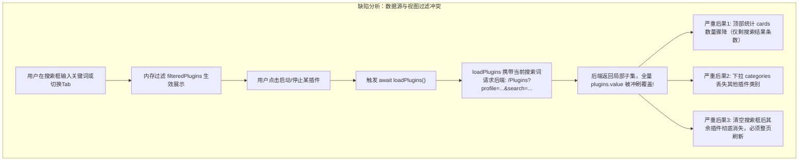
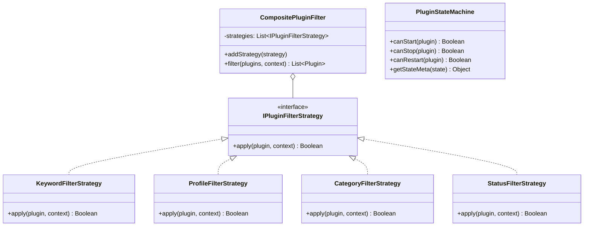

# 插件中心搜索输入框体验与架构治理调研与优化方案

## 一、调研背景与输入框视觉问题排查

### 1.1 输入框背景色异常排查与深层根因
在 LinuxWebTool 暗黑赛博（Cyber Dark）控制台界面中，用户反馈插件中心的“搜索插件名称/ID...”输入框呈现刺眼的纯白底色（如实测与截图所示），严重破坏了界面的视觉沉浸感与主题一致性。

经对前端样式体系与组件代码的逐行审计，确认根因如下：
1. **样式类名脱节（CSS Token Misalignment）**：
   - 全局公共样式表 `style.css` 中标准输入框组件类为 `.input`（配置了 `background: rgba(7, 11, 20, 0.7)`、`border: 1px solid #1d2c4a` 与聚焦霓虹发光 `box-shadow`）。
   - 在 `PluginsView.js` 及多个插件模态框（`PluginActionModal.js`、`PluginCreateModal.js`、`PluginImportModal.js`、`PluginKvDrawer.js`）中，误写为 `.input-base`。
   - 由于 `.input-base` 在全局 CSS 及 Tailwind 配置中均未定义，浏览器将其作为未修饰元素处理，直接回退至 User Agent 默认样式：`background-color: #ffffff; color: #000000; border: 2px inset`。
2. **零散修补导致的割裂**：
   - 开发者曾发现下拉筛选框 `select` 同样变白，因此在 `select` 上局部追加了 `bg-slate-900` 补丁，但漏掉了相邻的搜索框 `input`，导致同一工具栏内的两个核心表单控件背景完全不同，形成黑白突兀对比。
3. **交互细节缺失**：
   - 缺少搜索放大镜指示图标、缺少一键清空按钮（✕）、缺少 ESC 键清空快捷键，缺乏输入聚焦时的光晕过渡。

---

## 二、功能逻辑与性能缺陷分析（头脑风暴）

除了视觉样式缺陷外，深入审计插件中心的过滤检索与生命周期交互，发现以下深层次的逻辑与性能隐患：

### 2.1 逻辑缺陷（Logic Deficiencies）
1. **数据事实源污染（Source-of-Truth Poisoning）**：
   - 前端同时存在“后端服务端过滤”与“前端前端计算属性过滤”两套逻辑。
   - `loadPlugins()` 错误地将当前的 `profileTab.value` 与 `searchKeyword.value` 传给后端 `/Plugins` 接口。
   - 一旦在检索状态下触发任何插件动作并刷新列表，服务端返回的过滤子集直接覆盖全量数据 `plugins.value`，导致顶部指标卡片、分类清单和整个插件库数据被破坏。
2. **多维检索能力贫弱**：
   - 仅依靠同步 `includes` 进行严格包含匹配，不支持以空格拆分的多关键字联合检索（AND/OR）、不支持运行形态与状态维度的正交组合。
   - 筛选无匹配结果时缺乏快速一键重置引导。

### 2.2 性能缺陷（Performance Deficiencies）
1. **无防抖全量重算**：
   - 用户每击键一次即同步触发全量对象的多字段连续扫描，当插件数扩展至数十甚至数百个时会引起主线程轻微卡顿。
2. **无差别网络重新拉取**：
   - 对单个插件的启停和属性变更，全量重跑 `loadPlugins()`，产生不必要的网络 I/O 与界面重绘闪烁。

---

## 三、系统已有基础设施与可复用性调研

| 层次 | 现有基础设施/资产 | 可复用性分析与复用决策 |
| :--- | :--- | :--- |
| **UI 主题与样式** | `style.css`、`tailwind.js`（扩展了 `cyber-bg`, `cyber-panel`, `cyber-line`, `neon`） | 在 `style.css` 中将 `.input-base` 统一声明为与 `.input` 等价的标准类，一揽子修复全站所有模态框遗留；在 `PluginsView.js` 工具栏采用带放大镜与清除键的暗黑玻璃态搜索组件。 |
| **前端架构门禁** | `frontend-gate.cjs`（严格限制依赖、ESM 导出、Tailwind 规约、单文件行数） | 代码遵循零额外打包依赖原则，拆分的工具模块需在 `utils/` 单文件行数限制（<400行）内，测试用例接入 `node --test`。 |
| **异步操作流** | `app/composables/usePluginOperations.js` | 插件异步动作（提交、轮询、取消、产物）已具备完善机制，卡片组件与状态机可复用该轮询状态。 |
| **后端状态机与策略** | `PluginStateMachine.cs`、`ResidentExecutionStrategy.cs`、`OneShotExecutionStrategy.cs` | 后端在内核层已经实现了完备的有限状态机与执行策略模式。前端可通过与后端状态定义严格对齐，构建镜像级的前端状态守卫。 |
| **状态枚举契约** | `PluginModels.cs`（`PluginState`: Stopped=0, Starting=1, Running=2, Crashed=3, Backoff=4, Degraded=5, Disabled=6, MissingRuntime=7） | 前端可建立精确的 `PluginStateMachine` 守卫规则，杜绝非法状态下的重复点击操作。 |

---

## 四、设计模式优化落地方案

为了保证系统架构的高内聚、低耦合与卓越扩展性，本次重构引入三大经典设计模式：

### 4.1 策略模式（Strategy Pattern）—— 多维可扩展过滤引擎
建立 `app/utils/pluginFilterStrategies.js`，将每一种筛选行为解耦为独立的策略对象：
1. **`ProfileFilterStrategy`**：按运行画像（全部 / 常驻微服务 / 一次性脚本扩展）精准过滤。
2. **`CategoryFilterStrategy`**：按元数据分类进行筛选。
3. **`KeywordFilterStrategy`**：支持多词空格拆分（多关键词联合命中），对 `name`、`id`、`description`、`category` 实施大小写不敏感的高性能匹配。
4. **`StatusFilterStrategy`**：支持按运行中、停止、异常降级等状态进行细粒度过滤。
5. **`CompositePluginFilter`**：流水线式策略组合器，统一调度并输出筛选结果。

### 4.2 适配器模式（Adapter Pattern）—— 统一搜索与数据视图适配
1. **`PluginSearchAdapter`**：统一本地高速内存搜索（In-Memory Search）与远端检索（Remote Search）调用契约。当插件库在本地缓存时使用本地策略引擎秒级响应；当未来插件生态接入外部 Marketplace 插件扫描时，无缝切换为异步远端搜索适配，视图层代码零改动。
2. **`PluginDtoAdapter`**：统一将后端传来的原始 DTO 数据规范化为前端呈现模型，统一计算格式化标签、网关路径、运行时间，隔离接口字段变动。

### 4.3 状态机模式（Finite State Machine Pattern）—— 插件生命周期守卫
在 `app/utils/pluginStateMachine.js` 中构建前端有限状态机：
- **状态全集**：`Stopped(0)`, `Starting(1)`, `Running(2)`, `Stopping(3)`, `Backoff(4)`, `Degraded(5)`, `Disabled(6)`, `MissingRuntime(7)`。
- **动作守卫（Guards）**：
  - `canStart(plugin)`：仅在 `Stopped`、`Crashed`、`Backoff`、`Degraded` 状态下允许启动；在 `Starting`、`Running`、`Stopping` 或 `MissingRuntime` 状态下锁定按钮，防止重复提交造成并发雪崩。
  - `canStop(plugin)`：仅在 `Running`、`Starting` 状态下可终止。
  - `canRestart(plugin)`：仅在 `Running` 状态下可重启。
- **UI 状态映射**：统一维护状态颜色、呼吸动效、徽章文案，确保全站呈现一致。

---

## 五、实施步骤与验证清单

1. **样式表增强**：
   - 修改 `style.css`，将 `.input-base` 纳入 `.input` 选择器，全局修复插件模态框白底问题；
   - 增加针对搜索组件的高亮聚焦光圈、深灰占位符及暗黑下拉项支持。
2. **新建策略与状态机模块**：
   - 编写 `src/LinuxWebTool.WebHost/wwwroot/app/utils/pluginFilterStrategies.js`（策略模式与适配器）；
   - 编写 `src/LinuxWebTool.WebHost/wwwroot/app/utils/pluginStateMachine.js`（状态机模式）。
3. **重构 `PluginsView.js` 视图组件**：
   - 修复数据源污染 bug：`loadPlugins()` 永远获取全量插件中枢列表，统计指标与分类树彻底解耦自适应；
   - 工具栏升级为带有放大镜图标、清除按钮（✕）及快捷清空处理的暗黑科技感输入组件；
   - 接入防抖（Debounce）与 `CompositePluginFilter` 复合策略过滤。
4. **单测与门禁验证**：
   - 编写 `tests/frontend/plugin-filter-and-state-machine.test.mjs`，覆盖过滤策略、多词搜索、状态机守卫与数据纯净性；
   - 运行前端门禁 `frontend-gate.cjs`，确保零违规；
   - 运行全量前端单元测试，确保回归测试通过率 100%。

---

## 六、长效防御：自动化架构门禁（Guardrails）

为彻底杜绝同类“输入框白底回退”与“全局事实源污染”问题在未来团队协同开发中反复滋生，已在 `frontend-gate.cjs` 中建立永久静态与行为双层门禁：

1. **`FE-THEME-FORM-CONTROL-DARK`（静态模板表单暗黑门禁）**：
   - 静态 AST 提取所有 Vue 模板中的 `<input>`、`<select>`、`<textarea>` 交互控件；
   - 强制断言每个控件必须显式附带系统规范输入类（`.input`、`.input-base` 等）或显式深色底色（`bg-slate-900`、`bg-cyber-*`）；
   - 一旦开发者遗漏类名或误写未在 CSS 定义的假类名导致白底 UA 样式，门禁直接阻断并报错，不可通过基线豁免。
2. **`FE-PLUGIN-DATA-PURITY`（数据事实源防冲刷门禁）**：
   - 静态分析 `PluginsView.js` 的 `loadPlugins` 函数调用；
   - 严禁向后端中枢事实源接口传递响应式检索变量（如 `profileTab.value`、`searchKeyword.value`），强制将多维过滤限制在前端 Presentation 策略层。
3. **`FE-PLUGIN-FILTER-FSM`（动态行为门禁）**：
   - 将 `plugin-filter-and-state-machine.test.mjs` 纳入 `node frontend-gate.cjs` 必测流水线；
   - 涵盖策略过滤精度、状态机非法并发守卫、多词空格联合检索与暗黑科技感输入组件契约。

