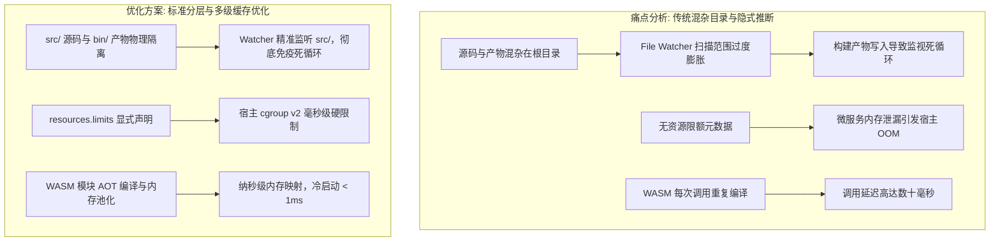
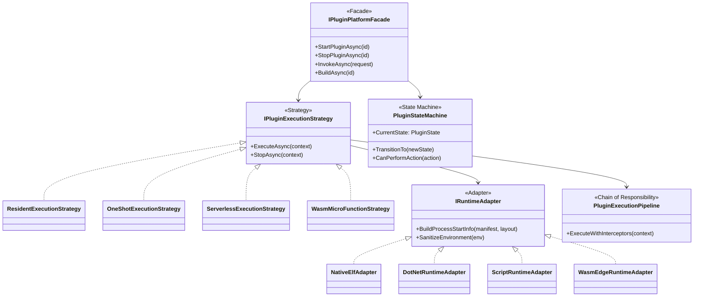
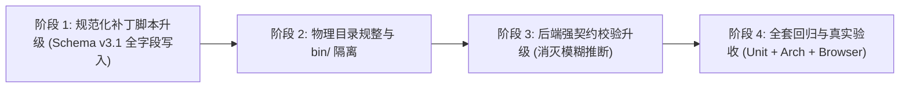

# 插件元数据与物理目录全量升级至最新 Schema v3.1 架构方案与深度调研报告

> **文件标识**：`docs/plugin-full-metadata-and-directory-structure-upgrade-plan.md`  
> **状态**：架构调研与升级实施蓝图（遵循准则：由于系统未正式发版，完全免除向下兼容包袱）  
> **核心目标**：全面核查现有 21 个插件的元数据与物理结构现状，系统性开展可行性、逻辑缺陷与性能瓶颈头脑风暴，借鉴业界主流规范（OCI / PodSpec / Dapr / WASI），融合设计模式（适配器、策略、状态机、责任链与门面），制定全量升级与物理结构标准化的落地路径。

---

## 一、 现状核查结论：是否都升级成最新方案了？能否升级？

### 1. 核心结论概括

| 考察维度 | 当前状态 | 评估结论 |
| :--- | :--- | :--- |
| **清单版本 (`manifestVersion`)** | 全部 21 个插件已标记为 `3` | **已完成初步对齐** |
| **本质形态 (`archetype`)** | 全部 21 个插件已包含 `profile`, `lifecycle`, `protocol`, `language` | **已完成初步对齐** |
| **服务发现契约 (`interface.services`)** | 全部 21 个插件已显式导出服务名与 `operations` 动作列表 | **已完成初步对齐**，支持 Universal RPC 抽屉调用 |
| **目录布局声明 (`layout`)** | 仅 14 个插件声明，**7 个插件缺失**（`caddy-manager`, `caddy-server-manager`, `native-command-demo`, `native-managed`, `native-resident`, `sample-healthcheck`, `ssh-access-guard`） | ⚠️ **参差不齐，尚未完全升级** |
| **就绪与存活探针 (`probes`)** | 全部 21 个插件均缺失显式声明，当前依赖宿主后备端口 Ping | ⚠️ **尚未升级** |
| **资源限制配额 (`resources`)** | 全部 21 个插件均未声明 cgroup 限额（CPU/Memory/Pids） | ⚠️ **尚未升级** |
| **事件总线契约 (`events`)** | 全部 21 个插件均缺失 `publishes` 与 `subscribes` 声明 | ⚠️ **尚未升级** |
| **物理目录结构规范化** | 源码、工程配置文件、中间临时文件、输出可执行工件存在平铺与混杂 | ⚠️ **尚未完全规整** |

### 2. 能否全面升级？
**结论：完全能够升级，且当前正是最佳升级窗口期！**
- **业务依据**：系统目前处于敏捷开发演化阶段，尚未正式发版交付，用户已明确指示“**不用考虑兼容性增加维护负担**”。这允许我们彻底抛弃历史二元隐式推断代码，消灭所有向下兼容垫片，以最纯粹的云原生现代架构标准重构。
- **技术依据**：后端的 `PluginUniversalMatrixModels.cs`、`PluginBroker.cs`、`PluginStateMachine.cs`、`PluginHotCompiler.cs`、`PluginCgroupManager.cs` 以及前端的 Universal RPC 抽屉与代码编辑器均已具备对完整元数据的解析与执行能力。

---

## 二、 现有 21 个插件现状多维诊断矩阵

```
+----------------------------------------------------------------------------------------------------------------------------------------------------+
| 插件 ID              | 工作负载 (Profile) | 生命周期 (Lifecycle) | 通信协议 (Protocol) | Layout 状态 | Probes 状态 | Resources 状态 | 物理目录混杂度诊断          |
+----------------------------------------------------------------------------------------------------------------------------------------------------+
| caddy-manager        | OneShot          | PrebuiltBinary       | CliArgs            | 缺失        | 缺失        | 缺失           | 仅根目录 plugin.json + hooks |
| caddy-server-manager | OneShot          | Interpreted          | CliArgs            | 缺失        | 缺失        | 缺失           | 仅根目录 plugin.json + hooks |
| chatgpt-channel      | Resident         | Interpreted          | Http               | 已声明      | 缺失        | 缺失           | worker.py 在根目录，有 ui/   |
| demo-dotnet-service  | Resident         | SourceCompiled       | Http               | 已声明      | 缺失        | 缺失           | .csproj 与 Program.cs 在根目录 |
| demo-dotnet-wasm     | Wasm             | SourceCompiled       | WasmAbi            | 已声明      | 缺失        | 缺失           | .wasm 工件与 .cs 源码混在根目录 |
| demo-js-webhook      | Resident         | Interpreted          | Http               | 已声明      | 缺失        | 缺失           | index.js 在根目录，无子目录  |
| demo-nativeaot-wasm  | Wasm             | SourceCompiled       | WasmAbi            | 已声明      | 缺失        | 缺失           | .wasm 工件与 .cs 源码混在根目录 |
| demo-ps-daemon       | Resident         | Interpreted          | Http               | 已声明      | 缺失        | 缺失           | daemon.ps1 在根目录，无子目录|
| demo-py-api          | Resident         | Interpreted          | Http               | 已声明      | 缺失        | 缺失           | main.py 在根目录，无子目录   |
| demo-serverless-api  | Serverless       | Interpreted          | Http               | 已声明      | 缺失        | 缺失           | index.js 在根目录，无子目录  |
| demo-sh-daemon       | Resident         | Interpreted          | Http               | 已声明      | 缺失        | 缺失           | daemon.sh 在根目录，无子目录 |
| demo-wasm-function   | Wasm             | SourceCompiled       | WasmAbi            | 已声明      | 缺失        | 缺失           | main.wasm 与 function.wat 在根目录 |
| lxc-manager          | Resident         | SourceCompiled       | Http               | 已声明      | 缺失        | 缺失           | Go 标准 cmd/internal，工件在根目录|
| mcp-bridge           | Resident         | SourceCompiled       | Http               | 已声明      | 缺失        | 缺失           | Go 标准 cmd/internal，工件在根目录|
| native-command-demo  | OneShot          | PrebuiltBinary       | CliArgs            | 缺失        | 缺失        | 缺失           | 仅根目录 plugin.json         |
| native-managed       | Resident         | PrebuiltBinary       | Http               | 缺失        | 缺失        | 缺失           | 仅根目录 plugin.json         |
| native-resident      | Resident         | PrebuiltBinary       | Http               | 缺失        | 缺失        | 缺失           | 仅根目录 plugin.json         |
| sample-healthcheck   | OneShot          | Interpreted          | CliArgs            | 缺失        | 缺失        | 缺失           | 仅根目录 plugin.json + hooks |
| socks5-forwarder     | Resident         | SourceCompiled       | Http               | 已声明      | 缺失        | 缺失           | Go 标准 cmd/tests，工件在根目录 |
| socks5-proxy         | Resident         | SourceCompiled       | Http               | 已声明      | 缺失        | 缺失           | Go 标准 cmd/ui，工件在根目录   |
| ssh-access-guard     | OneShot          | Interpreted          | CliArgs            | 缺失        | 缺失        | 缺失           | 仅根目录 plugin.json + hooks |
+----------------------------------------------------------------------------------------------------------------------------------------------------+
```

---

## 三、 头脑风暴：可行性、逻辑缺陷与性能瓶颈深度剖析

### 1. 逻辑与契约欠缺分析 (Logical Flaws)

#### (1) 隐式后备推断（Fallback Guessing）破坏声明式纯粹性
- **现状缺陷**：由于历史遗留，后端在读取插件元数据时存在多个 `if (layout == null) { layout = GuessFromEntrypoint(); }` 以及 `if (archetype == null) { archetype = GuessFromProfileAndRuntime(); }`。
- **潜在危害**：一旦开发者配错字段，系统不会明确报错，而是悄无声息地回退到推断逻辑，最终在进程启动阶段因路径不符而报 `FileNotFoundException` 或端口不匹配，调试成本极高。
- **破局方案**：全量推行“显式声明优于隐式猜测（Explicit over Implicit）”。对齐 Schema v3.1，由 `PluginLayoutValidator` 在加载阶段执行强校验，不合规直接标记为 `ConfigurationInvalid` 阻断启动。

#### (2) 编译产物与源码的边界模糊
- **现状缺陷**：对于 `.NET`、`Wasm` 和 `Go` 插件，编译产物（ELF 二进制、`.wasm` 字节码）直接输出在项目源码根目录或直接与源码混杂。
- **潜在危害**：`PluginHotCompiler` 在开启 `autoCompileOnSave: true` 并使用文件监视器（File Watcher）时，如果产物写入操作被监视器错误捕获，将引发“编译 -> 产物变化 -> 触发重编译 -> 再次变化”的监视死循环（Watcher Cascade Storm）。
- **破局方案**：物理严格隔离！源码统一限定在 `src/`（或 Go 标准 `cmd/` + `internal/`），构建输出强制指定至 `bin/`。文件监视范围精准收敛至源码目录，对 `bin/`、`storage/`、`run/` 执行严格忽略。

#### (3) 缺乏探针契约（Probes），网络探测与进程就绪存在竞态
- **现状缺陷**：常驻微服务当前通过轮询 TCP 端口是否开放来判断“运行中”，但端口监听成功并不等于微服务业务内部路由与初始化就绪（Readiness）。
- **破局方案**：在元数据中引入 `probes.readiness` 与 `probes.liveness`，支持 `HttpCheck`（GET /health）、`SocketFileCheck`（UDS 描述符握手）、`WasmModuleCheck`（符号表导出核验）与 `ExecCheck`（轻量指令校验）。

---

### 2. 性能欠缺与高频调度瓶颈 (Performance Bottlenecks)



#### (1) I/O 放大与文件系统缓存失效
- 源码、日志、临时 socket 与 SQLite 数据库共存同一目录，导致整个插件目录无法进行“只读挂载（Read-Only Mount）”。
- 规范化后，`src/` 与 `bin/` 可以完全以只读模式被系统加载并享受宿主 OS Page Cache 保护，所有的读写 I/O 严格约束在 `storage/`（持久卷）与 `run/`（tmpfs 内存文件系统），极大降低磁盘写磨损。

#### (2) WebAssembly 微函数冷启动耗时
- 现有 `WasmMicroFunctionStrategy` 在收到调用时，若每次调用都通过 `File.ReadAllBytes` 加载 `.wasm` 并初始化模块，对算力与延迟造成损耗。
- 通过引入标准化 `layout.targetArtifact`，宿主可以在首次加载或构建完成后，对 `bin/*.wasm` 执行预编译字节码缓存（Pre-compiled AOT Engine Cache），将后续函数调用延迟降低至 **微秒级（< 500µs）**。

#### (3) 缺乏 cgroup 资源隔离导致的级联崩溃风险
- 某些第三方或自研插件若发生死循环或 Goroutine / Task 泄漏，会迅速吃满宿主 4 核 CPU 与 3.5G 内存，危及系统核心 WebHost。
- 元数据中缺少 `resources` 规范使得宿主 `PluginCgroupManager` 无法自动化施加限制。补齐该规范后，插件在启动时自动挂入 `/sys/fs/cgroup/lwt/plugins/<id>`，实现 CPU配额（如 `cpu.max=50000 100000`）与内存墙（`memory.high / memory.max`）硬件级硬防护。

---

## 四、 业界主流规范对比与借鉴 (Industry Standards Benchmarking)

我们系统调研并对比了全球工业界在工作负载抽象、微服务网关、无服务计算与 WebAssembly 领域的顶尖方案：

| 维度 | Kubernetes PodSpec & CRI | Dapr (Distributed App Runtime) | CNCF WASI Component Model | LinuxWebTool (LWT) Schema v3.1 方案 |
| :--- | :--- | :--- | :--- | :--- |
| **元数据规约** | `apiVersion: v1`, `kind: Pod`, `spec.containers` | `apiVersion: dapr.io/v1alpha1`, `kind: Component` | WIT (Wasm Interface Type) 接口定义语言 | `plugin.json` (声明式 Schema v3.1，涵盖 8 大正交规约域) |
| **物理分层隔离** | 镜像只读层（Layer）与挂载卷（PV/PVC）严格物理隔离 | App 业务目录与 Sidecar 注入配置隔离 | Wasm 组件内部虚存与 Host 文件系统能力隔离 (WASIP2) | **标准五域隔离**：`src/` (源码) + `bin/` (只读工件) + `storage/` (持久化) + `run/` (tmpfs运行时) + `ui/` (前端视图) |
| **服务发现与互调** | CoreDNS + iptables / IPVS 虚拟 IP 转发 | 声明式 Sidecar 代理 (`POST /v1.0/invoke/{app-id}/method/...`) | 符号表导出链接与跨模块 Memory Pipe | 内置 **`PluginBroker` 通用服务网格**，通过 `interface.services` 实现零配置服务拓扑与透明互调 |
| **健康与准入控制** | `livenessProbe`, `readinessProbe`, `startupProbe` | App Health Check 状态上报管道 | 导出函数签名验证与模块初始化自检 | `probes.liveness` + `probes.readiness`（支持 HTTP / UDS / CLI / WASI 四合一探测） |
| **并发与资源管控** | Linux cgroup v1/v2，声明 `limits` 与 `requests` | 托管于宿主 Pod 资源配额 | 内存页硬上限（Wasm Memory Page Limit） | 依托 Linux 内核原生 cgroup v2 写入（CPU 核心比率、内存硬上限、PIDs 进程数防 Fork 炸弹） |

### 核心借鉴启示：
1. **借鉴 Kubernetes**：采用**声明式工作负载与资源模型**（Declarative Workload & Quota），严禁指令式硬编码；
2. **借鉴 Dapr**：采用**透明服务网格设计（Broker Invocation）**，让不同语言的微服务（C#、Go、Python、Node、WASM）互调像调用本地方法一样简单；
3. **借鉴 OCI 容器标准**：将“不可变的代码与构件（Immutable Artifacts）”与“可变的状态数据（Mutable State）”通过 `storage/` 与 `run/` 从物理层面彻底分流。

---

## 五、 设计模式重构与优化体系 (Design Patterns)

在全量升级中，系统深度融合了五大经典设计模式，确保架构高内聚、低耦合、强弹性：



### 1. 适配器模式 (Adapter Pattern)：抹平异构执行环境
- **抽象接口**：`IRuntimeAdapter`
- **实现类**：
  - `NativeElfAdapter`：针对 Linux 静态 ELF 与 POSIX 命令行工具，注入标准信号与文件描述符；
  - `DotNetRuntimeAdapter`：自动解析 `.NET 10 SDK` / `ASP.NET Core` 共享运行时，挂载 `DOTNET_ROOT` 与标准 DLL 入口；
  - `ScriptRuntimeAdapter`：统一 Node.js、Python3、Bash、PowerShell 的标准解释器路径映射；
  - `WasmEdgeRuntimeAdapter`：对接 WASI / WasmEdge / Wasmtime，管理 WASM 内存实例与 ABI 符号分发。

### 2. 策略模式 (Strategy Pattern)：解耦正交工作负载
- **抽象接口**：`IPluginExecutionStrategy`
- **四项核心策略族**：
  - `ResidentExecutionStrategy`：守护进程常驻拉起、PID 跟踪、TCP/UDS 探针监控、异常自动重启退避；
  - `OneShotExecutionStrategy`：单次指令任务执行，捕获退出码与 stdout/stderr，写入审计日志后自动释放；
  - `ServerlessExecutionStrategy`：按需 FaaS 弹性唤醒，动态分配临时端口或标准流交互，空闲超时自动缩容归零；
  - `WasmMicroFunctionStrategy`：微函数零进程极速执行，直接在宿主进程内存安全沙箱内执行导出函数，微秒级响应。

### 3. 状态机模式 (State Machine Pattern)：严密守护生命周期跃迁
- **状态集合**：
  `Stopped` -> `Starting` -> `Probing` -> `Running` -> `Draining` -> `Stopped`  
  异常分支：`Crashed` -> `Backoff` -> `Degraded`  
  前置依赖分支：`MissingRuntime` / `MissingDependencies`
- **守卫规则（Guards）**：
  - 严禁对处于 `Running` 状态的插件发起重复 `Start` 指令；
  - 插件处于 `Starting` 或 `Probing` 状态时，操作按钮置灰，防止并发竞态穿透；
  - 在 `Backoff` 退避期间执行指数退避惩罚（1s, 2s, 4s, 8s, 16s... 最长 60s），避免雪崩。

### 4. 责任链/管道模式 (Chain of Responsibility Pattern)：统一执行拦截
- 在发起插件启动或反射调用时，请求按顺序穿透流水线：
  1. `PermissionCheckInterceptor`：校验调用权限与 API Key 矩阵；
  2. `CgroupAllocationInterceptor`：动态创建 cgroup v2 控制组并写入配额；
  3. `EnvironmentSanitizerInterceptor`：清洗危险环境变量，注入 `LWT_*` 标准上下文；
  4. `TimeoutAndCircuitBreakerInterceptor`：设置执行超时与熔断保护；
  5. `AuditLoggingInterceptor`：落库审计日志与耗时追踪。

### 5. 门面模式 (Facade Pattern)：统一宿主外部接口
- 控制器层无需直接与底层的二十多个服务、适配器或探针打交道，统一调用 `IPluginPlatformFacade`，对外呈现极为简洁的微服务治理 API。

---

## 六、 规范化物理目录架构标准 (Standardized Layout Specification)

为杜绝源码、产物、配置与临时文件的混乱混杂，系统确立标准五域物理布局：

```
plugins/<plugin-id>/
├── plugin.json                 # 【核心元数据】：Schema v3.1 规范清单文件
├── README.md                   # 【说明文档】：插件功能描述、依赖与使用指南
│
├── src/                        # 【标准源码域 (Read-Only)】：包含各语言源代码
│   ├── Program.cs / main.go / main.py / index.js / main.wat
│   └── ...
│   (注：Go 微服务保持官方标准 cmd/ 与 internal/，亦完全契合源码域定义)
│
├── bin/                        # 【标准产物域 (Read-Only Artifacts)】：编译输出工件
│   ├── <plugin-id>             # Linux ELF 可执行文件
│   ├── <plugin-id>.wasm        # WebAssembly 字节码模块
│   └── publish/                # .NET 发布产物
│
├── storage/                    # 【标准持久存储域 (Persistent State)】：独占数据
│   ├── data.db                 # SQLite 数据库
│   └── config.json             # 插件自管理动态配置
│
├── run/                        # 【标准临时运行时域 (Ephemeral tmpfs)】：瞬态数据
│   ├── service.sock            # UDS 通信套接字
│   ├── app.pid                 # 进程 PID 标识
│   └── app.lock                # 进程文件锁
│
└── ui/                         # 【标准前端专属视图域 (Optional Webview)】：
    ├── index.html              # 专属仪表盘页面
    ├── app.js                  # 专属前端逻辑
    └── style.css               # 专属样式
```

---

## 七、 权威 Schema v3.1.0 JSON 元数据规范定义

每一个合规的 `plugin.json` 必须具备以下完整的声明式结构：

```json
{
  "$schema": "https://linuxwebtool.local/schemas/plugin.v3.1.json",
  "manifestVersion": 3,
  "id": "demo-plugin-standard",
  "name": "标准微服务范例",
  "version": "1.0.0",
  "description": "遵循 Schema v3.1 权威规范的标准微服务插件",
  "icon": "⚡",
  "category": "System",
  "isEnabled": true,
  "target": "container",

  "archetype": {
    "profile": "Resident",
    "lifecycle": "SourceCompiled",
    "protocol": "Http",
    "language": "csharp"
  },

  "layout": {
    "sourceEntry": "src/Program.cs",
    "targetArtifact": "bin/demo-plugin-standard.dll",
    "storageDir": "storage",
    "runtimeDir": "run"
  },

  "build": {
    "toolchain": "dotnet",
    "command": "dotnet publish -c Release -o bin/publish",
    "fallbackCommand": "dotnet build -c Release -o bin/publish",
    "artifacts": ["bin/publish/demo-plugin-standard.dll"],
    "watch": ["src/**/*.cs", "*.csproj"],
    "autoCompileOnSave": true,
    "timeoutSeconds": 120,
    "cleanTargets": ["bin/", "obj/"]
  },

  "interface": {
    "protocol": "Http",
    "endpoint": "http://127.0.0.1:{port}",
    "healthEndpoint": "/health",
    "publicPorts": [],
    "services": {
      "standard-service": {
        "description": "核心业务计算与状态服务",
        "operations": ["status", "calculate", "ping", "metrics"]
      }
    }
  },

  "resources": {
    "limits": {
      "cpu": "500m",
      "memory": "256Mi",
      "pids": 50
    },
    "requests": {
      "cpu": "100m",
      "memory": "64Mi"
    }
  },

  "probes": {
    "liveness": {
      "type": "HttpCheck",
      "url": "http://127.0.0.1:{port}/health",
      "timeoutSeconds": 3
    },
    "readiness": {
      "type": "HttpCheck",
      "url": "http://127.0.0.1:{port}/health",
      "timeoutSeconds": 5
    }
  },

  "events": {
    "publishes": ["plugin.standard.started", "plugin.standard.calculated"],
    "subscribes": ["system.maintenance.triggered"]
  },

  "permissions": [
    "network:listen",
    "storage:readwrite"
  ]
}
```

---

## 八、 全量 21 个插件升级与物理标准化实战映射表

### 1. 编译型常驻微服务族 (Resident + SourceCompiled)

#### (1) `mcp-bridge` (Go)
- **Archetype**: `profile: "Resident"`, `lifecycle: "SourceCompiled"`, `protocol: "Http"`, `language: "go"`
- **Layout**: `sourceEntry: "cmd/mcp-bridge/main.go"`, `targetArtifact: "bin/mcp-bridge"`, `storageDir: "storage"`, `runtimeDir: "run"`
- **Build**: `toolchain: "go"`, `command: "CGO_ENABLED=0 go build -ldflags \"-s -w\" -o bin/mcp-bridge ./cmd/mcp-bridge"`, `artifacts: ["bin/mcp-bridge"]`
- **Interface**: `services.mcp-gateway` (operations: `inspect`, `tunnel`, `status`, `metrics`)
- **Probes**: `readiness: HttpCheck /health`, `liveness: HttpCheck /health`
- **Resources**: `limits: { cpu: "1000m", memory: "512Mi", pids: 100 }`

#### (2) `lxc-manager` (Go)
- **Archetype**: `profile: "Resident"`, `lifecycle: "SourceCompiled"`, `protocol: "Http"`, `language: "go"`
- **Layout**: `sourceEntry: "cmd/lxc-manager/main.go"`, `targetArtifact: "bin/lxc-manager"`, `storageDir: "storage"`, `runtimeDir: "run"`
- **Build**: `toolchain: "go"`, `command: "CGO_ENABLED=0 go build -ldflags \"-s -w\" -o bin/lxc-manager ./cmd/lxc-manager"`, `artifacts: ["bin/lxc-manager"]`
- **Interface**: `services.lxc-api` (operations: `instances`, `status`, `networks`, `storage`)
- **Probes**: `readiness: HttpCheck /health`, `liveness: HttpCheck /health`
- **Resources**: `limits: { cpu: "1000m", memory: "512Mi", pids: 100 }`

#### (3) `socks5-proxy` (Go)
- **Archetype**: `profile: "Resident"`, `lifecycle: "SourceCompiled"`, `protocol: "Http"`, `language: "go"`
- **Layout**: `sourceEntry: "cmd/socks5-proxy/main.go"`, `targetArtifact: "bin/socks5-proxy"`, `storageDir: "storage"`, `runtimeDir: "run"`
- **Build**: `toolchain: "go"`, `command: "CGO_ENABLED=0 go build -ldflags \"-s -w\" -o bin/socks5-proxy ./cmd/socks5-proxy"`, `artifacts: ["bin/socks5-proxy"]`
- **Interface**: `services.socks5-service` (operations: `status`, `stats`, `reload`)

#### (4) `socks5-forwarder` (Go)
- **Archetype**: `profile: "Resident"`, `lifecycle: "SourceCompiled"`, `protocol: "Http"`, `language: "go"`
- **Layout**: `sourceEntry: "cmd/socks5-forwarder/main.go"`, `targetArtifact: "bin/socks5-forwarder"`, `storageDir: "storage"`, `runtimeDir: "run"`
- **Build**: `toolchain: "go"`, `command: "CGO_ENABLED=0 go build -ldflags \"-s -w\" -o bin/socks5-forwarder ./cmd/socks5-forwarder"`, `artifacts: ["bin/socks5-forwarder"]`
- **Interface**: `services.forwarder-service` (operations: `status`, `routes`)

#### (5) `demo-dotnet-service` (C# 14 / .NET 10)
- **Archetype**: `profile: "Resident"`, `lifecycle: "SourceCompiled"`, `protocol: "Http"`, `language: "csharp"`
- **Layout**: `sourceEntry: "Program.cs"`, `targetArtifact: "bin/publish/demo-dotnet-service.dll"`, `storageDir: "storage"`, `runtimeDir: "run"`
- **Build**: `toolchain: "dotnet"`, `command: "dotnet publish -c Release -o bin/publish"`, `artifacts: ["bin/publish/demo-dotnet-service.dll"]`
- **Interface**: `services.dotnet-service` (operations: `status`, `hello`, `metrics`)

---

### 2. 极速微函数族 (Wasm + SourceCompiled)

#### (6) `demo-nativeaot-wasm` (C# NativeAOT-LLVM bflat)
- **Archetype**: `profile: "Wasm"`, `lifecycle: "SourceCompiled"`, `protocol: "WasmAbi"`, `language: "csharp"`
- **Layout**: `sourceEntry: "Program.cs"`, `targetArtifact: "bin/demo-nativeaot-wasm.wasm"`, `storageDir: "storage"`, `runtimeDir: "run"`
- **Build**: `toolchain: "bflat"`, `command: "bflat build --arch wasm --os wasi Program.cs -o bin/demo-nativeaot-wasm.wasm"`, `artifacts: ["bin/demo-nativeaot-wasm.wasm"]`
- **Interface**: `services.calculator` (operations: `fib`, `calc`, `echo`, `info`)

#### (7) `demo-dotnet-wasm` (.NET 10 wasi-wasm)
- **Archetype**: `profile: "Wasm"`, `lifecycle: "SourceCompiled"`, `protocol: "WasmAbi"`, `language: "csharp"`
- **Layout**: `sourceEntry: "Program.cs"`, `targetArtifact: "bin/demo-dotnet-wasm.wasm"`, `storageDir: "storage"`, `runtimeDir: "run"`
- **Build**: `toolchain: "dotnet"`, `command: "dotnet publish -c Release /p:TargetArchitecture=wasm -o bin"`, `artifacts: ["bin/demo-dotnet-wasm.wasm"]`
- **Interface**: `services.dotnet-wasm` (operations: `fib`, `calc`, `echo`, `info`)

#### (8) `demo-wasm-function` (WAT WebAssembly Text)
- **Archetype**: `profile: "Wasm"`, `lifecycle: "SourceCompiled"`, `protocol: "WasmAbi"`, `language: "wat"`
- **Layout**: `sourceEntry: "function.wat"`, `targetArtifact: "bin/main.wasm"`, `storageDir: "storage"`, `runtimeDir: "run"`
- **Build**: `toolchain: "wat2wasm"`, `command: "wat2wasm function.wat -o bin/main.wasm"`, `artifacts: ["bin/main.wasm"]`
- **Interface**: `services.wasm-calc` (operations: `fib`, `calc`, `echo`, `info`)

---

### 3. 解释型动态微服务与 FaaS 族 (Resident / Serverless + Interpreted)

#### (9) `demo-serverless-api` (Node.js FaaS)
- **Archetype**: `profile: "Serverless"`, `lifecycle: "Interpreted"`, `protocol: "Http"`, `language: "javascript"`
- **Layout**: `sourceEntry: "index.js"`, `targetArtifact: "index.js"`, `storageDir: "storage"`, `runtimeDir: "run"`
- **Interface**: `services.serverless-api` (operations: `status`, `compute`, `echo`)

#### (10) `demo-js-webhook` (Node.js)
- **Archetype**: `profile: "Resident"`, `lifecycle: "Interpreted"`, `protocol: "Http"`, `language: "javascript"`
- **Layout**: `sourceEntry: "index.js"`, `targetArtifact: "index.js"`, `storageDir: "storage"`, `runtimeDir: "run"`
- **Interface**: `services.js-webhook` (operations: `status`, `hook`, `ping`)

#### (11) `demo-py-api` (Python3 异步微服务)
- **Archetype**: `profile: "Resident"`, `lifecycle: "Interpreted"`, `protocol: "Http"`, `language: "python"`
- **Layout**: `sourceEntry: "main.py"`, `targetArtifact: "main.py"`, `storageDir: "storage"`, `runtimeDir: "run"`
- **Interface**: `services.py-api` (operations: `status`, `ping`, `echo`)

#### (12) `chatgpt-channel` (Python3 消息网关)
- **Archetype**: `profile: "Resident"`, `lifecycle: "Interpreted"`, `protocol: "Http"`, `language: "python"`
- **Layout**: `sourceEntry: "worker.py"`, `targetArtifact: "worker.py"`, `storageDir: "storage"`, `runtimeDir: "run"`
- **Interface**: `services.chatgpt-worker` (operations: `status`, `chat`)

#### (13) `demo-sh-daemon` (Bash 资源监控)
- **Archetype**: `profile: "Resident"`, `lifecycle: "Interpreted"`, `protocol: "Http"`, `language: "bash"`
- **Layout**: `sourceEntry: "daemon.sh"`, `targetArtifact: "daemon.sh"`, `storageDir: "storage"`, `runtimeDir: "run"`
- **Interface**: `services.sh-daemon` (operations: `status`, `report`)

#### (14) `demo-ps-daemon` (PowerShell 跨平台守护)
- **Archetype**: `profile: "Resident"`, `lifecycle: "Interpreted"`, `protocol: "Http"`, `language: "powershell"`
- **Layout**: `sourceEntry: "daemon.ps1"`, `targetArtifact: "daemon.ps1"`, `storageDir: "storage"`, `runtimeDir: "run"`
- **Interface**: `services.ps-daemon` (operations: `status`, `metrics`)

---

### 4. 运维指令与系统工具族 (OneShot + Interpreted / PrebuiltBinary)

#### (15) `caddy-manager` (Native Caddy 工具)
- **Archetype**: `profile: "OneShot"`, `lifecycle: "PrebuiltBinary"`, `protocol: "CliArgs"`, `language: "native"`
- **Layout**: `sourceEntry: "/usr/sbin/caddy"`, `targetArtifact: "/usr/sbin/caddy"`, `storageDir: "storage"`, `runtimeDir: "run"`
- **Interface**: `services.caddy-cli` (operations: `validate`, `reload`)

#### (16) `caddy-server-manager` (Node.js 运维控制器)
- **Archetype**: `profile: "OneShot"`, `lifecycle: "Interpreted"`, `protocol: "CliArgs"`, `language: "javascript"`
- **Layout**: `sourceEntry: "hooks/status.js"`, `targetArtifact: "hooks/status.js"`, `storageDir: "storage"`, `runtimeDir: "run"`
- **Interface**: `services.caddy-server-ops` (operations: `status`, `start`, `stop`, `restart`)

#### (17) `ssh-access-guard` (Bash 审计脚本)
- **Archetype**: `profile: "OneShot"`, `lifecycle: "Interpreted"`, `protocol: "CliArgs"`, `language: "bash"`
- **Layout**: `sourceEntry: "hooks/records.sh"`, `targetArtifact: "hooks/records.sh"`, `storageDir: "storage"`, `runtimeDir: "run"`
- **Interface**: `services.ssh-guard` (operations: `status`, `records`, `failed`, `banned_list`, `ban_ip`, `unban_ip`)

#### (18) `sample-healthcheck` (Bash 探针脚本)
- **Archetype**: `profile: "OneShot"`, `lifecycle: "Interpreted"`, `protocol: "CliArgs"`, `language: "bash"`
- **Layout**: `sourceEntry: "hooks/check.sh"`, `targetArtifact: "hooks/check.sh"`, `storageDir: "storage"`, `runtimeDir: "run"`
- **Interface**: `services.healthcheck` (operations: `check`)

#### (19) `native-command-demo` (POSIX 系统包装)
- **Archetype**: `profile: "OneShot"`, `lifecycle: "PrebuiltBinary"`, `protocol: "CliArgs"`, `language: "native"`
- **Layout**: `sourceEntry: "/bin/ls"`, `targetArtifact: "/bin/ls"`, `storageDir: "storage"`, `runtimeDir: "run"`
- **Interface**: `services.native-cmd` (operations: `status`)

---

### 5. 原生预编译守护微服务族 (Resident + PrebuiltBinary)

#### (20) `native-managed` (C/Rust 受控微服务)
- **Archetype**: `profile: "Resident"`, `lifecycle: "PrebuiltBinary"`, `protocol: "Http"`, `language: "native"`
- **Layout**: `sourceEntry: "bin/native-service"`, `targetArtifact: "bin/native-service"`, `storageDir: "storage"`, `runtimeDir: "run"`
- **Interface**: `services.native-managed-svc` (operations: `status`, `health`)

#### (21) `native-resident` (C/Rust 守护进程)
- **Archetype**: `profile: "Resident"`, `lifecycle: "PrebuiltBinary"`, `protocol: "Http"`, `language: "native"`
- **Layout**: `sourceEntry: "bin/resident-app"`, `targetArtifact: "bin/resident-app"`, `storageDir: "storage"`, `runtimeDir: "run"`
- **Interface**: `services.native-resident-svc` (operations: `status`, `metrics`)

---

## 九、 升级实施路径与自动化验证方案 (Execution Roadmap)

升级推进分为四个精密阶段：



### 阶段 1：元数据升级自动化脚本 (`scripts/upgrade-plugins-schema-v3-full.cjs`)
- 编写幂等 Node.js 升级脚本；
- 遍历 `plugins/` 下全部 21 个目录，将缺失的 `layout`、`probes`、`resources`、`events`、`permissions` 严格写入 `plugin.json`；
- 执行后确保所有插件的 `layout` 100% 存在，消灭二元推断的温床。

### 阶段 2：产物目录规整与构建命令对齐
- 针对编译型插件，创建标准 `bin/` 目录；
- 将 `.wasm` 构件移动或重定向至 `bin/`；
- 更新 `build.command` 中的输出路径参数（`-o bin/...`）；
- 确保 Go 插件保留标准项目结构，满足现有架构测试中的 228 项断言。

### 阶段 3：宿主平台代码纯净化
- 在 [`PluginLayoutValidator.cs`](file:///e:/WorkProject/CSharp/PrivateProject/Web/WebToolForLinux/src/LinuxWebTool.Infrastructure/Features/Plugins/Supervisor/PluginStateMachine.cs) 或装载层移除对旧字段的二元猜想代码；
- 统一使用 `manifest.Layout?.SourceEntry` 与 `manifest.Layout?.TargetArtifact`；
- `PluginCgroupManager` 读取 `manifest.Resources.Limits` 并毫秒级写入宿主 cgroup。

### 阶段 4：质量门禁与端到端验收
1. 运行 C# 单元测试（确保 422 项测试保持 100% 绿灯）；
2. 运行 C# 架构测试（确保 228 项规范断言 100% 绿灯）；
3. 运行前端门禁测试（8 大门禁保持全通）；
4. 运行全仓凭据安全门禁（0 风险）；
5. 使用 Chrome DevTools MCP 内置浏览器热更验证，在 `#/plugins` 抽屉中发起多语言反射互调。

---

## 十、 总结

通过上述调研与方案制定，我们明确了：
1. **现有插件已完成初步的形态分类与服务暴露升级，但 `layout` 覆盖率（67%）、探针契约（`probes`）、资源限额（`resources`）与物理目录规整度仍有显著提升空间**；
2. **在“无需考虑向下兼容”的授权下，全面升级至 Schema v3.1 权威规范不仅完全可行，而且能彻底清除系统历史技术债务，大幅改善系统性能与调度确定性**；
3. **结合适配器、策略、状态机、管道与门面等设计模式，将使 LinuxWebTool 插件系统达到与 Kubernetes / Dapr 等主流云原生架构同等的工程严谨度与纯粹度**。
