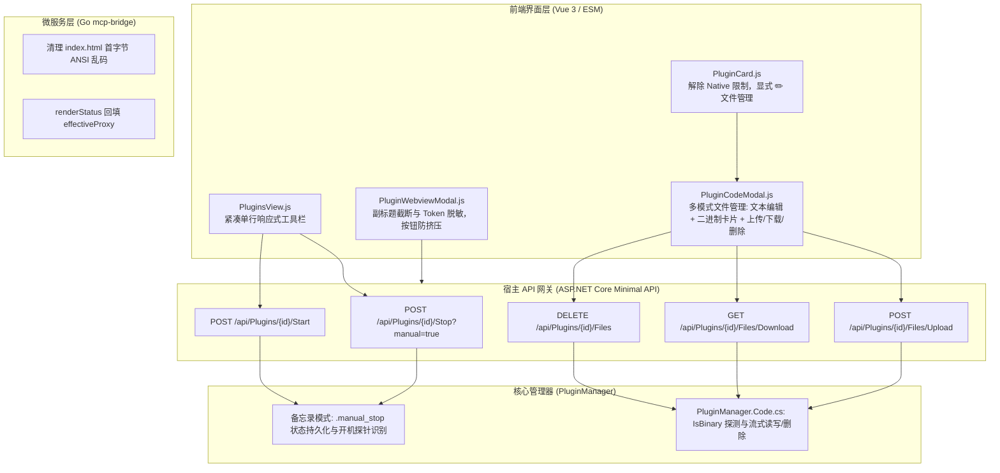

# 插件手动生命周期持久化、动态文件管理与 UI 紧凑响应式排版治理方案

> 文档编号：DEV-DOC-2026-11-03-01  
> 责任团队：Core Architecture & Plugin System & Frontend Engineering  
> 状态：Ready for Implementation  

---

## 1. 背景与问题定义

用户在使用 WebToolForLinux 插件系统及 MCP Bridge 智能安全网关时，反馈了 6 项关键的用户体验与系统行为问题：

1. **容器重启后插件意外自启（违背用户手动停止意图）**：
   - 用户在界面手动点击【⏹ 停止】插件后，当宿主容器或服务进程重启时，该插件依旧被开机流程自动拉起，无法记住用户的最后手动操作状态。
2. **插件过滤与检索卡片排版错位（空间利用率与美观度低）**：
   - 过滤栏在桌面/中等分辨率下，右侧检索容器与分类下拉框因 `flex-wrap` 换行为上下两截，左侧 Tabs 与右侧元素上下参差、中间大面积空洞留白。
3. **OpenAI Tunnel 出口代理保存后再次打开丢失显示**：
   - 用户配置网络出口代理（`ProxyURL`）并保存后，再次打开 MCP Bridge 控制台面板，输入框呈空白状态，容易误导用户甚至在二次保存时清空有效代理。
4. **MCP Bridge 面板顶部出现 `]133;C]133;C` 乱码**：
   - 打开 Webview 视图时，控制台 iframe 顶部固定渲染出 `]133;C]133;C` 字符，影响视觉美观与专业度。
5. **Native 插件不支持编辑，全插件缺乏文件上传/下载/删除动态热更能力**：
   - 卡片上人为硬编码屏蔽了 Native 插件的代码/文件入口；同时全系统缺乏单个文件的上传替换、下载与删除能力，任何文件更新都需要重新构建并部署容器。
6. **Webview 模态框副标题过长挤压右侧按钮变形**：
   - 包含长 JWT Token 的完整 URL 直接渲染且未限制宽度，挤占了弹窗头部空间，导致右侧【🔄 刷新】、【↗ 新标签页】、【✕ 关闭】等按钮被严重压扁、文字折行甚至变形。

---

## 2. 业界主流方案调研与现有基础设施复用

### 2.1 业界方案对比与借鉴

| 维度 | 业界主流实践（Docker / Systemd / VS Code / Kubernetes） | 当前系统表现 | 借鉴与采纳方案 |
| :--- | :--- | :--- | :--- |
| **手动启停意图记住** | **Systemd / PM2**：记录 `is-enabled` 与 `active-state`，当用户显式 `systemctl stop` 时，即使开机使能，也会记录手动操作标记；重启时尊重目标状态。 | 仅依靠内存状态机，重启时只看 `manifest.Supervision.AutoStart ?? true`，无视手动停止。 | **备忘录模式（Memento Pattern）**：手动停止落盘持久化 `.manual_stop` 标记文件；手动启动或重启时清除；开机自启检查该标记。 |
| **工具栏响应式布局** | **GitHub / Vercel Dashboard**：桌面端单行紧凑自适应，左侧 Tabs，中间弹性伸缩，右侧操作控件横向不换行（`flex-nowrap`）。 | 容器直接声明 `flex-wrap`，导致高频出现错位和换行断层。 | 采用响应式弹性工具栏：桌面端统一单行 `flex-nowrap items-center`，移动端折叠，消除空洞。 |
| **表单字段状态回显** | **Cloudflare Tunnel / Kong**：状态获取接口 `status.get` 返回已生效配置并严格做表单数据绑定。 | 后端已返回 `effectiveProxy`，但前端 `renderStatus` 漏写赋值语句。 | 前端补齐双向映射逻辑，初始化即赋值，并防止未修改时二次保存覆盖。 |
| **终端转义序列隔离** | **RFC 8259 / ANSI X3.64 / iTerm OSC 133**：严格防范终端转义序列渗入静态 HTML 资产。 | `index.html` 首字节意外混入了终端语义提示符 `\x1b]133;C\x07`。 | 彻底清洗文件首部 16 字节脏数据，并增设架构门禁严查静态文件首字节。 |
| **热补丁与动态文件管理** | **Portainer / OpenWrt LuCI**：支持容器/插件目录的任意文件树浏览、文本编辑、二进制文件下载/上传替换与删除。 | 前端写死 `plugin.runtime !== 5` 屏蔽 Native；且只支持文本保存，无上传/下载/删除。 | 解除 Native 屏蔽；提供通用的文件上传、下载、删除 API；对二进制文件提供图形化卡片。 |
| **超长路径与 Token 安全脱敏** | **Chrome DevTools / Azure Portal**：对敏感凭据（Token/Secret）自动脱敏，超长路径采用 `truncate` + `title` 浮窗提示。 | 裸显 250+ 字符 JWT Token 且未加宽度限制，挤爆 Flex 布局。 | 采用 `min-w-0 flex-1 truncate`，并对 Query 参数中 `token` 进行掩码脱敏 `?token=***`。 |

### 2.2 现有基础设施复用
1. **文件树驱动**：前端现有的 [`useFileTree`](file:///e:/WorkProject/CSharp/PrivateProject/Web/WebToolForLinux/src/LinuxWebTool.WebHost/wwwroot/app/utils/fileTree.js) 可无缝复用至所有插件的文件导航。
2. **沙箱安全守卫**：后端 [`PluginSecurityGuard`](file:///e:/WorkProject/CSharp/PrivateProject/Web/WebToolForLinux/src/LinuxWebTool.Infrastructure/Features/Plugins/Adapters/PluginSecurityGuard.cs) 具备成熟的路径穿透防护，可直接复用于上传、下载和删除接口。
3. **ANSI 转义清洗工具**：后端已具备 [`AnsiOutputSanitizer`](file:///e:/WorkProject/CSharp/PrivateProject/Web/WebToolForLinux/src/LinuxWebTool.Infrastructure/Features/RemoteHost/Adapters/AnsiOutputSanitizer.cs)，可作为门禁与过滤器的底层支撑。

---

## 3. 设计模式与技术实现方案



### 3.1 详细改造技术点

#### 1. 备忘录模式实现手动停止持久化
- **动作触发**：
  - 用户调用 `POST /api/Plugins/{id}/Stop` 时，携带 `isManual = true`（默认），在插件目录写入标记文件 `.manual_stop`；
  - 用户调用 `POST /api/Plugins/{id}/Start` 或 `Restart` 时，若检测到 `.manual_stop`，立即将其删除；
- **启动探针校验**：
  - 在 `PluginManager.cs:ExecuteStartupAutoStartAsync` 中：
    ```csharp
    if (File.Exists(Path.Combine(dir, ".manual_stop")))
    {
        _logger?.LogInformation("插件 '{Id}' 记录了用户最后手动停止意图，跳过开机自启", p.Manifest.Id);
        continue;
    }
    ```
  - 容器正常平稳关机（`StopAsync(CancellationToken)`）时，传入 `isManual = false`，不创建 `.manual_stop` 文件，确保只记录用户真正的主动操作。

#### 2. 紧凑单行排版优化
- 将 `PluginsView.js` 核心控制栏由松散换行改造为紧凑单行：
  - 左侧：Tabs 保持紧凑；
  - 右侧：`flex items-center gap-2 flex-nowrap`，状态下拉、分类下拉、搜索框、操作按钮排列有序；在屏幕缩小时平滑水平滑动或整行自适应，消除空洞。

#### 3. OpenAI Tunnel 代理回填修复
- 在 `plugins/mcp-bridge/internal/web/index.html` 的 `renderStatus(s)` 中：
  ```javascript
  if (s.effectiveProxy !== undefined) {
    const proxyInput = document.getElementById('tunnelProxyInput');
    if (proxyInput && !proxyInput.dataset.dirty) {
      proxyInput.value = s.effectiveProxy || '';
    }
  }
  if (typeof s.autoConnect === 'boolean') {
    const autoInput = document.getElementById('tunnelAutoConnectInput');
    if (autoInput) autoInput.checked = s.autoConnect;
  }
  ```

#### 4. `]133;C]133;C` 乱码彻底清除
- 清除 `plugins/mcp-bridge/internal/web/index.html` 首部 16 字节的 `\x1b]133;C\x07\x1b]133;C\x07`；
- 重新编译 Linux ELF 二进制 `plugins/mcp-bridge/mcp-bridge`。

#### 5. 动态文件管理（上传/下载/删除/二进制识别）
- **C# 接口扩展**：
  - `PluginManager.Code.cs` 增加：
    - `IsBinaryFile(string path)`：检测扩展名与前 1024 字节是否存在 0x00 空字节；
    - `UploadFileAsync(string id, string relativePath, Stream stream, CancellationToken ct)`：防穿越写入，Linux 下若是可执行文件自动赋予 `0755` 权限；
    - `DownloadFileAsync(string id, string relativePath, CancellationToken ct)`：流式下载；
    - `DeleteFileAsync(string id, string relativePath, CancellationToken ct)`：禁止删除 `plugin.json`，其余文件安全删除。
- **前端 `PluginCard.js`**：
  - 移除 `v-if="plugin.runtime !== 5"`，所有插件均展示 `✏️` 代码/文件管理按钮。
- **前端 `PluginCodeModal.js`**：
  - 新增上传按钮（`<input type="file">` 隐藏触发）、下载按钮与删除按钮；
  - 当选中的文件判定为二进制（`isBinary = true`）时，呈现卡片视图（文件名、大小、路径），提供【⬇️ 下载文件】、【⬆️ 上传替换】和【🗑️ 删除文件】按钮；
  - 当选中的文件为文本时，保持 Monaco 风格编辑器编辑与保存。

#### 6. Webview 弹窗副标题防挤压治理
- `PluginWebviewModal.js` 改造：
  ```html
  <div class="flex items-center justify-between p-3 border-b border-cyber-line/50 bg-slate-900/90 gap-3">
    <div class="flex items-center gap-2 min-w-0 flex-1">
      <span class="text-xl shrink-0">🖥️</span>
      <div class="min-w-0 flex-1">
        <h3 class="font-display font-semibold text-slate-100 text-sm truncate">
          {{ plugin?.name }} - Webview 视图
        </h3>
        <div class="text-xs text-slate-400 font-mono truncate" :title="assetUrl">
          {{ sanitizedAssetUrl }}
        </div>
      </div>
    </div>
    <div class="flex items-center gap-1.5 shrink-0 ml-2">
      <!-- 按钮绝对不被挤压变形 -->
    </div>
  </div>
  ```
- `sanitizedAssetUrl` 计算属性：将 URL 中的 `token=...` 替换为 `token=***`，既保护安全，又大幅缩短显示字符数。

---

## 4. 架构门禁规范 (LinuxArch067)

在 `tests/LinuxWebTool.ArchitectureTests/ArchitectureTests.cs` 中增加门禁断言：
1. **停止状态持久化**：验证 `PluginManager.StopAsync` 能够生成持久化文件，`StartAsync` 能够清理持久化标记；
2. **文件管理契约**：验证 `PluginsController` 必须暴露 `Upload`、`Download`、`Delete` 路由且遵循 `PluginSecurityGuard`；
3. **HTML 纯净性**：断言静态资源与 HTML 文件首字节严禁包含 ANSI Escape 字符（`\x1b`）与 UTF-8 BOM 乱码。

---

## 5. 验收方案

1. 单元测试与架构门禁 100% 通过；
2. 使用 `scripts/deploy-remote.ps1 -Mode Dev` 部署到远程容器（5271 端口）；
3. 运行 CDP 内置浏览器验收测试：
   - 验证停止插件后，查看 `.manual_stop` 文件生成；重启容器后插件保持 Stopped；
   - 验证插件中心过滤栏在各分辨率下保持单行紧凑整齐；
   - 验证 MCP Bridge 控制台顶部乱码消失；
   - 验证 MCP Bridge 代理保存后刷新依然正常显示代理地址；
   - 验证 Native 插件卡片显示 `✏️` 按钮，点击进入后可管理文件，并实测文件上传、下载与删除；
   - 验证 Webview 模态框打开时右侧按钮工整无变形，副标题正常脱敏截断；
   - 确认全页面 0 Uncaught Console Error。
