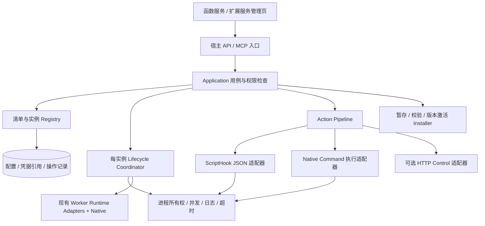
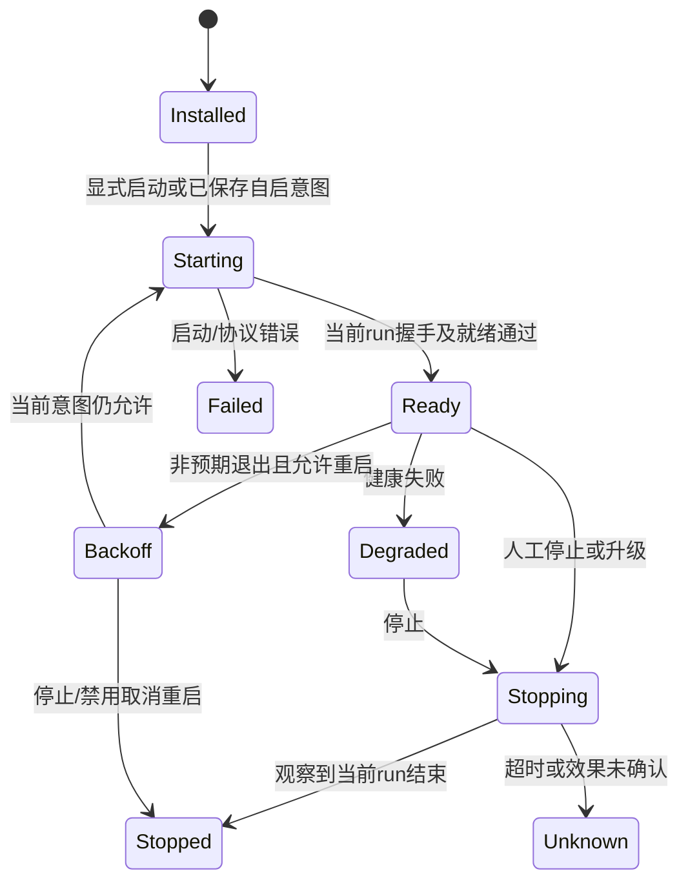

# 函数服务与脚本扩展：插件能力完善的可行性与设计

日期：2026-11-01。状态：调研设计，未实施。目标：单机/NAS、优先低占用，直接升级函数服务、脚本扩展与项目示例，为 Native 程序和后续 MCP Bridge 提供稳定宿主。

本次在当前对话内联完成，不使用子代理、不安装依赖、不启动外部服务。阅读配套：[当前问题与复用清单](plugin-platform-current-state-audit.md) · [库与行业方案比较](plugin-platform-libraries-and-industry.md)。已有 [MCP Bridge 计划](mcp-bridge-implementation-plan.md) 保留；本文建议先落实通用基础，不改变已经选定的 Go 单进程 Bridge 路线。

范围补充：把“原生工具封装为服务”作为正式交付能力，详见[原生工具服务化实施计划](native-tool-service-implementation-plan.md)与[文件范围和验收标准](native-tool-service-scope-and-acceptance.md)。本设计仍是文档；当前工作树已出现 Native/协议等未提交草稿，实施前需核验已有变更，不将类型声明视为已完成集成。

**用户已明确：项目尚未正式发布，不需要旧插件兼容。** 直接采用单一清单/动作契约，升级仓库内置示例，删除旧格式读取、legacy adapter、参数别名和迁移代码设计。此前文档的旧插件兼容要求在此范围内不再适用。无需兼容不等于可以默认删除现有数据或覆盖用户修改；本次没有执行重置或更新示例代码。

## 1. 结论与三种路线

**可行。推荐保留两种插件执行形态，共享一套新清单、调用结果、权限、安装更新和进程管理基础。** 当前核心是 .NET，不需要为了接入 Go 重写整个宿主，也不应要求普通后台程序全部实现 HTTP/JSON-RPC。

| 路线 | 收益 | 欠缺与成本 | 结论 |
|---|---|---|---|
| A：仅增加 Native | 最快托管 Go/Rust 预编译程序 | 生命周期、动作参数、假成功、导入边界等已有问题保留 | 可做小切片，不足以完成插件能力完善 |
| B：单一新契约 + 公共宿主能力 | 直接升级内置示例；语言与通信解耦，没有双轨代码 | 需要明确所有权、版本和更新事务 | **推荐** |
| C：全部采用 gRPC/WASM/完整插件框架 | 契约或受限执行环境更集中 | 工具链、依赖、程序改造与运维成本更高 | 暂不采用，按真实需求独立评估 |

当前保留：

- **Resident Worker**：宿主拥有常驻子进程，可用 Service/Daemon；运行时决定如何启动。
- **Hook Extension**：按动作启动脚本，动作结束后返回结果；脚本可以管理另一个外部服务，该服务不能被误当作宿主直接拥有的子进程。
- **Native Command Action**：直接执行已注册的原生工具，把类型化输入绑定到 argv/文件/stdin，宿主适配退出码、输出和产物，必要时作为有状态查询入口的异步任务。它属于扩展动作，不增加第三个独立管理平台。

共享的是产品契约和受控基础设施，不是把两个 Manager 合并成一个巨大 PluginManager。脚本运行错误与常驻进程崩溃也不能使用同一套自动重启规则。

## 2. 需要补齐的逻辑与性能缺口

本地证据见配套审计。优先问题包括：清单 ID/动作名与路径边界、停止/退出回调竞态、结果判定假成功、自定义参数丢失、覆盖安装数据保护、readiness 假绿、清单字段未完整生效、输出读取时无内存上界。

新增的设计风险还包括：

1. **协议不是安全边界**：HTTP、JSON-RPC、gRPC 都不会自动限制插件可读的文件或可执行的程序；同账户原生进程仍共享大量 OS 权限。
2. **探测会执行代码**：列插件时反复执行依赖命令和 status hook，可能造成延迟、额外进程和副作用；安装/扫描不应隐式执行新插件。
3. **多层重试会叠加**：宿主、插件内部、HTTP 库都重试时，写动作可能重复。默认不重试业务动作，连接恢复与业务重放分开。
4. **热更新不等于替换文件**：必须协调在途动作、旧进程、配置版本、数据目录与回滚；多文件复制不能被叫作原子切换。
5. **状态机不自动解决并发**：需要每实例串行化与 generation/runId；仅增加枚举或使用状态机库仍会出现旧回调污染新实例。
6. **容量限制需在采集时执行**：返回前截断、按日志行数限额、固定命令超时，都不能单独保证内存/FD/进程数量受控。

## 3. 推荐的分层与模式



| 模式 | 放置位置与用途 | 防止过度设计 |
|---|---|---|
| Adapter | IWorkerRuntimeAdapter 构造常驻启动规格；ScriptHook/NativeCommand/HTTP Control 统一动作输入输出 | 运行时适配器不负责每个插件的业务方法 |
| Strategy | 健康探测、停止方式、允许重试的只读操作、目录保留策略 | 非幂等动作不能因统一策略自动重试 |
| State Machine | 常驻实例生命周期；动作状态独立 | 终态和人工停止意图明确，不让错误无限重启 |
| Pipeline / Decorator | 权限→能力→Schema→配额→执行→结果判定→审计 | API/UI/MCP 进入同一用例，不能各自实现一套授权 |
| Registry + immutable snapshot | 解析后的清单、动作目录、运行代次；按 revision 发布 | 不缓存明文秘密，不让文件编辑直接改变在途目标 |
| Per-instance lock / mailbox | 一个实例的 Start/Stop/Update 串行；事件携带 runId | 不引入 Actor 集群；首版用 SemaphoreSlim/有界 Channel |
| Transaction / staging | 安装和版本激活，失败保留旧可用版本 | 不将普通文件复制包装成“事务成功” |

建议少量接口：现有 `IWorkerRuntimeAdapter` 保持职责；增加 `IPluginCommandAdapter`、`IPluginPackageStore`、`IProcessLauncher`/受限进程所有权接口。具体定义放 Contracts，编排在 Application，OS/文件/HTTP 在 Infrastructure，WebHost 只组合和映射。

## 4. 插件清单与身份契约

直接替换当前宽松、漏字段的手写解析方案，建立一套 typed manifest 与 strict Schema，升级所有内置示例。清单声明 `manifestVersion:1`、`hostApiVersion:1` 仅用于明确当前契约和拒绝未知版本，不实现多版本 reader、自动降级或旧字段别名。

建议统一身份为 `(kind,id)`，例如 `worker:demo-js-webhook`、`extension:caddy-server-manager`；两种插件历史上允许同名，不强行全球重命名。另有 `packageVersion`、`hostApiVersion`、`instanceId`、`runId`、`operationId`、`configRevision`；PID/端口不是持久身份。

单一新契约的逻辑结构示意（设计格式，不是现有可直接导入的 worker.json）：

```json
{
  "manifestVersion": 1,
  "kind": "worker",
  "id": "example-native",
  "hostApiVersion": "1",
  "execution": {
    "model": "resident",
    "runtime": "native",
    "entrypoint": "bin/example",
    "arguments": ["--config", "config/app.json"],
    "ownership": "child"
  },
  "control": {"transport": "http-json", "protocolVersion": 1},
  "actions": [{
    "name": "refresh",
    "mutates": true,
    "timeoutSeconds": 30,
    "inputSchema": {"type":"object","properties":{},"additionalProperties":false}
  }],
  "capabilities": {"network": true, "hostExecution": false},
  "storage": {"persistent": ["state/"]}
}
```

清单只**请求能力**；宿主单独保存授权 grant，插件不能通过修改自身清单给自己授权。动作名必须来自已发布目录；固定标准动作与自定义动作均有准确参数映射，不再把 `ip` 写死在通用执行器。

新 ID 使用受限单段字符，拒绝空值、`.`/`..`、路径分隔符、绝对路径、设备名、ADS、末尾点/空格等平台危险名称。无效清单直接返回定位到字段的错误，不静默重命名、猜测或创建兼容映射。

## 5. 宿主与插件如何通信

| 模式 | 推荐通信 | 能做什么 | 限制 |
|---|---|---|---|
| 普通 Resident Native | argv/env + stdout/stderr + exit | 托管、日志、端口、退出观察 | 无控制接口就不支持任意业务命令 |
| Managed Resident | loopback HTTP + JSON + 专用 token | handshake、health、invoke、drain/shutdown | 管理端点与用户业务端点分离 |
| Hook | stdin 一次 JSON 请求，stdout 一个 JSON 响应，stderr 日志 | 避免 shell 参数拼接、支持结构化结果 | 所有内置 hook 一并升级；单次调用不是持续 JSON-RPC 会话 |
| Native Command Action | 原始工具 argv/stdin/stdout/stderr，由宿主包装成统一动作结果 | 无需修改 ffmpeg、压缩器等工具源码即可提供服务 API | 工具原始 stdout 不要求遵守 Hook JSON；由声明的结果适配器解析 |
| 后续可选 stdio JSON-RPC | 正式 framing、ID 路由、取消/通知 | 多次请求、双向调用 | stdout 被协议独占，需额外流和并发管理 |

**首版选择：统一 Hook JSON + 可选 HTTP 管理，不强制 JSON-RPC。** HTTP 管理可以使用 JSON-RPC 作为载荷，但在动作很少时只增加复杂度。gRPC 留给确有流式/类型生成需求的插件，不据“二进制协议”推断它一定更快。删除通用执行器中的 ip 特判、字典值拼位置参数和从混合日志猜 JSON 的分支。

HTTP handshake 返回 `pluginIdentity/hostApiVersion/runId/capabilities`，宿主校验自己启动的当前实例。端口由宿主分配，目标固定 loopback，不接受浏览器提供任意代理 URL；每实例独立 token，不能转发宿主 JWT。控制 token 不经日志/普通配置/工具目录输出。

统一动作响应建议：

```json
{
  "protocolVersion": 1,
  "operationId": "op-example",
  "status": "succeeded",
  "data": {"updated":10},
  "error": null
}
```

正常动作成功要求：启动成功、未超时/未取消、退出码为 0（hook）、协议有效且业务结果成功。Hook 非 JSON、混合 stdout 日志或超大响应返回 ProtocolError/OutputLimitExceeded，不能回退到文本判成功，也不能在截断 JSON 后继续解析。无法可靠取得的 status 为 Unknown，而非用子串猜 Running。无控制接口的普通 Worker 不受 Hook JSON 输出要求约束，其 stdout 始终是普通日志。

Native Command 则按明确配置的 acceptedExitCodes（默认仅 0）、结果解析和产物校验判成功；不能要求未经修改的第三方工具输出 ExtensionHookResponse。Hook、原生命令和普通 Worker 的 stdout 角色互斥，不通过“尝试解析，不行当日志”猜测执行形态。

长动作可返回 `accepted + operationId`，后续查状态/取消；必须确认底层任务真实持久化或由明确的插件实例拥有。宿主记录 operationId 不代表任务已经实现重启恢复，更不能据 HTTP 断连自动重放写动作。

## 6. 生命周期与状态机



普通无 health/control 的程序显示 `ProcessRunning + readiness=Unsupported`，不强行停在 Starting，也不声称业务就绪。扩展管理外部 systemd/Docker 服务时，`ownership=external`，动作进程终止不等于外部服务已停；采用对应服务状态探测。

所有 Start/Stop/Update 与 Exited 回调检查当前 runId；先记录停止意图并取消待重启任务，再请求停止。正常停止顺序为停止接收新命令→等待在途动作→协议 shutdown/支持的信号→有界等待→强制清理→观察结果。Stop 返回值不能无条件 true。

实例锁只保护短时状态转换与 lease，不能持锁等待 HTTP、进程退出、hook 完成或整个 drain；异步等待后重新校验 runId，避免 Stop 等待的 Exit 回调也被同一锁阻塞。

Linux 进程组只有在创建和拥有该组时才能按负 PID 发信号，不能假定 PID 就是 PGID；优先已有 systemd/cgroup 托管能力或明确建立的组。Windows 可评估 Job Object 管理自有进程树，嵌套 Job/权限需验证。[systemd 清理语义](https://www.freedesktop.org/software/systemd/man/latest/systemd.kill.html)、[Windows Job Objects](https://learn.microsoft.com/en-us/windows/win32/procthread/job-objects)

原有 1/3/10/30 秒崩溃退避可保留，并加入抖动、停止意图和错误分类。认证/配置/不兼容程序不无限重启；外部 systemd/容器与 LWT 不同时拥有同一子进程的重启权。自动启动是独立持久意图，不能与 AutoRestart 混为一谈。

## 7. 安装、配置与升级

安装流水线：上传/抓取到受限 staging → 校验包大小/数量、manifest/ID、平台/入口/路径、链接、依赖 → 预览请求能力 → 明确授权 → 发布代码 → 按显式意图启动。**扫描、预览或安装不运行新插件的 status/install hook**；运行代码是另一个明确动作。

首版包限额建议：压缩包/展开总量各 512 MiB、单文件 256 MiB、最多 10,000 项、相对路径最多 1,024 字符；边读边计数，不仅信任 ZIP 声明。按目标平台判断大小写冲突，拒绝包内 symlink/reparse 和越界路径；最终安装路径还要独立受限，不能只校验 ZIP entries。SHA256 检查完整性，受信发布者需另有签名/信任策略。

从新契约开始使用 staging、不可变 `versions/<packageDigest>/`、独立 `state/`、`secrets/` 和 `current.json` 激活指针；同文件系统原子替换指针，新启动失败回退旧代码。不实现旧目录迁移器或双目录读取。源码示例与首次生成模板直接升级；现有开发数据如需重置，由明确的重装/重置操作执行，不在启动或扫描时自动删除。

新插件通过固定的状态/配置路径参数或 `LWT_PLUGIN_STATE_DIR`、`LWT_PLUGIN_CONFIG_PATH`、`LWT_PLUGIN_RUN_ID` 取得宿主提供的位置与身份；不将可变状态写回不可变代码目录。激活前核对同文件系统条件与峰值可用磁盘空间，磁盘不足保持当前版本。

同一 `(kind,id)` 更新期间拒绝冲突 Start/Invoke 或按明确 drain 策略处理。调用 lease 持有固定 packageGeneration；旧版本只在无在途引用时清理。配置/秘密/业务数据不与代码一起回滚；若包含不可逆数据迁移，应有独立升级方案，不宣称代码回退可恢复数据。

配置写入带 expectedRevision，原子提交，字段区分 keep/replace/clear。保存配置与 reload/apply 是两件事：写成功而 reload 失败时明确显示“已保存、未应用”，不能报告全流程成功。秘密使用独立 secretRef，UI 只返回 hasValue，不读取原始密码。

## 8. 权限与资源治理

复用现有 API Key 模块开关，在此之上增加 `(kind,id,action)` 能力检查，并约束管理/导入/更新/配置与业务调用。显示按钮不是授权边界；HTTP API、MCP、工作流都调用统一用例检查。直接升级示例、UI 和相关测试到新授权规则，不增加旧权限语义的回退通道；拒绝原因应清晰可见。

插件 OS 身份、文件、网络、hostExecution、secretRefs 是不同的授权维度。应用内检查只能约束通过宿主执行的动作；拥有原生执行权限的插件仍可直接访问其 OS 账户可访问的资源。强隔离需要低权限 OS 用户/容器/受控 WASM 等独立运行环境，不能靠 Adapter 或 token 宣称已沙箱化。

建议初始边界（需 NAS 实测后调整）：全局动作并发 4、每插件写动作串行、排队最多 16 项且最多等 2 秒；默认动作 30 秒，普通 health 3 秒，停止 drain 10 秒、总停止等待 15 秒。清单可在宿主许可范围内为特定动作显式调整期限，不按旧执行路径保留 12/15 秒的特殊规则。

输出采集只保留有界窗口：Hook 协议响应最多 256 KiB；普通日志单行最多 4 KiB、每实例缓存最多 1 MiB；持久日志轮转 2×8 MiB。达到保留上限后仍持续排空或按协议取消进程，避免管道反压死锁；所有字符串拼接与 UTF-8 解码也必须有界。结果截断与执行失败分开记录。

健康探测采用缓存/单飞：列表读取 snapshot，不每次发起全部 status；对已启用插件按需刷新，间隔初始 15 秒并加抖动，限制总探测并发 2。未安装/禁用插件不反复启动 runtime probe。无插件时不保留空转轮询器；不能让持有写锁的动作阻塞所有插件列表。

CPU/内存上限分成应用配额和 OS 限制；没有 cgroup/Job/容器能力时 UI 显示“仅监测、未强制”。内存报警后杀进程不是严格内存隔离。runtime 编译/依赖安装不在正常启动路径；Node/Python 应复用已声明环境，Native 运行无需 Go/Rust 编译器。

## 9. 性能验证与验收

不提供跨语言虚构跑分。先测当前基线，再在同 NAS、同插件与同负载比较：纯托管、脚本动作、managed HTTP、Native 常驻；统计宿主增量和全部子进程，不能只看某个进程 RSS。

工作集：空闲 15 分钟、10 个插件列表刷新、并发 1/4/8、单插件输出洪泛、status 卡死、停止/重启竞争、安装中断、24 小时稳定运行。记录 CPU 时间、PSS/cgroup、p50/p95、进程/FD 数、排队拒绝、日志保留字节和错误率。

候选门槛：缓存列表本地 p95 <100 ms，空闲额外 CPU <1 个逻辑核的 1%，24 小时无持续进程/FD/堆增长；停止在配置预算内结束或准确返回 Unknown/强杀结果。以上为设计验收目标，不是已测结果；外部慢服务响应不能被藏在本地延迟指标之外。

必测行为：停止后不自启、旧回调不影响新 run、参数精确送达、exit/协议/业务失败不被误报成功、reload 失败明确、更新保留数据、ID/链接不逃逸、秘密不回显、输出洪泛内存有界、权限在所有调用入口一致。具体缺陷与复用边界见[审计文档](plugin-platform-current-state-audit.md)。

## 10. 分阶段方案与文件归属

| 阶段 | 内容 | 交付与退出条件 |
|---|---|---|
| P0 正确性与单一契约 | 路径/ID/动作边界、typed manifest、stdin JSON/ActionResult、参数/结果、采集上限 | 同步更新三个扩展示例与测试，未知格式直接拒绝，没有兼容分支 |
| P1 Native 与受控宿主 | Native=6、argv、逐实例校验、runId、停止竞态、可观察 Stop、可选 health/shutdown | 五个函数示例同步新契约；预编译程序真实验证，不要求普通程序具备业务 HTTP |
| P2 管理能力 | Schema、secretRef、能力 grant、可选 HTTP Control | Hook 与 Managed Worker 各一条确定执行路径，示例完整闭环 |
| P3 安装更新 | staging、独立状态、版本激活、配置 revision、失败恢复 | 任意受控中断后保持一个明确可用代码版本，用户数据不丢 |
| P4 稳定性与生态 | 探测缓存、限额/审计、24h测试、示例 SDK | 至少 Hook 与 Native Managed 示例；再接 Go MCP Bridge |

修改归属：Workers/Services 现有 Contracts、Application 新增插件用例、Infrastructure 新增小型进程/包适配；WebHost Controller/mapper/JSON context/权限声明同步；前端保留当前函数/扩展入口，按能力显示管理按钮，不注入任意插件 JS。详细范围见配套审计清单。

本次不创建独立大平台，不强制新增 RPC 库、状态机库、数据库服务或 OS 守护进程。候选依赖先做 .NET 10 / Native AOT/跨平台的小验证，再决定是否引入；不靠调低门禁或复制私有执行器完成“复用”。

### 必须同步升级的项目示例

| 类型 | 源码位置/示例 ID | 升级目标 |
|---|---|---|
| 扩展包 | `extensions/sample-healthcheck/` | PowerShell/Bash status 使用统一 JSON 请求/响应，诊断写 stderr |
| 扩展包 | `extensions/ssh-access-guard/` | records/banned_list/ban_ip/unban_ip 等动作准确 Schema、ip 校验与能力授权；测试不得真实封禁用户连接 |
| 扩展包 | `extensions/caddy-server-manager/` | Node hooks 使用统一 JSON，外部服务 owner/health/错误明确；不把 JS 当 Bash 执行 |
| 扩展首次生成 | `ScriptExtensionManager.Defaults.cs` | 三个生成模板同步新契约，避免仓库包与内置生成包行为不一致 |
| 函数首次生成 | `WorkersManager.Defaults.cs`：demo-js-webhook、demo-py-api、demo-dotnet-service | 新清单、端口/状态/配置约定；需要 Managed 示例时显式声明 health/control，业务响应与管理接口分离 |
| 函数首次生成 | `WorkersManager.Defaults.cs`：demo-sh-daemon、demo-ps-daemon | 新清单、普通日志、停止信号/清理约定；不为无请求守护例子强制添加 HTTP |
| Native 验证例 | 匹配目标架构的测试 fixture/独立示例包 | 演示直接 executable + argv；不在首次启动时自动下载 Go 或现场编译，也不安装缺失 binary 的假 Running 示例 |

后续如抽取示例资源，应让模板只有一处权威来源并删除重复字面量，不保留两套协议。既有历史文档可保留说明，但正式使用文档和测试必须全部以新契约为准。

## 11. 原生工具封装为服务的正式范围

| 场景 | 用户配置与宿主动作 | 可交付结果 |
|---|---|---|
| 已有常驻服务/Daemon | 选择受信 executable、结构化 argv、cwd/env、端口与可选 health | 直接托管、启停/守护、日志、进程身份、业务访问地址；不强制实现管理协议 |
| 一次性原生工具 | 选择 command action、输入 Schema、固定 argv 模板、stdin 模式、结果/进度/产物适配器 | 无需用户手写包装脚本即可提供受控调用与 operationId 状态/取消；复杂业务仍可显式写 JSON Hook |
| 需要主动管理的常驻程序 | 声明独立 control、handshake、health、invoke、shutdown 能力及专用认证 | 统一动作调用和优雅停止；没有对应接口的程序不能被宣称可接收任意业务命令 |

程序来源区分 package 内文件与管理员明确登记的 system 程序。最终启动目标固定并验证，调用者不得提供 executable/任意 argv/cwd/环境变量；HTTP 参数仅按声明的类型绑定成独立参数。禁止 shell 字符串拼接；输入文件名的选项注入和 @response-file 行为按工具适配器约束，不把 ArgumentList 当作全部输入安全。

命令操作使用 queued/starting/running/succeeded/failed/cancelled/timedOut/unknown 独立状态。常驻进程才允许自动重启；一次性失败、取消、宿主异常中断不自动重跑业务。长任务及时返回 operationId；宿主重启后丢失确认的执行标为 unknown，不能仅凭 exit/文件存在推测已完成。

文件/二进制输出进入受限 operation 产物目录并返回 artifactId，不嵌入无限 Base64；下载须重新验证调用者权限和操作归属。进度解析器独立于结果解析器，进度到 100% 也不能替代退出和产物校验。PTY/GUI 工具、任意驱动/设备依赖以及强 OS 沙箱不是本次首版承诺。

## 12. 未决项与调研边界

仍需实际 NAS 架构/内存、部署账户、容器与宿主范围、现有插件清单及是否需要强隔离；这些影响限额和 OS owner 实现，不影响先修正确性缺陷。是否引入 JsonSchema.Net、CliWrap 或 Stateless 是实现验证后的选择，尚未获用户批准安装。

初次调研结论来自当时源码与一手资料，当时的相关 25 项测试已通过。本次补充计划时已观察到新的未提交代码草稿，尚未验证其接入程度；没有重复运行产品测试，不能将历史结果用于证明当前实现通过。未进行新缺陷动态复现、第三方库集成、Native AOT 发布或性能测试。
