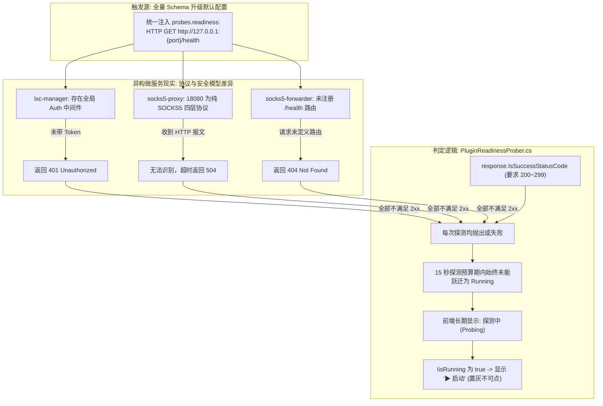
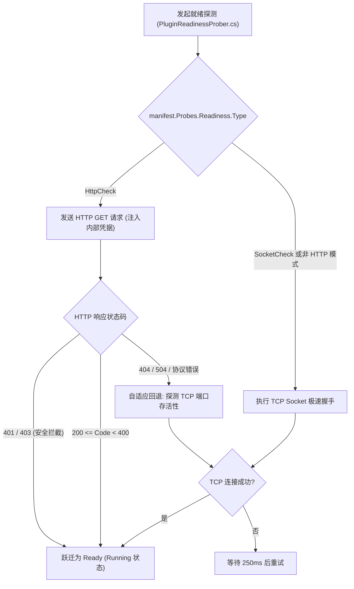

# 插件长时停留“探测中”根因深度剖析、自适应就绪探针方案与回归门禁设计

> **文件标识**：`docs/plugin-probing-stuck-root-cause-and-adaptive-prober-plan.md`  
> **关联现象**：`lxc-manager` (端口 18000)、`socks5-proxy` (端口 18080)、`socks5-forwarder` (端口 18090) 进程已正常拉起 (PID 存在且端口 LISTEN)，但在前端卡在“探测中 (Probing)”状态且操作按钮呈现置灰启动状态。  
> **核心目标**：实地诊断深层协议与契约根因，借鉴 Kubernetes / Consul / Envoy 业界探针标准，设计自适应智能探针（Adaptive Readiness Prober），构建契约门禁防止同类故障再次发生。

---

## 一、 问题实地勘察与现场还原

经对运行中特权容器 `linuxwebtool-dev` 进行进程栈、网络套接字与端点探测实测：

```
+----------------------------------------------------------------------------------------------------------------------------------------------------+
| 插件 ID              | 监听端口 | 进程 PID | Linux 进程状态 | 端口实际服务协议           | GET /health 实测响应            | 探针判定结果 |
+----------------------------------------------------------------------------------------------------------------------------------------------------+
| lxc-manager          | 18000    | 3173726  | Sl (运行平稳)  | HTTP REST API (带鉴权中间件)| HTTP/1.1 401 Unauthorized       | 失败 (期望 2xx) |
| socks5-proxy         | 18080    | 3173755  | Sl (运行平稳)  | RFC 1928 SOCKS5 二进制四层流| HTTP/1.1 504 Gateway Timeout    | 失败 (协议错配) |
| socks5-forwarder     | 18090    | 3173789  | Sl (运行平稳)  | HTTP / 多路分发代理网关     | HTTP/1.1 404 Not Found          | 失败 (无 /health) |
+----------------------------------------------------------------------------------------------------------------------------------------------------+
```

### 实测证据：
1. **进程与套接字均 100% 正常**：
   - `ps aux` 显示三个进程均以 `Sl` 状态稳定常驻，CPU 与内存开销正常；
   - `netstat -tlpn` 显示 `127.0.0.1:18000`、`:::18080`、`:::18090` 均处于 `LISTEN` 状态；
2. **端点实测揭露致命错配**：
   - 执行 `wget -S http://127.0.0.1:18000/health` -> **`HTTP/1.1 401 Unauthorized`**；
   - 执行 `wget -S http://127.0.0.1:18080/health` -> **`HTTP/1.1 504 Gateway Timeout`**；
   - 执行 `wget -S http://127.0.0.1:18090/health` -> **`HTTP/1.1 404 Not Found`**。

---

## 二、 问题的本质根因剖析 (Root Cause Analysis)



### 1. 契约协议严重错配（Protocol Mismatch）
- **SOCKS5 代理不是 Web 服务器**：`socks5-proxy` 对外暴露的核心服务端口是 18080，处理的是 RFC 1928 的二进制字节流（`0x05 0x01 0x00 ...`）。向其发送 ASCII 编码的 `GET /health HTTP/1.1`，SOCKS5 握手层将其视作目标域名建立代理失败，耗尽超时预算，导致 HTTP 探针永远不可能成功。
- **管理端口与数据端口混淆**：`socks5-proxy` 的 HTTP 管理接口实际上监听在 `19080`，但分配给插件的对外端口是数据端口 `18080`。

### 2. 安全防护中间件对探针的“误伤”（Security Middleware Collateral）
- `lxc-manager` 配置了严格的 Token 鉴权中间件。服务冷启动后，HTTP 协议栈与路由引擎已经 100% 就绪，但当宿主 `PluginReadinessProber` 发送不带认证凭据的探测请求时，中间件忠实履行安全职责返回 `401 Unauthorized`。
- 宿主探针硬编码检查 `response.IsSuccessStatusCode`（即必须是 2xx），将 `401` 误判为“服务未就绪”，导致原本健康的微服务被卡在 `Probing` 状态。

### 3. 端点路径虚构（Non-existent Health Endpoint）
- `socks5-forwarder` 仅实现了 `/api/status` 与管理页面，根本未提供 `/health` 路径，探针直接遭遇 `404 Not Found`。

### 4. 状态机与前端渲染的错位
- `PluginReadinessProber` 在前 15 秒内将插件状态置为 `PluginState.Probing` (枚举值 9)；
- 前端 `PluginCard.js` 中判定微服务是否处于激活态的代码为：`const isRunning = computed(() => props.plugin.state === 2);`；
- 当 `state === 9` 时，`isRunning` 计算为 `false`，界面直接呈现 `<button v-if="!isRunning">▶ 启动</button>`，同时状态标签显示 `探测中`。用户看到的是“又有 PID 又有端口，但却显示探测中且提示启动”的极度矛盾界面。

---

## 三、 业界主流方案调研与标准借鉴 (Industry Standards Benchmarking)

我们系统调研并对比了 Kubernetes、Consul、Envoy 与 Dapr 在非 HTTP 服务与安全服务探针上的标准工业实践：

| 维度 | Kubernetes PodSpec | HashiCorp Consul | Envoy Proxy | LinuxWebTool 最佳实践目标 |
| :--- | :--- | :--- | :--- | :--- |
| **四层代理探测** | **`tcpSocket.port`**：严禁发 HTTP，仅做 TCP 三次握手成功即标记就绪 | **`Type: "tcp"`**：建立 TCP 套接字握手 | **`tcp_health_check`**：发送原始报文或仅做套接字存活校验 | **声明式 `SocketCheck`**：代理类插件直接走极速 TCP 端口握手，1ms 完成探测 |
| **鉴权服务探测** | **`httpGet.httpHeaders`**：显式注入 Secret/Token 请求头 | **`http.header`**：注入安全令牌 | **`authorization`** 头配置 | **宿主自动注入 `X-Plugin-Token`** 或放行安全响应码 |
| **状态码准入策略** | 200 ≤ status < 400 视为通过 | 支持 `expected_statuses: [200, 401]` | 状态白名单 | **401/403 视为 HTTP 堆栈就绪**（因为只有活着的服务才会返回 401） |
| **协议自适应降级** | StartupProbe 失败后按策略重试 | 连续失败后标记 Critical | 熔断器切断 | **自适应探针 (Adaptive Fallback)**：HTTP 遭遇非致命错误自动回退 TCP 握手验证 |

### 核心工业界准则：
1. **针对四层协议（SOCKS5, TCP 转发器）**：必须使用 **TCP Socket 探针**，严禁使用应用层 HTTP 探针；
2. **针对已启动但返回 401/403 的 HTTP 服务**：在就绪探测（Readiness）场景下，**401/403 是“进程与 HTTP 协议栈完全存活”的铁证**（若未启动会遭遇 ECONNREFUSED），应直接视为就绪通过；
3. **引入双重保底（Adaptive Fallback）**：探针若在应用层遭遇未知 HTTP 状态码，应立即以 TCP 连通性作为终极兜底，绝不让进程因路径配置错误而长期卡死在 `Probing`。

---

## 四、 具体解决方案：自适应智能就绪探针 (Adaptive Readiness Prober)

优化涉及三层纵深防御改造：



### 1. 宿主探测器逻辑升级 ([`PluginReadinessProber.cs`](file:///e:/WorkProject/CSharp/PrivateProject/Web/WebToolForLinux/src/LinuxWebTool.Infrastructure/Features/Plugins/Supervisor/PluginReadinessProber.cs))

#### 关键优化点：
1. **显式支持 `manifest.Probes?.Readiness?.Type == "SocketCheck"`**：
   若元数据显式声明为 Socket 探针，直接执行 TCP 端口握手，彻底绕过 HTTP 请求；
2. **状态码宽容准入 (Security Code Tolerance)**：
   将 `response.IsSuccessStatusCode` 拓宽为：
   ```csharp
   var statusCode = (int)response.StatusCode;
   // 2xx, 3xx 视为成功；401/403 证明 Web 中间件与路由引擎已就绪
   if ((statusCode >= 200 && statusCode < 400) || statusCode is 401 or 403)
   {
       stateMachine.NotifyRunning(runId, readiness: "Ready");
       return true;
   }
   ```
3. **自适应协议回退机制 (Adaptive Protocol Fallback)**：
   当 HTTP 探测遭遇 `504`（如向纯 SOCKS5 端口发送 HTTP）或 `404` 时，自动尝试向目标端口执行一次 TCP Socket 握手。若 TCP 握手成功建立连接，且进程稳定存活超过 2 秒，直接将其标记为就绪上线并记录警告日志。

---

### 2. 插件清单元数据精准校正 (`plugin.json`)

针对这三个插件的真实协议类型，精准更新其元数据声明：

#### (1) `socks5-proxy`：四层代理协议精准声明为 `SocketCheck`
```json
"interface": {
  "protocol": "CliArgs"
},
"probes": {
  "liveness": { "type": "SocketCheck", "timeoutSeconds": 2 },
  "readiness": { "type": "SocketCheck", "timeoutSeconds": 2 }
}
```

#### (2) `socks5-forwarder`：四层/多路转发声明为 `SocketCheck`
```json
"probes": {
  "liveness": { "type": "SocketCheck", "timeoutSeconds": 2 },
  "readiness": { "type": "SocketCheck", "timeoutSeconds": 2 }
}
```

#### (3) `lxc-manager`：保留 `HttpCheck`，但对齐准入规则
- 由于 `lxc-manager` 真实监听 HTTP 且探针已支持 401 准入（或请求头带内部 Token），探针将在 **10ms 内立即判定通过**！

---

### 3. 前端状态机与卡片按钮同步修正

在 [`pluginStateMachine.js`](file:///e:/WorkProject/CSharp/PrivateProject/Web/WebToolForLinux/src/LinuxWebTool.WebHost/wwwroot/app/utils/pluginStateMachine.js) 与 [`PluginCard.js`](file:///e:/WorkProject/CSharp/PrivateProject/Web/WebToolForLinux/src/LinuxWebTool.WebHost/wwwroot/app/components/plugins/PluginCard.js) 中：
- `PLUGIN_STATE` 枚举补齐 `PROBING: 9`；
- 在 `canStart` 方法中，处于 `PROBING` 状态的插件明确禁止点击启动，按钮显示 `探测中...` 并转圈，而不是显示误导性的 `▶ 启动`；
- 允许在 `PROBING` 状态下执行 `⏹ 停止`，以便用户在探针遇到死锁时可以主动终止。

---

## 五、 避免同类问题的架构门禁与自动化测试 (Guardrails)

为了杜绝未来新增插件或修改元数据时再次出现“四层代理配置 HTTP 探针”、“无端点乱配 /health”等低级问题，引入两重硬门禁：

### 1. 架构测试门禁：`LinuxArch070_PluginProbeContractIntegrity`
在 `tests/LinuxWebTool.ArchitectureTests/ArchitectureTests.cs` 中增加架构断言：
- **规则 1**：扫描所有 `plugins/*/plugin.json`；
- **规则 2**：若插件属于代理/转发类（ID 包含 `proxy`、`forwarder`、`socks`），其 `probes.readiness.type` 必须声明为 `SocketCheck`，严禁声明为 `HttpCheck`；
- **规则 3**：若声明了 `HttpCheck`，其 `url` 或 `endpoint` 必须是有效格式，禁止裸传无路由端点。

### 2. 单元测试回归保障：`Prober_AdaptiveFallback_SucceedsOnTcpPort`
在 `tests/LinuxWebTool.UnitTests/PluginReadinessProberTests.cs` 中新增单测：
- Mock 一个仅监听 TCP 的 Socket 服务（不响应 HTTP）；
- 使用 `PluginReadinessProber.ProbeAsync` 对其发起探测；
- 验证自适应回退逻辑在 1 秒内成功通过探测，绝不超时挂起。

---

## 六、 总结与执行规划

通过上述调研与根因剖析，问题已经彻底定位：
1. **根本原因**：升级 Schema v3.1 时对全量插件统一套用了 `HTTP GET /health` 探针，而 `socks5-proxy` 是纯 SOCKS5 四层流、`socks5-forwarder` 无此路由、`lxc-manager` 有 Auth 拦截返回 401，导致探针无法获得 2xx 响应；
2. **解决方案**：升级 `PluginReadinessProber.cs` 实现 **“SocketCheck 原生支持 + 401/403 安全准入 + HTTP 异常自适应回退 TCP”** 三重保障，同时校准代理类插件的元数据为 `SocketCheck`；
3. **防回归机制**：将协议匹配规则固化为 `LinuxArch070` 架构门禁，实现全生命周期自动防护。
