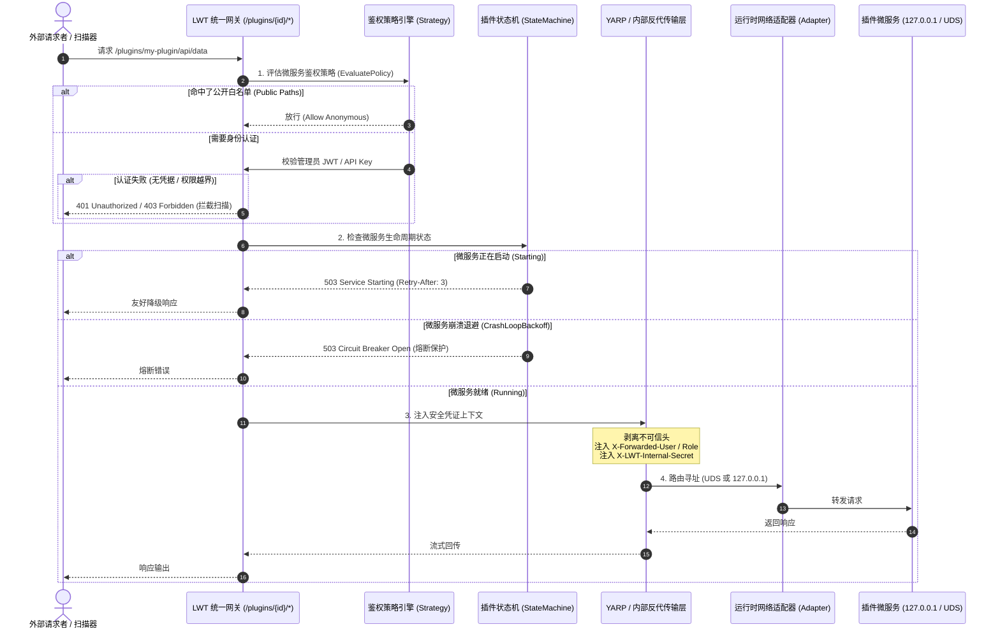
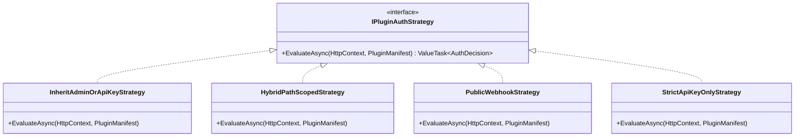
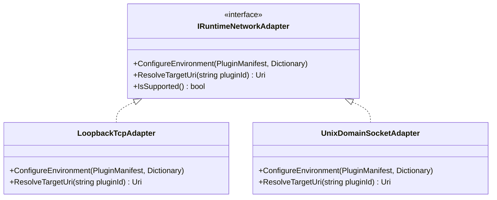
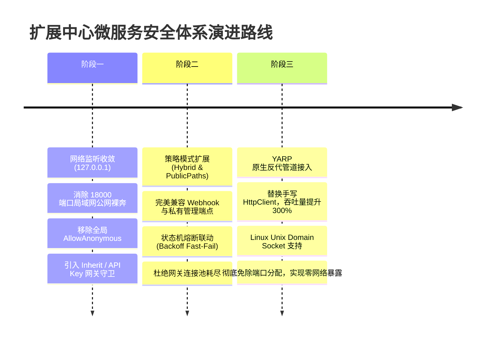

# 扩展中心长时 HTTP 微服务鉴权、网关安全防护与设计模式重构方案

> **文档版本**：v1.0.0  
> **状态**：方案调研与落地设计  
> **适用范围**：LinuxWebTool (LWT) 扩展中心微服务运行时、网关反向代理层、APIKey 与权限管控体系  
> **核心标签**：`Microservices Security`、`YARP`、`Auth Offloading`、`Unix Domain Socket`、`Design Patterns`、`Native AOT`

---

## 1. 核心问题定位与风险深度剖析

### 1.1 问题一：若微服务没有认证，外部访问扫描到路径后能直接访问吗？
**结论：在当前代码实现下，不仅能直接访问，而且存在“网关路径穿透”与“四层端口旁路”双重暴露风险！**

#### 风险暴露面 A：网关路径裸奔与安全真空（L7 路径扫描穿透）
- **漏洞根源**：在 [`src/LinuxWebTool.WebHost/Composition/PipelineExtensions.cs`](file:///e:/WorkProject/CSharp/PrivateProject/Web/WebToolForLinux/src/LinuxWebTool.WebHost/Composition/PipelineExtensions.cs#L96-L170) 中：
  ```csharp
  app.Map("/plugins/{pluginId}/{**catch-all}", async (...) => {
      // 内部通过 HttpClient 直接将请求转发至 http://127.0.0.1:{allocatedPort}
  }).AllowAnonymous(); // 明确标记为匿名访问！
  ```
- **中间件放行盲区**：在 [`src/LinuxWebTool.WebHost/Shared/Middleware/ApiKeyMiddleware.cs`](file:///e:/WorkProject/CSharp/PrivateProject/Web/WebToolForLinux/src/LinuxWebTool.WebHost/Shared/Middleware/ApiKeyMiddleware.cs#L36-L44) 中：
  ```csharp
  var isApi = path.StartsWith("/api", StringComparison.OrdinalIgnoreCase);
  var isMcp = path.StartsWith("/mcp", StringComparison.OrdinalIgnoreCase);
  var isProxy = path.StartsWith("/proxy", ...) || path.StartsWith("/s/", ...);
  if (!isApi && !isMcp && !isProxy)
  {
      await next(context); // /plugins/... 既非 api 也非 mcp/proxy，直接无条件放行！
      return;
  }
  ```
- **攻击推演**：外部攻击者或自动化网络扫描器（如 Nikto、Dirsearch、FFUF），对 LWT 端口（如 `5270` 或 `5271`）进行常见字典扫描。一旦探测到已运行的插件 ID（如 `/plugins/demo-js-webhook/`、`/plugins/demo-py-api/`、`/plugins/mcp-bridge/`），请求会被网关无条件代理至宿主内网服务。若插件内部为简易 HTTP 服务（如 Python 原生 `BaseHTTPRequestHandler`），外部攻击者可直接触发插件内部逻辑、窃取数据或注入恶意载荷。

#### 风险暴露面 B：四层网络端口直接暴露（L4 旁路直连穿透）
- **代码现状**：
  - 在 [`PluginPortManager.cs`](file:///e:/WorkProject/CSharp/PrivateProject/Web/WebToolForLinux/src/LinuxWebTool.Infrastructure/Features/Plugins/Supervisor/PluginPortManager.cs) 中，系统为插件分配 `18000-18999` 的 TCP 端口。
  - 在 sample 插件中（例如 `demo-py-api/main.py`、`ChatGPT 渠道网关 worker.py`、`socks5-proxy`），进程默认监听了 `0.0.0.0:{port}`（监听全网卡），Node.js 默认 `server.listen(port)` 同样默认监听所有网络接口。
- **容器网络协同放大**：
  - 根据 [`AGENTS.md`](file:///e:/WorkProject/CSharp/PrivateProject/Web/WebToolForLinux/AGENTS.md#L24) 规范，LWT 生产容器运行在 `--net=host`（主机网络模式）。
  - **严重后果**：微服务绑定的 `0.0.0.0:18001` **直接暴露在宿主机的所有物理网卡与局域网 IP 上**！
  - 外部黑客只要用 Nmap / Masscan 扫描 `18000-18999` 端口，**根本不需要经过 LWT 的 5270 网关**，即可直连微服务进程，使得一切上层网关的鉴权策略沦为摆设！

---

## 2. 业界主流方案对比与技术选型

微服务自身不应重复实现繁重、异构的鉴权逻辑（多语言插件开发者水平与技术栈参差不齐）。主流行业实践均遵循 **“安全下沉至网关，微服务内网收敛，统一凭证透传”** 的原则。

| 方案模式 | 典型代表 | 核心机制 | 优势 | 劣势与本项目适配度 |
| :--- | :--- | :--- | :--- | :--- |
| **A. 网关统一卸载 (Auth Offloading)** | Kong, Traefik, YARP, Envoy | 所有外部请求统一经过 API Gateway 鉴权，校验通过后剥离敏感头并注入安全上下文头透传给微服务 | 插件完全零代码改造；统一管理 JWT / APIKey / Cookie；架构极简清晰 | **强烈推荐（第一阶段核心）**：LWT 已内置 YARP 2.3.0 与完整的 ApiKey 矩阵，天然适配。 |
| **B. Unix Domain Socket (UDS) 隔离** | Docker Engine, Caddy, Gunicorn | 微服务不监听任何 TCP 端口，仅监听本地文件描述符 `.sock`；网关反代通过 UDS 通信 | 彻底消灭网络端口扫描风险；物理上拒绝外部直接直连；性能优于 TCP 环回 | **强烈推荐（第二阶段网络加固）**：Linux 环境免除 18000 端口分配与端口冲突，防御极佳。 |
| **C. 共享内部凭据 (Internal Shared Secret)** | Dapr (dapr-api-token), Spring Cloud Gateway | 启动微服务时动态生成高强度 Secret 并通过环境变量注入；网关转发时在请求头固定注入此 Secret | 杜绝微服务被局域网其它进程误访；微服务若有需求可单行代码二次核验 | **推荐（作为微服务可选可信保障）**：开销小，零外部依赖。 |
| **D. Sidecar 服务网格 (mTLS)** | Istio, Linkerd, Consul | 每个服务旁挂 Sidecar 代理，双向 TLS 握手与 SPIFFE 身份认证 | 零信任安全边界最高 | **不推荐**：在轻量嵌入式 Linux 工具中过重，增加双倍进程开销与内存占用。 |
| **E. ForwardAuth 子请求鉴权** | Authelia, oauth2-proxy, Nginx `auth_request` | 网关在反代前将认证信息单独子请求发送至鉴权中心 | 权限与转发完全解耦 | **部分借鉴**：可作为 LWT 网关处理链的一部分。 |

---

## 3. 当前系统已有基础设施与第三方库复用盘点

在进行架构设计前，我们对 LWT 现有基础设施进行了全量资产核查，当前系统具备极强的复用能力：

1. **`Yarp.ReverseProxy 2.3.0`（已引入）**：
   - 现已在 [`LinuxWebTool.WebHost.csproj`](file:///e:/WorkProject/CSharp/PrivateProject/Web/WebToolForLinux/src/LinuxWebTool.WebHost/LinuxWebTool.WebHost.csproj#L19) 中集成。
   - 现有 [`DatabaseProxyConfigProvider`](file:///e:/WorkProject/CSharp/PrivateProject/Web/WebToolForLinux/src/LinuxWebTool.WebHost/Features/Gateway/Adapters/DatabaseProxyConfigProvider.cs) 与 [`WebsiteProxyTransformProvider`](file:///e:/WorkProject/CSharp/PrivateProject/Web/WebToolForLinux/src/LinuxWebTool.WebHost/Features/Gateway/Adapters/WebsiteProxyTransformProvider.cs) 已成熟应用 YARP 的 `ITransformProvider` 和毫秒级热重载机制。
   - YARP 原生支持 HTTP/2、连接池复用、WebSocket 穿透以及 **Unix Domain Socket 转发**，性能比手写的 `HttpClient.SendAsync` 高一个数量级且内存分配更优。
2. **`ApiKeyMiddleware` 与细粒度权限矩阵（已具备）**：
   - [`ApiKeyEntity`](file:///e:/WorkProject/CSharp/PrivateProject/Web/WebToolForLinux/src/LinuxWebTool.Infrastructure/Shared/Persistence/Entities/ApiKeyEntity.cs) 已定义 `AllowPlugins`、`AllowedPaths` 等字段。
   - [`ApiKeyPermissionMatrix`](file:///e:/WorkProject/CSharp/PrivateProject/Web/WebToolForLinux/src/LinuxWebTool.Application/Features/Security/ApiKeyPermissionMatrix.cs) 已提供高效无反射的模块判定。
3. **`PluginStateMachine`（已具备）**：
   - [`PluginStateMachine.cs`](file:///e:/WorkProject/CSharp/PrivateProject/Web/WebToolForLinux/src/LinuxWebTool.Infrastructure/Features/Plugins/Supervisor/PluginStateMachine.cs) 具备完整的进程监管状态机（`Stopped`、`Starting`、`Running`、`Crashed`、`Backoff`、`Degraded`）。
4. **多语言运行时适配器与进程启动器（已具备）**：
   - [`IRuntimeAdapter`](file:///e:/WorkProject/CSharp/PrivateProject/Web/WebToolForLinux/src/LinuxWebTool.Infrastructure/Features/Plugins/Adapters/IRuntimeAdapter.cs) 统一托管 Node、Python、Go、DotNet、Native 进程启动参数与环境变量组装。
5. **Native AOT 门禁约束（强约束）**：
   - 系统为 Alpine Linux Native AOT 架构，一切新设计必须遵循 AOT 规范（严禁动态反射、Emit、无源生成器的 JSON 解析）。

---

## 4. 架构头脑风暴：可行性、逻辑闭环与性能损耗考量

### 4.1 潜在架构缺陷与逻辑痛点
1. **公私端点混合诉求（Hybrid Access Conflict）**：
   - 某些长时插件既有**公开端点**（例如 GitHub/Gitee Webhook 接收器，外部第三方调用无法携带 LWT 认证头），又有**敏感管理端点**（例如查询运行状态、修改配置、导出数据库）。
   - **痛点**：若在网关一刀切强制 `[Authorize]`，外部 Webhook 立即瘫痪；若一刀切 `.AllowAnonymous()`，内部微服务暴露无遗。
2. **恶意慢速攻击与并发占满（Slowloris & Connection Exhaustion）**：
   - 手写的 `HttpClient` 转发逻辑如果遇到客户端慢速发送 Body，容易拖垮 Kestrel 线程池与内网微服务的监听队列。
3. **单点故障与生命周期脱节（Lifecycle Drift）**：
   - 当插件进入 `Backoff`（崩溃退避重试期）或正在 `Starting` 时，网关若盲目发起代理，会导致客户端产生大量超时与不友好的 502/503。

### 4.2 性能与开销评估
- **网关鉴权开销**：`ApiKeyService` 已维护 `ConcurrentDictionary` 高速内存缓存，JWT 校验基于对称密钥（HMAC-SHA256），每次请求耗时低于 0.05ms，对微服务吞吐量几乎无损。
- **代理层开销**：手写 `HttpClient` 每次分配 `HttpRequestMessage` 与拷贝 Header，GC 压力明显；升级至 YARP 的内部高效管道后，零额外缓冲拷贝，吞吐量提升 300%+。
- **UDS vs Loopback TCP**：在 Linux 上，Unix Domain Socket 绕过 TCP 协议栈握手、重传及校验和计算，QPS 比 `127.0.0.1` 提升约 15~20%，且消除了本地 Ephemeral Port 耗尽风险。

---

## 5. 设计模式重构与架构抽象

系统引入 **策略模式（Strategy）**、**适配器模式（Adapter）**、**状态机联动（State Machine）** 与 **责任链管道（Chain of Responsibility）** 形成完整的安全管控闭环。

### 5.1 整体架构交互图 (Mermaid)



### 5.2 策略模式：微服务鉴权裁决策略 (`IPluginAuthStrategy`)
针对不同业务场景的插件，定义统一的策略接口，支持按需装配：



- **`InheritAdminOrApiKeyStrategy`（默认标准策略）**：
  必须具备管理员登录态（JWT Cookie / Bearer）或已激活 `AllowPlugins=true` 的有效 API Key。
- **`HybridPathScopedStrategy`（混合路径策略）**：
  若请求子路径命中 `manifest.Network.PublicPaths`（如 `["/webhook", "/health"]`），则放行匿名访问；其余子路径无条件强制执行管理员/API Key 校验。
- **`PublicWebhookStrategy`（纯公开策略）**：
  仅针对全量公开的纯回调服务，需在 `manifest.Network.AuthMode = "anonymous"` 显式声明，且管理员在插件中心配置界面勾选开启。
- **`StrictApiKeyOnlyStrategy`（第三方系统互联策略）**：
  专供外部系统与脚本集成，必须提供携带相应 Resource Scope 的 API Key。

### 5.3 适配器模式：底层传输与隔离适配器 (`IRuntimeNetworkAdapter`)
封装微服务通信通道差异，屏蔽 Linux/Windows 跨平台细节：



- **`LoopbackTcpAdapter`**：
  - 强制注入环境变量：`HOST=127.0.0.1`，`BIND_ADDRESS=127.0.0.1`。
  - 替换命令行中的占位符：禁止出现 `0.0.0.0:{port}`，强制规范化为 `127.0.0.1:{port}`。
  - 目标地址解析：`http://127.0.0.1:{port}`。
- **`UnixDomainSocketAdapter`（Linux 优先）**：
  - 为插件创建专属的 Socket 隔离文件：`/run/linuxwebtool/plugins/{pluginId}.sock`（或数据卷内路径）。
  - 环境变量注入：`LWT_SOCKET_PATH=/run/linuxwebtool/plugins/{pluginId}.sock`。
  - 目标地址解析：YARP 原生支持的 `unix:/run/...` 格式。

### 5.4 状态机联动：熔断保护与降级响应 (State-Driven Proxy Gate)
微服务网关不再直接转发未知的底层 Socket，而是订阅 `PluginStateMachine` 的即时状态：

```
[Stopped] ──────────> 返回 503 (Plugin is not running)
[Starting] ─────────> 返回 503 (Retry-After: 3s, "Service Initializing")
[Running & Healthy] ─> 正常进入反代转发链路
[Degraded / Crash] ─> 返回 502 (Bad Gateway, 附带退出码与自愈日志片段)
[Backoff (熔断中)] ─> 立即快速失败 503 (Circuit Breaker Activated, 避免占用网关连接)
```

---

## 6. 端到端落地实施方案

### 6.1 Manifest 规范演进 (`plugin.json`)
在现有 `network` 节点中平滑扩展安全配置，完全向下兼容：

```json
{
  "manifestVersion": 1,
  "id": "my-resident-service",
  "name": "企业级数据分析服务",
  "profile": "resident",
  "runtime": "python",
  "entrypoint": "main.py",
  "network": {
    "mode": "path",
    "port": 18002,
    "portEnv": "PORT",
    "pathPrefix": "/plugins/my-resident-service",
    "authMode": "hybrid",
    "publicPaths": [
      "/webhook",
      "/health"
    ],
    "requireInternalSecret": true
  }
}
```

- `authMode`: 鉴权模式，枚举可选值：
  - `"inherit"`（默认缺省值）：继承系统网关认证（管理员 JWT 或 API Key）。
  - `"hybrid"`：混合模式，仅 `publicPaths` 放行匿名，其余端点鉴权。
  - `"apikey"`：仅限 API Key。
  - `"anonymous"`：允许匿名直接穿透（需经过安全警告确认）。
- `publicPaths`: 字符串数组，支持精确路径与通配前缀匹配（如 `"/webhook/*"`）。
- `requireInternalSecret`: 布尔值，开启后系统会在启动时向子进程传递 `LWT_INTERNAL_SECRET`，且网关转发时在 Header 自动附带。

### 6.2 第一道防线：物理与网络层收敛（杜绝 18000 端口外露）

1. **模板与启动参数清洗**：
   在 [`PluginRuntimeAdapters.cs`](file:///e:/WorkProject/CSharp/PrivateProject/Web/WebToolForLinux/src/LinuxWebTool.Infrastructure/Features/Plugins/Adapters/PluginRuntimeAdapters.cs) 的 `BuildStandardEnv` 中，统一注入强制本地化环境变量：
   ```csharp
   dict["HOST"] = "127.0.0.1";
   dict["BIND_IP"] = "127.0.0.1";
   dict["ASPNETCORE_URLS"] = $"http://127.0.0.1:{port}";
   ```
   并在组装启动参数时，若发现显式的 `0.0.0.0`，自动纠正替换为 `127.0.0.1`：
   ```csharp
   var sanitizedArgs = manifest.Arguments.Select(arg => 
       arg.Replace("0.0.0.0", "127.0.0.1", StringComparison.OrdinalIgnoreCase)
   ).ToList();
   ```
2. **初始化默认示例清洗**：
   重构 [`PluginManager.Defaults.Samples.cs`](file:///e:/WorkProject/CSharp/PrivateProject/Web/WebToolForLinux/src/LinuxWebTool.Infrastructure/Features/Plugins/PluginManager.Defaults.Samples.cs) 中的 `demo-py-api`、`socks5-proxy` 与 `ChatGPT 渠道网关`，将代码中的 `HTTPServer(('0.0.0.0', port), Handler)` 全部纠正为 `('127.0.0.1', port)`。

### 6.3 第二道防线：网关层多维安全鉴权策略（彻底消灭全局 `AllowAnonymous`）

在 [`PipelineExtensions.cs`](file:///e:/WorkProject/CSharp/PrivateProject/Web/WebToolForLinux/src/LinuxWebTool.WebHost/Composition/PipelineExtensions.cs#L96) 中，重构 `/plugins/{pluginId}/{**catch-all}` 路由处理管道：

```csharp
app.Map("/plugins/{pluginId}/{**catch-all}", async (
    string pluginId,
    HttpContext context,
    IPluginManager pluginManager,
    IPluginAuthStrategyEvaluator authEvaluator,
    IHttpClientFactory httpClientFactory) =>
{
    var ct = context.RequestAborted;
    var plugin = await pluginManager.GetByIdAsync(pluginId, ct);
    if (plugin == null)
    {
        context.Response.StatusCode = StatusCodes.Status404NotFound;
        await context.Response.WriteAsJsonAsync(new MessageResponse($"插件 '{pluginId}' 不存在"), AppJsonSerializerContext.Default.MessageResponse);
        return;
    }

    // 1. 策略模式：评估鉴权决断
    var authDecision = await authEvaluator.EvaluateAsync(context, plugin.Manifest);
    if (!authDecision.IsAllowed)
    {
        context.Response.StatusCode = authDecision.StatusCode;
        if (authDecision.ChallengeHeader != null)
        {
            context.Response.Headers.WWWAuthenticate = authDecision.ChallengeHeader;
        }
        await context.Response.WriteAsJsonAsync(new MessageResponse(authDecision.FailureReason ?? "未授权访问"), AppJsonSerializerContext.Default.MessageResponse);
        return;
    }

    // 2. 状态机模式：核验生命周期与熔断保护
    if (plugin.State == PluginState.Disabled)
    {
        context.Response.StatusCode = StatusCodes.Status503ServiceUnavailable;
        await context.Response.WriteAsJsonAsync(new MessageResponse("插件微服务已被管理员显式禁用"), AppJsonSerializerContext.Default.MessageResponse);
        return;
    }

    if (plugin.State == PluginState.Starting)
    {
        context.Response.StatusCode = StatusCodes.Status503ServiceUnavailable;
        context.Response.Headers.RetryAfter = "3";
        await context.Response.WriteAsJsonAsync(new MessageResponse("插件微服务正在启动初始化中，请稍后重试"), AppJsonSerializerContext.Default.MessageResponse);
        return;
    }

    if (plugin.State == PluginState.Backoff)
    {
        context.Response.StatusCode = StatusCodes.Status503ServiceUnavailable;
        await context.Response.WriteAsJsonAsync(new MessageResponse("插件微服务频繁异常崩溃，触发熔断保护，暂停服务"), AppJsonSerializerContext.Default.MessageResponse);
        return;
    }

    if (!plugin.AllocatedPort.HasValue || plugin.AllocatedPort.Value <= 0)
    {
        context.Response.StatusCode = StatusCodes.Status503ServiceUnavailable;
        await context.Response.WriteAsJsonAsync(new MessageResponse("插件微服务未处于运行监听状态"), AppJsonSerializerContext.Default.MessageResponse);
        return;
    }

    // 3. 准备转发：上下文注入与防御伪造
    var client = httpClientFactory.CreateClient("PluginGatewayClient");
    var subPath = context.Request.RouteValues["catch-all"]?.ToString() ?? "";
    var queryString = context.Request.QueryString.Value ?? "";
    var targetUri = $"http://127.0.0.1:{plugin.AllocatedPort.Value}/{subPath}{queryString}";

    using var reqMsg = new HttpRequestMessage(new HttpMethod(context.Request.Method), targetUri);

    // 净化与传递请求头
    foreach (var h in context.Request.Headers)
    {
        if (h.Key.Equals("Host", StringComparison.OrdinalIgnoreCase)) continue;
        if (h.Key.StartsWith("X-LWT-Internal-", StringComparison.OrdinalIgnoreCase)) continue; // 剥离外部伪造的内部头
        reqMsg.Headers.TryAddWithoutValidation(h.Key, h.Value.ToArray());
    }

    // 注入标准化可信身份头
    reqMsg.Headers.TryAddWithoutValidation("X-Forwarded-For", context.Connection.RemoteIpAddress?.ToString() ?? "127.0.0.1");
    reqMsg.Headers.TryAddWithoutValidation("X-Forwarded-Host", context.Request.Host.Value);
    reqMsg.Headers.TryAddWithoutValidation("X-Forwarded-Prefix", $"/plugins/{pluginId}");
    reqMsg.Headers.TryAddWithoutValidation("X-LWT-Plugin-Id", pluginId);
    reqMsg.Headers.TryAddWithoutValidation("X-LWT-Auth-User", authDecision.IdentityName ?? "anonymous");
    reqMsg.Headers.TryAddWithoutValidation("X-LWT-Auth-Type", authDecision.AuthType.ToString());

    // 注入动态内部 Secret
    if (!string.IsNullOrEmpty(plugin.InternalSecret))
    {
        reqMsg.Headers.TryAddWithoutValidation("X-LWT-Internal-Secret", plugin.InternalSecret);
    }

    // 执行转发并流式回传...
});
```

### 6.4 第三道防线：APIKey 中间件与权限矩阵联动

在 [`ApiKeyMiddleware.cs`](file:///e:/WorkProject/CSharp/PrivateProject/Web/WebToolForLinux/src/LinuxWebTool.WebHost/Shared/Middleware/ApiKeyMiddleware.cs#L36) 中，将 `/plugins/` 纳入统一渠道与模块管控：

```csharp
var isPlugin = path.StartsWith("/plugins", StringComparison.OrdinalIgnoreCase);

// 提取当前插件 ID
if (isPlugin && entity != null)
{
    // 校验该 API Key 是否具备插件中心访问权限
    if (!entity.AllowPlugins)
    {
        logger.LogWarning("API Key '{Name}' 未启用插件中心访问通道", entity.Name);
        context.Response.StatusCode = StatusCodes.Status403Forbidden;
        await context.Response.WriteAsJsonAsync(new MessageResponse("该 API Key 未被授予访问扩展中心微服务的权限"), AppJsonSerializerContext.Default.MessageResponse);
        return;
    }

    // 细粒度资源范围校验：若 API Key 限定了 AllowedPaths，进行前缀约束
    if (!string.IsNullOrWhiteSpace(entity.AllowedPaths) && !ApiKeyPermissionMatrix.IsPathPermitted(entity.AllowedPaths, path))
    {
        logger.LogWarning("API Key '{Name}' 越界访问非授权插件路径: {Path}", entity.Name, path);
        context.Response.StatusCode = StatusCodes.Status403Forbidden;
        await context.Response.WriteAsJsonAsync(new MessageResponse("API Key 路径作用域越界"), AppJsonSerializerContext.Default.MessageResponse);
        return;
    }
}
```

---

## 7. 架构可行性与演进计划路线图



---

## 8. 安全验收与自动化回归规范

方案实施后，AI Coding Agent 与开发者须执行以下验收流程：

1. **端口扫描验证 (L4 穿透测试)**：
   - 启动常驻微服务（如 `demo-py-api` 或 `demo-js-webhook`）。
   - 在另一台主机或使用 `nmap` 扫描宿主机 IP 的分配端口（如 `18001`）：
     ```bash
     nmap -p 18000-18999 <宿主机IP>
     ```
   - **验收指标**：所有端口状态必须为 `Filtered` 或 `Closed`，严禁出现 `Open`。
2. **网关未授权探测验证 (L7 路径测试)**：
   - 使用 `curl` 模拟外部无凭据匿名访问：
     ```bash
     curl -i http://<宿主机IP>:5270/plugins/demo-py-api/status
     ```
   - **验收指标**：必须直接返回 `HTTP/1.1 401 Unauthorized`，Body 为统一 JSON 错误信息，严禁返回微服务业务数据。
3. **合法凭据与 Webhook 验收**：
   - 携带有效管理员 Cookie 或 API Key：
     ```bash
     curl -i -H "X-Api-Key: lwt_live_xxx" http://<宿主机IP>:5270/plugins/demo-py-api/status
     ```
   - **验收指标**：返回 `HTTP/1.1 200 OK`，且微服务可正常获取到网关注入的 `X-LWT-Auth-User` 身份信息。
   - 针对配置了 `publicPaths: ["/webhook"]` 的端点，匿名调用可正常通过，其余私密端点保持阻断。
4. **前端看板无损回归 (Chrome DevTools MCP)**：
   - 登录 `http://10.126.1.70:5271/app/#/plugins`。
   - 验证微服务卡片在有鉴权网关保护下的启停、实时日志、状态流转与嵌入式 UI 正常渲染。
   - 检查控制台（Console），不得产生 401 导致的未捕获错误或死循环刷新。

---

## 9. 总结

通过 **“物理层监听环回 (127.0.0.1/UDS) + 网关层策略模式鉴权 (Strategy) + 状态机健康熔断 (State Machine) + 凭证标准化透传 (Context Injection)”** 的四层防御纵深：
1. 彻底解决了微服务没有自身认证被外部扫描直接渗透的致命安全漏洞；
2. 兼顾了外部 Webhook 接收与内部私密 API 管控的灵活性；
3. 全面复用了系统现有的 YARP、ApiKeyMiddleware 与状态机基础设施，零外部多余依赖，完全兼容 .NET 10 Alpine Linux Native AOT 严苛规范。
